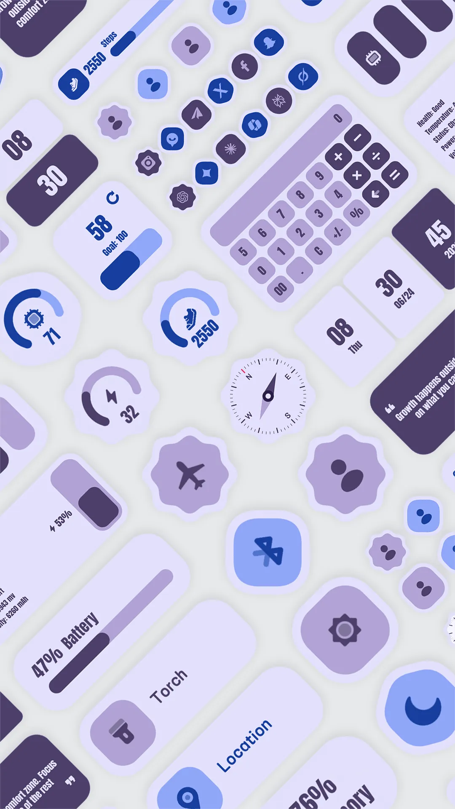

Skrin utama Android adalah kekuatan utamanya, dan [widget skrin utama](/ms/glossary/what-is-a-home-screen-widget/) adalah cara Anda menjadikannya milik Anda. Panduan 2026 ini membincangkan apa yang harus dicari pada aplikasi widget dan bagaimana One Widget dibandingkan dengan KWGT dan WidgetSmith. Baik Anda menyebutnya **widget Android**, **widget tersuai** atau **aplikasi widget**, daftar pendek yang sama berlaku — dan pada 2026, banyak carian tersebut secara spesifik menargetkan **widget Android 2026**.

## Apa yang orang sebut

**Widget skrin utama** Android dikenal dengan beberapa nama — widget Android, widget tersuai, pembuat widget, dan aplikasi widget — dan setiap label menunjuk kepada tugasan yang sedikit berbeza. Mencari **aplikasi widget Android terbaik** atau **widget Android 2026** biasanya bermaksud pustaka pratetap **500+ widget** seperti One Widget, bukan kanvas kosong seperti **pembuat widget Android** KWGT yang memakan masa tetapan. **Aplikasi widget** pula sering bermaksud satu instalasi yang merangkumi jam, kalendar, bateri, dan toggle. Senarai berikut memetakan setiap label kepada maksudnya:

- **Widget Android** / **widget skrin utama** / **widget tersuai** — label umum untuk apa pun yang Anda taruh di peluncur. Mencari **aplikasi widget Android terbaik** atau **widget Android 2026** biasanya berarti pustaka jadi, bukan kanvas kosong.
- **Pembuat widget Android** — sebuah builder tempat Anda melukis widget sendiri (KWGT adalah acuannya). Ini kebalikan dari pustaka pratetap, dan memakan waktu tetapan.
- **Aplikasi widget** — sering berarti permintaan akan satu aplikasi yang merangkumi jam, kalendar, bateri, dan toggle dan bukannya lima instalasi satu fungsi.

Kata gaya juga menjadi carian: **widget Material You** mengikuti palet wallpaper, **widget kaca Android** / **widget gaya iOS Android** meniru paparan tembus pandang iOS, **widget Nothing** sesuai dengan estetika dot-matrix Nothing, dan **widget Samsung One UI** sesuai dengan gaya bawaan Galaxy. One Widget menyediakan keempatnya sebagai pratetap, itulah sebabnya ia muncul di kedua perbandingan "pembuat" dan "jadi" di bawah.

## Mengapa aplikasi widget skrin utama penting di Android

**One Widget** menjadikan **[widget skrin utama](/ms/glossary/what-is-a-home-screen-widget/)** sebagai kelas utama di Android dengan meletakkan jam, toggle, dan shortcut aplikasi terus ke skrin utama, disokong tema mendalam yang sesuai dengan tiga skin popular — Galaxy, Pixel, dan Nothing. Sifat Android yang terbuka membenarkan widget duduk bersebelahan dengan peluncur dan bertindak sebagai pintasan satu ketik, manakala widget iOS lebih terhad dan sandbox. Itulah sebabnya perbandingan merentas platform di sini condong ke Android: pada 2026, kebanyakan carian **widget Android 2026** menargetkan pustaka pratetap yang boleh disesuaikan tanpa membina dari nol.

## Apa yang harus dicari pada aplikasi widget skrin utama

Sebuah **[aplikasi widget skrin utama](/ms/glossary/what-is-a-home-screen-widget/)** yang baik dinilai dari enam kriteria: variasi gaya yang merangkumi empat tema popular — Glass iOS, Material You, Galaxy One UI, dan Nothing — pelarasan mendalam pada saiz dan warna, quick toggle dan shortcut, info langsung, sokongan pelbagai peranti, serta satu aplikasi untuk banyak widget. **One Widget** memenuhi kesemua kriteria itu dengan **500+ widget** pratetap yang boleh diubah saiznya dari 1x1 hingga 2x6. Senarai berikut menghuraikan setiap kriteria.

- **Variasi gaya** — Glass iOS, Material You, Galaxy One UI, dan Nothing serta lain-lain, supaya widget sesuai dengan peluncur Anda.
- **Pelarasan mendalam** — ukuran, warna, radius sudut, dan apa yang sebenarnya dipaparkan widget.
- **Quick toggle & shortcut** — Wi-Fi, Bluetooth, senter, dan shortcut aplikasi satu ketik dari skrin utama.
- **Info terus** — widget jam, kalendar, bateri, RAM yang memperbarui di tempat.
- **Belanjepan peranti** — berfungsi di Galaxy, Pixel, Nothing, dan skin Android lain-lain.
- **Satu aplikasi, banyak widget** — hindari memasang beberapa aplikasi widget satu fungsi.

## Daftar sekilas

Tiga aplikasi dalam senarai 2026 ini mewakili tiga pendekatan widget: **One Widget** (berbayar sekali) menawarkan **500+ widget** dan empat gaya untuk Android sahaja, **KWGT** (percuma + Pro Key ~$4,99) adalah editor widget tersuai yang memerlukan anda membina setiap widget sendiri, dan **WidgetSmith** (percuma + langganan) hanya untuk iOS. Jadual di bawah membandingkan harga, platform, dan kegunaan terbaik supaya anda boleh memilih berdasarkan peranti dan kesediaan untuk melakukan tetapan.

| App | Harga (2026) | Platform | Terbaik untuk / catatan |
|---|---|---|---|
| **One Widget** | Aplikasi berbayar (sekali bayar) | Hanya Android | 500+ widget, 4 gaya, quick toggle, shortcut aplikasi |
| **KWGT** | Percuma + Pro Key ~$4,99 | Hanya Android | Editor widget tersuai sepenuhnya, namun Anda membangun setiap widget sendiri (DIY) |
| **WidgetSmith** | Percuma + langganan | Hanya iOS | Widget bertema iOS; tidak ada versi Android |

## One Widget, secara mendalam

**One Widget** adalah pakej widget untuk Android yang memuat **500+ widget** boleh disesuaikan dalam **empat gaya** — Glass iOS, Material You, Galaxy One UI, dan Nothing — tanpa perlu menulis skrip atau membina widget dari nol. Setiap pratetap boleh diubah saiznya dari 1x1 hingga 2x6, dengan warna latar ikon dan radius sudut yang boleh dilaras mengikut tema; quick toggle Wi-Fi, Bluetooth, dan senter serta shortcut aplikasi dan kontak juga disediakan. Widget jam, kalendar, bateri, dan RAM dikemas kini secara langsung, dan kesemua skin Android popular disokong dalam satu instalasi.

{: width="180" .normal }
{: width="180" .normal }
{: width="180" .normal }
{: width="180" .normal }
{: width="180" .normal }

One Widget memuat 500+ widget skrin utama Android yang dapat disesuaikan dalam gaya Glass iOS, Material You, Galaxy One UI, dan Nothing, plus shortcut aplikasi dan quick toggle.

- **500+ widget premium** — empat gaya trend dalam satu aplikasi, tanpa editor.
- **Pelarasan penuh** — ukuran dari 1x1 hingga 2x6, warna latar ikon, dan radius sudut supaya sesuai dengan tema Anda.
- **Quick toggle** — Wi-Fi, Bluetooth, senter, rotasi, DND, dan lain-lain terus dari widget.
- **Shortcut aplikasi & kontak** — peluncur satu ketik di skrin utama.
- **Widget info terus** — jam, kalendar, bateri, dan RAM yang memperbarui terus.
- **Semua peranti Android** — Galaxy, Pixel, dan Nothing didukung.

**Terbaik untuk:** pengguna Android yang menginginkan toolkit widget serba ada yang bergaya.

Lebih dalam:
- [Aplikasi widget Android terbaik](/ms/posts/best-one-widget-android/)
- [Widget Material You terbaik](/ms/posts/best-one-widget-material-you/)
- [Halaman aplikasi One Widget](/ms/apps/one-widget/)
- [Panduan Pengguna Resmi One Widget](/ms/posts/tutorial-one-widget/)

## Bagaimana One Widget dibandingkan dengan kompetitor

**One Widget** dibezakan daripada dua pesaingnya oleh gabungan **500+ widget** pratetap dalam empat gaya dan sokongan Android-asli, berbanding **KWGT** yang memberi fleksibiliti penuh tetapi memerlukan anda membina setiap widget dari nol, dan **WidgetSmith** yang hanya wujud untuk iOS. Perbandingan ini penting kerana kebanyakan pengguna mahukan widget yang siap dipasang dengan cepat, bukan kanvas kosong yang memakan masa tetapan. Butiran setiap perbandingan, termasuk pilihan lain untuk bekas pengguna WidgetSmith, disenaraikan di bawah.

- **vs KWGT** — KWGT paling fleksibel jika Anda suka membangun widget dari nol, namun fleksibilitas itu perlu tenaga — kebanyakan orang ingin widget jadi dengan cepat. One Widget menyediakan 500+ widget jadi dalam empat gaya. Butiran lengkap di [One Widget vs KWGT](/ms/posts/vs-one-widget-and-kwgt/).
- **vs WidgetSmith** — WidgetSmith adalah jawaban iOS untuk widget tersuai dan tidak punya build Android, jadi bukan pilihan untuk audiens ini; One Widget adalah pilihan asli Android.
- **Pilihan lain** — lihat [Alternatif WidgetSmith Terbaik (Android) di 2026](/ms/posts/alternatives-to-widgetsmith/) untuk daftar lengkap.

## Mana yang harus Anda pilih?

Pilihan antara tiga aplikasi ini bergantung pada peranti dan jumlah tetapan yang sanggup anda lakukan. **One Widget** sesuai untuk pengguna Android yang mahukan **500+ widget** pratetap dalam empat gaya terus dipasang; **KWGT** (Pro Key ~$4,99) untuk mereka yang mahu membina setiap widget dari nol; **WidgetSmith** pula hanya untuk pengguna iPhone kerana tiada versi Android. Senarai berikut memetakan setiap situasi kepada pilihan yang tepat, termasuk keperluan quick toggle dan shortcut pada satu skrin.

Pilihan cepat berdasarkan situasi:

- Ingin widget jadi yang cantik dengan cepat → One Widget.
- Suka DIY dan ingin kendali penuh → KWGT (Pro Key).
- Di iPhone dan ingin widget bertema → WidgetSmith.
- Ingin quick toggle + shortcut aplikasi dalam satu skrin → One Widget.

## Senario umum

Lima senario harian menunjukkan di mana **One Widget** memberi nilai paling jelas dengan **500+ widget** dan empat gayanya: skrin utama yang rapi dan bertema, quick toggle satu ketik, shortcut aplikasi dan kontak, satu aplikasi untuk pelbagai peranti, serta pratetap jadi tanpa perlu kerja DIY yang rumit. Dalam setiap kes, widget terus siap dipasang dan boleh diubah saiznya dari 1x1 hingga 2x6 tanpa menyentuh editor. KWGT kekal sesuai hanya jika anda mahu membina setiap elemen sendiri.

- **Skrin utama yang rapi dan bertema** — pilih gaya Glass iOS, Material You, One UI, atau Nothing, lalu taruh 500+ widget jadi (jam, kalendar, bateri) tanpa menyentuh editor.
- **Quick toggle satu ketik** — Wi-Fi, Bluetooth, dan senter terus dari skrin utama, sehingga Anda berhenti menggali tetapan.
- **Shortcut aplikasi & kontak** — luncurkan Chrome, Maps, atau kontak kegemaran dari satu widget, tanpa masuk folder.
- **Satu aplikasi, banyak widget** — Galaxy, Pixel, dan Nothing semua tercover; tidak perlu memasang beberapa aplikasi widget satu fungsi.
- **Tanpa DIY, tanpa langganan** — widget jadi terus siap pakai; versi percuma merangkumi widget bertema One UI, gaya lain dibuka dengan sekali bayar.

## FAQ

**Apakah One Widget percuma?**
{:.faq-q}

One Widget adalah aplikasi berbayar. Versi percuma merangkumi widget bertema One UI yang dapat diubah ukuran dan warnanya; gaya Glass iOS, Material You, dan Nothing dibuka melalui pembelian sekali bayar.

**Gaya widget apa yang ditawarkan One Widget?**
{:.faq-q}

Empat gaya trend 2026 — Glass iOS, Material You (peka wallpaper), Galaxy One UI, dan Nothing minimalis — tersebar di 500+ widget.

**Peranti apa yang mendukung One Widget?**
{:.faq-q}

Semua peranti Android, termasuk Samsung Galaxy, Google Pixel, dan telefon pintar Nothing.

**One Widget atau KWGT — mana yang harus saya pilih?**
{:.faq-q}

Ingin 500+ widget jadi bertema dengan cepat, tanpa editor → One Widget; ingin membangun setiap widget dari nol dengan kendali penuh → KWGT (Pro Key).

## Kesimpulan

Bagi pengguna Android yang menginginkan toolkit widget serba ada yang bergaya tanpa skrip DIY, One Widget adalah pilihan paling lengkap — dan ini aplikasi berbayar sekali bayar.

- [Google Play — One Widget](https://play.google.com/store/apps/details?id=com.glgjing.galaxy.nothing.glass.material.widget)

Atau baca [Aplikasi widget Android terbaik](/ms/posts/best-one-widget-android/) untuk butiran lengkap.

## Istilah berkaitan

- [Widget Skrin Utama Android: Cara Pasang dan Sesuaikan](/ms/glossary/what-is-a-home-screen-widget/)
- [Material You: Cara Tukar Warna Tema Android Anda](/ms/glossary/what-is-material-you/)
- [Nothing UI: Ciri Reka Bentuk dan Widget Gaya Kaca](/ms/glossary/what-is-nothing-ui/)
- [Galaxy One UI: Ciri, Perbezaan, dan Widget yang Disokong](/ms/glossary/what-is-galaxy-one-ui/)
- [iOS Glass: Gaya Kaca Widget dan Cara Menirunya](/ms/glossary/what-is-ios-glass/)
