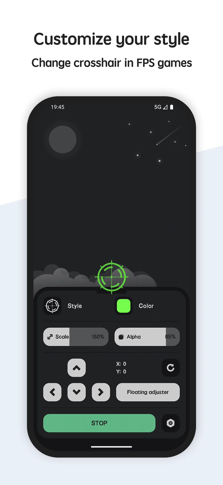

Game FPS mobile tidak selalu memberi Anda bidik silang yang Anda suka — atau sama sekali tidak ada. Sebuah [overlay bidik silang](/ms/glossary/what-is-a-crosshair/) memperbaikinya, dan panduan 2026 ini membincangkan apa yang dicari dan bagaimana Crosshair Aim dibandingkan alternatifnya. Jika Anda ingin **aplikasi bidik silang terbaik Android**, Anda memilih alat **custom crosshair Android** untuk penggunaan **bidik silang FPS** — sebuah **bidik silang untuk PUBG Mobile**, COD Mobile, dan shooter lain-lain — dengan **tanpa root**.

## Mengapa aplikasi overlay bidik silang penting di Android

**Crosshair Aim** menjadikan overlay bidik silang penting di Android kerana ia duduk di atas game **tanpa root**, memberikan titik sasaran presisi pada mana-mana shooter dengan **80+ gaya** yang boleh disesuaikan. Pada skrin sentuh tanpa tetikus untuk mengarah, retikel tersuai mengisi kekosongan apabila sesuatu senjata atau mod tidak menyertakannya. Dua perkara paling penting: overlay kekal di atas permainan tanpa menjatuhkan frame rate, dan ia selamat daripada anti-cheat kerana hanya bersifat visual — tidak menyentuh memori atau data game. Itulah sebabnya **aplikasi bidik silang terbaik Android** diukur dari prestasi, bukan sekadar bilangan gaya.

## Apa yang orang sebut

Satu overlay yang sama dikenal dengan beberapa nama — **bidik silang skrin**, **bidik silang android**, **bidik silang untuk game**, atau sekadar **aplikasi bidik silang** — dan semuanya menunjuk kepada retikel yang anda kawal, dilukis di atas mana-mana game tanpa root. **Crosshair Aim** menjawab carian **aplikasi bidik silang terbaik android 2026** mahupun **bidik silang untuk game penembakan android percuma** dengan **80+ gaya** tersuai untuk PUBG Mobile, COD Mobile, dan shooter lain. Sama ada anda mahukan **custom crosshair Android** untuk **bidik silang FPS** atau sekadar titik tengah asas, senarai semak di bawah terpakai kepada kesemua label ini. Kesemua nama itu merujuk kepada satu tugasan: menggambar retikel yang anda kawal di atas game tanpa root.

## Apa yang dicari di aplikasi overlay bidik silang

Sebuah **[overlay bidik silang](/ms/glossary/what-is-a-crosshair/)** yang baik dinilai daripada enam perkara: pelbagai gaya retikel, pelarasan saiz dan warna, sokongan pelbagai game, prestasi overlay tanpa lag, pratetap per senjata, serta pilihan percuma berbanding pro. **Crosshair Aim** memenuhi senarai ini dengan **80+ reka bentuk** — titik, lingkaran, dan tanda — yang sepenuhnya boleh disesuaikan dan disimpan sebagai pratetap per game. Overlay ringan kekal di atas tanpa menjatuhkan frame rate atau memicu anti-cheat kerana bersifat visual semata-mata. Enam kriteria utama:

- **Gaya bidik silang** — titik, lingkaran, tanda, dan bentuk dinamis, bukan hanya satu retikel statik.
- **Pelarasan** — ukuran, warna, ketebalan, dan posisi untuk mencocokkan kontrol dan senjata Anda.
- **Dukungan game** — bekerja lintas shooter popular, bukan hanya satu judul.
- **Prestasi overlay** — tetap di atas tanpa lag atau memicu masalah anti-cheat.
- **Pratetap per senjata** — simpan bidik silang per game supaya tidak setel ulang setiap sesi.
- **Percuma vs pro** — berapa banyak gaya percuma dan apa yang ditambahkan buka pro.

## Lapangan sekilas

Tiga aplikasi dalam senarai 2026 mewakili tiga pilihan bidik silang: **Crosshair Aim** (percuma + buka Pro, Android sahaja) menawarkan **80+ gaya** dan overlay boleh dikustom; **Crosshair Hero** (percuma + Pro, Android sahaja) bersaing rapat dengan pustaka besar dan editornya; **Crosshair X** (percuma + Pro) hanya untuk iOS. Jadual di bawah membandingkan harga, platform, dan kegunaan terbaik supaya anda boleh memilih antara gaya siap pakai, editor mendalam, dan retikel khas iPhone.

| Aplikasi | Harga (2026) | Platform | Terbaik untuk / catatan |
|---|---|---|---|
| **Crosshair Aim** | Muat turun percuma, teras percuma + buka Pro | Hanya Android | 80+ gaya, overlay boleh dikustom, semua shooter |
| **Crosshair Hero** | Percuma + Pro | Hanya Android | Pustaka bidik silang besar dan editor, saingan terus terdekat |
| **Crosshair X** | Percuma + Pro | iOS | Overlay bidik silang iOS; tidak ada versi Android |

## Crosshair Aim, lebih dalam

**Crosshair Aim** adalah **[overlay bidik silang](/ms/glossary/what-is-a-crosshair/)** untuk game shooter FPS di Android dengan **80+ reka bentuk** — titik, lingkaran, dan tanda — yang terus dipaparkan di atas permainan tanpa root. Setiap retikel boleh diubah saiz, warna, dan kedudukannya mengikut kontrol serta gaya main anda, dan pratetap per game membolehkan pertukaran segera antara senjata atau judul berbeza. Overlay ringan kekal di atas tanpa merosakkan frame rate, dan kerana ia hanya visual serta tidak menyentuh memori game, ia selamat daripada anti-cheat. Set gaya asas percuma; **buka Pro** membuka pustaka penuh **80+** dan pelarasan lebih dalam.

{: width="180" .normal }
{: width="180" .normal }
{: width="180" .normal }
{: width="180" .normal }

Crosshair Aim Pro menambahkan overlay bidik silang tersuai ke game shooter FPS di Android, dengan 80+ gaya untuk memperbaiki aim Anda di game penembakan apa pun.

- **80+ reka bentuk bidik silang** — titik, lingkaran, tanda, dan lain-lain, diterapkan sebagai overlay terus.
- **Sepenuhnya boleh dikustom** — ukuran, warna, dan posisi untuk mencocokkan kontrol dan gaya main Anda.
- **Semua shooter didukung** — buat bidik silang bahkan untuk senjata yang tidak memilikinya.
- **Pratetap per game** — simpan bidik silang untuk setiap judul dan beralih instan.
- **Overlay ringan** — tetap di atas tanpa merusak prestasi.
- **Percuma untuk bermula** — gaya dasar termasuk; Pro membuka pustaka lengkap.

**Terbaik untuk:** pemain FPS mobile yang ingin bidik silang presisi dan boleh dikustom.

Lebih dalam:
- [Bidik silang terbaik untuk game FPS](/ms/posts/best-cross-hair-fps/)
- [Aplikasi overlay bidik silang terbaik](/ms/posts/best-cross-hair-overlay/)
- [Halaman aplikasi Crosshair Aim](/ms/apps/cross-hair/)
- [Panduan Resmi Pengguna Crosshair Aim](/ms/posts/tutorial-cross-hair/)

## Bagaimana Crosshair Aim dibandingkan pesaing

**Crosshair Aim** dibezakan daripada dua pesaingnya oleh **80+ reka bentuk** siap pakai dengan setup ringan dan cepat pada Android. **Crosshair Hero** adalah saingan terdekat dengan pustaka besar dan editor sendiri, tetapi memerlukan lebih banyak pelarasan; **Crosshair X** pula hanya tersedia untuk iOS dan di luar pilihan untuk audiens Android. Perbandingan ini penting kerana retikel siap pakai menjimatkan masa berbanding membina setiap gaya dari awal, tanpa mengorbankan prestasi overlay. Butiran setiap perbandingan, termasuk alternatif untuk bekas pengguna Crosshair Hero, disenaraikan di bawah.

- **vs Crosshair Hero** — Crosshair Hero adalah saingan terus terdekat dengan pustaka besar dan editornya sendiri; Crosshair Aim menyainginya pada gaya dan mengandalkan setup lebih sederhana, lebih cepat dengan 80+ reka bentuk siap pakai. Butiran lengkap di [Crosshair Aim vs Crosshair Hero](/ms/posts/vs-crosshair-and-crosshair-master/).
- **vs Crosshair X** — Crosshair X adalah pilihan iOS dan tidak punya build Android, sehingga di luar pilihan untuk audiens ini; Crosshair Aim adalah pilihan Android-asli.
- **Pilihan lain** — lihat [Alternatif Crosshair Hero Terbaik di 2026](/ms/posts/alternatives-to-crosshair-master/) untuk lapangan penuh.

## Mana yang harus dipilih?

Pilihan antara tiga aplikasi ini bergantung pada peranti dan jumlah pelarasan yang sanggup anda buat. **Crosshair Aim** sesuai untuk overlay presisi dengan **80+ gaya** siap pakai di mana-mana shooter Android; **Crosshair Hero** (Pro) untuk mereka yang mahu editor mendalam; **Crosshair X** pula hanya untuk pengguna iOS. Jika anda hanya mahu titik tengah asas dengan cepat, set gaya percuma Crosshair Aim sudah memadai. Senarai berikut memetakan setiap situasi kepada pilihan yang tepat.

Pilihan cepat berdasarkan situasi:

- Ingin overlay presisi di shooter Android mana pun → Crosshair Aim.
- Ingin editor dalam dan tidak keberatan utak-atik → Crosshair Hero (Pro).
- Di iOS → Crosshair X.
- Hanya perlu titik tengah dasar dengan cepat → gaya percuma Crosshair Aim.

## Senario umum

Lima senario harian menunjukkan di mana **Crosshair Aim** memberi nilai paling jelas dengan **80+ gaya** dan overlay ringannya: apabila sesuatu senjata tiada retikel, apabila senjata berbeza memerlukan pratetap berbeza, pada peta visibilitas rendah, untuk mengekalkan frame rate, dan untuk kekal selamat daripada anti-cheat. Dalam setiap kes, anda menukar gaya atau warna dalam satu ketik tanpa menyentuh data game, dan overlay kekal di atas tanpa memakan prestasi. Retikel tersuai ini hanya visual, jadi ia tidak mengubah memori atau tingkah laku permainan. Butiran setiap senario disenaraikan di bawah.

- **Tidak ada bidik silang bawaan** — sebahagian senjata atau mode tidak menyertakan retikel; letakkan yang tersuai supaya Anda selalu punya titik aim.
- **Senjata beda, kebutuhan beda** — simpan pratetap per game atau per senjata dan beralih dalam satu ketik dan bukannya setel ulang.
- **Map visibilitas rendah** — pilih warna dan ketebalan kontras tinggi supaya retikel tetap kelihatan di adegan gelap atau terang.
- **Pertahankan frame rate** — overlay ringan dan tetap di atas tanpa menjatuhkan FPS, sehingga bantuan aim tidak memakan prestasi.
- **Selamat by design** — ini overlay hanya visual yang tidak menyentuh memori atau data game, sehingga selamat dari anti-cheat.

## FAQ

**Apakah Crosshair Aim percuma?**
{:.faq-q}

Ya. Set gaya dasar percuma; buka Pro membuka pustaka 80+ lengkap dan pelarasan lebih dalam.

**Crosshair Aim atau Crosshair Hero — mana yang harus saya pilih?**
{:.faq-q}

Ingin 80+ reka bentuk siap pakai dengan setup ringan dan cepat → Crosshair Aim; ingin editor dalam dan tidak keberatan menyesuaikan → Crosshair Hero (Pro).

**Apakah Crosshair Aim berjalan di iOS?**
{:.faq-q}

Tidak. Crosshair Aim hanya untuk Android; pengguna iOS boleh melihat Crosshair X, yang tidak punya build Android.

**Apakah selamat / apakah saya akan dibanned?**
{:.faq-q}

Ini overlay hanya visual yang tidak mengubah data atau memori game, sehingga tidak memicu anti-cheat. Gunakan dalam aturan fair-play setiap game.

## Kesimpulan

Untuk pemain FPS mobile yang ingin bidik silang presisi dan boleh dikustom, Crosshair Aim adalah pilihan paling fleksibel — dan set dasarnya percuma.

- [Google Play — Crosshair Aim](https://play.google.com/store/apps/details?id=com.glgjing.crosshair.aim.fps.game)

Atau baca [Bidik silang terbaik untuk game FPS](/ms/posts/best-cross-hair-fps/) untuk butiran lengkap.

## Istilah berkaitan

- [Crosshair FPS: Cara Kerja, Jenis Overlay, dan Aplikasinya](/ms/glossary/what-is-a-crosshair/)
