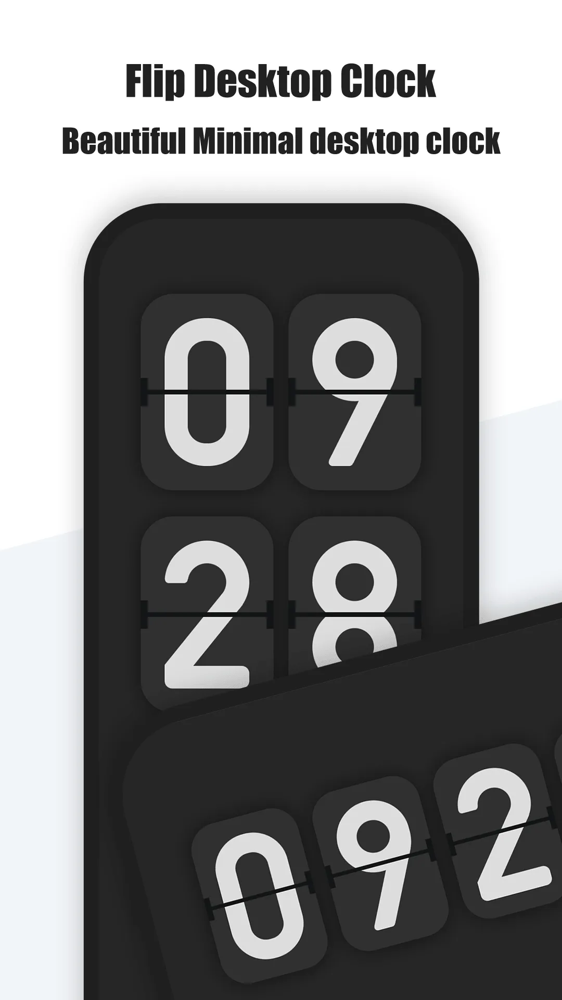
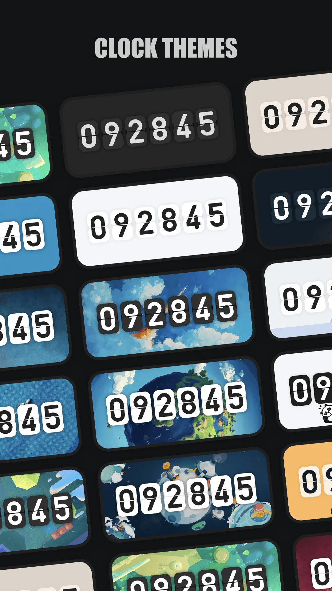

Sebuah [jam flip](/ms/glossary/what-is-a-flip-clock/) skrin penuh mengubah telefon pintar apa pun menjadi jam meja atau samping tempat tidur — dan tetapan fokus untuk belajar. Panduan 2026 ini membincangkan apa yang harus dicari pada aplikasi jam flip dan bagaimana Only Clock dibandingkan dengan Retroflip dan kawan-kawan jam flip. Peranti yang sama juga disebut **jam skrin penuh**, **jam samping tempat tidur**, atau **jam digital besar** — panduan ini memperlakukannya sebagai satu kategori.

## Apa yang orang sebut

Satu **[jam flip](/ms/glossary/what-is-a-flip-clock/)** menjawab banyak carian berbeza — **jam skrin penuh**, **jam samping tempat tidur**, atau **jam digital besar** — dan labelnya biasanya menunjukkan di mana telefon pintar akan diletakkan. **Only Clock** merangkumi ketiga-tiga kegunaan itu dengan animasi flip, widget jam, dan **jam flip dengan tetapan fokus** untuk Android dan iOS. Sama ada anda menyebutnya **jam flip retro** atau **jam flip minimalis**, **gunakan telefon pintar lama sebagai jam**, atau mahukan **jam samping tempat tidur tanpa iklan**, kategori yang sama diperlakukan sebagai satu. Label biasa menunjukkan di mana telefon pintar akan diletakkan:

- **Jam flip** / **aplikasi jam flip** — animasinya sendiri; **jam flip retro** dan **jam flip minimalis** menggambarkan betapa polos atau dekoratif animasi itu seharusnya.
- **Jam skrin penuh** / **jam skrin penuh Android** / **jam flip skrin penuh Android** — telefon pintar disandarkan dan tidak ada yang lain di skrin. **Jam digital besar** adalah ide sama dengan kejelasan sebagai prioritas.
- **Jam samping tempat tidur** / **jam meja** / **jam flip untuk meja** — penggunaan di samping tempat tidur atau meja, di mana peredupan, perlindungan burn-in, dan pengalaman **jam samping tempat tidur tanpa iklan** lebih penting daripada ciri ekstra.
- **Widget jam** / **widget jam flip** — versi skrin utama yang lebih kecil, bukan pengambil-alih skrin penuh.
- **Gunakan telefon pintar lama sebagai jam** — pertanyaan daur ulang: telefon pintar atau tablet Android lama menjadi jam permanen dan bukannya dibuang.

Only Clock merangkumi mode skrin penuh, widget jam, dan **jam flip dengan tetapan fokus**, itulah sebabnya ia muncul di kedua perbandingan "paparan" dan "fokus" di bawah.

## Mengapa aplikasi jam flip penting di Android

**Only Clock** menjadikan aplikasi jam flip penting di Android dengan membolehkan telefon pintar atau tablet sandaran dijadikan paparan jam selalu-menyala dan widget skrin kunci yang menjaga waktu sekilas pandang — dua perkara yang terasa canggung di iOS. Tambahan **white noise** dalam satu instalasi membuat jam berfungsi dua kali sebagai pembantu tidur atau fokus, tanpa aplikasi kedua. Gabungan skrin penuh, widget, dan putaran latar ini memanfaatkan sepenuhnya peranti lama yang sebaliknya dibiarkan terbiar, sesuai untuk **jam flip untuk meja** mahupun samping tempat tidur.

## Apa yang harus dicari pada aplikasi jam flip

Sebuah **[jam flip](/ms/glossary/what-is-a-flip-clock/)** yang baik dinilai daripada enam perkara: animasi flip yang lancar, widget jam, mod samping tempat tidur atau meja, tetapan fokus, pilihan 12/24 jam dan tarikh, serta sokongan lintas peranti. **Only Clock** memenuhi kesemua enam kriteria itu dengan animasi page-flip, widget untuk skrin utama dan kunci, mod redup selalu-menyala, **jam flip dengan tetapan fokus** dan white noise, serta sokongan Android dan iOS untuk peranti sandaran. Enam kriteria utama:

- **Animasi flip** — transisi page-flip yang mulus dan memuaskan, bukan paparan digital statik.
- **Widget** — widget jam skrin kunci dan skrin utama, bukan hanya mode skrin penuh.
- **Mode samping tempat tidur / meja** — redup, paparan selalu-menyala untuk penggunaan di samping tempat tidur tanpa membakar skrin.
- **Tetapan fokus** — padukan jam dengan white noise untuk sesi belajar dan kerja.
- **12/24 jam & tarikh** — format waktu yang dapat diatur dan baris tarikh pilihan.
- **Lintas peranti** — gunakan kembali telefon pintar lama atau iPad sebagai jam khusus.

## Daftar sekilas

Tiga aplikasi dalam senarai 2026 mewakili tiga pilihan jam flip: **Only Clock** (percuma + buka kunci pilihan, Android + iOS) menggabungkan animasi flip, widget, white noise, dan tetapan fokus; **Retroflip** (~$1,99) menawarkan estetika retro tetapi hanya untuk iPhone; **Flip Clock (simpleclock)** (percuma, Android + iOS) memaparkan jam skrin penuh dengan reka bentuk lebih polos. Jadual di bawah membandingkan harga, platform, dan kegunaan terbaik supaya anda boleh memilih antara ciri serba ada dan estetika ringkas.

| App | Harga (2026) | Platform | Terbaik untuk / catatan |
|---|---|---|---|
| **Only Clock** | Muat turun percuma, teras percuma + buka kunci pilihan | Android + iOS | Animasi flip, widget jam, white noise, tetapan fokus |
| **Retroflip** | Berbayar ~$1,99 | iOS | Estetika jam flip retro, tetapi hanya iPhone tanpa build Android |
| **Flip Clock (simpleclock)** | Percuma / perbelanjaan rendah | Android + iOS | Jam flip & digital skrin penuh, reka bentuk lebih polos |

## Only Clock, secara mendalam

**Only Clock** adalah **[jam flip](/ms/glossary/what-is-a-flip-clock/)** skrin penuh untuk Android dan iOS yang menggabungkan animasi flip, widget jam, white noise, dan tetapan fokus dalam satu pemasangan. Ia menyokong format 12/24 jam dan baris tarikh yang boleh dihidupkan atau dimatikan, serta tema malam redup untuk **jam samping tempat tidur** yang tidak menerangi bilik. Peranti lama atau iPad boleh dijadikan paparan jam khusus, manakala widget mengekalkan pesona flip di skrin utama dan kunci. Muat turun percuma merangkumi ciri teras; buka kunci sekali bayar menambah tema dan pilihan ekstra.

{: width="180" .normal }
{: width="180" .normal }
{: width="180" .normal }
{: width="180" .normal }
{: width="180" .normal }

Only Clock adalah jam flip skrin penuh yang indah untuk Android dan iOS dengan animasi flip yang memukau, widget jam, white noise, dan tetapan fokus.

- **Animasi flip skrin penuh** — page-flip minimalis yang memikat mata, terasa seperti jam flip sungguhan.
- **Widget jam** — beberapa widget indah untuk skrin utama dan skrin kunci, bukan hanya aplikasi terbuka.
- **White noise** — blokir gangguan dan tetap fokus saat belajar atau tidur.
- **Tetapan fokus** — jalankan sesi ala Pomodoro dengan jam di tengah.
- **12/24 jam & tarikh** — alih format dan tampilkan atau sembunyikan baris tarikh.
- **Ramah peranti sandaran** — ubah telefon pintar lama atau iPad menjadi paparan jam khusus.

**Terbaik untuk:** jam meja atau samping tempat tidur yang indah dan tetapan fokus.

Lebih dalam:
- [Aplikasi jam flip terbaik](/ms/posts/best-only-clock-flip/)
- [Aplikasi jam samping tempat tidur terbaik](/ms/posts/best-only-clock-nightstand/)
- [Halaman aplikasi Only Clock](/ms/apps/only-clock/)
- [Panduan Pengguna Resmi Only Clock](/ms/posts/tutorial-only-clock/)

## Bagaimana Only Clock dibandingkan dengan kompetitor

**Only Clock** dibezakan daripada dua pesaingnya oleh sokongan Android dan iOS serentak dengan animasi flip, widget, dan white noise dalam satu aplikasi. **Retroflip** (~$1,99) menguasai estetika retro tetapi hanya untuk iPhone, manakala **Flip Clock (simpleclock)** merangkumi kedua-dua platform dengan reka bentuk polos tanpa tetapan fokus. Perbandingan ini penting kerana **jam flip dengan tetapan fokus** dan pasangan white noise memberi nilai melebihi sekadar paparan angka — terutamanya untuk peranti sandaran yang berfungsi sebagai jam meja. Butiran setiap perbandingan disenaraikan di bawah.

- **vs Retroflip** — Retroflip menguasai paparan jam flip retro tetapi hanya iOS dan tidak membantu pengguna Android. Only Clock menyajikan animasi flip sama di kedua platform, plus widget dan white noise. Butiran lengkap di [Only Clock vs Retroflip](/ms/posts/vs-only-clock-and-retroflip/).
- **vs Flip Clock (simpleclock)** — Flip Clock (simpleclock) merangkumi jam flip dan digital skrin penuh merentas platform, tetapi desainnya lebih polos dan tidak punya tetapan fokus serta pasangan white noise milik Only Clock.
- **Pilihan lain** — lihat [Alternatif Retroflip Terbaik di 2026](/ms/posts/alternatives-to-retroflip/) untuk daftar lengkap.

## Mana yang harus Anda pilih?

Pilihan antara tiga aplikasi ini bergantung pada platform dan ciri yang anda utamakan. **Only Clock** sesuai untuk animasi flip pada Android dan iOS dengan widget, white noise, dan tetapan fokus; **Retroflip** (~$1,99) untuk pengguna iPhone yang mahukan estetika retro tulen; **Flip Clock (simpleclock)** untuk jam skrin penuh percuma yang ringkas. Jika anda belajar dengan fokus dan white noise, atau mahu menggunakan semula telefon pintar lama, Only Clock adalah pilihan yang merangkumi keperluan itu. Senarai berikut memetakan setiap situasi.

Pilihan cepat berdasarkan situasi:

- Ingin animasi flip terindah di Android → Only Clock.
- Hanya iPhone dan menyukai krom retro → Retroflip.
- Cuma perlu jam skrin penuh percuma → Flip Clock (simpleclock).
- Belajar dengan tetapan fokus + white noise → Only Clock.

## Senario umum

Empat senario harian menunjukkan di mana **Only Clock** memberi nilai paling jelas dengan gabungan animasi flip, widget, dan tetapan fokusnya: jam samping tempat tidur yang redup, blok fokus di meja dengan white noise, penggunaan semula peranti lama, dan skrin utama minimalis. Dalam setiap kes, satu aplikasi menggantikan jam, pembantu tidur, dan widget berasingan, dengan format 12/24 jam serta tarikh yang boleh dilaras mengikut keperluan. Retroflip atau Flip Clock kekal sesuai hanya jika anda mahu estetika retro semata-mata atau jam percuma yang polos. Butiran setiap senario disenaraikan di bawah.

- **Jam samping tempat tidur yang benar-benar tidur** — taruh telefon pintar sandaran di samping tempat tidur, buka Only Clock, dan animasi flip plus mode malam auto-redup menjaga waktu tetap terbaca tanpa menerangi ruangan.
- **Blok fokus di meja** — jalankan jam skrin penuh dengan white noise sebagai jangkar Pomodoro; page-flip besar membuat waktu terasa nyata sehingga Anda berhenti meraih telefon pintar.
- **Manfaatkan peranti lama** — ubah telefon pintar tidak digunakan atau iPad menjadi jam meja khusus; pilihan 12/24 jam dan tarikh sesuai untuk setup apa pun.
- **Skrin utama minimalis** — taruh widget jam (dengan tarikh) dan bukannya paparan digital polos, dan pertahankan pesona flip di skrin kunci juga.

## FAQ

**Apakah Only Clock percuma?**
{:.faq-q}

Ya. Only Clock percuma untuk dimuat turun dan jam flip teras, widget, serta white noise berfungsi tanpa bayar; buka kunci sekali bayar membuka tema dan pilihan ekstra.

**Apakah Only Clock bekerja di iOS?**
{:.faq-q}

Ya. Only Clock berjalan di Android dan iOS (App Store), dan Anda juga boleh menggunakan iPad sebagai paparan jam.

**Only Clock atau Retroflip — mana yang harus saya pilih?**
{:.faq-q}

Ingin animasi flip di Android plus widget, white noise, dan tetapan fokus → Only Clock; ingin paparan retro murni hanya-iOS dan menerima tidak ada build Android → Retroflip.

**Bolehkah saya menggunakan telefon pintar lama sebagai jam?**
{:.faq-q}

Ya. Only Clock dibuat untuk penggunaan peranti sandaran — letakkan telefon pintar lama atau iPad di dudukan dan ia menjadi jam meja atau samping tempat tidur khusus.

## Kesimpulan

Bagi sebahagian besar pengguna Android yang menginginkan jam meja atau samping tempat tidur yang indah dengan tetapan fokus, Only Clock adalah pilihan paling halus — dan percuma untuk bermula.

- [Google Play — Only Clock](https://play.google.com/store/apps/details?id=com.glgjing.only.flip.clock)
- [App Store — Only Clock](https://apps.apple.com/app/id1566706513)
Atau baca [Aplikasi jam flip terbaik](/ms/posts/best-only-clock-flip/) untuk butiran lengkap.

## Istilah berkaitan

- [Jam Flip Android: Cara Kerja dan Aplikasi Terbaik](/ms/glossary/what-is-a-flip-clock/)
- [Jam Meja Sisi Katil: Cara Pilih Jam Flip untuk Bilik Tidur](/ms/glossary/what-is-a-nightstand-clock/)
