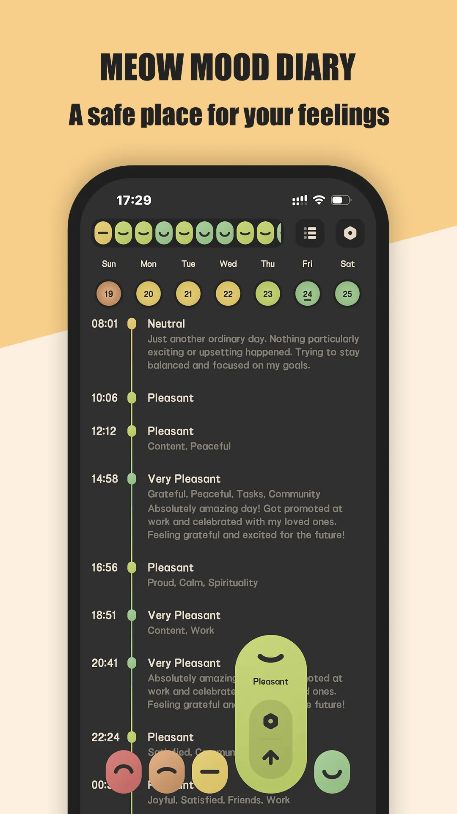
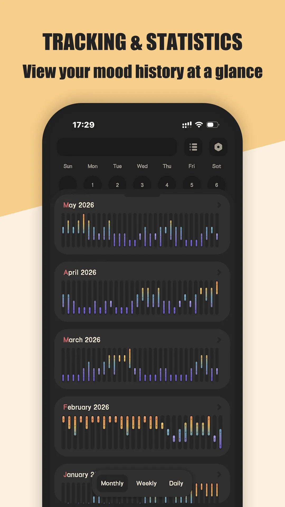
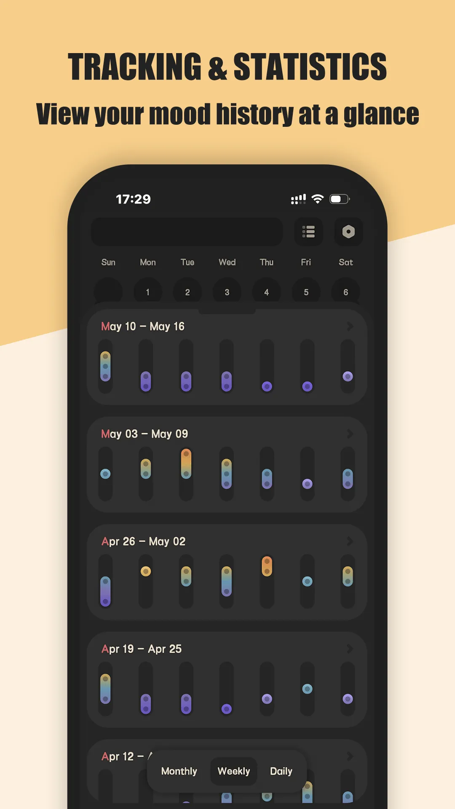
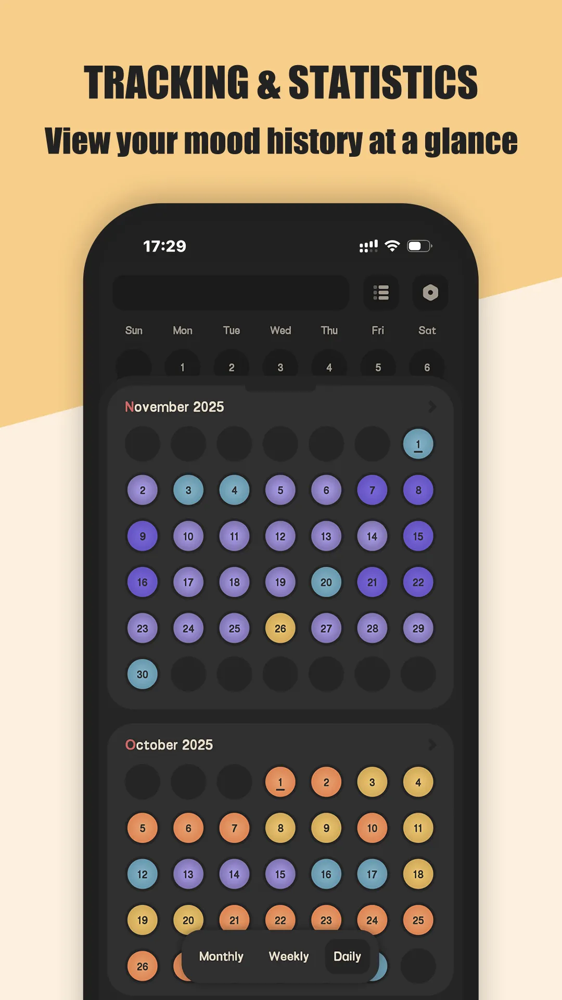
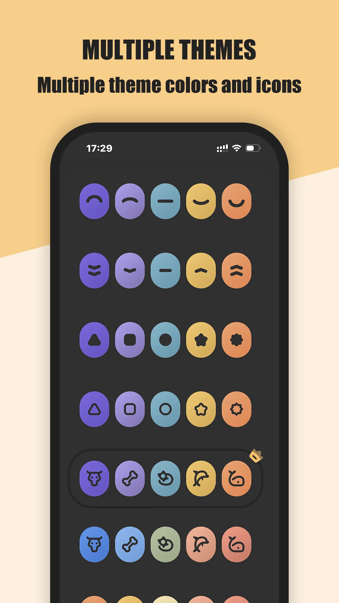

Buku harian digital mengubah perasaan yang berceceran menjadi sesuatu yang benar-benar boleh Anda lihat dan pelajari. Panduan 2026 ini membincangkan hal yang penting dalam aplikasi jurnal harian dan bagaimana Meow Mood Diary dibandingkan dengan aplikasi jurnal besar lain-lain. Jika Anda datang ke sini untuk mencari **aplikasi mood tracker** alih-alih aplikasi untuk menulis jurnal, mulailah dari bahagian penamaan di bawah.

## Sebutan yang digunakan orang

Orang mencari alat ini dengan banyak sebutan: **aplikasi mood tracker**, **jurnal mood**, **aplikasi jurnal harian**, atau **penjejak mood**. Sebutan itu biasanya memberi gambaran seberapa banyak mereka ingin menulis jurnal. **Catatan mood harian** cukup satu ketik dan satu perasaan; **aplikasi jurnal mood** lebih dekat ke buku harian digital peribadi berisi kalimat dan foto. Di Android, **penjejak mood Android** dan **aplikasi mood tracker terbaik** biasanya merujuk pada daftar pendek aplikasi ringan dengan pencatatan cepat yang sama.

Yang benar-benar membezakannya adalah alurnya: bolehkah Anda merekam perasaan dalam hitungan saat seperti **aplikasi check-in harian**, dan bolehkah sebulan kemudian Anda melihat kembali **penjejak mood dengan graf** serta menemukan polanya? Buku harian yang hanya menyimpan teks menjawab pertanyaan pertama, bukan yang kedua. Meow Mood Diary dibangun untuk keduanya — entri mood dan aktivitas dalam dua ketik, lalu graf dan peta panas kalendar.

## Mengapa buku harian digital penting di Android

Di Android, storan yang mengutamakan peranti plus kunci cap jari berarti pikiran peribadi Anda tidak pernah meninggalkan peranti, kecuali Anda mencadangkannya ke Google Drive milik sendiri. Hal ini lebih berarti di sini daripada di iOS, tempat orang mengharapkan semuanya disimpan di iCloud.

## Apa yang perlu dicari dalam [jurnal mood](/ms/glossary/what-is-a-mood-tracker/)

- **Privasi dan kepemilikan** — entri disimpan secara lokal atau di cloud milik Anda sendiri, bukan di server vendor yang tidak Anda kendalikan.
- **Pencatatan cepat satu ketik** — pilih ikon emosi tanpa harus menulis paragraf saat hari sedang buruk.
- **Sejarah dan wawasan** — kalendar serta graf untuk melihat pola (contohnya, rasa muram hari Minggu atau lonjakan setelah kopi).
- **Penggunaan offline** — catat kapan saja tanpa Wi-Fi, sehingga tabiat tetap tanpa hambatan.
- **Peringatan** — dorongan harian yang lembut untuk membangun tabiat check-in.
- **Kunci** — cap jari atau kode sandi supaya hanya Anda yang boleh membuka buku harian.

## Sekilas daftar aplikasi

| Aplikasi | Harga (2026) | Platform | Sesuai untuk / catatan |
|---|---|---|---|
| **Meow Mood Diary** | Muat turun percuma, ciri teras percuma + unlock pilihan | Android + iOS | Privasi, pencatatan mood satu ketik, offline, sandaran Google Drive |
| **Day One** | Langganan ~$34.99/tahun | Android + iOS | Jurnal rapi dengan foto dan penyegerakan, tetapi berbasis akaun cloud |
| **Journey** | Freemium | Android + iOS + Web | Buku harian merentas platform dengan peta perjalanan; versi percuma terhad |

## Meow Mood Diary, lebih mendalam

{: width="180" .normal }
{: width="180" .normal }
{: width="180" .normal }
{: width="180" .normal }
{: width="180" .normal }

Meow Mood Diary adalah [jurnal mood](/ms/glossary/what-is-a-mood-tracker/) dan aplikasi jurnal harian yang selamat serta peribadi, dengan antara muka bertema kucing yang menenangkan untuk merekam perasaan dan melacak mood.

- **Privasi penuh** — entri tidak pernah diunggah ke server kami; Anda hanya mencadangkan ke Google Drive milik sendiri.
- **Pencatatan mood satu ketik** — pilih ikon emosi; tidak perlu menulis panjang saat hari sedang buruk.
- **Sejarah dan statistik mood** — paparan kalendar dan graf trend emosi supaya pola muncul.
- **Sepenuhnya offline** — catat, lihat, dan edit tanpa Wi-Fi, sehingga tabiat tetap tanpa hambatan.
- **Peringatan yang boleh disesuaikan** — bangun rutinitas check-in harian yang konsisten.
- **Kunci cap jari dan kode sandi** — hanya Anda yang boleh mengakses buku harian.

**Sesuai untuk:** penjejakan mood harian yang peribadi tanpa terkunci cloud.

Pelajari lebih lanjut:
- [Aplikasi buku harian digital terbaik](/ms/posts/best-meow-mood-diary-diary/)
- [Aplikasi buku harian peribadi tanpa akaun](/ms/posts/best-meow-mood-diary-private/)
- [Halaman aplikasi Meow Mood Diary](/ms/apps/meow-mood-diary/)
- [Panduan Pengguna Resmi Meow Mood Diary](/ms/posts/tutorial-meow-mood-diary/)

## Perbandingan Meow Mood Diary dengan kompetitor

- **vs Day One** — Day One adalah standar jurnal rapi dengan foto dan penyegerakan, tetapi dibangun di sekitar akaun cloud dan langganan tahunan. Meow Mood Diary mengutamakan storan lokal dan peribadi secara bawaan, tanpa akaun yang perlu dibuat. Butiran lengkap di [Meow Mood Diary vs Day One](/ms/posts/vs-meow-mood-and-day-one/).
- **vs Journey** — Journey menambahkan peta perjalanan dan aplikasi web, yang menarik untuk menulis jurnal lintas peranti, tetapi versi gratisnya terhad dan kurang fokus pada check-in mood cepat.
- **Pilihan lain** — lihat [Alternatif Day One Terbaik di 2026](/ms/posts/alternatives-to-day-one/) untuk daftar lengkapnya.

## Mana yang sebaiknya Anda pilih?

Pilihan cepat berdasarkan situasi:

- Ingin privasi di peranti dan tanpa akaun → Meow Mood Diary.
- Ingin jurnal foto kaya ciri + penyegerakan dan menerima langganan → Day One.
- Ingin web + peta perjalanan → Journey.
- Cuma perlu check-in mood 30 saat sehari → Meow Mood Diary.

## Senario umum

- **Catatan cepat saat hari buruk** — pada malam yang berat, ketik satu ikon emosi dan beberapa tag; tanpa paragraf, sehingga buku harian tetap bertahan di hari-hari yang biasanya Anda lewatkan.
- **Peribadi secara bawaan** — entri tetap di peranti di sebalik kunci cap jari; pada telefon pintar keluarga bersama, pikiran Anda tidak pernah tersinkron ke cloud vendor kecuali Anda memilih Google Drive.
- **Menemukan pola** — kalendar dan graf memunculkan 'rasa muram hari Minggu' atau lonjakan setelah kopi, mengubah perasaan samar menjadi sesuatu yang boleh ditindaklanjuti.
- **Offline di mana saja** — catat di pesawat atau di area tanpa isyarat kereta bawah tanah; tidak ada yang perlu Wi-Fi untuk merekam momen.

## FAQ

**Apakah Meow Mood Diary percuma?**
{:.faq-q}

Ciri teras — pencatatan mood cepat, sejarah, graf, dan penggunaan offline — percuma untuk digunakan; beberapa ciri tambahan ada di sebalik unlock sekali bayar pilihan.

**Apakah Meow Mood Diary boleh digunakan offline?**
{:.faq-q}

Ya. Anda boleh mencatat, melihat, dan mengedit entri tanpa internet dan tanpa akaun; data tetap di peranti Anda.

**Apakah buku harian saya peribadi?**
{:.faq-q}

Ya — entri tidak pernah diunggah ke server kami; Anda hanya mencadangkan ke Google Drive milik sendiri, dan kunci cap jari atau kode sandi menjaga buku harian tetap untuk Anda sendiri.

**Meow Mood Diary atau Day One — mana yang sebaiknya saya pilih?**
{:.faq-q}

Ingin buku harian mood percuma, peribadi, tanpa akaun, dan disimpan di peranti → Meow Mood Diary; ingin jurnal foto kaya ciri dengan penyegerakan dan menerima langganan → Day One.

## Kesimpulan

Bagi kebanyakan pengguna Android yang menginginkan buku harian mood peribadi dan tanpa akaun, Meow Mood Diary adalah pilihan paling tenang — dan percuma untuk bermula.

- [Google Play — Meow Mood Diary](https://play.google.com/store/apps/details?id=com.glgjing.meow.mood.diary)
- [App Store — Meow Mood Diary](https://apps.apple.com/app/id6767560237)
Atau baca [Aplikasi buku harian digital terbaik](/ms/posts/best-meow-mood-diary-diary/) untuk butiran lengkapnya.

## Istilah berkaitan

- [Apakah Itu Penjejak Suasana Hati?](/ms/glossary/what-is-a-mood-tracker/)
