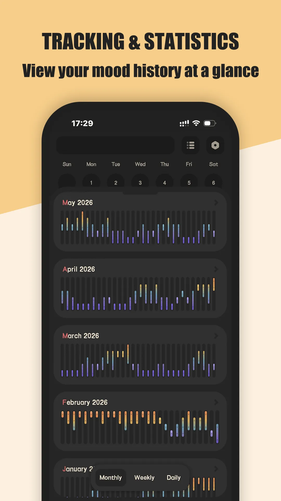

Buku harian digital mengubah perasaan yang berceceran menjadi sesuatu yang benar-benar boleh Anda lihat dan pelajari. Panduan 2026 ini membincangkan hal yang penting dalam aplikasi jurnal harian dan bagaimana Meow Mood Diary dibandingkan dengan aplikasi jurnal besar lain-lain. Jika Anda datang ke sini untuk mencari **aplikasi mood tracker** dan bukannya aplikasi untuk menulis jurnal, mulailah dari bahagian penamaan di bawah.

## Sebutan yang digunakan orang

Sebuah **[jurnal mood](/ms/glossary/what-is-a-mood-tracker/)** seperti **Meow Mood Diary** dicari dengan banyak sebutan — **aplikasi mood tracker**, **aplikasi jurnal harian**, atau **penjejak mood** — dan setiap sebutan menggambarkan seberapa banyak orang mahu menulis. **Catatan mood harian** hanya memerlukan satu ketik dan satu perasaan, manakala **aplikasi jurnal mood** lebih dekat kepada buku harian peribadi berisi ayat dan foto. Meow Mood Diary merangkumi kedua-duanya dengan entri mood dan aktiviti dalam dua ketik, disusuli graf dan peta haba kalendar. Di Android, **penjejak mood Android** dan **aplikasi mood tracker terbaik** biasanya merujuk kepada senarai aplikasi ringan dengan pencatatan cepat yang sama. Kesemua sebutan ini membawa kepada satu tugasan: merekod perasaan dengan segera dan melihat semula polanya kemudian.

Yang benar-benar membezakannya adalah alurnya: bolehkah Anda merekam perasaan dalam hitungan saat seperti **aplikasi check-in harian**, dan bolehkah sebulan kemudian Anda melihat kembali **penjejak mood dengan graf** serta menemukan polanya? Buku harian yang hanya menyimpan teks menjawab pertanyaan pertama, bukan yang kedua. Meow Mood Diary dibangun untuk keduanya — entri mood dan aktivitas dalam dua ketik, lalu graf dan peta panas kalendar.

## Mengapa buku harian digital penting di Android

**Meow Mood Diary** menjadikan buku harian digital penting di Android dengan menyimpan entri terus di peranti di sebalik kunci cap jari, supaya fikiran peribadi tidak pernah keluar melainkan anda sendiri memilih untuk membuat sandaran ke Google Drive milik anda. Entri mood direkod dalam dua ketik, manakala graf dan peta haba kalendar mendedahkan corak seperti "sedih hari Minggu" atau lonjakan selepas kopi berbulan-bulan kemudian. Model lokal-dulu ini lebih bermakna di Android berbanding iOS, tempat pengguna menjangkakan semuanya disimpan di iCloud. Hasilnya adalah jurnal yang benar-benar peribadi tanpa mengorbankan wawasan.

## Apa yang perlu dicari dalam [jurnal mood](/ms/glossary/what-is-a-mood-tracker/)

Sebuah **[jurnal mood](/ms/glossary/what-is-a-mood-tracker/)** yang baik dinilai daripada enam perkara: privasi dan pemilikan data, pencatatan satu ketik, sejarah dan wawasan, penggunaan offline, peringatan lembut, serta kunci cap jari atau kod sandi. **Meow Mood Diary** memenuhi kesemua enam kriteria itu dengan entri yang tidak pernah diunggah ke server vendor, pilihan ikon emosi segera, serta graf dan kalendar untuk melihat corak — semuanya berfungsi tanpa Wi-Fi dan bermula secara percuma. Enam kriteria utama:

- **Privasi dan kepemilikan** — entri disimpan secara lokal atau di cloud milik Anda sendiri, bukan di server vendor yang tidak Anda kendalikan.
- **Pencatatan cepat satu ketik** — pilih ikon emosi tanpa harus menulis paragraf saat hari sedang buruk.
- **Sejarah dan wawasan** — kalendar serta graf untuk melihat pola (contohnya, rasa muram hari Minggu atau lonjakan setelah kopi).
- **Penggunaan offline** — catat bila-bila sahaja tanpa Wi-Fi, sehingga tabiat tetap tanpa hambatan.
- **Peringatan** — dorongan harian yang lembut untuk membangun tabiat check-in.
- **Kunci** — cap jari atau kode sandi supaya hanya Anda yang boleh membuka buku harian.

## Sekilas daftar aplikasi

Tiga aplikasi dalam senarai 2026 mewakili tiga pendekatan jurnal: **Meow Mood Diary** (percuma + unlock pilihan, Android + iOS) mengutamakan privasi, pencatatan mood satu ketik, dan sandaran Google Drive; **Day One** (~$34.99/tahun) menawarkan jurnal foto rapi dengan penyegerakan berasaskan akaun cloud; **Journey** (freemium) merangkumi web dan peta perjalanan dengan versi percuma terhad. Jadual di bawah membandingkan harga, platform, dan kegunaan terbaik supaya anda boleh memilih antara jurnal peribadi lokal dan jurnal foto yang disegerakkan.

| Aplikasi | Harga (2026) | Platform | Sesuai untuk / catatan |
|---|---|---|---|
| **Meow Mood Diary** | Muat turun percuma, ciri teras percuma + unlock pilihan | Android + iOS | Privasi, pencatatan mood satu ketik, offline, sandaran Google Drive |
| **Day One** | Langganan ~$34.99/tahun | Android + iOS | Jurnal rapi dengan foto dan penyegerakan, tetapi berbasis akaun cloud |
| **Journey** | Freemium | Android + iOS + Web | Buku harian merentas platform dengan peta perjalanan; versi percuma terhad |

## Meow Mood Diary, lebih mendalam

**Meow Mood Diary** adalah **[jurnal mood](/ms/glossary/what-is-a-mood-tracker/)** dan aplikasi jurnal harian yang peribadi untuk Android dan iOS, dengan antara muka bertema kucing yang menenangkan. Entri mood dan aktiviti direkod dalam dua ketik — pilih ikon emosi, tambah tag — tanpa perlu menulis perenggan panjang pada hari yang buruk. Semua data kekal di peranti, tidak pernah diunggah ke server vendor, dan hanya disandarkan ke Google Drive milik anda jika anda memilihnya; kunci cap jari serta kod sandi menjaga buku harian tetap untuk anda. Graf trend, kalendar, dan peta haba mendedahkan corak dari masa ke masa, manakala peringatan yang boleh disesuaikan membina rutin check-in harian. Terasnya percuma; unlock sekali bayar pilihan menambah ciri lanjutan.

{: width="180" .normal }
{: width="180" .normal }
{: width="180" .normal }
{: width="180" .normal }
{: width="180" .normal }

Meow Mood Diary adalah [jurnal mood](/ms/glossary/what-is-a-mood-tracker/) dan aplikasi jurnal harian yang selamat serta peribadi, dengan antara muka bertema kucing yang menenangkan untuk merekam perasaan dan melacak mood.

- **Privasi penuh** — entri tidak pernah diunggah ke server kami; Anda hanya mencadangkan ke Google Drive milik sendiri.
- **Pencatatan mood satu ketik** — pilih ikon emosi; tidak perlu menulis panjang saat hari sedang buruk.
- **Sejarah dan statistik mood** — paparan kalendar dan graf trend emosi supaya pola muncul.
- **Sepenuhnya offline** — catat, lihat, dan edit tanpa Wi-Fi, sehingga tabiat tetap tanpa hambatan.
- **Peringatan yang boleh disesuaikan** — bangun rutinitas check-in harian yang konsisten.
- **Kunci cap jari dan kode sandi** — hanya Anda yang boleh mengakses buku harian.

**Sesuai untuk:** penjejakan mood harian yang peribadi tanpa terkunci cloud.

Pelajari lebih lanjut:
- [Aplikasi buku harian digital terbaik](/ms/posts/best-meow-mood-diary-diary/)
- [Aplikasi buku harian peribadi tanpa akaun](/ms/posts/best-meow-mood-diary-private/)
- [Halaman aplikasi Meow Mood Diary](/ms/apps/meow-mood-diary/)
- [Panduan Pengguna Resmi Meow Mood Diary](/ms/posts/tutorial-meow-mood-diary/)

## Perbandingan Meow Mood Diary dengan kompetitor

**Meow Mood Diary** dibezakan daripada dua pesaingnya oleh storan lokal secara bawaan dan pencatatan mood dua ketik tanpa akaun. **Day One** (~$34.99/tahun) adalah penanda aras jurnal rapi dengan foto dan penyegerakan, tetapi dibina di sekitar akaun cloud dan langganan tahunan; **Journey** menambah peta perjalanan dan aplikasi web, dengan versi percuma yang terhad. Perbandingan ini penting kerana buku harian peribadi mengutamakan siapa yang memiliki data — vendor atau anda sendiri. Butiran setiap perbandingan disenaraikan di bawah.

- **vs Day One** — Day One adalah standar jurnal rapi dengan foto dan penyegerakan, tetapi dibangun di sekitar akaun cloud dan langganan tahunan. Meow Mood Diary mengutamakan storan lokal dan peribadi secara bawaan, tanpa akaun yang perlu dibuat. Butiran lengkap di [Meow Mood Diary vs Day One](/ms/posts/vs-meow-mood-and-day-one/).
- **vs Journey** — Journey menambahkan peta perjalanan dan aplikasi web, yang menarik untuk menulis jurnal lintas peranti, tetapi versi gratisnya terhad dan kurang fokus pada check-in mood cepat.
- **Pilihan lain** — lihat [Alternatif Day One Terbaik di 2026](/ms/posts/alternatives-to-day-one/) untuk daftar lengkapnya.

## Mana yang sebaiknya Anda pilih?

Pilihan antara tiga aplikasi ini bergantung pada sejauh mana anda mengutamakan privasi berbanding ciri foto dan penyegerakan. **Meow Mood Diary** sesuai untuk privasi di peranti tanpa akaun dan check-in mood kira-kira 30 saat sehari; **Day One** (~$34.99/tahun) untuk jurnal foto kaya ciri dengan penyegerakan dan langganan; **Journey** untuk sokongan web dan peta perjalanan. Senarai berikut memetakan setiap situasi kepada pilihan yang tepat, termasuk keperluan sandaran dan akses merentas peranti.

Pilihan cepat berdasarkan situasi:

- Ingin privasi di peranti dan tanpa akaun → Meow Mood Diary.
- Ingin jurnal foto kaya ciri + penyegerakan dan menerima langganan → Day One.
- Ingin web + peta perjalanan → Journey.
- Cuma perlu check-in mood 30 saat sehari → Meow Mood Diary.

## Senario umum

Empat senario harian menunjukkan di mana **Meow Mood Diary** memberi nilai paling jelas dengan pencatatan dua ketik dan storan lokalnya: catatan cepat pada hari yang buruk, privasi secara bawaan pada telefon pintar keluarga, penemuan corak melalui graf dan kalendar, serta penggunaan offline di mana sahaja. Dalam setiap kes, perasaan direkod segera tanpa perenggan panjang, dan entri kekal di peranti di sebalik kunci cap jari kecuali anda memilih Google Drive. Day One atau Journey sesuai hanya jika anda mengutamakan jurnal foto kaya ciri atau sokongan web. Butiran setiap senario disenaraikan di bawah.

- **Catatan cepat saat hari buruk** — pada malam yang berat, ketik satu ikon emosi dan beberapa tag; tanpa paragraf, sehingga buku harian tetap bertahan di hari-hari yang biasanya Anda lewatkan.
- **Peribadi secara bawaan** — entri tetap di peranti di sebalik kunci cap jari; pada telefon pintar keluarga bersama, pikiran Anda tidak pernah tersinkron ke cloud vendor kecuali Anda memilih Google Drive.
- **Menemukan pola** — kalendar dan graf memunculkan 'rasa muram hari Minggu' atau lonjakan setelah kopi, mengubah perasaan samar menjadi sesuatu yang boleh ditindaklanjuti.
- **Offline di mana sahaja** — catat di pesawat atau di area tanpa isyarat kereta bawah tanah; tidak ada yang perlu Wi-Fi untuk merekam momen.

## FAQ

**Apakah Meow Mood Diary percuma?**
{:.faq-q}

Ciri teras — pencatatan mood cepat, sejarah, graf, dan penggunaan offline — percuma untuk digunakan; beberapa ciri tambahan ada di sebalik unlock sekali bayar pilihan.

**Apakah Meow Mood Diary boleh digunakan offline?**
{:.faq-q}

Ya. Anda boleh mencatat, melihat, dan mengedit entri tanpa internet dan tanpa akaun; data tetap di peranti Anda.

**Apakah buku harian saya peribadi?**
{:.faq-q}

Ya — entri tidak pernah diunggah ke server kami; Anda hanya mencadangkan ke Google Drive milik sendiri, dan kunci cap jari atau kode sandi menjaga buku harian tetap untuk Anda sendiri.

**Meow Mood Diary atau Day One — mana yang sebaiknya saya pilih?**
{:.faq-q}

Ingin buku harian mood percuma, peribadi, tanpa akaun, dan disimpan di peranti → Meow Mood Diary; ingin jurnal foto kaya ciri dengan penyegerakan dan menerima langganan → Day One.

## Kesimpulan

Bagi kebanyakan pengguna Android yang menginginkan buku harian mood peribadi dan tanpa akaun, Meow Mood Diary adalah pilihan paling tenang — dan percuma untuk bermula.

- [Google Play — Meow Mood Diary](https://play.google.com/store/apps/details?id=com.glgjing.meow.mood.diary)
- [App Store — Meow Mood Diary](https://apps.apple.com/app/id6767560237)
Atau baca [Aplikasi buku harian digital terbaik](/ms/posts/best-meow-mood-diary-diary/) untuk butiran lengkapnya.

## Istilah berkaitan

- [Penjejak Mood: Cara Catat Perasaan Harian](/ms/glossary/what-is-a-mood-tracker/)
