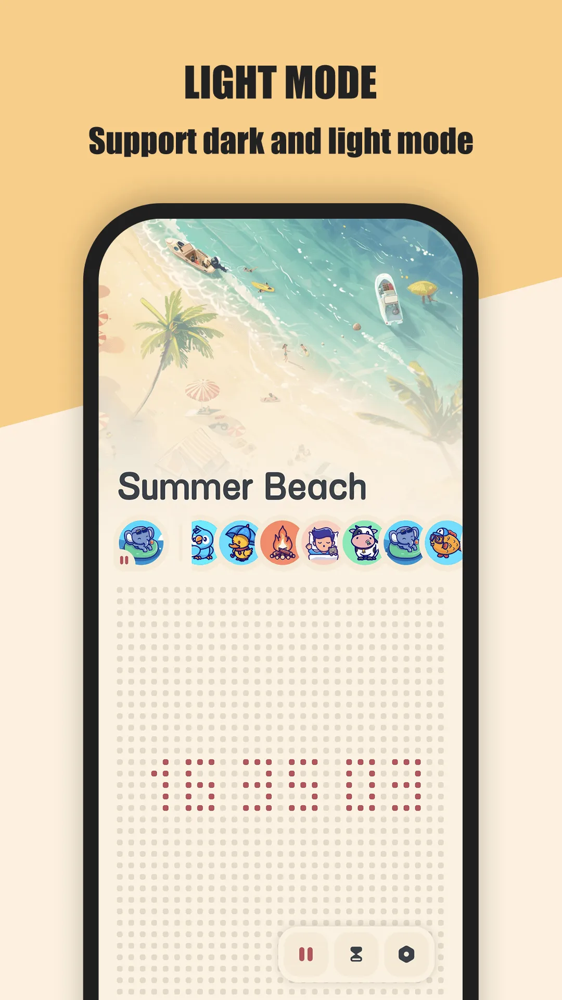

Jika tidur tidak kunjung datang, fokus terus hilang, atau kamar asrama sebelah tidak mau tenang, aplikasi [white noise](/ms/glossary/what-is-white-noise/) adalah alat tidur dan fokus termurah di Android. Panduan 2026 ini membedah hal yang benar-benar penting dalam aplikasi suara dan bagaimana Meow FM berdiri sejajar dengan nama besar seperti Calm. Apapun sebutannya — **white noise**, **suara tidur**, **suara fokus**, atau **generator noise** — daftar pendek di bawah ini adalah kumpulan aplikasi yang sama.

## Apa yang orang sebut

Satu **[aplikasi white noise](/ms/glossary/what-is-white-noise/)** seperti **Meow FM** dicari dengan beberapa nama — **suara tidur**, **suara fokus**, **noise ambient**, atau **generator noise** — dan label itu biasanya menunjukkan masalah yang ingin diselesaikan, bukan apa yang sebenarnya dilakukan aplikasi. Meow FM menjawab semuanya dengan pustaka **15+ suara ambient** yang boleh dicampur dan dimainkan sepenuhnya offline, lengkap dengan pemasa tidur 15/30/60 minit. Sama ada ia dipanggil **white noise untuk tidur** atau **untuk fokus**, dua cek yang paling penting: adakah ia terus dimainkan semasa skrin mati, dan bolehkah anda menghentikannya tanpa terbangun. Beberapa label biasa:

- **White noise untuk tidur** / **white noise untuk fokus** — alas suara stabil yang menyamarkan suara tiba-tiba atau lalu lintas. Yang pertama dipasangkan dengan pemasa tidur, yang kedua dengan blok belajar tidak terputus.
- **Aplikasi suara tidur** / **aplikasi suara hujan** / **aplikasi brown noise** — preferensi pada tekstur tertentu: hujan, laut, perapian, atau gumaman rendah brown noise.
- **Aplikasi white noise Android** / **white noise untuk memblokir noise** — platform atau tugasan yang harus diselesaikan; keduanya menunjuk ke senarai semak sama di bawah (putar latar, pustaka offline, pemasa, dan pencampuran).

Meow FM merangkumi semuanya dalam satu pustaka offline dengan lapisan yang boleh dicampur, itulah sebabnya penamaan kurang penting daripada dua cek: apakah ia tetap diputar skrin mati, dan bolehkah Anda menghentikannya tanpa terbangun?

## Mengapa aplikasi white noise penting di Android

**Meow FM** menjadikan aplikasi white noise penting di Android dengan memastikan audio terus berjalan semasa skrin mati serta dimainkan sepenuhnya offline tanpa menguras bateri — tepat pada masa anda cuba tidur. Dengan **15+ suara ambient** dan pemasa tidur yang mematikan audio secara automatik selepas 15, 30, atau 60 minit, aplikasi ini menutupi kebisingan lalu berhenti sendiri tanpa anda perlu bangun. Jam desktopnya pula menukar telefon pintar menjadi paparan samping tempat tidur yang turut berguna untuk sesi fokus, sesuatu yang widget iPhone lakukan jauh lebih kaku. Putar latar dan pemasa inilah yang memisahkan aplikasi tidur yang benar-benar berfungsi daripada pemain audio biasa.

## Apa yang dicari dalam aplikasi white noise

Sebuah **[aplikasi white noise](/ms/glossary/what-is-white-noise/)** yang baik dinilai daripada enam perkara: privasi tanpa akaun, putar latar yang cekap bateri, pemasa tidur, kepelbagaian dan pencampuran suara, putar offline, serta jam atau mod fokus. **Meow FM** memenuhi kesemua enam kriteria itu dengan **15+ suara ambient** yang boleh ditumpuk, pemasa 15/30/60 minit, dan main balik sepenuhnya offline tanpa akaun atau langganan. Enam kriteria utama:

- **Privasi & akaun** — sebahagian besar aplikasi suara tidak perlu akaun; Anda cukup menekan putar. Utamakan yang bekerja sepenuhnya offline supaya tidak ada yang bergantung pada server yang tidak Anda kuasai.
- **Putar latar & bateri** — audio harus berlanjut skrin terkunci dan menyeruput bateri, bukan mengurasnya semalaman semasa Anda tidur.
- **Pemasa tidur** — mati automatik supaya noise berhenti setelah Anda terlelap dan tidak jalan sampai pagi.
- **Ragam & pencampuran suara** — hujan, badai, hutan, perapian; idealnya lapisan yang boleh ditumpuk (hujan + guntur) jadi adegan tersuai.
- **Putar offline** — tanpa isyarat, tidak masalah di pesawat, kereta bawah tanah, atau perkemahan.
- **Jam / mode fokus** — jam kelihatan atau pemasa fokus membantu sesi belajar dan kerja, bukan sekadar tidur.

## Bidang ini sekilas

Tiga aplikasi dalam senarai 2026 mewakili tiga pendekatan suara tidur: **Meow FM** (percuma + buka sekali pilihan, Android + iOS) menawarkan **15+ suara ambient**, pemasa tidur, dan main balik offline; **Calm** (~$69,99/tahun) menggabungkan meditasi dan cerita tidur dengan pustaka besar berasaskan langganan; **Relax Melodies** (freemium) mencampur suara tidur dengan meditasi terpandu dalam pustaka lebih ringan. Jadual di bawah membandingkan harga, platform, dan kegunaan terbaik supaya anda boleh memilih antara suara offline ringkas dan pakej meditasi lengkap.

| Aplikasi | Harga (2026) | Platform | Terbaik untuk / catatan |
|---|---|---|---|
| **Meow FM** | Muat turun percuma, teras percuma + buka sekali pilihan | Android + iOS | Pemasa tidur, 15+ suara ambient, sepenuhnya offline, jam desktop |
| **Calm** | Freemium ~$69,99/tahun | Android + iOS | Meditasi + cerita tidur, pustaka besar, tetapi berlangganan-utama |
| **Relax Melodies** | Freemium | Android + iOS | Suara tidur campur & meditasi terpandu, pustaka lebih ringan |

## Meow FM, secara mendalam

**Meow FM** adalah **[aplikasi white noise](/ms/glossary/what-is-white-noise/)** bertema kucing untuk tidur, relaksasi, dan fokus dengan pustaka **15+ suara ambient** seperti hujan, badai petir, hutan, tepi laut, dan perapian. Pemasa tidur boleh diatur pada 15, 30, atau 60 minit — atau durasi tersuai — dan mematikan audio secara automatik selepas anda terlelap. Setiap suara diputar sepenuhnya offline tanpa isyarat atau akaun, sesuai untuk penerbangan dan Wi-Fi hotel yang buruk, manakala jam desktop mengekalkan penglihatan masa semasa sesi kerja dan berfungsi dua kali sebagai paparan samping tempat tidur. Pilihan suara percuma; adegan premium dibuka dengan pembelian sekali bayar tanpa langganan.

{: width="180" .normal }
{: width="180" .normal }
{: width="180" .normal }
{: width="180" .normal }
{: width="180" .normal }

Meow FM adalah aplikasi white noise bertema kucing untuk tidur, santai, dan fokus, dengan suara ambient seperti hujan, badai petir, hutan, dan perapian, plus jam desktop untuk sesi kerja.

- **15+ suara ambient** — hujan, badai petir, angin, hutan, tepi laut, perapian, malam musim panas — dibuat untuk tidur dan fokus.
- **Pemasa tidur** — atur durasi putar (15/30/60 minit atau tersuai) dan mati automatik setelah Anda terlelap.
- **Sepenuhnya offline** — setiap suara diputar tanpa isyarat, sesuai di pesawat, perjalanan, dan Wi-Fi hotel yang buruk.
- **Jam desktop** — jam kelihatan menjaga Anda efisien saat sesi fokus, berfungsi ganda sebagai paparan samping tempat tidur.
- **Mode gelap & terang** — pilih tema yang Anda suka supaya skrin tetap tenang di malam hari.
- **Percuma untuk bermula** — pilihan suara percuma; adegan premium dibuka via pembelian sekali bayar, tanpa langganan.

**Paling sesuai untuk:** tidur, relaksasi, dan fokus tanpa langganan.

Lebih dalam:
- [Aplikasi white noise terbaik untuk tidur](/ms/posts/best-meow-fm-sleep/)
- [Aplikasi fokus terbaik untuk belajar](/ms/posts/best-meow-fm-focus/)
- [Halaman aplikasi Meow FM](/ms/apps/meow-fm/)
- [Panduan Resmi Pengguna Meow FM](/ms/posts/tutorial-meow-fm/)

## Bagaimana Meow FM dibandingkan pesaing

**Meow FM** dibezakan daripada dua pesaingnya oleh **15+ suara ambient** offline dan pemasa tidur yang dibuka dengan pembelian sekali bayar, tanpa langganan. **Calm** (~$69,99/tahun) adalah gergasi meditasi dan tidur dengan cerita tidur serta pustaka besar, tetapi berasaskan langganan dan lebih berat daripada yang kebanyakan orang perlukan untuk terlelap; **Relax Melodies** adalah saingan terdekat dengan suara campur dan meditasi terpandu, namun tingkat percuma dan pustakanya lebih kecil. Perbandingan ini penting kerana tidur dan fokus sering hanya memerlukan suara yang boleh dipercayai, bukan pakej penuh. Butiran setiap perbandingan disenaraikan di bawah.

- **vs Calm** — Calm adalah raksasa meditasi-dan-tidur dengan cerita tidur dan pustaka besar, tetapi berlangganan-utama (~$69,99/tahun) dan lebih berat dari yang kebanyakan orang butuhkan sekadar untuk terlelap. Meow FM memberi Anda suara ambient offline dan pemasa tidur via buka sekali. Butiran lengkap di [Meow FM vs Calm](/ms/posts/vs-meow-fm-and-calm/).
- **vs Relax Melodies** — Relax Melodies adalah pesaing murni terdekat — suara tidur campur plus meditasi terpandu — tetapi tingkat gratisnya lebih tipis dan pustakanya lebih kecil daripada 15+ adegan Meow FM.
- **Pilihan lain** — lihat [Alternatif Calm Terbaik di 2026](/ms/posts/alternatives-to-calm/) untuk seluruh bidang.

## Mana yang harus Anda pilih?

Pilihan antara tiga aplikasi ini bergantung pada sama ada anda mahu suara offline ringkas atau pakej meditasi penuh. **Meow FM** sesuai untuk suara hujan atau badai offline dengan pemasa tidur, serta jam fokus untuk belajar; **Calm** (~$69,99/tahun) untuk meditasi terpandu dan cerita tidur dengan langganan; **Relax Melodies** untuk campuran soundscape dengan bimbingan ringan. Senarai berikut memetakan setiap situasi kepada pilihan yang tepat, termasuk keperluan main balik tanpa isyarat dan pemasa automatik.

Pilihan cepat berdasar situasi:

- Susah terlelap di pesawat atau ruangan berisik → rain/storm offline Meow FM + pemasa tidur.
- Ingin meditasi terpandu dan cerita tidur → Calm (terima langganan).
- Perlu soundscape campur dengan coaching ringan → Relax Melodies.
- Belajar atau bekerja dan ingin jam fokus → jam desktop Meow FM + sesi fokus.

## Senario umum

Empat senario harian menunjukkan di mana **Meow FM** memberi nilai paling jelas dengan **15+ suara ambient**, main balik offline, dan pemasa tidurnya: tidur pada malam yang bising, fokus di meja dengan jam desktop, melancong tanpa isyarat, dan penggunaan tanpa langganan mahupun akaun. Dalam setiap kes, suara menutupi gangguan dan mati sendiri selepas 15, 30, atau 60 minit supaya tidur tidak terganggu, dan tiada apa pun bergantung pada server luar. Calm atau Relax Melodies sesuai hanya jika anda mahu meditasi terpandu atau campuran suara dengan bimbingan. Butiran setiap senario disenaraikan di bawah.

- **Tidur di malam berisik** — di asrama, hotel, atau samping pasangan yang mendengkur, nyalakan hujan atau badai offline dan atur pemasa tidur; suara menutupi kebisingan dan mati setelah Anda terlelap.
- **Fokus di meja** — jam desktop Meow FM menjaga waktu kelihatan sementara suara ambient menenggelamkan obrolan pejabat; sesi 25 minit jadi pomodoro bawaan.
- **Melancong tanpa isyarat** — setiap adegan diputar sepenuhnya offline, sehingga penerbangan atau Wi-Fi hotel yang buruk tidak pernah mengganggu masa tenang.
- **Tanpa langganan, tanpa akaun** — tekan putar dan terus jalan; tidak ada yang bergantung pada server yang tidak Anda kuasai.

## FAQ

**Apakah Meow FM percuma?**
{:.faq-q}

Putar teras percuma — pilihan suara ambient, pemasa tidur, dan putar offline tidak dipungut perbelanjaan; adegan ekstra dibuka via pembelian sekali bayar, tanpa langganan.

**Apakah Meow FM bekerja offline?**
{:.faq-q}

Ya. Semua suara diputar tanpa internet, sehingga Anda boleh menutupi kebisingan di pesawat, kereta bawah tanah, atau perkemahan tanpa memakai data.

**Apakah Meow FM punya pemasa tidur?**
{:.faq-q}

Ya. Atur 15/30/60 minit atau durasi tersuai dan audio berhenti secara automatik setelah Anda terlelap.

**Meow FM atau Calm — mana yang harus saya pilih?**
{:.faq-q}

Ingin suara ambient percuma, offline, tanpa akaun dengan pemasa tidur → Meow FM; ingin meditasi terpandu dan cerita tidur serta menerima langganan ~$69,99/tahun → Calm.

## Kesimpulan

Untuk sebahagian besar pengguna Android yang ingin suara tidur dan fokus tanpa langganan, Meow FM adalah pilihan paling ramah — percuma untuk bermula, sepenuhnya offline, dengan pemasa tidur yang benar-benar mematikan diri.

- [Google Play — Meow FM](https://play.google.com/store/apps/details?id=com.glgjing.whitenoise.relax.night.sleep.meow)
- [App Store — Meow FM](https://apps.apple.com/app/id1606715188)
Atau baca [Aplikasi white noise terbaik untuk tidur](/ms/posts/best-meow-fm-sleep/) untuk butiran lengkap.

## Istilah berkaitan

- [White Noise: Cara Ia Membantu Fokus dan Tidur Lebih Baik](/ms/glossary/what-is-white-noise/)
