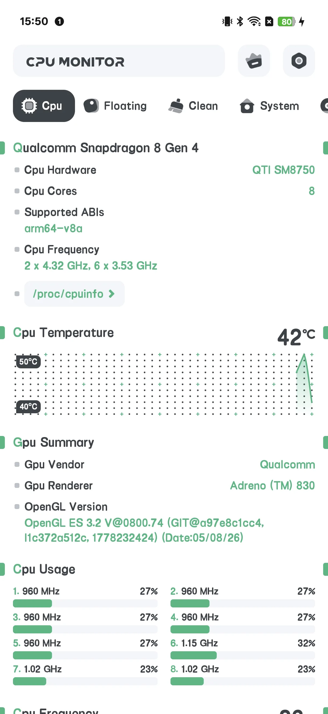
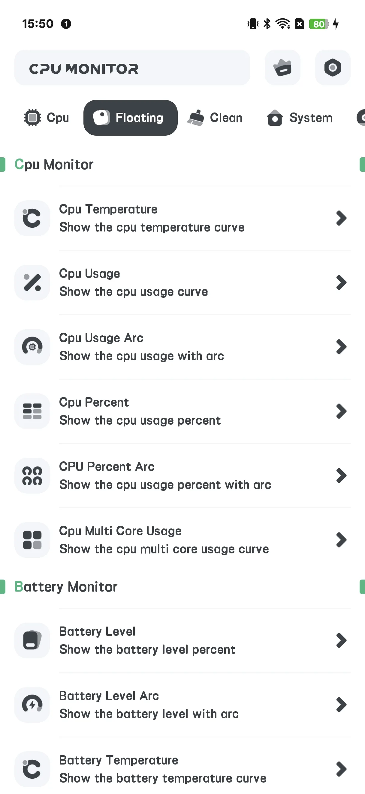
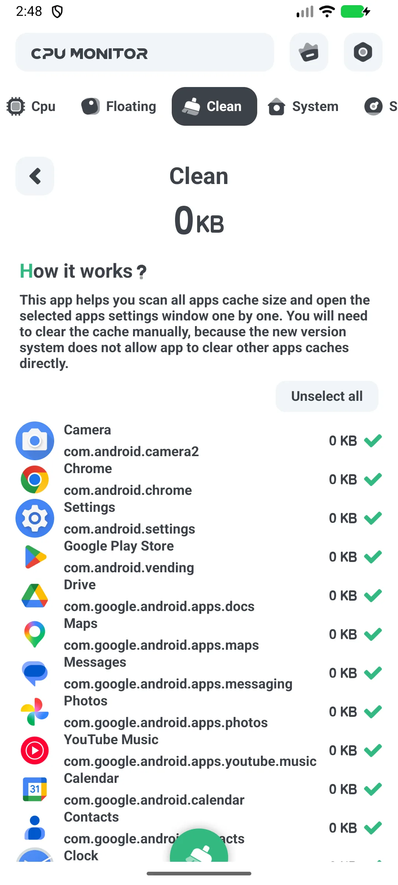
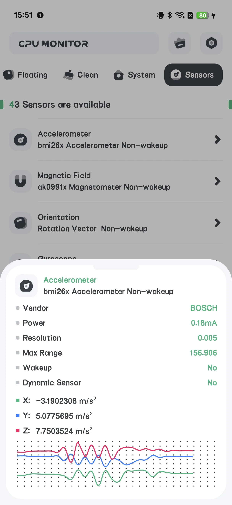
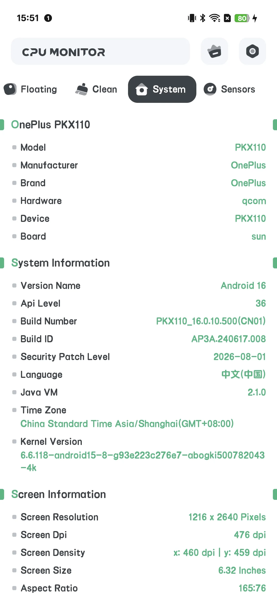

## Kandungan

- [Pengenalan Aplikasi](#pengenalan-aplikasi)
- [Penggunaan Pertama](#penggunaan-pertama)
- [CPU Waktu Nyata](#cpu-waktu-nyata)
- [Tetingkap Terapung](#tetingkap-terapung)
- [Widget Skrin Utama](#widget-skrin-utama)
- [Penggera Overheat](#penggera-overheat)
- [Lengkung Sejarah](#lengkung-sejarah)
- [Upgrade ke Pro](#upgrade-ke-pro)
- [Tetapan](#tetapan)
- [Senario Khas](#senario-khas)
- [FAQ](#faq)

## Pengenalan Aplikasi

CPU Monitor memaparkan **suhu [CPU](/ms/glossary/what-is-a-cpu-temperature-monitor/) dan frekuensi waktu nyata, RAM, bateri, dan storan** di Android, lengkap dengan tetingkap terapung, widget, penggera overheat, dan lengkung sejarah. Ini adalah alat **read-only**: ia membaca sensor thermal dan penghitung sistem tanpa root, dan tidak mengubah data game atau tetapan sistem. Panduan ini berjalan dari peluncuran pertama melalui tetingkap terapung, ambang **aplikasi penggera overheat CPU**, lengkung **monitor sejarah frekuensi CPU**, tata letak skrin utama **widget cpu ram bateri android**, dan skrin bersih cache — menjelaskan arti angka daripada menjanjikan penurunan suhu.

**📈 Pemantauan Terus**
- Suhu & frekuensi CPU, penggunaan per-core
- Statik RAM, bateri, dan storan di satu tempat

**🧹 Bersih**
- Skrin **CLEAN** memaparkan cache/junk aplikasi dan membiarkan Anda membersihkannya

**🌡 Penggera Overheat**
- Memperingatkan sebelum panas merusak prestasi atau bateri

**📉 Sejarah**
- Lengkung suhu / frekuensi untuk menemukan apa yang melonjakkan panas Anda

**💲 Percuma + Pro**
- Versi percuma **didukung iklan**
- **Pro** memadam iklan dan membuka toolset "Powerful System Monitor"

## Penggunaan Pertama

**CPU Monitor** dibuka pada skrin utama dengan **empat tab** — CPU, SYSTEM, FLOATING, dan SENSOR — serta butang **Upgrade** di bahagian atas untuk memadam iklan dan membuka toolset Pro. Tab CPU memaparkan suhu dan frekuensi masa nyata, tab SYSTEM menunjukkan statik RAM dan storan, tab FLOATING mengaktifkan tetingkap terapung, dan tab SENSOR membaca data perkakasan — semuanya hasil bacaan sensor dan penghitung sistem tanpa root. Panduan ini menelusuri setiap tab langkah demi langkah, bermula dari skrin utama di bawah.

{: width="180" .normal }
{: width="180" .normal }
{: width="180" .normal }
{: width="180" .normal }
{: width="180" .normal }

## CPU Waktu Nyata

Tab **CPU** pada **CPU Monitor** memaparkan bacaan suhu, frekuensi, dan beban per-core secara masa nyata, dengan statik RAM dan storan di satu tempat — kesemua angka dibaca terus daripada sensor thermal dan penghitung sistem tanpa root. Paparan ini menjadikan throttling haba kelihatan sebaik berlaku: frekuensi per-core yang jatuh semasa suhu meningkat menunjukkan perlambatan akibat panas, bukan masalah memori. Versi percuma menambah iklan banner di tab ini; **Upgrade ke Pro** memadamnya. Ikuti tiga langkah di bawah untuk membaca angka dengan betul.

1. Buka tab **CPU**
2. Baca suhu CPU, frekuensi, dan beban per-core waktu nyata
3. Versi percuma memaparkan iklan banner di sini

## Tetingkap Terapung

**CPU Monitor** menyediakan tetingkap terapung yang mengekalkan bacaan suhu CPU, penggunaan, bateri, FPS, RAM, dan System Monitor di atas mana-mana aplikasi selepas kebenaran overlay diberikan. Ciri ini berguna semasa gaming atau apabila anda mahu memantau haba tanpa menukar aplikasi — angka terus kelihatan di tepi skrin supaya anda boleh bertindak sebelum thermal throttling menurunkan prestasi. Tetingkap ini ringan dan tidak memerlukan root; ia berjalan sebagai overlay kebolehcapaian. Empat langkah di bawah mengaktifkannya.

1. Buka tab **FLOATING**
2. Alihkan monitor (suhu CPU/penggunaan/arc, bateri, FPS, RAM, System Monitor)
3. Berikan kebenaran overlay saat diminta
4. Statik terus terapung di atas aplikasi apa pun

## Widget Skrin Utama

**CPU Monitor** menawarkan widget skrin utama yang memaparkan suhu atau penggunaan CPU sekilas pandang tanpa perlu membuka aplikasi, dengan galeri widget yang boleh ditetapkan kepada paparan CPU sahaja. Widget ini menjadikan telefon pintar berguna sebagai paparan pantas pada skrin utama — sama ada untuk menyemak haba sebelum gaming atau memantau beban semasa bekerja. Ia berfungsi bersama tetingkap terapung dan penggera overheat untuk memberi tiga cara berbeza melihat angka yang sama. Dua langkah di bawah memasangnya.

1. Buka **Tetapan → Galeri widget** (set CPU-only)
2. Taruh widget suhu / penggunaan CPU di skrin utama

## Penggera Overheat

**CPU Monitor** menyediakan penggera overheat yang boleh diaktifkan untuk CPU dan/atau bateri dengan ambang yang anda tetapkan sendiri, memberi amaran sebelum haba merosakkan prestasi atau bateri. Ini adalah satu-satunya cara untuk bertindak awal tanpa memantau skrin secara berterusan — apabila suhu melepasi had, amaran muncul supaya anda boleh menutup aplikasi berat atau mencabut pengecas. Bacaan asasnya datang daripada sensor thermal peranti, read-only dan tanpa root. Tiga langkah di bawah menyediakan ambang tersebut.

1. Buka **Tetapan → Penggera overheat**
2. Alihkan penggera CPU dan/atau bateri dan tetapkan ambang
3. Anda akan diperingatkan sebelum keadaan merusak

## Lengkung Sejarah

**CPU Monitor** merekod **lengkung suhu dan frekuensi** dari masa ke masa pada paparan terapung dan sejarah, supaya anda boleh mengenal pasti game atau aplikasi mana yang melonjakkan haba sebaik sesi berakhir. Graf ini menukar bacaan seketika menjadi corak yang boleh ditindaklanjuti: lonjakan suhu yang sepadan dengan frekuensi puncak menunjukkan beban berat, manakala suhu tinggi dengan frekuensi jatuh menunjukkan throttling. Dengan sejarah ini, anda membuat keputusan berdasarkan bukti, bukan agakan — tutup aplikasi yang bermasalah atau laras tetapan grafiknya.

## Upgrade ke Pro

**CPU Monitor** menawarkan upgrade **Pro** sekali bayar yang memadam semua iklan dan membuka toolset penuh "Powerful System Monitor" — versi percuma mengekalkan iklan banner pada tab CPU dan skrin utama. Ciri Pro memperdalam pemantauan sistem di luar bacaan suhu dan frekuensi asas, menjadikan aplikasi ini toolkit lengkap untuk pengguna yang serius memantau peranti. Anda kekal menggunakan aplikasi yang sama; cuma dinding iklan dan had ciri yang hilang. Ketik **Upgrade** untuk membuka skrin Pro dan melihat senarai penuh yang ditawarkan.

## Tetapan

**CPU Monitor** mengumpulkan enam kumpulan tetapan dalam satu skrin — Upgrade, tema, penggera overheat, unit suhu, tingkat penyegaran, dan galeri widget — supaya anda boleh menyesuaikan pemantauan tanpa keluar aplikasi. Unit suhu menentukan sama ada bacaan dipaparkan dalam Celsius atau Fahrenheit, tingkat penyegaran mengawal sekerap mana angka dikemas kini, dan galeri widget menyediakan paparan skrin utama. Penggera overheat dan tema pula berfungsi bersama tetingkap terapung untuk mengekalkan amaran yang jelas. Tetapan merangkumi kesemua enam pilihan itu.

## Senario Khas

Lima senario harian menunjukkan di mana **CPU Monitor** memberi nilai paling jelas dengan bacaan suhu masa nyata, tetingkap terapung, penggera overheat, dan lengkung sejarahnya: memantau haba semasa gaming, menangkap titik panas pengecasan, mencari punca lonjakan suhu, membersihkan cache dengan cepat, dan menyenyapkan iklan melalui Pro. Dalam setiap kes, angka read-only dan amaran tepat pada masanya membantu anda bertindak sebelum haba merosakkan bateri atau prestasi. Skrin CLEAN pula menambah pembersihan cache apabila telefon terasa lemot. Butiran setiap senario disenaraikan di bawah.

- **Awasi panas saat gaming** — buka tab FLOATING, berikan overlay, dan suhu CPU/bateri terapung di atas game supaya Anda jeda sebelum throttling.
- **Tangkap hotspot pengisian** — taruh widget CPU skrin utama dan setel penggera overheat, maka Anda diperingatkan bila bateri memanas.
- **Temukan penyebab** — buka lengkung sejarah setelah sesi panas untuk melihat aplikasi mana yang melonjakkan suhu.
- **Bersih cepat** — gunakan skrin CLEAN untuk memadam cache/junk aplikasi saat telefon pintar terasa lemot.
- **Senyapkan iklan** — ketik Upgrade untuk memadam iklan dan membuka toolset Powerful System Monitor penuh.

## FAQ

### Apakah CPU Monitor sama dengan System Monitor?
{:.faq-q}
Mereka berkongsi kode, tetapi CPU Monitor menambah skrin **CLEAN** (cache) dan upgrade Pro; System Monitor read-only tanpa pembersihan.

### Mengapa saya melihat iklan?
{:.faq-q}
Versi percuma didukung iklan. Upgrade ke Pro untuk menghapusnya.

## Ringkasan

CPU Monitor adalah toolkit pemantauan terus praktikal — suhu waktu nyata, penggera overheat, statik terapung, widget, dan lengkung sejarah — dengan pembersih cache sebagai bonus.

## Istilah berkaitan

- [Apakah Itu Monitor Suhu CPU?](/ms/glossary/what-is-a-cpu-temperature-monitor/)
- [Apakah Itu System Monitor?](/ms/glossary/what-is-a-system-monitor/)
