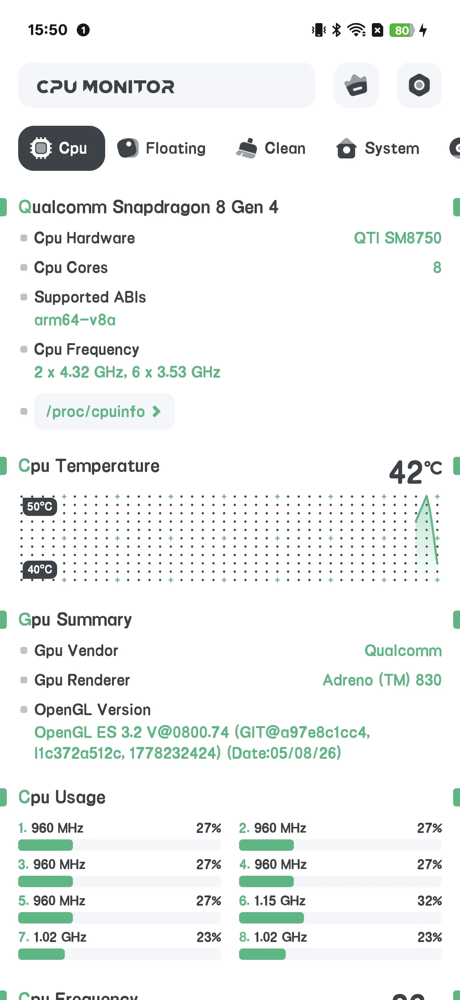
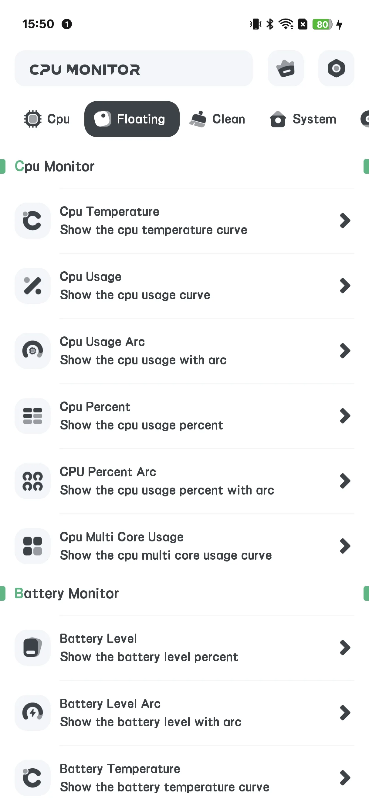
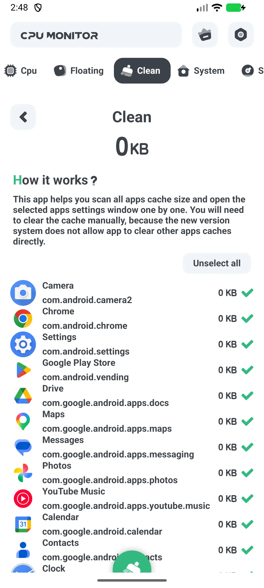
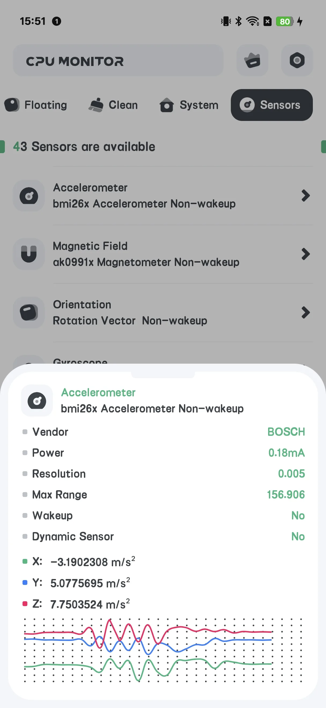
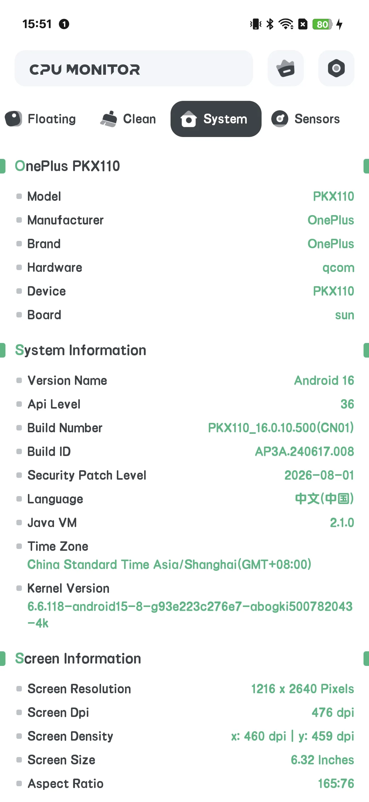

## Kandungan

- [Pengenalan Aplikasi](#pengenalan-aplikasi)
- [Penggunaan Pertama](#penggunaan-pertama)
- [CPU Waktu Nyata](#cpu-waktu-nyata)
- [Tetingkap Terapung](#tetingkap-terapung)
- [Widget Skrin Utama](#widget-skrin-utama)
- [Penggera Overheat](#penggera-overheat)
- [Lengkung Sejarah](#lengkung-sejarah)
- [Upgrade ke Pro](#upgrade-ke-pro)
- [Tetapan](#tetapan)
- [Senario Khas](#senario-khas)
- [FAQ](#faq)

## Pengenalan Aplikasi

CPU Monitor memaparkan **suhu [CPU](/ms/glossary/what-is-a-cpu-temperature-monitor/) dan frekuensi waktu nyata, RAM, bateri, dan storan** di Android, lengkap dengan tetingkap terapung, widget, penggera overheat, dan lengkung sejarah. Ini adalah alat **read-only**: ia membaca sensor thermal dan penghitung sistem tanpa root, dan tidak mengubah data game atau tetapan sistem. Panduan ini berjalan dari peluncuran pertama melalui tetingkap terapung, ambang **aplikasi penggera overheat CPU**, lengkung **monitor sejarah frekuensi CPU**, tata letak skrin utama **widget cpu ram bateri android**, dan skrin bersih cache — menjelaskan arti angka daripada menjanjikan penurunan suhu.

**📈 Pemantauan Terus**
- Suhu & frekuensi CPU, penggunaan per-core
- Statik RAM, bateri, dan storan di satu tempat

**🧹 Bersih**
- Skrin **CLEAN** memaparkan cache/junk aplikasi dan membiarkan Anda membersihkannya

**🌡 Penggera Overheat**
- Memperingatkan sebelum panas merusak prestasi atau bateri

**📉 Sejarah**
- Lengkung suhu / frekuensi untuk menemukan apa yang melonjakkan panas Anda

**💲 Percuma + Pro**
- Versi percuma **didukung iklan**
- **Pro** memadam iklan dan membuka toolset "Powerful System Monitor"

## Penggunaan Pertama

Skrin utama punya tab: **CPU / SYSTEM / FLOATING / SENSOR**, dengan butang **Upgrade** di atas.

{: width="180" .normal }
{: width="180" .normal }
{: width="180" .normal }
{: width="180" .normal }
{: width="180" .normal }

## CPU Waktu Nyata

1. Buka tab **CPU**
2. Baca suhu CPU, frekuensi, dan beban per-core waktu nyata
3. Versi percuma memaparkan iklan banner di sini

## Tetingkap Terapung

1. Buka tab **FLOATING**
2. Alihkan monitor (suhu CPU/penggunaan/arc, bateri, FPS, RAM, System Monitor)
3. Berikan kebenaran overlay saat diminta
4. Statik terus terapung di atas aplikasi apa pun

## Widget Skrin Utama

1. Buka **Tetapan → Galeri widget** (set CPU-only)
2. Taruh widget suhu / penggunaan CPU di skrin utama

## Penggera Overheat

1. Buka **Tetapan → Penggera overheat**
2. Alihkan penggera CPU dan/atau bateri dan tetapkan ambang
3. Anda akan diperingatkan sebelum keadaan merusak

## Lengkung Sejarah

Di paparan terapung/sejarah Anda boleh melihat **lengkung suhu dan frekuensi** dari waktu ke waktu — berguna untuk menemukan game atau aplikasi mana yang melonjakkan panas.

## Upgrade ke Pro

Ketik **Upgrade** untuk membuka skrin Pro: "Powerful System Monitor" memadam semua iklan dan membuka semua ciri.

## Tetapan

Tetapan merangkumi Upgrade, tema, penggera overheat, unit suhu, tingkat penyegaran, dan galeri widget.

## Senario Khas

- **Awasi panas saat gaming** — buka tab FLOATING, berikan overlay, dan suhu CPU/bateri terapung di atas game supaya Anda jeda sebelum throttling.
- **Tangkap hotspot pengisian** — taruh widget CPU skrin utama dan setel penggera overheat, maka Anda diperingatkan bila bateri memanas.
- **Temukan penyebab** — buka lengkung sejarah setelah sesi panas untuk melihat aplikasi mana yang melonjakkan suhu.
- **Bersih cepat** — gunakan skrin CLEAN untuk memadam cache/junk aplikasi saat telefon pintar terasa lemot.
- **Senyapkan iklan** — ketik Upgrade untuk memadam iklan dan membuka toolset Powerful System Monitor penuh.

## FAQ

### Apakah CPU Monitor sama dengan System Monitor?
{:.faq-q}
Mereka berkongsi kode, tetapi CPU Monitor menambah skrin **CLEAN** (cache) dan upgrade Pro; System Monitor read-only tanpa pembersihan.

### Mengapa saya melihat iklan?
{:.faq-q}
Versi percuma didukung iklan. Upgrade ke Pro untuk menghapusnya.

## Ringkasan

CPU Monitor adalah toolkit pemantauan terus praktikal — suhu waktu nyata, penggera overheat, statik terapung, widget, dan lengkung sejarah — dengan pembersih cache sebagai bonus.

## Istilah berkaitan

- [Apakah Itu Monitor Suhu CPU?](/ms/glossary/what-is-a-cpu-temperature-monitor/)
- [Apakah Itu System Monitor?](/ms/glossary/what-is-a-system-monitor/)
