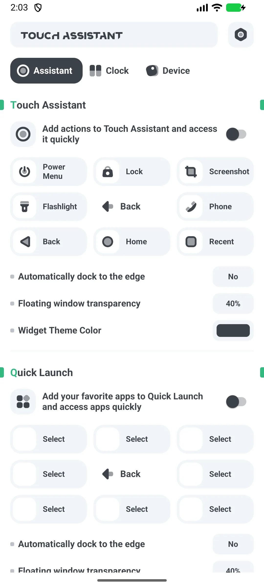
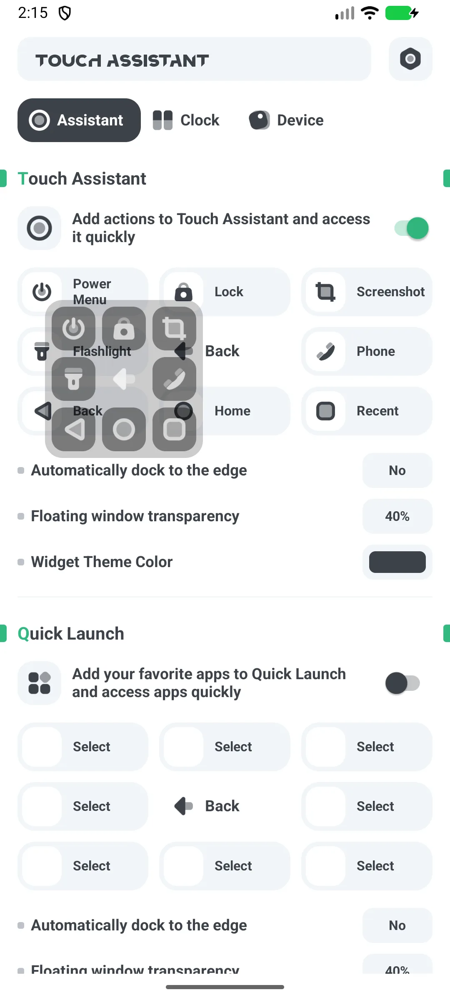
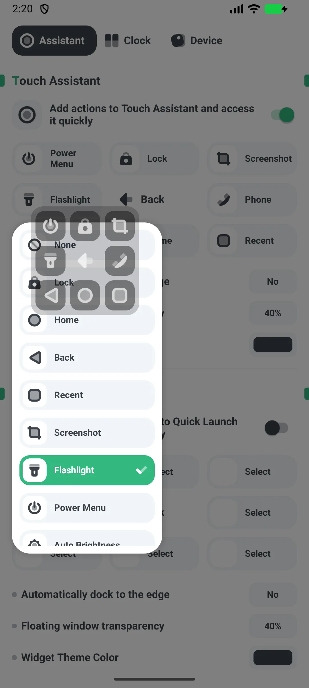

## Kandungan

- [Pengenalan Aplikasi](#pengenalan-aplikasi)
- [Penggunaan Pertama](#penggunaan-pertama)
- [Berikan Overlay dan Kebolehcapaian](#berikan-overlay-dan-kebolehcapaian)
- [Aktifkan dan Pindahkan Bola](#aktifkan-dan-pindahkan-bola)
- [Aksi Bola](#aksi-bola)
- [Pintasan Aplikasi](#pintasan-aplikasi)
- [Widget Toggle Sistem](#widget-toggle-sistem)
- [Ukuran, Warna, Dock](#ukuran-warna-dock)
- [Penggunaan Satu Tangan](#penggunaan-satu-tangan)
- [Percuma vs Pro](#percuma-vs-pro)
- [Senario Khas](#senario-khas)
- [FAQ](#faq)

## Pengenalan Aplikasi

Floating Assistant menambahkan sebuah [bola terapung](/ms/glossary/what-is-a-floating-window/) ke Android untuk peluncuran aplikasi cepat, toggle sistem, dan kendali satu tangan pada telefon pintar besar. Ia bekerja sebagai **aplikasi butang terapung untuk satu tangan android**: bola bertambat di salah satu tepi, setiap slot boleh dipetakan ulang, dan pintasan merangkumi aplikasi, kontak, dan toggle sistem. Panduan ini berjalan dari peluncuran pertama melalui pemberian kebenaran overlay dan kebolehcapaian, memindahkan dan mengubah ukuran bola, menugaskan **bola terapung dengan pintasan tersuai**, serta pembagian percuma/Pro — dengan penjelasan apa yang kebenaran tersebut perbolehkan dan tidak.

**🫳 Bola Terapung**
- Bola yang boleh diseret dan tetap di atas aplikasi apa pun (tanpa root)
- Menggantikan butang keras lewat perkhidmatan Kebolehcapaian

**⚡ 8 Slot Aksi**
- 15 aksi mungkin: menu daya, kunci, tangkapan skrin, senter, telepon, back, home, recent, kecerahan automatik, rotasi automatik, volume +/−/mute, dan lain-lain

**📱 Pintasan Aplikasi**
- 8 slot meluncurkan aplikasi terpasang Anda (aksi telepon atau pemanggil tersedia; **tidak ada pintasan kontak**)

**🔧 Widget Toggle Sistem**
- 11 widget skrin utama: Bluetooth, data seluler, Wi-Fi, senter, rotasi, pesawat, hotspot, DND, lokasi, getar, mode gelap

**💲 Percuma + Pro**
- Percuma memaparkan iklan; **Pro** adalah aplikasi terpisah tanpa iklan

## Penggunaan Pertama

**Floating Assistant** dibuka pada skrin utama dengan promo peningkatan di bahagian atas dan sakelar **"Home entry"** yang menghidupkan bola terapung — satu tindakan itu sahaja yang diperlukan untuk mula memaparkan bola di tepi skrin. Bola ini boleh diseret, bertambat secara automatik ke tepi kiri atau kanan, dan setiap slot boleh dipetakan semula dengan pintasan aplikasi mahupun aksi sistem. Roda tetapan membuka bahasa, nilai, bagikan, dan peningkatan. Panduan ini menelusuri persediaan awal hingga pembahagian percuma/Pro, termasuk apa yang dibenarkan oleh setiap kebenaran.

- Nyalakan **Home entry** untuk memaparkan bola
- Roda tetapan membuka bahasa, nilai, bagikan, dan peningkatan

{: width="180" .normal }

## Berikan Overlay dan Kebolehcapaian

**Floating Assistant** memerlukan dua kebenaran utama — **"Gambar di atas aplikasi lain"** dan **Kebolehcapaian** — serta pengecualian pengoptimuman bateri supaya bola kekal di atas aplikasi tanpa dihentikan sistem. Overlay membenarkan bola dilukis di atas skrin, manakala Kebolehcapaian diperlukan untuk aksi global seperti home, back, recent, kunci, dan tangkapan skrin. Kedua-duanya tidak memerlukan root; ia adalah kebenaran Android standard yang anda berikan sekali semasa persediaan. Empat langkah di bawah melengkapkan kebenaran ini.

1. Nyalakan **Home entry**
2. Berikan **"Gambar di atas aplikasi lain"** saat diminta (Tetapan sistem)
3. Terima **Kebolehcapaian** saat diminta — aksi butang bola (home/back/recent/kunci/tangkapan skrin) membutuhkannya
4. Izinkan **mengabaikan pengoptimalan bateri** supaya bola tidak dihentikan

Kebenaran overlay membiarkan bola melukis di atas aplikasi; Kebolehcapaian membiarkan melakukan aksi global.

## Aktifkan dan Pindahkan Bola

**Floating Assistant** memaparkan bola sebaik **Home entry** diaktifkan, dan bola itu boleh diseret ke mana sahaja sebelum secara automatik menempel ke tepi kiri atau kanan skrin. Kedudukannya disimpan sebagai peratusan skrin, jadi ia kekal konsisten apabila anda menukar orientasi atau menggunakan peranti dengan saiz berbeza. Dock boleh dimatikan jika anda mahu bola bebas bergerak. Tiga langkah di bawah mengaktifkan dan memindahkan bola mengikut keperluan anda.

1. Aktifkan **Home entry**
2. Bola muncul; **seret** untuk memindahkan — ia automatik menempel ke tepi kiri atau kanan
3. Posisinya disimpan sebagai persentase skrin

{: width="180" .normal }

## Aksi Bola

**Floating Assistant** mengembangkan bola menjadi **8 slot aksi** apabila diketik, dengan 15 aksi yang mungkin — menu daya, kunci, tangkapan skrin, senter, telepon, back, home, recent, kecerahan automatik, rotasi automatik, dan kawalan volume. Tetapan bawaan memetakan slot 1–9 kepada aksi yang paling kerap digunakan, dan anda boleh menukar mana-mana slot mengikut keperluan. Satu ketikan lagi menciutkan bola semula. Tiga langkah di bawah menggunakan dan menyesuaikan slot ini.

1. Ketik bola untuk **memperluas** menjadi 8 slot
2. Setiap slot memicu aksinya yang dipetakan (menu daya, kunci, tangkapan skrin, senter, telepon, back, home, recent, …)
3. Ketik bola lagi untuk menciutkan

Bawaan: 1=menu daya, 2=kunci, 3=tangkapan skrin, 4=senter, 6=telepon, 7=back, 8=home, 9=recent.

## Pintasan Aplikasi

**Floating Assistant** menyediakan sehingga **8 slot pintasan aplikasi** pada bola atau widget peluncur, membolehkan anda melancarkan aplikasi terpasang dengan satu ketikan tanpa menggali skrin utama. Setiap slot boleh diisi dengan aplikasi yang berbeza — jika aplikasi belum dipasang, ketikan membuka Google Play sebagai ganti. Perlu diingat: aksi berkaitan orang hanya terhad kepada telepon atau pemanggil, dan tiada pintasan kontak. Tiga langkah di bawah menyediakan pintasan ini.

1. Atur bola atau widget **peluncur aplikasi** dengan hingga 8 slot
2. Di setiap slot, pilih aplikasi terpasang
3. Ketik untuk meluncurkannya (atau Google Play bila belum ada)

## Widget Toggle Sistem

**Floating Assistant** menyediakan **11 widget toggle sistem** — Bluetooth, data seluler, Wi-Fi, senter, rotasi, pesawat, hotspot, DND, lokasi, getar, dan mod gelap — yang boleh diletakkan di skrin utama untuk kawalan seketik. Senter benar-benar mengalihkan lampu, rotasi menulis tetapan putaran automatik, manakala Wi-Fi, Bluetooth, dan DND membuka skrin tetapan sistem yang berkenaan. Widget **Gabung** mengumpulkan beberapa toggle dalam satu tempat. Tiga langkah di bawah menambah dan menggunakan widget ini.

1. Tambahkan **widget toggle** dari pemilih widget (11 tipe)
2. Contoh:
   - **Senter** benar-benar mengalihkan senter
   - **Wi-Fi / Bluetooth / DND** membuka skrin tetapan sistemnya
   - **Rotasi** menulis tetapan rotasi automatik
3. Gunakan widget **Gabung** untuk mengelompokkan beberapa toggle

{: width="180" .normal }

## Ukuran, Warna, Dock

**Floating Assistant** membolehkan anda menyesuaikan bola dengan **5 tahap saiz** S/M/L/XL/XXL, enam pilihan warna, alpha yang boleh diatur (bawaan kira-kira 40%), dan togol **Dock** yang mengawal penempelan automatik ke tepi. Warna bawaan adalah hitam, dengan pilihan putih, hijau, biru, kuning, dan ungu untuk disesuaikan dengan wallpaper atau keutamaan visual. Apabila Dock dimatikan, bola bebas diletakkan di mana sahaja tanpa menempel. Empat pilihan di bawah melengkapkan penyesuaian ini.

- **Ukuran**: 5 langkah S/M/L/XL/XXL
- **Alpha**: boleh diatur (bawaan ~40%)
- **Warna**: hitam / putih / hijau / biru / kuning / ungu (bawaan hitam)
- **Dock**: nyala atau mati mengontrol menempel automatik ke tepi

## Penggunaan Satu Tangan

**Floating Assistant** menjadikan telefon pintar besar boleh dikendalikan dengan satu tangan dengan meletakkan HOME, BACK, RECENTS, POWER-DIALOG, LOCK, dan TANGKAPAN SKRIN dalam bola terapung melalui perkhidmatan Kebolehcapaian, di samping senter, volume, dan rotasi. Ini bermakna semua kawalan yang biasanya memerlukan jangkauan ke tepi atau atas peranti kini berada di bawah ibu jari. Bola boleh diseret ke mana sahaja, jadi anda menentukan sendiri zon yang paling selesa untuk genggaman anda. Hasilnya adalah pengalaman satu tangan yang tidak mengubah cara anda memegang telefon pintar.

## Percuma vs Pro

**Floating Assistant** hadir dalam dua edisi: versi **Percuma** yang memaparkan iklan banner dan interstisial, serta aplikasi **Pro** terpisah yang benar-benar tanpa iklan. Kedua-duanya mengekalkan fungsi bola terapung yang sama; perbezaannya hanya pada gangguan iklan. Butang peningkatan dalam versi percuma tidak membeli Pro terus, sebaliknya membuka Google Play untuk memuat turun aplikasi berasingan itu. Dua edisi disenaraikan di bawah supaya anda tahu apa yang diperoleh.

- **Percuma** memaparkan iklan (banner + interstisial)
- **Pro** adalah aplikasi terpisah **tanpa iklan**; peningkatan dalam aplikasi hanya membuka Google Play untuknya

## Senario Khas

Lima senario harian menunjukkan di mana **Floating Assistant** memberi nilai paling jelas dengan bola terapung, lapan slot aksinya, dan 11 widget toggle sistemnya: penyiapan pertama, kawalan satu tangan pada telefon besar, kunci tanpa butang daya, lompat aplikasi cepat, dan toggle tanpa menggali tetapan. Dalam setiap kes, kebenaran yang diberikan sekali memastikan bola kekal di atas aplikasi, manakala slot dan widget meletakkan aksi yang paling kerap digunakan di hujung jari. Versi Pro tanpa iklan sesuai untuk pengguna harian yang mahu pengalaman bersih. Butiran setiap senario disenaraikan di bawah.

- **Penyiapan pertama** — nyalakan Home entry, berikan Gambar di atas aplikasi lain dan Kebolehcapaian sekali, lalu bola tetap di atas setiap aplikasi.
- **Satu tangan di telefon pintar besar** — seret bola ke tepi bawah supaya back, home, recent, dan tangkapan skrin mendarat di bawah ibu jari.
- **Kunci tanpa butang daya** — petakan slot ke kunci skrin dan hemat butang keras.
- **Lompat aplikasi cepat** — isi 8 slot aplikasi dengan aplikasi harian supaya lewati perburuan skrin utama.
- **Toggle tanpa menggali** — letakkan 11 widget toggle sistem (Wi-Fi, senter, DND…) di skrin utama untuk kendali seketuk.

## FAQ

### Apakah ada pintasan kontak?
{:.faq-q}
Tidak. Satu-satunya aksi berkaitan orang adalah pintasan **telepon atau pemanggil**. Tidak ada pintasan kontak.

### Bolehkah saya menyapu bola?
{:.faq-q}
Gerak isyarat hanya **ketik untuk melebar, ketik slot, dan seret untuk pindah atau dock**. Tidak ada pemetaan sapu kiri atau kanan.

### Mengapa Kebolehcapaian?
{:.faq-q}
Aksi butang global (home/back/recent/kunci/tangkapan skrin) dilakukan lewat perkhidmatan Kebolehcapaian Android.

## Ringkasan

Floating Assistant membuat telefon pintar besar boleh dioperasikan satu tangan: bola terapung untuk peluncuran dan aksi sistem, plus widget toggle — percuma untuk bermula, dengan aplikasi Pro tanpa iklan.

## Istilah berkaitan

- [Apakah Itu Assistive Touch?](/ms/glossary/what-is-assistive-touch/)
- [Apakah Itu Tetingkap Terapung?](/ms/glossary/what-is-a-floating-window/)
