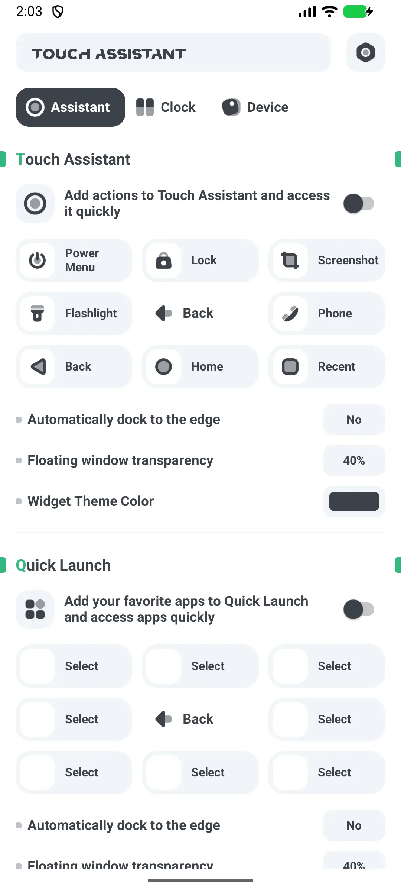
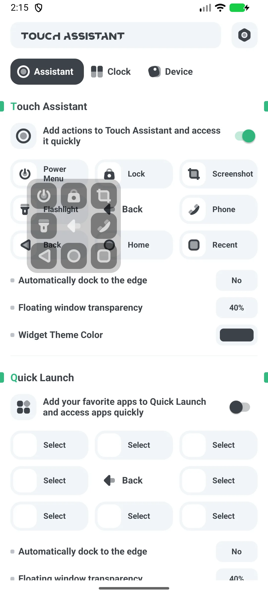
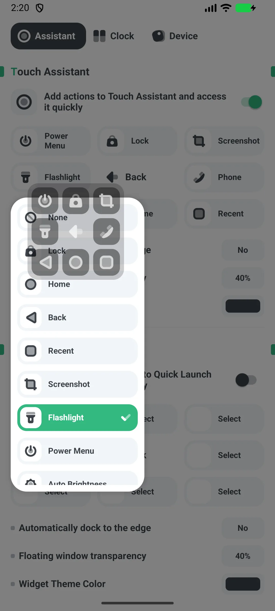

## Kandungan

- [Pengenalan Aplikasi](#pengenalan-aplikasi)
- [Penggunaan Pertama](#penggunaan-pertama)
- [Berikan Overlay dan Kebolehcapaian](#berikan-overlay-dan-kebolehcapaian)
- [Aktifkan dan Pindahkan Bola](#aktifkan-dan-pindahkan-bola)
- [Aksi Bola](#aksi-bola)
- [Pintasan Aplikasi](#pintasan-aplikasi)
- [Widget Toggle Sistem](#widget-toggle-sistem)
- [Ukuran, Warna, Dock](#ukuran-warna-dock)
- [Penggunaan Satu Tangan](#penggunaan-satu-tangan)
- [Percuma vs Pro](#percuma-vs-pro)
- [Senario Khas](#senario-khas)
- [FAQ](#faq)

## Pengenalan Aplikasi

Floating Assistant menambahkan sebuah [bola terapung](/ms/glossary/what-is-a-floating-window/) ke Android untuk peluncuran aplikasi cepat, toggle sistem, dan kendali satu tangan pada telefon pintar besar. Ia bekerja sebagai **aplikasi butang terapung untuk satu tangan android**: bola bertambat di salah satu tepi, setiap slot boleh dipetakan ulang, dan pintasan merangkumi aplikasi, kontak, dan toggle sistem. Panduan ini berjalan dari peluncuran pertama melalui pemberian kebenaran overlay dan kebolehcapaian, memindahkan dan mengubah ukuran bola, menugaskan **bola terapung dengan pintasan tersuai**, serta pembagian percuma/Pro — dengan penjelasan apa yang kebenaran tersebut perbolehkan dan tidak.

**🫳 Bola Terapung**
- Bola yang boleh diseret dan tetap di atas aplikasi apa pun (tanpa root)
- Menggantikan butang keras lewat perkhidmatan Kebolehcapaian

**⚡ 8 Slot Aksi**
- 15 aksi mungkin: menu daya, kunci, tangkapan skrin, senter, telepon, back, home, recent, kecerahan automatik, rotasi automatik, volume +/−/mute, dan lain-lain

**📱 Pintasan Aplikasi**
- 8 slot meluncurkan aplikasi terpasang Anda (aksi telepon atau pemanggil tersedia; **tidak ada pintasan kontak**)

**🔧 Widget Toggle Sistem**
- 11 widget skrin utama: Bluetooth, data seluler, Wi-Fi, senter, rotasi, pesawat, hotspot, DND, lokasi, getar, mode gelap

**💲 Percuma + Pro**
- Percuma memaparkan iklan; **Pro** adalah aplikasi terpisah tanpa iklan

## Penggunaan Pertama

Buka aplikasi ke skrin utama dengan promo peningkatan di atas dan sakelar **"Home entry"**.

- Nyalakan **Home entry** untuk memaparkan bola
- Roda tetapan membuka bahasa, nilai, bagikan, dan peningkatan

{: width="180" .normal }

## Berikan Overlay dan Kebolehcapaian

1. Nyalakan **Home entry**
2. Berikan **"Gambar di atas aplikasi lain"** saat diminta (Tetapan sistem)
3. Terima **Kebolehcapaian** saat diminta — aksi butang bola (home/back/recent/kunci/tangkapan skrin) membutuhkannya
4. Izinkan **mengabaikan pengoptimalan bateri** supaya bola tidak dihentikan

Kebenaran overlay membiarkan bola melukis di atas aplikasi; Kebolehcapaian membiarkan melakukan aksi global.

## Aktifkan dan Pindahkan Bola

1. Aktifkan **Home entry**
2. Bola muncul; **seret** untuk memindahkan — ia automatik menempel ke tepi kiri atau kanan
3. Posisinya disimpan sebagai persentase skrin

{: width="180" .normal }

## Aksi Bola

1. Ketik bola untuk **memperluas** menjadi 8 slot
2. Setiap slot memicu aksinya yang dipetakan (menu daya, kunci, tangkapan skrin, senter, telepon, back, home, recent, …)
3. Ketik bola lagi untuk menciutkan

Bawaan: 1=menu daya, 2=kunci, 3=tangkapan skrin, 4=senter, 6=telepon, 7=back, 8=home, 9=recent.

## Pintasan Aplikasi

1. Atur bola atau widget **peluncur aplikasi** dengan hingga 8 slot
2. Di setiap slot, pilih aplikasi terpasang
3. Ketik untuk meluncurkannya (atau Google Play bila belum ada)

## Widget Toggle Sistem

1. Tambahkan **widget toggle** dari pemilih widget (11 tipe)
2. Contoh:
   - **Senter** benar-benar mengalihkan senter
   - **Wi-Fi / Bluetooth / DND** membuka skrin tetapan sistemnya
   - **Rotasi** menulis tetapan rotasi automatik
3. Gunakan widget **Gabung** untuk mengelompokkan beberapa toggle

{: width="180" .normal }

## Ukuran, Warna, Dock

- **Ukuran**: 5 langkah S/M/L/XL/XXL
- **Alpha**: boleh diatur (bawaan ~40%)
- **Warna**: hitam / putih / hijau / biru / kuning / ungu (bawaan hitam)
- **Dock**: nyala atau mati mengontrol menempel automatik ke tepi

## Penggunaan Satu Tangan

Dengan bola Anda boleh melakukan HOME / BACK / RECENTS / POWER-DIALOG / LOCK / TANGKAPAN SKRIN lewat perkhidmatan Kebolehcapaian, plus senter, volume, dan rotasi di atas bola — sehingga mengontrol telefon pintar dengan ibu jari tanpa menjangkau butang fisik.

## Percuma vs Pro

- **Percuma** memaparkan iklan (banner + interstisial)
- **Pro** adalah aplikasi terpisah **tanpa iklan**; peningkatan dalam aplikasi hanya membuka Google Play untuknya

## Senario Khas

- **Penyiapan pertama** — nyalakan Home entry, berikan Gambar di atas aplikasi lain dan Kebolehcapaian sekali, lalu bola tetap di atas setiap aplikasi.
- **Satu tangan di telefon pintar besar** — seret bola ke tepi bawah supaya back, home, recent, dan tangkapan skrin mendarat di bawah ibu jari.
- **Kunci tanpa butang daya** — petakan slot ke kunci skrin dan hemat butang keras.
- **Lompat aplikasi cepat** — isi 8 slot aplikasi dengan aplikasi harian supaya lewati perburuan skrin utama.
- **Toggle tanpa menggali** — letakkan 11 widget toggle sistem (Wi-Fi, senter, DND…) di skrin utama untuk kendali seketuk.

## FAQ

### Apakah ada pintasan kontak?
{:.faq-q}
Tidak. Satu-satunya aksi berkaitan orang adalah pintasan **telepon atau pemanggil**. Tidak ada pintasan kontak.

### Bolehkah saya menyapu bola?
{:.faq-q}
Gerak isyarat hanya **ketik untuk melebar, ketik slot, dan seret untuk pindah atau dock**. Tidak ada pemetaan sapu kiri atau kanan.

### Mengapa Kebolehcapaian?
{:.faq-q}
Aksi butang global (home/back/recent/kunci/tangkapan skrin) dilakukan lewat perkhidmatan Kebolehcapaian Android.

## Ringkasan

Floating Assistant membuat telefon pintar besar boleh dioperasikan satu tangan: bola terapung untuk peluncuran dan aksi sistem, plus widget toggle — percuma untuk bermula, dengan aplikasi Pro tanpa iklan.

## Istilah berkaitan

- [Apakah Itu Assistive Touch?](/ms/glossary/what-is-assistive-touch/)
- [Apakah Itu Tetingkap Terapung?](/ms/glossary/what-is-a-floating-window/)
