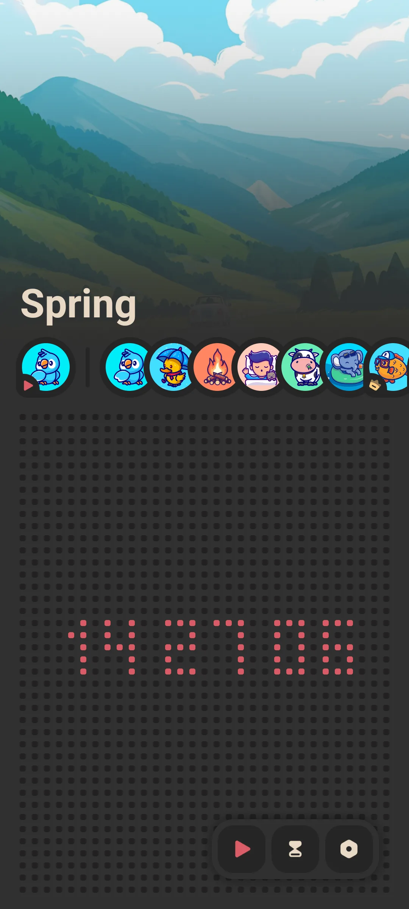
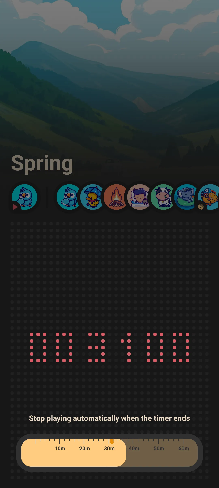
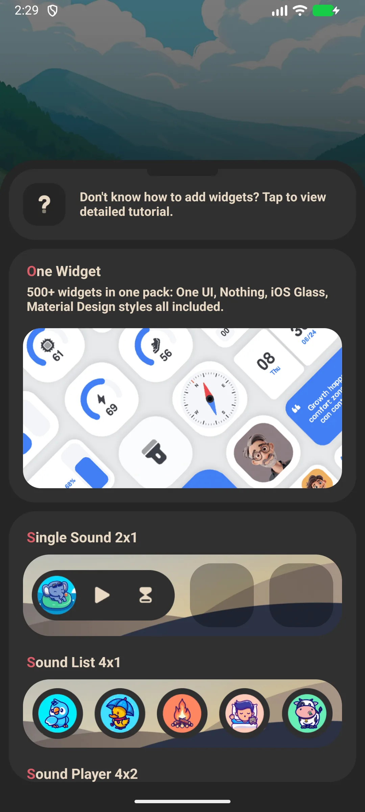

## Kandungan

- [Pendahuluan Aplikasi](#pendahuluan-aplikasi)
- [Penggunaan Pertama](#penggunaan-pertama)
- [Memutar Suara Ambient](#memutar-suara-ambient)
- [Tetapan Waktu Tidur](#tetapan-waktu-tidur)
- [Putar Latar dan Skrin Mati](#putar-latar-dan-skrin-mati)
- [Tema](#tema)
- [Widget Skrin Utama](#widget-skrin-utama)
- [Suara Percuma vs Premium](#suara-percuma-vs-premium)
- [Tetapan](#tetapan)
- [Senario Umum](#senario-umum)
- [FAQ](#faq)

## Pendahuluan Aplikasi

Meow FM adalah aplikasi [white-noise](/ms/glossary/what-is-white-noise/) bertema kucing untuk tidur, relaksasi, dan fokus. Putar suara ambient menenangkan untuk terlelap lebih cepat, fokus lebih lama, atau meredam ruangan berisik. Ini pemutar **white noise offline**: pustaka suara ada di peranti, sehingga **white noise untuk memblokir noise** tetap bekerja di pesawat atau skrin terkunci. Panduan ini berjalan dari putaran pertama Anda melalui **white noise dengan pemasa**, menumpuk trek ala **aplikasi suara hujan** di bawah gumaman rendah **aplikasi brown noise**, dan widget skrin utama — semua dari **aplikasi white noise kucing** yang tidak perlu akaun.

**🌧 Suara Ambient**
- A library of **15+ sounds**: rain, thunderstorm, forest, fireplace, wind, seaside, summer night, and more
- Browse the horizontal sound list and tap to play

**⏲ Tetapan Waktu Tidur**
- A pemasa slider from **0 to 60 minutes**; playback auto-stops when it ends so it never runs till morning

**🔇 Offline**
- Every sound plays with no network connection — great on planes, commutes and patchy hotel Wi-Fi

**🎨 Sederhana**
- Light / dark theme
- Free to start; a one-time unlock opens the premium sound scenes

> Catatan: Meow FM memutar **satu suara dalam satu waktu** (tidak ada layer/mixer untuk menggabungkan beberapa suara). Pilih adegan yang sesuai momen.

## Penggunaan Pertama

Skrin skrin utama adalah satu halaman: chip suara terpilih plus daftar gulir semua suara.

- Tap a sound to play it
- Tap again to stop
- Use the pemasa slider to schedule auto-stop

{: width="180" .normal }

## Memutar Suara Ambient

1. Di skrin skrin utama, gulir daftar suara
2. Ketik suara (mis. **Hujan** atau **Badai Petir**)
3. Mulai diputar segera dan chip diperbarui
4. Ketik suara yang sama lagi untuk berhenti, atau ketik lain-lain untuk beralih

Pemutaran berlanjut semasa Anda menggunakan aplikasi lain atau mengunci skrin.

## Tetapan Waktu Tidur

1. Seret **penggeser pemasa** dari 0 hingga 60 minit
2. Pemutaran berhenti secara automatik saat pemasa mencapai nol
3. Atur sebelum Anda terlelap supaya suara tidak jalan sepanjang malam

{: width="180" .normal }

## Putar Latar dan Skrin Mati

Meow FM menggunakan perkhidmatan pemutaran latar depan, sehingga suara tetap berjalan skrin mati dan tidak bergantung pada server. Ini ciri kunci untuk tidur dan fokus.

## Tema

Buka **Tetapan** dan beralih antara mode **terang** dan **gelap** (mode gelap aktif secara bawaan).

## Widget Skrin Utama

Meow FM menyediakan tiga jenis widget yang boleh Anda taruh di skrin utama:

- **Suara Tunggal** — putar satu ketik suara pilihan
- **Daftar Suara** — akses cepat ke beberapa suara
- **Pemutar Suara / sampul** — widget pemutar

Tambahkan dari pemilih widget, lalu konfigurasi suara di konfigurasi widget.

{: width="180" .normal }

## Suara Percuma vs Premium

- A set of sounds is **free** to play
- Additional **premium scenes** unlock via a **one-time purchase** (no subscription)

## Tetapan

Tetapan merangkumi tema (terang/gelap), promosi silang keluarga Meow, dan pilihan bil / pulihkan.

## Senario Umum

- **Tidur di malam berisik** — ketik adegan hujan atau badai, atur pemasa 60 minit, dan suara menutupi pasangan yang mendengkur sebelum mematikan diri.
- **Fokus di meja** — putar perapian atau tepi laut dan biarkan skrin mati; perkhidmatan latar depan berjalan sepanjang blok kerja.
- **Melancong tanpa isyarat** — setiap suara dibundel, sehingga pesawat atau Wi-Fi hotel buruk tidak pernah mengganggu masa tenang.
- **Satu ketik dari widget** — taruh widget Suara Tunggal di skrin utama dan mulai adegan tanpa membuka aplikasi.

## FAQ

### Bolehkah saya mencampur hujan + guntur bersama?
{:.faq-q}
Tidak di aplikasi saat ini — ia memutar satu suara dalam satu waktu. Pilih satu adegan yang paling pas (mis. Badai Petir sudah menggabung hujan dan guntur).

### Apakah perlu internet?
{:.faq-q}
Tidak. Semua suara dibundel dan diputar sepenuhnya offline.

### Bagaimana cara menghentikannya automatik?
{:.faq-q}
Gunakan pemasa tidur (0–60 minit); pemutaran berhenti di nol.

## Ringkasan

Meow FM adalah cara paling sederhana menambah suara ambient menenangkan ke tidur atau fokus — percuma untuk bermula, sepenuhnya offline, dengan pemasa tidur yang mematikan diri.

[Halaman aplikasi Meow FM](/ms/apps/meow-fm/) — tersedia di Android dan iOS.

## Istilah berkaitan

- [Apakah Itu White Noise?](/ms/glossary/what-is-white-noise/)
