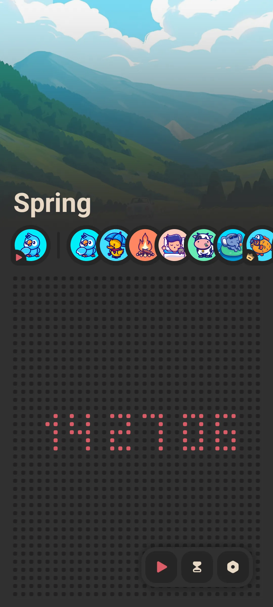
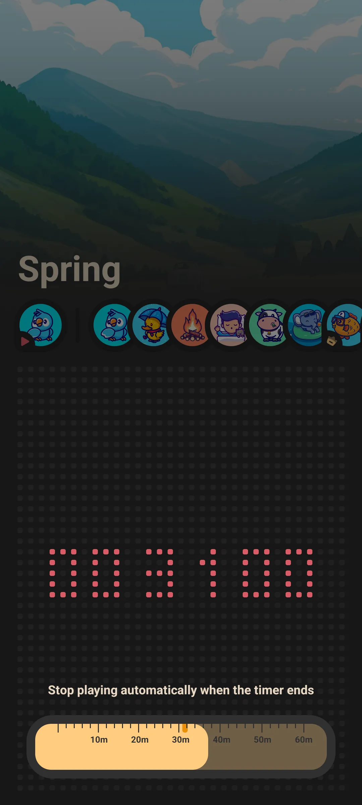
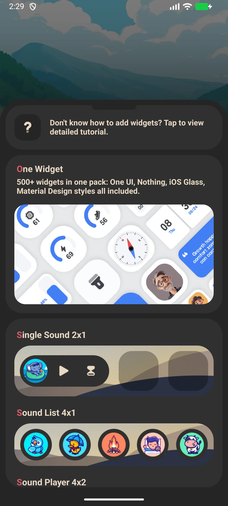

## Kandungan

- [Pendahuluan Aplikasi](#pendahuluan-aplikasi)
- [Penggunaan Pertama](#penggunaan-pertama)
- [Memutar Suara Ambient](#memutar-suara-ambient)
- [Tetapan Waktu Tidur](#tetapan-waktu-tidur)
- [Putar Latar dan Skrin Mati](#putar-latar-dan-skrin-mati)
- [Tema](#tema)
- [Widget Skrin Utama](#widget-skrin-utama)
- [Suara Percuma vs Premium](#suara-percuma-vs-premium)
- [Tetapan](#tetapan)
- [Senario Umum](#senario-umum)
- [FAQ](#faq)

## Pendahuluan Aplikasi

Meow FM adalah aplikasi [white-noise](/ms/glossary/what-is-white-noise/) bertema kucing untuk tidur, relaksasi, dan fokus. Putar suara ambient menenangkan untuk terlelap lebih cepat, fokus lebih lama, atau meredam ruangan berisik. Ini pemutar **white noise offline**: pustaka suara ada di peranti, sehingga **white noise untuk memblokir noise** tetap bekerja di pesawat atau skrin terkunci. Panduan ini berjalan dari putaran pertama Anda melalui **white noise dengan pemasa**, menumpuk trek ala **aplikasi suara hujan** di bawah gumaman rendah **aplikasi brown noise**, dan widget skrin utama — semua dari **aplikasi white noise kucing** yang tidak perlu akaun.

**🌧 Suara Ambient**
- A library of **15+ sounds**: rain, thunderstorm, forest, fireplace, wind, seaside, summer night, and more
- Browse the horizontal sound list and tap to play

**⏲ Tetapan Waktu Tidur**
- A pemasa slider from **0 to 60 minutes**; playback auto-stops when it ends so it never runs till morning

**🔇 Offline**
- Every sound plays with no network connection — great on planes, commutes and patchy hotel Wi-Fi

**🎨 Sederhana**
- Light / dark theme
- Free to start; a one-time unlock opens the premium sound scenes

> Catatan: Meow FM memutar **satu suara dalam satu waktu** (tidak ada layer/mixer untuk menggabungkan beberapa suara). Pilih adegan yang sesuai momen.

## Penggunaan Pertama

**Meow FM** memaparkan skrin utama satu halaman yang terdiri daripada chip suara terpilih dan senarai gulir semua suara, dengan **15+ adegan ambient** yang boleh dimainkan terus dengan satu ketikan. Setiap suara berjalan sepenuhnya offline dari pustaka dalam peranti — tiada akaun, tiada isyarat, dan tiada server luar terlibat. Penggeser pemasa 0–60 minit tersedia pada skrin yang sama untuk menjadualkan penutupan automatik, jadi anda boleh mengatur tidur tanpa meninggalkan halaman ini. Panduan ini menelusuri skrin tersebut langkah demi langkah.

- Tap a sound to play it
- Tap again to stop
- Use the pemasa slider to schedule auto-stop

{: width="180" .normal }

## Memutar Suara Ambient

**Meow FM** memutar satu suara ambient pada satu masa daripada pustaka **15+ adegan** seperti hujan, badai petir, hutan, perapian, angin, tepi laut, dan malam musim panas — kesemuanya tersimpan di peranti dan dimainkan tanpa sambungan rangkaian. Ketik mana-mana suara untuk memulakan, kemudian ketik lagi untuk berhenti atau ketik suara lain untuk bertukar serta-merta. Main balik berterusan walaupun anda bertukar aplikasi atau mengunci skrin, menjadikannya sesuai untuk tidur mahupun fokus. Empat langkah di bawah menggulir dan memilih suara.

1. Di skrin skrin utama, gulir daftar suara
2. Ketik suara (mis. **Hujan** atau **Badai Petir**)
3. Mulai diputar segera dan chip diperbarui
4. Ketik suara yang sama lagi untuk berhenti, atau ketik lain-lain untuk beralih

Pemutaran berlanjut semasa Anda menggunakan aplikasi lain atau mengunci skrin.

## Tetapan Waktu Tidur

**Meow FM** menyediakan penggeser pemasa tidur dari **0 hingga 60 minit** yang menghentikan main balik secara automatik apabila mencapai nol, supaya suara tidak berjalan sehingga pagi. Ini adalah cara paling mudah untuk membiarkan adegan hujan atau badai menutupi kebisingan semasa anda terlelap tanpa perlu bangun mematikannya. Tetapkan pemasa sebelum tidur, dan audio akan berhenti dengan sendirinya pada masa yang dipilih. Tiga langkah di bawah mengatur penutupan automatik ini.

1. Seret **penggeser pemasa** dari 0 hingga 60 minit
2. Pemutaran berhenti secara automatik saat pemasa mencapai nol
3. Atur sebelum Anda terlelap supaya suara tidak jalan sepanjang malam

{: width="180" .normal }

## Putar Latar dan Skrin Mati

**Meow FM** menggunakan perkhidmatan pemutaran latar depan supaya suara ambient terus berjalan walaupun skrin mati atau anda bertukar aplikasi, dan tidak bergantung pada mana-mana server. Ini adalah ciri penentu untuk tidur dan fokus: bunyi tidak terputus pada saat anda memerlukannya, tetapi juga tidak mengejutkan anda dengan iklan atau muat semula rangkaian. Setiap adegan dimainkan daripada pustaka lokal di peranti, jadi ia kekal boleh dipercayai di pesawat, kereta bawah tanah, atau Wi-Fi hotel yang tidak stabil. Gabungan latar depan dan storan offline inilah yang menjadikan Meow FM sesuai untuk sesi panjang.

## Tema

**Meow FM** menyediakan dua tema — **terang** dan **gelap** — yang boleh ditukar melalui **Tetapan**, dengan mod gelap aktif secara bawaan supaya skrin kekal tenang pada waktu malam. Pilihan ini bukan sekadar estetik: tema gelap mengurangkan cahaya yang mengganggu apabila anda menyemak pemasa sebelum tidur atau membiarkan skrin menyala semasa sesi fokus. Pertukaran serta-merta tanpa memulakan semula main balik, jadi suara ambient tidak terputus. Buka **Tetapan** dan pilih mode yang sesuai dengan suasana bilik anda.

## Widget Skrin Utama

**Meow FM** menyediakan **tiga jenis widget** skrin utama — **Suara Tunggal**, **Daftar Suara**, dan **Pemutar Suara / sampul** — supaya anda boleh memulakan adegan ambient tanpa membuka aplikasi. Widget Suara Tunggal memainkan satu suara pilihan dengan satu ketik, Daftar Suara memberi akses cepat kepada beberapa adegan, dan widget pemutar memaparkan sampul serta kawalan main. Ketiga-tiganya ditambah dari pemilih widget biasa, kemudian dikonfigurasi dengan memilih suara yang dikehendaki. Pilihan ini memendekkan laluan daripada keinginan tidur kepada bunyi yang menenangkan. Tiga jenis widget disenaraikan di bawah.

- **Suara Tunggal** — putar satu ketik suara pilihan
- **Daftar Suara** — akses cepat ke beberapa suara
- **Pemutar Suara / sampul** — widget pemutar

Tambahkan dari pemilih widget, lalu konfigurasi suara di konfigurasi widget.

{: width="180" .normal }

## Suara Percuma vs Premium

**Meow FM** membenarkan satu set suara dimainkan secara **percuma**, manakala adegan **premium** tambahan dibuka melalui **pembelian sekali bayar** tanpa langganan. Model ini bermakna anda boleh terus menggunakan aplikasi untuk tidur dan fokus tanpa komitmen bulanan, dan hanya membayar jika mahu lebih banyak variasi adegan. Pustaka percuma sudah merangkumi suara asas seperti hujan dan perapian yang paling kerap digunakan. Dua pilihan disenaraikan di bawah supaya anda tahu apa yang tersedia.

- A set of sounds is **free** to play
- Additional **premium scenes** unlock via a **one-time purchase** (no subscription)

## Tetapan

**Meow FM** mengumpulkan tiga kumpulan tetapan dalam satu skrin — tema terang atau gelap, promosi silang keluarga Meow, dan pilihan bil atau pulihkan pembelian — supaya anda boleh mengurus penampilan serta akses premium tanpa keluar aplikasi. Pemulihan pembelian berguna apabila anda memasang semula aplikasi pada peranti baharu: adegan premium yang sudah dibayar kembali dibuka tanpa perlu membayar lagi. Tema gelap kekal sebagai lalai untuk penggunaan waktu malam. Tetapan merangkumi kesemua tiga pilihan itu.

## Senario Umum

Empat senario harian menunjukkan di mana **Meow FM** memberi nilai paling jelas dengan **15+ adegan offline**, pemasa 0–60 minit, dan perkhidmatan latar depannya: tidur pada malam yang bising, fokus di meja, melancong tanpa isyarat, dan main balik satu ketik dari widget. Dalam setiap kes, suara ambient menutupi gangguan tanpa memerlukan internet, dan pemasa mematikan audio sendiri supaya anda tidak bangun pada tengah malam. Tiada akaun dan tiada server luar yang terlibat. Butiran setiap senario disenaraikan di bawah.

- **Tidur di malam berisik** — ketik adegan hujan atau badai, atur pemasa 60 minit, dan suara menutupi pasangan yang mendengkur sebelum mematikan diri.
- **Fokus di meja** — putar perapian atau tepi laut dan biarkan skrin mati; perkhidmatan latar depan berjalan sepanjang blok kerja.
- **Melancong tanpa isyarat** — setiap suara dibundel, sehingga pesawat atau Wi-Fi hotel buruk tidak pernah mengganggu masa tenang.
- **Satu ketik dari widget** — taruh widget Suara Tunggal di skrin utama dan mulai adegan tanpa membuka aplikasi.

## FAQ

### Bolehkah saya mencampur hujan + guntur bersama?
{:.faq-q}
Tidak di aplikasi saat ini — ia memutar satu suara dalam satu waktu. Pilih satu adegan yang paling pas (mis. Badai Petir sudah menggabung hujan dan guntur).

### Apakah perlu internet?
{:.faq-q}
Tidak. Semua suara dibundel dan diputar sepenuhnya offline.

### Bagaimana cara menghentikannya automatik?
{:.faq-q}
Gunakan pemasa tidur (0–60 minit); pemutaran berhenti di nol.

## Ringkasan

Meow FM adalah cara paling sederhana menambah suara ambient menenangkan ke tidur atau fokus — percuma untuk bermula, sepenuhnya offline, dengan pemasa tidur yang mematikan diri.

[Halaman aplikasi Meow FM](/ms/apps/meow-fm/) — tersedia di Android dan iOS.

## Istilah berkaitan

- [Apakah Itu White Noise?](/ms/glossary/what-is-white-noise/)
