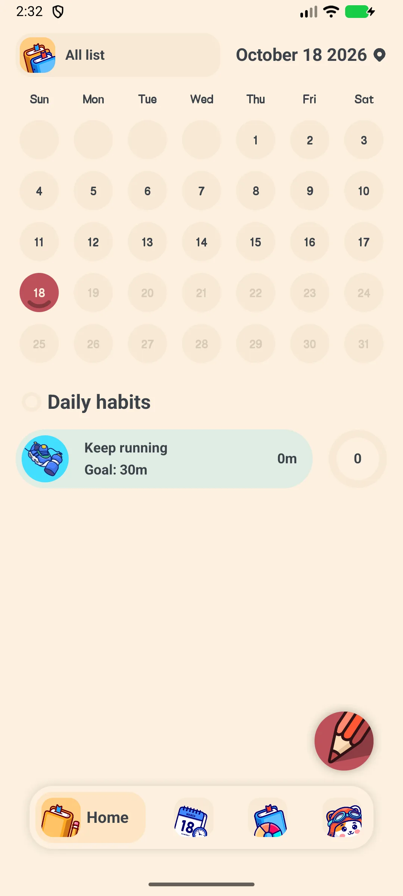
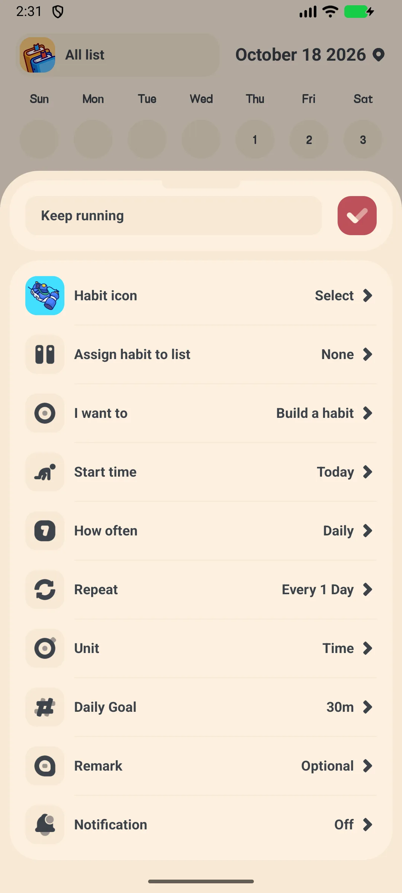
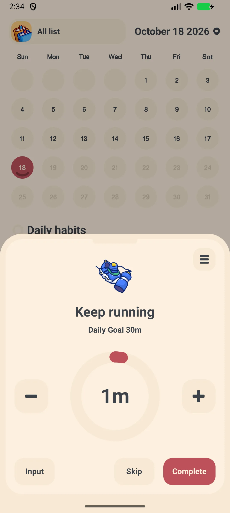
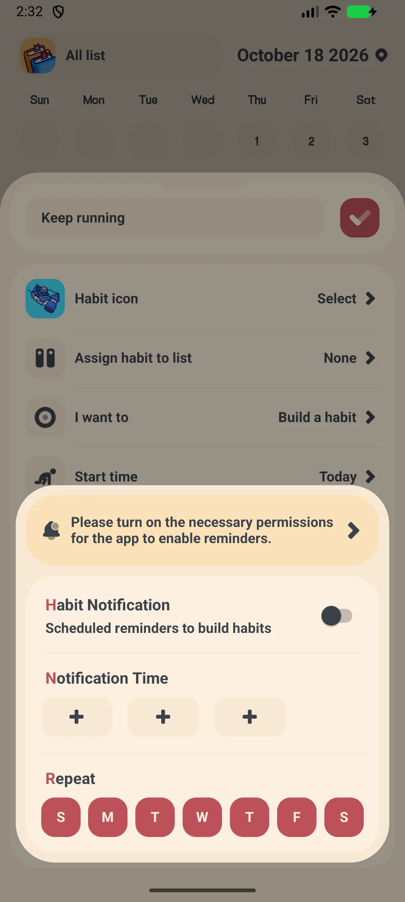
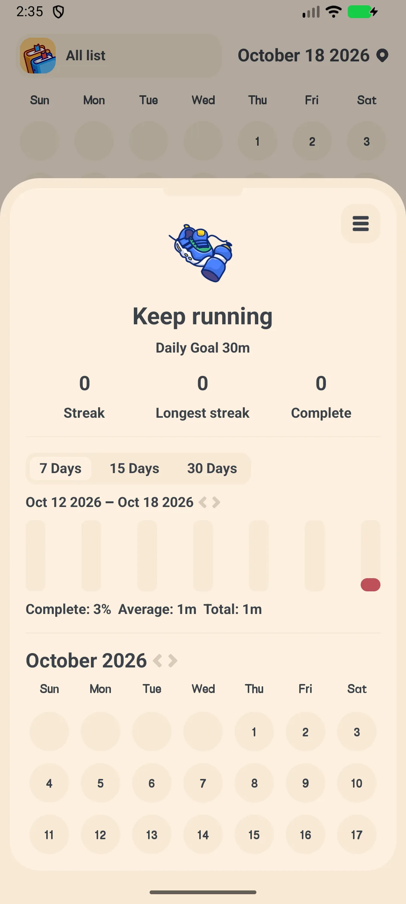

## Kandungan

- [Pengenalan Aplikasi](#pengenalan-aplikasi)
- [Penggunaan Pertama](#penggunaan-pertama)
- [Menambahkan Tabiat](#menambahkan-tabiat)
- [Check-in Harian](#check-in-harian)
- [Peringatan](#peringatan)
- [Streak dan Trend](#streak-dan-trend)
- [Edit, Arsip, atau Padam](#edit-arsip-atau-padam)
- [Sandaran dan Eksport](#sandaran-dan-eksport)
- [Tetapan](#tetapan)
- [Senario Umum](#senario-umum)
- [FAQ](#faq)

## Pengenalan Aplikasi

Meow Habits adalah **[aplikasi habit tracker](/ms/glossary/what-is-a-habit-tracker/)** comel sekaligus pembangun rutinitas untuk Android dan iOS. Bangun tabiat baik dan hentikan tabiat buruk dengan streak, graf, dan peta panas kalendar. Aplikasi ini bekerja sebagai **habit tracker tanpa akaun** dan **aplikasi habit tracker offline**: pencatatan tidak perlu pendaftaran maupun isyarat, dan **habit tracker dengan eksport CSV** serta **habit tracker dengan sandaran WebDav** menjaga sejarah tetap milik Anda. Panduan cara pakai aplikasi habit tracker ini memandu dari pembukaan pertama, lewat **habit tracker dengan widget** dan **habit tracker dengan peringatan**, hingga membaca trend Anda sendiri.

**🐱 500+ Ikon Comel**
- Pemilih ikon dengan sekitar **590 ikon** dalam **14 kategori**
- Pilih ikon dan warna untuk setiap tabiat

**🔥 Streak dan Graf**
- Streak dan tingkat penyelesaian per tabiat
- Paparan batang, pai, dan kalendar (peta panas) untuk progres Anda

**🔁 Siklus Fleksibel**
- Harian, Mingguan, Bulanan, atau Hari Tertentu (mis. Sen/Rab/Jum)
- Aturan tersuai "Setiap N hari/minggu"

**☁️ Peribadi**
- Offline secara lalai; sandaran Google Drive / WebDav pilihan
- Eksport CSV (VIP)

## Penggunaan Pertama

Aplikasi terbuka di tab **Skrin utama** yang memaparkan tabiat hari ini serta kalendar bulanan.

- Tab bawah: **Skrin utama**, **Tabiat**, **Trend**, **Tetapan**
- Ketik **+** untuk menambah tabiat pertama (versi percuma hingga **5 tabiat**; VIP membuka tanpa had)

{: width="180" .normal }

## Menambahkan Tabiat

1. Ketik **+** di tab Skrin utama
2. Pilih **template** atau mulai kosong → membuka **Tambah Tabiat**
3. Masukkan **nama**
4. Ketik **ikon** untuk membuka pemilih ikon (≈590 ikon, 14 kategori)
5. Pilih **Buku (daftar)** dan **jenis**
6. Tetapkan **target** (mis. jumlah atau durasi)
7. Atur **siklus**: Harian / Mingguan / Bulanan / Hari Tertentu, serta interval "Setiap N" jika perlu
8. Tetapkan **tarikh mulai**
9. Ketik **Konfirmasi**

{: width="180" .normal }

## Check-in Harian

1. Di tab Skrin utama atau Tabiat, ketik sebuah tabiat untuk membuka skrin **check-in**
2. Cincin progres besar memaparkan target hari ini
3. Pakai **+ / −** untuk mengubah jumlah, **Input** untuk mengetik nilai, **Lewati** untuk melewati, atau **Selesai** untuk menuntaskan
4. Menu 3 titik menyediakan Trend / Notifikasi / Catatan / Edit / Arsip / Padam

{: width="180" .normal }

## Peringatan

1. Buka sebuah tabiat dan ketik pilihan peringatan (lonceng)
2. Aktifkan peringatan harian
3. Pilih salah satu dari **3 chip waktu** dan tentukan hari (Min–Sab) yang berlaku
4. Aplikasi mengingatkan Anda untuk check-in

{: width="180" .normal }

## Streak dan Trend

1. Buka tabiat → **Detail** untuk melihat angka streak, batang sejarah, dan peta panas kalendar
2. Beralih ke tab **Trend** untuk graf dan pencapaian

{: width="180" .normal }

## Edit, Arsip, atau Padam

Dari menu 3 titik di skrin check-in Anda boleh **Edit**, **Arsip** (sejarah tetap disimpan tetapi disembunyikan), atau **Padam** sebuah tabiat.

## Sandaran dan Eksport

- **Tetapan → Google Drive / WebDav** untuk mencadangkan dan memulihkan
- **Tetapan → Eksport** memungkinkan Anda memilih tabiat, menentukan julat tarikh, dan berkongsi **CSV**

## Tetapan

Tetapan merangkumi banner VIP, **mode gelap**, **bahasa**, **hari awal pekan**, **kunci aplikasi** (VIP), suara, notifikasi, **widget**, Daftar, Tabiat, **Eksport** (VIP), Google Drive, WebDav, dan bahagian keluarga Meow.

## Senario Umum

- **Rutinitas pagi** — setelah disiapkan, sematkan 'Minum air' dan 'Peregangan' ke widget skrin utama dan check-in dari skrin kunci supaya streak harian tidak pernah putus.
- **Hentikan tabiat buruk** — buat tabiat 'Berhenti scroll' dengan peringatan harian; peta panas kalendar membuat satu kelalaian kelihatan sebelum berubah jadi streak yang putus.
- **Tinjau bulan Anda** — buka tab Trend untuk melihat tingkat penyelesaian dan pencapaian, lalu pakai Tetapan → Eksport (VIP) untuk menarik CSV demi analisis lebih dalam.
- **Tetap peribadi offline** — semuanya berjalan tanpa akaun; aktifkan Google Drive atau WebDav hanya saat ingin sandaran lintas peranti.

## FAQ

### Apa yang memutus streak?
{:.faq-q}
Streak berlanjut selama Anda check-in pada hari yang dijadwalkan. Melewatkan satu hari terjadwal mengatur ulang streak saat ini untuk tabiat itu.

### Apakah ada had versi percuma?
{:.faq-q}
Ya — versi percuma mengizinkan hingga **5 tabiat**. VIP membuka tabiat tanpa had, daftar tanpa had, mode gelap, kunci aplikasi, dan eksport CSV.

### Di mana data saya disimpan?
{:.faq-q}
Secara lalai di peranti Anda. Pakai sandaran Google Drive atau WebDav untuk memindahkannya antarperangkat.

## Ringkasan

Meow Habits mengubah cara membuat tabiat menjadi ritual harian yang tenang dengan ikon comel, streak harian, dan trend yang jelas — dan bekerja sepenuhnya offline.

[Halaman aplikasi Meow Habits](/ms/apps/meow-habits/) — tersedia di Android dan iOS.

## Istilah Berkaitan

- [Apakah Itu Aplikasi Penjejak Tabiat (Habit Tracker)?](/ms/glossary/what-is-a-habit-tracker/)
