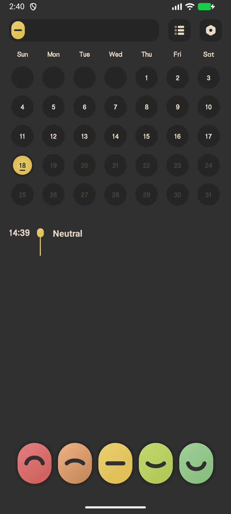
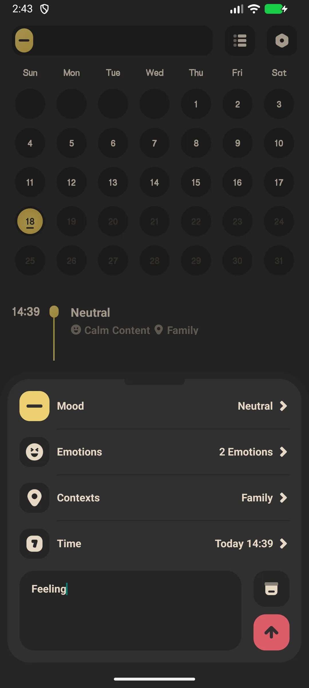
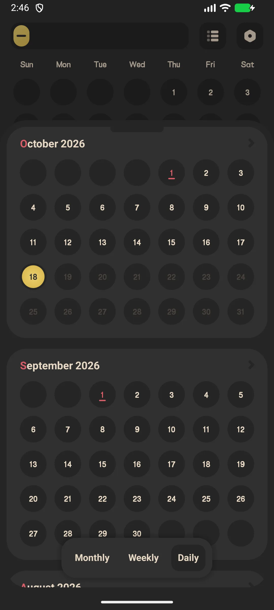
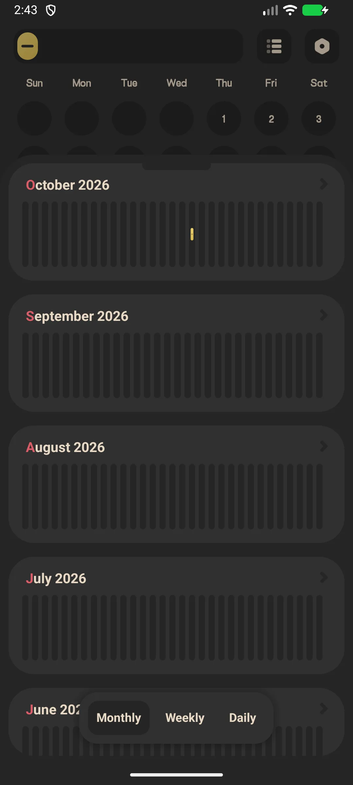

## Kandungan

- [Pengenalan Aplikasi](#pengenalan-aplikasi)
- [Penggunaan Pertama](#penggunaan-pertama)
- [Catat Mood (Satu Ketik)](#catat-mood-satu-ketik)
- [Entri Mood Lengkap](#entri-mood-lengkap)
- [Kalendar Sejarah](#kalendar-sejarah)
- [Statistik dan Trend](#statistik-dan-trend)
- [Peringatan Harian](#peringatan-harian)
- [Kunci Aplikasi (VIP)](#kunci-aplikasi-vip)
- [Sandaran](#sandaran)
- [Tetapan](#tetapan)
- [Senario Umum](#senario-umum)
- [FAQ](#faq)

## Pengenalan Aplikasi

Meow Mood Diary adalah [buku harian mood](/ms/glossary/what-is-a-mood-tracker/) dan aplikasi jurnal yang selamat serta peribadi, dengan antara muka bertema kucing yang menenangkan. Ia bekerja sebagai **aplikasi mood tracker offline** dan **aplikasi check-in harian**: satu ketik mencatat mood, ketik kedua menambahkan aktivitas dan catatan, dan bahagian lain panduan ini membincangkan kalendar, graf, kunci aplikasi pilihan, peringatan, serta cara mengeluarkan sejarah dari **aplikasi buku harian mood** yang tidak pernah meminta Anda mendaftar.

**😺 Pencatatan Satu Ketik**
- Lima "kapsul" tingkat mood di skrin skrin utama
- Ketik kapsul untuk terus mencatat, atau buka untuk entri lebih lengkap

**📊 Wawasan**
- Kalendar bulanan yang diwarnai sesuai mood
- Statistik: distribusi tingkat (pai), histogram bulanan, frekuensi emosi, frekuensi konteks

**🔒 Peribadi Secara Bawaan**
- Data disimpan **hanya secara lokal** — tidak ada yang diunggah ke server
- Sandaran Google Drive / WebDav pilihan (Anda yang mengendalikan cloud)
- Kunci aplikasi (cap jari / kode sandi) adalah ciri **VIP**

**🎨 Pilihan Kaya**
- **48 emosi bawaan** (24 tidak menyenangkan + 6 netral + 18 menyenangkan) dikelompokkan ke 5 tingkat mood
- **18 tag konteks** (di mana / dengan siapa)
- Percuma vs VIP: lebih banyak ikon, lebih banyak warna tema, kunci aplikasi, dan eksport PDF

## Penggunaan Pertama

**Meow Mood Diary** dibuka pada skrin utama yang memaparkan **lima kapsul mood**, kalendar bulanan, dan senarai mood hari ini dalam satu paparan, jadi anda boleh merekod perasaan dan melihat sejarah tanpa berpindah skrin. Kapsul-kapsul itu membolehkan pencatatan satu ketik, manakala menu statistik dan tetapan di bahagian atas memberikan akses kepada wawasan serta pilihan privasi. Reka bentuk ini mengutamakan kelajuan — satu ketik untuk mood, ketik kedua untuk butiran. Elemen skrin utama disenaraikan di bawah.

- Ketik **menu statistik** (atas) untuk melihat statistik
- Ketik **menu tetapan** (atas) untuk membuka tetapan

{: width="180" .normal }

## Catat Mood (Satu Ketik)

**Meow Mood Diary** membolehkan anda menyimpan mood dengan satu ketik pada **kapsul mood** di skrin utama — kapsul mengembang, dan ketikan pada konfirmasi terus menyimpan tahap mood tanpa catatan mahupun tag. Laluan ini sesuai untuk hari yang sibuk atau berat apabila menulis perenggan tidak praktikal, kerana rekod tetap terbentuk dalam beberapa saat. Jika anda mahu butiran, ikon roda gerigi pada kapsul yang sama membuka entri lengkap. Dua langkah di bawah menerangkan pencatatan pantas ini.

1. Di skrin skrin utama, ketik **kapsul mood** (mis. "Senang")
2. Kapsul mengembang — ketik **konfirmasi** untuk menyimpan seketika, atau ketik ikon **tetapan (roda gerigi)** untuk menambah butiran

Catatan satu ketik menyimpan tingkat mood tanpa catatan maupun tag.

## Entri Mood Lengkap

**Meow Mood Diary** menyediakan entri mood terperinci dengan **48 emosi bawaan** yang dikelompokkan kepada lima tahap, **18 tag konteks**, catatan pilihan, dan tetapan waktu — semuanya melalui tujuh langkah dari roda gerigi pada kapsul mood. Pilihan ganda pada tag emosi dan konteks membolehkan anda menggambarkan suasana dengan tepat, misalnya "ceria" di "tempat kerja" pada waktu tertentu. Masa tidak boleh ditetapkan ke masa depan supaya rekod kekal jujur. Tujuh langkah di bawah membina satu entri lengkap.

1. Ketik roda gerigi pada kapsul → **Tambah Mood**
2. Pilih **tingkat mood** (1–5)
3. Pilih **tag emosi** (pilih ganda dari 48 emosi)
4. Pilih **tag konteks** (pilih ganda dari 18 konteks)
5. Atur **waktu** (tidak boleh di masa depan)
6. Tulis **catatan** pilihan
7. Ketik **Simpan**

{: width="180" .normal }

## Kalendar Sejarah

**Meow Mood Diary** mewarnai setiap hari pada kalendar bulanan berdasarkan **purata tahap mood** hari itu, menghasilkan peta haba yang mendedahkan corak emosi dari masa ke masa — hari mendatang kekal kelabu supaya tidak mengelirukan. Anda boleh meluncur bulan demi bulan dan mengetik mana-mana hari untuk membaca entri yang direkod pada tarikh tersebut. Paparan ini menukar catatan harian yang berasingan menjadi gambaran keseluruhan yang mudah dibaca. Tiga tindakan di bawah menggunakan kalendar sejarah.

- Luncur kalendar skrin utama bulan demi bulan
- Setiap hari berupa busur berwarna yang mencerminkan **rata-rata tingkat mood** hari itu (hari mendatang tampak keabuan)
- Ketik satu hari untuk melihat entri hari itu

{: width="180" .normal }

## Statistik dan Trend

**Meow Mood Diary** mempamerkan empat paparan statistik — carta pai untuk taburan tahap mood, histogram bulanan, kekerapan emosi, dan kekerapan konteks — yang boleh ditukar antara tab Bulan, Minggu, dan Hari supaya anda mengenali corak pada mana-mana skala masa. Graf ini menjawab soalan yang tidak boleh dijawab oleh catatan harian sahaja: emosi mana yang paling kerap muncul, dan dalam konteks apa. Data kekal peribadi kerana semuanya dikira daripada entri lokal di peranti. Tiga langkah di bawah membuka dan meninjau statistik ini.

1. Ketik ikon statistik (kanan atas)
2. Beralih tab **Bulan / Minggu / Hari**
3. Tinjau:
   - **Distribusi tingkat** graf pai
   - **Histogram bulanan**
   - **Frekuensi emosi** dan **frekuensi konteks**

{: width="180" .normal }

## Peringatan Harian

**Meow Mood Diary** menghantar notifikasi lembut — "Apa kabar hari ini?" atau "Saatnya mencatat mood!" — pada waktu yang anda tetapkan melalui Tetapan → Peringatan, membantu membina rutin check-in tanpa terasa memaksa. Peringatan harian penting untuk mengekalkan rentak rekod, kerana satu hari yang terlewat mewujudkan jurang dalam kalendar dan graf trend. Anda mengaktifkan ciri ini dan memilih masa yang sesuai dengan jadual harian. Tiga langkah di bawah menyediakan peringatan.

1. Tetapan → **Peringatan**
2. Aktifkan peringatan harian dan atur waktunya
3. Anda menerima notifikasi lembut "Apa kabar hari ini?" / "Saatnya mencatat mood!"

## Kunci Aplikasi (VIP)

**Meow Mood Diary** menawarkan kunci aplikasi sebagai ciri **VIP** yang menggunakan cap jari atau kod sandi untuk menjaga buku harian tetap peribadi pada peranti yang dikongsi, dengan peningkatan pakej diperlukan jika anda belum VIP. Ini melengkapkan storan lokal yang sudah tidak memuat naik apa pun ke server — kunci menambah lapisan perlindungan fizikal apabila orang lain memegang telefon anda. Entri kekal di peranti dan hanya anda yang boleh membukanya. Tiga langkah di bawah mengaktifkan kunci aplikasi.

1. Tetapan → **Kunci aplikasi**
2. Bila belum VIP, Anda akan diminta meningkatkan pakej
3. Pengguna VIP boleh mengaktifkan kunci cap jari atau kode sandi

## Sandaran

**Meow Mood Diary** menyediakan sandaran pilihan melalui **Google Drive** dan **WebDav** — dengan pilihan masuk, sandarkan, pulihkan, dan sandaran automatik — namun entri sentiasa kekal di peranti kecuali anda sendiri memilih untuk mencadangkannya. Ini bermakna anda mengawal sepenuhnya ke mana data peribadi pergi: tidak ada muat naik ke server vendor, dan cloud hanya digunakan apabila anda mahu sandaran lintas peranti. Sandaran automatik mengelakkan kehilangan sejarah selepas tetapan semula kilang. Akses kedua-dua pilihan melalui Tetapan → Google Drive atau WebDav.

## Tetapan

**Meow Mood Diary** mengumpulkan pelbagai tetapan dalam satu skrin — bahasa, hari awal pekan, kunci aplikasi (VIP), widget, ikon mood (VIP), warna tema (VIP), tag emosi dan konteks, eksport (VIP), peringatan, serta Google Drive dan WebDav — supaya anda boleh menyesuaikan pencatatan dengan keperluan peribadi. Hari awal pekan mempengaruhi paparan kalendar, manakala tag emosi dan konteks boleh disunting agar sesuai dengan cara anda menggambarkan perasaan. Ciri VIP seperti kunci, ikon tambahan, warna tema, dan eksport PDF menyediakan penyesuaian lebih mendalam. Semua pilihan ini tersedia dari skrin Tetapan.

## Senario Umum

Empat senario harian menunjukkan di mana **Meow Mood Diary** memberi nilai paling jelas dengan pencatatan satu ketik, storan lokal, kalendar berwarna, dan graf trendnya: catatan cepat pada hari yang buruk, privasi secara bawaan, penemuan corak emosi, serta penggunaan offline di mana sahaja. Dalam setiap kes, perasaan direkod serta-merta tanpa perlu menulis panjang, dan tiada data meninggalkan peranti kecuali anda memilih Google Drive. Ciri VIP seperti kunci cap jari dan eksport PDF sesuai untuk pengguna yang mahu perlindungan dan analisis lebih lanjut. Butiran setiap senario disenaraikan di bawah.

- **Catatan cepat saat hari buruk** — pada malam yang berat, ketik satu emosi dan beberapa tag; tanpa paragraf, sehingga buku harian tetap bertahan di hari yang biasanya Anda lewatkan.
- **Peribadi secara bawaan** — entri tetap di peranti di sebalik kunci cap jari (VIP); pada telefon pintar keluarga bersama, pikiran Anda tidak pernah tersinkron ke cloud vendor kecuali Anda memilih Google Drive.
- **Menemukan pola** — kalendar dan graf memunculkan 'rasa muram hari Minggu' atau lonjakan setelah kopi, mengubah perasaan samar jadi sesuatu yang boleh ditindaklanjuti.
- **Offline di mana sahaja** — catat di pesawat atau di area kereta bawah tanah tanpa isyarat; tidak ada yang perlu Wi-Fi untuk merekam momen.

## FAQ

### Apakah buku harian saya diunggah ke server?
{:.faq-q}
Tidak. Semua entri disimpan dalam basis data lokal di peranti Anda. Hanya Anda yang boleh mencadangkannya ke Google Drive atau WebDav milik sendiri.

### Bagaimana warna kalendar ditentukan?
{:.faq-q}
Warna setiap hari adalah rata-rata tingkat mood dari entri hari itu, dipetakan ke palet 5 warna tema aktif. Hari tanpa entri dibiarkan polos.

### Bolehkah saya mengekspor buku harian?
{:.faq-q}
Ya — eksport PDF adalah ciri VIP.

## Ringkasan

Meow Mood Diary membuat penjejakan mood harian terasa mudah dan peribadi, dengan kalendar yang jelas serta graf trend untuk memahami emosi Anda dari waktu ke waktu.

[Halaman aplikasi Meow Mood Diary](/ms/apps/meow-mood-diary/) — tersedia di Android dan iOS.

## Istilah Berkaitan

- [Apakah Itu Penjejak Suasana Hati?](/ms/glossary/what-is-a-mood-tracker/)
