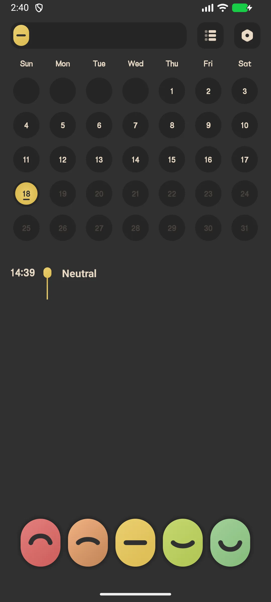
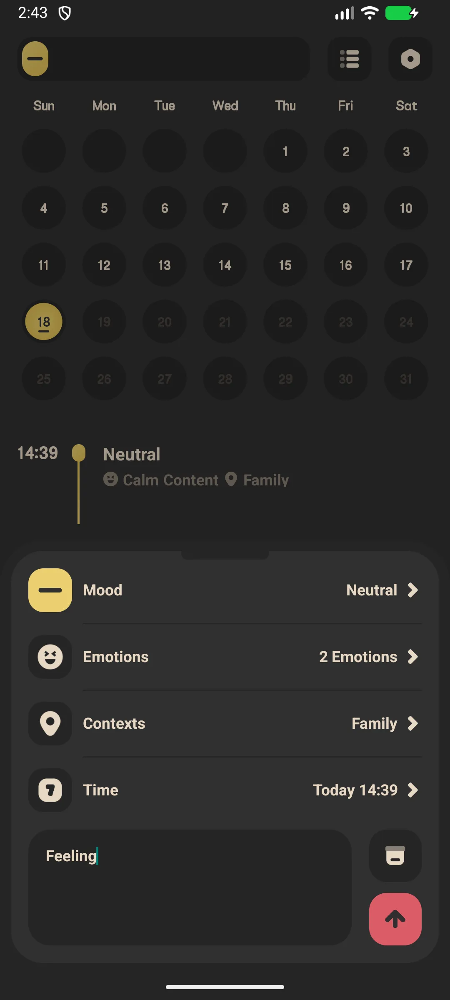
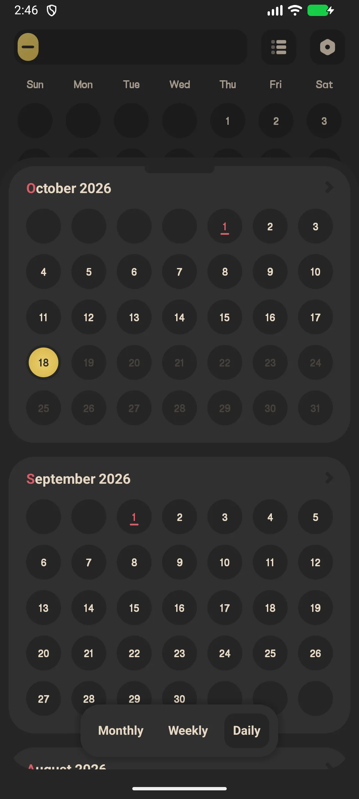
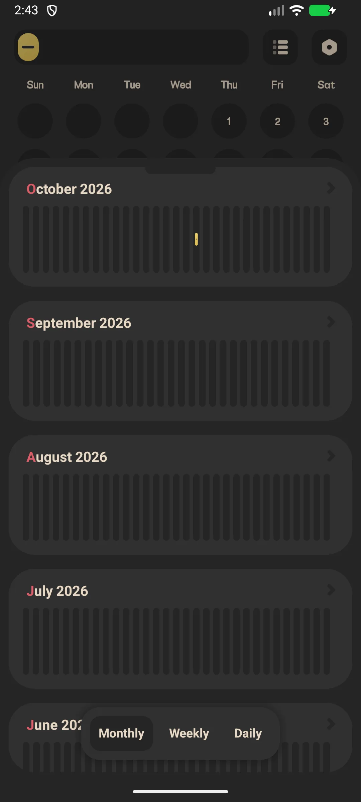

## Kandungan

- [Pengenalan Aplikasi](#pengenalan-aplikasi)
- [Penggunaan Pertama](#penggunaan-pertama)
- [Catat Mood (Satu Ketik)](#catat-mood-satu-ketik)
- [Entri Mood Lengkap](#entri-mood-lengkap)
- [Kalendar Sejarah](#kalendar-sejarah)
- [Statistik dan Trend](#statistik-dan-trend)
- [Peringatan Harian](#peringatan-harian)
- [Kunci Aplikasi (VIP)](#kunci-aplikasi-vip)
- [Sandaran](#sandaran)
- [Tetapan](#tetapan)
- [Senario Umum](#senario-umum)
- [FAQ](#faq)

## Pengenalan Aplikasi

Meow Mood Diary adalah [buku harian mood](/ms/glossary/what-is-a-mood-tracker/) dan aplikasi jurnal yang selamat serta peribadi, dengan antara muka bertema kucing yang menenangkan. Ia bekerja sebagai **aplikasi mood tracker offline** dan **aplikasi check-in harian**: satu ketik mencatat mood, ketik kedua menambahkan aktivitas dan catatan, dan bahagian lain panduan ini membincangkan kalendar, graf, kunci aplikasi pilihan, peringatan, serta cara mengeluarkan sejarah dari **aplikasi buku harian mood** yang tidak pernah meminta Anda mendaftar.

**😺 Pencatatan Satu Ketik**
- Lima "kapsul" tingkat mood di skrin skrin utama
- Ketik kapsul untuk terus mencatat, atau buka untuk entri lebih lengkap

**📊 Wawasan**
- Kalendar bulanan yang diwarnai sesuai mood
- Statistik: distribusi tingkat (pai), histogram bulanan, frekuensi emosi, frekuensi konteks

**🔒 Peribadi Secara Bawaan**
- Data disimpan **hanya secara lokal** — tidak ada yang diunggah ke server
- Sandaran Google Drive / WebDav pilihan (Anda yang mengendalikan cloud)
- Kunci aplikasi (cap jari / kode sandi) adalah ciri **VIP**

**🎨 Pilihan Kaya**
- **48 emosi bawaan** (24 tidak menyenangkan + 6 netral + 18 menyenangkan) dikelompokkan ke 5 tingkat mood
- **18 tag konteks** (di mana / dengan siapa)
- Percuma vs VIP: lebih banyak ikon, lebih banyak warna tema, kunci aplikasi, dan eksport PDF

## Penggunaan Pertama

Skrin skrin utama memaparkan lima kapsul mood, kalendar bulanan, dan daftar mood hari ini.

- Ketik **menu statistik** (atas) untuk melihat statistik
- Ketik **menu tetapan** (atas) untuk membuka tetapan

{: width="180" .normal }

## Catat Mood (Satu Ketik)

1. Di skrin skrin utama, ketik **kapsul mood** (mis. "Senang")
2. Kapsul mengembang — ketik **konfirmasi** untuk menyimpan seketika, atau ketik ikon **tetapan (roda gerigi)** untuk menambah butiran

Catatan satu ketik menyimpan tingkat mood tanpa catatan maupun tag.

## Entri Mood Lengkap

1. Ketik roda gerigi pada kapsul → **Tambah Mood**
2. Pilih **tingkat mood** (1–5)
3. Pilih **tag emosi** (pilih ganda dari 48 emosi)
4. Pilih **tag konteks** (pilih ganda dari 18 konteks)
5. Atur **waktu** (tidak boleh di masa depan)
6. Tulis **catatan** pilihan
7. Ketik **Simpan**

{: width="180" .normal }

## Kalendar Sejarah

- Luncur kalendar skrin utama bulan demi bulan
- Setiap hari berupa busur berwarna yang mencerminkan **rata-rata tingkat mood** hari itu (hari mendatang tampak keabuan)
- Ketik satu hari untuk melihat entri hari itu

{: width="180" .normal }

## Statistik dan Trend

1. Ketik ikon statistik (kanan atas)
2. Beralih tab **Bulan / Minggu / Hari**
3. Tinjau:
   - **Distribusi tingkat** graf pai
   - **Histogram bulanan**
   - **Frekuensi emosi** dan **frekuensi konteks**

{: width="180" .normal }

## Peringatan Harian

1. Tetapan → **Peringatan**
2. Aktifkan peringatan harian dan atur waktunya
3. Anda menerima notifikasi lembut "Apa kabar hari ini?" / "Saatnya mencatat mood!"

## Kunci Aplikasi (VIP)

1. Tetapan → **Kunci aplikasi**
2. Bila belum VIP, Anda akan diminta meningkatkan pakej
3. Pengguna VIP boleh mengaktifkan kunci cap jari atau kode sandi

## Sandaran

Tetapan → **Google Drive** (masuk, sandarkan / pulihkan / automatik) dan **WebDav**. Entri tetap di peranti kecuali Anda mencadangkannya.

## Tetapan

Tetapan merangkumi bahasa, hari awal pekan, kunci aplikasi (VIP), widget, ikon mood (VIP), warna tema (VIP), tag emosi/konteks, eksport (VIP), peringatan, serta Google Drive / WebDav.

## Senario Umum

- **Catatan cepat saat hari buruk** — pada malam yang berat, ketik satu emosi dan beberapa tag; tanpa paragraf, sehingga buku harian tetap bertahan di hari yang biasanya Anda lewatkan.
- **Peribadi secara bawaan** — entri tetap di peranti di sebalik kunci cap jari (VIP); pada telefon pintar keluarga bersama, pikiran Anda tidak pernah tersinkron ke cloud vendor kecuali Anda memilih Google Drive.
- **Menemukan pola** — kalendar dan graf memunculkan 'rasa muram hari Minggu' atau lonjakan setelah kopi, mengubah perasaan samar jadi sesuatu yang boleh ditindaklanjuti.
- **Offline di mana saja** — catat di pesawat atau di area kereta bawah tanah tanpa isyarat; tidak ada yang perlu Wi-Fi untuk merekam momen.

## FAQ

### Apakah buku harian saya diunggah ke server?
{:.faq-q}
Tidak. Semua entri disimpan dalam basis data lokal di peranti Anda. Hanya Anda yang boleh mencadangkannya ke Google Drive atau WebDav milik sendiri.

### Bagaimana warna kalendar ditentukan?
{:.faq-q}
Warna setiap hari adalah rata-rata tingkat mood dari entri hari itu, dipetakan ke palet 5 warna tema aktif. Hari tanpa entri dibiarkan polos.

### Bolehkah saya mengekspor buku harian?
{:.faq-q}
Ya — eksport PDF adalah ciri VIP.

## Ringkasan

Meow Mood Diary membuat penjejakan mood harian terasa mudah dan peribadi, dengan kalendar yang jelas serta graf trend untuk memahami emosi Anda dari waktu ke waktu.

[Halaman aplikasi Meow Mood Diary](/ms/apps/meow-mood-diary/) — tersedia di Android dan iOS.

## Istilah Berkaitan

- [Apakah Itu Penjejak Suasana Hati?](/ms/glossary/what-is-a-mood-tracker/)
