## Kandungan

- [Pengenalan Aplikasi](#pengenalan-aplikasi)
- [Penggunaan Pertama](#penggunaan-pertama)
- [Menambahkan Tugasan](#menambahkan-tugasan)
- [Subtugasan](#subtugasan)
- [Peringatan](#peringatan)
- [Paparan Kalendar](#paparan-kalendar)
- [Statistik](#statistik)
- [Daftar dan Tag](#daftar-dan-tag)
- [Sandaran dan Penyegerakan](#sandaran-dan-penyegerakan)
- [Eksport CSV (VIP)](#eksport-csv-vip)
- [Tetapan](#tetapan)
- [FAQ](#faq)

## Pengenalan Aplikasi

Meow Todo List adalah pengurus tugasan bergaya kartun comel sekaligus **[aplikasi to-do list](/ms/glossary/what-is-a-to-do-list/)** untuk Android dan iOS. Ia membantu Anda mencatat tugasan dengan cepat dan meninjaunya per hari, minggu, bulan, atau daftar. Aplikasi ini juga berfungsi sebagai **aplikasi tugasan harian offline sederhana**: senarai tugasan tanpa akaun disimpan di telefon pintar, dan teras **aplikasi pengurus tugasan percuma** merangkumi daftar, peringatan, serta **aplikasi kalendar tugasan**. Panduan ini memandu setiap skrin, dari pembukaan pertama hingga **penyegerakan Google Drive** dan eksport CSV.

**📝 Pencatatan Cepat**

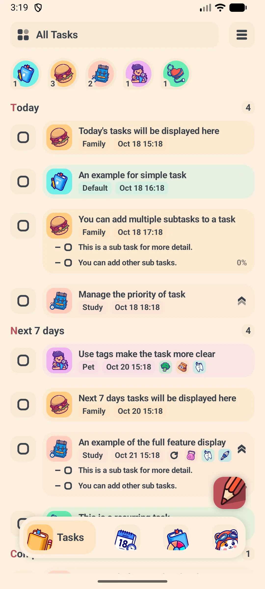{: width="180" .normal }
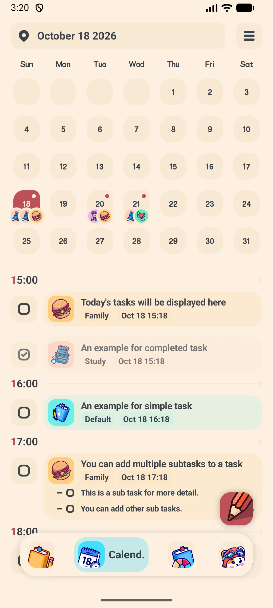{: width="180" .normal }
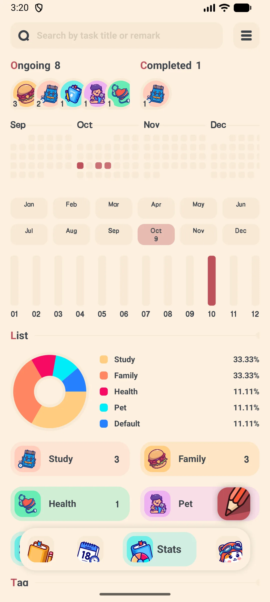{: width="180" .normal }
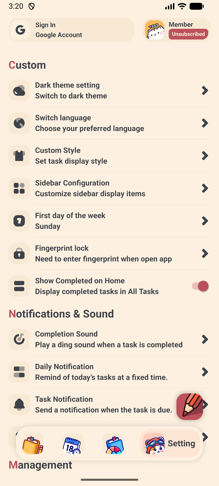{: width="180" .normal }

- Empat tab bawah: **Tugasan**, **Kalendar**, **Statistik**, **Tetapan**
- Butang terapung **+** menambah tugasan dari mana saja
- Filter laci samping: Semua / Hari Ini / Besok / 7 hari / Selesai, plus Buku (daftar) dan Tag Anda

**🗓 Perancangan**
- Tetapkan tarikh **dan waktu** pada setiap tugasan
- Tugasan berulang: harian, mingguan, bulanan, tahunan, atau aturan tersuai "setiap N hari/minggu"
- Paparan kalendar dengan pilihan Hari / Minggu / Bulan

**📊 Wawasan**
- Peta panas kontribusi dan diagram pai yang dikelompokkan per Buku/Tag
- Ringkasan mingguan / bulanan / tahunan

**☁️ Selamat dan Peribadi**
- Storan lokal (basis data Room); sandaran Google Drive / WebDAV pilihan
- VIP membuka mode gelap, kunci aplikasi, eksport CSV, dan had lebih tinggi

## Penggunaan Pertama

Saat pertama kali membuka Meow Todo List, Anda terus masuk ke tab **Tugasan**.

- Butang **+** (kanan bawah) membuat tugasan
- **Laci** kiri berpindah antara Hari Ini / Besok / 7 hari / Selesai serta Buku dan Tag tersuai Anda
- Bar bawah berpindah antara Tugasan / Kalendar / Statistik / Tetapan

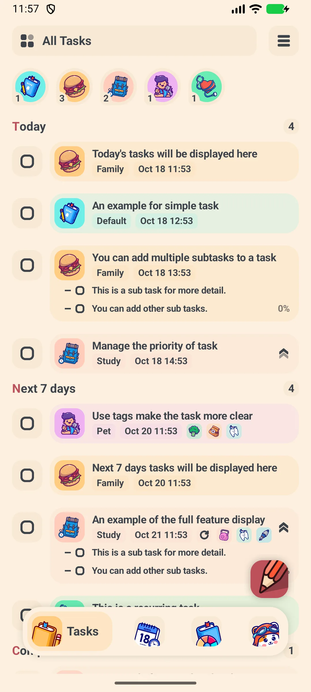{: width="180" .normal }

## Menambahkan Tugasan

1. Ketik butang **+**
2. Ketik **judul** tugasan
3. Ketik baris **tarikh** untuk membuka pop-up kalendar; aktifkan **jam** untuk menetapkan waktu tertentu, atau matikan untuk tugasan sepanjang hari
4. Pilih **Buku** (daftar) — mis. Kerja, Hidup, Belajar
5. Pilih satu atau lebih **Tag** untuk memfilter
6. Tetapkan **prioritas** jika perlu
7. Ketik **Konfirmasi** untuk menyimpan

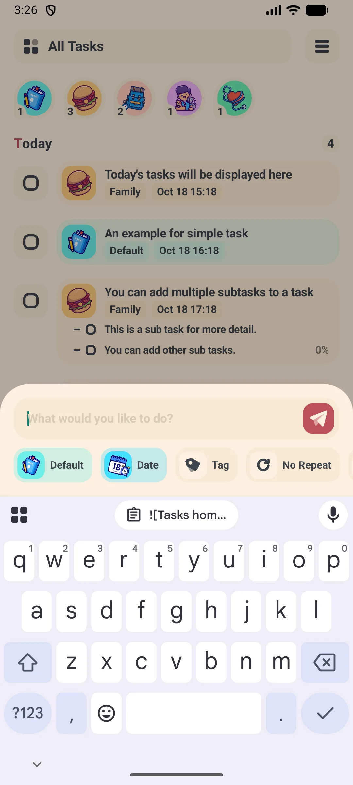{: width="180" .normal }
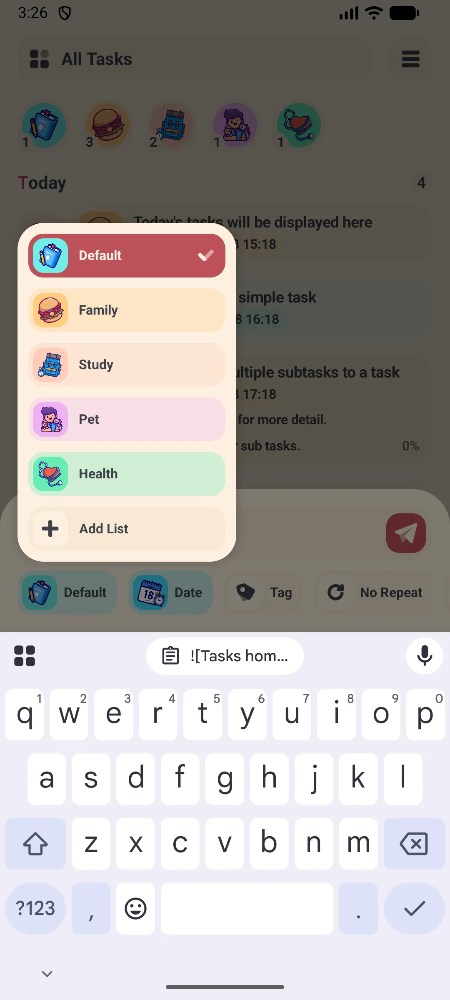{: width="180" .normal }
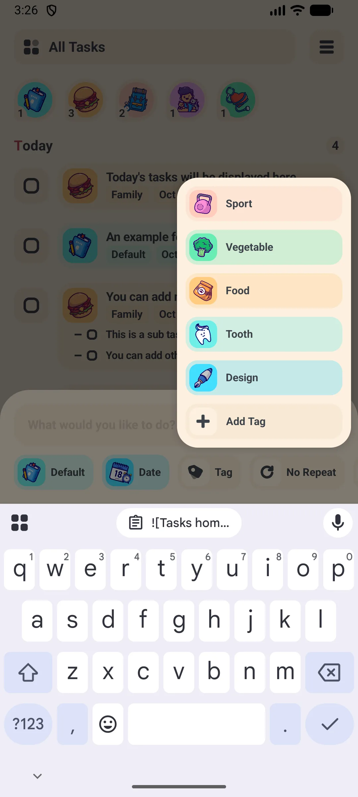{: width="180" .normal }
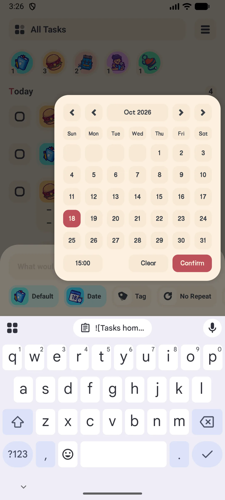{: width="180" .normal }
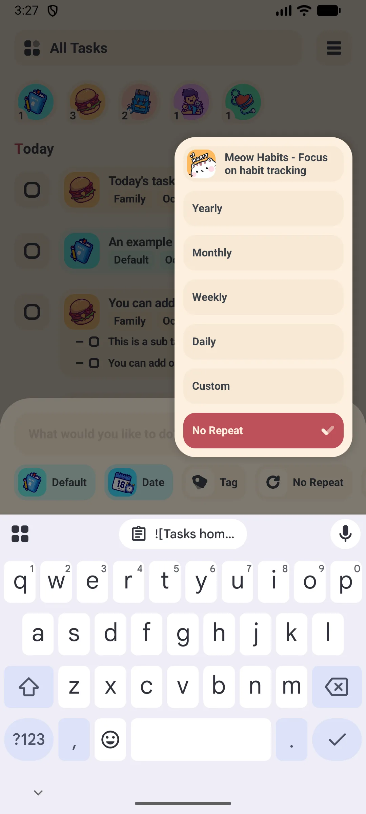{: width="180" .normal }

## Subtugasan

Buka sebuah tugasan, lalu gunakan lajur **Tambah subtugasan** di bahagian bawah halaman butiran.

- Ketik subtugasan dan item terus masuk ke daftar
- Akaun percuma boleh menambah hingga **15 subtugasan** per tugasan; VIP memadam had **aplikasi subtask percuma** ini
- Centang item saat selesai dikerjakan

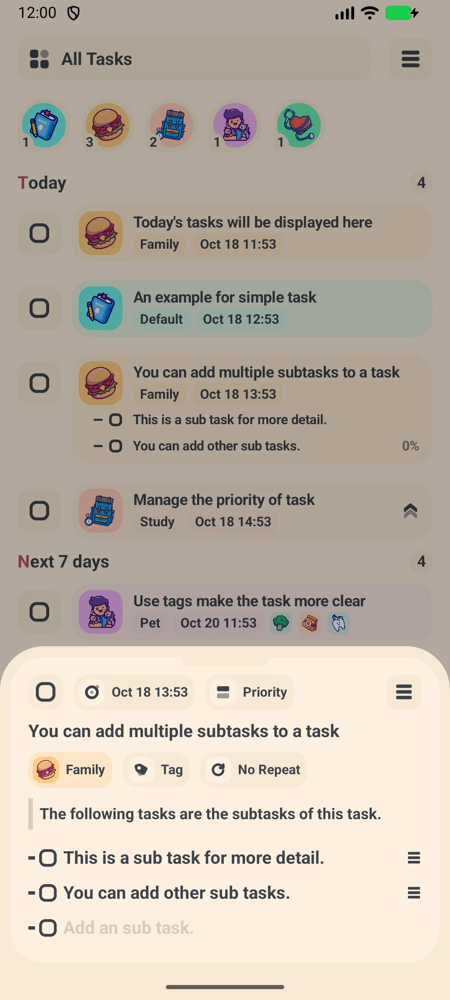{: width="180" .normal }
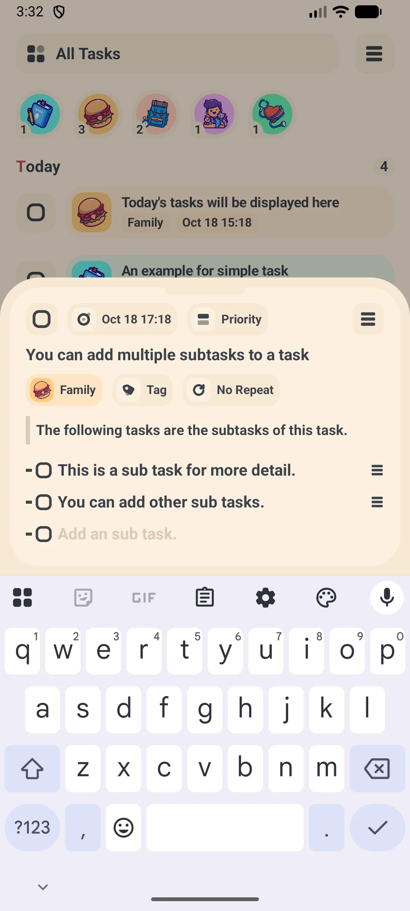{: width="180" .normal }

## Peringatan

Peringatan dijadwalkan dengan **WorkManager**, sehingga **aplikasi peringatan tugasan** ini tetap berbunyi walaupun Anda tidak membuka aplikasi.

1. Saat mengedit tugasan, tetapkan tarikh/waktu (peringatan memakai waktu tersebut)
2. Pastikan notifikasi diizinkan untuk aplikasi
3. Aplikasi menjadwalkan ulang peringatan automatik saat tugasan diedit

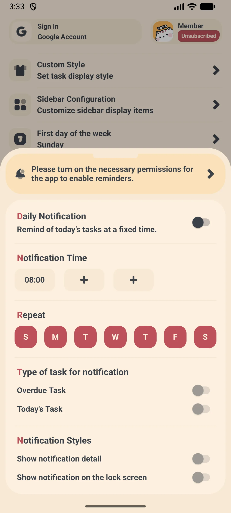{: width="180" .normal }
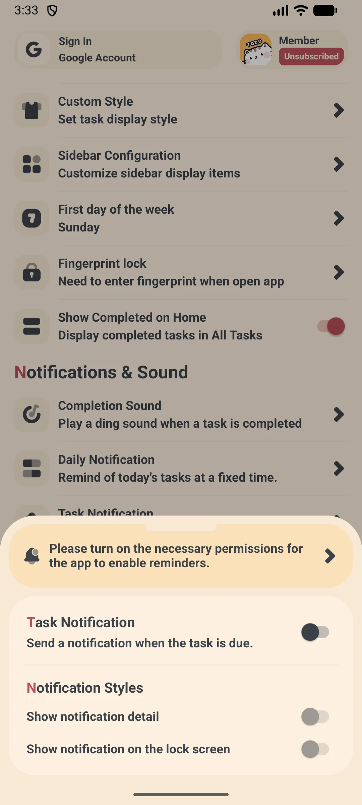{: width="180" .normal }
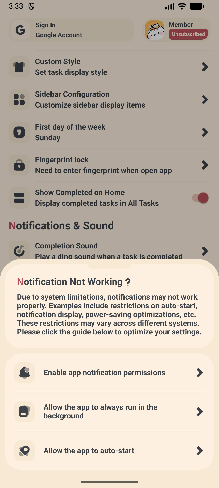{: width="180" .normal }

Jika peringatan tidak muncul, buka tugasan dan pastikan tarikh/waktunya di masa depan, lalu izinkan notifikasi di tetapan sistem.

## Paparan Kalendar

1. Beralih ke tab **Kalendar**
2. Pakai pilihan **Hari / Minggu / Bulan** di kanan atas
3. Hari yang punya tugasan ditandai titik kecil
4. Ketik sebuah hari untuk melihat tugasan hari itu

{: width="180" .normal }
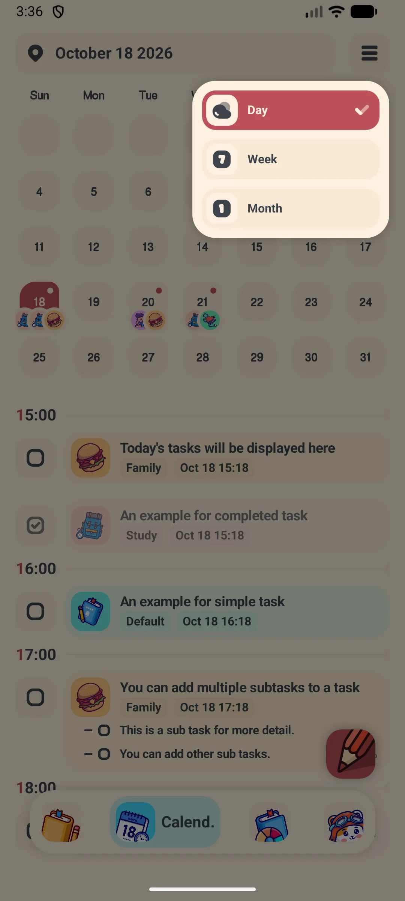{: width="180" .normal }
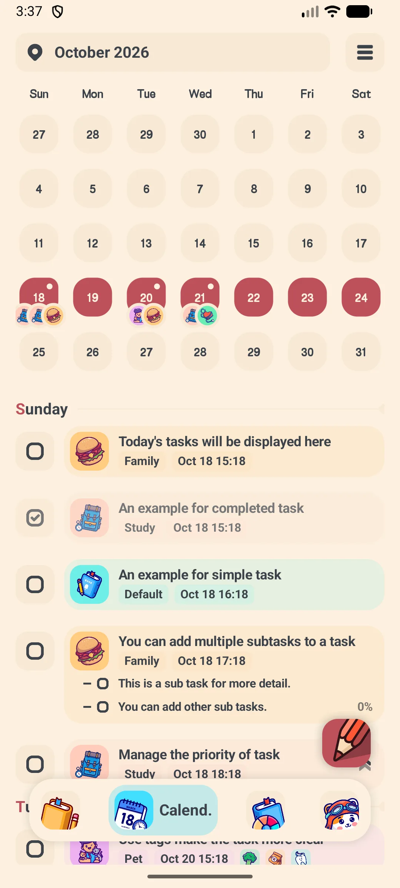{: width="180" .normal }
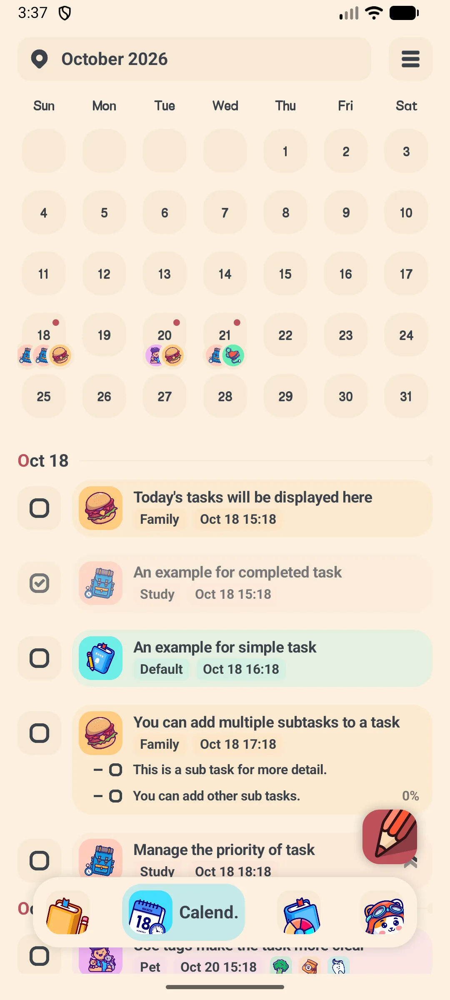{: width="180" .normal }

## Statistik

1. Buka tab **Statistik**
2. Lihat peta panas kontribusi dan diagram pai
3. Ganti julat (minggu / bulan / tahun) untuk melihat trend per Buku dan Tag

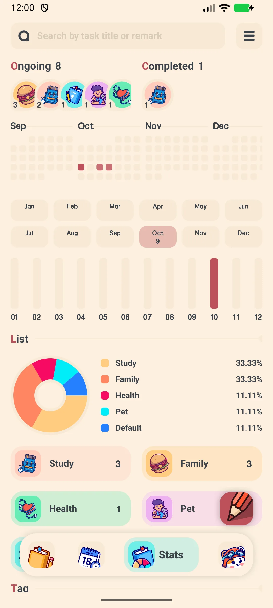{: width="180" .normal }
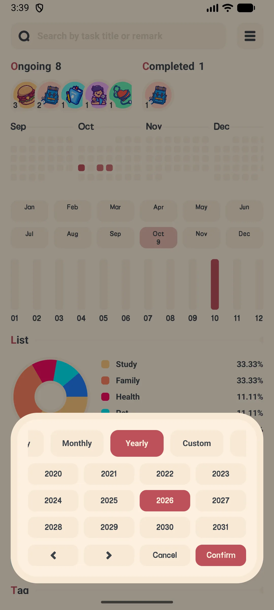{: width="180" .normal }

## Daftar dan Tag

- **Buku (daftar)** mengelompokkan tugasan — mis. Kerja, Travel. Akaun percuma boleh membuat hingga **10 Buku**
- **Tag** memudahkan filter lintas daftar — akaun percuma boleh membuat hingga **10 Tag**
- Buat keduanya dari laci atau skrin Tetapan → Pengurusan

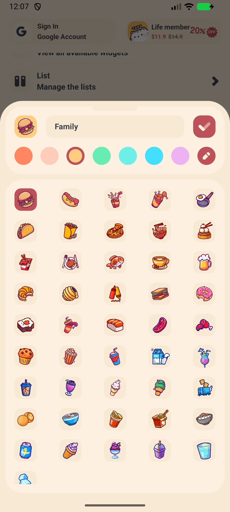{: width="180" .normal }

## Sandaran dan Penyegerakan

1. Buka **Tetapan → Pengurusan → Google Drive** (atau **WebDAV**)
2. Masuk / isi server, akaun, dan kata laluan
3. Ketik **Sandarkan** untuk mengunggah, **Pulihkan** untuk mengunduh
4. Aktifkan **Sandaran automatik** untuk mencadangkan berkala

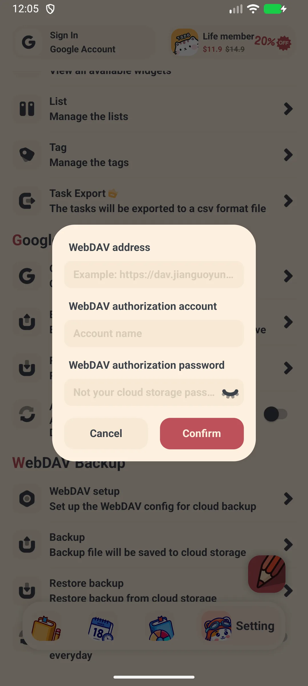{: width="180" .normal }

## Eksport CSV (VIP)

1. Buka **Tetapan → Pengurusan → Eksport**
2. Filter berdasarkan Buku / Tag / prioritas / julat tarikh
3. Ketik **Eksport**, lalu bagikan fail `.csv` (buka di Excel atau Sheets)

**Eksport CSV** adalah ciri **VIP**.

## Tetapan

Tetapan merangkumi:

- **Mode gelap** (VIP)
- **Kunci aplikasi** — cap jari atau kata laluan (VIP)
- **Hari awal pekan** dan **bahasa**
- Paparan **tugasan selesai** (10 terakhir secara lalai, dengan "tampilkan semua")
- **Google Drive / WebDAV** dan **Widget**

## Senario Umum

- **Musim ujian** — pakai paparan kalendar dan peringatan harian supaya tarikh akhir setiap mata kuliah tetap kelihatan, jadi tidak ada yang selip antarpekan.
- **Projek kumpulan** — buat satu Buku (daftar) per projek dan Tag per anggota, lalu pecahkan kerja jadi subtugasan dan eksport CSV untuk berkongsi rencana.
- **Pencatatan offline** — saat perjalanan tanpa isyarat, tambah tugasan terus; data tetap di peranti dan baru tersinkron ke Google Drive atau WebDav ketika Anda kembali daring.
- **Privasi utama** — storan Room lokal plus kunci aplikasi cap jari pilihan menjaga senarai tugasan tanpa akaun tetap di telefon pintar, bukan di akaun cloud lain.

## FAQ

### Bagaimana cara mengedit atau memadam tugasan?
{:.faq-q}
Buka tugasan, ubah kolomnya, lalu ketik konfirmasi untuk menyimpan. Pakai menu 3 titik (atau tekan lama) untuk memadam.

### Bagaimana cara kerja tugasan berulang?
{:.faq-q}
Saat Anda menyelesaikan tugasan berulang, aplikasi automatik membuat kemunculan berikutnya (hari +1, minggu +7, bulan +1, tahun +1, atau interval tersuai) dan menghentikan yang lama.

### Apakah ada batasan pada versi percuma?
{:.faq-q}
Jumlah tugasan tidak dihadkan, tetapi Buku maksimum 10, Tag 10, dan subtugasan 15 pada versi percuma. Versi percuma juga memaparkan iklan.

## Ringkasan

Meow Todo List adalah pengurus tugasan yang ramah dan comel, merangkumi pencatatan cepat, tugasan berulang, paparan kalendar, dan statistik — dengan sandaran Drive/WebDav untuk menjaga senarai tugasan tetap selamat.

## Istilah Berkaitan

- [Apakah Itu Aplikasi To-Do List?](/ms/glossary/what-is-a-to-do-list/)
- [Apakah Itu Subtugasan?](/ms/glossary/what-is-a-subtask/)
