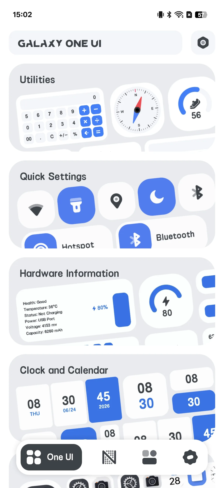
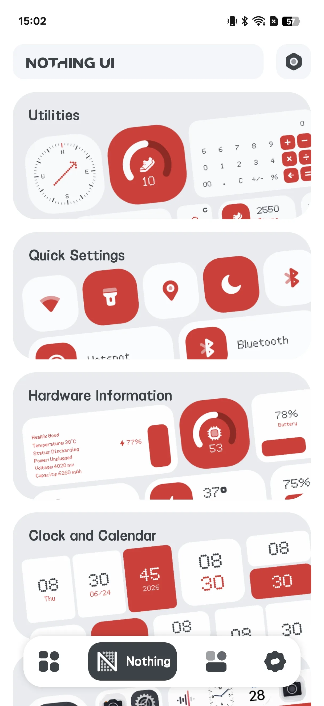
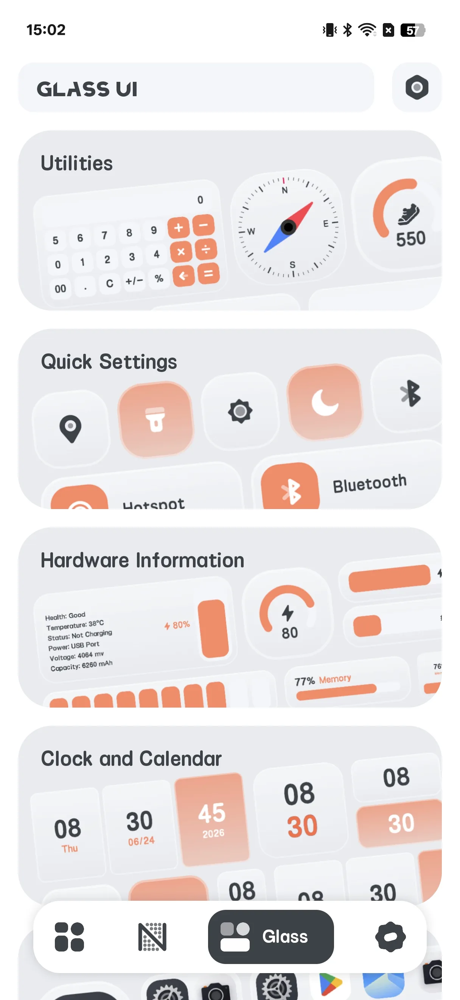
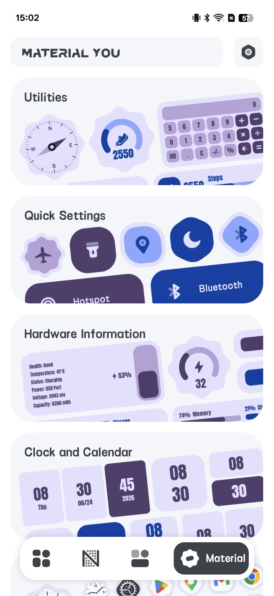
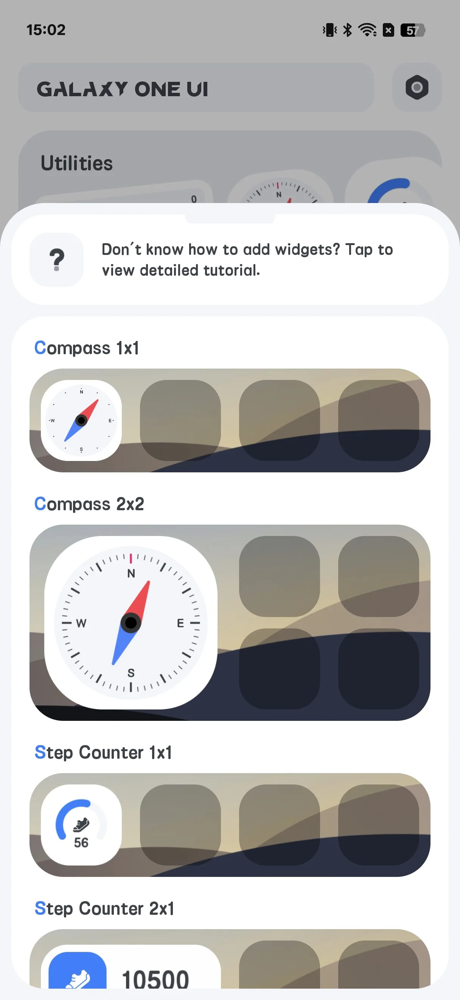
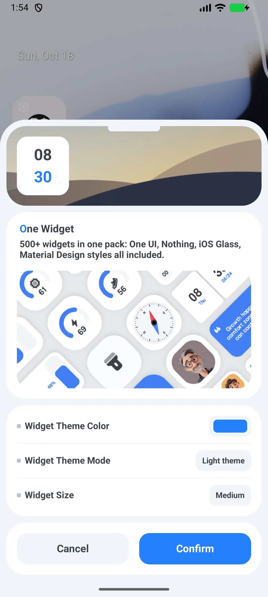

## Kandungan

- [Pendahuluan Aplikasi](#pendahuluan-aplikasi)
- [Penggunaan Pertama](#penggunaan-pertama)
- [Jelajahi 4 Gaya](#jelajahi-4-gaya)
- [Menambahkan Widget](#menambahkan-widget)
- [Mengonfigurasi Widget](#mengonfigurasi-widget)
- [Quick Toggle](#quick-toggle)
- [Shortcut Aplikasi](#shortcut-aplikasi)
- [Widget Info Terus](#widget-info-terus)
- [Tetapan](#tetapan)
- [Senario Umum](#senario-umum)
- [FAQ](#faq)

## Pendahuluan Aplikasi

**One Widget** adalah **[aplikasi widget skrin utama](/ms/glossary/what-is-a-home-screen-widget/)** Android dengan lebih **500+ pratetap** dalam empat gaya — One UI, Nothing, Glass, dan Material You — lengkap dengan pintasan aplikasi serta **11 quick toggle**, dan boleh digunakan terus tanpa akaun mahupun editor kod. Anda boleh memilih pratetap, menetapkan saiz grid sehingga **6x2**, kemudian menukar warna latar dan jejari sudut agar widget menyatu dengan pelancar peranti. Versi lite percuma memuat gaya One UI, manakala aplikasi penuh membuka keempat-empat gaya. Panduan ini menelusuri kitaran penuh dari galeri gaya, pemasangan dan konfigurasi widget, toggle, pintasan aplikasi, sehinggalah info jam, kalendar, dan bateri secara langsung.

**🎨 Empat Gaya**
- **One UI** (lalai; satu-satunya gaya yang ada di aplikasi "lite" percuma)
- **Nothing**
- **Glass**
- **Material You**

> "Material You" di sini adalah *nama gaya* yang menggunakan palet hari-malam biru/ungu tetap — bukan warna dinamis berbasis wallpaper Android 12.

**⚡ Quick Toggle**
- 11 toggle: Bluetooth, data seluler, Wi-Fi, senter, rotasi, pesawat, hotspot, jangan-ganggu, lokasi, getar, mode gelap

**📱 Shortcut & Kontak Aplikasi**
- Peluncur satu ketik untuk aplikasi Anda dan telepon/pengeras suara

**📊 Info Terus**
- Widget jam, kalendar, bateri, dan RAM yang memperbarui di tempat

**💲 Dua Aplikasi, Bukan Satu**
- Sebuah **aplikasi "lite" percuma** (hanya gaya One UI) dan sebuah **aplikasi "full" berbayar** (keempat gaya). Tidak ada pembelian dalam aplikasi — pasang aplikasi full dari Google Play untuk membuka semuanya.

## Penggunaan Pertama

**One Widget** dibuka pada galeri empat tab — **One UI, Nothing, Glass, dan Material You** — dengan lebih **500+ pratetap widget skrin utama** yang boleh dipasang terus tanpa akaun mahupun editor kod. Setiap halaman gaya menyenaraikan lapan kategori — Tools, Entry, Hardware, Clock, Launcher, Combo, Note, dan Contact — supaya anda boleh mencari widget yang dikehendaki dengan cepat. Versi lite percuma memuat gaya One UI, manakala aplikasi penuh membuka keempat-empatnya. Gaya yang tersedia diterangkan dalam bahagian seterusnya.

- Setiap halaman gaya mencantumkan kategori: Tools, Entry, Hardware, Clock, Launcher, Combo, Note, Contact
- Ketik sebuah kategori untuk melihat pratinjau widget

{: width="180" .normal }
{: width="180" .normal }
{: width="180" .normal }
{: width="180" .normal }

## Jelajahi 4 Gaya

**One Widget** menawarkan empat gaya visual — **One UI** (lalai, terdapat dalam aplikasi lite percuma), **Nothing**, **Glass**, dan **Material You** — dengan tiga gaya terakhir memerlukan aplikasi penuh berbayar yang dipasang dari Google Play. Setiap gaya menampilkan pratetap tersendiri, daripada dot-matrix Nothing sehinggalah widget tembus pandang Glass, jadi anda boleh memilih rupa yang paling sesuai dengan pelancar peranti. Perlu diingat: "Material You" di sini adalah nama gaya dengan palet biru/ungu tetap, bukan warna dinamis berasaskan wallpaper Android 12. Luncur tab atas untuk melihat pratinjau setiap gaya.

## Menambahkan Widget

**One Widget** dipasang ke skrin utama melalui pemilih widget sistem dalam empat langkah — tekan lama skrin utama, pilih Widget, cari One Widget dalam senarai serta pilih varian, kemudian laras pilihan dan tekan Konfirmasi. Sistem akan membuka skrin konfigurasi aplikasi secara automatik, jadi anda boleh menyesuaikan widget sebelum ia diletakkan. Tiada kod atau editor pihak ketiga yang terlibat — prosesnya menggunakan mekanisme widget Android standard. Empat langkah di bawah memasang satu widget.

1. Tekan lama skrin utama Anda → **Widget**
2. Temukan **One Widget** dalam daftar dan pilih sebuah varian
3. Sistem membuka skrin **konfigurasi** One Widget
4. Atur pilihan Anda dan ketik **Konfirmasi** untuk menaruhnya

{: width="180" .normal }

## Mengonfigurasi Widget

**One Widget** menyediakan empat pilihan konfigurasi yang dikongsi oleh kebanyakan widget — warna tema melalui palet pop-up, mod Gelap atau terang, bentuk lingkaran atau segi empat tepat membulat, dan saiz grid sehingga **6x2** seperti 1x1, 2x1, 4x1, 5x1, 2x2, 4x2, dan 5x2. Warna latar ikon serta jejari sudut diturunkan automatik daripada bentuk yang dipilih — lingkaran menggunakan separuh saiz, manakala yang membulat menggunakan satu pertiga. Ini bermakna anda boleh menyelaraskan rupa widget dengan wallpaper tanpa melaraskan setiap butiran secara manual. Pilihan umum disenaraikan di bawah.

- **Warna tema** (palet pop-up)
- Mode **Gelap / terang**
- **Bentuk** — lingkaran atau persegi panjang membulat
- **Ukuran** — pilihan grid seperti 1x1, 2x1, 4x1, 5x1, 6x1, 2x2, 4x2, 5x2, 6x2 (hingga **6x2**)

Warna latar ikon dan radius sudut diturunkan dari bentuk (lingkaran = ukuran/2, membulat = ukuran/3).

{: width="180" .normal }

## Quick Toggle

**One Widget** menyediakan **11 quick toggle** — Bluetooth, data seluler, Wi-Fi, senter, rotasi, pesawat, hotspot, jangan-ganggu, lokasi, getar, dan mod gelap — yang boleh diletakkan secara individu atau digabungkan sehingga lima toggle dalam satu bar 4x1 melalui widget Combine. Senter benar-benar mengalihkan lampu melalui `CameraManager`, manakala Wi-Fi, Bluetooth, dan DND membuka skrin tetapan sistem yang berkenaan dan rotasi menulis tetapan auto-rotate. Tiada root diperlukan kerana semuanya menggunakan API dan tetapan sistem standard. Tiga langkah di bawah menambah dan menggunakan toggle ini.

1. Dari widget toggle, pilih tipe toggle (Wi-Fi, Bluetooth, senter, rotasi, DND, …)
2. Taruh toggle tunggal, atau gunakan widget **Combine 4x1** untuk menaruh hingga 5 toggle dalam satu bar (lalai: Bluetooth / Wi-Fi / data seluler / senter / rotasi)
3. Ketik sebuah toggle untuk beraksi:
   - **Senter** benar-benar mengalihkan senter (`CameraManager`)
   - **Wi-Fi / Bluetooth / DND** membuka skrin tetapan sistem yang relevan
   - **Rotasi** menulis tetapan auto-rotate sistem

## Shortcut Aplikasi

**One Widget** membolehkan anda melancarkan aplikasi terpasang dengan satu ketik melalui widget **Shortcut Aplikasi**, dengan setiap slot dipetakan kepada satu aplikasi daripada senarai peluncur — atau membuka Google Play jika aplikasi itu belum dipasang. Ini memendekkan laluan kepada aplikasi yang paling kerap digunakan tanpa perlu mencarinya dalam laci aplikasi. Widget ini juga menyokong pintasan telepon dan pembesar suara untuk akses segera. Tiga langkah di bawah mengkonfigurasi pintasan ini.

1. Konfigurasikan widget **Shortcut Aplikasi**
2. Di setiap slot, pilih aplikasi terpasang dari daftar peluncur
3. Ketik widget untuk meluncurkan aplikasi tersebut (atau Google Play jika belum terpasang)

## Widget Info Terus

**One Widget** memaparkan maklumat langsung melalui widget Jam, Bateri/RAM, dan kalendar yang dikemas kini pada kadar berbeza mengikut keperluan — jam melukis semula setiap kira-kira 30 minit, bateri/RAM menanya statistik setiap **60 saat** dengan kemas kini segera daripada siaran perubahan bateri, manakala widget kalendar dan nota statik atau menyegar pada kitaran 30 minit. Kadar ini mengimbangi ketepatan dengan penggunaan bateri, jadi skrin utama kekal bermakna tanpa menjadi beban. Anda boleh meletakkan berbilang widget info serentak untuk gambaran sekilas. Butiran kadar kemas kini disenaraikan di bawah.

- Widget **Jam** melukis ulang pada siklus pembaruan widget sistem (setiap 30 mnt) dan saat ukuran berubah
- Widget **Bateri / RAM** menanya statistik peranti kira-kira setiap **60 saat**; bateri juga memperbarui instan dari siaran perubahan bateri
- Widget kalendar / catatan statik atau menyegarkan pada siklus 30-menit

## Tetapan

**One Widget** mengumpulkan lapan tetapan dalam satu skrin — mod gelap, bahasa, unit suhu, nilai, kongsi, maklum balas, privasi, dan versi — supaya anda boleh menyesuaikan aplikasi dengan keperluan peribadi. Unit suhu berguna apabila widget cuaca dipaparkan, manakala mod gelap mengekalkan rupa yang selesa pada waktu malam. Bahagian privasi dan versi memberi maklumat tentang data serta kemas kini aplikasi. Kesemua tetapan ini tersedia dari skrin Tetapan.

## Senario Umum

Lima senario harian menunjukkan di mana **One Widget** memberi nilai paling jelas dengan **500+ pratetap**, empat gaya, quick toggle, dan shortcut aplikasinya: skrin utama segar dalam lima minit, padanan dengan wallpaper, toggle satu ketik, pintasan aplikasi dan kontak, serta sokongan semua peranti Android. Dalam setiap kes, widget dipasang terus dari galeri tanpa editor atau kod, jadi penyesuaian tidak memerlukan pengetahuan teknikal. Aplikasi lite percuma memuat gaya One UI, manakala aplikasi penuh membuka keempat-empat gaya. Butiran setiap senario disenaraikan di bawah.

- **Skrin utama segar dalam 5 minit** — buka galeri 4-tab, ketik sebuah gaya, pilih widget jam atau cuaca, lalu taruh; tanpa editor, tanpa Kode.
- **Cocokkan dengan wallpaper** — atur warna tema dan gelap/terang, pilih bentuk lingkaran atau membulat, dan widget menyatu dengan peluncur Anda.
- **Quick toggle satu ketik** — taruh Wi-Fi, Bluetooth, dan senter dalam bar 4x1 supaya Anda berhenti menggali tetapan.
- **Shortcut aplikasi & kontak** — luncurkan Chrome, Maps, atau kontak kegemaran dari satu widget.
- **Semua peranti Android** — Galaxy, Pixel, dan Nothing semua didukung; aplikasi lite percuma merangkumi gaya One UI, aplikasi full membuka keempatnya.

## FAQ

### Mengapa saya tidak boleh menggunakan Nothing / Glass / Material You di aplikasi percuma?
{:.faq-q}
Aplikasi percuma adalah build "lite" yang hanya menyertakan gaya One UI. Pasang aplikasi full berbayar untuk membuka tiga gaya lain-lain.

### Apakah "Material You" benar-benar temanya dinamis?
{:.faq-q}
Ini adalah gaya yang menggunakan palet hari-malam biru/ungu tetap. Bukan warna dinamis berbasis wallpaper.

### Apakah toggle perlu root?
{:.faq-q}
Tidak. Mereka menggunakan API dan tetapan sistem standar; senter menggunakan API senter kamera.

## Ringkasan

One Widget adalah cara tercepat memberi skrin utama Android Anda toolkit widget serba ada yang bergaya — ratusan widget dalam empat paparan, dengan quick toggle dan shortcut aplikasi.

## Istilah berkaitan

- [Apakah Itu Widget Skrin Utama?](/ms/glossary/what-is-a-home-screen-widget/)
- [Apakah Itu Material You?](/ms/glossary/what-is-material-you/)
- [Apakah Itu Nothing UI?](/ms/glossary/what-is-nothing-ui/)
- [Apakah Itu Galaxy One UI?](/ms/glossary/what-is-galaxy-one-ui/)
- [Apakah Itu iOS Glass?](/ms/glossary/what-is-ios-glass/)
