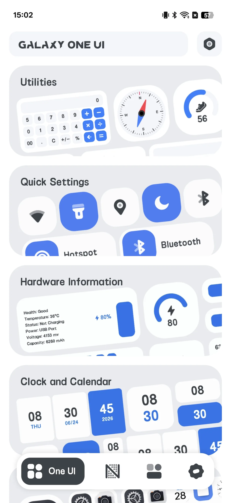
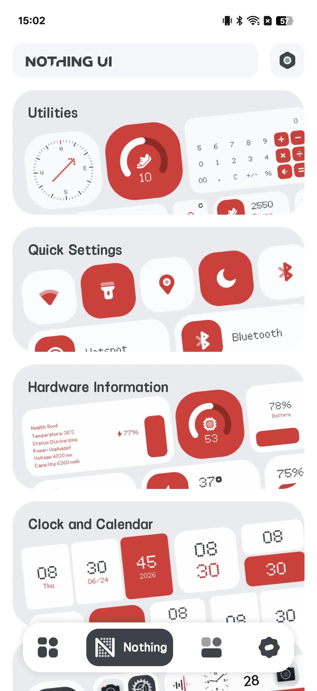
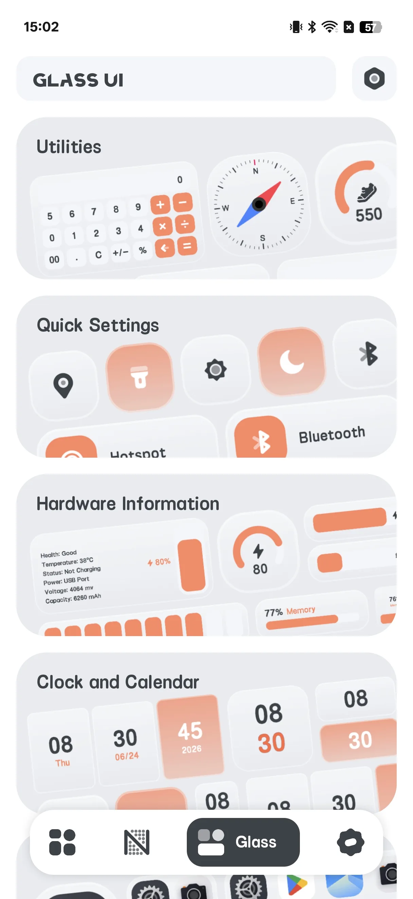
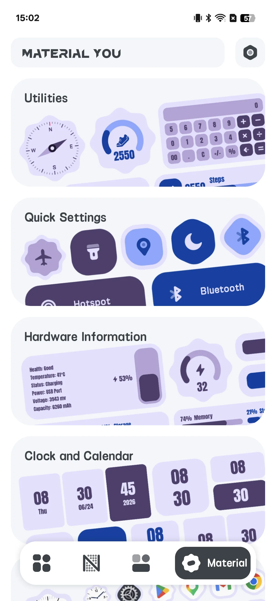
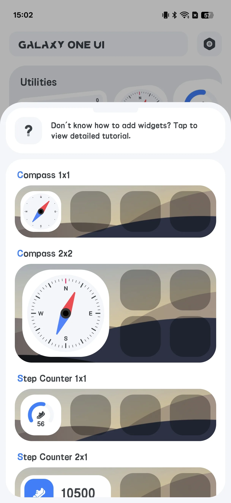
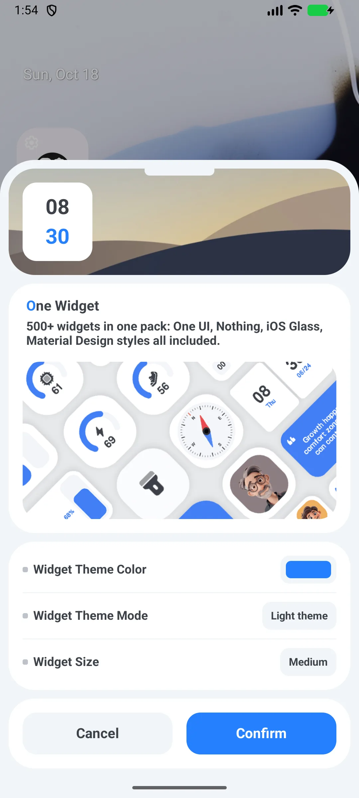

## Kandungan

- [Pendahuluan Aplikasi](#pendahuluan-aplikasi)
- [Penggunaan Pertama](#penggunaan-pertama)
- [Jelajahi 4 Gaya](#jelajahi-4-gaya)
- [Menambahkan Widget](#menambahkan-widget)
- [Mengonfigurasi Widget](#mengonfigurasi-widget)
- [Quick Toggle](#quick-toggle)
- [Shortcut Aplikasi](#shortcut-aplikasi)
- [Widget Info Terus](#widget-info-terus)
- [Tetapan](#tetapan)
- [Senario Umum](#senario-umum)
- [FAQ](#faq)

## Pendahuluan Aplikasi

One Widget memuat **500+ widget skrin utama Android yang dapat disesuaikan [widget skrin utama](/ms/glossary/what-is-a-home-screen-widget/)** dalam empat gaya trend, plus shortcut aplikasi dan quick toggle. Ini adalah **aplikasi widget** yang boleh Anda pakai tanpa akaun: jelajahi empat pustaka gaya, taruh sebuah pratetap, lalu ubah ukuran dan ganti latar serta radius sudutnya. Panduan ini menelusuri siklus penuh dari peluncuran pertama melalui gaya, menambah dan mengonfigurasi widget, toggle **widget shortcut aplikasi Android**, serta info jam, kalendar, dan bateri terus.

**🎨 Empat Gaya**
- **One UI** (lalai; satu-satunya gaya yang ada di aplikasi "lite" percuma)
- **Nothing**
- **Glass**
- **Material You**

> "Material You" di sini adalah *nama gaya* yang menggunakan palet hari-malam biru/ungu tetap — bukan warna dinamis berbasis wallpaper Android 12.

**⚡ Quick Toggle**
- 11 toggle: Bluetooth, data seluler, Wi-Fi, senter, rotasi, pesawat, hotspot, jangan-ganggu, lokasi, getar, mode gelap

**📱 Shortcut & Kontak Aplikasi**
- Peluncur satu ketik untuk aplikasi Anda dan telepon/pengeras suara

**📊 Info Terus**
- Widget jam, kalendar, bateri, dan RAM yang memperbarui di tempat

**💲 Dua Aplikasi, Bukan Satu**
- Sebuah **aplikasi "lite" percuma** (hanya gaya One UI) dan sebuah **aplikasi "full" berbayar** (keempat gaya). Tidak ada pembelian dalam aplikasi — pasang aplikasi full dari Google Play untuk membuka semuanya.

## Penggunaan Pertama

Buka One Widget ke galeri 4-tab: **One UI / Nothing / Glass / Material You**.

- Setiap halaman gaya mencantumkan kategori: Tools, Entry, Hardware, Clock, Launcher, Combo, Note, Contact
- Ketik sebuah kategori untuk melihat pratinjau widget

{: width="180" .normal }
{: width="180" .normal }
{: width="180" .normal }
{: width="180" .normal }

## Jelajahi 4 Gaya

Luncur tab atas untuk melihat pratinjau setiap gaya. **One UI** adalah lalai dan tersedia di aplikasi lite percuma; Nothing / Glass / Material You membutuhkan aplikasi full berbayar.

## Menambahkan Widget

1. Tekan lama skrin utama Anda → **Widget**
2. Temukan **One Widget** dalam daftar dan pilih sebuah varian
3. Sistem membuka skrin **konfigurasi** One Widget
4. Atur pilihan Anda dan ketik **Konfirmasi** untuk menaruhnya

{: width="180" .normal }

## Mengonfigurasi Widget

Sebahagian besar widget berkongsi pilihan umum:

- **Warna tema** (palet pop-up)
- Mode **Gelap / terang**
- **Bentuk** — lingkaran atau persegi panjang membulat
- **Ukuran** — pilihan grid seperti 1x1, 2x1, 4x1, 5x1, 6x1, 2x2, 4x2, 5x2, 6x2 (hingga **6x2**)

Warna latar ikon dan radius sudut diturunkan dari bentuk (lingkaran = ukuran/2, membulat = ukuran/3).

{: width="180" .normal }

## Quick Toggle

1. Dari widget toggle, pilih tipe toggle (Wi-Fi, Bluetooth, senter, rotasi, DND, …)
2. Taruh toggle tunggal, atau gunakan widget **Combine 4x1** untuk menaruh hingga 5 toggle dalam satu bar (lalai: Bluetooth / Wi-Fi / data seluler / senter / rotasi)
3. Ketik sebuah toggle untuk beraksi:
   - **Senter** benar-benar mengalihkan senter (`CameraManager`)
   - **Wi-Fi / Bluetooth / DND** membuka skrin tetapan sistem yang relevan
   - **Rotasi** menulis tetapan auto-rotate sistem

## Shortcut Aplikasi

1. Konfigurasikan widget **Shortcut Aplikasi**
2. Di setiap slot, pilih aplikasi terpasang dari daftar peluncur
3. Ketik widget untuk meluncurkan aplikasi tersebut (atau Google Play jika belum terpasang)

## Widget Info Terus

- Widget **Jam** melukis ulang pada siklus pembaruan widget sistem (setiap 30 mnt) dan saat ukuran berubah
- Widget **Bateri / RAM** menanya statistik peranti kira-kira setiap **60 saat**; bateri juga memperbarui instan dari siaran perubahan bateri
- Widget kalendar / catatan statik atau menyegarkan pada siklus 30-menit

## Tetapan

Tetapan merangkumi mode gelap, bahasa, satuan suhu, nilai, bagikan, umpan balik, privasi, dan versi.

## Senario Umum

- **Skrin utama segar dalam 5 minit** — buka galeri 4-tab, ketik sebuah gaya, pilih widget jam atau cuaca, lalu taruh; tanpa editor, tanpa Kode.
- **Cocokkan dengan wallpaper** — atur warna tema dan gelap/terang, pilih bentuk lingkaran atau membulat, dan widget menyatu dengan peluncur Anda.
- **Quick toggle satu ketik** — taruh Wi-Fi, Bluetooth, dan senter dalam bar 4x1 supaya Anda berhenti menggali tetapan.
- **Shortcut aplikasi & kontak** — luncurkan Chrome, Maps, atau kontak kegemaran dari satu widget.
- **Semua peranti Android** — Galaxy, Pixel, dan Nothing semua didukung; aplikasi lite percuma merangkumi gaya One UI, aplikasi full membuka keempatnya.

## FAQ

### Mengapa saya tidak boleh menggunakan Nothing / Glass / Material You di aplikasi percuma?
{:.faq-q}
Aplikasi percuma adalah build "lite" yang hanya menyertakan gaya One UI. Pasang aplikasi full berbayar untuk membuka tiga gaya lain-lain.

### Apakah "Material You" benar-benar temanya dinamis?
{:.faq-q}
Ini adalah gaya yang menggunakan palet hari-malam biru/ungu tetap. Bukan warna dinamis berbasis wallpaper.

### Apakah toggle perlu root?
{:.faq-q}
Tidak. Mereka menggunakan API dan tetapan sistem standar; senter menggunakan API senter kamera.

## Ringkasan

One Widget adalah cara tercepat memberi skrin utama Android Anda toolkit widget serba ada yang bergaya — ratusan widget dalam empat paparan, dengan quick toggle dan shortcut aplikasi.

## Istilah berkaitan

- [Apakah Itu Widget Skrin Utama?](/ms/glossary/what-is-a-home-screen-widget/)
- [Apakah Itu Material You?](/ms/glossary/what-is-material-you/)
- [Apakah Itu Nothing UI?](/ms/glossary/what-is-nothing-ui/)
- [Apakah Itu Galaxy One UI?](/ms/glossary/what-is-galaxy-one-ui/)
- [Apakah Itu iOS Glass?](/ms/glossary/what-is-ios-glass/)
