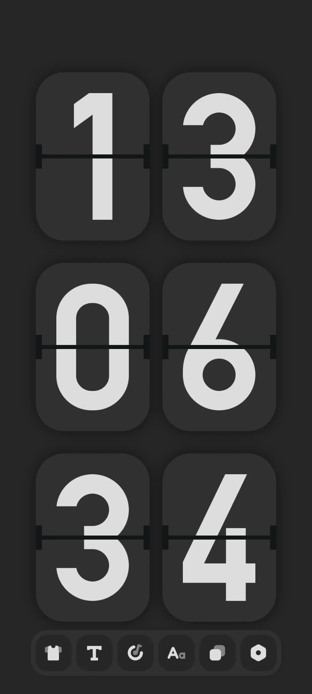
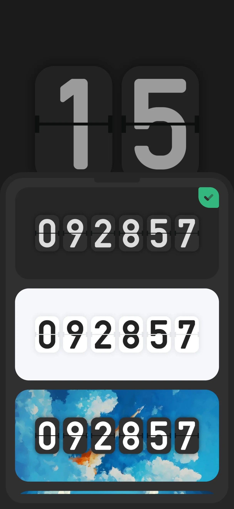
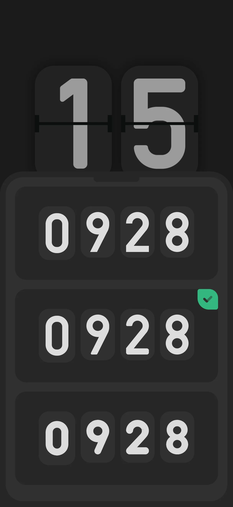
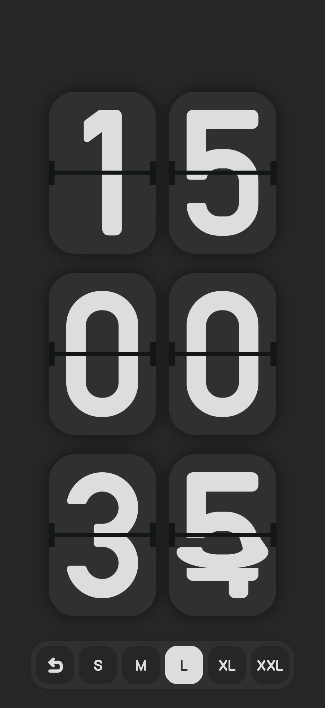
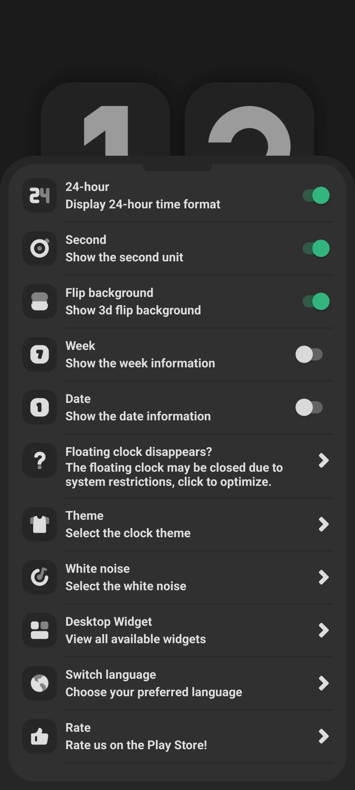
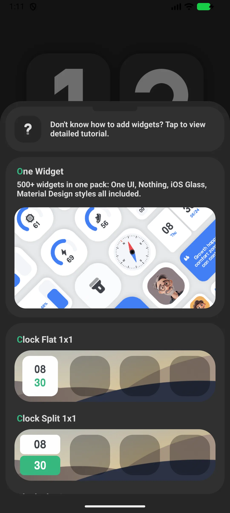
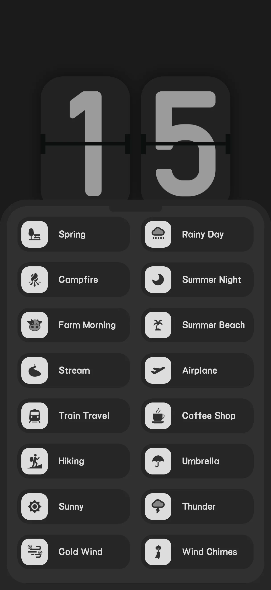
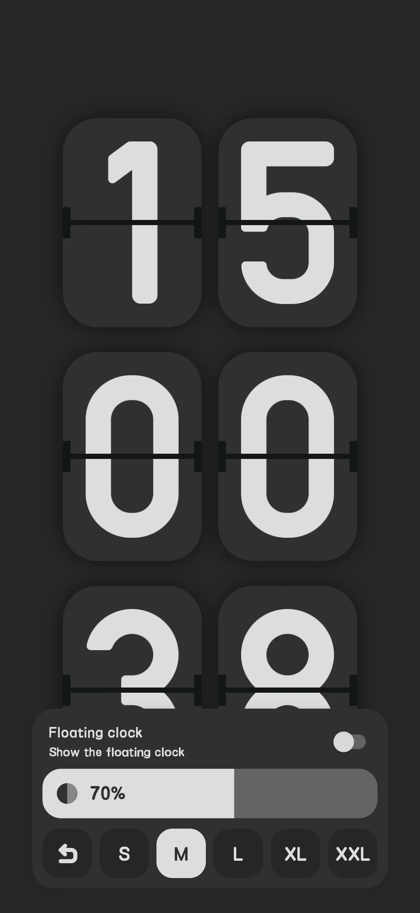

## Kandungan

- [Pendahuluan Aplikasi](#pendahuluan-aplikasi)
- [Penggunaan Pertama](#penggunaan-pertama)
- [Paparan Jam Flip](#paparan-jam-flip)
- [12/24-jam, Saat, Tarikh](#1224-jam-saat-tarikh)
- [Widget Jam](#widget-jam)
- [White Noise](#white-noise)
- [Floating Clock](#floating-clock)
- [Telefon pintar Sandaran sebagai Jam](#telefon-pintar-sandaran-sebagai-jam)
- [Free vs Pro](#free-vs-pro)
- [Senario Umum](#senario-umum)
- [FAQ](#faq)

## Pendahuluan Aplikasi

Only Clock adalah **jam flip skrin penuh [flip clock](/ms/glossary/what-is-a-flip-clock/)** yang indah untuk Android dan iOS — ubah telefon pintar atau tablet apa pun menjadi jam meja atau samping tempat tidur. Ia berfungsi sebagai sumber **jam flip dengan tetapan fokus**, **jam flip dengan white noise**, dan **widget jam flip**, sehingga satu instalasi merangkumi meja, samping tempat tidur, dan skrin utama. Panduan ini menelusuri dari peluncuran pertama melalui paparan 12/24-jam, tema, dan ukuran digit, lalu ke widget, suara, dan mode terapung — termasuk cara **gunakan telefon pintar lama sebagai jam** tanpa membiarkan skrin terang penuh.

**🕐 Animasi Flip**
- Transisi page-flip yang mulus saat digit berubah (sekitar 600 ms per digit)
- Berbagai tema (mis. Hitam, Putih, Langit)

**🪟 Widget**
- 18 widget jam bertema plus widget grid jam (1x1, 2x1, 2x2, 4x1, 4x2, datar/terpisah)

**🔊 White Noise**
- Suara ambient bawaan (mesin sama dengan aplikasi white-noise mandiri) untuk membantu fokus atau tidur

**📅 Paparan Fleksibel**
- Alih 12/24-jam, saat, minggu, dan tarikh

> Catatan: Only Clock sendiri **tidak punya tetapan/pomodoro fokus** — itu ada di aplikasi saudara terpisah. White noise jam hanya membantu Anda berkonsentrasi.

## Penggunaan Pertama

Buka aplikasi ke **jam flip skrin penuh**.

- Bar alat (atas) memberi akses cepat ke tetapan, tema, suara, dan ukuran
- Skrin tetap terjaga saat jam dipaparkan

{: width="180" .normal }

## Paparan Jam Flip

Jam memaparkan waktu bergaya flip. Ketik bar alat untuk mengubah **tema** (Clock Theme), **font** (Clock Font), dan **ukuran** (Clock Size).

{: width="180" .normal }
{: width="180" .normal }
{: width="180" .normal }

## 12/24-jam, Saat, Tarikh

1. Buka **Tetapan**
2. Alihkan:
   - **24-jam** (lalai aktif)
   - **Saat** (lalai aktif)
   - **Minggu** (lalai mati)
   - **Tarikh** (lalai mati)
   - **Latar belakang flip** mask (lalai aktif)

{: width="180" .normal }

## Widget Jam

1. Buka **Tetapan → Widget**
2. Telusuri **galeri** 26 gaya
3. Ketik sebuah gaya → aplikasi memaparkan panduan "tekan lama skrin utama untuk menambah"
4. Tekan lama skrin utama/skrin kunci → Widget → pilih Only Clock → taruh
5. Widget flip 4x2 punya konfigurasi sendiri (saat / mask / minggu / tarikh)

{: width="180" .normal }

## White Noise

1. Buka **Tetapan → White noise**
2. Pilih suara dari grid dua lajur (beberapa premium)
3. Ketik untuk memutar/berhenti

Jam berkongsi mesin suara sama dengan aplikasi white-noise mandiri.

{: width="180" .normal }

## Floating Clock

1. Aktifkan sakelar jam terapung di bar alat skrin utama
2. Berikan kebenaran overlay jika diminta
3. Overlay jam muncul di atas aplikasi lain

{: width="180" .normal }

## Telefon pintar Sandaran sebagai Jam

Kerana skrin tetap terjaga (`FLAG_KEEP_SCREEN_ON`) dan Anda boleh menaruh widget, telefon pintar atau tablet lama bekerja sangat baik sebagai jam meja/samping tempat tidur khusus. Izinkan optimasi bateri diabaikan supaya tidak dimatikan.

## Free vs Pro

- **Percuma** memaparkan iklan dan mengunci beberapa tema/font/suara di sebalik iklan hadiah atau pembelian
- **Pro** memadam iklan dan membuka semua

## Senario Umum

- **Jam samping tempat tidur dari telefon pintar sandaran** — buka Only Clock, colok telefon pintar di samping tempat tidur, dan wajah flip redup memaparkan waktu sepanjang malam dengan skrin tetap terjaga.
- **Jangkar fokus di meja** — jalankan jam skrin penuh dengan white noise saat blok belajar; mode terapung menjaga waktu di atas catatan atau video.
- **Skrin utama sekilas** — tambahkan widget flip 4x2 dengan saat, minggu, dan tarikh supaya waktu hanya sejauh satu pandangan.
- **Cocokkan dengan ruangan** — alih tema Hitam/Putih/Langit dan font/ukuran supaya jam pas dengan setup Anda.

## FAQ

### Apakah ada tetapan/pomodoro fokus di Only Clock?
{:.faq-q}
Tidak. Tetapan fokus ada di aplikasi terpisah. Only Clock menyediakan jam flip, widget, dan white noise.

### Apakah skrin tetap menyala?
{:.faq-q}
Ya — jam menggunakan flag keep-screen-on saat dipaparkan; untuk penggunaan samping tempat tidur, abaikan juga optimasi bateri.

## Ringkasan

Only Clock mengubah peranti apa pun menjadi paparan jam flip yang memukau dengan widget dan white noise yang menenangkan — percuma untuk bermula, dengan upgrade Pro untuk memadam iklan dan membuka semua tema.

## Istilah berkaitan

- [Apakah Itu Jam Flip?](/ms/glossary/what-is-a-flip-clock/)
- [Apakah Itu Jam Meja Samping Tempat Tidur?](/ms/glossary/what-is-a-nightstand-clock/)
