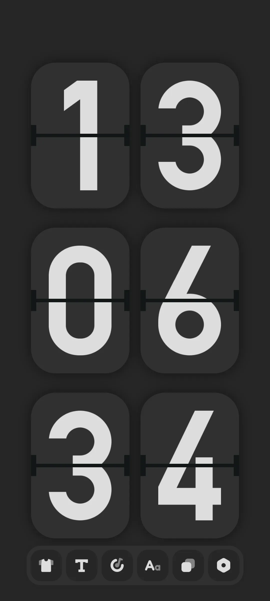
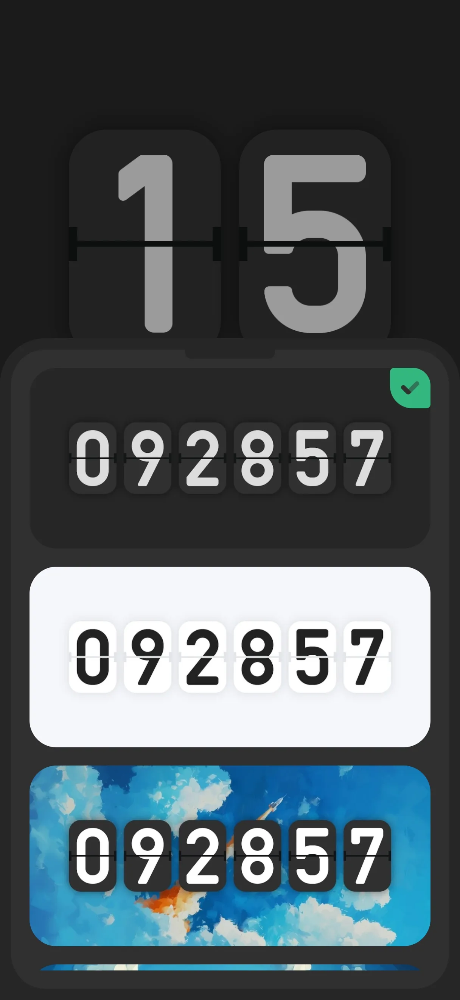
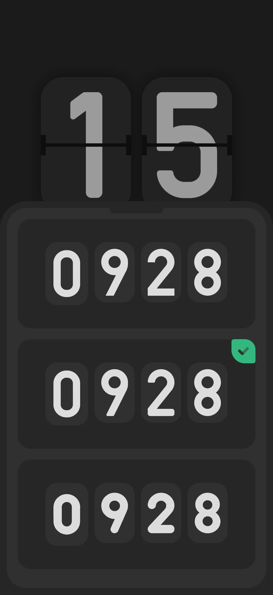
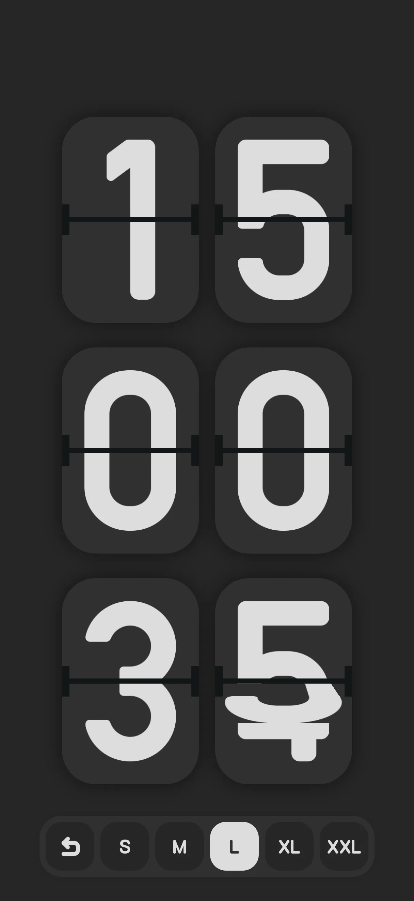
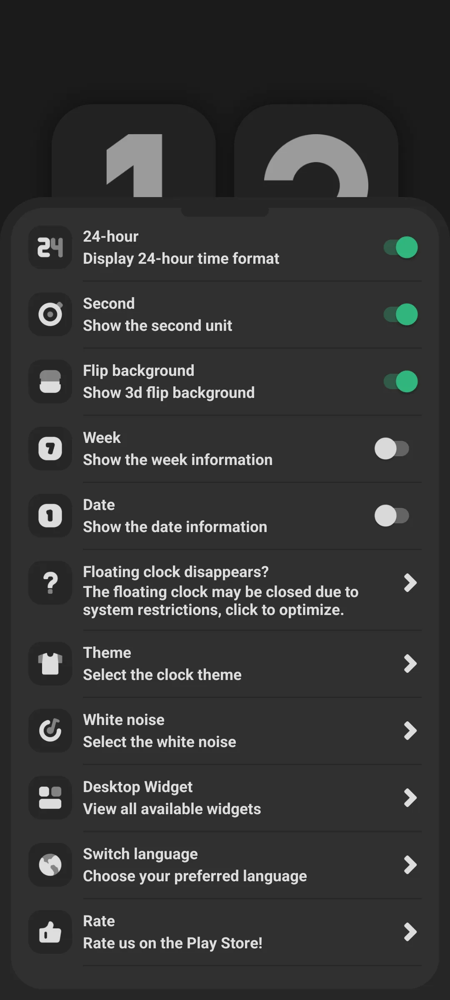
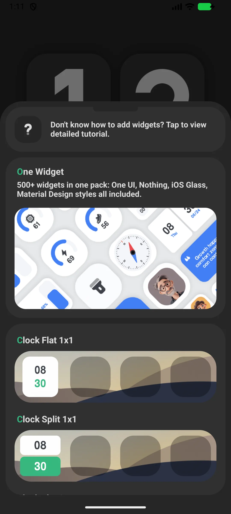
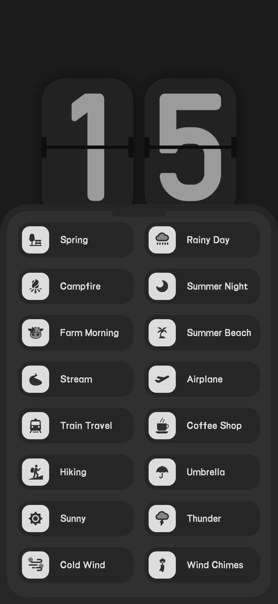
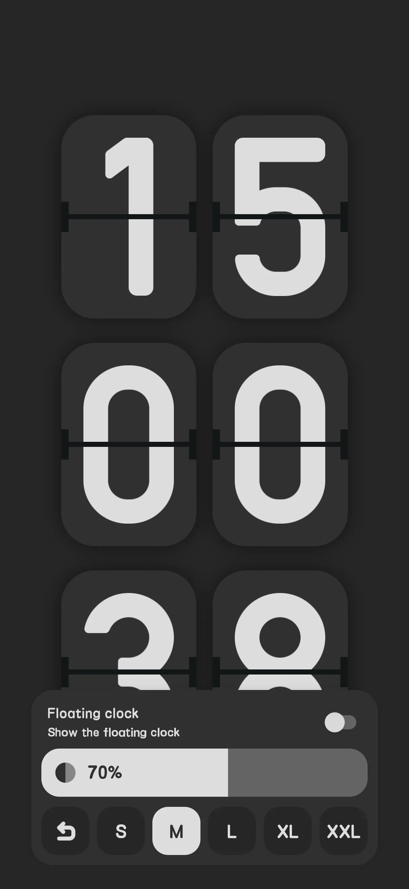

## Kandungan

- [Pendahuluan Aplikasi](#pendahuluan-aplikasi)
- [Penggunaan Pertama](#penggunaan-pertama)
- [Paparan Jam Flip](#paparan-jam-flip)
- [12/24-jam, Saat, Tarikh](#1224-jam-saat-tarikh)
- [Widget Jam](#widget-jam)
- [White Noise](#white-noise)
- [Floating Clock](#floating-clock)
- [Telefon pintar Sandaran sebagai Jam](#telefon-pintar-sandaran-sebagai-jam)
- [Free vs Pro](#free-vs-pro)
- [Senario Umum](#senario-umum)
- [FAQ](#faq)

## Pendahuluan Aplikasi

**Only Clock** adalah **[jam flip skrin penuh](/ms/glossary/what-is-a-flip-clock/)** untuk Android dan iOS yang menukar mana-mana telefon pintar atau tablet menjadi jam meja mahupun samping tempat tidur, dengan skrin yang kekal terjaga dan animasi flip yang lancar. Satu pemasangan merangkumi paparan jam flip, **26 gaya widget jam**, serta pemutar white noise — jadi ia berfungsi serentak sebagai sumber **jam flip dengan tetapan fokus**, **jam flip dengan white noise**, dan **widget jam flip** tanpa perlu beberapa aplikasi berasingan. Panduan ini menelusuri daripada peluncuran pertama melalui paparan 12/24-jam, tema, dan saiz digit, kemudian widget, suara, dan mod terapung — termasuk cara **menggunakan telefon pintar lama sebagai jam** tanpa membiarkan skrin menyala terang sepanjang malam. Perlu diingat, Only Clock sendiri tidak mempunyai tetapan atau pomodoro fokus.

**🕐 Animasi Flip**
- Transisi page-flip yang mulus saat digit berubah (sekitar 600 ms per digit)
- Berbagai tema (mis. Hitam, Putih, Langit)

**🪟 Widget**
- 18 widget jam bertema plus widget grid jam (1x1, 2x1, 2x2, 4x1, 4x2, datar/terpisah)

**🔊 White Noise**
- Suara ambient bawaan (mesin sama dengan aplikasi white-noise mandiri) untuk membantu fokus atau tidur

**📅 Paparan Fleksibel**
- Alih 12/24-jam, saat, minggu, dan tarikh

> Catatan: Only Clock sendiri **tidak punya tetapan/pomodoro fokus** — itu ada di aplikasi saudara terpisah. White noise jam hanya membantu Anda berkonsentrasi.

## Penggunaan Pertama

**Only Clock** dibuka terus pada **jam flip skrin penuh** yang menukar telefon pintar atau tablet menjadi jam meja mahupun samping tempat tidur, dengan skrin yang kekal terjaga selagi jam dipaparkan. Bar alat di bahagian atas memberi akses segera kepada tetapan, tema, suara, dan saiz digit, jadi pelarasan boleh dibuat tanpa keluar dari paparan jam. Animasi page-flip yang lancar berlaku apabila digit bertukar, menghasilkan rupa jam flip yang klasik. Satu pemasangan merangkumi paparan jam, widget, dan white noise. Elemen skrin utama disenaraikan di bawah.

- Bar alat (atas) memberi akses cepat ke tetapan, tema, suara, dan ukuran
- Skrin tetap terjaga saat jam dipaparkan

{: width="180" .normal }

## Paparan Jam Flip

**Only Clock** memaparkan waktu dengan animasi flip yang lancar dan membolehkan anda mengubah **tema** (Clock Theme), **font** (Clock Font), dan **saiz digit** (Clock Size) terus melalui bar alat. Pilihan tema seperti Hitam, Putih, dan Langit menyesuaikan jam dengan suasana bilik, manakala gaya font dan saiz digit boleh dilaras supaya waktu kekal mudah dibaca dari jauh — sesuai untuk setup jam meja. Perubahan ini berlaku serta-merta tanpa memulakan semula aplikasi. Ketik bar alat untuk mengakses ketiga-tiga kawalan tersebut.

{: width="180" .normal }
{: width="180" .normal }
{: width="180" .normal }

## 12/24-jam, Saat, Tarikh

**Only Clock** mengekalkan paparan **24 jam dan saat secara lalai**, manakala minggu dan tarikh dimatikan secara bawaan, dan anda boleh mengubah kelima-lima pilihan itu melalui Tetapan. Latar belakang flip mask juga aktif secara lalai untuk mengekalkan rupa jam flip yang kemas. Fleksibiliti ini membolehkan paparan disesuaikan sama ada anda mahu sekadar masa atau maklumat tarikh yang lengkap pada skrin utama. Lima langkah di bawah melaras setiap pilihan mengikut keperluan.

1. Buka **Tetapan**
2. Alihkan:
   - **24-jam** (lalai aktif)
   - **Saat** (lalai aktif)
   - **Minggu** (lalai mati)
   - **Tarikh** (lalai mati)
   - **Latar belakang flip** mask (lalai aktif)

{: width="180" .normal }

## Widget Jam

**Only Clock** menyediakan **galeri 26 gaya widget jam** bertema flip, termasuk grid 1x1, 2x1, 2x2, 4x1, dan 4x2 dalam versi datar mahupun terpisah, supaya waktu tetap kelihatan terus dari skrin utama atau skrin kunci. Setelah memilih gaya, aplikasi memaparkan panduan untuk menambah widget melalui tekan lama skrin utama — tiada editor pihak ketiga yang diperlukan. Widget flip 4x2 turut mempunyai konfigurasi sendiri untuk saat, mask, minggu, dan tarikh. Lima langkah di bawah memasang dan menyesuaikan widget ini.

1. Buka **Tetapan → Widget**
2. Telusuri **galeri** 26 gaya
3. Ketik sebuah gaya → aplikasi memaparkan panduan "tekan lama skrin utama untuk menambah"
4. Tekan lama skrin utama/skrin kunci → Widget → pilih Only Clock → taruh
5. Widget flip 4x2 punya konfigurasi sendiri (saat / mask / minggu / tarikh)

{: width="180" .normal }

## White Noise

**Only Clock** menyertakan pemutar white noise dengan suara ambient bawaan dalam grid dua lajur — menggunakan enjin yang sama dengan aplikasi white-noise berasingan — untuk membantu fokus atau tidur tanpa memasang aplikasi tambahan. sesetengah suara premium tersedia, dan mana-mana adegan boleh dimainkan atau dihentikan dengan satu ketikan. Menggabungkan jam dengan suara yang menenangkan menjadikan satu peranti berfungsi sebagai jam meja dan bantuan tidur serentak. Perlu diingat, Only Clock sendiri tidak mempunyai tetapan atau pomodoro fokus. Tiga langkah di bawah membuka dan memainkan suara ini.

1. Buka **Tetapan → White noise**
2. Pilih suara dari grid dua lajur (beberapa premium)
3. Ketik untuk memutar/berhenti

Jam berkongsi mesin suara sama dengan aplikasi white-noise mandiri.

{: width="180" .normal }

## Floating Clock

**Only Clock** mengekalkan masa di atas aplikasi lain melalui mod jam terapung yang diaktifkan dari bar alat skrin utama dan memerlukan kebenaran overlay apabila diminta. Overlay ini berguna apabila anda mahu memantau waktu semasa menulis nota, menonton video, atau bekerja tanpa bertukar aplikasi — jam kekal kelihatan di tepi skrin. Seperti quick toggle, ia menggunakan kebenaran sistem Android standard dan tidak memerlukan root. Tiga langkah di bawah mengaktifkan jam terapung.

1. Aktifkan sakelar jam terapung di bar alat skrin utama
2. Berikan kebenaran overlay jika diminta
3. Overlay jam muncul di atas aplikasi lain

{: width="180" .normal }

## Telefon pintar Sandaran sebagai Jam

**Only Clock** menjadikan telefon pintar atau tablet lama sebagai jam meja mahupun samping tempat tidur yang khusus dengan memastikan skrin kekal terjaga melalui `FLAG_KEEP_SCREEN_ON` dan membenarkan widget diletakkan pada paparan. Memandangkan peranti itu tidak lagi digunakan untuk tugas harian, gabungan skrin menyala berterusan dan wajah flip yang redup menghasilkan jam yang sentiasa sedia tanpa perlu menyentuh butang kuasa. Anda hanya perlu mengabaikan pengoptimuman bateri dalam tetapan sistem supaya sistem tidak mematikan aplikasi semasa ia berjalan lama. Ini adalah cara paling murah untuk memberi fungsi baharu kepada peranti yang sudah tidak digunakan.

## Free vs Pro

**Only Clock** hadir dalam dua edisi: versi **Percuma** yang memaparkan iklan dan mengunci sebahagian tema, font, serta suara di sebalik iklan hadiah atau pembelian, dan versi **Pro** yang memadam iklan serta membuka kesemua kandungan. Kedua-duanya mengekalkan fungsi jam flip, widget, dan white noise yang sama; perbezaannya terletak pada gangguan iklan dan pilihan penyesuaian. Bagi pengguna yang menjadikan jam sebagai paparan tetap di meja atau samping tempat tidur, Pro memberikan pengalaman yang lebih bersih. Dua edisi disenaraikan di bawah.

- **Percuma** memaparkan iklan dan mengunci beberapa tema/font/suara di sebalik iklan hadiah atau pembelian
- **Pro** memadam iklan dan membuka semua

## Senario Umum

Empat senario harian menunjukkan di mana **Only Clock** memberi nilai paling jelas dengan jam flip skrin penuh, **26 gaya widget**, white noise, dan mod terapungnya: jam samping tempat tidur dari peranti sandaran, jangkar fokus di meja, skrin utama sekilas, dan padanan dengan ruangan. Dalam setiap kes, satu pemasangan menggantikan beberapa aplikasi — masa, suara, dan widget semuanya tersedia tanpa akaun. Skrin kekal terjaga supaya waktu sentiasa kelihatan, manakala versi Pro memadam iklan untuk paparan yang lebih bersih. Butiran setiap senario disenaraikan di bawah.

- **Jam samping tempat tidur dari telefon pintar sandaran** — buka Only Clock, colok telefon pintar di samping tempat tidur, dan wajah flip redup memaparkan waktu sepanjang malam dengan skrin tetap terjaga.
- **Jangkar fokus di meja** — jalankan jam skrin penuh dengan white noise saat blok belajar; mode terapung menjaga waktu di atas catatan atau video.
- **Skrin utama sekilas** — tambahkan widget flip 4x2 dengan saat, minggu, dan tarikh supaya waktu hanya sejauh satu pandangan.
- **Cocokkan dengan ruangan** — alih tema Hitam/Putih/Langit dan font/ukuran supaya jam pas dengan setup Anda.

## FAQ

### Apakah ada tetapan/pomodoro fokus di Only Clock?
{:.faq-q}
Tidak. Tetapan fokus ada di aplikasi terpisah. Only Clock menyediakan jam flip, widget, dan white noise.

### Apakah skrin tetap menyala?
{:.faq-q}
Ya — jam menggunakan flag keep-screen-on saat dipaparkan; untuk penggunaan samping tempat tidur, abaikan juga optimasi bateri.

## Ringkasan

Only Clock mengubah peranti apa pun menjadi paparan jam flip yang memukau dengan widget dan white noise yang menenangkan — percuma untuk bermula, dengan upgrade Pro untuk memadam iklan dan membuka semua tema.

## Istilah berkaitan

- [Apakah Itu Jam Flip?](/ms/glossary/what-is-a-flip-clock/)
- [Apakah Itu Jam Meja Samping Tempat Tidur?](/ms/glossary/what-is-a-nightstand-clock/)
