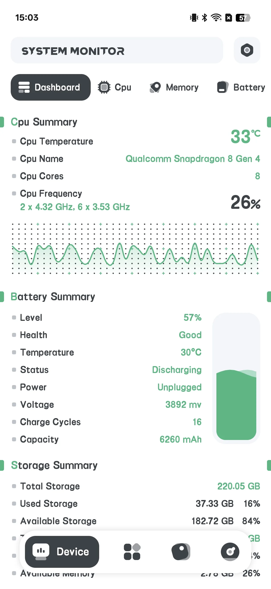
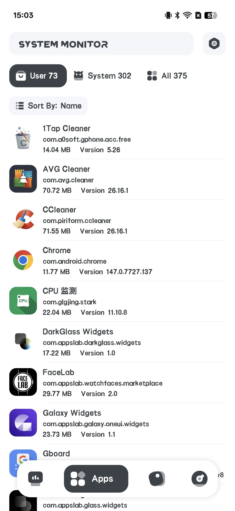
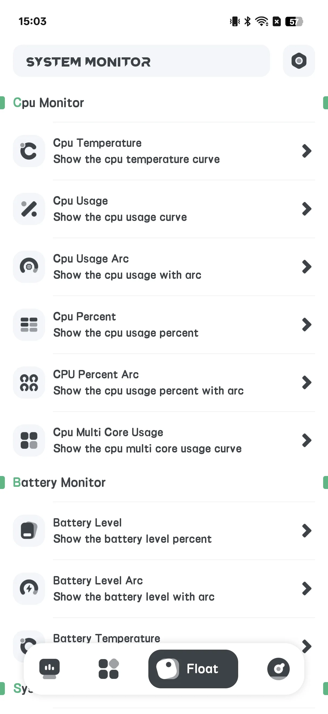
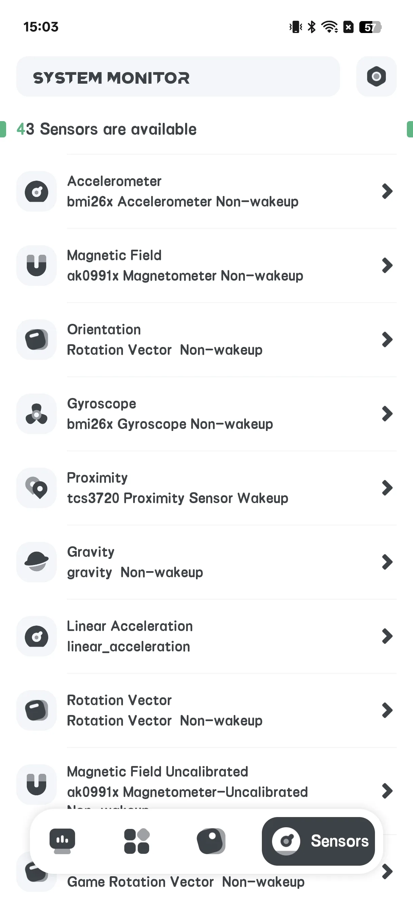
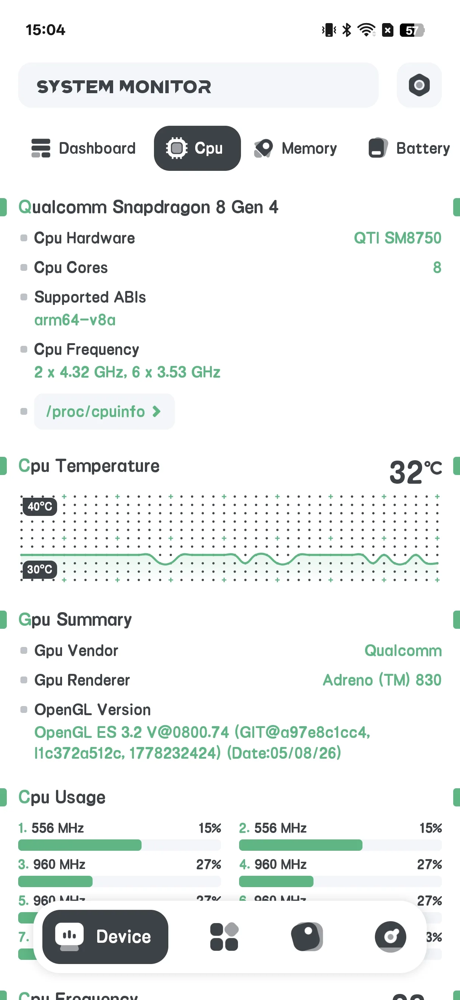
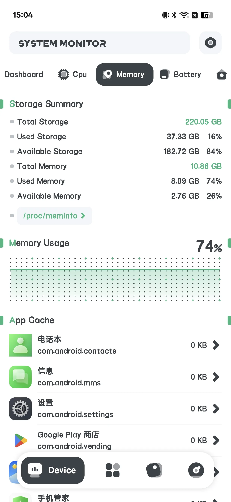
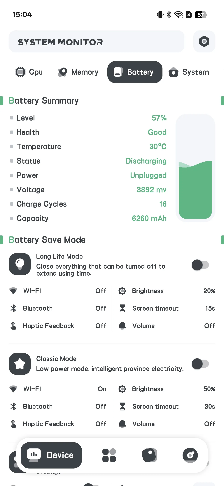
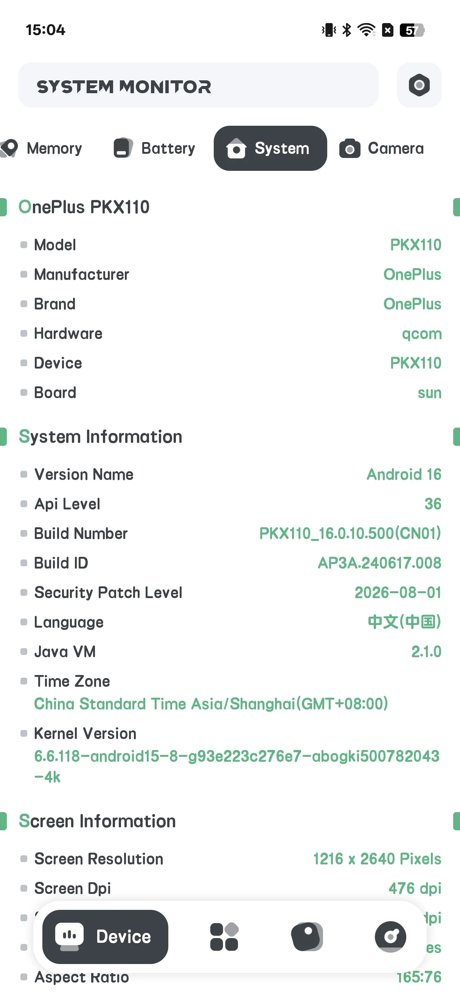
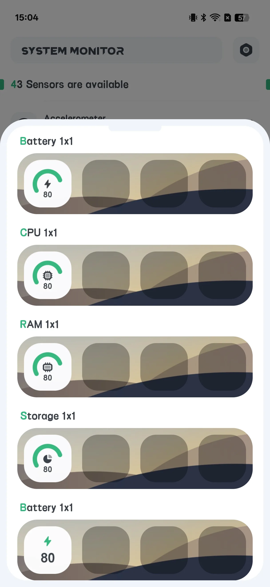

## Kandungan

- [Pengenalan Aplikasi](#pengenalan-aplikasi)
- [Penggunaan Pertama](#penggunaan-pertama)
- [Lihat Info Hardware](#lihat-info-hardware)
- [Kesihatan Bateri](#kesihatan-bateri)
- [Penggera Overheat](#penggera-overheat)
- [Tetingkap Terapung](#tetingkap-terapung)
- [Widget Skrin Utama](#widget-skrin-utama)
- [Tetapan](#tetapan)
- [Senario Khas](#senario-khas)
- [FAQ](#faq)

## Pengenalan Aplikasi

System Monitor adalah alat Android **berbayar satu kali** untuk [deteksi info hardware read-only](/ms/glossary/what-is-a-system-monitor/). Ia melaporkan apa yang terjadi di dalam telefon pintar Anda — ia **tidak** membersihkan junk atau boost RAM. Kerana hanya membaca penghitung sistem, carian **system monitor android dengan cleaner dan booster** yang membawa Anda ke sini biasanya ingin dua hal: angka terpercaya dan cara menjadikannya tetap kelihatan. Panduan ini berjalan dari peluncuran pertama melalui info hardware, kesihatan bateri, penggera overheat, overlay **system monitor dengan tetingkap terapung** dan widget skrin utama — semua read-only, tanpa akaun dan tanpa klaim pembersihan junk.

**🔍 Apa yang Dibacanya (read-only)**
- **CPU** suhu dan frekuensi, penggunaan per-core
- **Storage** penggunaan
- **Memori (RAM)** penggunaan
- **Bateri** kesihatan: suhu, status kesihatan, tegangan, dan level
- **Kamera** keupayaan

**🌡 Perlindungan Overheat**
- Penggera yang memperingatkan saat CPU atau bateri panas

**🪟 Tetingkap Terapung & Widget**
- Overlay terapung memaparkan statik terus
- Widget skrin utama: CPU / Bateri / RAM / ROM / Combine

> Penting: System Monitor **tidak mempunyai app lock / fingerprint lock** dan **tidak melakukan pembersihan atau boosting**. Baris "Fingerprint: supported?" yang mungkin Anda lihat hanyalah bacaan kapabilitas peranti, bukan ciri kunci.

## Penggunaan Pertama

Skrin utama punya empat tab: **Hardware**, **App**, **Floating**, **Sensor**.

- **Hardware** adalah skrin info utama
- **Floating** mengonfigurasi overlay
- **Sensor** memaparkan daftar sensor peranti

{: width="180" .normal }
{: width="180" .normal }
{: width="180" .normal }
{: width="180" .normal }

## Lihat Info Hardware

1. Buka tab **Hardware**
2. Alihkan sub-tab: **Dashboard / CPU / RAM / BAT / SYSTEM / CAMERA**
3. Baca nilai terus:
   - **CPU**: suhu, frekuensi, beban per-core
   - **RAM**: memori terpakai / jumlah
   - **BAT**: suhu bateri, kesihatan, tegangan, level
   - **SYSTEM**: storage dan info peranti

{: width="180" .normal }
{: width="180" .normal }
{: width="180" .normal }
{: width="180" .normal }

## Kesihatan Bateri

Di sub-tab **BAT** Anda boleh melihat **suhu, status kesihatan, tegangan, dan level** bateri dengan lengkung — berguna untuk mengawasi keausan dari waktu ke waktu.

{: width="180" .normal }

## Penggera Overheat

1. Buka **Settings → Penggera overheat** (atau **Temperature Alert**)
2. Alihkan penggera **CPU** dan/atau **Bateri** aktif
3. Tetapkan suhu **ambang**
4. Aplikasi memperingatkan Anda saat nilai terlampaui supaya Anda mendinginkan telefon pintar

## Tetingkap Terapung

1. Buka tab **Floating**
2. Alihkan monitor yang diinginkan (suhu/usage/lengkung CPU, bateri, RAM, System Monitor, FPS)
3. Berikan kebenaran **"Draw over other apps"** saat diminta
4. Statik terapung muncul di atas aplikasi apa pun

{: width="180" .normal }

## Widget Skrin Utama

1. Buka **Settings → Galeri widget**
2. Pilih widget: CPU / Bateri / RAM / ROM / Combine
3. Taruh dari pemilih widget

{: width="180" .normal }

## Tetapan

Tetapan merangkumi tema, penggera overheat, satuan suhu, tingkat penyegaran, galeri widget, dan pemulihan automatik floating.

## Senario Khas

- **Baca suhu CPU saat gaming** — buka tab Hardware (sub-tab CPU) dan awasi suhu serta beban per-core untuk menangkap throttling sebelum frame jatuh.
- **Lindungi bateri** — periksa lengkung suhu, kesihatan, tegangan, dan level sub-tab BAT untuk mengawasi keausan berkembang selama bulan.
- **Pandang tanpa membuka** — aktifkan overlay Floating atau taruh widget Combine di skrin utama untuk CPU/bateri/RAM terus sekilas.
- **Pasang penjaga panas** — nyalakan penggera overheat dengan ambang supaya Anda diperingatkan sebelum telefon pintar panas merusak.
- **Tahu apa yang bukan** — ingat ini read-only: tidak membersihkan junk atau mengosongkan RAM, jadi tutup aplikasi berat sendiri.

## FAQ

### Apakah ini membersihkan memori atau storage?
{:.faq-q}
Tidak. System Monitor strictly read-only — melaporkan fakta dan tidak pernah memadam fail atau "boost" RAM.

### Apakah ada app lock?
{:.faq-q}
Tidak. Tidak ada kunci fingerprint atau password di aplikasi ini.

### Dari mana data berasal?
{:.faq-q}
Dari API Android standar (mis. BatteryManager dan fail sistem). Tidak ada yang diubah.

## Ringkasan

System Monitor adalah pilihan jujur ketika Anda hanya ingin *melihat* isi telefon pintar — suhu CPU, kesihatan bateri, dan statik terus — tanpa pembersih atau booster. Muat turun berbayar satu kali.

## Istilah berkaitan

- [Apakah Itu Monitor Suhu CPU?](/ms/glossary/what-is-a-cpu-temperature-monitor/)
- [Apakah Itu System Monitor?](/ms/glossary/what-is-a-system-monitor/)
- [Apakah Itu RAM Booster?](/ms/glossary/what-is-a-ram-booster/)
