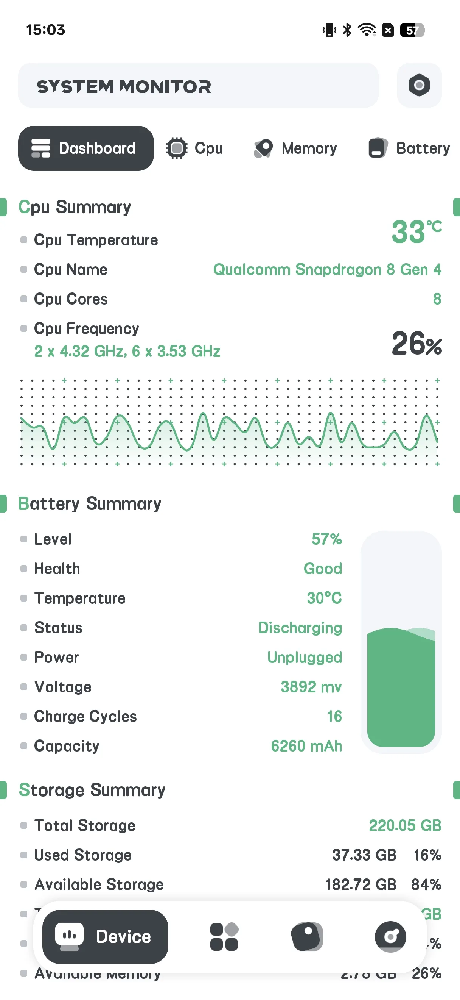
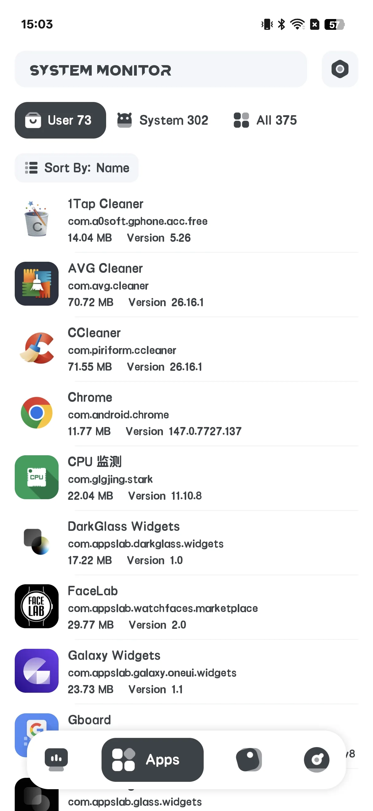
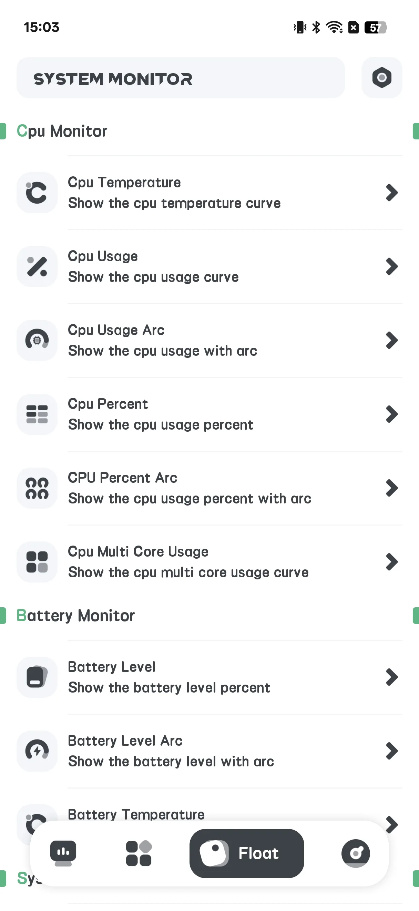
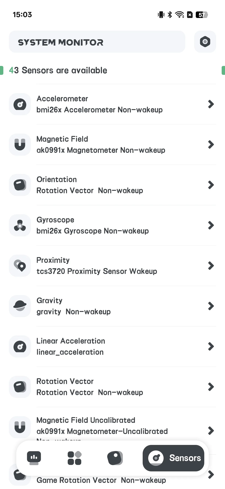
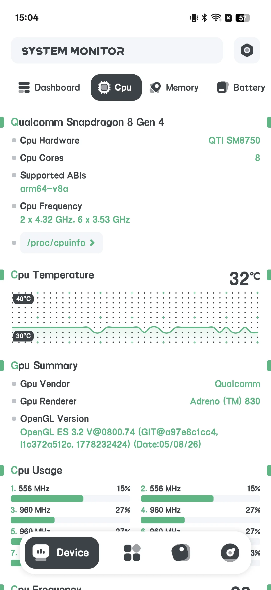
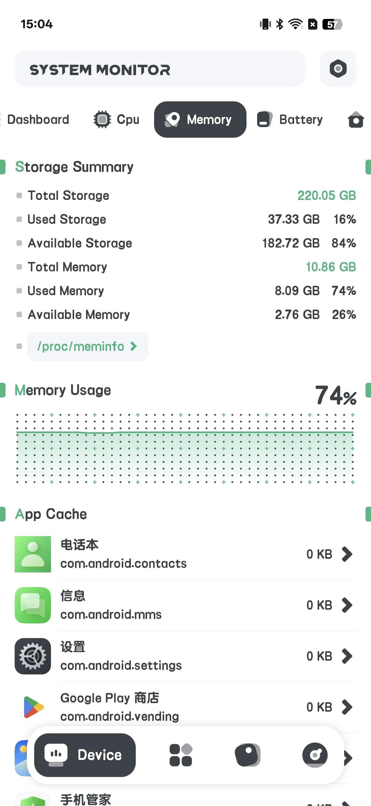
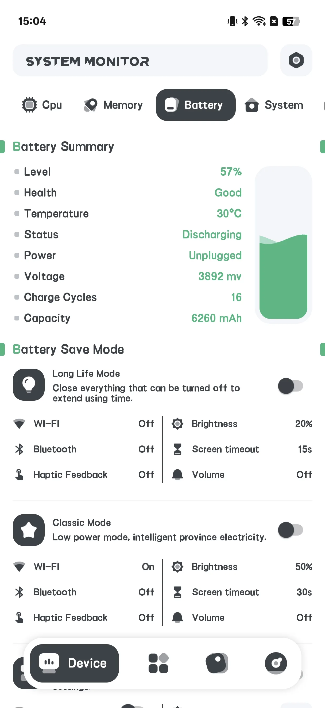
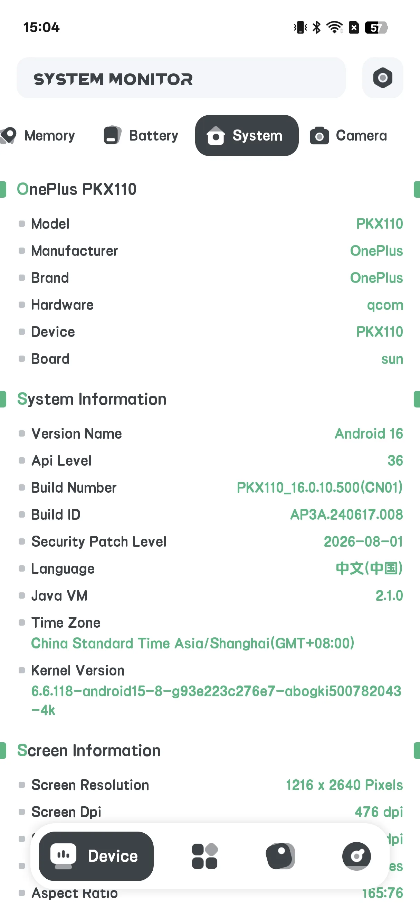
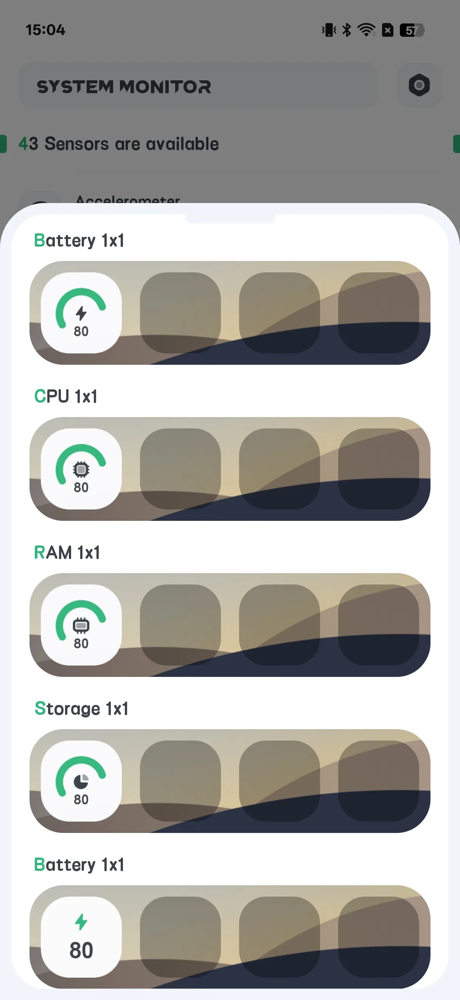

## Kandungan

- [Pengenalan Aplikasi](#pengenalan-aplikasi)
- [Penggunaan Pertama](#penggunaan-pertama)
- [Lihat Info Hardware](#lihat-info-hardware)
- [Kesihatan Bateri](#kesihatan-bateri)
- [Penggera Overheat](#penggera-overheat)
- [Tetingkap Terapung](#tetingkap-terapung)
- [Widget Skrin Utama](#widget-skrin-utama)
- [Tetapan](#tetapan)
- [Senario Khas](#senario-khas)
- [FAQ](#faq)

## Pengenalan Aplikasi

System Monitor ialah alat Android **berbayar satu kali** untuk [deteksi info hardware read-only](/ms/glossary/what-is-a-system-monitor/) yang memaparkan suhu dan frekuensi CPU, penggunaan RAM, storan serta kesihatan bateri melalui enam sub-tab tanpa membersihkan junk atau 'boost' RAM. Aplikasi ini hanya membaca penghitung sistem, jadi carian **system monitor android dengan cleaner dan booster** yang membawa Anda ke sini biasanya mahukan dua perkara: angka yang boleh dipercayai dan cara menjadikannya kekal kelihatan. Panduan ini berjalan dari peluncuran pertama melalui info hardware, kesihatan bateri, penggera overheat, overlay **system monitor dengan tetingkap terapung** dan lima widget skrin utama (CPU, Bateri, RAM, ROM dan Combine) — semuanya read-only, tanpa akaun dan tanpa dakwaan pembersihan junk.

**🔍 Apa yang Dibacanya (read-only)**
- **CPU** suhu dan frekuensi, penggunaan per-core
- **Storage** penggunaan
- **Memori (RAM)** penggunaan
- **Bateri** kesihatan: suhu, status kesihatan, tegangan, dan level
- **Kamera** keupayaan

**🌡 Perlindungan Overheat**
- Penggera yang memperingatkan saat CPU atau bateri panas

**🪟 Tetingkap Terapung & Widget**
- Overlay terapung memaparkan statik terus
- Widget skrin utama: CPU / Bateri / RAM / ROM / Combine

> Penting: System Monitor **tidak mempunyai app lock / fingerprint lock** dan **tidak melakukan pembersihan atau boosting**. Baris "Fingerprint: supported?" yang mungkin Anda lihat hanyalah bacaan kapabilitas peranti, bukan ciri kunci.

## Penggunaan Pertama

System Monitor membuka terus ke skrin utama dengan **empat tab** — **Hardware**, **App**, **Floating** dan **Sensor** — tanpa akaun atau wizard persediaan, kerana alat ini berbayar satu kali dan berfungsi sepenuhnya secara read-only. Tab Hardware menjadi skrin info utama, Floating mengkonfigurasi overlay terapung, dan Sensor memaparkan senarai sensor peranti; tab App pula menyenaraikan proses beserta penggunaan memori per-aplikasi. Susunan empat tab ini memendekkan laluan dari peluncuran pertama kepada bacaan yang dikehendaki, jadi Anda boleh menyemak suhu CPU atau penggunaan RAM dalam beberapa ketikan sahaja.

- **Hardware** adalah skrin info utama
- **Floating** mengonfigurasi overlay
- **Sensor** memaparkan daftar sensor peranti

{: width="180" .normal }
{: width="180" .normal }
{: width="180" .normal }
{: width="180" .normal }

## Lihat Info Hardware

System Monitor menyusun bacaan perkakasan dalam enam sub-tab di bawah tab **Hardware** — Dashboard, CPU, RAM, BAT, SYSTEM dan CAMERA — supaya setiap nilai boleh dibaca terus tanpa perlu membuka aplikasi lain. Sub-tab CPU memaparkan suhu, frekuensi dan beban per-core, RAM menunjukkan memori terpakai berbanding jumlah, BAT menggabungkan suhu, kesihatan, tegangan dan paras bateri, manakala SYSTEM merangkumi storan dan CAMERA membaca keupayaan kamera. Semua bacaan ini adalah read-only: System Monitor tidak memadam, menulis atau 'mengoptimumkan' apa pun, jadi angka yang dipaparkan adalah keadaan sebenar peranti pada masa itu.

1. Buka tab **Hardware**
2. Alihkan sub-tab: **Dashboard / CPU / RAM / BAT / SYSTEM / CAMERA**
3. Baca nilai terus:
   - **CPU**: suhu, frekuensi, beban per-core
   - **RAM**: memori terpakai / jumlah
   - **BAT**: suhu bateri, kesihatan, tegangan, level
   - **SYSTEM**: storage dan info peranti

{: width="180" .normal }
{: width="180" .normal }
{: width="180" .normal }
{: width="180" .normal }

## Kesihatan Bateri

System Monitor memaparkan **empat bacaan bateri** — suhu, status kesihatan, tegangan dan paras — di dalam sub-tab **BAT** berserta lengkung yang menunjukkan perubahan dari semasa ke semasa. Bacaan ini read-only dan berguna untuk mengesan keausan bateri lebih awal, sebelum kapasiti merosot ketara. Anda boleh melihat bagaimana suhu meningkat semasa pengecasan pantas atau sesi permainan panjang, dan membandingkannya dengan tegangan serta status kesihatan untuk menilai sama ada bateri masih berada dalam keadaan baik. Semua nilai datang daripada penghitung sistem Android, jadi System Monitor tidak mengubah, mengosongkan atau 'mengoptimumkan' bateri — ia hanya melaporkan apa yang dikesan, tanpa klaim pembersihan atau penjimatan ajaib.

{: width="180" .normal }

## Penggera Overheat

System Monitor menyediakan penggera overheat yang boleh diaktifkan secara berasingan untuk suhu CPU dan/atau bateri, dengan ambang suhu yang ditetapkan sendiri. Pengguna membuka menu **Settings → Penggera overheat** (juga dipanggil **Temperature Alert**), menghidupkan suis penggera yang dikehendaki, kemudian menaik atau menurunkan nilai ambang mengikut keperluan peranti. Sebaik bacaan melepasi had itu, aplikasi memberi amaran awal supaya telefon pintar disejukkan sebelum prestasi merosot atau bateri cepat terhaus. Ciri ini beroperasi secara lokal dan read-only, tanpa menghantar data ke pelayan mahupun memaksa aplikasi lain ditutup. Ia melengkapkan bacaan suhu langsung pada tab Hardware dengan satu lapisan amaran yang boleh dikawal sepenuhnya oleh pengguna.

1. Buka **Settings → Penggera overheat** (atau **Temperature Alert**)
2. Alihkan penggera **CPU** dan/atau **Bateri** aktif
3. Tetapkan suhu **ambang**
4. Aplikasi memperingatkan Anda saat nilai terlampaui supaya Anda mendinginkan telefon pintar

## Tetingkap Terapung

System Monitor boleh memaparkan statik masa nyata di atas aplikasi lain melalui tetingkap terapung yang diaktifkan dari tab **Floating**. Pengguna memilih monitor yang diinginkan — suhu, penggunaan atau lengkung CPU, bateri, RAM, System Monitor dan FPS — kemudian memberikan kebenaran **Draw over other apps** apabila diminta. Sebaik kebenaran diberikan, statik terapung terus kelihatan walaupun aplikasi lain sedang dibuka, sesuai untuk memantau suhu semasa bermain game atau mengecas. Overlay ini hanya melukis angka di atas skrin dan tidak mengubah data aplikasi lain. Jika ia mengganggu, statik boleh disembunyikan atau dimatikan bila-bila masa melalui tab yang sama, tanpa menjejaskan bacaan pada papan pemuka utama.

1. Buka tab **Floating**
2. Alihkan monitor yang diinginkan (suhu/usage/lengkung CPU, bateri, RAM, System Monitor, FPS)
3. Berikan kebenaran **"Draw over other apps"** saat diminta
4. Statik terapung muncul di atas aplikasi apa pun

{: width="180" .normal }

## Widget Skrin Utama

System Monitor menyediakan lima pilihan widget skrin utama — CPU, Bateri, RAM, ROM dan Combine — yang memaparkan statik terus tanpa perlu membuka aplikasi. Widget dipilih melalui **Settings → Galeri widget**, kemudian diletakkan terus dari pemilih widget skrin utama peranti. Setiap widget menunjukkan satu kumpulan bacaan, manakala widget Combine menggabungkan beberapa metrik dalam satu paparan ringkas. Sama seperti overlay terapung, widget ini read-only: ia hanya melaporkan apa yang dibaca daripada sistem dan tidak membersihkan storan, memadam fail atau mengosongkan RAM. Dengan widget yang dipasang, suhu, baki memori dan kesihatan bateri sentiasa berada dalam pandangan sekilas sepanjang hari.

1. Buka **Settings → Galeri widget**
2. Pilih widget: CPU / Bateri / RAM / ROM / Combine
3. Taruh dari pemilih widget

{: width="180" .normal }

## Tetapan

System Monitor mengumpulkan tetapan untuk enam perkara — tema, penggera overheat, satuan suhu, kadar penyegaran, galeri widget dan pemulihan automatik overlay terapung — dalam satu skrin yang mudah dicari. Pilihan ini menyesuaikan cara bacaan dipaparkan dan sekerap mana ia dikemas kini, tetapi tidak mengubah fakta bahawa alat ini beroperasi secara read-only. Pengguna boleh bertukar antara Celsius dan Fahrenheit, melaras kadar penyegaran untuk menjimatkan bateri, atau memulihkan tetingkap terapung jika ia berhenti selepas kemas kini sistem. Tiada tetapan yang mendayakan pembersihan fail, kunci cap jari atau 'boost' paksa; semuanya tertumpu kepada menjadikan angka perkakasan lebih jelas dan boleh dipercayai setiap hari.

## Senario Khas

System Monitor berguna dalam lima senario harian yang semuanya berpaksikan bacaan terus, bukan pembersihan: memantau suhu CPU semasa gaming, menjaga kesihatan bateri, melihat statik tanpa membuka aplikasi, memasang penjaga haba, dan sedar akan batas read-only alat ini. Dalam setiap kes, nilainya datang daripada penghitung sistem yang sama, jadi pengguna boleh membandingkan keadaan sebelum dan selepas sesi berat dengan yakin. Contohnya, lengkung sub-tab BAT mendedahkan keausan bateri yang berkembang perlahan, sementara widget Combine memberi pandangan sekilas tanpa satu pun ketikan. System Monitor sengaja tidak mengosongkan RAM atau memadam junk; memahami batas itu justru membantu pengguna mencari alat yang tepat apabila storan benar-benar perlu dibersihkan.

- **Baca suhu CPU saat gaming** — buka tab Hardware (sub-tab CPU) dan awasi suhu serta beban per-core untuk menangkap throttling sebelum frame jatuh.
- **Lindungi bateri** — periksa lengkung suhu, kesihatan, tegangan, dan level sub-tab BAT untuk mengawasi keausan berkembang selama bulan.
- **Pandang tanpa membuka** — aktifkan overlay Floating atau taruh widget Combine di skrin utama untuk CPU/bateri/RAM terus sekilas.
- **Pasang penjaga panas** — nyalakan penggera overheat dengan ambang supaya Anda diperingatkan sebelum telefon pintar panas merusak.
- **Tahu apa yang bukan** — ingat ini read-only: tidak membersihkan junk atau mengosongkan RAM, jadi tutup aplikasi berat sendiri.

## FAQ

### Apakah ini membersihkan memori atau storage?
{:.faq-q}
Tidak. System Monitor strictly read-only — melaporkan fakta dan tidak pernah memadam fail atau "boost" RAM.

### Apakah ada app lock?
{:.faq-q}
Tidak. Tidak ada kunci fingerprint atau password di aplikasi ini.

### Dari mana data berasal?
{:.faq-q}
Dari API Android standar (mis. BatteryManager dan fail sistem). Tidak ada yang diubah.

## Ringkasan

System Monitor adalah pilihan jujur ketika Anda hanya ingin *melihat* isi telefon pintar — suhu CPU, kesihatan bateri, dan statik terus — tanpa pembersih atau booster. Muat turun berbayar satu kali.

## Istilah berkaitan

- [Apakah Itu Monitor Suhu CPU?](/ms/glossary/what-is-a-cpu-temperature-monitor/)
- [Apakah Itu System Monitor?](/ms/glossary/what-is-a-system-monitor/)
- [Apakah Itu RAM Booster?](/ms/glossary/what-is-a-ram-booster/)
