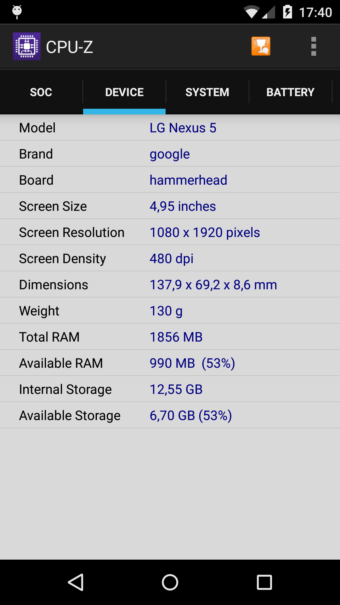
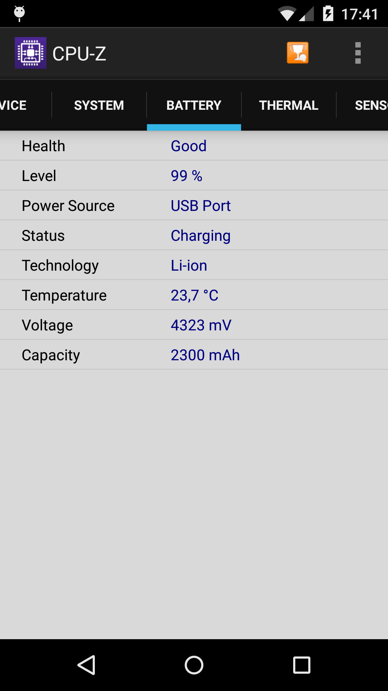

Keduanya membaca isi telefon pintar Anda, tetapi menjawab pertanyaan berbeza. **CPU Monitor** dibuat untuk *mengawasi* peranti waktu nyata — suhu, frekuensi, RAM, dan bateri semasa Anda gaming atau mengecas. **CPU-Z** dibuat untuk *mengidentifikasi* peranti sekali waktu — lembar spesifikasi bersih dari SoC, GPU, memori, dan sensor. Perbandingan **CPU Monitor vs CPU-Z** ini membantu Anda memilih **aplikasi hardware Android** yang tepat di 2026. Jika Anda datang mencari **alternatif CPU-Z** yang terus mengawasi setelah ketikan pertama, baris pemantauan di bawah menyelesaikannya.

## Sekilas

CPU Monitor dan CPU-Z ialah dua aplikasi hardware Android yang melakukan dua kerja berbeza: CPU Monitor memantau suhu, frekuensi, RAM dan bateri secara langsung, manakala CPU-Z membaca spesifikasi peranti sekali sahaja. CPU Monitor menawarkan penggera overheat, tetingkap terapung, widget CPU/RAM/bateri dan boost satu ketik; CPU-Z menyenaraikan SoC, GPU, memori, storan dan sensor dalam lembar spesifikasi statik tanpa amaran atau widget. Kedua-duanya percuma di Android dan tiada versi iOS, jadi jadual perbandingan di bawah memetakan setiap perbezaan supaya anda boleh memilih berdasarkan sama ada anda mahu pemantauan berterusan atau pengenalan peranti sekali waktu.

| | CPU Monitor | CPU-Z |
|---|---|---|
| **Tujuan teras** | Monitor waktu nyata (suhu, frekuensi, RAM, bateri) | Pembaca lembar spesifikasi peranti |
| **Platform** | Android | Android (tanpa iOS) |
| **Harga** | Teras percuma + buka kunci pilihan | Percuma, tanpa langganan |
| **Suhu CPU terus** | **Ya, waktu nyata + penggera overheat** | Bacaan sensor statik |
| **Frekuensi / per-core CPU** | **Ya, terus** | Tertera di spesifikasi |
| **Pemantauan RAM** | **Ya, terus** | Dipaparkan sekali |
| **Kesihatan / suhu bateri** | **Ya, dengan lengkung** | Bacaan dasar |
| **Tetingkap terapung** | **Ya** | Tidak |
| **Widget skrin utama** | CPU, RAM, bateri | Tidak |
| **Boost satu ketik** | **Ya** | Tidak |
| **Tema** | Multi | Tidak ada (UI utilitas) |
| **Sejarah / trend** | Ya (graf penggunaan) | Tidak |
| **Terbaik untuk** | Mengawasi panas terus saat gaming/isi daya | Identifikasi peranti sekali waktu |

---

## CPU Monitor, secara detail

CPU Monitor ialah papan pemuka masa nyata khusus Android yang memerhatikan suhu CPU, frekuensi per-core, RAM dan bateri serta membunyikan penggera overheat sebelum thermal throttling berlaku semasa permainan panjang atau pengecasan pantas. Aplikasi ini meletakkan overlay bar status, tetingkap terapung desktop dan widget skrin utama untuk CPU, RAM dan bateri di atas aplikasi lain, supaya angka kekal kelihatan tanpa membukanya. Boost satu ketik membebaskan RAM dengan segera, manakala doktor bateri memaparkan lengkung kesihatan, voltan dan suhu. Pemonitor teras, widget, tetingkap terapung dan penggera adalah percuma; tema dan sejarah tambahan berada di sebalik buka kunci pilihan.

{: width="180" .normal }
{: width="180" .normal }
{: width="180" .normal }
{: width="180" .normal }
{: width="180" .normal }

CPU Monitor mengubah status-bar dan skrin utama Anda menjadi papan pemuka masa nyata. Ciri utamanya adalah **suhu [CPU](/ms/glossary/what-is-a-cpu-temperature-monitor/) dan frekuensi waktu nyata** dengan penggera overheat, sehingga Anda diperingatkan sebelum thermal throttling aktif selama game panjang atau pengisian cepat.

### Kelebihan
- **Suhu terus dengan penggera overheat** — satu ciri yang tidak boleh ditandingi CPU-Z; ia memperingatkan Anda menutup aplikasi berat dan mendinginkan.
- **Pemantauan frekuensi per-core** — lihat persis core mana yang berputar, bukan sekadar rata-rata.
- **Tetingkap terapung dan widget** — overlay status-bar plus widget CPU/RAM/bateri menjaga angka kelihatan tanpa membuka aplikasi.
- **Boost satu ketik** — dengan cepat membebaskan RAM saat telefon pintar terasa lemot.
- **Dokter bateri** — lengkung kesihatan, tegangan, dan suhu bateri.
- **Ringan dan percuma di teras**, dengan multi-tema.

### Kelemahan
- **Hanya Android** — tidak ada versi iPhone atau iPad.
- **Akurasi bergantung sensor** — tidak setiap peranti membuka sensor suhu nyata, jadi sebahagian bacaan perkiraan.
- **Kurang dalam tentang spesifikasi statik** — memaparkan angka terus tetapi bukan inventaris komponen penuh (mis. model GPU persis, panel skrin).
- **Tema/sejarah ekstra** berada di sebalik buka kunci pilihan.
- **Tanpa eksport** laporan spesifikasi.

### Terbaik untuk
Gamer, penggemar emulasi, dan sesiapa sahaja yang ingin *mengawasi* panas dan beban waktu nyata daripada membaca daftar spesifikasi sekali waktu.

**Muat turun CPU Monitor**
- [Google Play](https://play.google.com/store/apps/details?id=com.glgjing.stark)

---

## CPU-Z, secara detail

CPU-Z ialah pembaca spesifikasi terkenal dari PC yang kini hadir di Android, membuka lembar spesifikasi kemas mengandungi nama dan seni bina SoC, GPU, jenis memori, storan, kapasiti bateri, senarai sensor dan butiran skrin. Ia adalah aplikasi yang anda ambil apabila perlu mengetahui kandungan dalaman telefon pintar, bukan memantau tingkah lakunya dari masa ke masa. Antara muka utiliti tanpa basa-basi dan minimum iklan menjadikannya rujukan dipercayai untuk pengenalan sekali waktu. CPU-Z kekal percuma tanpa langganan mahupun akaun, tetapi bacaan suhu dan sensor adalah statik — ia tidak merekod trend atau memberi amaran panas, dan tiada tetingkap terapung atau widget.

{: width="180" .normal }
{: width="180" .normal }
{: width="180" .normal }
{: width="180" .normal }
{: width="180" .normal }

CPU-Z adalah port Android dari utilitas PC terkenal oleh CPUID. Ia membuka lembar spesifikasi bertab bersih: nama SoC dan arsitektur, GPU, memori dan storan, bateri, sensor, dan bahkan detail skrin. Ini aplikasi yang Anda ambil saat perlu *tahu isi di dalamnya*.

### Kelebihan
- **Lembar spesifikasi berwibawa dan detail** — SoC, GPU, jenis memori, storan, kapasitas reka bentuk bateri, dan daftar sensor panjang.
- **Merek terpercaya** dengan antara muka utilitas tanpa basa-basi, minim iklan.
- **Sepenuhnya percuma**, tanpa langganan, tanpa akaun.
- **Sesuai untuk identifikasi** — selesaikan "chip ini apa?" atau "ini benar UFS 3.1?" dalam saat.
- **Tab sensor** membuka nilai terus (termasuk suhu) untuk cek sekali waktu.

### Kelemahan
- **Statik, bukan monitor** — memaparkan cuplikan; tidak melacak suhu dari waktu ke waktu atau memperingatkan saat panas.
- **Tanpa tetingkap terapung, widget, atau penggera overheat** — Anda harus membuka aplikasi untuk melihat apa pun.
- **Tanpa boost satu ketik atau manajemen RAM.**
- **Hanya Android**, dan UI murni utilitas (tanpa tema).
- **Tanpa trend atau sejarah** — Anda tidak boleh melihat bagaimana suhu berubah selama game.

### Terbaik untuk
Pengembang, pembeli yang memverifikasi telefon pintar bekas, dan sesiapa sahaja yang perlu bacaan hardware terpercaya sekali waktu.

**Muat turun CPU-Z**
- [Google Play](https://play.google.com/store/apps/details?id=com.cpuid.cpu_z)

---

## Bagaimana mereka membandingkan di mana itu penting

CPU Monitor dan CPU-Z membahagikan kategori aplikasi hardware Android kepada dua peranan — pemantauan langsung dan pengenalan sekali waktu — dan lima dimensi berikut menentukan pilihan yang tepat. Pada pemantauan suhu dan frekuensi berterusan, penggera overheat, overlay terapung dan widget skrin utama, CPU Monitor adalah satu-satunya daripada kedua-duanya yang menyediakannya. CPU-Z menang pada kedalaman statik — model SoC tepat, GPU, standard memori, jenis storan dan senarai sensor yang lebih lengkap — serta kekal percuma tanpa jualan tambahan. Kedua-duanya hanya untuk Android; CPU Monitor menambah buka kunci pilihan untuk tema dan sejarah. Bahagian di bawah menghuraikan setiap dimensi itu satu per satu.

### Pemantauan terus vs lembar spesifikasi
Ini teras perbedaan. CPU Monitor adalah *monitor*: buka (atau gunakan tetingkap terapung) dan Anda melihat suhu naik, core naik, dan RAM terisi — waktu nyata. CPU-Z adalah *pembaca*: menangkap keadaan semasa Anda membukanya dan menyajikannya sebagai laporan rapi. Jika tujuan Anda "apakah telefon pintar saya overheat?", hanya CPU Monitor yang menjawabnya terus-menerus.

### Overlay dan widget
CPU Monitor memberi Anda overlay status-bar, tetingkap terapung desktop, dan widget skrin utama untuk CPU/RAM/bateri — visibilitas persisten. CPU-Z tidak memaparkan apa pun kecuali Anda meluncurkannya. Untuk yang ingin papan pemuka sekilas, itu menentukan.

### Perlindungan panas gaming
Saat bermain, penggera overheat CPU Monitor dan graf frekuensi terus memberi tahu kapan harus mundur. CPU-Z boleh memaparkan suhu sekali, tetapi tidak boleh mengawasi sesi. Untuk gaming atau emulasi berat, CPU Monitor adalah pilihan praktikal.

### Kedalaman detail hardware
Untuk identifikasi mentah, CPU-Z menang. Ia mencantumkan model SoC, GPU, standar memori, jenis storan, dan inventaris sensor lebih penuh. CPU Monitor lebih ringan di detail statik dan lebih kuat di perilaku terus.

### Harga dan platform
Keduanya percuma di Android; CPU Monitor menambah buka kunci pilihan untuk tema/sejarah ekstra, sementara CPU-Z percuma tanpa upsell. Tidak satu pun ada di iOS.

## Mana yang harus dipilih

CPU Monitor atau CPU-Z — pilih CPU Monitor jika anda mahu memantau suhu, frekuensi dan RAM secara langsung, mendapat amaran overheat semasa gaming, atau menyimpan widget terapung di skrin utama; pilih CPU-Z jika anda memerlukan lembar spesifikasi peranti yang percuma dan boleh dipercayai tentang cip, GPU, memori dan sensor tanpa peduli penjejakan langsung. Kedua-duanya percuma di Android dan tiada versi iOS. Ramai pengguna mahir menyimpan kedua-dua aplikasi — CPU-Z untuk semakan sekali masa dan CPU Monitor untuk kesedaran haba serta beban harian — kerana setiap satu melayani kerja berbeza dengan baik.

- **Pilih CPU Monitor** jika Anda ingin mengawasi suhu, frekuensi, dan RAM terus, mendapat amaran overheat saat gaming, atau menyimpan widget terapung di skrin utama.
- **Pilih CPU-Z** jika Anda perlu lembar spesifikasi peranti terpercaya dan detail — chip, GPU, memori, sensor — dan tidak peduli penjejakan terus.
- **Pengguna mahir sering menyimpan keduanya**: CPU-Z untuk cek "apa isi telefon pintar ini?" sesekali, dan CPU Monitor untuk kesadaran thermal dan beban sehari-hari.

## Aplikasi hardware dan suhu lain yang patut dipertimbangkan

Alternatif CPU-Z terbahagi kepada tiga kumpulan — pembaca lembar spesifikasi, papan pemuka masa nyata dan alat amaran — dan perbandingan dua aplikasi ini tidak merangkumi setiap alasan orang mencari pengganti. Pilihan yang tepat bergantung pada sama ada anda menginginkan lembar spesifikasi, papan pemuka masa nyata atau amaran panas:

- Sebuah **alternatif DevCheck** atau **alternatif AIDA64** untuk inventaris hardware paling mendalam — SoC, GPU, skrin, sensor, dan detail build sistem. Keduanya lebih dekat ke CPU-Z daripada ke monitor terus.
- Sebuah **alternatif 3C Toolbox** adalah carian semasa Anda ingin toolkit sistem lengkap dengan pemantauan, pelarasan, dan statistik bateri dalam satu tempat; itu instalasi lebih berat daripada aplikasi suhu sederhana.
- Sebuah **alternatif Simple System Monitor** sesuai untuk graf CPU, RAM, dan rangkaian read-only bersih tanpa klaim ekstra.
- Sebuah **alternatif AccuBattery** tentang kesihatan bateri dan siklus charge daripada suhu CPU — patut dipasangkan dengan daftar pendek **alternatif CPU-Z terbaik android** jika suhu pengisian jadi perhatian.

Untuk daftar pendek **alternatif CPU-Z terbaik android**, pertanyaan penentu sederhana: apakah Anda perlu mengidentifikasi telefon pintar sekali waktu, atau mengawasinya setiap kali panas? Lapangan lengkap dibandingkan di [Alternatif CPU-Z Terbaik di 2026](/ms/posts/alternatives-to-cpu-z/).

## Senario khas

CPU Monitor dan CPU-Z sesuai untuk empat situasi Android yang berulang: memantau haba semasa permainan, mengenal pasti telefon pintar terpakai sebelum membeli, menjaga pengecasan pantas yang menjadi panas, dan menjalankan kedua-duanya secara selari. Dalam tiga situasi pertama, faktor penentunya ialah sama ada aplikasi terus memantau selepas ketikan pertama — CPU Monitor merekod suhu dan memberi amaran, manakala CPU-Z menunjukkan satu bacaan dan kekal senyap sehingga dibuka semula. Situasi keempat pula menggabungkan kedua-duanya. Butiran senario tersebut disenaraikan di bawah.

- **Awasi panas gaming** — biarkan tetingkap terapung CPU Monitor di atas game; penggera overheat memberi tahu Anda jeda sebelum thermal throttling menjatuhkan frame.
- **Identifikasi peranti sekali waktu** — semasa Anda hanya perlu memastikan SoC, GPU, atau jenis storan (mis. membeli bekas), lembar spesifikasi CPU-Z menjawab dalam saat.
- **Pengaman pengisian** — setel penggera overheat bateri supaya pengisian cepat yang panas memperingatkan Anda mencabut.
- **Simpan keduanya** — banyak pengguna Android menjalankan CPU-Z untuk identifikasi sesekali dan CPU Monitor untuk kesadaran thermal sehari-hari.

## FAQ

**CPU Monitor atau CPU-Z — mana yang harus saya pilih?**
{:.faq-q}

Ingin suhu, frekuensi, RAM terus, dan penggera overheat saat gaming → CPU Monitor; ingin lembar spesifikasi peranti percuma dan berwibawa → CPU-Z.

**Apakah CPU Monitor memaparkan suhu terus dari waktu ke waktu?**
{:.faq-q}

Ya. Ia memetakan suhu CPU dan bateri sebagai lengkung, sehingga Anda boleh meninjau seluruh sesi, bukan sekadar cuplikan.

**Apakah CPU-Z punya tetingkap terapung atau penggera overheat?**
{:.faq-q}

Tidak. CPU-Z adalah pembaca statik — buka untuk melihat nilai saat ini, tetapi ia tidak melacak trend atau memperingatkan Anda.

**Apakah CPU Monitor percuma?**
{:.faq-q}

Ya. Monitor teras, widget, tetingkap terapung, dan penggera overheat percuma; buka kunci pilihan menambah tema dan sejarah lebih dalam.

## Istilah berkaitan

- [Apakah Itu Monitor Suhu CPU?](/ms/glossary/what-is-a-cpu-temperature-monitor/)
- [Apakah Itu System Monitor?](/ms/glossary/what-is-a-system-monitor/)
