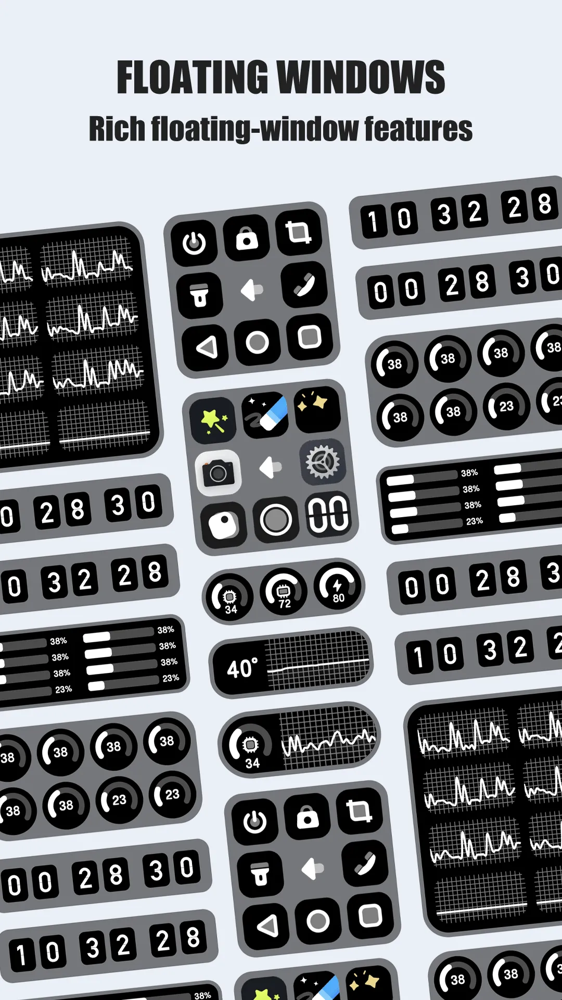
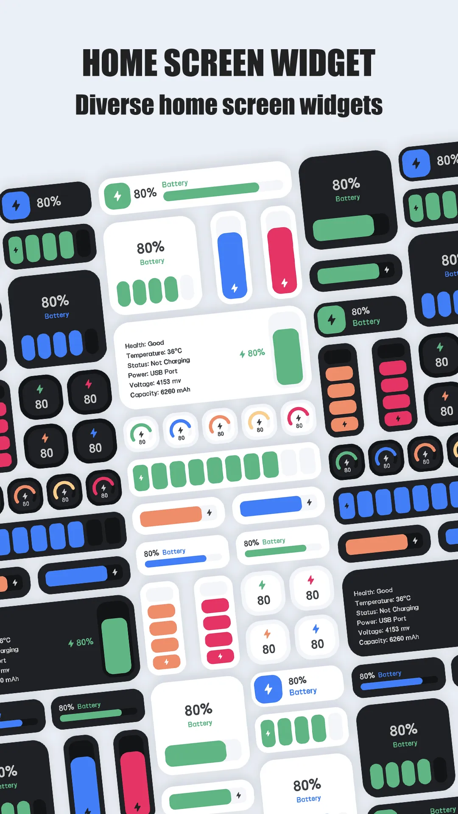
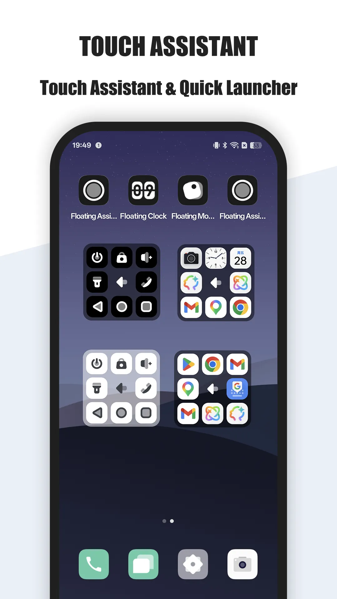
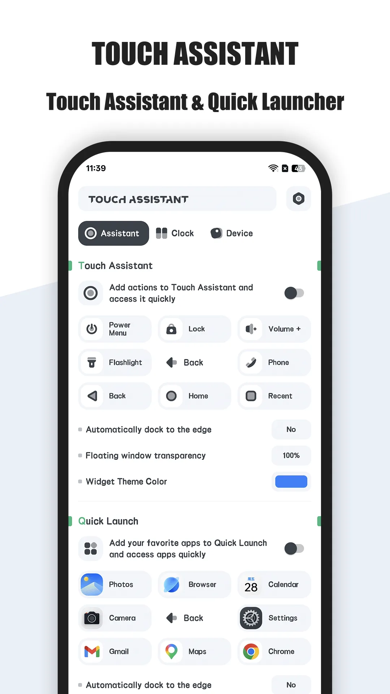
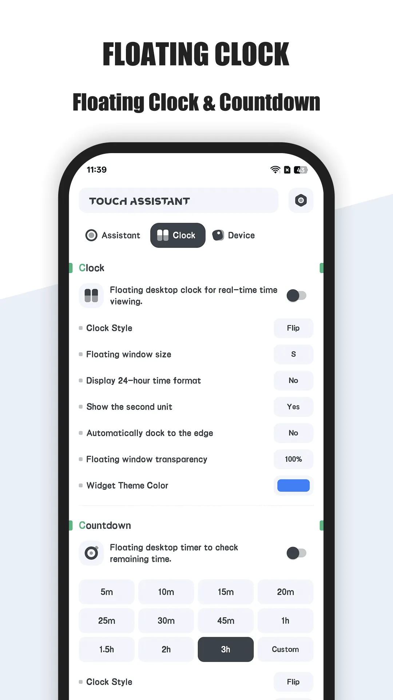
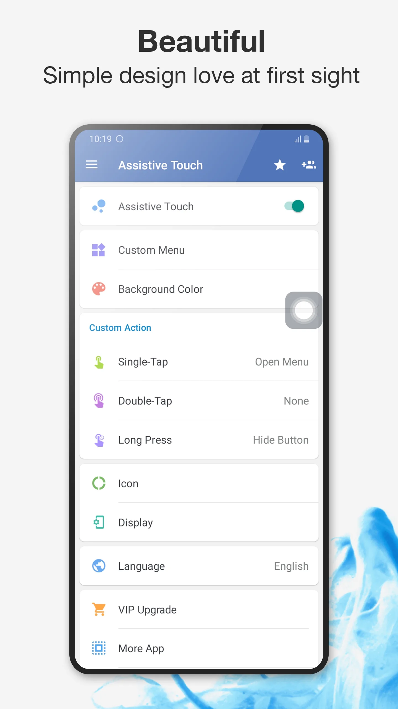
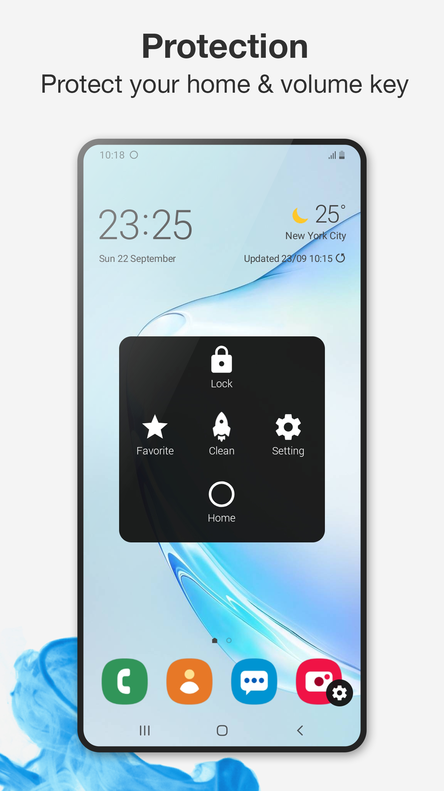
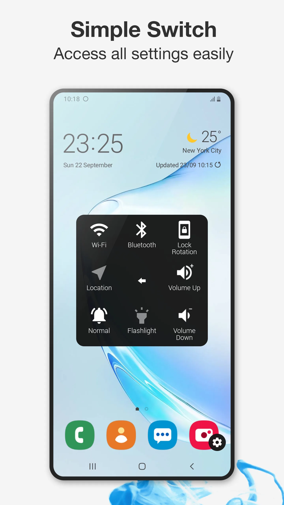
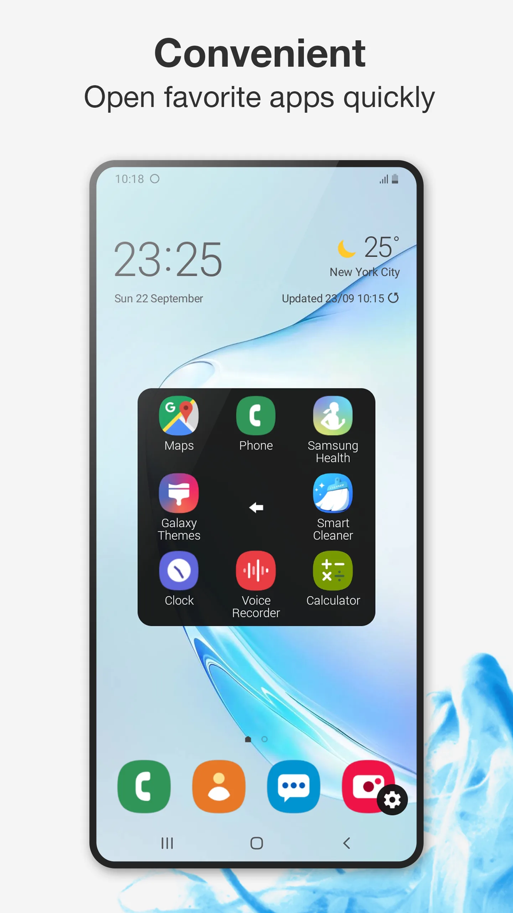
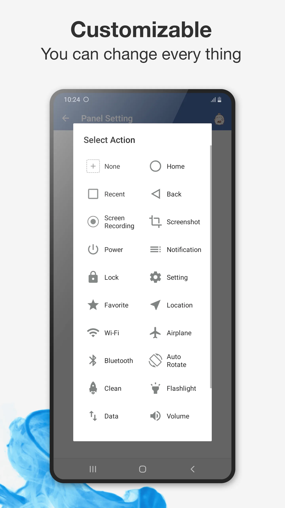

Keduanya menaruh kontrol di atas skrin Anda, tetapi menyelesaikan masalah berbeza. **Floating Assistant** adalah overlay 3-in-1 — assistive touch, jam terapung, dan monitor sistem terus. **Assistive Touch** (Easy Touch) adalah bola navigasi terapung klasik. Perbandingan **Floating Assistant vs Assistive Touch** ini membantu Anda memilih aplikasi [widget terapung](/ms/glossary/what-is-a-floating-window/) di 2026. Jika Anda datang mencari **alternatif Assistive Touch** dengan lebih daripada sekadar bola navigasi, baris overlay di bawah menyelesaikannya.

## Sekilas

| | Floating Assistant | Assistive Touch (Easy Touch) |
|---|---|---|
| **Teras** | 3-in-1: touch + jam terapung + monitor | Bola navigasi terapung |
| **Platform** | Android | Android |
| **Butang assistive touch** | **Ya** | **Ya** |
| **Jam terapung** | **Ya** | Biasanya tidak |
| **Monitor terapung (CPU/RAM/bateri)** | **Ya, terus** | Tidak |
| **Boost satu ketik** | **Ya** | Bervariasi |
| **Tangkapan skrin / senter** | **Ya** | Ya |
| **Pelarasan** | Bola + modul, tema | Ukuran, warna, gerak isyarat |
| **Privasi** | Kebolehcapaian hanya untuk kontrol; tanpa data peribadi | Didukung iklan |
| **Harga** | Teras percuma + buka kunci pilihan | Percuma (didukung iklan) |
| **Terbaik untuk** | Kontrol + pemantauan all-in-one | Bola nav sederhana |

---

## Floating Assistant, secara detail

{: width="180" .normal }
{: width="180" .normal }
{: width="180" .normal }
{: width="180" .normal }
{: width="180" .normal }

Floating Assistant membundel tiga alat ke satu overlay: bola assistive touch untuk navigasi, jam terapung yang boleh dipertahankan di atas aplikasi lain, dan monitor sistem terapung memaparkan suhu CPU, penggunaan, RAM, dan bateri dengan boost satu ketik.

### Kelebihan
- **Tiga alat dalam satu overlay** — Anda tidak perlu aplikasi terpisah untuk butang, jam, dan monitor.
- **Jam terapung** — waktu tetap kelihatan di atas aplikasi atau game apa pun.
- **Monitor terus** — suhu CPU, penggunaan, RAM, dan bateri terus, ideal saat gaming atau mengecas.
- **Boost satu ketik** — bebaskan RAM cepat saat telefon pintar stutter.
- **Tangkapan skrin, senter, dan akses aplikasi cepat** dari bola.
- **Postur privasi** — menggunakan Kebolehcapaian hanya untuk kontrol terdaftar dan tidak mengumpulkan data peribadi atau sensitif.
- **Melindungi butang fisik** di telefon pintar skrin lebar.

### Kelemahan
- **Hanya Android** — tidak ada versi iOS.
- **Overlay memakan sedikit ruang skrin** bila jam + monitor menyala.
- **Tema/modul ekstra** berada di sebalik buka kunci pilihan.
- Ciri lebih banyak berarti penyiapan sedikit lebih ramai daripada bola polos.

### Terbaik untuk
Pengguna mahir dan gamer yang ingin butang *dan* jam *dan* statik sistem terus dari satu lapisan terapung.

**Muat turun Floating Assistant**
- [Google Play](https://play.google.com/store/apps/details?id=com.glgjing.floating.apps.assistive.touch.pro)

---

## Assistive Touch (Easy Touch), secara detail

{: width="180" .normal }
{: width="180" .normal }
{: width="180" .normal }
{: width="180" .normal }
{: width="180" .normal }

Assistive Touch adalah bola terapung gaya iOS familiar untuk Android: butang virtual home, back, recent, dan volume, plus kunci, tangkapan skrin, senter, dan gerak isyarat tersuai — cara paling sederhana menukar butang keras aus.

### Kelebihan
- **Bola terapung familiar** dengan kontrol virtual home/back/recent/volume.
- **Pengalih cepat** — Wi-Fi, Bluetooth, senter, kecerahan, dan mode suara.
- **Gerak isyarat tersuai** (ketik dua kali, tahan lama) untuk memicu aksi.
- **Tema** untuk mempersonalisasi paparan bola.
- **Percuma digunakan**, mudah diaktifkan dan disembunyikan.
- Bagus untuk **melindungi butang fisik** atau jangkauan satu tangan.

### Kelemahan
- **Didukung iklan**, yang boleh mengganggu.
- **Tanpa jam terapung** — hanya navigasi.
- **Tanpa monitor terus** — tidak ada bacaan CPU/RAM/bateri, tidak ada kesadaran overheat.
- **Tanpa boost satu ketik atau manajemen RAM** di pengalaman teras.
- **Caveat privasi** — aplikasi beriklan biasanya meminta kebenaran lebih luas daripada alat monitor-sahaja.

### Terbaik untuk
Pengguna yang hanya ingin bola navigasi gaya iOS sederhana untuk menukar atau melengkapi butang keras.

**Muat turun Assistive Touch (Easy Touch)**
- [Google Play](https://play.google.com/store/apps/details?id=com.easytouch.assistivetouch)

---

## Bagaimana mereka membandingkan di mana itu penting

### Belanjepan overlay
Floating Assistant adalah kotak perkakas: navigasi, jam, dan pemantauan dalam satu. Assistive Touch adalah bola navigasi tunggal. Jika hanya perlu butang, bola lebih ringan; jika ingin lebih daripada overlay, Floating Assistant melakukan lebih banyak.

### Pemantauan saat gaming
Ini jurang paling jelas. Monitor CPU/RAM/bateri terus dan boost satu ketik Floating Assistant membantu selama sesi panjang; Assistive Touch tidak menawarkan visibilitas sistem sama sekali.

### Jam dan pandangan sekilas
Floating Assistant mempertahankan jam di atas aplikasi lain — praktikal sebagai pendamping samping tempat tidur atau meja. Assistive Touch fokus pada kontrol dan menghilangkan jam.

### Privasi dan iklan
Floating Assistant memposisikan diri tidak mengumpulkan data peribadi, dengan teras bebas iklan. Assistive Touch percuma tetapi didukung iklan, yang patut dipertimbangkan bila Anda peduli privasi.

## Mana yang harus dipilih

- **Pilih Floating Assistant** bila Anda ingin satu overlay yang menangani navigasi, jam terapung, dan pemantauan sistem terus (bagus untuk gaming dan telefon pintar tua).
- **Pilih Assistive Touch (Easy Touch)** bila hanya perlu bola navigasi terapung percuma sederhana untuk menukar butang keras.
- **Untuk pengemudi harian all-in-one**, Floating Assistant merangkumi lebih banyak tanah tanpa memaksa Anda ke banyak aplikasi.

## Aplikasi butang terapung lain yang patut dipertimbangkan

Perbandingan dua aplikasi tidak boleh merangkumi setiap alasan orang mencari **alternatif Assistive Touch**. Pengganti tepat bergantung apa yang ingin bola lakukan:

- Sebuah **alternatif Easy Touch** biasanya padanan terdekat dengan aplikasi di sini: bola navigasi percuma dengan menu tetap. Floating Assistant mempertahankan basis itu dan menambah dock tepi, slot remap, dan overlay ekstra.
- Sebuah **alternatif Floatify** tentang gelembung notifikasi dan balasan cepat bukan butang sistem; menyelesaikan masalah berbeza dari jangkauan satu tangan.
- Sebuah **alternatif Button Mapper** sesuai bagi yang ingin butang volume atau daya fisik dipetakan ulang, bukan bola di skrin sama sekali.
- Sebuah **alternatif Simple Control** menunjuk ke panel kontrol ringkas berisi pengalih; widget pengalih sistem Floating Assistant menutupinya dalam bola yang sama.

Untuk daftar pendek **alternatif Assistive Touch android terbaik**, pertanyaan penentu adalah: dapatkah setiap slot dipetakan ulang, apakah bola berlabuh di tepi mana pun, dan apakah kebenaran overlay serta kebolehcapaian dijelaskan jelas? Lapangan lengkap dibandingkan di [Alternatif Assistive Touch Terbaik di 2026](/ms/posts/alternatives-to-assistive-touch/).

## Senario khas

- **Navigasi tanpa butang keras** — bola assistive touch Floating Assistant mengembalikan home/back/recent/kunci/tangkapan skrin dalam jangkauan ibu jari, menyelamatkan butang aus.
- **Waktu tetap kelihatan** — jam melayangnya bertahan di atas aplikasi atau game apa pun, praktikal sebagai pendamping samping tempat tidur atau meja.
- **Awasi panas saat gaming** — monitor CPU/RAM/bateri terus dan boost satu ketik membantu sesi panjang; Assistive Touch tidak memaparkan apa pun.
- **Satu overlay, bukan tiga aplikasi** — touch, jam, dan monitor dalam satu lapisan terapung dan bukannya juggling alat terpisah.
- **Privasi-utama** — Kebolehcapaian hanya untuk kontrol terdaftar dan tidak mengumpulkan data peribadi, berbeza dari bola beriklan.

## FAQ

**Floating Assistant atau Assistive Touch — mana yang harus saya pilih?**
{:.faq-q}

Ingin satu overlay berisi assistive touch + jam terapung + pemantauan sistem terus → Floating Assistant; ingin bola navigasi percuma sederhana → Assistive Touch (Easy Touch).

**Apakah Floating Assistant menyertakan jam terapung?**
{:.faq-q}

Ya. Berbeza dari Assistive Touch, ia mempertahankan jam di atas aplikasi lain — berguna sebagai pandangan samping tempat tidur atau meja.

**Apakah Floating Assistant memantau CPU/RAM/bateri?**
{:.faq-q}

Ya, terus. Ia memaparkan suhu/penggunaan CPU, RAM, dan bateri serta menawarkan boost satu ketik; Assistive Touch tidak punya monitor sistem.

**Apakah Floating Assistant percuma?**
{:.faq-q}

Ya. Overlay teras percuma; buka kunci pilihan menambah tema dan modul lebih dalam.

## Istilah berkaitan

- [Apakah Itu Assistive Touch?](/ms/glossary/what-is-assistive-touch/)
- [Apakah Itu Tetingkap Terapung?](/ms/glossary/what-is-a-floating-window/)
