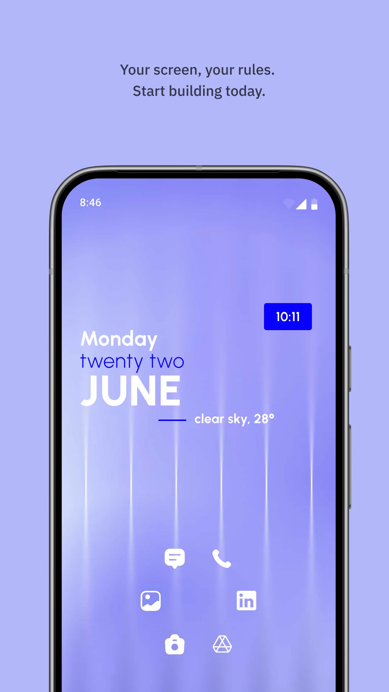

Keduanya mengustomisasi skrin utama Anda, tetapi dengan cara berbeza. **One Widget** menyediakan 500+ widget jadi yang lagi trend, tinggal ubah ukuran dan taruh. **KWGT** (Tersuai Widget Maker) adalah editor dari nol tempat Anda membangun widget apa pun yang boleh dibayangkan. Perbandingan **One Widget vs KWGT** ini membantu Anda memilih **[aplikasi widget Android](/ms/glossary/what-is-a-home-screen-widget/)** yang tepat di 2026. Jika Anda datang mencari **alternatif KWGT** yang menghindari editor, baris tetapan di bawah adalah keputusan utuhnya.

## Sekilas

One Widget dan KWGT ialah dua aplikasi untuk mengustom skrin utama Android dengan pendekatan yang bertentangan. One Widget menyediakan lebih 500 widget siap dalam empat gaya popular — Glass iOS, Material You, Galaxy One UI dan Nothing — berserta lapan kategori fungsional, terus dilaras saiznya dan diletakkan tanpa editor. KWGT pula pembangun dari nol yang membenarkan ikatan data langsung, formula tersuai dan kawalan setiap elemen, dengan Pro kunci sekali kira-kira AS$4.99. One Widget rendah lengkung belajar dan percuma untuk set One UI; KWGT tinggi lengkung belajar tetapi percuma untuk dibina. Kedua-duanya hanya untuk Android. Jadual di bawah memetakan perbezaan itu supaya anda boleh memilih antara widget kurasi cepat dan reka bentuk tersuai penuh.

| | One Widget | KWGT (Tersuai) |
|---|---|---|
| **Pendekatan** | 500+ widget jadi | Editor dari nol |
| **Gaya** | One UI, Nothing, Glass, Material You | Apa pun (Anda rancang) |
| **Lengkung belajar** | **Rendah** | **Tinggi** |
| **Ikatan data terus** | Widget pratetap | **Penuh (cuaca, muzik, formula)** |
| **Pelarasan** | Ukuran, warna, radius sudut | Jumlah (setiap elemen) |
| **Eksport / bagikan** | Terhad | **Penuh (dengan Pro)** |
| **Quick toggle / shortcut** | **Ya (Wi-Fi, BT, senter, aplikasi)** | Mungkin (dengan tetapan) |
| **Harga** | One UI percuma + buka kunci sekali bayar | Percuma + Pro key (~$4,99) |
| **Platform** | Android | Android |
| **Terbaik untuk** | Tema cepat & kohesif | Reka bentuk tersuai unik |

---

## One Widget, secara rinci

One Widget ialah toolkit skrin utama Android serba ada yang memuat lebih 500 widget premium dalam empat gaya trend — Glass iOS, Material You, Galaxy One UI dan Nothing minimalis — terbahagi kepada lapan kategori fungsional. Pengguna memilih widget jadi, mengubah saiz dari 1x1 hingga 2x6, warna latar ikon dan jejari sudut, lalu meletakkannya tanpa perlu editor reka bentuk. Quick toggle Wi-Fi, Bluetooth dan senter serta pintasan aplikasi menjadikan widget benar-benar berguna, bukan sekadar hiasan. Set One UI percuma; gaya lain dibuka dengan pembelian sekali bayar tanpa langganan. Lengkung belajarnya rendah dan sesuai untuk bukan pereka yang mahu meja rapi dengan cepat, tetapi ia terikat pada pratetap dan tidak membenarkan formula data arbitrer.

{: width="180" .normal }
{: width="180" .normal }
{: width="180" .normal }
{: width="180" .normal }
{: width="180" .normal }

One Widget adalah **toolkit skrin utama Android serba ada** yang memuat 500+ widget premium dalam empat gaya trend: Glass iOS, Material You, Galaxy One UI, dan Nothing minimalis. Anda pilih widget jadi, ubah ukurannya, dan selesai.

### Kelebihan
- **500+ widget jadi** — tanpa editor, tanpa keahlian reka bentuk; ketik dan taruh.
- **Empat gaya popular** — Glass, Material You, Galaxy One UI, Nothing — merangkumi sebahagian besar selera estetika.
- **8 kategori fungsional**: shortcut aplikasi, quick toggle sistem (Wi-Fi, Bluetooth, senter…), info hardware peranti (bateri, RAM, storage), jam/kalendar, catatan/kutipan, kontak, peluncur aplikasi agregat (Google/AI/sosial), dan mini alat (kompas, pedometer, kalkulator).
- **Pelarasan ukuran penuh** (1x1 hingga 2x6), warna latar ikon, dan radius sudut supaya sesuai dengan tema Anda.
- **Quick toggle dan shortcut aplikasi** sebagai widget skrin utama — sungguh berguna, bukan sekadar dekoratif.
- **Lengkung belajar rendah** — ideal untuk non-desainer yang ingin desktop rapi dengan cepat.
- **Set One UI percuma**; gaya lain dibuka dengan pembelian sekali bayar.

### Kelemahan
- **Hanya Android** — tidak ada versi iOS.
- **Terikat pratetap** — Anda pelarasan dalam reka bentuk jadi, bukan kanvas kosong.
- **Kedalaman data terus terhad** — widget dikurasi; Anda tidak boleh mengikat formula arbitrer atau sumber data eksotis.
- **Eksport/berkongsi terhad** dibanding builder sejati.
- Keluarga gaya lain perlu pembelian (One UI percuma).

### Terbaik untuk
Pengguna yang ingin skrin utama kohesif dan cantik dengan cepat tanpa mempelajari alat reka bentuk.

**Muat turun One Widget**
- [Google Play](https://play.google.com/store/apps/details?id=com.glgjing.galaxy.nothing.glass.material.widget)

---

## KWGT, secara rinci

KWGT (Tersuai Widget Maker) ialah pembangun widget paling berkuasa di Android yang membolehkan pengguna menaruh teks, bentuk, gambar dan titik data, kemudian mengikatnya kepada sumber langsung seperti cuaca, muzik, bateri atau formula sendiri. Setiap elemen — posisi, saiz, font, warna dan lapisan — boleh ditentukan sehingga ke tahap piksel, dengan komuniti besar yang berkongsi pratetap dan tutorial. Terasnya percuma untuk membina dan menguji; Pro key kira-kira AS$4.99 memadam tanda air dan membuka eksport penuh. Namun lengkung belajarnya tinggi dan widget yang baik boleh mengambil masa berjam-jam berbanding detiknya One Widget. Ia hanya untuk Android dan sesuai untuk pereka serta pengutak-atik yang mahu skrin utama sekehendak hati.

{: width="180" .normal }
{: width="180" .normal }
{: width="180" .normal }
{: width="180" .normal }
{: width="180" .normal }

KWGT (Tersuai Widget Maker) adalah pembangun widget paling powerful di Android. Anda menaruh teks, bentuk, gambar, dan titik data, lalu mengikatnya ke sumber terus — cuaca, muzik, bateri, atau formula Anda sendiri — untuk membuat widget yang sepenuhnya orisinal.

### Kelebihan
- **Pelarasan tidak terhad** — setiap elemen (posisi, ukuran, font, warna, layer) boleh Anda tentukan.
- **Ikatan data terus penuh** — cuaca, muzik, statistik sistem, dan formula tersuai via bahasa ekspresi Tersuai.
- **Tata letak tersuai** — rekreasi paparan apa pun (atau ciptakan sendiri) hingga piksel.
- **Komunitas besar** dengan pratetap dan tutorial dibagikan.
- **Pro key (~$4,99)** memadam watermark dan membuka eksport/berkongsi penuh.
- **Percuma digunakan** di teras untuk membangun dan menguji.

### Kelemahan
- **Lengkung belajar tinggi** — menaruh dan mengikat elemen perlu upaya nyata; bukan untuk pengguna kasual.
- **Investasi waktu** — widget hebat boleh memakan jam, bandingkan detiknya One Widget.
- **Hanya Android**, tidak ada iOS.
- **Watermark dan eksport terhad** hingga Anda membeli Pro key.
- Boleh terasa membebani jika Anda "hanya ingin widget jam yang bagus".

### Terbaik untuk
Desainer dan pengutak-atik yang ingin skrin utama sekehendak hati dan suka membangunnya sendiri.

**Muat turun KWGT**
- [Google Play](https://play.google.com/store/apps/details?id=org.tersuai.widget)

---

## Bagaimana keduanya membandingkan di hal yang penting

One Widget dan KWGT berbeza pada empat perkara yang menentukan pilihan: kelajuan berbanding kendali, kedalaman data langsung, estetika, dan harga. One Widget menang pada masa-kepada-cantik — pilih pratetap, ubah saiz, siap — manakala KWGT menang pada kawalan dengan kanvas kosong di mana setiap piksel dan sumber data boleh ditentukan. Kedua-duanya boleh memaparkan info langsung, tetapi KWGT membenarkan ikatan data apa pun termasuk formula cuaca dan metadata muzik, sementara widget One Widget dikurasi. Dari segi estetika, One Widget menjamin paparan kohesif yang direka profesional; hasil KWGT bergantung sepenuhnya pada kemahiran pengguna. One Widget percuma untuk One UI dengan buka kunci sekali bayar; KWGT percuma untuk dibina dengan Pro kira-kira AS$4.99. Bahagian di bawah menghuraikan setiap dimensi.

### Kelajuan vs kendali
One Widget menang di waktu-menuju-cantik: pilih pratetap, ubah ukuran, selesai. KWGT menang di kendali: kanvas kosong di mana Anda mendikte setiap piksel dan sumber data. Jika Anda menghargai waktu, One Widget; jika menghargai keunikan, KWGT.

### Data terus
Keduanya boleh memaparkan info terus, tetapi kedalamannya berbeza. Widget One Widget dikurasi (jam, bateri, RAM, toggle). KWGT membiarkan Anda mengikat *data apa pun* — formula cuaca, metadata muzik yang sedang diputar, perhitungan tersuai — ke dalam tata letak tersuai. Untuk data eksotis, KWGT tidak tertandingi.

### Estetika
One Widget menjamin paparan kohesif dan trend (Glass/One UI/Nothing/Material You) kerana profesional yang merancang preset-nya. Hasil KWGT sepenuhnya bergantung pada keahlian Anda — luar biasa atau amatir.

### Harga
One Widget percuma untuk One UI dengan buka kunci sekali bayar untuk keluarga lain. KWGT percuma untuk dibangun, dengan Pro key ~$4,99 untuk penghapusan watermark dan eksport. Keduanya wajar; tidak ada yang berat langganan.

## Mana yang harus Anda pilih

One Widget atau KWGT — pilih One Widget jika anda mahu skrin utama yang rapi dan kohesif dalam beberapa minit serta lebih suka gaya kurasi berbanding alat reka bentuk; pilih KWGT jika anda mahu kawalan kreatif penuh, formula data langsung dan tidak keberatan belajar serta meluangkan masa membina widget unik. Ramai pengguna Android menyimpan kedua-duanya — One Widget untuk widget harian yang cepat dan KWGT bila mahu sesuatu yang benar-benar tersuai. Kedua-duanya hanya untuk Android dan tidak berat langganan, jadi pilihannya bergantung pada sama ada anda menghargai masa atau keunikan.

- **Pilih One Widget** jika Anda ingin skrin utama rapi dan kohesif dalam minit serta lebih suka gaya kurasi daripada alat reka bentuk.
- **Pilih KWGT** jika Anda ingin kendali kreatif penuh, formula data terus, dan tidak keberatan belajar (serta meluangkan waktu) membangun widget unik.
- **Banyak pengguna Android menyimpan keduanya**: One Widget untuk widget sehari-hari yang cepat, dan KWGT saat mereka ingin sesuatu yang benar-benar tersuai.

## Pembuat widget lain yang layak dipertimbangkan

Alternatif KWGT terbahagi kepada beberapa haluan — pembangun yang lebih mesra, widget jam dan kalendar yang boleh dipercayai, serta pustaka pratetap besar — jadi perbandingan dua aplikasi ini tidak boleh merangkumi setiap alasan orang mencari **alternatif KWGT**. Substitusi yang tepat bergantung pada apa yang ingin Anda bangun:

- Sebuah **alternatif Tersuai Widget Maker** untuk orang yang menyukai kekuatan KWGT tetapi tidak editornya: pratetap jadi yang Anda ubah ukuran, bukan layer yang Anda gambar. One Widget adalah jalan pintas di sini.
- Sebuah **alternatif Chronus** biasanya tentang widget jam/kalendar/berita yang boleh dipercayai dengan banyak pilihan tipografi; jika itu semua yang Anda butuhkan, pakej serbaguna mungkin lebih daripada yang Anda mau.
- Sebuah **alternatif Widgetopia** atau **alternatif Zooper Widget** adalah carian semasa Anda menginginkan pustaka pratetap besar daripada alat scripting — alasan sama mengapa daftar pendek **alternatif KWGT terbaik Android** cenderung menyertakan pakej jadi.
- Sebuah **alternatif Widgetsmith** sesuai untuk tata letak gaya iOS; di Android, pratetap Glass One Widget menutupi paparan itu tanpa aplikasi khusus iPhone.

Bidang lengkap dibandingkan di [Alternatif WidgetSmith Terbaik di 2026](/ms/posts/alternatives-to-widgetsmith/).

## Senario umum

One Widget dan KWGT sesuai untuk lima situasi: mahu skrin utama rapi segera, suka membina dari nol, hanya perlukan quick toggle, mahukan data langsung yang eksotik, atau menyimpan kedua-duanya. Dengan lebih 500 widget jadi, One Widget bermaksud pilih, ubah saiz dan siap dalam masa singkat, manakala KWGT memerlukan sesi membina terlebih dahulu. Editor KWGT membenarkan ikatan cuaca, muzik dan formula tersuai, sementara One Widget menyediakan Wi-Fi, Bluetooth dan senter sebagai widget tanpa scripting. Ramai pengguna menjalankan kedua-duanya secara selari. Kedua-duanya hanya untuk Android. Senario penuh disenaraikan di bawah.

- **Anda ingin skrin utama rapi malam ini** — 500+ widget jadi One Widget berarti pilih, ubah ukuran, selesai; KWGT perlu sesi membangun dulu.
- **Anda suka membangun dari nol** — editor dan Kode KWGT membiarkan Anda mengikat cuaca, muzik, dan formula tersuai ke widget sekehendak hati.
- **Anda hanya perlu quick toggle** — One Widget menyediakan Wi-Fi/Bluetooth/senter dan shortcut aplikasi sebagai widget; tanpa scripting.
- **Anda ingin data terus eksotis** — ikatan data penuh KWGT tidak tertandingi untuk now-playing, formula cuaca, dan statistik tersuai.
- **Simpan keduanya** — banyak pengguna Android menjalankan One Widget untuk widget sehari-hari dan KWGT saat mereka ingin sesuatu yang benar-benar tersuai.

## FAQ

**One Widget atau KWGT — mana yang harus saya pilih?**
{:.faq-q}

Ingin skrin utama kohesif dan rapi dalam minit, tanpa editor → One Widget; ingin kendali kreatif penuh dengan formula data terus dan tidak keberatan lengkung belajar → KWGT.

**Apakah One Widget percuma?**
{:.faq-q}

Set gaya One UI percuma; tiga gaya lain dibuka dengan pembelian sekali bayar (tanpa langganan).

**Apakah One Widget bekerja di iOS?**
{:.faq-q}

Tidak. One Widget hanya Android; KWGT juga hanya Android. Untuk iOS, lihat WidgetSmith.

**Apakah KWGT bebas langganan?**
{:.faq-q}

KWGT percuma untuk dibangun dan diuji; Pro key sekali bayar ~$4,99 memadam watermark dan membuka eksport penuh. Tanpa langganan.

## Istilah berkaitan

- [Apakah Itu Widget Skrin Utama?](/ms/glossary/what-is-a-home-screen-widget/)
- [Apakah Itu Material You?](/ms/glossary/what-is-material-you/)
- [Apakah Itu Nothing UI?](/ms/glossary/what-is-nothing-ui/)
- [Apakah Itu Galaxy One UI?](/ms/glossary/what-is-galaxy-one-ui/)
- [Apakah Itu iOS Glass?](/ms/glossary/what-is-ios-glass/)
