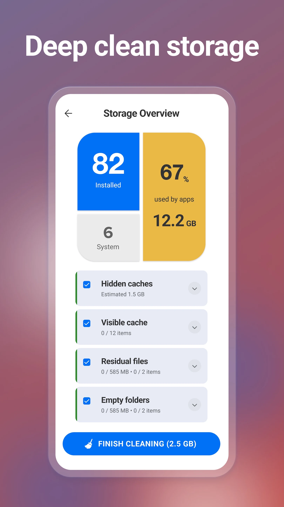

Satu membersihkan, satu memantau. **System Monitor** adalah papan pemuka Android read-only yang memaparkan data CPU, RAM, bateri, dan suhu terus, dengan ringkasan memori dan bacaan kesihatan bateri. **CCleaner** adalah aplikasi pembersih junk popular untuk cache dan fail tidak digunakan. Perbandingan **System Monitor vs CCleaner** ini menjelaskan [system monitor android](/ms/glossary/what-is-a-system-monitor/) mana yang sesuai untuk Anda di 2026 — dan juga daftar pendek **alternatif CCleaner untuk android** bila Anda ingin angka terus dan bukannya pembersihan.

## Sekilas

System Monitor dan CCleaner ialah dua aplikasi Android yang melakukan kerja bertentangan: satu memantau, satu membersihkan. System Monitor adalah papan pemuka read-only yang memaparkan suhu CPU, frekuensi per-core, RAM, storan dan kesihatan bateri secara langsung, dengan penggera overheat, tetingkap terapung dan RAM boost satu ketik. CCleaner pula pembersih junk dan cache yang memadam fail tidak digunakan dengan pindai satu ketik yang familier. Kedua-duanya percuma dengan ciri berbayar atau iklan, dan hanya untuk Android. System Monitor tidak memadam apa pun; CCleaner tidak memantau suhu langsung. Jadual di bawah memetakan perbezaan itu supaya anda boleh memilih antara wawasan dan pembersihan.

| | System Monitor | CCleaner |
|---|---|---|
| **Teras** | Monitor (CPU/RAM/bateri) + boost | Pembersih junk/cache |
| **Platform** | Android | Android |
| **Pemantauan CPU** | **Ya (suhu, freq, per-core)** | Terhad |
| **RAM boost** | **Satu ketik + daftar abaikan** | Ya |
| **Dokter bateri** | **Kesihatan + mode hemat** | Dasar |
| **Pembersihan junk** | Hanya ringkasan storage | **Ya (cache/junk)** |
| **Penggera overheat** | **Ya** | Tidak |
| **Tetingkap terapung** | **Ya** | Tidak |
| **Privasi / keselamatan** | Lokal, tanpa kumpul data | Didukung iklan |
| **Harga** | Teras percuma + buka kunci | Percuma (didukung iklan) |
| **Terbaik untuk** | Wawasan & kontrol | Membersihkan cache/fail tidak digunakan |

---

## System Monitor, secara detail

System Monitor ialah alat Android all-in-one yang menggabungkan monitor CPU, ringkasan storan, RAM booster dan doktor bateri dalam satu papan pemuka, supaya anda mendapat wawasan dan aksi cepat tanpa memasang aplikasi berasingan. Bacaan suhu dan frekuensi CPU langsung disertakan analisis sejarah serta penggera overheat, manakala pemantauan multicore menunjukkan beban per-core. RAM boost satu ketik dilengkapi senarai abaikan supaya aplikasi penting tidak dibunuh, dan doktor bateri memaparkan lengkung kesihatan, voltan serta suhu. Tetingkap terapung dan widget menjaga angka tetap kelihatan. Terasnya percuma dengan multi-tema; tema dan sejarah tambahan di sebalik buka kunci. Ia tidak memadam junk atau fail — itu memang bukan tugasnya.

{: width="180" .normal }
{: width="180" .normal }
{: width="180" .normal }
{: width="180" .normal }
{: width="180" .normal }

System Monitor adalah **alat Android all-in-one**: monitor CPU, ringkasan storage, RAM booster, dan dokter bateri — sehingga Anda dapat wawasan *dan* aksi cepat dalam satu tempat.

### Kelebihan
- **Suhu dan frekuensi CPU terus** dengan analisis sejarah dan penggera overheat.
- **Pemantauan CPU multicore** dan penggunaan per-core.
- **RAM boost satu ketik** dengan daftar abaikan supaya aplikasi penting tidak dibunuh.
- **Dokter bateri** — lengkung kesihatan, tegangan, dan suhu, plus mode hemat.
- **Tetingkap terapung dan widget** untuk CPU/RAM/bateri sekilas.
- **Ringkasan storage** untuk melihat apa yang memakan ruang (tanpa memadam fail).
- **Multi-tema** dan teras percuma.

### Kelemahan
- **Hanya Android** — tidak ada versi iOS.
- **Tidak memadam junk/cache** — ini monitor, bukan pembersih (by design).
- **Tema/sejarah ekstra** berada di sebalik buka kunci pilihan.
- **Tanpa manajemen fail dalam** (tanpa pencari duplikat atau uninstaller aplikasi).
- Akurasi suhu bergantung sensor per peranti.

### Terbaik untuk
Pengguna yang ingin *memahami dan mengontrol* apa yang memakai sumber daya — dan diperingatkan sebelum overheat — dan bukannya membersihkan secara buta.

**Muat turun System Monitor**
- [Google Play](https://play.google.com/store/apps/details?id=com.glgjing.marvel)

---

## CCleaner, secara detail

CCleaner seluler ialah versi telefon pintar bagi alat PC terkenal yang menawarkan cara cepat mengosongkan cache, sejarah penjelajahan dan fail tidak digunakan, bersama pembantu foto serta bateri asas pada tier premium. Alur pindai satu ketiknya mudah dan familier bagi pengguna desktop, dengan ringkasan storan sederhana dan tier percuma yang didukung iklan. Namun dampaknya terhad pada Android moden kerana sistem sudah mengurus RAM dan cache sendiri — pembersihan sering menjimatkan ruang kecil sahaja. CCleaner tidak memaparkan suhu, frekuensi mahupun RAM secara langsung, tiada penggera overheat atau tetingkap terapung, dan pembersihan agresif boleh memaksa aplikasi dibuka semula. Ia hanya untuk Android dan sesuai untuk pengguna kasual yang mahukan sapu cache yang dikenali.

{: width="180" .normal }
{: width="180" .normal }
{: width="180" .normal }
{: width="180" .normal }
{: width="180" .normal }

CCleaner seluler adalah **versi telefon pintar alat PC terkenal** — cara cepat mengosongkan cache, sejarah penjelajahan, dan fail tidak digunakan, plus pembantu foto dan bateri dasar.

### Kelebihan
- **Merek dan alur familier** bila Anda pakai CCleaner di desktop.
- **Pembersihan cache/sejarah cepat** dan ringkasan storage sederhana.
- **Pembantu hibernasi bateri dan aplikasi** di tier premium.
- **Pindai satu ketik mudah** untuk pengguna kasual.
- **Tier percuma** tersedia.

### Kelemahan
- **Dampak nyata terhad** di Android modern — OS sudah mengurus cache dan tugasan latar; "pembersihan" sering menghemat sedikit.
- **Versi percuma didukung iklan** dengan ajakan langganan.
- **Tanpa pemantauan terus** — tidak boleh memaparkan suhu, frekuensi, atau RAM secara nyata.
- **Tanpa penggera overheat atau tetingkap terapung.**
- **Tanpa versi iOS** — hanya Android kini.
- Pembersihan agresif bahkan boleh merusak bateri dengan memaksa tutup aplikasi yang membuka ulang.

### Terbaik untuk
Pengguna kasual yang ingin cara familier satu ketik untuk mengosongkan cache dan fail tidak digunakan.

**Muat turun CCleaner**
- [Google Play](https://play.google.com/store/apps/details?id=com.piriform.ccleaner)

---

## Bagaimana mereka membandingkan di mana itu penting

System Monitor dan CCleaner berbeza pada empat perkara yang menentukan kegunaannya: peranan monitor berbanding pembersih, apa yang pembersihan benar-benar lakukan pada Android moden, bateri dan keselamatan, serta harga dan iklan. System Monitor mengamati — CPU, RAM dan bateri terus dengan penggera overheat serta tetingkap terapung — dan menawarn boost; CCleaner bertindak memadam cache dan junk. Memandangkan Android sudah mengurus RAM dan cache, kemenangan nyata pembersih ialah memadam fail tidak digunakan dan media besar, bukan mempercepat telefon. System Monitor membantu anda melihat pelakunya, bukan menebak. Bahagian di bawah menghuraikan setiap perbezaan itu.

### Monitor vs cleaner
Ini teras perbedaan. System Monitor mengamati — CPU/RAM/bateri terus, penggera overheat, tetingkap terapung — dan menawarkan boost. CCleaner bertindak — memadam cache dan junk. Jika Anda ingin *tahu* apa yang terjadi, System Monitor; jika ingin *mengosongkan* ruang, CCleaner.

### Apa yang pembersihan benar-benar lakukan di Android modern
Sejujurnya, Android sudah mengurus RAM dan cache. Kemenangan nyata pembersih terbesar adalah memadam fail tidak digunakan dan media besar — bukan "mempercepat" via pengosongan RAM. Nilai System Monitor adalah membantu Anda *melihat* pelakunya (CPU panas, aplikasi rakus RAM) dan bukannya menebak.

### Bateri dan keselamatan
System Monitor menyertakan dokter bateri dengan lengkung kesihatan dan mode hemat, plus postur privasi setempat sahaja. CCleaner menawarkan bantuan bateri dasar tetapi didukung iklan. Untuk kesadaran bateri berkelanjutan, System Monitor lebih berguna.

### Harga dan iklan
System Monitor percuma di teras dengan buka kunci pilihan; CCleaner percuma tetapi didukung iklan dengan dorongan langganan. Tidak satu pun berat langganan.

## Mana yang harus dipilih

System Monitor atau CCleaner — pilih System Monitor jika anda mahu wawasan dan kawalan langsung melalui suhu, frekuensi, RAM, penggera overheat dan widget terapung, berserta boost bila telefon terasa lemot; pilih CCleaner jika anda khusus mahu sapu cache dan junk satu ketik yang familier tanpa memerlukan pemantauan. Amalan terbaiknya ialah mengekalkan System Monitor untuk kesedaran peranti dan, bila storan benar-benar perlu dikosongkan, menggunakan Files by Google yang rasmi dan selamat berbanding pembersihan buta. Kedua-duanya hanya untuk Android; pilihannya bergantung pada sama ada anda mahu tahu atau mahu memadam.

- **Pilih System Monitor** bila Anda ingin wawasan dan kontrol terus — suhu, frekuensi, RAM, penggera overheat, widget terapung — dan boost saat telefon pintar terasa lemot.
- **Pilih CCleaner** bila Anda khusus ingin cache/junk bersih satu ketik yang familier dan tidak perlu pemantauan.
- **Praktik terbaik**: pertahankan System Monitor untuk kesadaran, dan bila harus mengosongkan storage, lebih baik **Files by Google** (resmi, selamat, tanpa perilaku agresif) daripada pembersihan buta.

## Pembersih dan monitor lain yang patut dipertimbangkan

Alternatif CCleaner terbahagi kepada beberapa haluan — pembersih agresif, pengurus fail rasmi dan toolbox sistem dengan pemantauan — jadi perbandingan dua aplikasi ini tidak boleh merangkumi setiap alasan orang mencari **alternatif CCleaner**. Pengganti yang tepat bergantung pada apa yang ingin dihapus, atau sekadar dilihat:

- **Alternatif AVG Cleaner** atau **alternatif Clean Master** biasanya tentang fail junk, cache sisa, dan sisa aplikasi; aplikasi itu bertindak pada storage, bukan pada bacaan terus.
- **Alternatif Files by Google** sesuai untuk pengurus fail dulu: menemukan muat turun besar dan duplikat, dengan pembersihan sebagai produk sampingan.
- **Alternatif SD Maid** adalah carian semasa Anda ingin pemindaian sisa dalam dan sisa spesifik aplikasi; **alternatif 3C Toolbox** adalah ujung spektrum toolbox, dengan pemantauan dan pelarasan dalam satu instalasi.
- Untuk daftar pendek **pembersih storage android terbaik**, pertanyaan penentu adalah apa yang dihapus dan apakah Anda boleh meninjaunya dulu — monitor seperti System Monitor melaporkan penggunaan tanpa menyentuh fail.

Untuk daftar pendek **alternatif CCleaner terbaik android**, pisahkan dua kerja: mengosongkan ruang adalah kerja pembersih, dan menjelaskan slowdown adalah kerja monitor. Lapangan lengkap dibandingkan di [Alternatif CCleaner Terbaik di 2026](/ms/posts/alternatives-to-ccleaner/).

## Senario khas

System Monitor dan CCleaner sesuai untuk lima situasi: melihat panas lebih awal, lega satu ketik via boost, kesadaran bateri, pembersihan storan yang betul, dan sapu cache kasual. Suhu CPU langsung dan penggera overheat memberi amaran supaya anda menjeda permainan atau sesi pengisian sebelum kerosakan, sementara boost satu ketik dengan senarai abaikan mengosongkan RAM tanpa menutup aplikasi penting. Lengkung kesihatan, voltan dan suhu menunjukkan keausan bateri dari bulan ke bulan. Bila storan benar-benar perlu dikosongkan, panduan mencadangkan Files by Google. System Monitor kekal read-only dan tidak memadam fail. Senario penuh disenaraikan di bawah.

- **Lihat panas sebelum menggigit** — suhu CPU terus dan penggera overheat System Monitor memperingatkan Anda menjeda game atau sesi pengisian sebelum rusak.
- **Lega satu ketik** — saat telefon pintar terasa lemot, boost satu ketuknya (dengan daftar abaikan) mengosongkan RAM tanpa membunuh aplikasi yang penting.
- **Kesadaran bateri** — lengkung kesihatan/tegangan/suhu dokter bateri menunjukkan keausan berkembang, sehingga Anda boleh mengubah tabiat sejak awal.
- **Bersih dengan benar** — bila benar-benar perlu mengosongkan storage, panduan menyarankan Files by Google daripada pembersihan buta; System Monitor menjaga Anda sadar apa yang memakan ruang.
- **Bersih cache kasual** — bila Anda hanya ingin sapu cache satu ketik familier dan tidak perlu pemantauan, CCleaner adalah pilihan lebih sederhana.

## FAQ

**System Monitor atau CCleaner — mana yang harus saya pilih?**
{:.faq-q}

Ingin wawasan dan kontrol terus (suhu, frekuensi, RAM, penggera overheat, widget terapung) plus boost satu ketik pilihan → System Monitor; ingin cache/junk bersih satu ketik familier dan tidak perlu pemantauan → CCleaner.

**Apakah System Monitor membersihkan junk atau cache?**
{:.faq-q}

Tidak. System Monitor adalah monitor dengan boost satu ketik; ia tidak memadam fail junk atau cache (by design). Untuk pembersihan storage, panduan menunjuk ke Files by Google.

**Apakah System Monitor mengosongkan RAM?**
{:.faq-q}

Ya — ia punya RAM boost satu ketik dengan daftar abaikan supaya aplikasi penting tetap terbuka; ini kontrol, bukan pembersih penuh.

**Apakah System Monitor percuma?**
{:.faq-q}

Ya. Monitor teras, widget, tetingkap terapung, dan penggera overheat percuma; buka kunci pilihan menambah tema dan sejarah lebih dalam.

## Istilah berkaitan

- [Apakah Itu Monitor Suhu CPU?](/ms/glossary/what-is-a-cpu-temperature-monitor/)
- [Apakah Itu System Monitor?](/ms/glossary/what-is-a-system-monitor/)
- [Apakah Itu RAM Booster?](/ms/glossary/what-is-a-ram-booster/)
