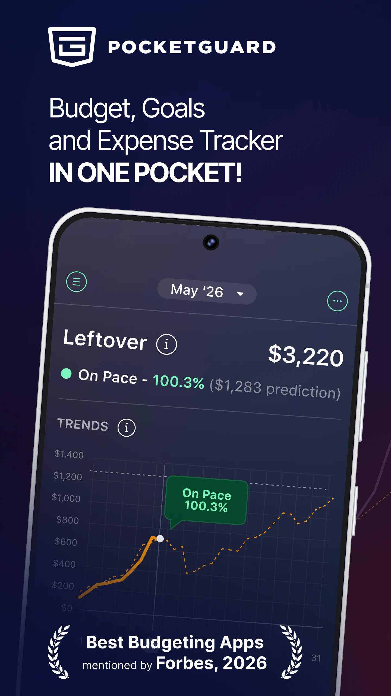
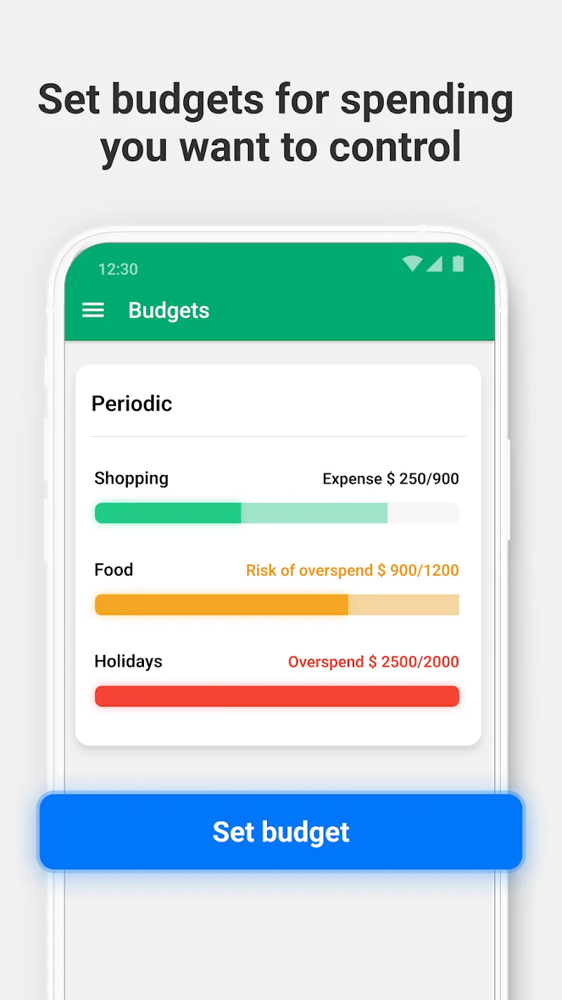
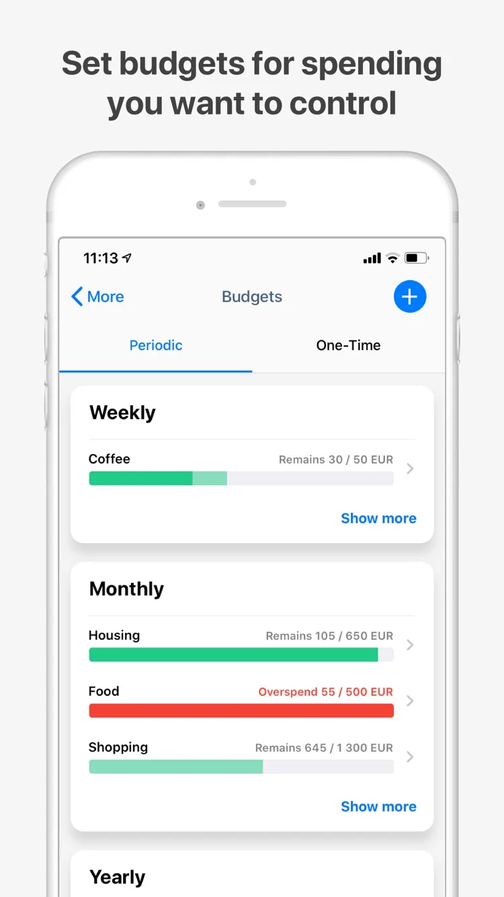

Kebanyakan artikel "perbandingan ciri bajet" berhenti di tahap "ada bajet kategori, ada graf, ada peringatan". Padahal yang sebenarnya menentukan sama ada sebuah **aplikasi catatan kewangan** selesa digunakan ialah tiga soalan lebih asas: **objek bajetnya apa**, **di mana sempadan tempoh dipotong**, dan **ke mana wang yang tak terpakai pergi**. Ambil "bajet makan RM2,000": di YNAB itu baki kategori yang terus berlonggok; di Goodbudget itu baki sampul yang jalan terus; di Meow Money Manager itu tetingkap masa yang beralih ikut tarikh — dan ketiganya mentakrif "overbudget" secara sangat berbeza.

Artikel ini hanya membincangkan ciri bajet. Kami bedah mekanisme bajet **7 aplikasi popular**: **YNAB**, **Monarch Money**, **Goodbudget**, **EveryDollar**, **PocketGuard**, **Wallet by BudgetBakers**, dan **Meow Money Manager**.

> Skop bacaan: artikel ini tulen analisis mendalam ciri **bajet**. Ciri lain aplikasi catatan kewangan (segerak bank, laporan, pengurusan bil, multi mata wang, dll.) tidak dibandingkan di sini.

Kalau berminat juga dengan perbandingan ciri secara keseluruhan, baca: [Meow Money Manager vs YNAB: Mana Aplikasi Bajet yang Sesuai untuk Anda?](/ms/posts/vs-meow-money-and-ynab/), [Alternatif Mint Terbaik 2026](/ms/posts/alternatives-to-mint/), dan [Aplikasi Bajet & Expense Tracker Terbaik untuk Android (2026)](/ms/posts/pillar-budget-expense-tracker-apps-android/).

## Sekilas: semak pantas mekanisme bajet 7 aplikasi

| Aplikasi | Objek bajet | Model tempoh | Rollover | Perbelanjaan bukan bulanan | Rumus asas |
|---|---|---|---|---|---|
| **Meow Money Manager** | Satu bajet (total, atau per kategori) | Hari / minggu / bulan / tahun / suai, **tetingkap bergerak** | Tiada, tetingkap dikira semula setiap hari | Tarikh mula–tamat suai | Bajet harian = baki ÷ baki hari (0 jika overbudget) |
| **YNAB** | Kategori + Target | Bulan kalendar | Baki positif rollover; negatif dinol-kan & dikendali berasingan | Yearly / Weekly / Custom Target | Pendapatan − diperuntukkan = Ready to Assign |
| **Monarch Money** | Bajet kategori atau bucket Fixed / Non-monthly / Flex | Bulan kalendar | Lebihan dan defisit **sama-sama rollover** | Bucket Non-monthly: target + kekerapan | Rollover lalu + rancangan ini − sebenar ini = rollover berikut |
| **Goodbudget** | Sampul (Regular / Annual / Goal) | Minggu / separuh bulan / bulan dll. | Baki berjalan, ditentukan cara isi | Sampul Annual / Goal + tarikh matang | (Target − diisi) ÷ tempoh sebelum matang |
| **EveryDollar** | Kategori & item baris | Bulan kalendar, dibina semula setiap bulan | Tanpa rollover, mula dari sifar setiap bulan | Sinking funds | Pendapatan − perbelanjaan = 0 |
| **PocketGuard** | Bajet kategori | Bulan kalendar | Lebihan ditambah ke bulan depan, defisit ditolak | Target & pelan lunas hutang | In My Pocket = pendapatan − bil − keperluan − sasaran |
| **Wallet** | Bajet per kategori / akaun / tag | Minggu / bulan / tahun / suai; berulang atau sekali pakai | Amaun tak terpakai rollover | Bajet berulang + bayaran dijadual | Baki = bajet − dibelanjakan; plus ramalan perbelanjaan |

Pembahagian paling jelas: **YNAB, EveryDollar, Goodbudget ialah bajet jenis "peruntukan"** (masukkan wang ke kotak, lalu belanja); **Monarch, PocketGuard, Wallet ialah bajet jenis "pelan"** (tetapkan had atas, lalu banding dengan realisasi); **Meow Money Manager ialah bajet jenis "had"** (beri tetingkap masa dan pagar, terus laporkan baki dan berapa yang boleh dibelanjakan sehari). Tiada yang lebih baik — masing-masing sesuai untuk situasi berbeza.

---

## Bina dulu kerangka penilainya: enam perbezaan teknis ciri bajet

### 1. Objek bajet: baki akaun atau had perbelanjaan

YNAB dan Monarch secara eksplisit meletakkan diri sebagai **bajet aliran tunai**, bukan bajet baki akaun. Dokumentasi bantuan Monarch terang-terangan: bajet dibina daripada pendapatan bulan ini yang dijangkakan, di mana pendapatan ditolak perbelanjaan dan simpanan membentuk persamaan `pendapatan = perbelanjaan + simpanan`; baki akaun digunakan untuk matlamat jangka panjang, bukan keputusan belanja harian. YNAB meletakkan **Ready to Assign** di puncak pelan, dan jumlah Available setiap kategori mesti boleh dijelaskan oleh wang itu.

Meow Money Manager mengambil jalan sebaliknya: tiada tindakan "peruntukan" dan tak perlu masukkan pendapatan yang dijangkakan. Satu bajet ialah "dalam tetingkap masa ini, kumpulan perbelanjaan ini paling banyak boleh habis segini" — bajet total memberi satu pagar, bajet kategori memberi pagar setiap kategori, dan jumlah terpakai dikemas kini live semasa Anda merekod. Maksudnya ia **tak wajibkan Anda merancang pendapatan dulu**, tapi juga tak boleh menjawab "berapa yang masih boleh diperuntukkan ke simpanan bulan ini."

### 2. Sempadan tempoh: bulan kalendar, tempoh bajet, atau tetingkap bergerak

Majoriti aplikasi guna **bulan kalendar** sebagai tempoh bajet kerana selaras dengan gaji, sewa, bil. EveryDollar membina [zero-based budgeting](/ms/glossary/what-is-zero-based-budgeting/) setiap bulan; YNAB dan Monarch menjalankan rollover setiap bulan; bajet kategori PocketGuard di-reset bulanan (kecuali rollover aktif).

Goodbudget lebih fleksibel: Anda pilih "tempoh bajet utama" (bulan, separuh bulan, minggu, dll.), dan saranan isi bulanan sampul Annual ialah "bajet tahunan ÷ bilangan tempoh bajet dalam setahun" — tempoh bulan bermakna dibahagi 12, separuh bulan bermakna dibahagi 24, contoh rasmi malah menunjukkan pembahagian 8 untuk tempoh separuh bulan.

**Tetingkap bergerak** tak peduli bulan kalendar: bukan satu bajet untuk November dan satu lagi untuk Disember, sebaliknya satu bajet bulan yang auto-tentukan mula–tamat bulan ini berdasar tarikh hari ini, dan auto-lanjut ke tempoh berikut bila matang. Untungnya tanpa penyelenggaraan dan auto-lanjut; rugunya tiada rekod pagar bulan lalu, juga tak boleh lihat "bulan lalu saya pasang berapa."

### 3. Semantik rollover: satu tempat paling senang salah

Istilah sama — [budget rollover](/ms/glossary/what-is-budget-rollover/) — berkelakuan sangat berbeza di empat produk:

- **YNAB**: Available positif di hujung bulan kekal utuh; Available negatif **tidak** dibawa sebagai negatif ke bulan depan, sebaliknya papar kelabu 0. Overspending tunai (merah) ditolak dari Ready to Assign bulan depan; overspending kredit (kuning) bertukar jadi hutang di kategori lunas kad kredit yang mesti Anda dana terus. FAQ rasmi malah menjawab "bolehkah reimbursement buat overspending rollover ke bulan depan? Tidak."
- **Monarch**: positif dan negatif sama-sama rollover, dengan rumus eksplisit `rollover lalu + rancangan ini − sebenar ini = rollover berikut`. Contoh rasmi: overspend −25 bulan lalu, rancangan 100, sebenar 50 → rollover berikut 25. Rollover **hanya terpakai untuk kategori perbelanjaan, bukan kategori pendapatan**.
- **PocketGuard**: baki yang tak terpakai ditambah ke pagar kategori sama bulan depan; overspend ditolak dari pagar bulan depan.
- **Goodbudget**: sampul ialah baki jalan terus, tak dinol-kan bulanan; sama ada dinol-kan bergantung Anda pilih isi "Add" atau "Set" (diurai bawah).
- **EveryDollar, Meow Money Manager**: tiada konsep rollover, dikira semula setiap tempoh / bulan.

### 4. Perbelanjaan bukan bulanan: bagaimana membahagi yuran tahunan, insurans, hadiah raya

Ini garisan antara "cukup" dan "selesa digunakan."

- YNAB guna **Yearly Target**: menyebar jumlah tahunan jadi prompt peruntukan bulanan; kelakuan `Set aside another` buat wang berlonggok bulan demi bulan.
- Monarch guna **bucket Non-monthly**: tetapkan target dan kekerapan untuk kategori, sistem auto-kira bayaran bulanan. Contoh rasmi: insurans $600 dibayar setiap 6 bulan → sistem kira $100/bulan dan rollover jadi 200, 300, 400, 500, 600, lalu sifar bila dibayar dan mula lagi. Kekerapan `variable` tak dikira automatik; Anda yang tentukan berapa sebulan.
- Goodbudget guna **sampul Annual / Goal + tarikh matang**, rumus di bawah.
- EveryDollar guna [sinking fund](/ms/glossary/what-is-a-sinking-fund/): saranan rasmi "bahagi jumlah kos dengan bilangan bulan sebelum matang, simpan sedikit setiap bulan."
- Wallet guna bajet berulang dengan bayaran dijadual dan ramalan perbelanjaan.
- Meow Money Manager guna **tarikh mula–tamat suai**: Anda boleh buat bajet 1–7 Oktober untuk bercuti, tapi ia tak auto-sebar target tahunan ke setiap bulan.

### 5. "Baki berapa" sebenarnya dikira bagaimana

Angka yang dipaparkan aplikasi berbeza serupa tapi maknanya jauh berbeza:

- **Baki**: Meow Money Manager `bajet − terpakai`; Wallet `bajet − terpakai`; Monarch paparkan `Remaining` dan boleh menyertakan baki bulan lalu jika rollover aktif.
- **Wang selamat dibelanjakan**: In My Pocket PocketGuard ialah "pendapatan ditolak bil, keperluan, sasaran simpanan," ada dimensi masa (tak korban bajet esok).
- **Maksud progres**: bar Meow Money Manager menunjukkan **peratusan baki** (baki ÷ total), bukan peratusan terpakai; Monarch guna hijau/kuning/merah plus tanda "hari ke-berapa bulan ini," kuning bermakna di ritma sekarang Anda akan overbudget hujung bulan; Spending Pace PocketGuard bagi tiga status On Pace / Under Pace / Over Pace; Target YNAB hijau bermakna tercapai, kuning bermakna perlu dilengkapkan.
- **Per kiraan harian**: "bajet harian" membahagi baki dengan baki hari; YNAB dan EveryDollar tak lakukannya — mereka bergantung "setiap ringgit ada tugas" untuk atur ritma.

### 6. Sumber data: segerak automatik atau manual lokal

YNAB, Monarch, PocketGuard, Wallet kesemuanya menjadikan segerak bank automatik sebagai sumber utama (PocketGuard eksplisit menulis guna Plaid, Finicity, Salt Edge, merangkumi AS, Kanada, UK; Wallet mengaku boleh hubung 15,000+ bank). EveryDollar versi percuma sepenuhnya manual, import automatik baru ada di Premium. Goodbudget boleh import transaksi dari bank, tapi intinya tetap urus sampul manual. Meow Money Manager **sengaja tak sambung ke akaun bank** — semua entri manual atau dibuat automatik per tempoh, data kekal di peranti.

Ini terus menentukan "real-time" bajet vs "kos privasi": bajet segerak automatik hampir tanpa penyelenggaraan, tapi mesti serah kebenaran baca akaun; bajet manual lokal perlu belasan saat setiap hari merekod, tapi tiada buku besar di awan.

---

## Bedah 7 aplikasi satu per satu

### Meow Money Manager: tempoh bergerak dan bajet harian

Bajetnya tak wajibkan rancang pendapatan dulu, dan tiada langkah "peruntukkan wang ke kategori": Anda beri tetingkap masa dan pagar, ia terus laporkan baki dan berapa yang boleh dibelanjakan sehari. Kami bedah per ciri.

<!-- Meow screenshot 1/3: reuses in-site budget_manage.webp; swap for a newer UI shot by replacing the same file -->
{: width="180" .normal }
{: width="180" .normal }
<!-- Meow screenshot 3/3: reuses in-site budget_add_category.webp; swap for a newer UI shot by replacing the same file -->
{: width="180" .normal }

#### Dua bentuk bajet: total dan kategori

Satu bajet boleh berupa **bajet total**: satu pagar untuk seluruh tetingkap yang merangkumi semua perbelanjaan di dalamnya; atau **[bajet kategori](/ms/glossary/what-is-a-category-budget/)**: pilih beberapa kategori perbelanjaan, setiap kategori dapat pagar sendiri, jumlahnya ialah jumlah pagar kategori. Ia tak sokong struktur dua aras "sub-bajet di bawah total," dan **bilangan kategori yang dipilih tak dihadkan**.

Bajet kategori sokong kategori induk–anak: memilih induk "Makanan" auto-jumlahkan anaknya ("Sarapan", "Pesan bawa pulang") tanpa tick satu-satu. Jumlah terpakai dikira per tetingkap masa semasa, angka berubah bila tetingkap beralih.

#### Lima tempoh dan tetingkap bergerak

Tempoh ada **hari, minggu, bulan, tahun, suai**. Tempoh suai boleh tentukan tarikh mula–tamat (mula tak boleh lewat dari tamat); hari mula minggu dan bulan pun boleh diatur, sehingga "gaji setiap tarikh 25, kira sebulan dari 25 ke 24 bulan depan" boleh terus dipasang.

Ia guna **tetingkap bergerak**: mula–tamat tempoh ini auto-ditentukan oleh tarikh hari ini; satu bajet bulan auto-lanjut ke bulan berikut tanpa dibina semula dan tanpa buat bajet baru untuk tempoh berikut. Tanpa penyelenggaraan; rugunya tiada rekod pagar bulan lalu, tak boleh lihat "bulan lalu saya pasang berapa."

#### Baki hari dan bajet harian

Baki hari dikira per tempoh: bajet harian = 1 hari, bajet minggu = baki hari minggu ini, bajet bulan = baki hari bulan ini (dipengaruhi hari mula bulan suai), bajet tahun = baki hari tahun ini, tempoh suai = baki hari di interval, dan tak pernah negatif.

Di atas itu ada **bajet harian**: baki dibahagi baki hari, simpan 4 desimal, dibundarkan. Bila sudah overbudget, dikira 0 — tak pernah "masih boleh belanja −RM12.50/hari"; di hari terakhir atau bila tempoh lepas, terus paparkan baki tanpa pembahagian.

Bar progres menunjukkan **nisbah baki**, bukan nisbah terpakai: bar makin pendek bermakna baki makin sedikit, dan bila overbudget bar kosong — bertentangan dengan kebanyakan aplikasi, jadi jangan baca "bar pendek" sebagai "baru mula belanja."

#### Cara mengira jumlah terpakai

Bajet total menjumlahkan semua perbelanjaan di tetingkap; selisih reimbursement dan kos pemindahan juga masuk hitungan ini, bukan sekadar "jumlah perbelanjaan."

Bajet kategori mengelompokkan per kategori, dan ada dua butiran yang senang terlepas tapi terus memengaruhi ketepatan angka:

1. **Penjumlahan auto induk–anak**: pilih induk untuk merangkumi semua anak, tak perlu tick masing-masing.
2. **Reimbursement dikira sebanyak net belum dibayar**: perbelanjaan tugas yang sudah lunas reimbursenya tak lagi makan pagar; jika separuh saja, yang dikira hanya bahagian belum dibayar.

Untuk yang sering bayar dulu untuk tugas, poin 2 jauh lebih tepat daripada "anggap reimbursement sebagai pendapatan," dan ini pendekatan jarang di antara 7 aplikasi ini. Liputan hitungan sentiasa selaras dengan tetingkap tempoh semasa.

#### Peraturan pembuatan, kuota percuma, dan widget halaman utama

Membuat bajet perlu pilih tempoh, isi nama, beri nominal: nominal bajet total mesti > 0, setiap pagar kategori di bajet kategori mesti > 0; tempoh suai juga perlu tarikh mula–tamat. Bajet kategori buat masa ini **hanya merangkumi kategori perbelanjaan**, kategori pendapatan tak boleh dapat bajet sendiri.

Versi percuma paling banyak **3 bajet**, ke-4 perlu buka VIP; tapi satu bajet boleh muat berapa pun kategori perbelanjaan. Kategori boleh diurut dengan seret, urutan disimpan bersama bajet. Selesai tambah, edit, atau padam bajet, widget halaman utama ikut segar, setiap bajet paparkan total dan baki sendiri.

#### Had keupayaan yang jelas

Ia tak ada rollover lintas tempoh, tak buat multi-tempoh automatik per tempoh, tak ada multi-mata-wang aras bajet (multi mata wang ialah simbol global dan keupayaan multi-buku, bukan dimensi bajet), tak ada notifikasi push overbudget, tak ada kongsi bajet, tak ada graf trend sejarah, tak ada bajet kategori pendapatan, juga tak ada templat bajet atau sebaran target automatik. Peranannya ialah **papan had** yang luar talian, ringan, dan bertitik berat jelas, bukan sebuah metodologi bajet.

### YNAB: target-driven dengan overspend dual-track tunai & kredit

{: width="180" .normal }
{: width="180" .normal }

Unit bajet YNAB ialah **kategori + Target**. Target ada dua dimensi:

- **Jenis** menentukan kekerapan: `Monthly` (setiap bulan kalendar), `Yearly` (sebar jumlah tahunan jadi prompt tabungan bulanan), `Weekly` (berulang dalam bulan), `Custom` (perbelanjaan luar ritma standard).
- **Kelakuan** menentukan apa yang diprompt bila reset: `Set aside another` setiap tempoh menuntut target penuh even bila ada baki bulan lalu — sesuai untuk tabungan dan perbelanjaan bukan bulanan yang mesti berlonggok; `Refill up to` hanya minta tambal ke target, baki bulan lalu boleh mengurangkan — sesuai untuk kategori "paling banyak sekian sebulan."

Progres guna hijau (tercapai) dan kuning (perlu dilengkapkan). Selesai pasang Target, YNAB memprompt Anda memperuntukkan wang ke kategori itu setiap gaji, dan boleh buat sebahagian Target automatik dari sejarah belanja.

Rollover hujung bulan ialah bahagian YNAB paling tepat sekaligus paling salah faham. Rasmi "When the Month Rolls Over" bagi empat peraturan:

1. Available positif **kekal**, utuh di bulan baru;
2. Available negatif di bulan baru papar **kelabu 0**, tak lagi ada sebagai negatif;
3. Kolum Assigned **reset ke 0** (kecuali Anda sudah peruntukkan wang ke bulan depan);
4. Overspending tunai (merah negatif) ditolak dari Ready to Assign bulan baru; overspending kredit (kuning negatif) bertukar jadi prompt Underfunded di kategori lunas kad kredit yang mesti Anda dana terus untuk melunaskan hutang.

Bila Ready to Assign masih ada baki hujung bulan tanpa overspend tunai, ia rollover utuh ke bulan baru; bila ada overspend tunai, dikompensasi dulu, baki baru rollover. "Overspending in YNAB" tambah: bila tunai dan kredit campur di satu kategori, YNAB rekod tunai dulu, sehingga negatif papar merah.

**Sesuai untuk**: yang sanggup belajar metodologi, mahu rancang setiap ringgit secara aktif, dan terima kos langganan. **Tak sesuai**: yang cuma mahu lihat "baki bulan ini berapa."

### Monarch Money: dua sistem bajet dengan rollover berumus

{: width="180" .normal }
{: width="180" .normal }

Monarch sediakan mode **Category** (bajet kategori tradisional, setiap kategori perbelanjaan satu pagar) dan **Flex** (default) sekaligus, boleh dialih bila-bila masa dengan tetapan masing-masing kekal tersimpan.

Flex membahagi perbelanjaan ke tiga bucket atas:

- **Fixed**: sewa, elektrik, langganan, premium bulanan — perbelanjaan stabil setiap bulan yang sukar dipotong, total bucket setiap bulan sama;
- **Non-monthly**: perbelanjaan yang berlaku sekurang-kurangnya setahun sekali, boleh diramal tapi tak setiap bulan (langganan tahunan, penyelenggaraan kereta, hadiah raya) — **mesti aktifkan rollover dan tetapkan target serta kekerapan** agar berfungsi;
- **Flex**: makan luar, hiburan, beli-belah — paling berfluktuasi dan paling senang dipotong, hanya dibanding dengan satu angka total.

Bila mula buat bajet, Monarch auto-isi dari purata perbelanjaan setiap kategori **6 bulan lepas**, atau bila-bila masa melalui `Recalculate default budgets`. Sistem kategori tiga aras: Type (Income / Expenses / Transfers, tak boleh ubah) → Group → Category, bawaan sekitar 60 kategori, boleh disuai, dinyahaktif, atau dikecualikan dari bajet (tetap dikira dalam aliran tunai dan total).

Peraturan rollover diberi rumus rasmi:

> **Rollover lalu + rancangan ini − sebenar ini = rollover berikut**

Contoh rasmi: overspend −25 bulan lalu, rancangan 100, sebenar 50 → rollover berikut 25. Anda boleh set `Starting Balance` dan `Starting Month` per kategori untuk rekod tabungan sejarah. Tiga had penting: rollover **hanya untuk kategori perbelanjaan, bukan pendapatan**; di bucket Fixed dan Non-monthly, rollover kategori memengaruhi kedua-dua kategori dan Remaining bucket, sementara **di bucket Flex, rollover kategori hanya memengaruhi aras kategori, bukan total bucket Flex**; angka bucket Flex memang tak sama dengan jumlah bajet kategori di bawahnya kerana banyak kategori tak ada pagar sendiri.

Penyebaran Non-monthly automatik: "target ÷ kekerapan" → $600 setiap 6 bulan = $100/bulan, rollover ke 600 lalu sifar. Kekerapan `variable` tak dikira automatik.

Paparan: web menunjukkan kolum Planned / Actual / Remaining, mobile dua kolum (tekan lama angka untuk tukar); bar guna hijau (dalam bajet), kuning (di ritma sekarang akan overbudget, hanya di bar Flex), merah (sudah overbudget) plus tanda "hari ke-berapa bulan ini." Anda boleh pindahkan wang dari kategori lebihan ke kategori overbudget (Flex hanya di aras bucket), eksport CSV (web sahaja, bulan berjalan), widget bajet iOS, paparan kalendar bajet, dan notifikasi.

**Sesuai untuk**: pengguna yang mahu kawalan kategori tapi tak mahu selenggara pagar per kategori. **Tak sesuai**: pendapatan sangat berfluktuasi atau pengikut zero-based tulen.

### Goodbudget: baki sampul berjalan dengan dua semantik isi

{: width="180" .normal }
{: width="180" .normal }

Goodbudget guna [metod bajet sampul](/ms/glossary/what-is-envelope-budgeting/): bajet diwujudkan sebagai **baki sampul**, dan **baki berjalan**. Dokumentasi rasmi terang: baki sampul tak dihadkan satu bulan — transaksi bila-bila masa, dulu atau sekarang, memengaruhi baki hari ini. Ini perbezaan asas dari YNAB dan Monarch: bukan "satu helaian sebulan," sebaliknya "terus masuk, terus keluar."

Tiga jenis sampul:

- **Regular Envelope**: perbelanjaan harian diisi per tempoh bajet utama (bulan / separuh bulan / minggu);
- **Annual Envelope**: perbelanjaan besar tahunan (cukai harta, hadiah raya), dengan bajet tahunan dan tarikh matang;
- **Goal Envelope**: target sekali pakai (kahwin, beli kereta), dengan target dan tarikh matang, selesai bila tercapai.

Bila tempoh baru Anda jalankan "Fill," dan dua kaedah berbeza ketepatan. Contoh rasmi: sampul berbajet 50.00, hujung baki 5.00 —

- `Add budgeted amount`: **rollover 5.00 lalu tambah 50.00**, tempoh baru mula dari **55.00**;
- `Set to budget amount`: **hanya tambal ke 50.00**, bermakna tambah 45.00, tempoh baru mula dari **50.00**.

Jadi "sama ada overspend dibawa ke bulan depan" di Goodbudget bukan tetapan produk, sebaliknya pilihan Anda setiap isi. Anda juga boleh jadual isi berulang setiap tarikh 1 untuk auto. Bila mahu sampul setiap bulan mula dari bajet tanpa baki berlonggok, dokumentasi ada cara "auto-reset baki sampul bulanan."

Sampul Annual / Goal ada rumus isi tersarankan eksplisit (halaman bantuan rasmi):

- Annual tanpa tarikh matang: bajet tahunan ÷ bilangan tempoh bajet dalam setahun (tempoh bulan → ÷12);
- Goal tanpa tarikh matang: **sentiasa 0**;
- Annual atau Goal dengan tarikh matang: `(bajet/target − jumlah sudah Fill atau Pindah masuk) ÷ tempoh bajet sebelum matang`. Contoh rasmi: target 1200, matang 4 bulan lagi, belum pernah isi, tempoh bulan → `(1200 − 0) / 4 = 400`; tukar separuh bulan dan sudah isi 50 → `(1200 − 50) / 8 = 143.75`.

Butiran kontra-intuitif tapi penting: **rumus tak peduli baki semasa**. Walaupun wang yang sudah Anda tabung separuh sudah habis dibelanjakan, jumlah pernah diisi tetap dikira "tabungan selesai."

Kuota percuma (halaman Billing rasmi): **10 sampul Regular + 10 sampul Annual/Goal + 1 akaun + 2 peranti + 1 tahun sejarah**, boleh dipakai tanpa had masa; Premium **$10/bulan atau $80/tahun** untuk sampul tak terhad, dll. Dokumentasi juga menyarankan satu sampul per perbelanjaan bukan bulanan dan bahagi total dengan bulan sebelum matang.

**Sesuai untuk**: penganut metod sampul, sanggup isi beberapa minit setiap bulan, dan kategori tak banyak. **Tak sesuai**: lebih dari 20 kategori, atau yang tak mahu selenggara baki manual.

### EveryDollar: bajet zero-based bulanan yang ketat

{: width="180" .normal }
{: width="180" .normal }

Model EveryDollar cukup ringkas sehingga cukup satu ayat: **pendapatan − perbelanjaan = 0**. Anda masukkan seluruh pendapatan awal bulan, lalu sebut derma, simpanan, perbelanjaan sampai selisih sifar; dokumentasi kata tick hijau dan "It's an EveryDollar budget!" muncul di atas. Contoh rasmi: pendapatan bulanan 3000 → derma 300, simpanan 300, rumah & utiliti 1300, makan 450, pengangkutan 400, lain-lain 250, tepat 3000.

Ia membina helaian **per bulan**, mula baru setiap bulan — "setiap bulan ialah peluang baru" ada dalam saranan pemula. Maksudnya ia bukan jenis rollover; overspend dan lebihan tak auto-masuk hitungan bulan depan. Bila rancangan berubah di tengah bulan, dokumentasi menyarankan pindah wang antara item baris, dan selepas pindah tetap mesti "setiap ringgit ada tugas."

**Versi percuma** (artikel Ramsey rasmi, dikemas kini 2026-11-05) merangkumi: buat bajet bulanan, akses web/mobile/tablet, transaksi manual, kategori dan item baris suai, **kategori dan item baris tak terhad**, tetapan dan jejaki target, sinking funds, pecah transaksi ke banyak item, tarikh matang bil, sokongan manusia. **Premium $79.99/tahun** menambah: hubung banyak akaun kewangan, transaksi mengalir automatik dan seret ke item baris, perancangan gaji (paycheck planning), saranan kategorisasi sekali klik, peringat tarikh matang bil, laporan khas, eksport CSV, kursus jurulatih langsung, net worth semasa dan ramalan, peta jalan kewangan.

Untuk perbelanjaan bukan bulanan, saranan rasmi ialah **sebar manual**: buat satu sinking fund per perbelanjaan tahunan/insidental, bahagi total dengan bulan sebelum matang, simpan sedikit setiap bulan. Ini selesaikan masalah sama dengan Yearly Target YNAB atau bucket Non-monthly Monarch, tapi tanpa kira automatik dan rollover automatik. Anda boleh kongsi satu akaun dengan pasangan untuk bajet bersama.

**Sesuai untuk**: yang mahu amal zero-based ketat dan suka "ringkas tanpa peraturan tersembunyi." **Tak sesuai**: yang perlu akumulasi simpanan lintas bulan, atau mahu sistem kira sebar tahunan untuknya.

### PocketGuard: bajet diterbalikkan dari "wang selamat dibelanjakan"

{: width="180" .normal }
{: width="180" .normal }

Bajet PocketGuard tak mula dari "kategori" tapi dari **satu angka**: In My Pocket (juga dipanggil Leftover / Safe-to-spend) — wang yang selamat dibelanjakan hari ini selepas bil, keperluan, sasaran simpanan, dan hutang. Deskripsi Google Play membahaginya tiga lapis: baki bajet real-time selepas pendapatan dan perbelanjaan, jumlah selamat dibelanjakan selepas potong bil/sasaran/keperluan, dan bahagian harian yang "takkan rosakkan bajet esok."

**Category Budget** diperuntukkan di atas angka itu: halaman bantuan kata bila buat bajet kategori PocketGuard **memperuntuk dana untuk kategori itu dan potong dari In My Pocket**; peruntuk pendapatan ke setiap kategori, Anda bina helaian zero-based. Halaman ciri juga menyenaraikan gaya zero-based, kategori, sampul, dan 50/30/20.

**Rollover** terpakai per kategori: yang tak terpakai ditambah ke pagar kategori sama bulan depan; yang overbudget ditolak dari pagar bulan depan. Maka ia simpan lebihan dan defisit sekaligus, bertentangan tajam dengan "hanya rollover baki positif" YNAB.

**Spending Pace** ialah mekanisme bajet paling dikenali: sistem gabung bil dan kebiasaan, sebelum hujung bulan sudah menilai sama ada Anda akan overbudget, bagi tiga status `On Pace` (ikut rancangan bulan), `Under Pace` (di bawah rancangan), `Over Pace` (perbelanjaan makin laju, mungkin lepas bajet). Juga ada peraturan transaksi auto-kategorisasi, `Don't count` untuk kecualikan transaksi dari bajet, perbandingan prestasi bulanan dan analisis trend, pengenalan bil dan langganan, pelan lunas hutang.

Harga (FAQ Google Play rasmi, dikemas kini 2026-10-28): ciri inti percuma tapi bilangan bajet dihadkan; **PocketGuard Plus cuba 7 hari lalu $12.99/bulan atau $74.99/tahun**, buka bajet tak terhad, peraturan transaksi, pelan lunas hutang, dll. Sambungan bank merangkumi AS, Kanada, UK; Anda juga boleh **tak sambung bank langsung, entri manual**.

> Nota: laman dan pusat bantuan PocketGuard di beberapa wilayah paparkan halaman sekatan serantau; peraturan rollover dan kategori di sini disilang-teliti dari ringkasan bantuan rasmi, teks ciri rasmi, dan deskripsi Google Play.

**Sesuai untuk**: yang paling peduli "adakah hari ini masih boleh beli ini," dan yang enggan dengan helaian kategori. **Tak sesuai**: perlu pengurusan target rumit dan multi-mata-wang.

### Wallet by BudgetBakers: bajet per kategori, akaun, atau tag

{: width="180" .normal }
{: width="180" .normal }

Bajet Wallet **tak disusun "satu per kategori" tapi "per syarat penapis."** Halaman bantuan bagi tiga cara: pilih kategori tertentu (saranan rasmi), pilih akaun tertentu, atau pilih tag suai. Setiap rekod yang padan syarat itu masuk ke bajet ini, sehingga dokumentasi khususnya mengingatkan **elak tindih bajet** (misal satu kategori ada di dua bajet), atau statistik jadi sukar dibaca.

Soal tempoh dan bentuk, halaman ciri menyenaraikan: **bajet berulang (recurring) dan sekali pakai (one-time)**, jejaki per kategori, **amaun tak terpakai rollover**; halaman bajet tambah bajet tempoh bulan / minggu / suai, peringatan menghampiri had, analisis trend sejarah. Kad bajet memaparkan Spent (terpakai), Remaining (bajet − terpakai, dalam mata wang default) dan Forecast spending (ramalan perbelanjaan bila tempoh berakhir). Di antara 7 produk ini, hanya Wallet yang menjadikan "ramalan perbelanjaan hujung tempoh dari lintasan semasa" sebagai info utama kad bajet.

Multi-mata-wang ialah kelebihan jelas Wallet: halaman ciri menyenaraikan **170+ mata wang, kadar live**; pusat bantuan kata setiap mata wang perlu akaun sendiri, kadar dikemas kini setiap malam (atau matikan auto-update dan atur manual). Kongsi keluarga sokong akaun bersama, bahagi perbelanjaan, dan kawalan privasi. Halaman ciri juga menyenaraikan segerak 15,000+ bank, laporan CSV/PDF, lintas platform iOS / Android / Web.

Tiga had perlu dicatat: **ciri bajet belum ada di versi Web**, hanya Android (menu sisi utama) dan iOS (tab "Plan" di bawah); versi percuma mostly manual, segerak bank dan kongsi keluarga di sebalik Premium; harga Premium tak diterbitkan di laman, lihat di aplikasi.

**Sesuai untuk**: akaun multi-mata-wang, bajet kongsi keluarga, atau yang mahu potong bajet per akaun/tag bukan kategori. **Tak sesuai**: yang cuma mahu urus bajet di web.

---

## Perbandingan mendalam antar dimensi kunci

### Semantik rollover dibandingkan: satu perkataan, empat kelakuan

| Aplikasi | Baki positif (lebihan) | Baki negatif (overbudget) | Boleh dimatikan | Terpakai untuk kategori pendapatan |
|---|---|---|---|---|
| Meow Money Manager | Tanpa rollover; tetingkap dikira semula bila tempoh tamat | Tanpa rollover | Tiada konsep | Bajet pendapatan tak disokong |
| YNAB | Kekal utuh di Available bulan depan | Dinol-kan jadi kelabu 0; overspend tunai potong Ready to Assign bulan depan; overspend kredit jadi hutang kad | Tak boleh dimatikan | Tidak terpakai |
| Monarch | Masuk ke rollover bulan depan | Dikira negatif ke rollover bulan depan | Boleh toggle per kategori | **Tidak**, dilarang eksplisit |
| Goodbudget | Bergantung isi Add / Set | Bergantung isi Add / Set | Ditentukan setiap isi | Tidak terpakai (sampul = perbelanjaan) |
| EveryDollar | Tanpa rollover, dibina semula bulanan | Tanpa rollover | Tiada konsep | Pendapatan ialah input bajet |
| PocketGuard | Ditambah ke pagar kategori sama bulan depan | Ditolak dari pagar bulan depan | Boleh toggle per bajet | Tidak terpakai |
| Wallet | Amaun tak terpakai rollover | Pengendalian overbudget tak dijelaskan rasmi | Tak dijelaskan | Bajet berpusat perbelanjaan |

**Cara baca jadual ini**: bila Anda menabung untuk bayaran 6 bulan lagi, "baki positif mesti rollover" ialah syarat mutlak — Meow Money Manager dan EveryDollar terus gugur, Goodbudget perlu Anda pilih isi `Add`, YNAB perlu `Set aside another` atau Yearly Target, Monarch perlu nyalakan rollover dan set target kekerapan, PocketGuard dan Wallet sokong native. Sebaliknya, bila Anda mahu setiap bulan helaian bersih dan tak mahu overspend bulan lalu cemari bulan ini, semantik "zeroing" YNAB dan EveryDollar justru lebih tenang; pendekatan dikira semula per tetingkap pun serupa, overbudget satu tempoh tak tekan pagar tempoh berikut, buku pun lebih senang dicocokkan.

### Penyebaran perbelanjaan bukan bulanan: kira automatik vs anggaran manual

| Aplikasi | Mekanisme | Kira automatik per tempoh | Akumulasi automatik ke target |
|---|---|---|---|
| Meow Money Manager | Bajet dengan tarikh mula–tamat suai | Tidak | Tidak |
| YNAB | Yearly / Weekly / Custom Target + `Set aside another` | Ya (target tahunan → prompt bulanan) | Ya (baki terus berlonggok) |
| Monarch | Bucket Non-monthly: target + kekerapan | **Ya** (600 ÷ 6 = 100/bulan) | **Ya** (rollover ke 600 lalu sifar) |
| Goodbudget | Sampul Annual / Goal + tarikh matang | **Ya** ((target − diisi) ÷ tempoh sebelum matang) | Ya (baki sampul) |
| EveryDollar | Sinking funds | Tidak (saranan rasmi: bahagi dengan bulan manual) | Ya (baki fund) |
| PocketGuard | Target + rollover | Penyebaran automatik tak jelas | Ya (rollover kategori) |
| Wallet | Bajet berulang + bayaran dijadual + ramalan | Penyebaran automatik tak jelas | Ya (amaun tak terpakai rollover) |

Monarch dan Goodbudget ialah dua paling lengkap di sini: keduanya bagi **rumus yang boleh dikira semula**, mempertimbangkan tarikh matang, mengendalikan "sudah tabung separuh." Bezanya rumus Goodbudget **tak tolak baki semasa** (membelanjakan wang yang sudah ditabung tak naikkan saranan isi), sementara Monarch guna perbelanjaan aktual terus dalam rollover, semantik lebih dekat ke perakaunan. Sebaliknya, bila perbelanjaan berpusat di tetingkap pendek jelas — satu bercuti, satu ubah suai — cukup pasang satu bajet untuk tetingkap itu daripada sebar jumlah tahunan ke setiap bulan.

### Perbandingan perhitungan: apa yang sebenarnya dikatakan bar progres

| Aplikasi | Angka utama | Progres / status | Per kiraan harian | Ramalan hujung tempoh |
|---|---|---|---|---|
| Meow Money Manager | Baki, baki hari, **bajet harian** | Peratusan baki (0 bila overbudget) | **Ada** | Tidak |
| YNAB | Available, Ready to Assign | Target hijau / kuning | Tidak | Tidak |
| Monarch | Planned / Actual / Remaining | Hijau / kuning / merah + tanda hari bulan | Tidak | Ya (Forecast, halaman ciri) |
| Goodbudget | Baki berjalan sampul | Baki sampul itu sendiri | Tidak | Tidak |
| EveryDollar | Baki item baris | Tanpa bar (tick zero-based) | Tidak | Ya (ramalan net worth, Premium) |
| PocketGuard | In My Pocket | Tiga status Spending Pace | Tidak | Ya (trend Pace) |
| Wallet | Spent / Remaining / Forecast spending | Peringatan menghampiri had | Tidak | **Ya** |

"Bajet harian" mengikat baki dengan baki masa, terus menjawab "hari ini boleh belanja berapa," baki tempoh dan bahagian harian sekali gus kelihatan, tanpa rancang pendapatan dulu atau bahagi sendiri. Tapi ada kesan sampingan — **bajet harian melompat bila baki hari berubah**. Misal bajet bulan di hari ke-1 baki RM3,000, baki 30 hari → RM100/hari; pertengahan bulan baki RM1,500, baki 15 hari → kekal RM100/hari (stabil bila linear); tapi sekali belanja besar sehari, bajet harian terus turun dan tak akan rebound kemudian. Ini sifat bawaan bajet jenis had, bukan cacat, tapi pembaca mesti faham ini **bukan ramalan**, hanya purata aritmetik baki semasa.

### Hirarki kategori, liputan, dan had data

| Aplikasi | Hirarki kategori | Dimensi tag / akaun | Kecualikan transaksi | Liputan reimbursement | Multi-mata-wang |
|---|---|---|---|---|---|
| Meow Money Manager | Induk / anak, anak auto-jumlah ke induk | Buku (multi-buku, bukan dimensi bajet) | Kos pemindahan masuk total | **Net belum dibayar dikira** | 50+ simbol, multi-buku (global) |
| YNAB | Kumpulan kategori / kategori | Tidak | Boleh sembunyi kategori | Amalan reimbursement berasingan (tak ubah rollover) | Terhad |
| Monarch | Type / Group / Category tiga aras | Tidak | **Boleh kecualikan kategori dari bajet** (tetap di aliran tunai) | Tiada liputan khas | Terhad |
| Goodbudget | Sampul / kumpulan sampul | Akaun (Account) | Tidak | Tidak | Terhad |
| EveryDollar | Kategori / item baris | Tidak | Tidak | Tidak | Terhad |
| PocketGuard | Kategori suai | Peraturan transaksi | **`Don't count` kecualikan dari bajet** | Tidak | Terhad |
| Wallet | Kategori | **Kategori / akaun / tag, pilih satu** | Boleh elak via peraturan | Tidak | **170+ mata wang, kadar live** |

Mengira **sebanyak net belum dibayar reimbursement** ialah pendekatan jarang di antara 7 ini: perbelanjaan tugas lunas reimbursenya tak lagi makan pagar; bila separuh, hanya bahagian belum dibayar yang dikira. Untuk yang sering bayar dulu untuk tugas, ini jauh lebih tepat daripada "anggap reimbursement sebagai pendapatan." Sementara "kecualikan dari bajet tapi tetap di aliran tunai" Monarch, `Don't count` PocketGuard, dan dimensi tag Wallet mewakili fleksibiliti lain: **menentukan transaksi mana yang langsung tak ikut bajet**.

### Privasi, harga, dan perkongsian

| Aplikasi | Akaun & data | Segerak bank | Kongsi bajet | Kuota percuma | Harga berbayar (rasmi) |
|---|---|---|---|---|---|
| Meow Money Manager | Tanpa akaun, di peranti, sandaran ke awan sendiri | Tidak (sengaja) | Tidak | Paling banyak 3 bajet | VIP sekali bayar |
| YNAB | Akaun awan | Automatik | Kongsi pelan dengan pasangan | Tiada versi percuma | $109/tahun (jadual Ramsey) |
| Monarch | Akaun awan | Automatik | Disokong | Tiada versi percuma | Core $99.99 / Plus $199.99 setahun (jadual Ramsey) |
| Goodbudget | Akaun household | Boleh import | Kongsi satu bajet di 2 peranti | 10 + 10 sampul, 1 akaun, 2 peranti, 1 tahun sejarah | $10/bulan, atau $80/tahun |
| EveryDollar | Akaun awan | Hanya Premium | Kongsi satu bajet dengan pasangan | Kategori tak terhad + sinking funds | $79.99/tahun |
| PocketGuard | Akaun awan | Automatik (atau manual penuh) | Tak ditekankan sebagai ciri bajet | Inti percuma, bilangan bajet dihadkan | $12.99/bulan, atau $74.99/tahun |
| Wallet | Akaun awan | Automatik (Premium) | Bajet kongsi keluarga | Perekodan manual | Tak diterbitkan, lihat di aplikasi |

Di baris ini, tanpa akaun, tanpa sambungan bank, tanpa kongsi ialah pertukaran sedar yang menggantikan data tak keluar peranti dan pembayaran sekali bayar; 6 lain default ke akaun awan dan segerak automatik, menyerah buku besar dan kebenaran baca bank ke vendor. **Bila privasi jadi keutamaan, terus pilih Meow Money Manager**: dari 7 ini, hanya ia yang tak perlu akaun, tak izin baca bank, dan tak muat naik buku besar ke awan — rekod kekal di peranti, sandaran masuk ke awan Anda sendiri, pendedahan data terkecil, paling selamat soal privasi. Membandingkannya dengan YNAB soal "siapa lebih worth it" kurang tepat — keduanya jual dua benda berbeza: sebuah metodologi yang ubah perlakuan, dan sebuah buku besar lokal yang tak ganggu Anda.

---

## Aplikasi mana yang harus dipilih

- **Cuma mahu jawab "hari ini masih boleh belanja berapa"**: pilih **Meow Money Manager**. Bajet harian, baki hari, dan widget halaman utama terus menjawab; tak perlu rancang pendapatan dulu, tak perlu akaun atau sambung bank, dan hari mula minggu/bulan boleh ikut gaji. Syaratnya terima rekod manual dan "tak ada rollover."
- **Sanggup tukar metodologi dengan kawalan**: pilih **YNAB**. Dua kelakuan Target, overspend dual-track tunai/kredit, dan Ready to Assign ketat membentuk model peruntukan lengkap. Ini juga pintu masuk ke **alternatif YNAB** bila Anda cari gaya serupa dengan rekod lokal.
- **Mahu kategori tapi tak mahu selenggara per kategori**: pilih **Monarch Money**. Tiga bucket Flex pisah "perlu diurus ketat" dari "cuma lihat total," dan kekerapan Non-monthly ialah penyebaran paling automatik di sini.
- **Penganut sampul dengan kategori tak banyak**: pilih **Goodbudget**. Baki berjalan plus isi Add/Set serah kawalan rollover sepenuhnya; tapi pastikan 10 + 10 sampul cukup.
- **Zero-based ketat, makin ringkas makin baik**: pilih **EveryDollar**. Percuma sudah bagi kategori tak terhad dan sinking funds, rugi bukan bulanan kena kira sendiri dan bajet dibina semula setiap bulan.
- **Paling takut overbudget, mahu lihat "wang selamat dibelanjakan"**: pilih **PocketGuard**. In My Pocket plus Spending Pace tiga status peringat sebelum hujung bulan, bukan sesudahnya.
- **Multi-mata-wang, kongsi keluarga, bajet per tag**: pilih **Wallet by BudgetBakers**. 170+ mata wang dengan definisi kategori/akaun/tag ialah kombinasi jarang di antara 7 ini, tapi bajet baru ada di telefon.
- **Sering bayar dulu untuk tugas**: semak sama ada bajet mengira net belum dibayar reimbursement. Perbelanjaan lunas reimbursenya tak makan pagar; aplikasi lain mostly anggap reimbursement sebagai pendapatan atau alur berasingan.

**Kombinasi pragmatis**: guna alat jenis had untuk rekod harian dan reimbursement tugas, alat jenis peruntukan untuk sebar perbelanjaan tahunan dan perancangan bersama, masing-masing pegang sedikit. Bila harian cuma peduli baki tempoh ini dan tak menabung berasingan untuk perbelanjaan tahunan, yang pertama sudah cukup; tak perlu tindih alur peruntukan di atasnya. Bila jalan berdua, jangan cuba cocokkan "baki" — liputannya memang berbeza.

> Di Malaysia, selain 7 aplikasi di atas, banyak **alternatif tempatan** yang berbaloi dipertimbangkan untuk rekod ringan: **MoneyMama**, **Belanje**, **MAE by Maybank2u**, **Spendee**, **BillMon** — sebahagian fokus ke catatan kewangan sederhana dan e-wallet (Touch 'n Go eWallet, GrabPay, DuitNow QR), sesuai bila Anda tak perlu metodologi bajet lengkap. (Nota: ini bukan perbandingan head-to-head; sebut sebagai pilihan lain di ekosistem tempatan.)

### Tautan muat turun rasmi

Ketujuh aplikasi tersedia di Android dan iOS. Halaman kedai rasmi masing-masing di bawah.

| Aplikasi | Android | iOS |
|---|---|---|
| Meow Money Manager | [Google Play](https://play.google.com/store/apps/details?id=com.glgjing.money.manager.bookkeeping.meow) | [App Store](https://apps.apple.com/us/app/meow-money-manager/id1528852284) |
| YNAB | [Google Play](https://play.google.com/store/apps/details?id=com.youneedabudget.evergreen.app) | [App Store](https://apps.apple.com/us/app/ynab/id1010865877) |
| Monarch Money | [Google Play](https://play.google.com/store/apps/details?id=com.monarchmoney.mobile) | [App Store](https://apps.apple.com/us/app/monarch-budget-track-money/id1459319842) |
| Goodbudget | [Google Play](https://play.google.com/store/apps/details?id=com.dayspringtech.envelopes) | [App Store](https://apps.apple.com/us/app/goodbudget-budget-planner/id471112395) |
| EveryDollar | [Google Play](https://play.google.com/store/apps/details?id=com.everydollar.android) | [App Store](https://apps.apple.com/us/app/everydollar-budget-management/id942571931) |
| PocketGuard | [Google Play](https://play.google.com/store/apps/details?id=com.pocketguard.android.app) | [App Store](https://apps.apple.com/us/app/pocketguard-budget-app/id949414211) |
| Wallet by BudgetBakers | [Google Play](https://play.google.com/store/apps/details?id=com.droid4you.application.wallet) | [App Store](https://apps.apple.com/us/app/wallet-daily-budget-profit/id1032467659) |

## FAQ

**YNAB dan Monarch sama-sama "rollover", bezanya di mana sebenarnya?**
{:.faq-q}

YNAB hanya rollover baki positif; Available negatif di bulan baru papar kelabu 0, overspend tunai dipotong dari Ready to Assign dan overspend kredit jadi hutang di kategori lunas kad. Monarch tulis positif dan negatif ke satu rumus `rollover lalu + rancangan ini − sebenar ini = rollover berikut`, sehingga overspend terus tekan pagar bulan depan. Yang pertama lindungi "helaian bersih setiap bulan"; yang kedua buat hutang tak boleh disembunyi di angka.

**Bagaimana "bajet harian" dikira?**
{:.faq-q}

Baki dibahagi baki hari, simpan 4 desimal, dibundarkan; bila sudah overbudget dikira 0. Baki hari dikira per tempoh: bajet harian kekal 1, bajet minggu = baki hari minggu ini, bajet bulan = baki hari bulan ini (dipengaruhi hari mula bulan suai), bajet tahun = baki hari tahun ini, tempoh suai = baki hari di interval dan tak kurang dari 0. Bila baki hari 0, tak dibahagi — terus paparkan baki.

**Mengapa ada bar progres yang tunjuk baki, ada yang tunjuk terpakai?**
{:.faq-q}

Ia menunjukkan **nisbah baki** (baki ÷ total bajet); bar makin pendek bermakna baki makin sedikit, dan bila overbudget bar kosong. Kebanyakan aplikasi tunjuk nisbah terpakai dan merah bila overbudget. Keduanya cuma arah angka berbeza — jangan baca "bar pendek" sebagai "baru mula belanja."

**Aplikasi mana yang automatik sebar yuran tahunan ke setiap bulan?**
{:.faq-q}

Monarch dan Goodbudget sama-sama bagi rumus yang boleh dikira semula. Bucket Non-monthly Monarch mengira bayaran bulanan sebagai "target ÷ kekerapan" ($600 / 6 bulan = $100/bulan) dan rollover; sampul Annual/Goal Goodbudget mengira saranan isi sebagai "(target − sudah diisi) ÷ tempoh sebelum matang". YNAB guna Yearly Target dengan `Set aside another` untuk kesan serupa, EveryDollar menyarankan bahagi total dengan bilangan bulan manual.

**Boleh buat bajet untuk kategori pendapatan?**
{:.faq-q}

Dokumentasi Monarch secara eksplisit kata "rollover hanya untuk kategori perbelanjaan, bukan pendapatan" — pendapatan ialah input bajet, bukan objek had. Bajet kategori Meow Money Manager juga **hanya merangkumi kategori perbelanjaan**; kategori pendapatan tak boleh dapat bajet sendiri.

**Tanpa sambung akaun bank, adakah bajet tetap tepat?**
{:.faq-q}

Tepat atau tidak bergantung rekod lengkap, bukan dari mana data datang. FAQ PocketGuard secara eksplisit sokong entri manual penuh; versi percuma EveryDollar memang manual; Meow Money Manager sengaja tak sambung bank. Segerak automatik jimat tenaga rekod, tapi kategorisasi tetap perlu pembetulan manual (YNAB, Monarch, PocketGuard semua bagi peraturan atau saranan). Kedisplinan kunci untuk manual ialah "rekod hari yang sama" — lepas beberapa entri, baki akan kelihatan terlalu optimis.

**Berapa banyak bajet yang boleh dibuat dalam versi percuma Meow Money Manager?**
{:.faq-q}

Paling banyak **3 bajet**; ke-4 memprompt buka VIP. Tapi satu bajet boleh muat berapa pun kategori perbelanjaan — letak sesuka Anda banyak kategori dalam satu bajet kategori.

## Istilah berkaitan

- [Apakah Pengurusan Bajet?](/ms/glossary/what-is-budget-management/)
- [Apakah Bajet Kategori (Category Budget)?](/ms/glossary/what-is-a-category-budget/)
- [Apakah Zero-Based Budgeting?](/ms/glossary/what-is-zero-based-budgeting/)
- [Apakah Envelope Budgeting?](/ms/glossary/what-is-envelope-budgeting/)
- [Apakah Budget Rollover?](/ms/glossary/what-is-budget-rollover/)
- [Apakah Sinking Fund?](/ms/glossary/what-is-a-sinking-fund/)
- [Apakah Aplikasi Catatan Kewangan (Expense Tracker)?](/ms/glossary/what-is-an-expense-tracker/)
- [Apakah Pengurusan Reimbursement?](/ms/glossary/what-is-reimbursement-management/)
