Kebanyakan perbandingan aplikasi tabiat berhenti di ada tanda, ada carta, boleh mengingatkan. Namun yang benar-benar menentukan sama ada sesuatu aplikasi sesuai untuk anda ialah tiga soalan lebih asas: **satu rekod mewakili apa**, **di mana sempadan tempoh dipotong**, dan **bagaimana angka berubah selepas satu hari terlepas**. Ambil bersenam tiga kali seminggu: ada aplikasi yang minta anda namakan Isnin/Rabu/Jumaat, ada yang menerima sebarang tiga hari dalam seminggu, ada pula yang menganggapnya sekadar dua hari sekali. Terlepas satu tanda, ada yang menetapkan semula streak ke sifar, ada yang hanya membiarkan skor jangka panjang merosot perlahan, ada yang terus memotong nyawa watak.

Artikel ini terlebih dahulu menerangkan **apa itu aplikasi tabiat dan apa gunanya**, kemudian membedah 7 produk utama menerusi enam titik teknis yang boleh disemak satu per satu: **Meow Habits**, **Streaks**, **Habitica**, **Loop Habit Tracker**, **Habitify**, **Productive** dan **Fabulous**.

> Skop bacaan: tulisan ini mengupas **mekanisme penjejak tabiat** secara mendalam; pencatatan perbelanjaan, senarai tugasan, platform data kesihatan dan komuniti hanya disebut apabila ia mengubah takrif satu rekod. Ciri, kuota dan cara bayar mengikut halaman rasmi serta keterangan kedai rasmi setakat November 2026; selepas kemas kini, pakai apa yang dipaparkan dalam aplikasi.

Kalau anda lebih peduli tentang mana satu sesuai untuk saya berbanding bagaimana mereka mengira, baca juga [Aplikasi Penjejak Tabiat Android Terbaik (2026)](/ms/posts/pillar-habit-tracker-apps-android/), [Meow Habits vs Streaks: Mana Lebih Mudah Konsisten?](/ms/posts/vs-meow-habits-and-streaks/), [Panduan Pemula Meow Habits](/ms/posts/best-meow-habits-beginners/) dan [Tutorial Lengkap Meow Habits](/ms/posts/tutorial-meow-habits/).

## Sekilas: mekanisme tabiat 7 aplikasi

| Aplikasi | Satu rekod mewakili | Model tempoh | Selepas satu hari terlepas | Statistik utama | Tempat data disimpan |
|---|---|---|---|---|---|
| **Meow Habits** | Satu rekod kumulatif bagi setiap tempoh: `+1` / `-1` / masuk angka / siap / dilangkau | Harian, mingguan, bulanan, hari tertentu, setiap N hari, dengan sasaran dan unit | Streak dikira mundur menerusi tempoh sah; boleh ditanda dilangkau tanpa memutusnya | Streak semasa, streak terpanjang, bilangan siap, kadar penyelesaian, kalendar dan peta haba 365 hari | Pada peranti, tanpa akaun; eksport CSV, sandaran Google Drive / WebDAV |
| **Streaks** | Satu tanda bagi setiap tugasan; ada juga tugasan bermasa dan tugasan negatif jangan buat | Setiap hari, hari tertentu, beberapa hari seminggu, boleh ada hari rehat | Terlepas hari yang wajib menetapkan semula streak ke sifar; hari rehat tidak memutusnya | Streak semasa / terbaik, kadar penyelesaian, kalendar dan trend | Ekosistem Apple, disegerakkan melalui iCloud, bukan pelayan pihak ketiga |
| **Habitica** | Tiga jenis berasingan: Habits (tambah/tolak serta-merta), Dailies (berjadual), To-Dos (sekali) | Daily boleh setiap hari, tiga kali seminggu, empat kali sebulan | Daily tidak siap memotong nyawa; nyawa sifar menurunkan aras dan mengosongkan syiling | Aras, XP, syiling, pertumbuhan watak dan sejarah tugasan | Akaun + awan, klien sumber terbuka, ada juga versi web |
| **Loop Habit Tracker** | Satu tanda; tabiat berangka boleh merekod jumlah | Harian, 3 kali seminggu, selang sehari, selang seminggu | Bukan putus lalu sifar: skor tabiat mengukuh dengan siap, merosot dengan terlepas | Skor tabiat, streak, kadar penyelesaian, matriks tanda dan carta | Luar talian pada peranti, tanpa akaun, sumber terbuka, eksport CSV atau fail pangkalan data penuh |
| **Habitify** | Satu tanda, tabiat dikumpulkan mengikut pagi / tengah hari / malam | Harian atau hari tertentu serta peraturan ulangan seumpamanya | Dipaparkan sebagai kalendar dan kadar penyelesaian, hukuman bukan mekanisme teras | Kadar penyelesaian, streak, kalendar dan trend | Akaun + penyegerakan masa nyata merentas platform; versi percuma had 3 tabiat |
| **Productive** | Satu tanda, tabiat melekat pada blok masa dan pelan | Hari ulangan dan beberapa kali sehari, dengan pustaka templat | Kalendar menunjukkan siap atau tidak | Kadar penyelesaian, pencapaian, trend dan gelang progres | Akaun + penyegerakan, dengan cabaran dan peringatan |
| **Fabulous** | Setiap langkah kecil dalam satu rutin disiapkan satu per satu | Disusun mengikut peringkat journey dan rutin pagi / tengah hari / malam | Streak tidak ditekankan, progres maju mengikut peringkat | Progres peringkat, kelengkapan rutin dan kandungan jurulatih | Akaun + pustaka kandungan langganan |

Beza yang terus kelihatan: **Meow Habits, Streaks, Loop, Habitify dan Productive berjenis pencatat** (rekod dulu perlakuannya, kemudian barulah motivasi); **Habitica berjenis permainan** (rekod itu sendiri ditukar kepada XP, syiling dan hukuman); **Fabulous berjenis kursus** (rekod berkhidmat kepada program perubahan tingkah laku berperingkat). Tiada yang lebih baik, cuma andaiannya berbeza tentang apa ertinya konsisten.

---

## Fahami dulu: apa yang sebenarnya direkod oleh aplikasi tabiat

Sebelum membandingkan produk, beberapa konsep yang berulang tetapi jarang diterangkan perlu dihuraikan. Ini bukan permainan istilah — setiap angka yang anda lihat dalam aplikasi ditentukan olehnya.

### Satu tabiat = sasaran + tempoh + satu rekod

Unit terkecil penjejak tabiat bukan hari ini saya bersenam, tetapi tiga perkara yang ditindih:

- **Sasaran**: perlakuannya, dan sama ada ia ada piawaian boleh ukur. Baca setiap hari tiada angka sasaran, baca 30 minit ada.
- **Tempoh**: tetingkap masa yang digunakan untuk mengira sasaran itu. Sehari, seminggu, sebulan, atau setiap Isnin, Rabu, Jumaat.
- **Rekod**: apa yang anda lakukan terhadap sasaran dalam tempoh itu — siap, berapa banyak terkumpul, atau sengaja ditanda dilangkau.

Memahami ini menjelaskan banyak kekeliruan: mengapa semalam sudah ditanda, tetapi streak hari ini masih 0? Sebab semalam masuk tempoh sebelumnya, manakala tempoh hari ini belum ada rekod. Mengapa carta sejarah berubah selepas satu tabiat dipadam? Sebab statistik diagregat mengikut tempoh, bukan dicampur daripada aliran rekod satu per satu.

### Membina dan berhenti: gelang progres sama, arah bertentangan

Kebanyakan aplikasi membahagikan tabiat kepada dua: **membina** (lebih kerap dibuat, seperti minum air, membaca, bersenam) dan **berhenti** (lebih jarang, seperti tidak minum minuman manis, tidak berjaga lewat). Pada skrin kedua-duanya selalunya memakai gelang progres yang sama, tetapi arah penilaiannya terbalik: membina dikira siap apabila mencapai sasaran, berhenti apabila tidak melepasi had.

Meow Habits meletakkan pilihan ini pada langkah pertama mencipta tabiat (pilih bina atau berhenti di Saya mahu), kemudian barulah meminta unit dan sasaran; Streaks pula ada tugasan negatif khusus yang membina streak dengan tidak melakukan sesuatu. Salah pilih arah, gelang progres akan jujur memberitahu anda bahawa makin banyak dibuat hari ini, makin teruk hasilnya.

### Sasaran boolean dan sasaran berangka

Rekod paling asas cuma ada dua keadaan: **belum / siap** (boolean). Tetapi banyak perlakuan semula jadi ada kuantiti: 8 gelas air, 30 minit membaca, 3 km berlari. **Sasaran berangka** begini memerlukan unit dan ambang, dan tindakan merekod bertukar daripada satu tanda kepada tambah, tolak, masuk angka, atau terus tanda siap.

Beza ini mengalir terus ke statistik: kadar penyelesaian boolean cuma 0% atau 100%, manakala berangka boleh menunjukkan hari ini siap 60%. Meow Habits menyediakan lima tindakan serentak dalam panel tanda: `+1`, `-1`, masuk angka, siap dan dilangkau; matriks Loop turut memaparkan tabiat yang direkod dalam batu atau muka surat; skrin utama Streaks bertumpu pada satu tanda, dengan tugasan bermasa mengendalikan berapa lama ia berlangsung.

### Tempoh: hari kalendar, N kali seminggu, hari tertentu, setiap N hari

Setiap hari ialah tempoh paling mudah, tetapi tabiat sebenar jarang sekemas itu. Empat takrif yang lazim:

1. **Hari kalendar**: sekali sehari, melintasi tengah malam bertukar petak.
2. **Hari tertentu**: hanya Isnin, Rabu, Jumaat yang wajib; hari lain tidak menimbulkan tugasan tertangguh.
3. **N kali seminggu**: sebarang 3 kali siap dalam seminggu memadai, tanpa menetapkan hari tertentu.
4. **Setiap N hari / minggu / bulan**: selang tetap yang bergolek, bukan mengikut bulan kalendar.

Keterangan kedai rasmi Loop menyebut jadual fleksibel seperti 3 kali seminggu, sekali dua minggu, selang sehari; Daily Habitica boleh ditetapkan tiga kali seminggu atau empat kali sebulan; Meow Habits mengasingkan kekerapan, selang ulangan dan hari tertentu menjadi pilihan berasingan, di samping membenarkan unit serta sasaran bagi setiap tabiat. Salah pilih tempoh, akibat paling langsung ialah sudah siap, tetapi aplikasi kata hari ini belum.

### Streak, streak terpanjang dan kadar penyelesaian

**Streak** ialah bilangan tempoh siap berturutan yang dikira mundur daripada tempoh sah terdekat; **streak terpanjang** ialah puncak sejarah; **bilangan siap** ialah jumlah tempoh yang pernah disiapkan. Ketiga-tiganya kerap tertukar, sedangkan ia menjawab soalan berbeza: masih berjalan atau tidak, pernah sampai mana, dan jumlah keseluruhan.

Takrif **kadar penyelesaian** lebih perlu diperhatikan. Dalam Meow Habits, tabiat membina dikira nilai siap ÷ sasaran lalu dihadkan pada 100%, manakala tabiat berhenti cuma ada dua hasil; halaman trend kemudian mengambil purata bagi satu tempoh. Maksudnya membaca 90 minit tidak menaikkan kadar penyelesaian hari ini kepada 300%, tetapi tetap muncul dalam jumlah dan purata. Aplikasi lain boleh guna hari siap ÷ hari wajib, jadi angkanya tidak boleh dibandingkan terus.

### Dilangkau, isi mundur dan kelonggaran

Manusia pasti pernah terlupa. Cara aplikasi melayan hari yang terlepas lebih penting daripada berapa banyak digit yang mampu dipaparkan:

- **Isi mundur**: kembali ke tarikh lampau untuk menambah rekod. Meow Habits membenarkan anda menyelak balik kalendar bulanan, tetapi tidak membenarkan tanda pada tarikh masa depan; apabila tabiat baharu dicipta, tempoh sah antara tarikh mula dan hari ini turut diwujudkan supaya tiada ruang kosong.
- **Dilangkau**: menyatakan dengan sengaja bahawa tempoh ini memang tidak dibuat. Ia tidak memutus streak dan tidak dikira siap. Ia berbeza dengan terlupa merekod.
- **Kelonggaran / susutan**: tidak menganggap satu kelalaian sebagai malapetaka, sebaliknya membiarkannya mempengaruhi skor jangka panjang perlahan-lahan. Loop memanggilnya skor tabiat — setiap kali siap tabiat menjadi lebih kuat, setiap kali terlepas menjadi lebih lemah; selepas konsisten lama, beberapa hari terlepas tidak memadam semua progres.
- **Hukuman**: Daily Habitica yang tidak siap memotong nyawa, dan apabila habis watak turun aras serta syiling dikosongkan.

### Peringatan, widget dan satu sentuhan

Satu sebab tabiat gagal ialah apabila anda teringat, masa untuk melakukan perkara itu sudah berlalu. Sebab itu peringatan bukan ciri sampingan, tetapi pintu masuk rantai rekod: pemberitahuan tepat pada waktunya, tanda terus daripada pemberitahuan, atau satu sentuhan pada widget skrin utama, semuanya memampatkan buka aplikasi → cari tabiat → tanda kepada satu ketikan.

Meow Habits menyokong beberapa masa peringatan bagi setiap tabiat berserta hari yang berkenaan, peringatan ringkasan harian dan pelbagai widget skrin utama; keterangan rasmi Loop menekankan bahawa pemberitahuan boleh terus disiapkan, diabaikan atau ditangguhkan tanpa membuka aplikasi; Streaks juga boleh bersambung dengan Apple Health supaya langkah atau minit kesedaran menandakan tugasan siap secara automatik.

### Pemilikan data: akaun, eksport dan sandaran

Satu perkara terakhir sering terlepas pandang: **selepas setahun merekod, datanya berada di tangan siapa?** Lebih kurang tiga model:

- **Setempat sepenuhnya, tanpa akaun**: Meow Habits dan Loop termasuk di sini; data kekal pada peranti, tiada pendaftaran. Harganya, menukar peranti perlu eksport atau fail sandaran.
- **Akaun + penyegerakan awan**: Habitify, Productive, Fabulous dan Habitica mengambil jalan ini; merentas peranti mudah, tetapi rekod diserahkan kepada pelayan.
- **Penyegerakan dalam ekosistem**: Streaks memakai iCloud antara peranti Apple, dan keterangan rasminya menyatakan data tidak melalui pelayan mereka sendiri.

Keupayaan eksport sama penting. Meow Habits boleh mengeksport rekod ke CSV mahupun menyandarkan seluruh pangkalan data ke Google Drive atau WebDAV sendiri; Loop mengeksport CSV atau fail pangkalan data. Ada atau tidaknya jalan untuk mengeluarkan data menentukan sama ada beberapa tahun lagi anda masih boleh bertukar alat.

---

## Apa gunanya aplikasi tabiat sebenarnya

Selepas mekanisme, kembali kepada soalan praktikal: dengan satu ketikan setiap hari, apa yang anda peroleh?

### Menukar niat yang kabur kepada fakta boleh semak

Saya mahu lebih banyak membaca ialah satu harapan; 19 daripada 30 hari terakhir membaca, purata 22 minit ialah satu fakta. Nilai paling asas aplikasi tabiat ialah **menukar niat menjadi rekod yang boleh diperhatikan**, supaya saya rasa agak konsisten bertukar menjadi ayat yang boleh disemak. Dalam sains tingkah laku, amalan ini dipanggil **pemantauan kendiri**: Lally et al. (2010, *European Journal of Social Psychology*) meminta sukarelawan memilih satu perlakuan baharu dan merekodnya setiap hari, lalu menganggar median kira-kira 66 hari sebelum automatisiti mendatar, dengan julat individu 18 hingga 254 hari — julat seluas itu sendiri pun menunjukkan betapa tidak boleh diharapnya perasaan semata-mata.

Perlu dinyatakan, ulasan sistematik Burke et al. (2011) terhadap intervensi pemantauan kendiri mendapati bahawa walaupun pemantauan kendiri berkait dengan hasil lebih baik, kekuatan bukti kajian yang disertakan dinilai lemah. **Rekod ialah alat, bukan jaminan hasil.**

### Menekan kos memulakan kepada satu ketukan

Musuh tabiat selalunya bukan malas, tetapi geseran: buka kunci, cari aplikasi, skrol ke tabiat, ketik siap. Yang benar-benar dioptimumkan oleh peringatan dan widget ialah laluan itu. Meletakkan tanda pada bar pemberitahuan atau skrin utama ertinya memindahkan keputusan ke saat perlakuan berlaku, bukan menunggu ingatan pada waktu malam. Itu juga sebabnya widget skrin utama Android dan widget Skrin Kunci Apple berulang kali ditekankan dalam aplikasi tabiat.

### Gelung maklum balik: progres yang kelihatan

Gelang progres, kalendar bulanan, peta haba dan angka streak, kesemuanya ialah **maklum balik**. Ia memampatkan jarak antara sudah buat dengan nampak yang sudah buat menjadi hampir sifar. Cara setiap produk memberi maklum balik sangat berbeza: Streaks memakai satu gelang tugasan dan pembilang hari, Meow Habits kalendar haba bulanan dan matriks titik 365 hari, Loop lengkung skor tabiat yang naik turun mengikut masa, manakala Habitica aras, syiling dan kelengkapan.

### Semakan semula: mencari hari yang benar-benar menghalang

Lebih berguna daripada sudah berapa hari konsisten ialah mengapa ia terputus. Apabila rekod disusun mengikut tempoh pada kalendar, coraknya muncul dengan sendiri: tiga minggu berturut-turut hanya terlepas pada hari Rabu bermakna jadual Rabu yang bermasalah; kadar penyelesaian tinggi pada awal bulan lalu menjunam di hujung bulan bermakna sasaran ditetapkan terlalu penuh. Yang patut diubah ketika itu ialah jadual atau angka sasaran, bukan menyalahkan diri. Tabiat berangka amat membantu di sini — ia menunjukkan bahawa bukannya langsung tidak buat, cuma satu pertiga daripada pelan.

### Batas: bilakah penjejak sebaliknya mengganggu

Mekanisme yang sama juga boleh membawa kesan sampingan, dan ia wajar difikirkan sebelum memilih aplikasi:

- **Gelisah rantai putus**. Apabila streak menjadi satu-satunya markah, satu kelalaian boleh membuat orang terus berputus asa. Menariknya, kajian Lally et al. mendapati **terlepas satu peluang tidak mengubah lengkung pembentukan tabiat secara keseluruhan secara ketara**; yang penting ialah pengulangan jangka panjang, bukan rantai yang tidak boleh putus. Skor yang menyusut pada Loop, penanda dilangkau pada Meow Habits dan hari rehat pada Streaks, kesemuanya memberi ruang untuk itu.
- **Reka bentuk hukuman tidak sesuai untuk semua orang**. Pemotongan nyawa dalam Habitica ialah motivasi hebat bagi peminat gamifikasi, tetapi boleh menjadi punca tekanan bagi mereka yang mudah berasa bersalah atas satu kesilapan.
- **Angka boleh menggantikan matlamat**. Apabila streak 100 hari menjadi tujuan, tanda itu sendiri yang dioptimumkan, sedangkan perlakuan yang mahu dibina hilang begitu sahaja.
- **Sesetengah keadaan tidak memerlukan aplikasi**. Perlakuan yang sudah dicetus secara automatik oleh isyarat tetap (memberus gigi, laluan ulang-alik) tidak perlu direkod; masalah yang memerlukan sokongan profesional juga tidak patut diselesaikan dengan tanda.

Satu ayat: nilai aplikasi tabiat terletak pada **menjadikan perlakuan kelihatan, mengecilkan geseran dan memberi asas semakan semula**, bukan membina tabiat bagi pihak anda.

---

## Kerangka penilaian: enam titik teknis yang membezakan

Enam soalan di bawah ialah kerangka yang boleh dipakai untuk membandingkan mana-mana dua aplikasi tabiat. Bedah setiap produk dan jadual perbandingan seterusnya kesemuanya mengikuti enam poin ini.

### 1. Unit rekod: petak tanda lawan sasaran berangka

Aplikasi yang hanya menyediakan tanda lebih ringan dan laju, tetapi lapisan maklumat berapa banyak hilang; aplikasi dengan sasaran berangka mampu menyatakan darjah, dengan kos satu langkah input tambahan. Ukurannya bukan siapa lebih banyak ciri, tetapi sama ada tabiat anda semula jadi membawa kuantiti: tidur awal itu boolean, minum 8 gelas itu berangka.

### 2. Model tempoh: hari kalendar, N kali seminggu, hari tertentu, setiap N hari

Hidup sebenar jarang berjalan kemas mengikut kalendar. Sama ada aplikasi mampu menyatakan tiga kali seminggu, pada sebarang hari, hari bekerja sahaja atau selang sehari — itulah yang menentukan sama ada ia akan mengisytiharkan anda gagal pada hari yang sepatutnya berehat.

### 3. Semantik hari terlepas: sifar / susutan / dilangkau / potong nyawa

Ini titik perbezaan paling besar antara produk, dan yang paling jarang dimasukkan ke dalam senarai ciri:

| Semantik | Produk contoh | Selepas satu hari terlepas | Sesuai untuk |
|---|---|---|---|
| Kembali sifar | Streaks | Streak dikira semula dari awal | Mereka yang mahu peraturan jelas dan menjadikan streak sebagai matlamat |
| Susutan | Loop | Skor tabiat menurun perlahan, progres lama tidak terpadam oleh satu kelalaian | Mereka yang peduli trend jangka panjang dan mudah patah semangat kerana rantai putus |
| Dilangkau melindungi rantai | Meow Habits | Tempoh yang ditanda dilangkau tidak memutus streak | Mereka yang jadualnya tidak menentu dan perlu mengisytiharkan rehat lebih awal |
| Potong nyawa / turun aras | Habitica | Daily tidak siap memotong nyawa, habis bermakna turun aras | Mereka yang suka ganjaran-hukuman luaran dan maklum balik permainan |
| Tiada hukuman | Habitify / Productive / Fabulous | Dipaparkan sebagai kalendar atau progres peringkat | Mereka yang hanya mahu melihat kelengkapan, tanpa dikejar angka |

### 4. Peraturan siap dan takrif statistik

Tiga perkara perlu ditanya: siap bermakna sudah ditanda atau sudah terkumpul ke sasaran; kadar penyelesaian dikira mengikut hari atau mengikut jumlah, dan adakah ia dihadkan 100%; petak kosong dalam kalendar bermakna belum buat atau memang tidak wajib. Satu angka kadar penyelesaian 75% boleh bermakna tiga daripada empat hari dalam satu aplikasi, atau 6 daripada 8 gelas dalam aplikasi lain.

### 5. Peringatan dan laluan satu sentuhan

Boleh atau tidak satu tabiat ada beberapa masa peringatan, boleh atau tidak hari ditentukan, boleh atau tidak siap terus daripada pemberitahuan, ada atau tidak widget skrin utama, boleh atau tidak data kesihatan menyiapkan secara automatik — makin pendek rantai ini, makin mudah rekod dibuat tepat pada waktunya.

### 6. Pemilikan dan mudah alih data

Wajib mendaftar atau tidak, data pada peranti atau di awan, boleh atau tidak dieksport ke format umum, sandaran memakai awan vendor atau boleh dipasang sendiri. Setahun kemudian, apabila menukar telefon atau aplikasi, perkara ini tiba-tiba menjadi yang paling penting.

---

## Bedah 7 aplikasi satu per satu

### Meow Habits (Android)

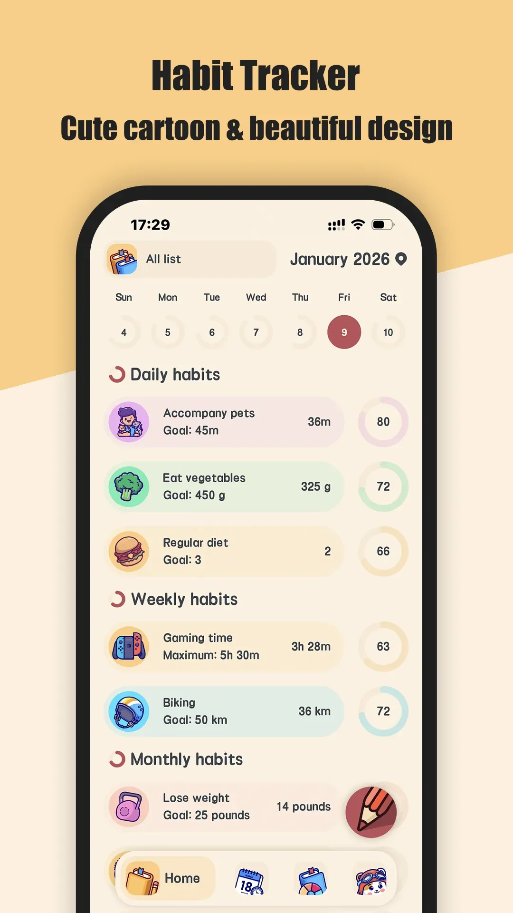{: width="180" .normal }
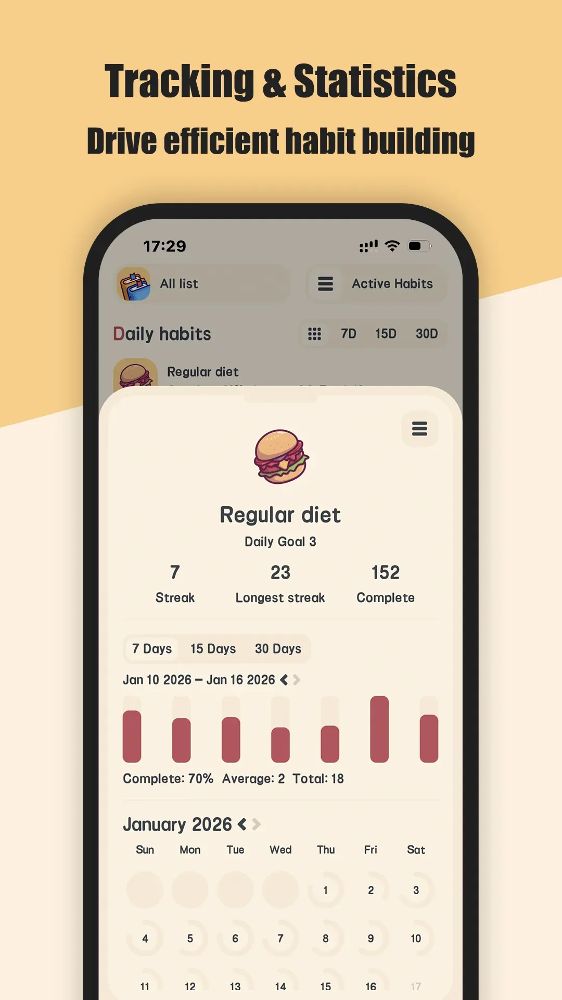{: width="180" .normal }
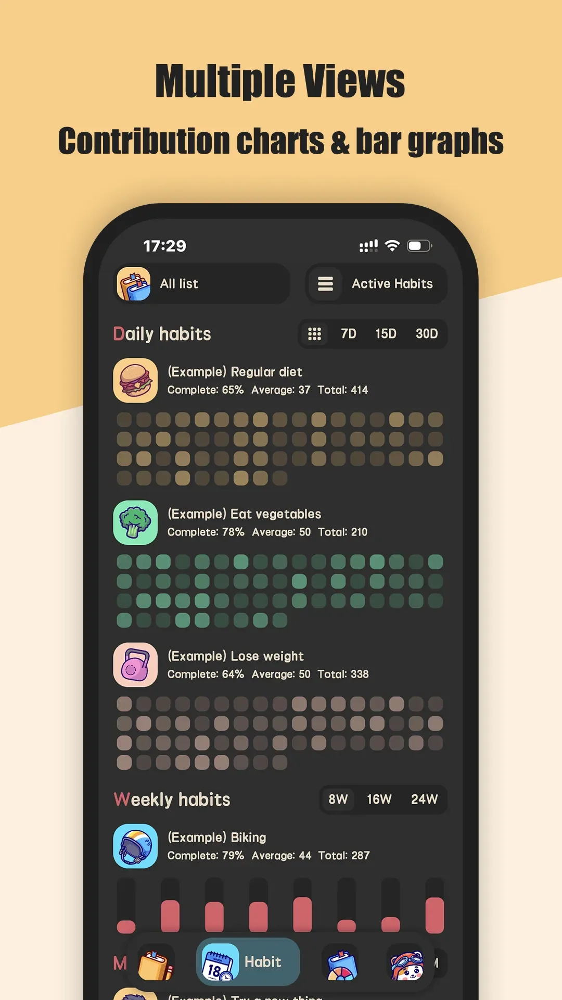{: width="180" .normal }

Meow Habits ialah aplikasi tanda tabiat yang berpaksikan **rekod pada peranti dan tiada akaun**, dengan antara muka berpusat pada kalendar bulanan. Hala tuju reka bentuknya jelas: kira dulu berapa daripada tabiat ini yang siap dalam tempoh ini, kemudian paparkan hasilnya menerusi empat pintu — kalendar, halaman terperinci, halaman trend dan widget.

#### Satu rekod: lima tindakan menanda

Mengetik tabiat membuka panel tanda dengan `+1`, `-1`, terus masuk angka, tanda siap satu ketikan, dan tanda dilangkau. Satu tempoh hanya menyimpan satu rekod kumulatif yang boleh disertakan nota; bunyi dimainkan apabila siap. Maka 2 gelas air pagi dan 3 gelas petang tidak menjadi dua aliran rekod, sebaliknya terkumpul menjadi 5 gelas bagi hari itu, lalu dibandingkan dengan sasaran 8 gelas.

#### Sasaran dan tempoh: bina, berhenti dan unit suai

Semasa mencipta tabiat anda boleh menetapkan ikon, senarai, bina atau berhenti, tarikh mula, kekerapan (harian / mingguan / bulanan / hari tertentu), selang ulangan, unit (bilangan, masa atau suai), sasaran, nota dan pemberitahuan. Senarai terbina meliputi kesihatan, senaman, belajar, produktiviti, berjimat dan gembira, di samping beberapa templat tabiat sedia guna untuk mereka yang tidak tahu dari mana hendak mula.

Satu perkara perlu diperhatikan: **tempoh, sasaran dan tarikh mula tidak boleh diubah selepas dicipta**; yang masih boleh diubah ialah ikon, senarai, nota dan peringatan. Jadi memutuskan tiga kali seminggu berbanding Isnin/Rabu/Jumaat sejak awal lebih menjimatkan tenaga daripada membetulkannya kemudian.

#### Streak dan kadar penyelesaian: tiga angka ditambah peta haba

Bahagian atas halaman terperinci memaparkan streak semasa, streak terpanjang dan bilangan siap; di bawahnya anda boleh bertukar antara 7 / 15 / 30 hari terakhir untuk melihat bar setiap hari serta kadar penyelesaian / purata / jumlah, kemudian peta haba kalendar sebulan penuh. Bagi tabiat membina, kadar penyelesaian satu tempoh dikira nilai siap ÷ sasaran dan dihadkan 100%; bagi berhenti, memadai sama ada hadnya dipatuhi. Kalendar skrin utama memaparkan tabiat wajib hari itu sebagai gelang progres, terus kelihatan mana yang belum mencapai sasaran.

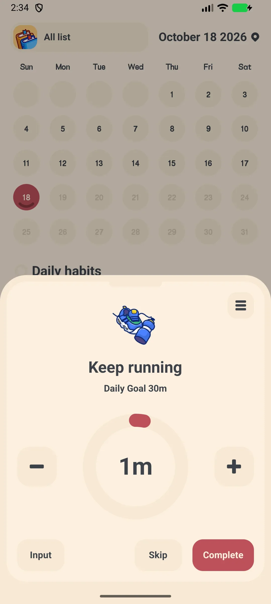{: width="180" .normal }
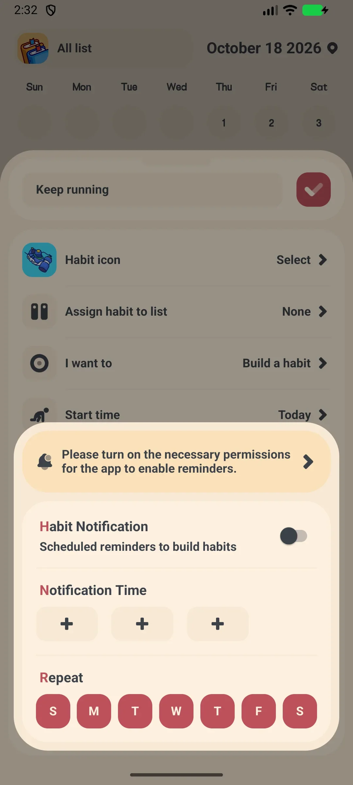{: width="180" .normal }

#### Peringatan, widget dan tanda satu sentuhan

Setiap tabiat boleh ada beberapa masa peringatan berserta hari berkuat kuasanya; ada juga ringkasan sekali sehari yang menyenaraikan tabiat yang masih tertangguh. Pada peringkat sistem tersedia panduan kebenaran pemberitahuan dan pengoptimuman bateri supaya peringatan tidak disekat. Di sebelah skrin utama tersedia pelbagai widget: senarai tabiat, satu tabiat, statistik minggu / bulan / tahun, carta pai dan peta haba bulanan; widget satu tabiat boleh terus menanda tanpa membuka aplikasi.

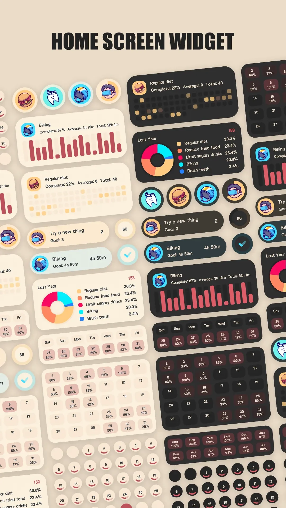{: width="180" .normal }

#### Data: storan setempat, eksport CSV dan sandaran kendiri

Rekod disimpan setempat pada peranti, tanpa akaun mahupun penyegerakan masa nyata merentas peranti. Untuk berpindah, anda boleh mengeksport CSV mengikut julat tarikh dengan memilih sebahagian atau semua tabiat; juga boleh menyandarkan seluruh pangkalan data ke Google Drive, atau mengisi alamat WebDAV sendiri lalu memulihkan dengan menimpa data sedia ada. Sandaran automatik paling kerap sekali sehari. Gabungan ini sesuai untuk mereka yang tidak mahu menyerahkan data harian kepada pelayan, tetapi bimbang kehilangannya apabila menukar telefon.

#### Kuota dan batas

Versi percuma menghadkan bilangan tabiat dan senarai; tabiat tambahan bersama tema gelap, kunci aplikasi dan eksport CSV perlu membuka ciri berbayar. Ia **tidak melakukan** penyegerakan automatik data kesihatan, papan kedudukan sosial, cadangan AI, penyegerakan awan berakaun mahupun import CSV; warna suai, tarikh tamat, tanda pada masa depan dan sub-tabiat berbilang aras juga di luar keupayaan. Mahu langkah dibaca automatik daripada gelang, atau bersaing streak dengan rakan, anda perlu alat lain.

| Sesuai untuk | Tidak sesuai untuk |
|---|---|
| Merekod jangka panjang luar talian tanpa akaun; memerlukan sasaran berangka dan unit suai; bergantung pada widget satu sentuhan; mahu data boleh dieksport atau disandarkan ke perkhidmatan sendiri | Memerlukan penyegerakan masa nyata merentas peranti; mahu data kesihatan automatik; menjadikan sosial / papan kedudukan motivasi utama; bilangan tabiat banyak dan tidak mahu terikat kuota percuma |

Selain skrin utama dan halaman terperinci, ada tiga paparan yang berbaloi dilihat berasingan: bagaimana senarai dan templat sedia guna mengumpulkan tabiat, statistik pencapaian menyeluruh, serta perlindungan privasi ke atas rekod setempat.

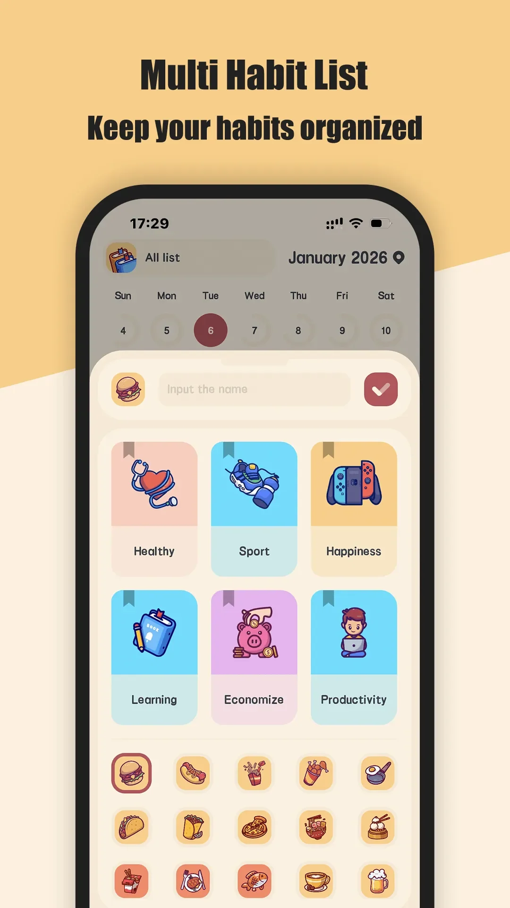{: width="180" .normal }
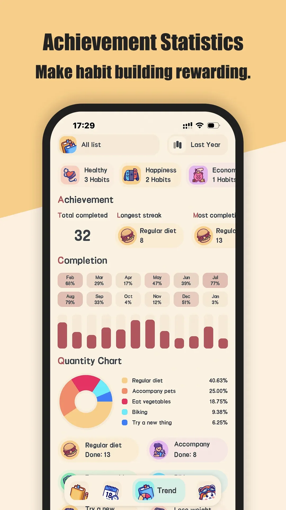{: width="180" .normal }
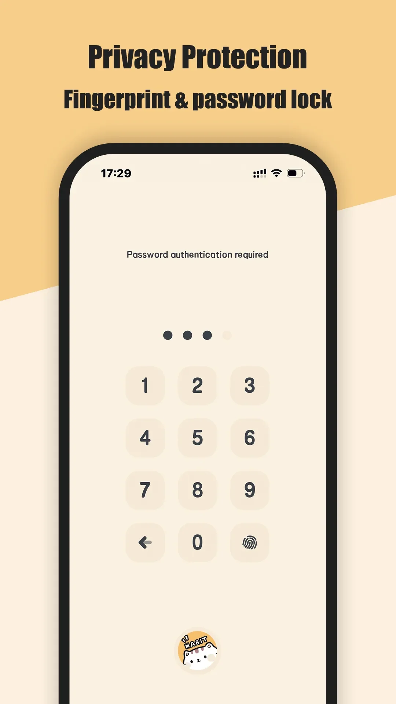{: width="180" .normal }

<!-- Tiada tangkapan skrin halaman tetapan eksport CSV / sandaran WebDAV dalam direktori imej lagi; keupayaan ini diterangkan melalui teks di atas -->

### Streaks (ekosistem Apple)

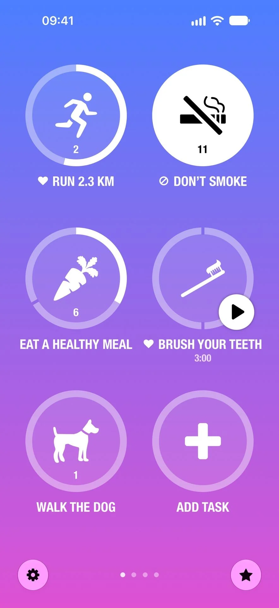{: width="180" .normal }
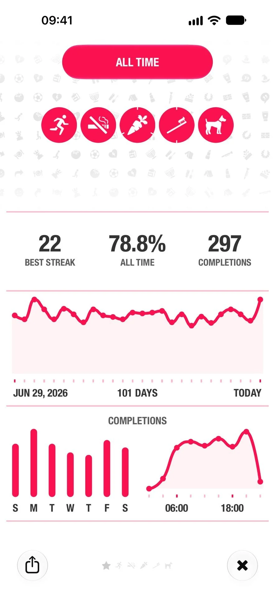{: width="180" .normal }

Streaks meletakkan jangan putus rantai terus pada namanya. Laman rasmi kini menyatakan **maksimum 24 tugasan** (sumber lama kerap menyebut 12, itu beza versi; pakai aplikasi sebagai rujukan); tugasan boleh ditetapkan setiap hari, pada hari tertentu atau beberapa hari seminggu, dan hari rehat boleh ditanda supaya tidak memutus streak. Selain tugasan satu tanda, ada tugasan bermasa (contohnya meditasi 10 minit) dan tugasan negatif jangan buat.

Fokus mekanismenya ialah **tempoh dan penyiapan automatik**: menerusi Apple Health, langkah, minit kesedaran atau gelang Aktiviti boleh terus menjadi satu rekod siap, lalu mengurangkan input manual. Sisi statistik memberi streak semasa dan terbaik, kadar penyelesaian, kalendar serta trend; antara muka menyediakan banyak ikon dan tema warna, di samping widget, Siri Shortcuts dan pemasa Skrin Kunci.

Data disegerakkan melalui iCloud antara iPhone, iPad, Apple Watch dan Mac, dan keterangan rasminya menyatakan ia tidak melalui pelayan mereka sendiri; caranya beli sekali, tanpa langganan dan tanpa iklan. Harganya juga terus: hanya ekosistem Apple, pengguna Android tidak boleh memakainya; dan terlepas satu hari wajib membuat streak bermula dari sifar semula — terasa kemas bagi yang suka peraturan jelas, terasa menegangkan bagi yang mudah patah semangat kerana rantai putus.

### Habitica

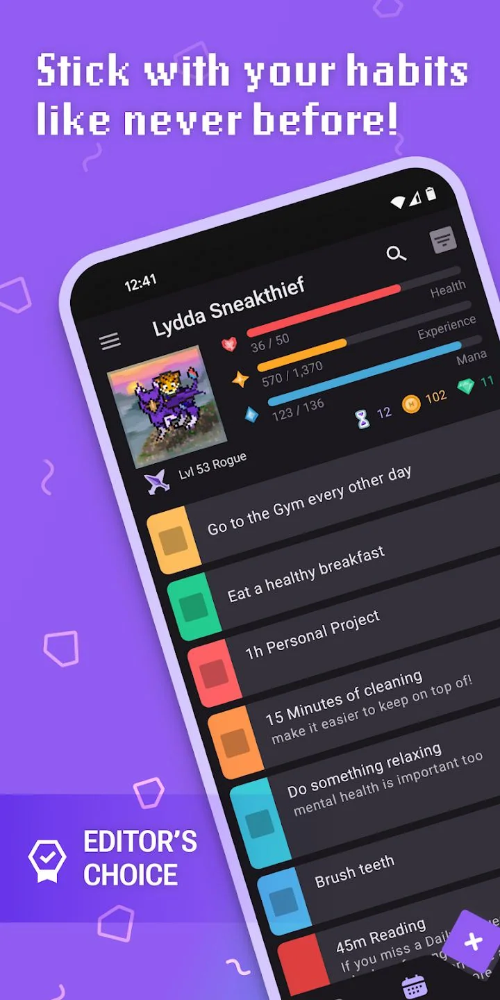{: width="180" .normal }
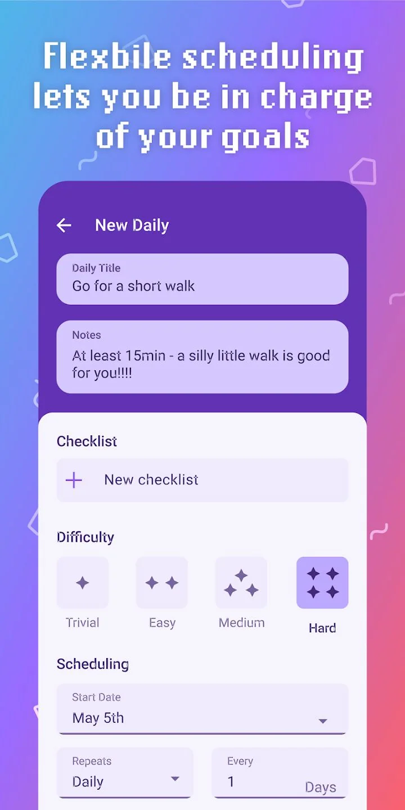{: width="180" .normal }

Habitica terus menjadikan penjejak tabiat sebuah permainan berperanan. Perlakuan dibahagikan empat: **Habits** (ketik `+` / `-` bila-bila, boleh positif, negatif atau dua arah), **Dailies** (ulang mengikut jadual, lewat tempoh memotong nyawa), **To-Dos** (sekali, boleh ada tarikh akhir, lewat tidak memotong nyawa) dan **Rewards** (tebus syiling untuk ganjaran kepada diri sendiri). Habits positif memberi XP dan syiling, negatif memotong nyawa; tempoh ulangan Daily boleh setiap hari, tiga kali seminggu atau empat kali sebulan, dan makin sukar makin besar ganjaran.

Reka bentuk ini menukar hari terlepas kepada kos yang jelas: apabila nyawa habis, syiling dikosongkan, watak turun satu aras, dan kelengkapan boleh hilang. Ia turut menyediakan pasukan, quest, kelas dan pertumbuhan atribut, menukar konsistensi daripada rekod peribadi menjadi permainan bersama. Tugasan, pasukan dan quest percuma; bahagian berbayar kebanyakannya permata kosmetik serta langganan pilihan (permata bulanan, bonus guguran dan sebagainya); kliennya sumber terbuka, ada juga versi web, meliputi iOS, Android dan Web.

Kalau bar pengalaman dan kelengkapan langsung tidak menarik, semua penukaran itu cuma menambah beban; tetapi bagi mereka yang sukar bertahan tanpa maklum balik luaran, inilah satu-satunya daripada 7 produk yang menjadikan ganjaran dan hukuman satu sistem penuh.

### Loop Habit Tracker

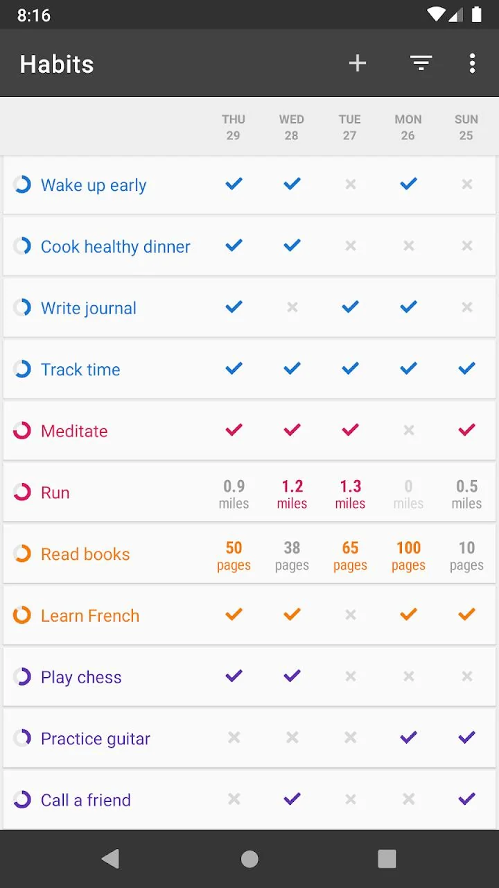{: width="180" .normal }
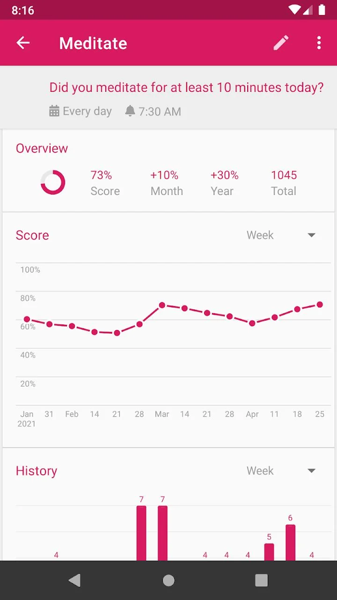{: width="180" .normal }

Perkara paling berbaloi dibincangkan tentang Loop bukan antara mukanya, tetapi **penolakannya terhadap putus rantai lalu kembali sifar**. Keterangan kedai rasminya menyatakan dengan jelas: produk memakai formula lanjutan untuk mengira skor tabiat, setiap pengulangan mengukuhkan tabiat, setiap kelalaian melemahkannya; selepas konsisten lama, beberapa hari terlepas tidak memusnahkan semua progres. Ini menjawab terus kegelisahan rantai putus di atas — trend jangka panjang lebih hampir kepada lengkung sebenar pembentukan tabiat berbanding rantai yang tidak boleh putus.

Dari segi tempoh, ia menyokong harian, 3 kali seminggu, sekali dua minggu, selang sehari dan jadual fleksibel lain; matriks tandanya turut memaparkan tabiat berangka yang direkod dalam batu atau muka surat. Peringatan boleh ditetapkan bagi setiap tabiat, dan daripada pemberitahuan boleh terus siap, abaikan atau tangguh tanpa membuka aplikasi, termasuk pada jam tangan. Sisi statistik ada carta terperinci serta sejarah penuh.

Data kekal sepenuhnya pada peranti, tanpa akaun dan tanpa muat naik rangkaian, serta boleh dieksport menjadi CSV atau fail pangkalan data; aplikasinya tanpa iklan dan sumber terbuka. Ia produk yang paling tuntas menempuh jalur setempat tulen + mudah alih, tetapi hanya ada pada Android dan antara mukanya condong kepada alat, bukan pendorong.

### Habitify

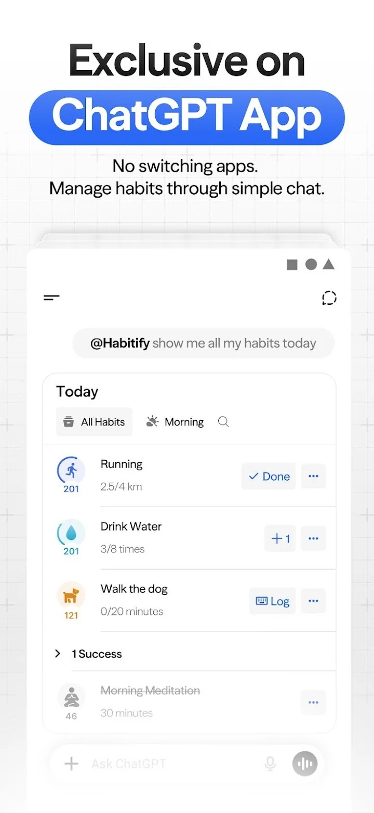{: width="180" .normal }
{: width="180" .normal }
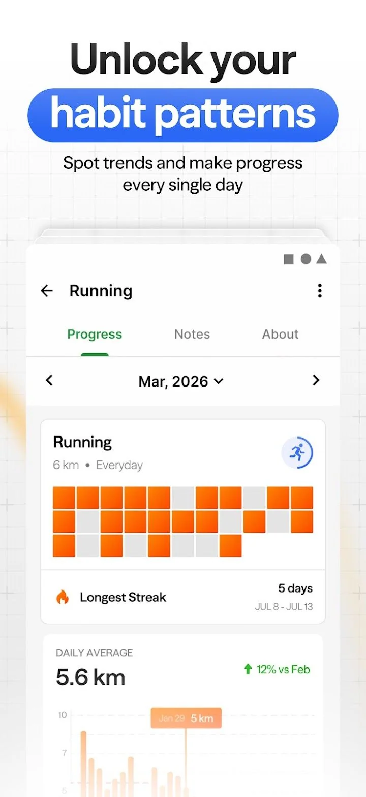{: width="180" .normal }

Gagasan Habitify ialah **meletakkan tabiat pada garis masa satu hari**: pagi, tengah hari, malam masing-masing membentuk satu kumpulan, jadi membuka aplikasi terus menunjukkan apa yang patut dibuat pada ketika itu. Laman rasminya menekankan liputan iPhone, Android, Mac, Web dan jam tangan dengan penyegerakan masa nyata; ada juga integrasi kalendar, integrasi data kesihatan, API dan sambungan automasi, nota, rekod mood, pemasa terbina dan kunci privasi. Paparan statistik menyusun rekod siap menjadi peta haba serta memberi angka kumulatif.

Kedudukannya berlawanan dengan alat setempat tulen: akaun, penyegerakan dan pengalaman berbilang peranti menjadi tarikan utama. Halaman harga rasmi menyatakan versi percuma boleh guna 3 tabiat (termasuk penyegerakan merentas platform dan peringatan), manakala tabiat tanpa had masuk pelan berbayar; ada juga cabaran rakan dan ciri komuniti. Kalau anda cuma menanda pada satu telefon Android dan tidak mahu mendaftar, kebanyakan keupayaan itu tidak digunakan; tetapi kalau anda berulang alik antara telefon, komputer dan web, ia menjimatkan kerumitan rekod yang berselerak di beberapa peranti.

### Productive

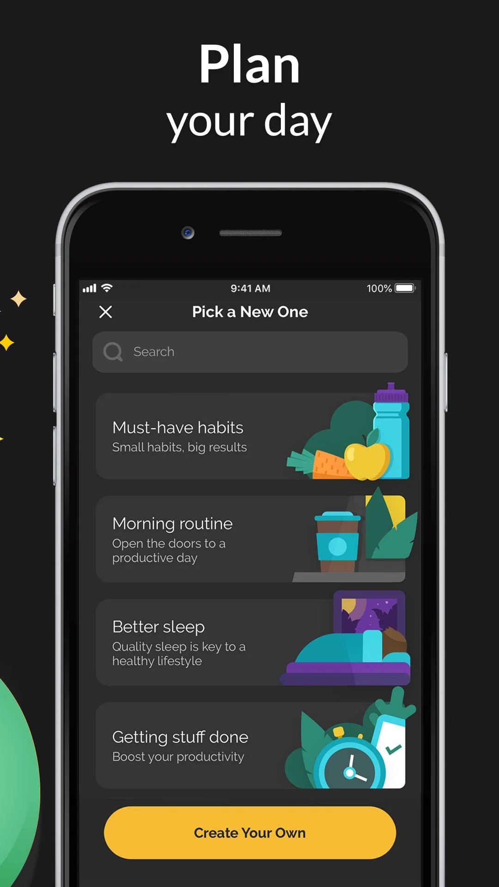{: width="180" .normal }
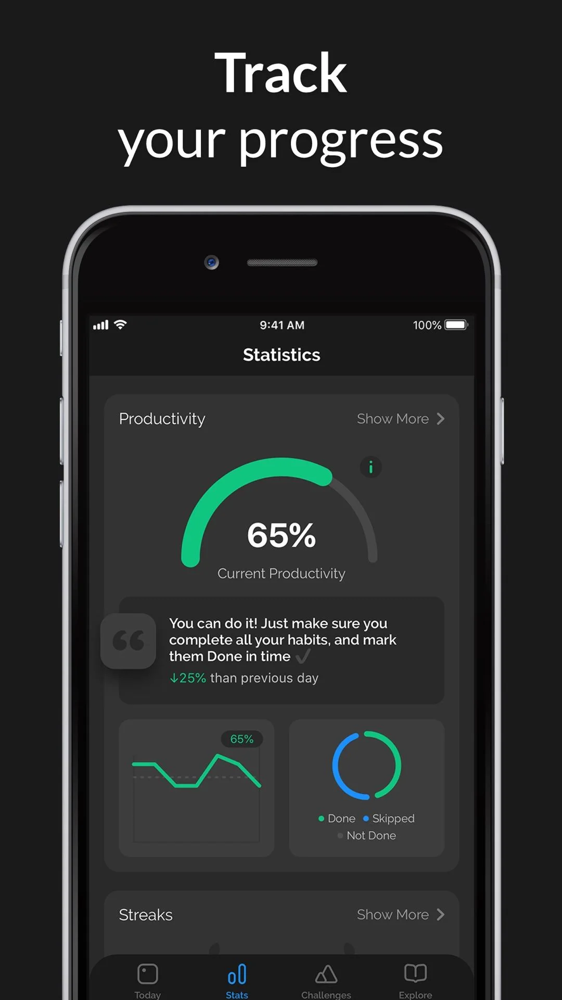{: width="180" .normal }
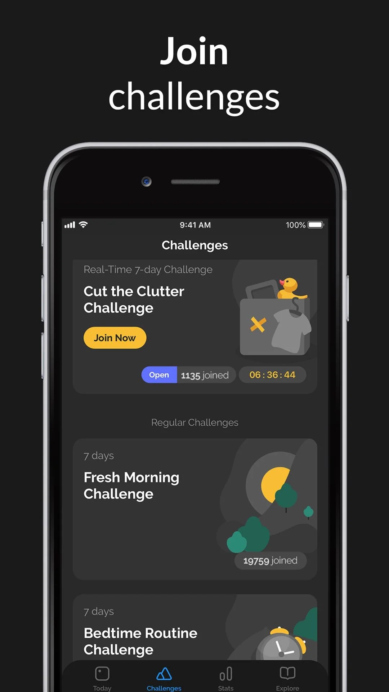{: width="180" .normal }

Productive melayan tabiat sebagai **jadual satu hari**: pilih tabiat daripada pustaka templat, letak pada pagi, tengah hari atau malam, tetapkan hari ulangan dan peringatan, kemudian tanda satu per satu dalam kalendar. Laman rasminya menyebut pustaka templat, statistik dan pencapaian, peringatan pintar berasaskan lokasi dan masa, serta cabaran yang boleh disertai bersama orang lain; halaman cabaran dijadikan lajur berasingan, terpisah daripada pelan harian.

Ia sekeluarga dengan Habitify dalam kumpulan organisasi blok masa + penyegerakan akaun, tetapi lebih menekankan rasa terancang dan sosial ringan: yang anda lihat bukan satu tabiat terpencil, tetapi seluruh susunan hari ini. Untuk bayaran, ia memakai langganan dengan percubaan percuma singkat yang bertukar automatik kepada langganan, jadi perhatikan semasa mendaftar. Himpunan ciri condong kepada bantu saya menyusun, bukan bantu saya mengira data dengan tepat, sebab itu kadar penyelesaian dan pencapaian yang mendominasi, dan takrif streak tidak dihuraikan mendalam.

### Fabulous

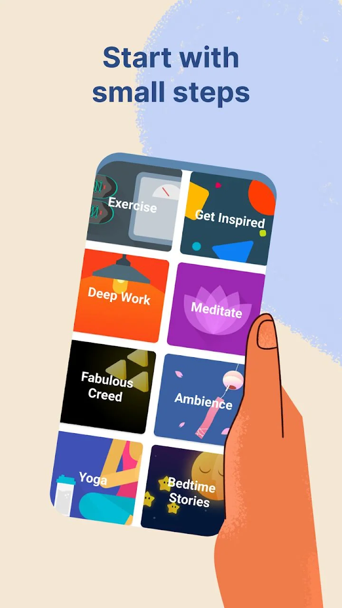{: width="180" .normal }
{: width="180" .normal }
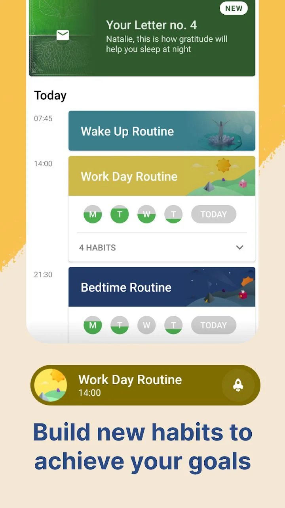{: width="180" .normal }

Fabulous lebih menyerupai **kursus perubahan tingkah laku berperingkat** berbanding alat tanda. Ia berakar daripada penyelidikan ekonomi tingkah laku di Center for Advanced Hindsight Universiti Duke dan menganjurkan memecah matlamat besar kepada perlakuan sangat kecil, lalu merantaikannya dengan habit stacking menjadi rutin pagi, tengah hari dan malam: stabilkan dulu minum segelas air, kemudian tambah langkah seterusnya, dan bukannya terus menyenaraikan sepuluh tugasan; skrin rutin hari ini menyenaraikan langkah kecil untuk dipotong satu per satu.

Bentuk produknya berjalan sebagai journey, lengkap dengan kandungan jurulatih, rutin, sesi kerja mendalam, komuniti dan tempahan jurulatih manusia; statistiknya tidak menonjolkan streak, sebaliknya kelengkapan peringkat. Harganya ialah pustaka kandungan langganan dengan percubaan percuma yang bertukar automatik kepada langganan, dan yang terutama anda beli ialah program serta kandungan, bukan sistem rekod yang bebas dikonfigurasi. Sesiapa yang mahu menentukan sendiri tempoh, sasaran dan eksport data akan berasa terlalu terikat.

---

## Perbandingan mendalam pada dimensi utama

### Semantik hari terlepas dan kelalaian

| Aplikasi | Satu hari terlepas | Dilangkau sengaja | Isi sejarah mundur | Tarikh masa depan |
|---|---|---|---|---|
| Meow Habits | Streak dikira mundur menerusi tempoh sah | Disokong, penanda tidak memutusnya | Disokong menerusi kalendar bulanan | Tidak dibenarkan |
| Streaks | Streak kembali sifar | Hari rehat boleh ditetapkan | Mengikut kalendar dalam aplikasi | Tidak berkenaan |
| Habitica | Daily memotong nyawa, habis bermakna turun aras | Kerosakan boleh dijeda | Mengikut sejarah tugasan | Tidak berkenaan |
| Loop | Skor tabiat menyusut, tidak kembali sifar | Dielakkan menerusi jadual fleksibel | Matriks tanda boleh diajak mundur | Tidak berkenaan |
| Habitify / Productive | Kalendar memaparkan belum siap | Dielakkan menerusi peraturan ulangan | Mengikut kalendar dalam aplikasi | Tidak berkenaan |
| Fabulous | Maju mengikut peringkat, streak tidak ditekankan | Tiada mekanisme rantai putus | Tidak berkenaan | Tidak berkenaan |

### Tempoh, sasaran dan peraturan siap

| Aplikasi | Penyataan tempoh | Sasaran berangka | Takrif kadar penyelesaian |
|---|---|---|---|
| Meow Habits | Hari / minggu / bulan / hari tertentu / setiap N hari | Disokong, unit boleh disuai | Nilai siap ÷ sasaran, dihadkan 100%; berhenti dinilai pada had |
| Streaks | Setiap hari / hari tertentu / beberapa hari seminggu + hari rehat | Tugasan bermasa meliputi durasi | Hari siap dan kadar penyelesaian |
| Habitica | Daily boleh harian / 3 kali seminggu / 4 kali sebulan | Bertumpu pada tanda, angka melalui ganjaran suai | Aras / XP / syiling, bukan peratusan |
| Loop | Harian / 3 kali seminggu / selang sehari / selang seminggu | Disokong | Skor tabiat + kadar penyelesaian |
| Habitify | Harian / hari tertentu, dikumpulkan mengikut blok masa | Bertumpu pada tanda | Kadar penyelesaian dan kalendar |
| Productive | Hari ulangan + blok masa + beberapa kali sehari | Bertumpu pada tanda | Kadar penyelesaian dan pencapaian |
| Fabulous | Peringkat journey + rutin | Tidak berkenaan | Progres peringkat |

### Peringatan, pintu masuk dan data

| Aplikasi | Peringatan | Tanda satu sentuhan | Lokasi data | Eksport / sandaran | Akaun |
|---|---|---|---|---|---|
| Meow Habits | Beberapa masa bagi setiap tabiat + hari tertentu + ringkasan harian | Widget skrin utama | Pada peranti | Eksport CSV, sandaran Google Drive / WebDAV | Tidak perlu |
| Streaks | Peringatan bagi setiap tugasan | Widget, Siri, siap automatik melalui Apple Health | iCloud (ekosistem Apple) | Bergantung pada penyegerakan ekosistem | Tidak perlu |
| Habitica | Peringatan Daily | Tambah / tolak dalam aplikasi | Awan | Dalam sistem akaun | Perlu |
| Loop | Peringatan bagi setiap tabiat, pemberitahuan boleh siap / abaikan / tangguh | Pemberitahuan, widget, jam tangan | Pada peranti | Eksport CSV / pangkalan data | Tidak perlu |
| Habitify | Peringatan lanjutan, peringatan blok masa | Widget, berbilang platform | Penyegerakan awan masa nyata | Awan + integrasi kalendar / kesihatan | Perlu |
| Productive | Peringatan pintar berasaskan masa / lokasi | Tanda dalam aplikasi | Awan | Dalam sistem akaun | Perlu |
| Fabulous | Peringatan rutin | Tanda langkah dalam aplikasi | Awan | Dalam sistem akaun | Perlu |

### Platform dan cara bayar (mengikut halaman rasmi)

| Aplikasi | Platform utama | Cara bayar | Keupayaan lazim yang jelas tiada |
|---|---|---|---|
| Meow Habits | Android (kedai turut menyenaraikan pintu masuk iOS) | Percuma dengan had tabiat / senarai, sebahagian ciri perlu dibuka | Penyegerakan automatik data kesihatan, papan kedudukan sosial, penyegerakan awan berakaun |
| Streaks | iPhone / iPad / Apple Watch / Mac / Vision Pro | Beli sekali, tanpa langganan dan iklan | Android / Windows; bilangan tugasan dihadkan |
| Habitica | Web / iOS / Android | Tugasan teras percuma, kosmetik dan langganan pilihan berbayar | Bukan alat setempat tulen, rekod perlukan akaun |
| Loop | Android | Percuma, sumber terbuka, tanpa iklan | iOS; penyegerakan akaun; motivasi gamifikasi |
| Habitify | iOS / Android / Mac / Web / Watch | Percuma 3 tabiat, tanpa had berbayar | Penggunaan luar talian sepenuhnya |
| Productive | Utamanya iOS, ada pintu masuk web | Langganan + percubaan percuma singkat | Guna luar talian tanpa akaun, eksport data bebas |
| Fabulous | iOS / Android | Pustaka kandungan langganan + percubaan percuma | Takrif tempoh suai, eksport data terbuka |

---

## Mana satu patut anda pilih

Terapkan kerangka enam poin pada situasi sendiri, dan pilihan menjadi jauh lebih jelas:

- **Tanya dulu sama ada rekod perlu membawa angka**. Untuk 8 gelas / 30 minit / 3 km, takrif Meow Habits dan Loop paling lengkap; kalau satu tanda memadai, laluan Streaks, Habitify dan Productive lebih pendek.
- **Kemudian tanya sama ada jadualnya kemas**. Hanya Isnin/Rabu/Jumaat, atau memadai tiga kali seminggu, ertinya fokus kepada hari tertentu dan jadual fleksibel — Meow Habits, Streaks, Loop dan Habitica kesemuanya memberi pilihan jelas.
- **Seterusnya tanya sama ada kembali sifar selepas satu hari boleh diterima**. Yang mudah patah semangat kerana sifar, lihat skor menyusut Loop atau penanda dilangkau Meow Habits; yang mahu peraturan jelas, Streaks paling terus; yang mahu ganjaran-hukuman luaran, Habitica paling kuat.
- **Kemudian tanya ke mana data pergi**. Tidak mahu mendaftar tetapi mahu sandaran sendiri, Meow Habits dan Loop ialah jalur itu; kerap bertukar peranti, penyegerakan Habitify / Productive / Fabulous lebih mudah; semuanya Apple, Streaks melalui iCloud memadai.
- **Akhir sekali tanya sama ada anda mahu alat atau program**. Mahu menentukan sendiri tabiat, tempoh dan carta, pilih jenis pencatat; mahukan proses perubahan yang dipandu, model kursus Fabulous lebih sesuai.

Masih ragu? Mulakan dengan menyempitkan pilihan melalui [ringkasan aplikasi penjejak tabiat](/ms/posts/pillar-habit-tracker-apps-android/), kemudian baca [perbandingan poin demi poin Meow Habits vs Streaks](/ms/posts/vs-meow-habits-and-streaks/). Bagi pengguna Android di Malaysia yang mencari aplikasi amalan harian tanpa akaun, antara muka berbahasa Melayu, boleh guna luar talian dan bergantung pada widget, [aplikasi tanda tabiat Android](/ms/apps/meow-habits/) juga berbaloi dilihat berasingan.

### Pautan muat turun rasmi

| Aplikasi | Android | iOS / lain-lain |
|---|---|---|
| Meow Habits | [Google Play](https://play.google.com/store/apps/details?id=com.glgjing.meow.habit.goal) | [App Store](https://apps.apple.com/app/id6758230559) |
| Streaks | — | [App Store](https://apps.apple.com/app/id963034692) · [Laman rasmi](https://streaksapp.com/) |
| Habitica | [Google Play](https://play.google.com/store/apps/details?id=com.habitrpg.android.habitica) | [Laman rasmi / web](https://habitica.com/) |
| Loop Habit Tracker | [Google Play](https://play.google.com/store/apps/details?id=org.isoron.uhabits) | [Laman rasmi](https://loophabits.org/) |
| Habitify | [Google Play](https://play.google.com/store/apps/details?id=co.unstatic.habitify) | [Laman rasmi](https://www.habitify.me/) |
| Productive | — | [Laman rasmi](https://productiveapp.io/) |
| Fabulous | [Google Play](https://play.google.com/store/apps/details?id=co.thefabulous.app) | [Laman rasmi](https://www.thefabulous.co/) |

---

## Soalan lazim (FAQ)

**Masalah apa yang sebenarnya diselesaikan oleh aplikasi tabiat?**
{:.faq-q}

Menukar niat yang kabur kepada rekod yang boleh disemak, dan mengecilkan geseran antara teringat dengan merekod. Ia tidak membina tabiat menggantikan anda, tetapi menjadikan perlakuan kelihatan, memberi maklum balik progres dan memberi asas semakan semula. Penyelidikan tingkah laku menunjukkan perlakuan baharu selalunya mengambil minggu hingga bulan sebelum menjadi automatik (Lally et al. 2010 menganggar median kira-kira 66 hari dengan variasi individu luas), dan dalam tempoh itu rekod ialah salah satu isyarat luaran paling mudah dijaga.

**Streak putus satu hari, adakah semuanya sia-sia?**
{:.faq-q}

Tidak. Kajian Lally et al. mendapati terlepas satu peluang tidak mengubah lengkung pembentukan tabiat secara keseluruhan secara ketara. Produk juga memberi layanan berbeza: Streaks kembali sifar, Loop membiarkan skor tabiat menyusut perlahan, Meow Habits membenarkan satu tempoh ditanda dilangkau, manakala Habitify / Productive / Fabulous tidak menjadikan streak sebagai teras. Memilih takrif yang sepadan dengan cara berfikir anda lebih penting daripada mempertahankan rantai habis-habisan.

**Apa beza tiga kali seminggu dengan Isnin/Rabu/Jumaat?**
{:.faq-q}

Yang pertama memadai sebarang tiga hari dalam seminggu, sesuai untuk jadual tidak tetap; yang kedua hanya menimbulkan tugasan tertangguh pada hari ditetapkan, hari lain bukan kelalaian. Loop secara rasmi menyokong jadual fleksibel seperti 3 kali seminggu, Daily Habitica juga boleh tiga kali seminggu, manakala Meow Habits mengasingkan kekerapan, selang ulangan dan hari tertentu. Pastikan dulu mana satu yang dipakai aplikasi sebelum mencipta tabiat.

**Sasaran berangka atau tanda ringkas, mana patut dipilih?**
{:.faq-q}

Lihat sama ada perlakuan itu ada darjah. Minum air, membaca dan berlari sesuai dengan sasaran berangka: anda dapat melihat hari ini siap 60% atau 100%, jauh lebih banyak bahan semakan; tidur awal atau tidak minum minuman manis lebih sesuai ditanda. Meow Habits dan Loop kedua-duanya menyokong sasaran berangka bersatuan, dan panel tanda Meow Habits sekaligus menyediakan tambah, tolak, masuk terus, siap satu ketikan dan dilangkau.

**Adakah dilangkau sama dengan terlupa merekod?**
{:.faq-q}

Tidak. Terlupa merekod ertinya wajib dibuat tetapi tidak direkod, dan biasanya menjejaskan streak; dilangkau ialah kenyataan sengaja bahawa tempoh ini memang tidak dibuat, jadi tidak memutus streak dan tidak dikira siap. Menanda perjalanan kerja atau hari sakit sebagai dilangkau, lebih awal atau kemudian, membuat kalendar tidak tersalah membaca rehat objektif sebagai kegagalan.

**Boleh guna tanpa akaun? Bagaimana kalau tukar telefon?**
{:.faq-q}

Meow Habits dan Loop tidak perlukan akaun, data ada pada peranti; Streaks disegerakkan antara peranti Apple melalui iCloud, juga tanpa mendaftar dengan vendor. Sebelum menukar peranti, ingat eksport atau sandaran: Meow Habits boleh mengeksport CSV mengikut julat tarikh, atau menyandarkan seluruh pangkalan data ke Google Drive / WebDAV sendiri; Loop mengeksport CSV atau fail pangkalan data. Habitify, Productive, Fabulous dan Habitica memakai penyegerakan akaun, menukar peranti lebih mudah, tetapi rekod melalui pelayan.

**Adakah aplikasi tabiat menyegerakkan gelang atau data kesihatan secara automatik?**
{:.faq-q}

Bergantung pada produk. Streaks boleh memakai Apple Health supaya langkah atau minit kesedaran ditanda siap secara automatik; Habitify menyediakan integrasi kalendar dan data kesihatan. Meow Habits **tidak menyediakan** penyegerakan automatik data kesihatan, tanda kebanyakannya dilakukan manual — malah itulah yang mengekalkannya setempat tulen dan tanpa akaun. Apabila melihat promosi rekod automatik, semak dulu platform mana yang benar-benar bersambung.

**Versi percuma biasanya menghadkan apa?**
{:.faq-q}

Lazimnya bilangan tabiat atau aras ciri. Habitify secara rasmi menyatakan 3 tabiat bagi versi percuma; versi percuma Meow Habits menghadkan bilangan tabiat dan senarai, dengan tema gelap, kunci aplikasi dan eksport CSV sebagai ciri perlu dibuka; Loop percuma, sumber terbuka dan tanpa iklan; Streaks beli sekali; Productive dan Fabulous memakai langganan serta percubaan singkat. Percubaan produk langganan bertukar automatik kepada langganan, jadi semak tarikh pembatalan sebelum mendaftar.

---

## Istilah berkaitan

- [Apa itu penjejak tabiat (Habit Tracker)?](/ms/glossary/what-is-a-habit-tracker/)
- [Apa itu streak tabiat (Habit Streak)?](/ms/glossary/what-is-a-habit-streak/)
