Rabu petang pukul tiga, tiba-tiba anda teringat: laporan suku tahunan perlu dihantar Rabu depan. Menuliskannya pada kertas lekat dan memasukkannya ke aplikasi senarai tugas bezanya bukan pada skrin yang lebih cantik, tetapi pada apa yang berlaku selepas itu: adakah ia muncul sendiri pada hari berkenaan, adakah tarikh akhir yang terlepas ditanda atau senyap tenggelam, dan adakah selepas siap ia meninggalkan kesan atau menjadi satu lagi item yang perlu dibersihkan.

Berikan ayat yang sama kepada 7 aplikasi senarai tugas dan anda akan mendapat 7 jawapan. Ada yang memecahkannya kepada tajuk, tarikh dan keutamaan; ada yang menyimpan satu baris teks sahaja. Ada yang terus menjana tugas bulan depan sebaik sahaja yang ini siap; ada yang menyusun semula hari anda. Ada yang menyimpan data pada peranti sehingga tukar telefon perlu membuat sandaran sendiri; ada yang mewajibkan akaun sebelum boleh mula. Senarai ciri nampak serupa, yang menentukan pengalaman sebenarnya ialah semua peraturan "selepas itu apa".

Jadi tulisan ini bukan pertandingan siapa ada senarai semak paling panjang. Kami mengikut satu tugas melalui lima tahap — dicatat, ditempatkan, dilakukan pada hari itu, ditanda, ditinjau semula — sambil menjawab dua soalan yang lebih asas: **apa sebenarnya aplikasi senarai tugas itu**, dan **masalah nyata apa yang diselesaikannya**. Untuk terus membandingkan pilihan, baca [tinjauan aplikasi senarai tugas dan pengurus tugas Android](/ms/posts/pillar-todo-list-task-manager-apps-android/) serta [perbezaan Meow Todo List dengan Todoist](/ms/posts/vs-meow-todo-and-todoist/).

> Asas semakan: ciri, kuota dan harga pesaing datang daripada halaman rasmi, pusat bantuan rasmi dan penerangan kedai aplikasi, disemak November 2026; peraturan produk kami mengikut tetapan dan tingkah laku yang kelihatan dalam aplikasi. Versi cepat berubah, jadi angka pakej berbayar mengikut halaman semasa. Tulisan ini hanya membincangkan senarai tugas peribadi, bukan pengurusan projek pasukan.

## 1. Yang dijaga aplikasi senarai tugas ialah urusan "belum siap"

### Kertas lekat dengan satu sistem berbeza pada tiga lapis

Tugas pada kertas cuma satu ayat; tugas dalam aplikasi ialah **rekod yang ada tempat tuju**. Hampir setiap produk tersusun daripada tiga lapis:

- **Butir**: medan yang dibawa satu tugas. Paling ringkas memadai dengan tajuk; paling lengkap boleh memuat nota, masa rancangan, keutamaan, peraturan ulangan, tag, senarai, subtugas dan status siap.
- **Bekas**: ke mana butir itu diletakkan. Senarai, folder, projek, kawasan dan tag pada asasnya memberi satu butir tempat bernaung supaya ia boleh dipanggil semula mengikut satu dimensi.
- **Paparan**: dengan sudut apa kumpulan butir yang sama disusun semula. Hari ini, esok, 7 hari akan datang, akan tiba, siap, kalender dan papan bukan data lain, tetapi irisan berbeza bagi data yang sama.

Tiga lapis ini menerangkan mengapa aplikasi senarai tugas bukan sekadar kertas lekat digital: langkah tambahannya ialah memberi setiap urusan yang belum siap satu peraturan **bilakah ia akan dilihat semula**. Anda tidak perlu mengingatnya, cuma perlu ia menemui anda pada waktunya.

### Ia, kalendar, aplikasi tabiat dan nota masing-masing menjaga satu bahagian

Kesilapan paling kerap pemula ialah memasukkan semua perkara yang perlu diingat ke dalam satu alat. Pembahagian empat alat ini sebenarnya jelas:

| Alat | Unit asas | Makna masa | Soalan lazim |
|---|---|---|---|
| Aplikasi senarai tugas | Satu tugas (tamat apabila siap) | Siap sebelum sesuatu hari atau tarikh akhir | Apa yang belum siap |
| Kalendar | Satu blok masa | Ada mula dan tamat yang jelas, menggunakan masa | Rabu petang pukul tiga saya buat apa |
| Aplikasi tabiat | Satu kali siap dalam satu kitaran | Berulang mengikut kitaran, tiada penghujung | Berapa kali bersenam minggu ini |
| Nota dan dokumen | Kandungan yang boleh disunting lama | Biasanya tiada status siap | Di mana saya simpan bahan itu |

Gabungan yang lazim: tugas ditulis dalam senarai, yang benar-benar menggunakan dua jam dipindah ke kalendar, tabiat jangka panjang diserahkan kepada aplikasi tabiat, bahan rujukan kekal dalam nota. Keistimewaan aplikasi senarai tugas ialah **menyediakan tempat yang jelas untuk tindakan menyiapkan** — nota mahupun kalendar tidak menawarkannya.

### Kamus kecil konsep teras

Istilah berikut berulang dalam perbandingan ini, jadi ditetapkan dahulu di awal:

- **Peti masuk (Inbox)**: tempat menampung catatan sebelum dikelaskan. Nilainya pada memisahkan "terfikir" dengan "memutuskan di mana letaknya", supaya anda tidak membatalkan catatan hanya kerana perlu mengasingkan.
- **Subtugas**: langkah yang boleh ditanda satu per satu dalam satu tugas. Kebanyakan produk hanya menyokong satu aras dan subtugas tiada tarikh sendiri; lihat [apa itu subtugas](/ms/glossary/what-is-a-subtask/).
- **Senarai, tag dan projek**: senarai biasanya bermaksud pemilikan (satu tugas masuk satu senarai), tag bermaksud dimensi (satu tugas boleh ada beberapa), projek pula selalu membawa matlamat dan peringkat. Sama ada ketiganya boleh bertindih menentukan had keupayaan menyusun.
- **Peraturan ulangan**: membuat tugas muncul semula harian, mingguan, bulanan, tahunan atau pada selang tersuai, dan boleh tamat pada tarikh atau selepas bilangan tertentu. Beza utamanya ialah "selepas yang ini siap, bagaimana tugas seterusnya dijana".
- **Paparan hari ini**: beberapa butir yang dipilih daripada semua tugas untuk dihadapi hari ini. Ia bukan sekadar penapisan mengikut tarikh hari ini, kerana setiap produk melayan tugas lewat tempoh secara berbeza.
- **Lewat tempoh (Overdue)**: melepasi masa rancangan dan belum siap. Ada produk yang memindahkannya ke hari ini secara automatik, ada yang menanda merah dan membiarkannya di kumpulan Lewat Tempoh, ada yang menggabungkannya ke paparan hari ini.
- **Input bahasa semula jadi**: menulis tarikh akhir dan masa terus pada tajuk, lalu aplikasi menghurai tarikh serta peringatan. Ini memendekkan kos masuk pada tahap pertama.
- **Arkib dan status siap**: ke mana butir pergi selepas ditanda. Ada yang menyimpan sejarah boleh cari, ada yang meringkaskannya menjadi satu angka, ada yang terus menghilangkannya daripada senarai.

Konsepnya nampak remeh, tetapi hampir semua yang membuat dua aplikasi terasa berbeza datang daripada peraturan di sebalik istilah-istilah ini.

## 2. Mengikut satu tugas melalui lima tahap

### Tahap 1 — Menangkap: satu ayat dipecah kepada beberapa medan

Kos masuk menentukan sama ada sesuatu senarai benar-benar digunakan. Paling ringan hanya menyediakan kotak tajuk dan menangguhkan tarikh, keutamaan, ulangan serta tag; paling mudah memasukkan semua medan itu ke dalam satu ayat lalu menghurainya.

Todoist dan TickTick kedua-duanya menjadikan tambah pantas bahasa semula jadi sebagai pintu masuk utama, dan halaman rasmi kedua-duanya menyenaraikannya dalam keupayaan percuma: tulis laporan mingguan dengan masa Jumaat, terus dapat tarikh dan peraturan ulangan. Google Tasks melangkah lebih jauh, membenarkan anda menukar sesuatu menjadi tugas di sebelah e-mel dalam Gmail atau di bar sisi Google Kalendar tanpa bertukar aplikasi. Meow Todo List mengambil jalan lain: tajuk ialah teks biasa, manakala tarikh, keutamaan, tag dan ulangan dipilih pada panel berasingan — beberapa ketikan lebih banyak, tetapi **tiada kekaburan huraian**, apa yang anda taip itulah yang disimpan.

Ada satu butiran yang mudah terlepas pada tahap ini: sama ada peringatan merupakan medan berasingan. Meow Todo List tiada pilihan "ingatkan 10 minit sebelum"; masa peringatan sama dengan masa rancangan tugas, ditambah ringkasan harian yang berasingan. Peringatan tersuai dalam Todoist termasuk pakej berbayar. Sesiapa yang mahu diingatkan lebih awal sebaiknya menyemak ini sebelum memilih.

Ada juga soalan lebih awal: bagaimana jika mahu mencatat tetapi belum memutuskan di mana letaknya. Things 3 ada peti masuk khusus, TickTick meletakkan peti masuk di kedudukan pertama bar sisi, Google Tasks terus menumbuhkan pintu masuk di sebelah e-mel dan kalendar; Meow Todo List tiada peti masuk khusus, dan butir sebegini ditampung oleh senarai "Default" serta kumpulan "Tiada tarikh". Ada tidaknya langkah ini menentukan anda "catat dulu, kemas kemudian" atau "mesti dikelaskan serta-merta" — yang kemudian selalunya berakhir dengan tiada catatan langsung.

### Tahap 2 — Menyusun: senarai, tag, subtugas dan keutamaan

Apabila tugas menimbun, masalah beralih daripada "adakah saya ingat" kepada "bolehkah saya jumpa". Pemisah paling berisi di sini ialah **boleh atau tidaknya lapisan bertindih**.

Things 3 membina struktur jangka panjang kawasan, projek, tajuk kecil dan tugas, sesuai untuk mengasingkan kerja, keluarga serta matlamat peribadi dalam tempoh lama; Todoist menggunakan projek, subtugas beraras, label dan penapis; Microsoft To Do serta Google Tasks lebih berhemat, bergantung pada beberapa senarai rata; Meow Todo List ialah **satu aras senarai, satu aras tag, satu aras subtugas**, tanpa induk pada senarai mahupun tag dan tanpa bersarang lagi. Ganjarnya kesederhanaan: mencipta tugas tidak perlu dulu menjawab "ini masuk folder mana". Kosnya, projek rumit sukar dipecah dengan bersih.

Pengisihan dan penapisan juga termasuk di sini. Meow Todo List menyediakan empat mod isihan — tarikh, keutamaan, senarai atau tiada — dengan isihan manual seret pada mod selain tarikh; carian dan eksport boleh ditapis mengikut senarai, tag, keutamaan dan julat tarikh. Pakej percuma menghadkan bilangan senarai (10), tag (10) dan subtugas bagi setiap tugas (10), **bukan jumlah keseluruhan tugas** — asas yang sangat berbeza daripada "9 senarai, 99 tugas setiap senarai" pada TickTick, dan penting semasa membandingkan kuota.

Keutamaan juga sebahagian daripada tahap ini, tetapi skalanya berbeza: Meow Todo List ada empat aras (tiada, rendah, sederhana, tinggi), TickTick menyediakan matriks empat kuadran, Google Tasks langsung tiada keutamaan. Empat aras sesuai untuk isihan pantas, matriks sesuai untuk membuat pilihan, dan tanpa keutamaan berat hanya boleh dinyatakan melalui "masuk senarai mana" serta "di kedudukan ke berapa". Begitu juga peraturan isihan — tarikh, keutamaan, senarai, atau seret manual sepenuhnya ialah empat gagasan berbeza tentang keteraturan.

### Tahap 3 — Melaksana: makna paparan hari ini dan lewat tempoh

Produk hanya menampakkan peribadinya apabila harinya tiba.

Apa sebenarnya termasuk dalam "hari ini"? Jawapan Meow Todo List: tugas yang jatuh tempo hari ini ditambah **semua tugas yang lewat tempoh tetapi belum siap**, dikumpulkan dan ditanda di bawah Lewat Tempoh; tugas lewat tempoh tidak digeser automatik dan tidak siap secara automatik. Apabila diisih mengikut tarikh, semua tugas terbahagi kepada enam kumpulan: Lewat Tempoh, Hari Ini, Esok, 7 hari, Kemudian dan Tiada tarikh. "My Day" dalam Microsoft To Do memakai logik lain: ia bermula kosong setiap hari, lalu anda atau "Cadangan" memilih semula apa yang hendak dibuat, dan yang belum siap dicadangkan lagi esoknya. Yang pertama ialah lejar, yang kedua senarai yang disusun semula setiap hari; tiada yang lebih baik, bergantung pada sama ada anda lebih takut terlepas atau lebih takut ditindih catatan lama.

Tugas berulang ialah bahagian yang paling kerap terlepas pandang dan paling jujur mendedahkan andaian reka bentuk. Ambil "bayar sewa pada 1 haribulan setiap bulan": apabila anda menanda tugas semasa, Meow Todo List menjana **tugas seterusnya yang benar-benar baharu**, menyalin tajuk, nota, senarai, tag, keutamaan, peraturan ulangan serta semua subtugas, menetapkan semula subtugas kepada belum siap dan memindahkan masa rancangan ke kitaran sah seterusnya; kitaran yang sudah berlalu tanpa sempat diurus dilangkau, terus mendarat pada hari ini atau masa depan, dan boleh dihentikan mengikut tarikh atau bilangan. Tugas lama menjadi siap dan berhenti berulang. Maka sejarahnya ialah kumpulan rekod yang benar-benar pernah disiapkan, bukan satu tugas yang ditulis semula berulang kali. Bantuan rasmi Google menyatakan tugas berulang boleh ditetapkan pada tarikh tertentu, tetapi subtugas hanya satu aras dan tiada tarikh sendiri — makna sejarah kedua-duanya tidak sama.

Peringatan dan pintu masuk juga terletak di sini. Meow Todo List membahagikan peringatan kepada dua: notifikasi apabila tugas jatuh tempo, dan ringkasan harian pada masa tetap yang boleh menyertakan tugas lewat tempoh; widget skrin utama menambah bentuk tambah pantas, senarai tugas, kalendar dan statistik. Tetapi mengetik notifikasi membuka laman utama aplikasi, **tanpa** tindakan "Siap" atau "Kemudian" dalam notifikasi, dan butir widget juga membuka perincian. Produk yang meletakkan tindakan menyiapkan terus dalam notifikasi boleh memangkas satu lagi lapisan geseran, dengan harga bar notifikasi yang lebih bising.

### Tahap 4 — Menyiapkan: ke mana data pergi selepas ditanda

Tindakannya begitu ringan sehingga jarang ada yang bertanya hasilnya, padahal ia menentukan sama ada enam bulan kemudian anda masih boleh menjawab "sebenarnya siap pada tarikh berapa".

Meow Todo List memindahkan tugas siap ke kumpulan "Siap", dengan suis di laman utama, 10 entri terbaharu secara lalai serta pilihan "Tunjuk lebih banyak"; ketika siap, masa dicatat dan satu bunyi boleh dimainkan. Aplikasi ini **tiada tong sampah mahupun kawasan arkib**: pemadaman kekal, dan "Kosongkan yang siap" memberi amaran jelas bahawa ia tidak boleh dibatalkan. Things 3 ada rekod penyiapan bernama Logbook, manakala Todoist menjadikan sejarah aktiviti visualisasi produktiviti boleh cari (percuma 1 minggu, sejarah penuh pada pakej berbayar).

Bagi sesiapa yang perlukan jejak, semakan semula, atau bukti bahawa sesuatu pernah dibuat, beza tahap ini jauh lebih penting daripada warna antara muka; bagi yang cuma mahu senarai kosong sekali sehari, makin ringkas makin baik.

Satu perangkap mudah ialah "Kosongkan yang siap". Ia menjadikan senarai terus kemas, tetapi pada produk tanpa arkib dan tanpa tong sampah langkah itu turut memadam jejaknya, dan antara muka memang memberi amaran tidak boleh dibatalkan. Sesiapa yang membuat semakan per suku sebaiknya eksport dahulu sebelum mengosongkan; yang menjadikan senarai sekadar papan sementara pula wajar mengosongkannya secara berkala agar tugas siap tidak memenuhi laman utama.

### Tahap 5 — Meninjau: kalendar, statistik dan jalan keluar data

Tahap terakhir menentukan sama ada sistem ini boleh digunakan bertahun-tahun.

Meow Todo List ada empat paparan utama — Tugas, Kalendar, Statistik dan Tetapan — dengan mod kalendar harian, mingguan dan bulanan. Statistik boleh dilihat mengikut hari, minggu, bulan, tahun, julat tersuai atau seluruh masa, termasuk graf sumbangan tahunan, haba kalendar bulanan, mingguan dan tahunan, carta pai serta kedudukan mengikut senarai dan mengikut tag, dan senarai tugas yang dikumpulkan mengikut jam, minggu atau tarikh. Di skrin utama pula ada 10 jenis widget: tambah pantas, buku tugas, senarai tugas, statistik pai, kalendar bulanan dan mingguan, serta statistik mingguan, bulanan dan tahunan; kebanyakannya terus menunjukkan ringkasan hari itu. Tiada lencana pencapaian atau sistem streak, statistik hanya menjawab "berapa banyak dan di mana taburannya", tanpa mencipta satu lagi angka yang perlu dijaga.

Jalan keluar data berbaloi dilihat berasingan. Meow Todo List menyimpan data pada peranti, **tidak memerlukan akaun**, dan tiada penyegerakan masa nyata berbilang peranti; pertukaran peranti bergantung pada sandaran dan pemulihan seluruh pangkalan data, dengan Google Drive atau alamat WebDAV sendiri, serta sandaran automatik yang boleh ditetapkan. Eksport CSV selepas penapisan mengikut senarai, tag, keutamaan dan julat tarikh ialah ciri premium, dengan lajur senarai, tajuk, penerangan, tag, tarikh dan status siap; **tiada import yang sepadan**. Ini bermakna ia sesuai untuk orang yang tidak mahu menyerahkan catatan harian kepada pelayan tetapi mahu boleh membawanya pergi bila-bila masa, bukan untuk orang yang menambah tugas pada telefon lalu mahu terus melihatnya pada komputer.

## 3. Apa gunanya aplikasi senarai tugas sebenarnya

### Menyerahkan "mengingat" ke luar kepala

Pada dekad 1920-an Bluma Zeigarnik perasan bahawa pelayan mengingati pesanan yang belum dibayar dengan lebih jelas berbanding yang sudah dijelaskan, kemudian dirumuskan sebagai kesan Zeigarnik: urusan belum siap lebih cenderung kekal dalam fikiran. Lebih dekat dengan aplikasi senarai tugas ialah eksperimen Masicampo dan Baumeister pada 2011 dalam *Journal of Personality and Social Psychology* (101(4), 667–683, doi:10.1037/a0024192): yang membuat matlamat belum tercapai terus menyelinap masuk ke fikiran selalunya bukan "belum siap" itu sendiri, tetapi **ketiadaan pelan yang konkret**; sebaik sahaja ditulis bila, di mana dan bagaimana, gangguannya menurun dengan ketara.

Kesimpulan ini penting untuk memahami aplikasi senarai tugas: nilainya bukan sekadar "membantu anda menyiapkan", tetapi **memindahkan sesuatu urusan keluar dari kepala ke tempat yang ada langkah seterusnya yang jelas**. Menulis serta menyusunnya sahaja sudah melepaskan sebahagian beban. Ingat juga batas buktinya — ini kajian tugas jangka pendek dalam makmal, bukan jaminan bahawa memasang aplikasi senarai tugas terus menjadikan anda lebih produktif; yang tetap menentukan hasil ialah sama ada tugas itu memang boleh dilaksanakan.

Diterjemahkan kepada amalan harian: **jangan hanya menulis kata nama, tulis tindakan seterusnya**. Butir laporan suku tahunan yang kabur hampir tidak memberi maklumat boleh laksana; baris yang menyebut Rabu pukul 9 di meja kerja dan tindakan pertama sekali gus memberi masa, tempat serta gerakan awal. Pola "jika X, buat Y" ini dalam sains tingkah laku dipanggil implementation intentions, dan satu nilai aplikasi senarai tugas ialah memberi pola itu tempat yang tetap.

### Empat nilai yang boleh dipakai setiap hari

- **Ingatan luaran**: serahkan "jangan lupa" kepada sistem, tinggalkan kepala untuk pertimbangan. Lebih-lebih lagi bagi urusan tanpa pencetus tetap (tuntutan belanja, balas e-mel, bayar bil), kertas lekat dan daya ingat kedua-duanya tidak boleh diharap.
- **Menukar yang kabur kepada boleh laksana**: butir laporan suku tahunan yang kabur mengundang tangguh; selepas dipecah kepada tarik data, tempah bilik mesyuarat dan tulis rangka, kos memulakan terus turun. Subtugas dan peraturan ulangan memang memikul langkah ini.
- **Memendekkan jarak dari terfikir ke tercatat**: widget, notifikasi, bar sisi dan tambah pantas semuanya berebut perkara yang sama — dapat menulis pada saat idea muncul, bukan mengejar catatan pada waktu malam.
- **Meninggalkan jejak boleh semak**: masa siap, graf sumbangan dan taburan mengikut senarai menjadikan "sebulan ini sibuk dengan apa" satu fakta boleh semak, bukan tanggapan.

### Senarai itu bekas, bukan kaedah

GTD, semakan mingguan, matriks empat kuadran dan time blocking ialah kaedah, bukan ciri sesuatu aplikasi. Alat hanya mampu menyediakan tiga perkara: tempat untuk butir, cara ia muncul semula pada waktu yang tepat, dan rekod bahawa ia sudah siap. Kaedah yang belum jelas tidak akan selesai dengan bertukar aplikasi; sebaliknya, alat yang cukup ringkas hingga anda sanggup membukanya setiap hari biasanya lebih berkesan daripada sistem lengkap yang sudah malas dijaga selepas tiga hari.

### Bilakah senarai sebaliknya menyusahkan

Mekanisme yang sama boleh berbalik. Senarai yang terus membesar dan tidak pernah dibersihkan menjadi beban yang cuma menghasilkan keresahan; dua puluh minit sehari menyusun semula keutamaan sendiri menggunakan masa yang sepatutnya untuk bekerja; menganggap "mengemas senarai" sebagai "memajukan kerja" ialah penipuan diri paling lazim. Selain itu, bagi kerja yang memerlukan kerjasama ramai, penyegerakan masa nyata merentas peranti, atau tugas yang sangat bergantung pada keadaan luar seperti menunggu balasan orang lain, senarai peribadi yang tulen tempatan bukan pilihan sesuai — memang tidak direka untuk itu.

Satu ayat: aplikasi senarai tugas bertanggungjawab **memberi tempat kepada urusan yang belum siap**, bukan melakukannya untuk anda.

## 4. Ke mana 7 produk mencurahkan tenaga

### Meow Todo List (Android / iOS): lima tahap kekal tempatan

Meow Todo List tersedia pada Android mahupun iOS, dan kedua-duanya mengambil jalur "tiada akaun, data kekal pada peranti"; butiran fungsi di bawah mengikut antara muka Android, jadi pada iOS ikut paparan sebenar dalam aplikasi. Dalam kalangan 7 produk ini, ia paling konsisten mengutamakan tempatan: tiada akaun, tugas, senarai dan tag disimpan pada peranti; organisasi satu aras senarai, satu aras tag, satu aras subtugas; paparan Tugas, Kalendar, Statistik dan Tetapan; peringatan berupa peringatan tugas serta ringkasan harian; 10 jenis widget pada skrin utama. Pertukarannya konsisten — menangkap, menyusun dan meninjau semuanya dijadikan keupayaan tempatan, dengan kos tiada penyegerakan masa nyata merentas peranti.

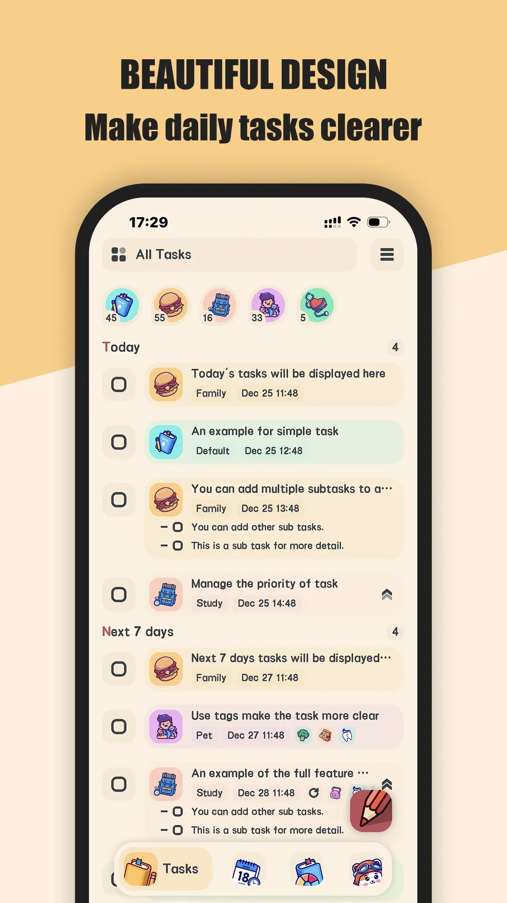{: width="180" .normal }
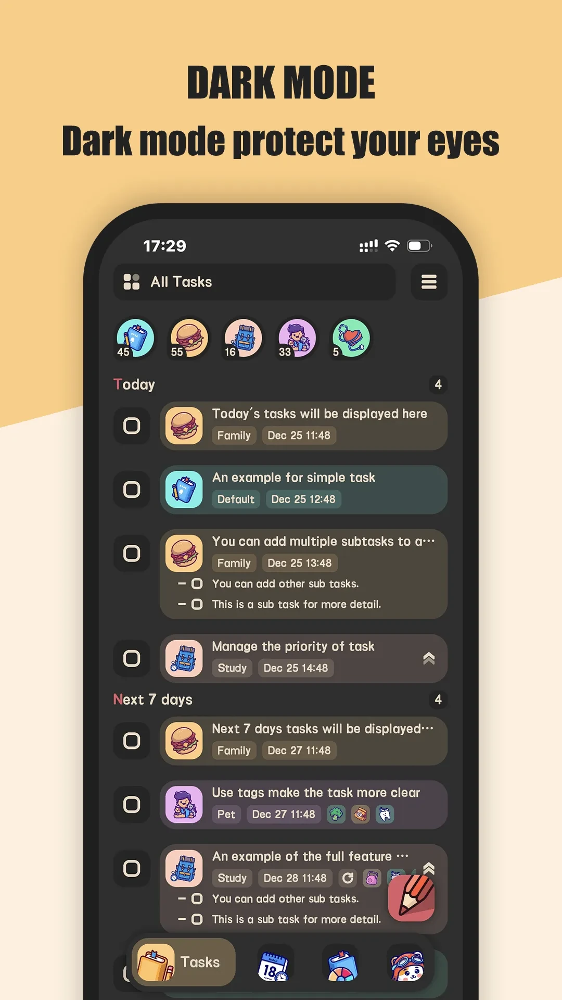{: width="180" .normal }
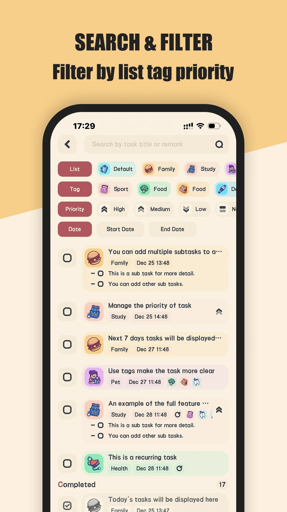{: width="180" .normal }

Pengendalian tugas berulang paling berbaloi disebut berasingan: menyiapkan tugas semasa menjana tugas seterusnya yang benar-benar baharu, subtugas turut disalin dan ditetapkan semula, kitaran yang terlangkau tidak diisi menjadi rentetan rekod yang tidak dibuat, dan ia boleh tamat mengikut tarikh atau bilangan. Tugas lewat tempoh tidak digeser automatik, sebaliknya dikumpulkan jelas di "Lewat Tempoh" dan turut dibawa ke paparan hari ini. Yang siap masuk kumpulan "Siap" dengan masa dicatat, tetapi tiada tong sampah, tiada buat asal pemadaman dan tiada import.

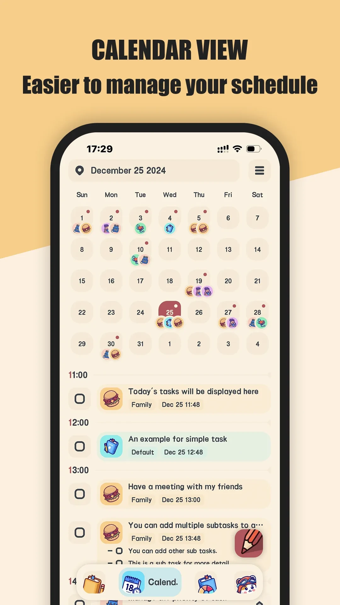{: width="180" .normal }
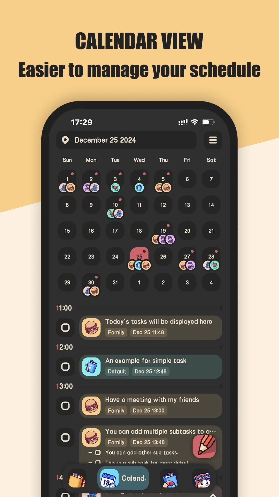{: width="180" .normal }
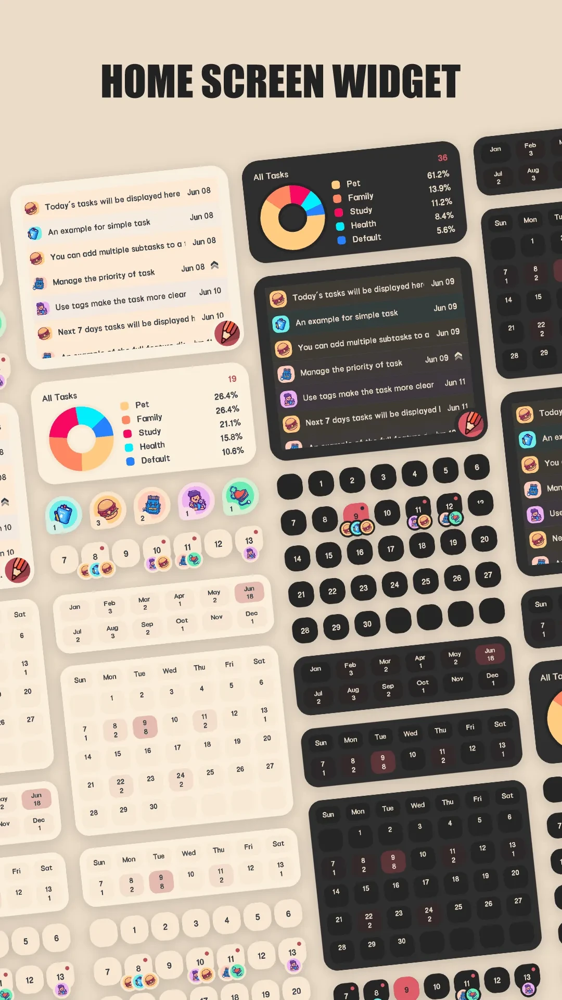{: width="180" .normal }

Pakej percuma membenarkan paling banyak 10 senarai, 10 tag dan 10 subtugas bagi setiap tugas, manakala jumlah keseluruhan tugas tidak dihadkan; tema gelap, kunci aplikasi, senarai, tag dan subtugas tanpa had, serta eksport CSV ialah item yang dibuka, dan senarai pengguna bukan premium memaparkan iklan. Tiada huraian bahasa semula jadi, tiada kerjasama dan penugasan, tiada satu ketikan siap dalam notifikasi, tiada lencana pencapaian, dan tiada selang peringatan berasingan. Semua "tiada" ini sejalan dengan kedudukannya yang tulen tempatan: memahami batasnya lebih mudah untuk menilai kesesuaian berbanding mengira jumlah suis tambahan.

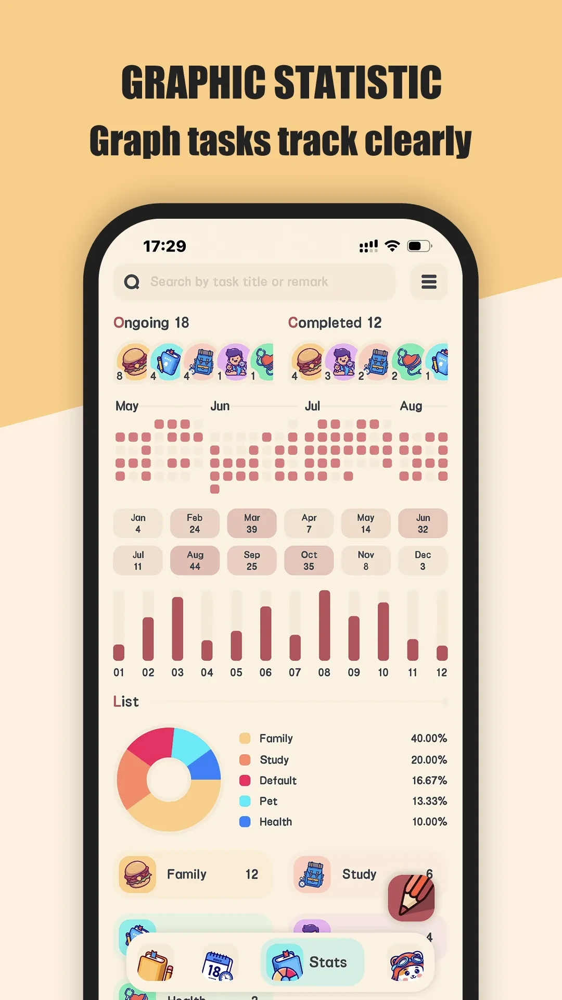{: width="180" .normal }
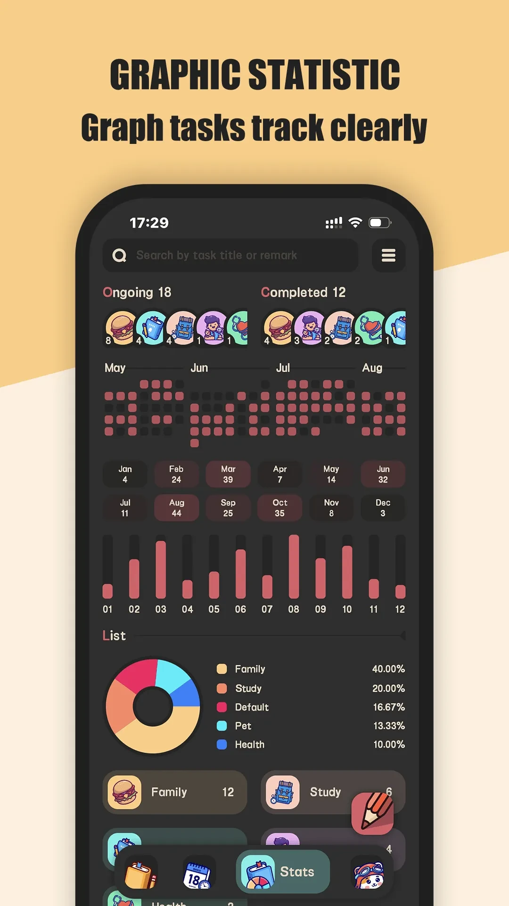{: width="180" .normal }
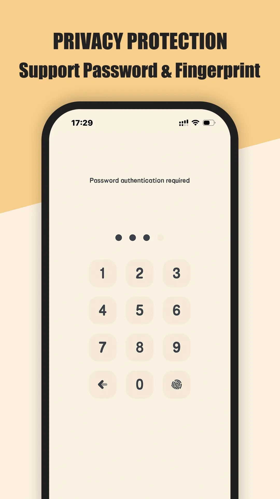{: width="180" .normal }

### Todoist: memendekkan tahap pertama sehabis mungkin

Kekuatan utama Todoist ada pada penangkapan: tambah pantas pintar memampatkan tarikh, keutamaan, projek dan label ke dalam satu ayat, dan halaman harga rasminya menyenaraikan "tambah pantas pintar" terus dalam pakej percuma. Untuk organisasi digunakan projek, subtugas, label dan penapis; paparan senarai serta papan tersedia, manakala susun atur kalendar dan jadual termasuk pakej berbayar.

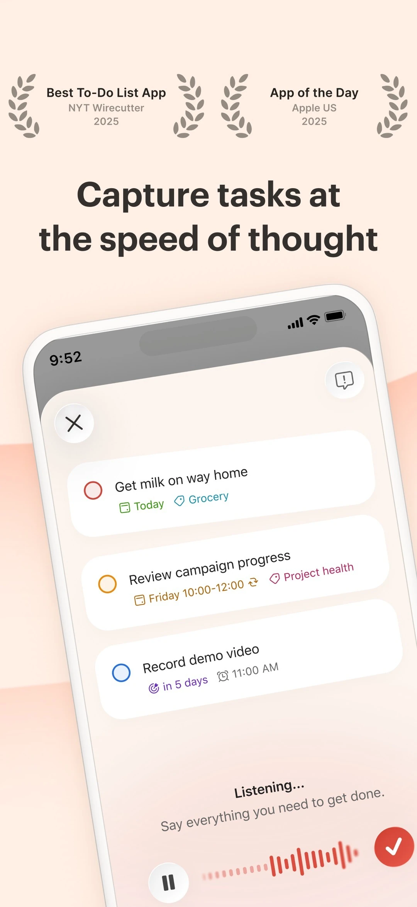{: width="180" .normal }
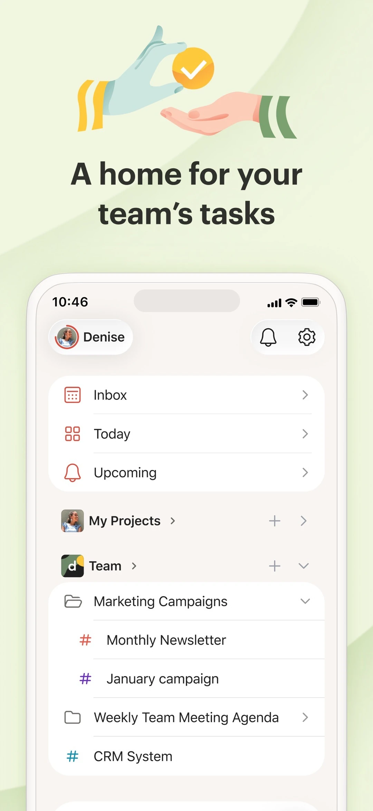{: width="180" .normal }
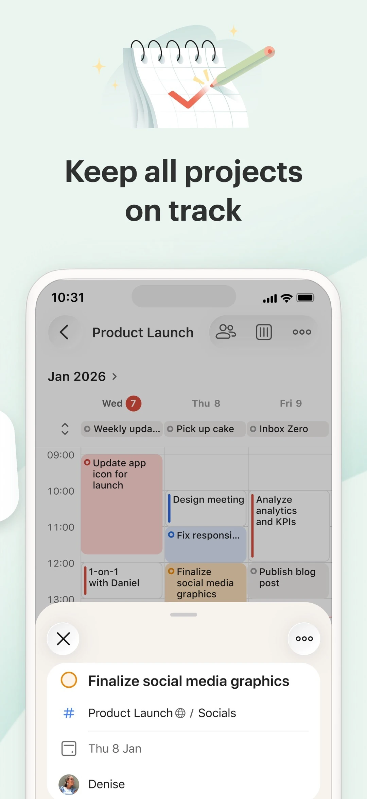{: width="180" .normal }

Halaman harga rasminya jelas: pakej percuma "Beginner" ada 5 projek peribadi, 3 paparan penapis dan sejarah aktiviti 1 minggu, termasuk peringatan tugas, tarikh jatuh tempo berulang dan label, tetapi **tidak termasuk** susun atur kalendar, peringatan tersuai, tempoh tugas dan sandaran automatik; Pro melalui langganan tahunan US$5/bulan (US$60/tahun) atau bulanan US$7/bulan membuka 300 projek peribadi, 150 penapis dan sejarah penuh. Kerjasama, penugasan tugas dan komen juga tersedia pada percuma, maksimum 5 orang bagi setiap projek peribadi. Ringkasnya, "catat sepintas lalu" dan "kerjasama merentas peranti" dibuat ringan, manakala tinjauan serta paparan lanjutan diletakkan di sebelah berbayar.

### TickTick: menjadikan pelaksanaan sebagai kalendar, tabiat dan fokus

TickTick memasukkan satu set alat pelaksanaan di luar senarai ke dalam satu aplikasi: paparan kalendar, papan, matriks keutamaan, pomodoro, penjejakan tabiat, kira detik dan widget — tangkapan skrin kedai rasminya hampir berupa senarai ciri.

{: width="180" .normal }
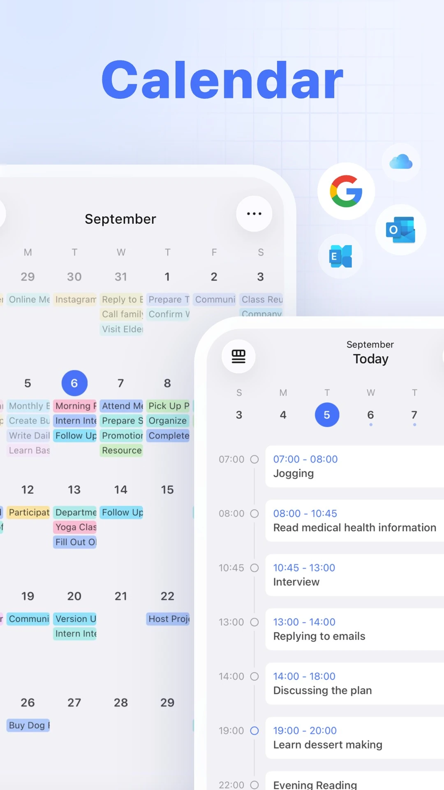{: width="180" .normal }
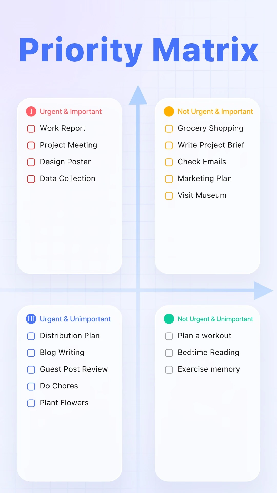{: width="180" .normal }

Kuota percumanya jatuh pada "bilangan senarai": halaman naik taraf rasmi menyatakan 9 senarai, 99 tugas setiap senarai, paparan senarai dan papan, peringatan tugas bahasa semula jadi serta penyegerakan merentas platform; Premium US$49.99/tahun menaikkannya kepada 299 senarai dan 999 tugas setiap senarai, serta membuka pelbagai paparan kalendar, tempoh tugas, peringatan e-mel dan tema. Jika yang anda mahu bukan sekadar "mencatat", tetapi menjadikan penyusunan, fokus dan tabiat berada di satu pintu, ini paling luas liputannya dalam kumpulan ini; sebaliknya, jika cuma mahu senarai yang tenang, modul-modul itu menjadi antara muka berlebihan.

### Microsoft To Do: "My Day" ialah penyusunan semula setiap hari

Microsoft To Do meletakkan beratnya pada tahap ketiga. Menurut penerangan rasmi, "My Day" ialah senarai peribadi yang bermula kosong setiap hari, dengan "Cadangan" memilih semula tugas; apa yang belum siap hari ini akan dicadangkan lagi esoknya. Ia turut bersambung dengan Outlook: e-mel bertanda boleh menjadi tugas, data tugas disegerakkan melalui Exchange, dan tugas boleh dipecah kepada langkah, diberi nota, dilampirkan fail sehingga 25 MB, serta diberi peringatan jatuh tempo sekali atau berulang.

{: width="180" .normal }
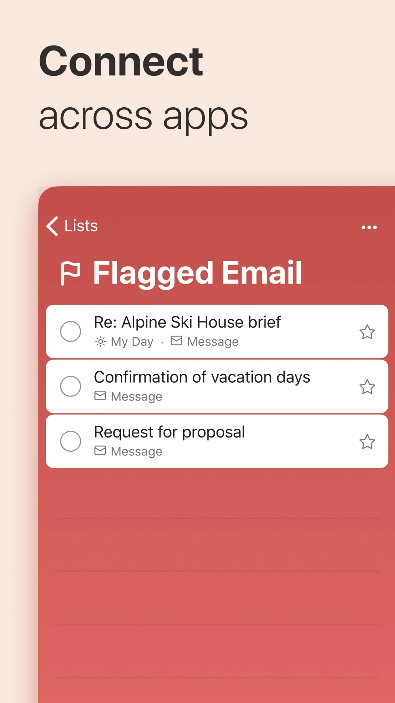{: width="180" .normal }

Ia disegerakkan secara percuma antara iPhone, Android, Windows dan Web, tanpa pakej berbayar berasingan dan tanpa hierarki rumit. Sesuai untuk orang yang sudah menjadikan peti mel sebagai meja kerja; kosnya keupayaan menyusun yang cetek, kurang selesa untuk projek panjang dan penapisan rumit.

### Things 3: menjadikan tahap kedua satu struktur

Things 3 satu-satunya dalam kumpulan ini yang menjadikan "struktur organisasi" sebagai perkara utama. Areas menampung bidang tanggungjawab jangka panjang, Projects menampung matlamat yang ada penghujung, dan dalam projek boleh dikumpulkan lagi dengan Headings; Today, Upcoming, Anytime, Someday dan Logbook membentuk perbendaharaan paparan yang jelas, dan tambah pantas boleh terus memuat nota, subtugas serta peringatan.

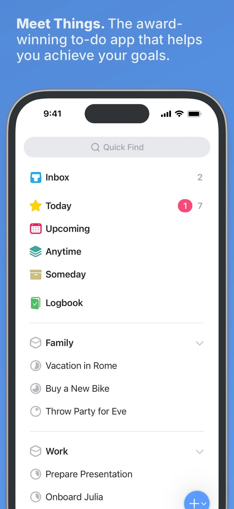{: width="180" .normal }
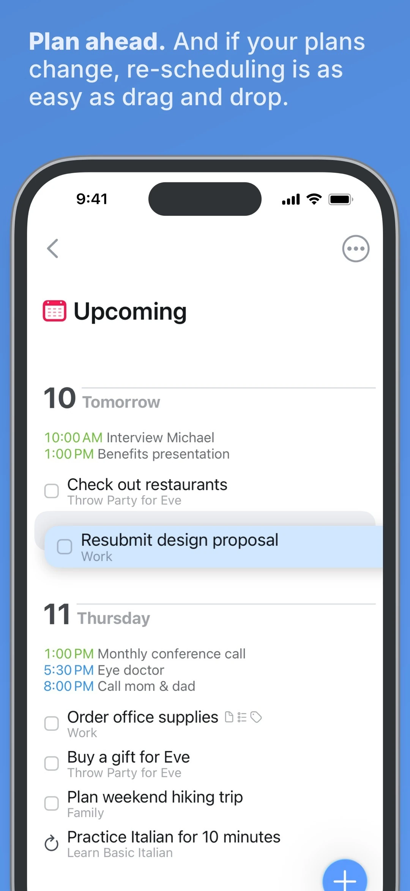{: width="180" .normal }
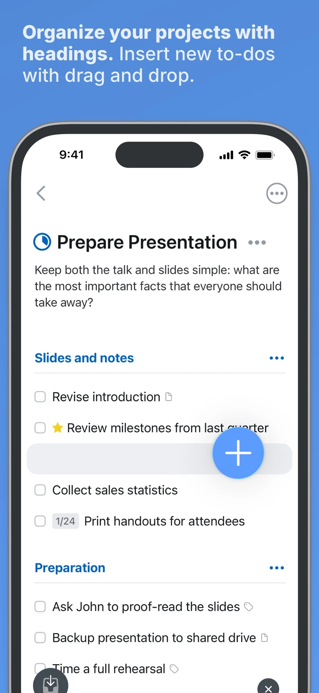{: width="180" .normal }

Ia dibeli sekali bagi setiap platform, bukan langganan (iPhone dan Apple Watch US$9.99, iPad US$19.99, Mac US$49.99, harga mengikut halaman rasmi), dengan penyegerakan Things Cloud antara peranti sendiri termasuk dalam pembelian tanpa langganan tambahan. Hadnya juga sangat jelas: ekosistem Apple sahaja, tiada Android atau Windows, tiada versi web, dan tiada kerjasama ramai. Peminatnya kebanyakannya kekal kerana struktur jangka panjang ini.

### Google Tasks: tertanam di tempat yang sudah anda guna

Google Tasks hampir menumpukan seluruh kosnya pada pintu masuk. Menurut penerangan rasmi, tugas boleh dicipta terus di bar sisi Gmail, Google Kalendar, Chat dan Docs; selepas diberi tarikh dan masa ia muncul secara automatik pada kalendar, dan tarikh akhir, ulangan pada tarikh tertentu serta subtugas turut disokong.

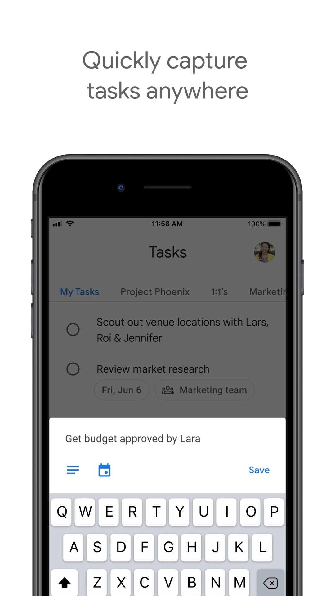{: width="180" .normal }
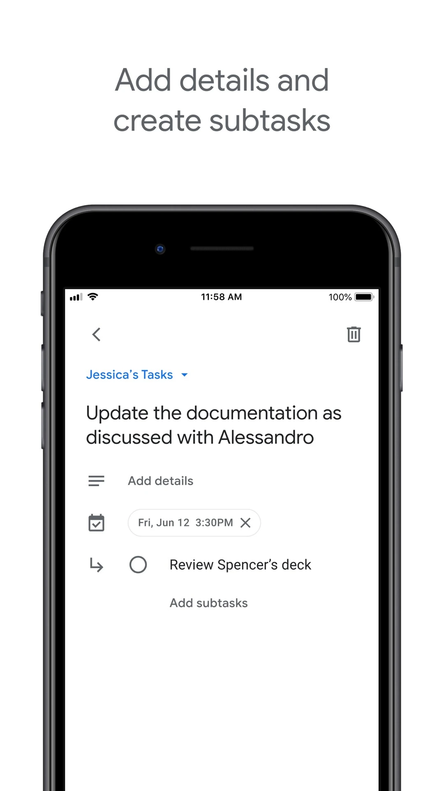{: width="180" .normal }

Pusat bantuan rasmi memberi angka kuota: paling banyak 100,000 tugas bagi semua senarai digabungkan, dan 20,000 tugas belum siap dalam satu senarai. Subtugasnya hanya satu aras, tiada tarikh sendiri, dan tiada keutamaan, papan atau statistik; apabila subtugas wujud, peraturan ulangan tidak boleh digunakan. Ia hadir percuma bersama akaun Google, tidak membicarakan data tempatan mahupun organisasi rumit — kedudukannya memang "catat sepintas lalu di sebelah e-mel".

### Any.do: meletakkan tugas ke dalam jadual hari itu

Any.do meletakkan senarai dan kalendar pada satu skrin, menekankan "apa yang perlu dibuat hari ini" berbanding "berapa banyak tugas wujud"; selain itu ada perancangan harian, tugas bersama dan papan kerjasama, penyegerakan merentas peranti, serta pakej berbayar untuk pasukan kecil.

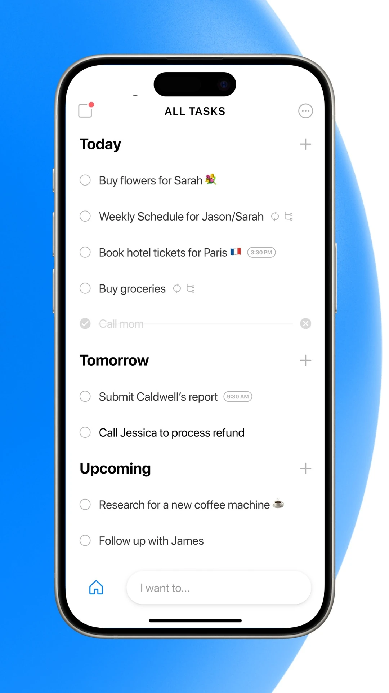{: width="180" .normal }
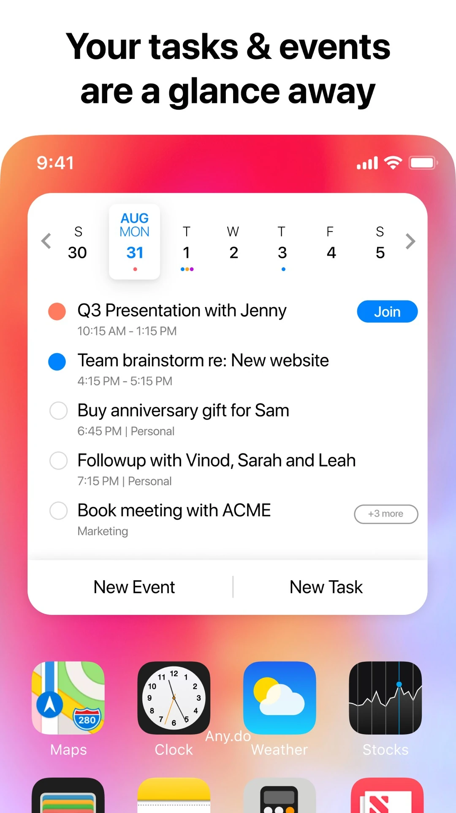{: width="180" .normal }

Seperti Microsoft To Do ia condong kepada "penjadwalan", tetapi lebih menekankan kerjasama dan nilai tambah langganan; pakej percuma tersedia, dengan hak dan harga mengikut halaman harga rasmi semasa. Jika anda kebanyakannya bekerja bersendirian dan tidak mahu memindahkan senarai ke dalam sistem langganan, semak dulu ciri mana yang termasuk pakej percuma.

## 5. Satu tugas menjadi apa dalam 7 aplikasi

Masukkan ayat pembuka tentang laporan suku tahunan yang jatuh tempo Rabu depan seadanya ke setiap aplikasi, bezanya boleh dimampatkan menjadi satu jadual:

| Produk | Apa berlaku semasa input | Masuk bekas mana | Selepas Rabu depan | Selepas ditanda | Di mana datanya |
|---|---|---|---|---|---|
| Meow Todo List | Tajuk teks biasa; tarikh, keutamaan, tag dan ulangan ditetapkan pada panel berasingan | Satu aras senarai, tag dan subtugas | Masuk kumpulan "Lewat Tempoh" dan ditanda, tidak digeser automatik | Masuk "Siap" dengan masa siap dicatat; tiada tong sampah | Pada peranti; sandaran penuh ke Google Drive atau WebDAV, eksport CSV premium |
| Todoist | Tambah pantas pintar menghurai tarikh dan projek | Projek, subtugas, label dan penapis | Kekal sebagai tugas belum siap, susun atur kalendar berbayar | Sejarah aktiviti (percuma 1 minggu), visualisasi produktiviti | Penyegerakan awan dengan akaun |
| TickTick | Input bahasa semula jadi, boleh tetapkan peringatan dan ulangan | Senarai, papan dan matriks keutamaan | Kelihatan pada paparan kalendar, boleh dipasangkan fokus dan pomodoro | Rekod siap ditambah statistik tabiat dan fokus | Penyegerakan merentas platform dengan akaun |
| Microsoft To Do | Ditambah manual atau daripada e-mel Outlook bertanda | Senarai rata dan langkah | Tugas belum siap masuk "Cadangan" esok hari | Kekal dalam senarai, boleh ditanda siap | Penyegerakan Exchange dan akaun Microsoft |
| Things 3 | Tambah pantas boleh membawa nota, subtugas dan peringatan | Kawasan, Projek, Tajuk Kecil | Kekal dalam garis masa Upcoming | Masuk rekod siap Logbook | Peranti Apple sahaja, penyegerakan Things Cloud |
| Google Tasks | Dicatat dari bar sisi Gmail, Kalendar, Chat atau Docs | Senarai rata dan satu aras subtugas | Tugas bertarikh dipaparkan pada kalendar | Kekal dalam senarai selepas ditanda siap | Akaun Google |
| Any.do | Ditambah manual, boleh masuk perancangan hari itu | Senarai, paparan kalendar dan papan bersama | Kelihatan bersebelahan kalendar | Status siap ditambah semakan perancangan harian | Penyegerakan merentas peranti dengan akaun |

Jadual ini sengaja hanya membandingkan ke mana satu tugas pergi. Bilangan ciri, gaya antara muka dan banyak tidaknya templat tidak mengubah sama ada tugas itu akan dilihat semula apabila diperlukan.

## 6. Platform, pembayaran dan pemilikan data

| Produk | Platform utama | Skema bayar (halaman rasmi 2026-11) | Perlu akaun | Data dan eksport |
|---|---|---|---|---|
| Meow Todo List | Android / iOS | Percuma dihadkan 10 senarai, 10 tag, 10 subtugas setiap tugas; tema gelap, kunci aplikasi, kuota tanpa had dan eksport CSV item yang dibuka | Tidak | Pada peranti; sandaran penuh boleh dihalakan ke WebDAV sendiri; tiada import |
| Todoist | Web / iOS / Android / desktop | Percuma 5 projek peribadi; Pro US$60/tahun atau US$7/bulan; Business mengikut orang | Ya | Penyegerakan awan; sandaran automatik berbayar |
| TickTick | Semua platform (termasuk Web, jam tangan) | Percuma 9 senarai, 99 tugas setiap senarai; Premium US$49.99/tahun | Ya | Penyegerakan merentas platform |
| Microsoft To Do | iPhone / Android / Windows / Web | Percuma, tiada pakej berbayar berasingan | Ya (akaun Microsoft) | Penyegerakan Exchange, mengikut ekosistem Microsoft 365 |
| Things 3 | iPhone / iPad / Mac / Apple Watch sahaja | Beli sekali bagi setiap platform, tiada langganan | Tidak | Penyegerakan Things Cloud antara peranti sendiri |
| Google Tasks | Gmail / Kalendar / Chat / Docs ditambah aplikasi mudah alih | Percuma bersama akaun Google | Ya | Akaun Google; had keseluruhan 100,000 tugas |
| Any.do | iPhone / Android / Mac / Windows / Web | Pakej percuma ditambah pakej langganan (mengikut halaman harga rasmi) | Ya | Penyegerakan merentas peranti |

## 7. Cari dulu tahap mana yang membuat anda tersekat

Jangan mula dengan "mana yang terbaik", lihat dulu pada tahap mana daripada lima tahap ini anda paling kerap tergelincir:

- **Selalu terlupa mencatat**: utamakan pintu masuk. Tambah pantas bahasa semula jadi (Todoist, TickTick), bar sisi Gmail (Google Tasks) dan widget tambah pantas pada skrin utama (Meow Todo List) semuanya memangkas kos kepada beberapa saat.
- **Sudah catat tetapi tidak jumpa**: masalahnya pada tahap kedua. Projek panjang pilih Things 3 atau Todoist; jika cuma perlu pengumpulan ringkas, senarai rata atau satu aras senarai memadai, tidak perlu membayar kos pembelajaran untuk hierarki yang tidak digunakan.
- **Sudah catat tetapi tidak dibuat**: masalahnya pada tahap ketiga. Penyusunan semula "My Day" setiap hari (Microsoft To Do), kalendar bersebelahan senarai (Any.do, TickTick) dan menanda lewat tempoh dengan jelas (Meow Todo List) ialah tiga jalan keluar berbeza.
- **Siap tetapi jejak hilang**: lihat tahap keempat dan kelima. Mahukan sejarah penuh pilih Todoist berbayar atau Logbook Things 3; Meow Todo List tiada tong sampah, pemadaman tidak boleh dibatalkan, ini perlu diketahui sejak awal.
- **Mengambil berat tentang pemilikan data**: tidak mahu mendaftar, mahu sandaran sendiri, Meow Todo List dan Things 3 (Apple sahaja) ialah dua hujungnya; kerap bertukar peranti dan perlukan penyegerakan langsung, produk bersandarkan akaun lebih mudah.

Masih ragu, mulakan dengan [panduan pemula Meow Todo List](/ms/posts/best-meow-todo-list-android/) dan [tutorial lengkap Meow Todo List](/ms/posts/tutorial-meow-todo-list/); jika lebih mengutamakan penggunaan luar talian, data tulen tempatan dan widget skrin utama, [halaman aplikasi Meow Todo List](/ms/apps/meow-todo-list/) memuat penerangan ciri yang lebih lengkap.

## 8. Enam tanggapan salah yang lazim

1. **"Lebih banyak ciri lebih konsisten"**: pomodoro, tabiat, papan dan kerjasama memang berguna, tetapi setiap modul tambahan bermaksud satu lagi tempat yang perlu dijaga. Gunakan satu dua minggu dulu untuk mencari tahap yang tersekat, baru putuskan sama ada mahu alat yang lebih berat.
2. **"Menulis senarai bermakna sudah maju"**: dapatan Masicampo dan Baumeister ialah "pelan konkret" mengurangkan fikiran yang menyelinap, bukan "membuat senarai" sama dengan menyiapkan tugas. Sebaiknya setiap butir memuat tindakan seterusnya, bukan cuma kata nama.
3. **"Tugas lewat tempoh patut automatik berpindah ke hari ini"**: menggeser automatik membuat "berapa hari terlepas" hilang daripada statistik. Menanda lewat tempoh dengan jelas sesuai untuk yang perlu semakan semula; menyusun semula setiap hari sesuai untuk yang tidak mahu ditindih catatan lama, jangan dicampurkan.
4. **"Pakej percuma bebas mencipta tugas"**: hadnya boleh jatuh pada bilangan senarai (Meow Todo List 10, TickTick 9), bilangan projek (Todoist 5), bilangan tugas setiap senarai (TickTick 99), atau pada subtugas dan panjang sejarah. Lihat dulu apa yang dihadkan sebelum menilai memadai atau tidak.
5. **"Tempatan bermaksud tidak selamat, awan bermaksud lebih mudah"**: tempatan tiada penyegerakan langsung, pertukaran peranti bergantung pada fail sandaran, tetapi rekod tidak melalui pelayan; awan mudah, harganya akaun dan data disimpan di pelayan. Ini pilihan, bukan soal baik atau buruk.

6. **"Tugas berulang sama dengan streak tabiat"**: dalam aplikasi tabiat, "baca setiap hari" ialah satu matlamat yang disiapkan berulang merentas kitaran, dan terlepas sehari memutuskan streak; dalam aplikasi senarai tugas, "bayar sewa pada 1 haribulan" setiap kali siap menjana tugas baharu yang berdiri sendiri. Mencampurkan dua-duanya menjadikan angka statistik hilang makna.

## 9. Pautan muat turun rasmi

Di sini hanya disenaraikan halaman kedai milik setiap produk, tanpa laman muat turun pihak ketiga. Pautan Google Play dibuka satu per satu untuk menyemak nama aplikasi, dan ID App Store disemak melalui Lookup API rasmi Apple bagi nama aplikasi serta pembangunnya (disemak November 2026); jika aplikasi bertukar nama atau kawasan edaran berubah, ikut hasil carian di kedai.

- **Meow Todo List**: [Google Play](https://play.google.com/store/apps/details?id=com.glgjing.money.task.todo.list.meow) · [App Store](https://apps.apple.com/app/id6742345495)
- **Todoist**: [Google Play](https://play.google.com/store/apps/details?id=com.todoist) · [App Store](https://apps.apple.com/app/id572688855)
- **TickTick**: [Google Play](https://play.google.com/store/apps/details?id=com.ticktick.task) · [App Store](https://apps.apple.com/app/id626144601)
- **Microsoft To Do**: [Google Play](https://play.google.com/store/apps/details?id=com.microsoft.todos) · [App Store](https://apps.apple.com/app/id1212616790)
- **Things 3**: [App Store](https://apps.apple.com/app/id904237743) · [Laman rasmi](https://culturedcode.com/things/); ekosistem Apple sahaja, **tiada versi Android**
- **Google Tasks**: [Google Play](https://play.google.com/store/apps/details?id=com.google.android.apps.tasks) · [App Store](https://apps.apple.com/app/id1353634006)
- **Any.do**: [Google Play](https://play.google.com/store/apps/details?id=com.anydo) · [App Store](https://apps.apple.com/app/id497328576)

## 10. Soalan lazim (FAQ)

**Adakah aplikasi senarai tugas, to-do list dan pengurus tugas itu jenis produk yang sama?**
{:.faq-q}

Secara garis besar ya, cuma sebutannya menekankan sisi berbeza: terasnya sentiasa "satu tugas, status siap, dan bilakah ia akan dilihat semula". Yang perlu dibezakan pula ialah sempadan dengan tiga alat lain — kalendar mengurus blok masa dengan mula dan tamat yang jelas, aplikasi tabiat mengurus tingkah laku berulang mengikut kitaran tanpa penghujung, nota menyimpan kandungan yang boleh disunting lama, manakala senarai tugas mengurus perkara yang **tamat selepas siap**. Memasukkan keempat-empatnya ke dalam satu alat selalunya langkah pertama ke arah senarai yang tidak terkawal.

**Seberapa terperinci satu tugas patut ditulis? Adakah semuanya perlu subtugas?**
{:.faq-q}

Ujinya ringkas: sebaik sahaja dilihat, bolehkah terus dibuat. Butir laporan suku tahunan biasanya perlu dipecah kepada beberapa tindakan, membalas e-mel ringkas tidak perlu. Dalam kebanyakan produk subtugas hanya satu aras dan tiada tarikh sendiri (begitu penerangan rasmi Google), jadi lebih sesuai menjadi senarai langkah berbanding projek bersarang; pakej percuma Meow Todo List membenarkan paling banyak 10 subtugas bagi setiap tugas, lebih daripada itu perlu dibuka. Daripada memecah semua tugas, pecah sahaja yang terus anda tangguhkan.

**Selepas tugas berulang siap, dari mana tugas seterusnya datang?**
{:.faq-q}

Ambil contoh Meow Todo List: apabila tugas semasa ditanda, dijana **tugas seterusnya yang benar-benar baharu**, dengan tajuk, nota, senarai, tag, keutamaan, peraturan ulangan dan subtugas turut disalin, subtugas ditetapkan semula kepada belum siap, masa rancangan berpindah ke kitaran sah seterusnya; kitaran yang sudah berlalu tanpa sempat diurus dilangkau supaya mendarat pada hari ini atau masa depan, dan boleh dihentikan mengikut tarikh atau bilangan. Tugas lama menjadi siap dan tidak berulang lagi. Sebab itu sejarahnya ialah rentetan rekod yang benar-benar pernah disiapkan, bukan satu tugas yang ditulis semula berkali-kali.

**Jika tarikh sudah lepas dan belum siap, adakah tugas automatik berpindah ke hari ini?**
{:.faq-q}

Tidak semestinya, dan di sinilah bezanya paling besar. Meow Todo List tidak menggeser automatik: tugas lewat tempoh dikumpulkan berasingan di "Lewat Tempoh" dan ditanda, sekali gus turut dibawa ke paparan hari ini. "My Day" Microsoft To Do bermula kosong setiap hari, yang belum siap hari ini masuk "Cadangan" esoknya. Yang pertama lejar untuk yang suka menyemak semula; yang kedua penyusunan semula harian untuk yang tidak mahu ditekan catatan lama. Putuskan dulu sama ada anda lebih takut terlepas atau lebih takut tertekan.

**Selepas bertukar telefon, adakah tugas lama masih ada?**
{:.faq-q}

Bergantung pada tempat data disimpan. Meow Todo List tulen tempatan dan tiada akaun, jadi pertukaran peranti bergantung pada sandaran serta pemulihan seluruh pangkalan data, dengan Google Drive atau alamat WebDAV sendiri, dan sandaran automatik boleh ditetapkan; eksport CSV selepas penapisan mengikut senarai, tag, keutamaan dan julat tarikh ialah ciri premium, tanpa import yang sepadan. Todoist, TickTick, Microsoft To Do, Google Tasks dan Any.do menggunakan penyegerakan awan berasaskan akaun supaya pertukaran peranti lebih mudah; Things 3 menyegerakkan antara peranti Apple sendiri melalui Things Cloud. Apa pun pilihannya, sebelum bertukar telefon pastikan sandaran atau penyegerakan benar-benar pernah berjalan.

**Adakah pakej percuma memadai? Biasanya hadnya di mana?**
{:.faq-q}

Yang dihadkan berbeza-beza, jadi jangan sekadar mengira "berapa tugas boleh dicipta". Meow Todo List menghadkan 10 senarai, 10 tag dan 10 subtugas bagi setiap tugas, **jumlah keseluruhan tugas tidak dihadkan**; TickTick menyatakan secara rasmi 9 senarai percuma dan 99 tugas setiap senarai; Todoist percuma memberi 5 projek peribadi, 3 penapis dan sejarah aktiviti 1 minggu, dengan susun atur kalendar serta sandaran automatik pada pakej berbayar; angka rasmi Google ialah 100,000 tugas bagi semua senarai digabungkan dan 20,000 belum siap bagi setiap senarai. Lihat dulu had mana yang paling mudah anda langgar sebelum memutuskan untuk berbayar.

**Bolehkah menulis tarikh dan masa terus pada tajuk lalu biarkan aplikasi menghurainya?**
{:.faq-q}

Bergantung pada produk. Todoist dan TickTick kedua-duanya menyenaraikan tambah pantas bahasa semula jadi sebagai keupayaan percuma, satu ayat boleh memunculkan tarikh dan peraturan ulangan; Meow Todo List tiada huraian bahasa semula jadi, tajuknya teks biasa, dan tarikh, keutamaan, tag serta ulangan dipilih pada panel berasingan, kelebihannya tiada kekaburan huraian dan apa yang ditulis itulah yang disimpan. Selain itu masa peringatannya sama dengan masa rancangan tugas, tanpa tetapan "ingatkan 10 minit sebelum" yang berasingan, ditambah ringkasan harian pada masa tetap.

**Bolehkah digunakan luar talian dan tanpa akaun?**
{:.faq-q}

Meow Todo List boleh: tugas, senarai dan tag disimpan pada peranti serta boleh digunakan luar talian; kosnya tiada penyegerakan masa nyata berbilang peranti dan pertukaran peranti perlu melalui fail sandaran. Things 3 juga tidak perlu akaun, tetapi hanya pada peranti Apple. Produk lain bermula dengan akaun; ketika luar talian biasanya masih boleh melihat atau menyunting sementara, tetapi fungsi penuh bergantung pada penyegerakan selepas log masuk. Untuk benar-benar tempatan, semak juga sama ada eksport dan sandaran tersedia — itu yang menentukan sama ada beberapa tahun lagi data masih boleh dibawa pergi.

## 11. Bacaan lanjutan dan indeks istilah

- [Tinjauan aplikasi senarai tugas dan pengurus tugas Android (2026)](/ms/posts/pillar-todo-list-task-manager-apps-android/)
- [Meow Todo List vs Todoist: di mana bezanya](/ms/posts/vs-meow-todo-and-todoist/)
- [Panduan pemula Meow Todo List](/ms/posts/best-meow-todo-list-android/)
- [Tutorial lengkap Meow Todo List](/ms/posts/tutorial-meow-todo-list/)
- [Istilah: apa itu subtugas](/ms/glossary/what-is-a-subtask/)
