หากคุณอยากนำทางบนจอโดยไม่มีปุ่มกายภาพ [ทางเลือก Assistive Touch](/th/glossary/what-is-a-floating-window/) นี้เริ่มจากลูกบอลลอยเรียบง่ายไปจนโอเวอร์เลย์เต็มและควบคุมท่าทาง (ผู้ใช้ iPhone: **AssistiveTouch ถูกฝังใน iOS แล้ว** — ตั้งค่า > การเข้าถึง > การสัมผัส > AssistiveTouch — จึงไม่ต้องใช้แอป)

ด้านล่างเราเปรียบเทียบเครื่องมือ Android หกตัวตามราคา ความสามารถ และเรื่องที่สำคัญจริง เพื่อให้คุณเลือกตัวที่ถูก ส่วนใหญ่ผู้อ่านมาพร้อมข้อจำกัดเดียว — โฆษณามากเกินไป ฟีเจอร์จำกัด หรือสิทธิ์กว้างเกินไป — จึงจัดแต่ละตัวตามเหตุผลนั้น

## ทำไมจึงมองข้ามแอป Assistive Touch พื้นฐาน

- **แอปฟรีเต็มโฆษณา** ที่รบกวนประสบการณ์โอเวอร์เลย์สงบ
- **จำกัดแค่ปุ่มเสมือน** — ไม่มีนาฬิกา ไม่มีตัวตรวจสอบ ไม่มีเพิ่มเติม
- **สิทธิ์การช่วยเหลือพิเศษกว้าง** กับแนวปฏิบัติข้อมูลคลุมเครือในบางโคลน
- คุณอาจต้องการ **ท่าทางหรือแมปปุ่มกายภาพใหม่** แทนลูกบอลลอย
- ทางเลือกดีรวม **เครื่องมือลอยมีประโยชน์มากกว่า** ในที่เดียว

## ทางเลือก Assistive Touch ที่ดีที่สุดแบบคร่าวๆ

{: width="180" .normal }
{: width="180" .normal }
{: width="180" .normal }
{: width="180" .normal }
{: width="180" .normal }

| แอป | ราคา (2026) | แกนกลาง | เพิ่มเติม |
|---|---|---|---|
| **Floating Assistant** | แกนฟรี + ปลดล็อก | Assistive touch | นาฬิกาลอย + ตัวตรวจสอบเรียลไทม์ |
| **Easy Touch** | ฟรี (โฆษณา) | ลูกบอลสไตล์ iOS | ปุ่มเสมือน ท่าทาง |
| **Assistive Touch, Easy Tools** | ฟรี (โฆษณา) | แถบนำทาง | ตัวสลับด่วน จับภาพหน้าจอ |
| **Button Mapper** | ฟรี + Pro | แมปปุ่มกายภาพใหม่ | การกระทำปุ่มที่กำหนดเอง |
| **All in One Gestures** | ฟรี + Pro | ควบคุมท่าทาง | ซ่อนปุ่มซอฟต์ |
| **Assistive Touch** | ฟรี (โฆษณา) | สัมผัสลอย | ปุ่มเสมือน ตั้งค่าด่วน |

---

### 1. Floating Assistant — ดีสุดแบบครบจบ

{: width="180" .normal }
{: width="180" .normal }
{: width="180" .normal }
{: width="180" .normal }
{: width="180" .normal }

Floating Assistant นำ **assistive touch นาฬิกาลอย และตัวตรวจสอบระบบลอย** มาบนจอ Android ของคุณ ให้คุณควบคุมโทรศัพท์จากโอเวอร์เลย์เดียวที่สะดวก

**จุดแข็ง**
- **ลูกบอล assistive touch** พร้อมปุ่มเสมือน หน้าหลัก ย้อนกลับ แอปล่าสุด และระดับเสียง boost หนึ่งแตะ ล็อกจอ จับภาพหน้าจอ ไฟฉาย และเข้าแอปด่วน
- **นาฬิกาและนับถอยหลังลอย** เหนือแอปอื่น — สะดวกขณะจอเต็ม
- **ตัวตรวจสอบลอย** แสดงอุณหภูมิ CPU การใช้ RAM และแบตเตอรี่เรียลไทม์ พร้อม boost หนึ่งแตะ — เหมาะขณะเล่นเกม
- **ใช้บริการการช่วยเหลือพิเศษเฉพาะสำหรับควบคุมที่ลงทะเบียน** และไม่เก็บข้อมูลส่วนตัวหรือข้อมูลละเอียดอ่อน
- ปกป้องปุ่มกายภาพและทำงานดีบนโทรศัพท์จอกว้าง
- แกนฟรีพร้อมปลดล็อกสำหรับการปรับแต่งเพิ่มเติม

**จุดอ่อน**
- แค่ Android — ไม่มีแอป iOS
- บางธีมและตัวตรวจสอบเพิ่มเติมอยู่หลังปลดล็อก
- เลเยอร์ลอยกินพื้นที่จอเล็กน้อย

**เหมาะสำหรับ:** ผู้ใช้ที่อยากโอเวอร์เลย์เดียวมีปุ่ม นาฬิกา และการตรวจสอบ

**ดาวน์โหลด Floating Assistant**
- [Google Play](https://play.google.com/store/apps/details?id=com.glgjing.floating.apps.assistive.touch.pro)

---

### 2. Easy Touch — ดีสุดลูกบอลสไตล์ iOS

Easy Touch คือ **ลูกบอล assistive สไตล์ iOS** ยอดนิยมสำหรับ Android พร้อมนำทางเสมือน ตัวสลับด่วน ท่าทาง และธีมที่เลียนแบบ AssistiveTouch iPhone

**จุดแข็ง**
- **ลูกบอลลอย** พร้อมควบคุม หน้าหลัก ย้อนกลับ แอปล่าสุด และระดับเสียง
- **ตัวสลับด่วน** สำหรับ Wi-Fi Bluetooth ไฟฉาย ความสว่างจอ และโหมดเสียง
- **ท่าทาง** (แตะสองครั้ง กดค้าง) เพื่อเรียกการกระทำ
- **ธีม** อัปเดตสม่ำเสมอเพื่อปรับลูกบอล
- ใช้ฟรี

**จุดอ่อน**
- **มีโฆษณา** ซึ่งรบกวนได้
- ไม่มีนาฬิกาลอยหรือตัวตรวจสอบระบบ
- การปรับแต่งลึกเบากว่า Floating Assistant

**เหมาะสำหรับ:** ผู้ใช้ที่เฉพาะเจาะจงอยากลูกบอลลอยสไตล์ iPhone

**ดาวน์โหลด Easy Touch**
- [Google Play](https://play.google.com/store/apps/details?id=com.easytouch.assistivetouch)

---

### 3. Assistive Touch, Easy Tools — ดีสุดตัวสลับด่วน

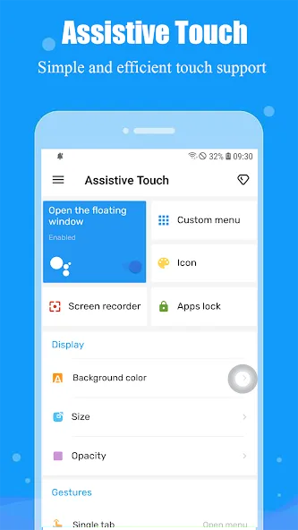{: width="180" .normal }
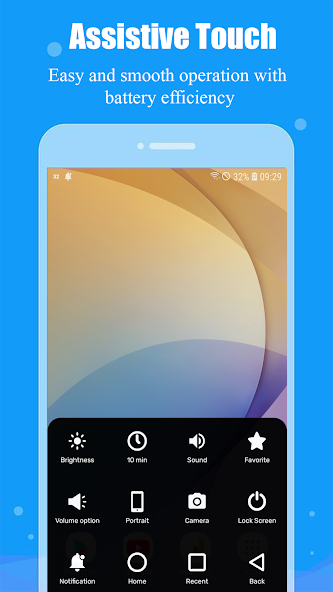{: width="180" .normal }
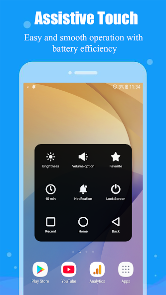{: width="180" .normal }
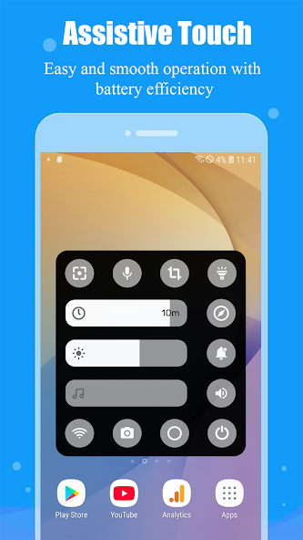{: width="180" .normal }

Assistive Touch, Easy Tools เพิ่ม **โอเวอร์เลย์แถบนำทาง** พร้อม recent/หน้าหลัก/ย้อนกลับ พลัสชุดตัวสลับด่วน จับภาพหน้าจอ และบันทึกหน้าจอ

**จุดแข็ง**
- **ควบคุมนำทาง** (recent หน้าหลัก ย้อนกลับ) โดยไม่มีปุ่มกายภาพ
- **ตัวสลับด่วน** สำหรับ Wi-Fi Bluetooth ไฟฉาย พลังงาน โหมดเครื่องบิน ตำแหน่ง
- ปรับแต่ง **ความสว่าง/ระดับเสียง** และตัวเปิดแอปโปรด
- ทางลัด **จับภาพหน้าจอและบันทึกหน้าจอ**
- ฟรีพร้อมโฆษณา

**จุดอ่อน**
- ชั้นฟรีมีโฆษณา
- ไม่มีนาฬิกาลอยหรือตัวตรวจสอบ
- โอเวอร์เลย์อาจแน่นด้วยตัวสลับมากมาย

**เหมาะสำหรับ:** ผู้ใช้ที่อยากการตั้งค่าด่วนมากที่สุดในแผงเดียว

**ดาวน์โหลด Assistive Touch, Easy Tools**
- [Google Play](https://play.google.com/store/apps/details?id=mtr.assistivetouch.easytools)

---

### 4. Button Mapper — ดีสุดแมปปุ่มกายภาพใหม่

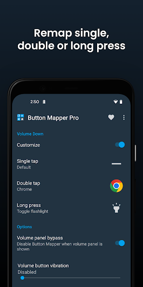{: width="180" .normal }
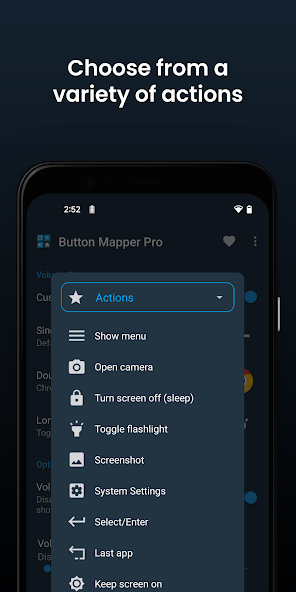{: width="180" .normal }
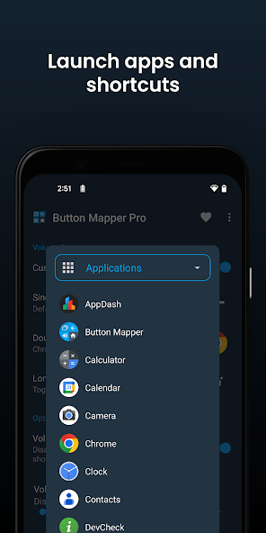{: width="180" .normal }
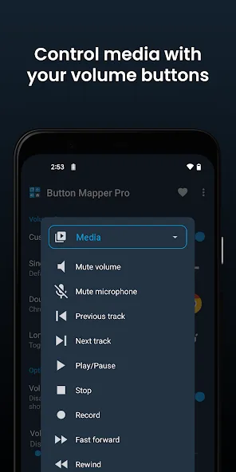{: width="180" .normal }
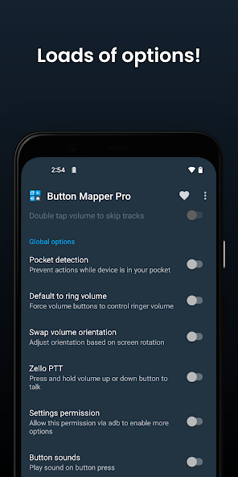{: width="180" .normal }

Button Mapper **แมปปุ่มกายภาพของคุณใหม่** (ระดับเสียง Bixby และอื่นๆ) ไปยังการกระทำที่กำหนดเอง — วิธีต่างสำหรับ "ควบคุมการเข้าถึง" ที่ไม่ต้องลูกบอลลอยเลย

**จุดแข็ง**
- **แมปปุ่มกายภาพใหม่** เพื่อเปิดแอป สลับไฟฉาย จับภาพหน้าจอ ควบคุมสื่อ และอื่นๆ
- **ทำงานโดยไม่มีโอเวอร์เลย์** จึงไม่มีอะไรลอยบนจอคุณ
- ดีสำหรับ **ปุ่มพังหรือ awkward** และความต้องการการเข้าถึง
- นักพัฒนาน่าเชื่อถือ (เดียวกับ DevCheck) ฟรีพร้อมอัปเกรด Pro
- ไม่มีโฆษณาในประสบการณ์แกน

**จุดอ่อน**
- ไม่ใช่ลูกบอล assistive ลอย — กระบวนทัศน์ต่าง
- บางปุ่มและการกระทำต้องเวอร์ชัน Pro
- การตั้งค่าเทคนิคกว่าลูกบอลเรียบง่าย

**เหมาะสำหรับ:** ผู้ใช้ที่ชอบใช้ปุ่มจริงมากกว่าไอคอนลอย

**ดาวน์โหลด Button Mapper**
- [Google Play](https://play.google.com/store/apps/details?id=flar2.homebutton)

---

### 5. All in One Gestures — ดีสุดควบคุมท่าทาง

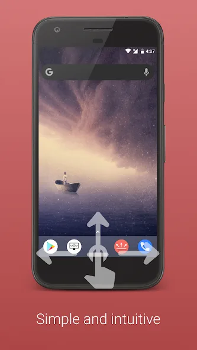{: width="180" .normal }
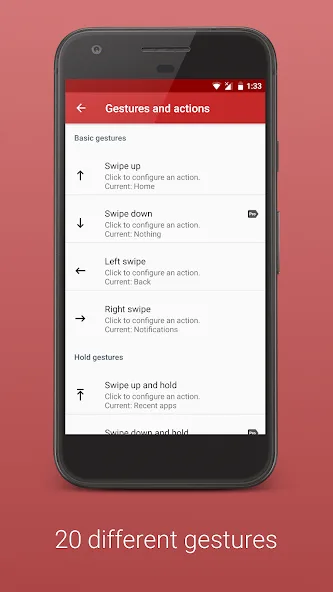{: width="180" .normal }
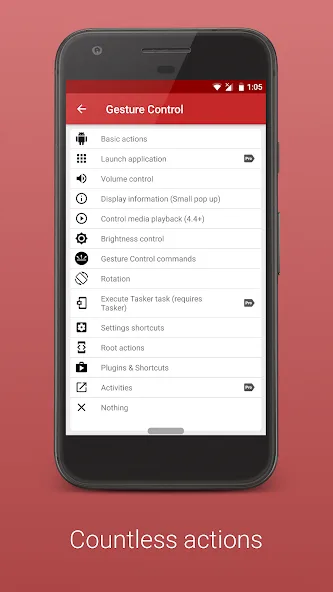{: width="180" .normal }
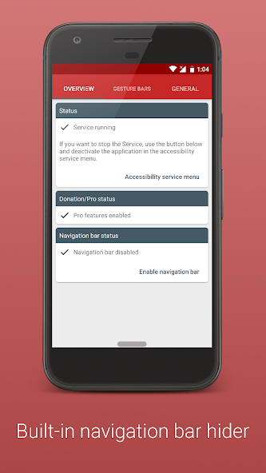{: width="180" .normal }
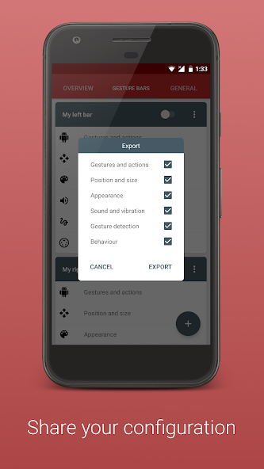{: width="180" .normal }

All in One Gestures ให้คุณ **ซ่อนปุ่มซอฟต์และควบคุมอุปกรณ์ด้วยท่าทาง** — ปัด หนีบ และอื่นๆ — สำหรับประสบการณ์สะอาดไร้ปุ่ม

**จุดแข็ง**
- **ควบคุมท่าทาง** (ปัด หนีบ กดค้าง) เพื่อเรียกการกระทำ
- **ซ่อนแถบนำทาง** สำหรับความรู้สึกจอเต็ม ดืดด่ำ
- แมปท่าทาง-เป็น-การกระทำที่ปรับแต่งได้
- เบาและเสถียร
- ฟรีพร้อมอัปเกรด Pro

**จุดอ่อน**
- เส้นเรียนรู้ท่าทางสำหรับผู้ใช้ใหม่
- ไม่มีนาฬิกาลอยหรือตัวตรวจสอบ
- น้อย "assistive" สำหรับผู้อยากปุ่มมองเห็น

**เหมาะสำหรับ:** ผู้ใช้ที่ชอบท่าทางมากกว่าลูกบอลลอย

**ดาวน์โหลด All in One Gestures**
- [Google Play](https://play.google.com/store/apps/details?id=com.conena.navigation.gesture.control)

---

### 6. Assistive Touch — ดีสุดสัมผัสลอยเรียบง่าย

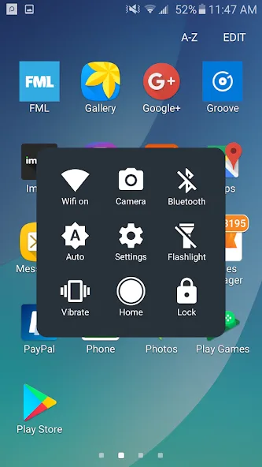{: width="180" .normal }
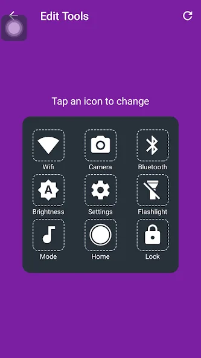{: width="180" .normal }
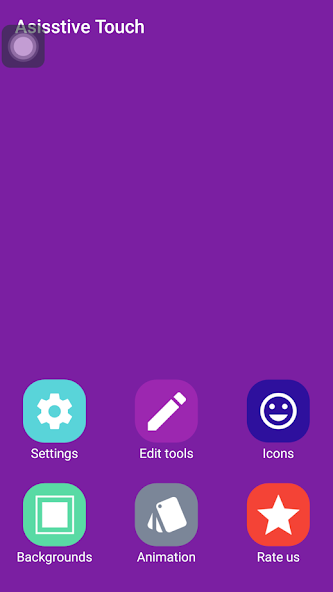{: width="180" .normal }

Assistive Touch (smarttool) คือ **แอปสัมผัสลอยตรงไปตรงมา** พร้อมปุ่มเสมือนและตั้งค่าด่วน ใกล้เคียงประสบการณ์ AssistiveTouch คลาสสิก

**จุดแข็ง**
- **ปุ่มสัมผัสลอย** พร้อม หน้าหลัก/ย้อนกลับ/แอปล่าสุด และระดับเสียง
- ทางลัด **ตั้งค่าด่วน** สำหรับตัวสลับทั่วไป
- เลย์เอาต์เรียบง่าย คุ้นเคย
- ใช้ฟรี
- เปิดและซ่อนง่าย

**จุดอ่อน**
- มีโฆษณา
- ของเพิ่มน้อยกว่า (ไม่มีนาฬิกา/ตัวตรวจสอบ) เทียบ Floating Assistant
- UI สไตล์โคลนด้วยธีมจำกัด

**เหมาะสำหรับ:** ผู้ใช้ที่อยากพฤติกรรมสัมผัสลอยคลาสสิก ไม่มากกว่านั้น

**ดาวน์โหลด Assistive Touch**
- [Google Play](https://play.google.com/store/apps/details?id=com.wanata.assistive.touch)

---

## เปรียบเทียบความสามารถหลัก

| ความสามารถ | Floating Assistant | Easy Touch | Assistive Touch, Easy Tools | Button Mapper | All in One Gestures | Assistive Touch |
|---|---|---|---|---|---|---|
| **แพลตฟอร์ม** | Android | Android | Android | Android | Android | Android |
| **ลูกบอล assistive ลอย** | ใช่ | ใช่ | ใช่ (แถบ nav) | ไม่ (กายภาพ) | ไม่ (ท่าทาง) | ใช่ |
| **หน้าหลัก/ย้อนกลับ/แอปล่าสุด เสมือน** | ใช่ | ใช่ | ใช่ | ผ่านปุ่ม | ผ่านท่าทาง | ใช่ |
| **ระดับเสียง / ตัวสลับด่วน** | ใช่ | ใช่ | ใช่ | ใช่ (แมป) | ใช่ (แมป) | ใช่ |
| **Boost หนึ่งแตะ / cleaner** | ใช่ | ไม่ | ไม่ | ไม่ | ไม่ | ไม่ |
| **จับภาพหน้าจอ / ไฟฉาย** | ใช่ | ใช่ | ใช่ | แมปได้ | แมปได้ | บางส่วน |
| **นาฬิกาลอย** | ใช่ | ไม่ | ไม่ | ไม่ | ไม่ | ไม่ |
| **ตัวตรวจสอบระบบลอย** | ใช่ (CPU/RAM/แบตเตอรี่) | ไม่ | ไม่ | ไม่ | ไม่ | ไม่ |
| **ท่าทาง** | บางส่วน | ใช่ | บางส่วน | ไม่ | ใช่ (แข็งแกร่ง) | บางส่วน |
| **ทางลัด/แอปที่กำหนดเอง** | ใช่ | ใช่ | ใช่ | ใช่ (ปุ่ม) | ใช่ (ท่าทาง) | ใช่ |
| **ท่าทีความเป็นส่วนตัว** | แข็งแกร่ง (ไม่มีข้อมูล) | ระวัง (โฆษณา) | ระวัง (โฆษณา) | แข็งแกร่ง | แข็งแกร่ง | ระวัง (โฆษณา) |
| **โฆษณา / IAP** | แกนฟรี | โฆษณา | โฆษณา | ฟรี + Pro (ไม่โฆษณา) | ฟรี + Pro | โฆษณา |
| **ชั้นฟรี** | ใจกว้าง | ใช่ | ใช่ | ใช่ | ใช่ | ใช่ |

---

## วิธีเลือก

- อยาก **ปุ่ม + นาฬิกา + ตัวตรวจสอบเรียลไทม์ในโอเวอร์เลย์เดียว** → **Floating Assistant**
- อยาก **ลูกบอลลอยสไตล์ iPhone** → **Easy Touch**
- อยาก **ตัวสลับด่วนมากสุดในแผง** → **Assistive Touch, Easy Tools**
- ชอบ **ใช้ปุ่มจริง** → **Button Mapper**
- ชอบ **ท่าทางมากกว่าลูกบอล** → **All in One Gestures**
- อยาก **สัมผัสลอยคลาสสิกเรียบง่าย** → **Assistive Touch**

## ทางเลือก Assistive Touch ตัวไหนเหมาะกับผู้ใช้แต่ละแบบ

ตารางเปรียบเทียบจัดอันดับความสามารถ; ส่วนนี้เริ่มจากการตั้งค่าที่คุณทิ้งไว้

| หากคุณมาจาก... | เลือก | เหตุผลที่เข้ากัน |
|---|---|---|
| ลูกบอลลอยสไตล์ iOS บนโทรศัพท์สูง | **Floating Assistant** | ลูกบอลลอยขอบจอคงในเอื้อมนิ้วหัวแม่มือ และโอเวอร์เลย์เดียวกันเพิ่มนาฬิกาลอยและค่า CPU/RAM/แบตเตอรี่เรียลไทม์ |
| แมปปุ่มกายภาพใหม่ | **Button Mapper** | ปุ่มระดับเสียงยังทำงานจริงโดยไม่มีอะไรวาดเหนือแอปคุณ |
| นำทางท่าทางและไม่มีลูกบอลเลย | **All in One Gestures** | การปัดขอบแทนแถบนำทาง จึงจอคงสะอาด |
| โคลนเต็มโฆษณาพร้อมสิทธิ์คลุมเครือ | **Floating Assistant** หรือ **Button Mapper** | แกนฟรีไม่เก็บข้อมูลส่วนตัว และบริการการช่วยเหลือพิเศษใช้เฉพาะสำหรับการกระทำที่คุณเปิดใช้งาน |
| AssistiveTouch บน iPhone | ไม่ต้องติดตั้ง | AssistiveTouch ถูกฝังใน iOS แล้ว จึงไม่มีอะไรต้องแทนบนแพลตฟอร์มนั้น |

ก่อนตกลงใจบนแอปลูกบอลลอยใดก็ตาม ตรวจสองเรื่อง: การกระทำใดต้องใช้ **บริการการช่วยเหลือพิเศษ** จริง และลูกบอลสามารถจอดในโซนเอื้อมนิ้วหัวแม่มือบนจอสูงได้หรือไม่ สองการตรวจนี้แยกตัวช่วยมือเดียวที่ใช้ได้จริง ออกจากโอเวอร์เลย์ที่คุณปิดท้ายที่สุด

## วิธีโยกย้ายไปทางเลือก Assistive Touch ที่ดีกว่า

1. **กำหนดสไตล์ของคุณ** — ลูกบอลลอย แมปกายภาพ หรือท่าทาง — แล้วเลือกจากตาราง
2. **ติดตั้งและให้สิทธิ์**: แสดงเหนือแอปอื่นสำหรับโอเวอร์เลย์ และการช่วยเหลือพิเศษสำหรับการกระทำปุ่ม/ท่าทาง
3. **ปรับแต่งลูกบอลหรือท่าทาง** — เพิ่มแอป ตัวสลับ และจับภาพหน้าจอที่ใช้บ่อยสุด
4. **เปิดของเพิ่มที่จะใช้** — นาฬิกา/ตัวตรวจสอบ Floating Assistant หรือทางลัดปุ่มระดับเสียง Button Mapper
5. **ทบทวนความเป็นส่วนตัว**: ให้ความสำคัญแอปที่ไม่เก็บข้อมูล (Floating Assistant Button Mapper All in One Gestures) แทนโคลนเต็มโฆษณา

## คำถามที่พบบ่อย

**Floating Assistant คือทางเลือก Assistive Touch ที่ดีที่สุดไหม?**
{:.faq-q}
หากคุณอยากโอเวอร์เลย์เดียวมี assistive touch + นาฬิกาลอย + การตรวจสอบ CPU/RAM/แบตเตอรี่เรียลไทม์พร้อม boost หนึ่งแตะ แน่นอน — ห้าตัวอื่นเป็นงานเดี่ยว (ลูกบอล ท่าทาง หรือแมปกายภาพ) โดยไม่มีนาฬิกาหรือตัวตรวจสอบ

**ทางเลือก Assistive Touch ตัวไหนมีนาฬิกาลอยและตัวตรวจสอบ?**
{:.faq-q}
แค่ Floating Assistant Easy Touch Assistive Touch และอื่นๆ เสนอปุ่มเสมือนหรือท่าทาง แต่ไม่มีนาฬิกาและไม่มีค่าระบบเรียลไทม์

**ทางเลือก Assistive Touch ตัวไหนเลี่ยงโฆษณา?**
{:.faq-q}
Floating Assistant (แกนฟรี ปลดล็อกเลือกได้) Button Mapper และ All in One Gestures (ฟรี + Pro ไม่โฆษณา) คือตัวเลือกเป็นมิตรโฆษณา; โคลน Easy Touch / Assistive Touch มีโฆษณา

**มี Assistive Touch สำหรับ iPhone ไหม?**
{:.faq-q}
มี — AssistiveTouch ถูกฝังใน iOS แล้ว (ตั้งค่า > การเข้าถึง > การสัมผัส > AssistiveTouch) จึงไม่ต้องใช้แอบน iPhone

[รับ Floating Assistant](/th/apps/floating-assistant/) — มีให้บน Android

## ศัพท์ที่เกี่ยวข้อง

- [Assistive Touch คืออะไร?](/th/glossary/what-is-assistive-touch/)
- [หน้าต่างลอยคืออะไร?](/th/glossary/what-is-a-floating-window/)
