Calm ได้รับความนิยม แต่ **สมาชิก ~$69.99/ปี** ของมันไม่เหมาะกับทุกคน หากสิ่งที่คุณต้องการส่วนใหญ่คือ **เสียงแอมเบียนต์สำหรับนอนและโฟกัส** มีทางเลือกที่เรียบง่ายกว่า ถูกกว่า และมักไม่ต้องบัญชี

ด้านล่างเราเปรียบเทียบหก **ทางเลือก Calm** — จากแอป [ไวต์นอยส์](/th/glossary/what-is-white-noise/) เรียบง่ายน่ารัก ถึงคลังเสียงมหึมาและชุมชนสมาธิ — ด้านราคา แพลตฟอร์ม และความสามารถที่ตัดสินจริง ผู้อ่านส่วนใหญ่มาพร้อมอุปสรรคหนึ่ง — สมาชิก บัญชี หรือเสียงที่หยุดตอนจอดับ — จึงจัดแต่ละตัวเลือกตามเหตุผลนั้น

## ทำไมถึงมองหานอก Calm

{: width="180" .normal }
{: width="180" .normal }
{: width="180" .normal }
{: width="180" .normal }

- **สมาชิกเสียเงิน** (~$69.99/ปี) สำหรับคลังที่คุณแทบไม่ใช้
- คุณแค่อยาก **เสียงแอมเบียนต์** ไม่ใช่บทเรียนแนะนำหรือนิทานก่อนนอน
- คุณชอบ **ไม่ต้องบัญชี** และเล่นแตะเดียว
- แอปอาจรู้สึก **หนักเนื้อหา** เมื่อคุณแค่อยากเสียงฝนเพื่อนอน
- ทางเลือกมากมาย **ฟรีหรือจ่ายครั้งเดียว** สำหรับเสียงแกนเดียวกัน

## ทางเลือก Calm ที่ดีที่สุดแบบคร่าวๆ

| แอป | ราคา (2026) | แพลตฟอร์ม | เหมาะสำหรับ |
|---|---|---|---|
| **Meow FM** | แกนฟรี + ปลดล็อก | Android, iOS | ไวต์นอยส์เรียบง่ายน่ารักสำหรับนอน/โฟกัส |
| **Headspace** | ฟรี + สมาชิก (~$70/ปี) | Android, iOS | สมาธิแนะนำ + นอน |
| **Insight Timer** | ฟรี + สมาชิก | Android, iOS | คลังสมาธิฟรีใหญ่โต |
| **BetterSleep** | ฟรี + สมาชิก | Android, iOS | ผสมเสียง + นิทานก่อนนอน |
| **White Noise (TMSOFT)** | ~$1.99 จ่ายครั้งเดียว | Android, iOS | คลังเสียงมหึมา |
| **Noisli** | ฟรี + สมาชิก (~$60/ปี) | Android, iOS, เว็บ | ผสมโฟกัสงาน |

---

### 1. Meow FM — ไวต์นอยส์เรียบง่ายที่ดีที่สุด

{: width="180" .normal }
{: width="180" .normal }
{: width="180" .normal }
{: width="180" .normal }
{: width="180" .normal }

Meow FM คือ **แอปไวต์นอยส์สำหรับนอน ผ่อนคลาย และโฟกัส** พร้อมเสียงแอมเบียนต์อย่างฝน พายุฝนฟ้าคะนอง ป่า ริมทะเล และเตาผิง พลัสตัวจับเวลานอนและนาฬิกาโต๊ะเพื่อให้คุณมีประสิทธิภาพ

**จุดแข็ง**
- **เสียงแอมเบียนต์สำหรับนอน ผ่อนคลาย และโฟกัส** — ฝน พายุฝนฟ้าคะนอง ลม ป่า ริมทะเล เตาผิง และอื่นๆ
- **ตัวจับเวลานอน** หยุดอัตโนมัติเพื่อเสียงหยุดหลังคุณหลับ
- **นาฬิกาโต๊ะ** ให้มีประสิทธิภาพขณะทำงานหรือเรียน
- **โหมดมืดและสว่าง** พร้อมปกสวยสงบสำหรับแต่ละเสียง
- **ดีไซน์ Meow เป็นมิตรอบอุ่น** ที่รู้สึกปลอบใจ ไม่ใช่คลินิก
- เลือกเสียงฟรี พร้อมเสียงพรีเมียมเป็นปลดล็อกครั้งเดียว

**จุดอ่อน**
- คลังเล็กกว่า BetterSleep หรือ White Noise
- ไม่มีสมาธิแนะนำหรือนิทานก่อนนอน
- เสียงพรีเมียมต้องซื้อ (ไม่มีแรงกดดันสมาชิก)

**เหมาะสำหรับ:** คนที่แค่อยากเสียงแอมเบียนต์สวยเรียบง่ายเพื่อนอนหรือโฟกัส — โดยไม่ต้องบัญชี ไม่วุ่นวาย

**ดาวน์โหลด Meow FM**
- [Google Play](https://play.google.com/store/apps/details?id=com.glgjing.whitenoise.relax.night.sleep.meow)
- [App Store](https://apps.apple.com/us/app/meow-fm-white-noise/id1606715188)

---

### 2. Headspace — สมาธิแนะนำที่ดีที่สุด

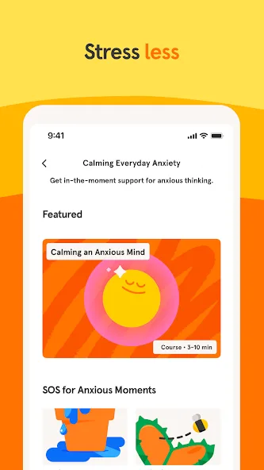{: width="180" .normal }
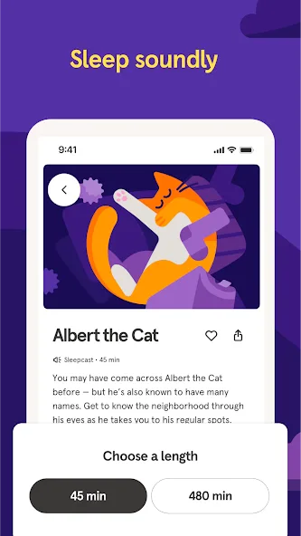{: width="180" .normal }
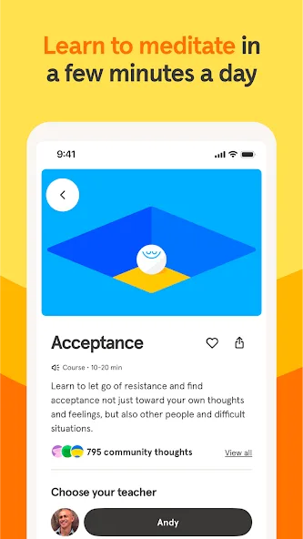{: width="180" .normal }
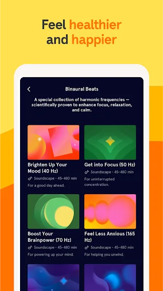{: width="180" .normal }
{: width="180" .normal }

Headspace รวม **สมาธิแนะนำ** เข้ากับ sleepcasts ดนตรีโฟกัส และท่าหายใจ — เส้นทางมีโครงสร้างสู่การนอนสงบและความเครียดต่ำ

**จุดแข็ง**
- **คลังสมาธิแนะนำใหญ่โต** สำหรับนอน ความเครียด โฟกัส และวิตกกังวล
- **Sleepcasts และผ่อนคลาย** เนื้อหาสำหรับก่อนนอน
- **ท่าหายใจและโฟกัส** พร้อมสไตล์เป็นมิตร animated
- แอปข้ามแพลตฟอร์มแข็งแรง (Android + iOS) และเป็นมิตรผู้เริ่มต้น
- คอร์สพื้นฐานฟรี; เนื้อหากว้างพร้อมสมาชิก

**จุดอ่อน**
- **สมาชิกแพง** (~$70/ปี) คล้าย Calm
- เรื่องผสมเสียงแอมเบียนต์ล้วนน้อย
- เนื้อหาดีที่สุดอยู่หลัง paywall

**เหมาะสำหรับ:** ผู้ใช้ที่อยากโครงสร้างแนะนำ ไม่ใช่แค่นอยส์พื้นหลัง

**ดาวน์โหลด Headspace**
- [Google Play](https://play.google.com/store/apps/details?id=com.getsomeheadspace.android)
- [App Store](https://apps.apple.com/us/app/headspace-sleep-meditation/id493145008)

---

### 3. Insight Timer — คลังสมาธิฟรีที่ดีที่สุด

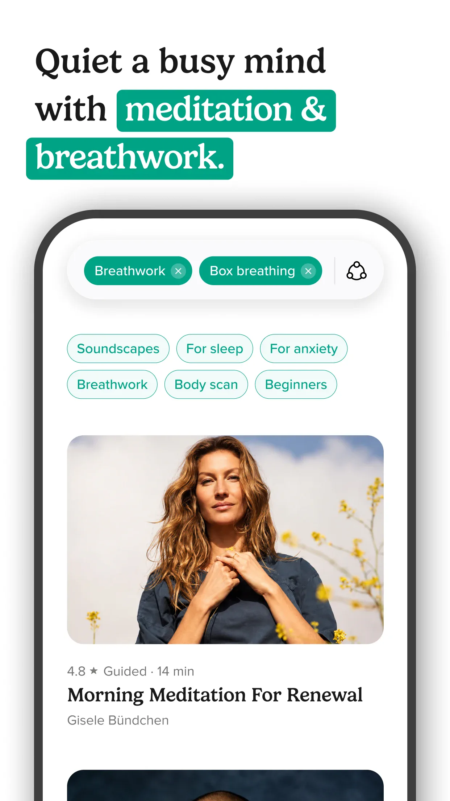{: width="180" .normal }
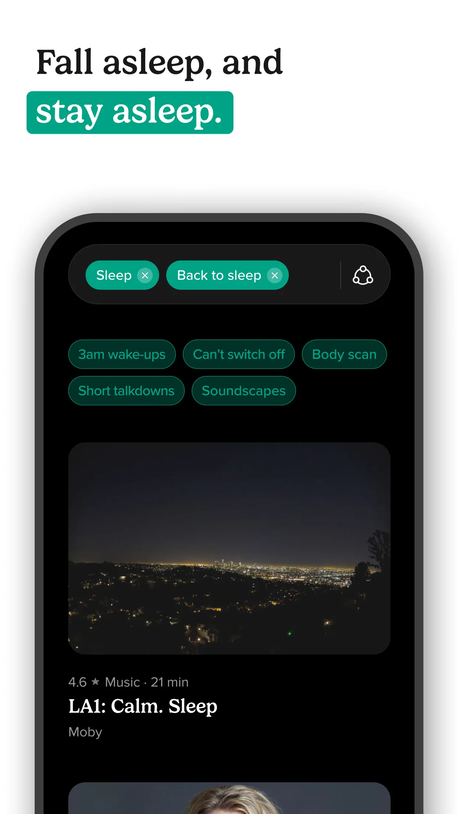{: width="180" .normal }
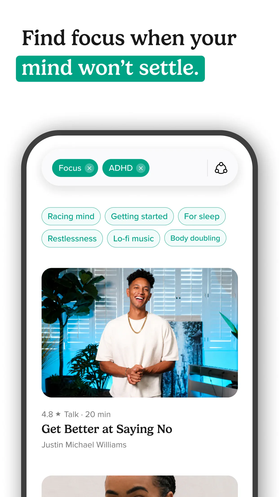{: width="180" .normal }
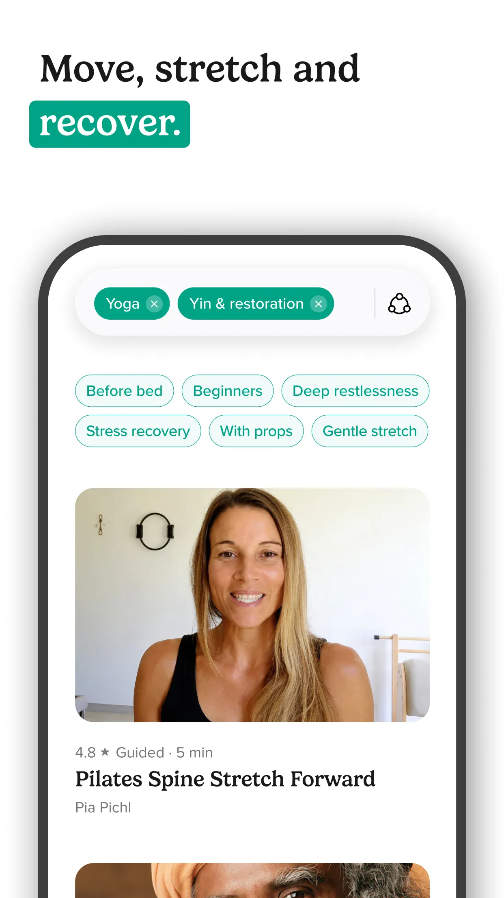{: width="180" .normal }
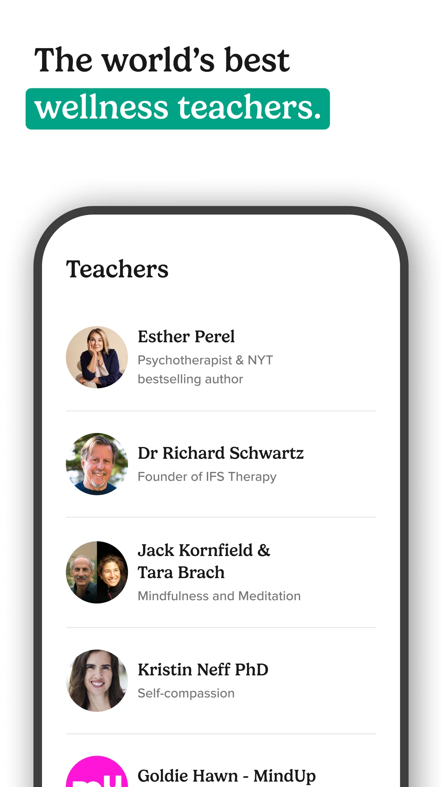{: width="180" .normal }

Insight Timer เสนอ **คลังสมาธิฟรีมหึมา** (หมื่นเซสชันแนะนำ) พลัสดนตรีนอน talks และตัวจับเวลาปรับแต่งได้

**จุดแข็ง**
- **คลังฟรีมหึมา** — เนื้อหาฟรีกว่ามากเทียบ Calm หรือ Headspace
- **ดนตรีนอนและนิทาน** พื้นเสียงแอมเบียนต์ และบทสอนโดยครู
- **ตัวจับเวลาสมาธิปรับแต่งได้** พร้อมระฆังช่วง
- ชุมชนโลกกระตือรือร้นและคอร์ส
- แกนฟรี; สมาชิกเลือกได้สำหรับคอร์สพรีเมียม

**จุดอ่อน**
- ขนาดคลังอาจรู้สึก **มากเกินไป** โดยไม่มีการคัดสรร
- คอร์สพรีเมียมบางส่วนต้องสมาชิก
- "นิทานก่อนนอน" ขัดเงาน้อยกว่า Calm

**เหมาะสำหรับ:** นักสมาธิที่อยากคลังฟรที่ใหญ่ที่สุดและตัวจับเวลา

**ดาวน์โหลด Insight Timer**
- [Google Play](https://play.google.com/store/apps/details?id=com.spotlightsix.zentimerlite2)
- [App Store](https://apps.apple.com/us/app/insight-timer-meditate-sleep/id337472899)

---

### 4. BetterSleep — การผสมเสียงที่ดีที่สุด

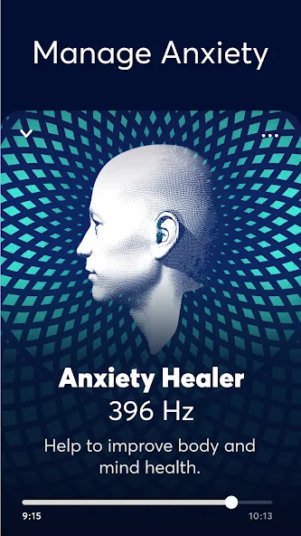{: width="180" .normal }
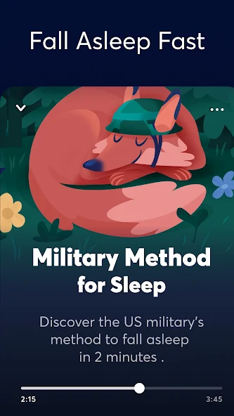{: width="180" .normal }
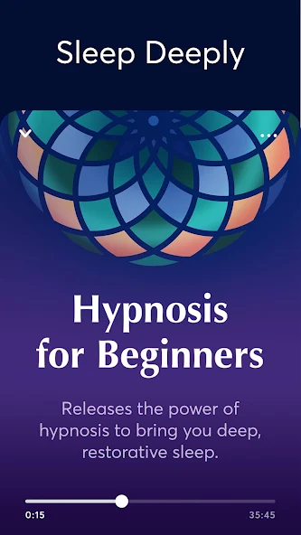{: width="180" .normal }
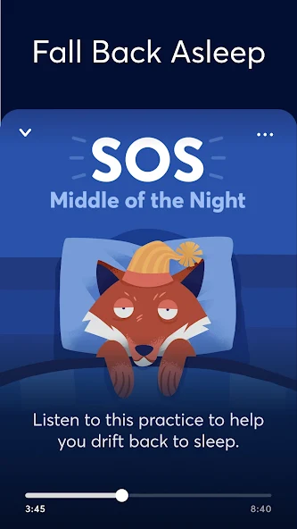{: width="180" .normal }
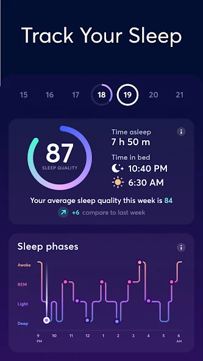{: width="180" .normal }

BetterSleep (เดิม Relax Melodies) สร้างรอบ **ผสมพื้นเสียงเอง** — รวมฝน ลม เปียโน และสิบกว่าชั้น พลัสนิทานก่อนนอนและแบบฝึกก่อนนอน

**จุดแข็ง**
- **การผสมเสียงลึก** — สร้างผสมเองจากคลังเสียงใหญ่
- **นิทานก่อนนอน สมาธิ และ Sleep Moves** แบบฝึกก่อนนอน
- นาฬิกาปลุกฉลาดและติดตามการนอน
- UI สงบขัดเงา
- ระดับฟรีพร้อมสมาชิกสำหรับคลังเต็ม

**จุดอ่อน**
- **ต้องสมาชิก** สำหรับเสียงและนิทานส่วนใหญ่
- การผสมอาจมากกว่าที่ผู้ใช้ทั่วไปอยากได้
- บางคนพบว่าระดับฟรีจำกัด

**เหมาะสำหรับ:** ผู้ใช้ที่ชอบปรุงพื้นเสียงนอนเอง

**ดาวน์โหลด BetterSleep**
- [Google Play](https://play.google.com/store/apps/details?id=ipnossoft.rma.free)
- [App Store](https://apps.apple.com/us/app/bettersleep-relax-and-sleep/id314498713)

---

### 5. White Noise (TMSOFT) — คลังเสียงที่ดีที่สุด

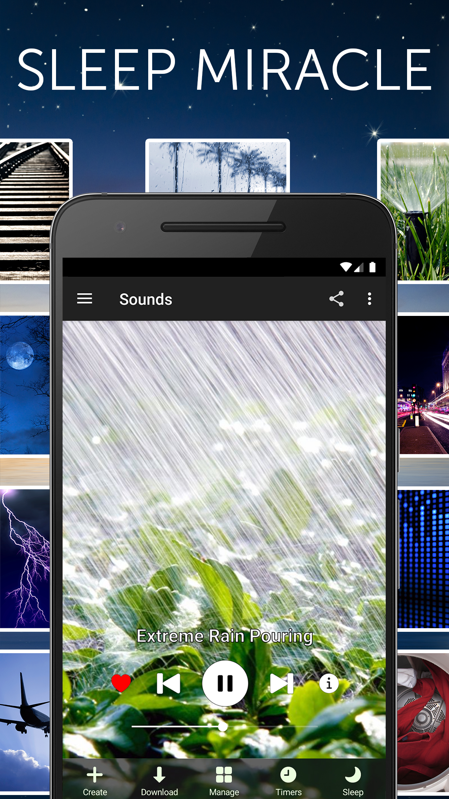{: width="180" .normal }
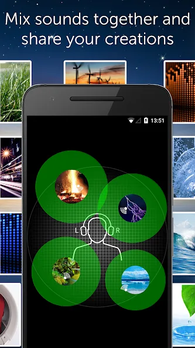{: width="180" .normal }
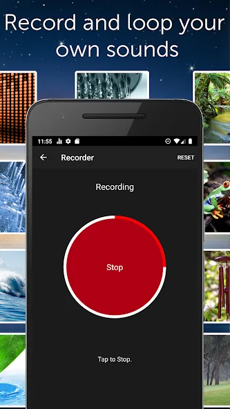{: width="180" .normal }
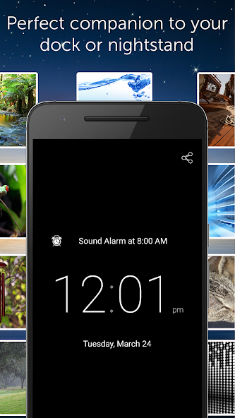{: width="180" .normal }
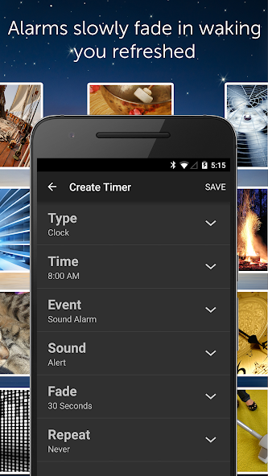{: width="180" .normal }

White Noise by TMSOFT คือ **คลังเสียงแอมเบียนต์มหึมา** (ลูปและผสม) ในราคาจ่ายครั้งเดียว — ไม่ต้องสมาชิก — พลัสบันทึกและการผสม

**จุดแข็ง**
- **คลังเสียงใหญ่มาก** ของลูปและผสมแอมเบียนต์
- **ผสมและบันทึก** พื้นเสียงของตัวเอง; นำเข้าของตัวเอง
- **ซื้อครั้งเดียว** (~$1.99) — ไม่ต้องสมาชิก
- นาฬิกาปลุกและตัวจับเวลาพร้อมระดับเสียงค่อยเป็นค่อยไป
- ทำงานออฟไลน์เมื่อดาวน์โหลดแล้ว

**จุดอ่อน**
- UI เรียบง่ายกว่า เป็นยูทิลิตี้มากกว่าไลฟ์สไตล์
- ไม่มีสมาธิแนะนำหรือนิทาน
- การค้นพบคัดสรรน้อยกว่า BetterSleep

**เหมาะสำหรับ:** นักบริสุทธิ์เสียงที่อยากคลังใหญ่โดยไม่ต้องสมาชิก

**ดาวน์โหลด White Noise (TMSOFT)**
- [Google Play](https://play.google.com/store/apps/details?id=com.tmsoft.whitenoise.full)
- [App Store](https://apps.apple.com/us/app/white-noise/id289894882)

---

### 6. Noisli — การผสมโฟกัสงานที่ดีที่สุด

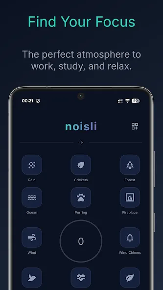{: width="180" .normal }
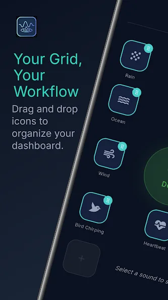{: width="180" .normal }
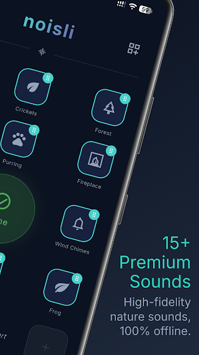{: width="180" .normal }
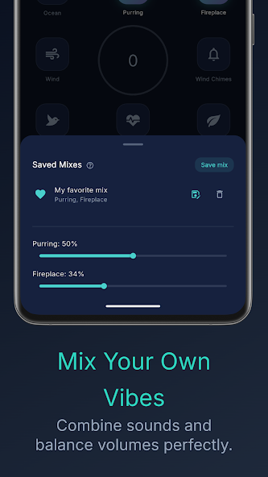{: width="180" .normal }
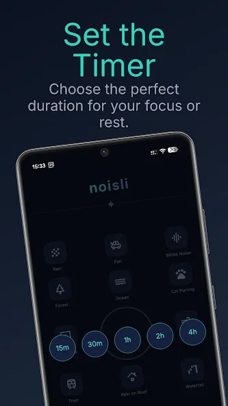{: width="180" .normal }

Noisli คือ **เครื่องผสมเสียงโฟกัสและผ่อนคลาย** สำหรับงาน เรียน และนอน พร้อมซิงค์เว็บ Android และ iOS ตลอดจนตัวจับเวลาและโหมด productivity ในตัว

**จุดแข็ง**
- **การผสมเสียงคัดสรร** ปรับสำหรับโฟกัสและ productivity
- **ซิงค์เว็บ + มือถือ** เพื่อผสมตามคุณ
- **ตัวจับเวลาและโหมด productivity** สำหรับสปรินต์งาน
- อินเทอร์เฟซสะอาด minimal
- ระดับฟรีพร้อมสมาชิกสำหรับเข้าถึงเต็ม

**จุดอ่อน**
- **สมาชิก (~$60/ปี)** สำหรับคลังเต็ม
- ความหลากหลายแอมเบียนต์น้อยกว่า White Noise
- เนื้อหานิทานก่อนนอนน้อยกว่า Calm/BetterSleep

**เหมาะสำหรับ:** คนทำงานระยะไกลและนักเรียนที่ผสมเสียงสำหรับโฟกัส

**ดาวน์โหลด Noisli**
- [Google Play](https://play.google.com/store/apps/details?id=dev.crscaballero.noisli)
- [App Store](https://apps.apple.com/us/app/noisli/id862773459)

---

## เปรียบเทียบความสามารถหลัก

| ความสามารถ | Meow FM | Headspace | Insight Timer | BetterSleep | White Noise (TMSOFT) | Noisli |
|---|---|---|---|---|---|---|
| **แพลตฟอร์ม** | Android, iOS | Android, iOS | Android, iOS | Android, iOS | Android, iOS | Android, iOS, เว็บ |
| **ระดับฟรี** | กว้างขวาง | จำกัด | ใหญ่โต | จำกัด | จ่ายครั้งเดียว (ถูก) | จำกัด |
| **คลังเสียง** | คัดสรร | เล็ก (สมาธิ) | ปานกลาง | ใหญ่ (ผสมได้) | ใหญ่มาก | คัดสรร |
| **การผสม/ผสมเสียง** | ไม่ (คัดสรร) | ไม่ | ตัวจับเวลาเท่านั้น | มี (ลึก) | มี | มี (โฟกัส) |
| **ตัวจับเวลานอน** | มี | มี | มี | มี | มี | มี |
| **สมาธิแนะนำ** | ไม่ | แข็งแกร่ง | แข็งแกร่ง (ฟรี) | บางส่วน | ไม่ | ไม่ |
| **นิทานก่อนนอน** | ไม่ | มี | บางส่วน | มี | ไม่ | ไม่ |
| **โหมดโฟกัส/งาน** | มี (นาฬิกา) | มี | มี | บางส่วน | บางส่วน | แข็งแกร่ง |
| **ออฟไลน์/ดาวน์โหลด** | มี | มี | มี | มี | มี | มี |
| **ไม่ต้องบัญชี** | มี | ไม่ (บัญชี) | เลือกได้ | บัญชี | เลือกได้ | บัญชี (ซิงค์) |
| **รูปแบบราคา** | ฟรี + ปลดล็อก | สมาชิก (~$70/ปี) | ฟรี + สมาชิก | ฟรี + สมาชิก | ครั้งเดียว ~$1.99 | สมาชิก (~$60/ปี) |
| **โฆษณา** | ไม่ | ไม่ | ไม่ | ไม่ | ไม่ | ไม่ |

---

## ทางเลือก Calm ตัวไหนเหมาะกับผู้ใช้แต่ละประเภท

ตารางจัดอันดับฟีเจอร์; ที่นี่หกแอปจัดกลุ่มตาม *สิ่งที่คุณจ่ายจริง*:

- **จ่ายสำหรับเนื้อหาแนะนำ** — **ทางเลือก Headspace** หรือ Insight Timer เก็บสมาธิและนิทานก่อนนอน หากนั่นคือส่วนที่คุณใช้ การสลับไปเครื่องเล่นเสียงล้วนจะรู้สึกเหมือนเสียผลิตภัณฑ์
- **จ่ายสำหรับความหลากหลายเสียง** — **ทางเลือก Noisli** หรือ **ทางเลือก myNoise** ว่าด้วยชั้นผสมได้และความถี่เฉพาะ; Meow FM ครอบคลุมการซ้อนด้วยเสียงในเครื่อง ในขณะที่ White Noise (TMSOFT) คือคลังใหญ่ซื้อครั้งเดียว
- **จ่ายสำหรับกิจวัตรก่อนนอน** — **ทางเลือก BetterSleep** เก็บการผสมเสียงพลัสนิทานก่อนนอนและติดตาม Meow FM เก็บลูปสั้น: กดเล่น ตั้งตัวจับเวลา ตื่นมาพบโทรศัพท์ที่หยุดเอง
- **จ่ายสำหรับโฟกัส** — **ทางเลือก Brain.fm** สำหรับเสียงออกแบบรอบสถานะ cognition; รายการตรวจสอบที่นี่แทนที่จะว่าเรื่อง **ไวต์นอยส์ออฟไลน์** ที่รอดตอนจอดับ
- **ไม่จ่ายเลย** — **แอปไวต์นอยส์ไม่ต้องสมาชิก** ควรยังรวมตัวจับเวลาและคลังออฟไลน์ Meow FM คือตัวที่เก็บทั้งสองในแกนฟรี

ก่อนย้าย ให้ถามสองคำถาม: เสียงรันโดยไม่มีสัญญาณได้หรือไม่ และตัวจับเวลายังทำงานโดยไม่มีระดับเสียเงินหรือไม่?

## วิธีเลือก

- อยาก **ไวต์นอยส์เรียบง่าย น่ารัก ไม่ต้องบัญชี** → **Meow FM**
- อยาก **สมาธิแนะนำ + นอน** → **Headspace**
- อยาก **คลังสมาธิฟรีใหญ่ที่สุด** → **Insight Timer**
- อยาก **ผสมพื้นเสียงนอนเอง** → **BetterSleep**
- อยาก **คลังใหญ่ ราคาครั้งเดียว** → **White Noise (TMSOFT)**
- อยาก **ผสมโฟกัสสำหรับงาน** → **Noisli**

## วิธีย้ายจาก Calm

1. **จดสิ่งที่คุณใช้จริงๆ** — เสียงแอมเบียนต์ นิทานก่อนนอน หรือสมาธิ? เลือกทางเลือกที่เข้ากัน
2. **ดาวน์โหลดแอปเสียง** (Meow FM หรือ White Noise สำหรับเสียงล้วน; BetterSleep สำหรับการผสม)
3. **สร้างเพลย์ลิสต์ก่อนนอน** และตั้งตัวจับเวลานอนเพื่อเสียงหยุดอัตโนมัติ
4. **ลองระดับฟรีก่อน** — Insight Timer และ Meow FM ให้มากมายโดยไม่จ่าย
5. **ยกเลิก Calm ก็ต่อเมื่อ** คุณแน่ใจว่าแอปใหม่ครอบคลุมกิจวัตรคืนคุณ

## คำถามที่พบบ่อย

**Meow FM เป็นทางเลือก Calm ฟรีที่ดีไหม?**
{:.faq-q}
ใช่ หากสิ่งที่คุณต้องการส่วนใหญ่คือเสียงแอมเบียนต์สำหรับนอนและโฟกัส Meow FM ฟรีในแกนหลัก ไม่ต้องบัญชี เล่นออฟไลน์เต็มรูปแบบ และมีตัวจับเวลานอนหยุดอัตโนมัติ — โดยไม่ต้องสมาชิก ~$69.99/ปี

**Meow FM ทำงานออฟไลน์ได้ไหม?**
{:.faq-q}
ได้ ทุกเสียงเล่นโดยไม่มีอินเทอร์เน็ต จึงทำให้คุณนอนหรือโฟกัสบนเครื่องบิน เต็นท์ หรือที่ใดก็ตาม Wi-Fi หลุด

**ทางเลือก Calm ตัวไหนดีที่สุดสำหรับผสมเสียง?**
{:.faq-q}
BetterSleep และ Noisli คือเครื่องผสมลึกที่สุด; White Noise (TMSOFT) เสนอคลังมหึมาในราคาจ่ายครั้งเดียว; Meow FM คือตัวเลือกไม่ต้องบัญชีเรียบง่ายที่สุดสำหรับนอยส์แอมเบียนต์ล้วน

**ฉันย้ายจาก Calm ได้ง่ายไหม?**
{:.faq-q}
ได้ เลือกทางเลือกที่เข้ากับสิ่งที่คุณใช้ (เสียง vs นิทาน vs สมาธิ) สร้างเพลย์ลิสต์ก่อนนอนพร้อมตัวจับเวลา และยกเลิก Calm ก็ต่อเมื่อแอปใหม่ครอบคลุมกิจวัตรคืนคุณ

[หน้าแอป Meow FM](/th/apps/meow-fm/) — มีให้สำหรับ Android และ iOS

## ศัพท์ที่เกี่ยวข้อง

- [ไวต์นอยส์คืออะไร?](/th/glossary/what-is-white-noise/)
