CCleaner อาจมีชื่อเสียง แต่บน Android สมัยใหม่ผลกระทบจำกัด และผู้ใช้บางคนต้องการ **การทำความสะอาดเบากว่า หรือการตรวจสอบจริง** [ทางเลือก CCleaner](/th/glossary/what-is-a-system-monitor/) นี้ครอบคลุมทั้งสองอย่าง — และเราจะพูดตรงๆ เรื่องที่ตัวทำความสะอาดทำได้และทำไม่ได้

ด้านล่างเราเปรียบเทียบแอปหกตัวว่าด้วยราคา แพลตฟอร์ม และความสามารถที่สำคัญจริง เพื่อให้คุณเลือกเครื่องมือที่ถูกไม่ใช่แค่ชื่อแบรนด์ ส่วนใหญ่ผู้อ่านมาพร้อมข้อจำกัดเดียว — ราคาสมัครสมาชิก รายการลบที่คลุมเครือ หรือไม่มีค่าอ่านเรียลไทม์ — จึงจัดแต่ละตัวตามเหตุผลนั้น

## ทำไมจึงมองข้าม CCleaner

- **ผลกระทบจำกัดบน Android สมัยใหม่** — ระบบจัดการแคชและงานเบื้องหลังแล้ว; "การทำความสะอาด" มักประหยัดได้น้อย
- **แอปเคยถูกถอดจากร้านบางแห่ง** และไม่จำเป็นเหมือนเดิม
- **โฆษณาและการชักชวนสมัครสมาชิก** ในเวอร์ชันมือถือ
- **ความกังวลความเป็นส่วนตัว** — ตัวทำความสะอาดบางตัวขอสิทธิ์กว้าง
- คุณอาจต้องการ **การตรวจสอบจริง** (ว่าอะไรกิน CPU/แบตเตอรี่) ไม่ใช่แค่การทำความสะอาด

> ความจริง: บน Android สมัยใหม่ ชัยชนะเรื่องพื้นที่จัดเก็บที่ใหญ่ที่สุดคือการลบไฟล์ที่ไม่ใช้แล้วและสื่อขนาดใหญ่ — ไม่ใช่ "การเคลียร์ RAM" เลือกเครื่องมือเพื่อ *การจัดการพื้นที่จัดเก็บอย่างปลอดภัย* และใช้ตัวตรวจสอบเพื่อหาว่าอะไรกันแนที่ดูดทรัพยากรจริง

## ทางเลือก CCleaner ที่ดีที่สุดแบบคร่าวๆ

| แอป | ราคา (2026) | แพลตฟอร์ม | เหมาะสำหรับ |
|---|---|---|---|
| **System Monitor** | แกนฟรี + ปลดล็อก | Android | ตรวจสอบ + boost + ทำความสะอาดเบา |
| **Files by Google** | ฟรี | Android | ทำความสะอาดพื้นที่จัดเก็บปลอดภัยทางการ |
| **SD Maid** | ฟรี + Pro | Android | ทำความสะอาดลึกและระมัดระวัง |
| **CCleaner** | ฟรี + sub | Android | แบรนด์คุ้นเคย ทำความสะอาดด่วน |
| **Avast Cleanup** | ฟรี + sub | Android | ทำความสะอาด + ทำความสะอาดรูปถ่าย |
| **Norton Clean** | ฟรี | Android | ตัวทำความสะอาด junk/cache เรียบง่าย |

---

### 1. System Monitor — ดีสุดสำหรับตรวจสอบคู่กับทำความสะอาด

{: width="180" .normal }
{: width="180" .normal }
{: width="180" .normal }
{: width="180" .normal }
{: width="180" .normal }

System Monitor คือ **เครื่องมือ Android ครบจบ** พร้อมตรวจสอบ CPU ทำความสะอาดพื้นที่จัดเก็บ RAM Booster และหมอแบตเตอรี่ — ให้คุณทั้ง *ข้อมูลเชิงลึก* และ *การทำความสะอาด* ในที่เดียว

**จุดแข็ง**
- **ตรวจสอบ CPU RAM และแบตเตอรี่เรียลไทม์** พร้อมการป้องกัน overheat
- **ทำความสะอาดพื้นที่จัดเก็บ** สำหรับ junk และแคช พลัสวิเคราะห์ RAM ด้วย boost หนึ่งแตะ
- **หมอแบตเตอรี่** พร้อมเส้นโค้งสุขภาพ แรงดัน และอุณหภูมิ
- **หน้าต่างลอยและวิดเจ็ต** สำหรับทัศนวิสัยต่อเนื่อง
- ธีมหลากหลายและแกนฟรี

**จุดอ่อน**
- แค่ Android
- การทำความสะอาดเบากว่าตัวทำความสะอาดเฉพาะทาง (จุดแข็งคือการตรวจสอบ)
- บางฟีเจอร์อยู่หลังปลดล็อก Pro

**เหมาะสำหรับ:** ผู้ใช้ที่อยาก *เห็น* ว่าอะไรผิดพลาดแล้วแก้ไข ไม่ใช่แค่กวาดแคช

**ดาวน์โหลด System Monitor**
- [Google Play](https://play.google.com/store/apps/details?id=com.glgjing.marvel)

---

### 2. Files by Google — ดีสุดทำความสะอาดปลอดภัย

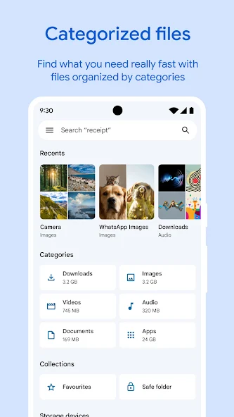{: width="180" .normal }
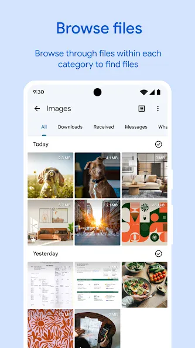{: width="180" .normal }
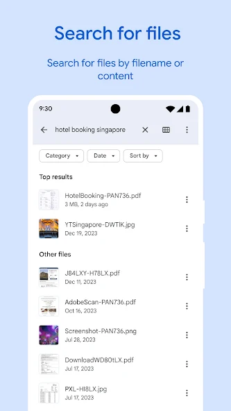{: width="180" .normal }
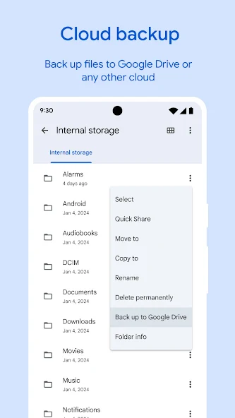{: width="180" .normal }
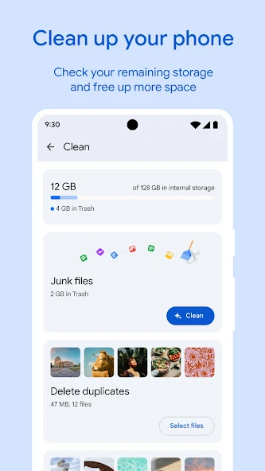{: width="180" .normal }

Files by Google คือ **ตัวจัดการพื้นที่จัดเก็บทางการ** ของ Google — เคลียร์ไฟล์ที่ไม่ใช้แล้ว หาตัวซ้ำ และช่วยประหยัดพื้นที่ด้วยดีไซน์เป็นมิตรความเป็นส่วนตัวโดยไม่มีงานเบื้องหลังรุกราน

**จุดแข็ง**
- **ทางการและปลอดภัย** — ทำโดย Google สิทธิ์น้อยสุด ไม่มีพฤติกรรมน่าสงสัย
- **ทำความสะอาดพื้นที่จัดเก็บฉลาด**: ไฟล์ไม่ใช้แล้ว ตัวซ้ำ สื่อใหญ่ และแคชแอป
- **เรียกดูและแชร์ไฟล์** ออฟไลน์กับเพื่อนร่วมงาน
- **ไม่โฆษณา ไม่สมัครสมาชิก** — ฟรีเต็มที่
- UI ชัดเจนและเรียบง่ายสำหรับทุกคน

**จุดอ่อน**
- **ไม่มี RAM boost หรือการตรวจสอบระบบ** — แค่พื้นที่จัดเก็บ
- ไม่มีการล่าสัมผัสไฟล์ "ซาก" ลึกเหมือน SD Maid
- แค่ Android

**เหมาะสำหรับ:** ผู้ใช้ที่อยากวิธีน่าเชื่อถือและไม่ยุ่งยากเพื่อเอื้อพื้นที่จัดเก็บคืน

**ดาวน์โหลด Files by Google**
- [Google Play](https://play.google.com/store/apps/details?id=com.google.android.apps.nbu.files)

---

### 3. SD Maid — ดีสุดทำความสะอาดลึก

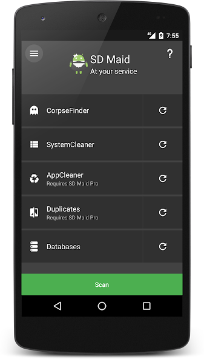{: width="180" .normal }
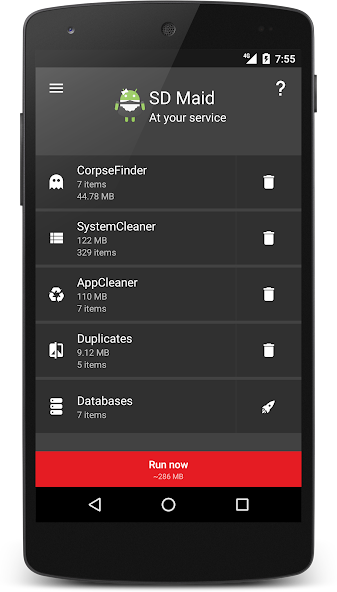{: width="180" .normal }
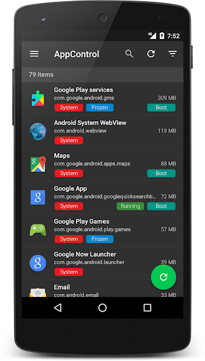{: width="180" .normal }
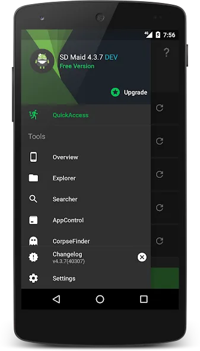{: width="180" .normal }
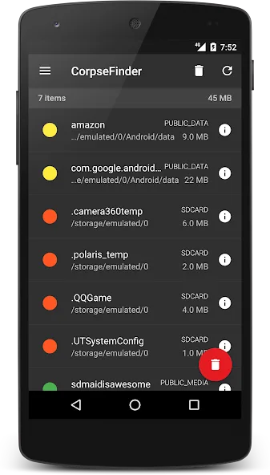{: width="180" .normal }

SD Maid คือ **ตัวทำความสะอาดลึกที่ระมัดระวัง** สำหรับ Android: หาไฟล์ซากจากแอปที่ถอนการติดตั้ง ตัวซ้ำ ฐานข้อมูลเพื่อเพิ่มประสิทธิภาพ และควบคุมแอป

**จุดแข็ง**
- **ตัวหาซาก** ลบสิ่งที่ตัวทำความสะอาดอื่นพลาด
- **ค้นหาตัวซ้ำและไฟล์** ทั่วพื้นที่จัดเก็บ
- **ควบคุม / แช่แข็งแอป** และปรับแต่งฐานข้อมูล
- **ตัวจัดตารางเวลา** สำหรับบำรุงรักษาอัตโนมัติ
- ชื่อเสียงแข็งแกร่งในกลุ่ม power user; ชั้นฟรีมีประโยชน์

**จุดอ่อน**
- แค่ Android
- ฟีเจอร์ดีสุด (ตัวหาซาก ควบคุมแอป ตารางเวลา) ต้อง SD Maid Pro
- UI แน่นกว่า — น้อยน่ามิตรต่อผู้ใช้ทั่วไป

**เหมาะสำหรับ:** power user ที่อยากทำความสะอาดครอบคลุมและควบคุมได้

**ดาวน์โหลด SD Maid**
- [Google Play](https://play.google.com/store/apps/details?id=eu.thedarken.sdm)

---

### 4. CCleaner — ดีสุดทำความสะอาดด่วนคุ้นเคย

{: width="180" .normal }
{: width="180" .normal }
{: width="180" .normal }
{: width="180" .normal }
{: width="180" .normal }

CCleaner มือถือคือ **เวอร์ชันโทรศัพท์ของเครื่องมือ PC ชื่อดัง** — วิธีด่วนเคลียร์แคช ประวัติการเรียกดู และไฟล์ไม่ใช้ รวมถึงผู้ช่วยรูปถ่ายและแบตเตอรี่พื้นฐาน

**จุดแข็ง**
- **แบรนด์และลูกค้าคุ้นเคย** หากคุณใช้ CCleaner บนเดสก์ท็อป
- **ทำความสะอาดแคช/ประวัติด่วน** และภาพรวมพื้นที่จัดเก็บเรียบง่าย
- **ผู้ช่วยจำศีลแบตเตอรี่และแอป** ในชั้นพรีเมียม
- สแกนหนึ่งแตะง่าย
- มีชั้นฟรี

**จุดอ่อน**
- **ผลกระทบจริงจำกัด** ต่อการจัดการแคช Android สมัยใหม่
- โฆษณาและการชักชวนสมัครสมาชิกในเวอร์ชันฟรี
- **ไม่มีใน iOS อีกต่อไป** — แค่ Android ตอนนี้

**เหมาะสำหรับ:** ผู้ใช้ที่แค่อยากชื่อ CCleaner และสแกนด่วน

**ดาวน์โหลด CCleaner**
- [Google Play](https://play.google.com/store/apps/details?id=com.piriform.ccleaner)

---

### 5. Avast Cleanup — ดีสุดสำหรับทำความสะอาดรูปถ่าย

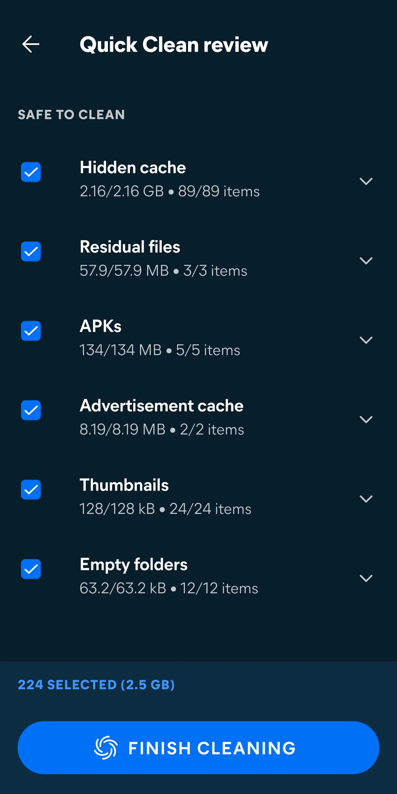{: width="180" .normal }
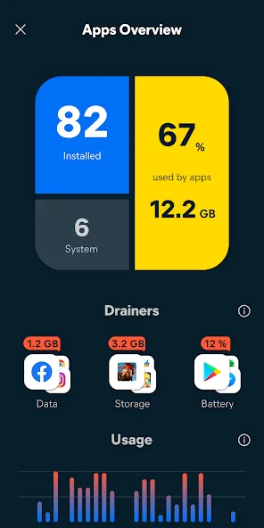{: width="180" .normal }
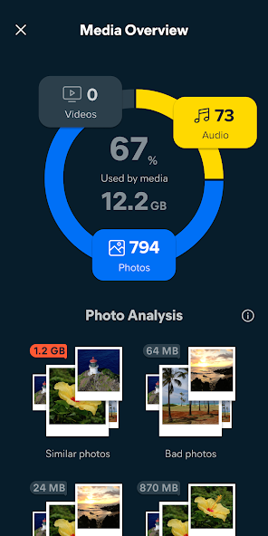{: width="180" .normal }
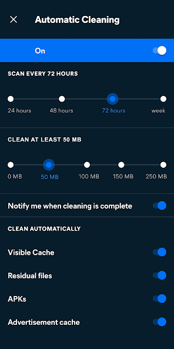{: width="180" .normal }

Avast Cleanup โฟกัสที่ **เคลียร์พื้นที่จากรูปถ่ายและไฟล์** — หารูปคุณภาพต่ำ คล้ายกัน และซ้ำกัน พลัสทำความสะอาด junk และแคชแอป

**จุดแข็ง**
- **ทำความสะอาดรูปถ่าย** ที่มาร์กถาพเบลอ ซ้ำ และคล้ายกันเพื่อลบ
- **ลบ junk และแคช** ด้วยภาพรวมพื้นที่จัดเก็บชัดเจน
- **จำศีลแอป** เพื่อลดภาระเบื้องหลัง
- สนับสนุนแบรนด์ความปลอดภัยชั้นนำ
- ฟรีพร้อมสมัครสมาชิกพรีเมียม

**จุดอ่อน**
- แค่ Android
- ฟีเจอร์รูปถ่ายดีสุดอยู่หลังสมัครสมาชิก
- ไม่มีการตรวจสอบระบบเรียลไทม์

**เหมาะสำหรับ:** ผู้ใช้ที่พื้นที่จัดเก็บโดนรูปถ่ายครอบงำ

**ดาวน์โหลด Avast Cleanup**
- [Google Play](https://play.google.com/store/apps/details?id=com.avast.android.cleaner)

---

### 6. Norton Clean — ดีสุดตัวทำความสะอาด junk เรียบง่าย

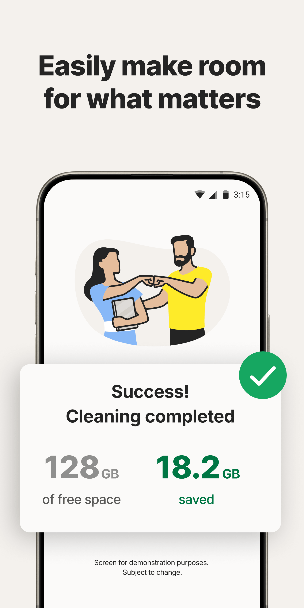{: width="180" .normal }
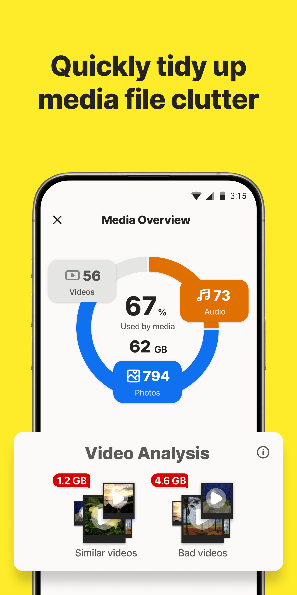{: width="180" .normal }
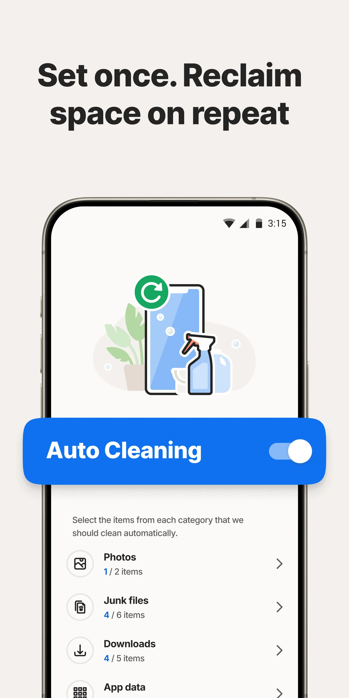{: width="180" .normal }
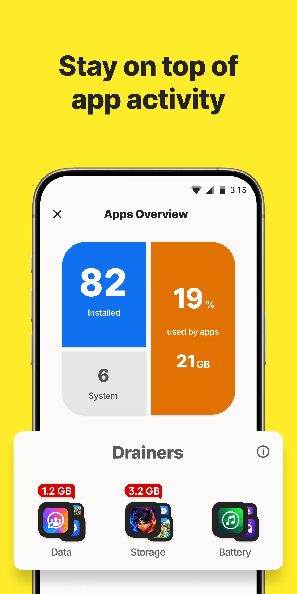{: width="180" .normal }

Norton Clean คือ **ตัวทำความสะอาด junk และแคชตรงไปตรงมา** ที่ลบไฟล์ชั่วคราว ข้อมูลซาก และซากแอปด้วยหนึ่งแตะเรียบง่าย

**จุดแข็ง**
- **ลบ junk/cache เรียบง่าย** — ง่ายสำหรับทุกคน
- **ทำความสะอาดไฟล์ซาก** หลังถอนการติดตั้ง
- สนับสนุนแบรนด์ความปลอดภัย Norton
- ใช้ฟรี
- เบาและไม่กวน

**จุดอ่อน**
- แค่ Android
- ฟีเจอร์เพิ่มน้อยกว่านอกจากทำความสะอาดพื้นฐาน
- ไม่มีการตรวจสอบ ไม่มี RAM boost ไม่มีเครื่องมือรูปถ่าย

**เหมาะสำหรับ:** ผู้ใช้ที่อยากตัวทำความสะอาดหนึ่งแตะ minimal และน่าเชื่อถือ

**ดาวน์โหลด Norton Clean**
- [Google Play](https://play.google.com/store/apps/details?id=com.symantec.cleaner)

---

## เปรียบเทียบความสามารถหลัก

| ความสามารถ | System Monitor | Files by Google | SD Maid | CCleaner | Avast Cleanup | Norton Clean |
|---|---|---|---|---|---|---|
| **แพลตฟอร์ม** | Android | Android | Android | Android | Android | Android |
| **ทำความสะอาด junk / แคช** | ใช่ (เบา) | ใช่ (ปลอดภัย) | ใช่ (ลึก) | ใช่ | ใช่ | ใช่ |
| **วิเคราะห์พื้นที่จัดเก็บ** | ใช่ | ใช่ | ใช่ (ล้ำลึก) | พื้นฐาน | ใช่ | พื้นฐาน |
| **หาตัวซ้ำ / ซาก** | ไม่ | ตัวซ้ำ | ใช่ (ซาก) | ไม่ | รูปถ่าย | ไม่ |
| **RAM boost** | ใช่ | ไม่ | บางส่วน | ไม่ | จำศีลแอป | ไม่ |
| **ประหยัดแบตเตอรี่** | ใช่ (หมอ) | ไม่ | ไม่ | พื้นฐาน | พื้นฐาน | ไม่ |
| **ตรวจสอบเรียลไทม์** | ใช่ (CPU/RAM/แบตเตอรี่) | ไม่ | ไม่ | ไม่ | ไม่ | ไม่ |
| **ปลอดภัย / ทางการ** | ใช่ | ใช่ (Google) | ใช่ (power-user) | ระวัง | ใช่ (แบรนด์) | ใช่ (แบรนด์) |
| **โฆษณา / สมัครสมาชิก** | แกนฟรี | ไม่โฆษณา | ฟรี + Pro | โฆษณา + sub | ฟรี + sub | ฟรี |
| **ต้องรูท** | ไม่ | ไม่ | ไม่ (Pro เพิ่มเติมเลือกได้) | ไม่ | ไม่ | ไม่ |
| **เก่งที่สุดใน** | ตรวจสอบ + boost | พื้นที่จัดเก็บปลอดภัย | ทำความสะอาดลึก | แบรนด์คุ้นเคย | ทำความสะอาดรูปถ่าย | ทำความสะอาดเรียบง่าย |

---

## ทางเลือก CCleaner ตัวไหนเหมาะกับผู้ใช้แต่ละแบบ

ตารางจัดอันดับฟีเจอร์; ที่นี่หกแอปถูกจัดกลุ่มตาม *สิ่งที่คุณอยากบรรลุจริง*

- **เข้าใจความช้า** — **ทางเลือก CCleaner** ที่รายงาน CPU RAM แบตเตอรี่ และอุณหภูมิ (System Monitor) ตอบคำถามต่างจากการลบแคช หากพื้นที่จัดเก็บไม่ดูมีปัญหา การทำความสะอาดจะอธิบาย stutter ไม่ได้
- **ทำความสะอาดพื้นที่จัดเก็บปลอดภัยทางการ** — ค้นหา **ทางเลือก Files by Google** เรื่องทบทวนไฟล์ใหญ่และตัวซ้ำก่อนลบ; Norton Clean คือเวอร์ชัน minimal ของงานนั้น
- **ทำความสะอาดซากตามกฎลึก** — **ทางเลือก SD Maid** หรือ **ทางเลือก AVG Cleaner** เหมาะสำหรับผู้อยากเห็นซากไหนถูกนำออกแน่ๆ **ทางเลือก Clean Master** คือเวอร์ชัน "หนึ่งแตะ" เก่าและกว้างกว่าของความคิดเดียวกัน
- **เครื่องมือครบชุด** — **ทางเลือก 3C Toolbox** รวมการตรวจสอบ การปรับแต่ง และสถิติแบตเตอรี่ในการติดตั้งเดียว แลกกับความซับซ้อน
- **รูปถ่ายและสมัครสมาชิก** — Avast Cleanup เล็งคลังรูปถ่าย และแอปส่วนใหญ่วางสแกนลึกกว่าหลังชั้นเสียเงิน; ตรวจว่าแกนฟรีลบอะไรจริง

ไม่ว่าจะชื่ออะไร ให้ถามสองคำถามก่อนย้าย: คุณสามารถทบทวนรายการลบก่อนได้หรือไม่ และแอปอธิบายความช้าได้นอกจากเคลียร์พื้นที่หรือไม่

## วิธีเลือก

- อยาก **ตรวจสอบ + boost + ทำความสะอาดเบา** → **System Monitor**
- อยาก **ทำความสะอาดพื้นที่จัดเก็บปลอดภัยทางการไม่ยุ่งยาก** → **Files by Google**
- อยาก **ทำความสะอาดลึกและระมัดระวัง** → **SD Maid**
- อยาก **ชื่อ CCleaner และสแกนด่วน** → **CCleaner**
- พื้นที่จัดเก็บมี **รูปถ่าย** → **Avast Cleanup**
- อยาก **ตัวทำความสะอาด minimal น่าเชื่อถือ** → **Norton Clean**

## วิธีโยกย้ายจาก CCleaner

1. **กำหนดเป้าหมายจริงของคุณ** — พื้นที่ว่างมากขึ้น หรือมือถือเร็วขึ้น? สองการซ่อมแซมต่างกัน
2. **ติดตั้งเครื่องมือพื้นที่จัดเก็บ** (Files by Google หรือ SD Maid) แล้วรันการทำความสะอาดครั้งเดียวตัวซ้ำและไฟล์ไม่ใช้
3. **เพิ่มตัวตรวจสอบ** (System Monitor) เพื่อหาว่าอะไรกันแน่ดูด CPU/แบตเตอรี่ แทน "boost" อย่างไร้เป้าหมาย
4. **ถอนการติดตั้ง CCleaner** ทันทีที่เครื่องมือใหม่ครอบคลุมความต้องการคุณ — Android สมัยใหม่ต้องการการทำความสะอาดตลอดน้อยลง
5. **คงความเรียบง่าย**: ลบสื่อใหญ่และแอปเก่าเป็นประจำ; ปล่อย OS จัดการที่เหลือ

## คำถามที่พบบ่อย

**System Monitor คือทางเลือก CCleaner ที่ดีที่สุดไหม?**
{:.faq-q}
หากคุณอยากการตรวจสอบพร้อมการทำความสะอาด แน่นอน System Monitor คือแอปเดียวที่นี่ที่มีการตรวจสอบ CPU/RAM/แบตเตอรี่เรียลไทม์ สัญญาณเตือน overheat และ boost หนึ่งแตะ — ที่อื่นเป็นตัวทำความสะอาดหรือเครื่องมือพื้นที่จัดเก็บโดยไม่มีข้อมูลเชิงลึกเรียลไทม์

**ทางเลือก CCleaner ตัวไหนปลอดภัยที่สุดสำหรับพื้นที่จัดเก็บ?**
{:.faq-q}
Files by Google คือตัวเลือกปลอดภัยที่สุด — ทางการ ไม่โฆษณา ไม่มีงานเบื้องหลังรุกราน SD Maid คือตัวทำความสะอาดลึกสุดสำหรับ power user

**ทางเลือก CCleaner ตัวไหนเคลียร์ RAM จริง?**
{:.faq-q}
System Monitor คือตัวเดียวที่นี่ที่มี boost RAM หนึ่งแตะ; ที่เหลือจัดการพื้นที่จัดเก็บและแคช แต่ไม่ตรวจสอบหรือเคลียร์หน่วยความจำโดยตรง

**System Monitor ฟรีไหม?**
{:.faq-q}
ใช่ ตัวตรวจสอบแกน วิดเจ็ต หน้าต่างลอย และสัญญาณเตือน overheat ฟรี; ปลดล็อกเลือกได้เพิ่มธีมและประวัติที่ลึกกว่า

[หน้าแอป System Monitor](/th/apps/system-monitor/) — มีให้บน Android

## ศัพท์ที่เกี่ยวข้อง

- [ตัวตรวจสอบอุณหภูมิ CPU คืออะไร?](/th/glossary/what-is-a-cpu-temperature-monitor/)
- [System Monitor คืออะไร?](/th/glossary/what-is-a-system-monitor/)
- [RAM Booster คืออะไร?](/th/glossary/what-is-a-ram-booster/)
