CPU-Z ดีสำหรับแผ่นสเปกด่วน แต่บน Android มัน **ไม่แสดง [อุณหภูมิเรียลไทม์](/th/glossary/what-is-a-cpu-temperature-monitor/)** ไม่มีหน้าต่างลอย และไม่มีวิดเจ็ตหรือการเตือนความร้อนเกิน หากคุณอยากการตรวจสอบเรียลไทม์ หมวดนี้มีตัวเลือก matured แล้ว

ด้านล่างนี้เราเปรียบเทียบหก **ทางเลือก CPU-Z** — จากตัวตรวจสอบอุณหภูมิเรียลไทม์ถึงตัวรายงานสเปกเจาะลึก — ข้ามราคา แพลตฟอร์ม และความสามารถที่สำคัญจริงๆ ส่วนใหญ่ผู้อ่านมาพร้อมอุปสรรคหนึ่ง — ไม่มีอุณหภูมิเรียลไทม์ ไม่มีหน้าต่างลอย หรือไม่มีวิดเจ็ต — จึงแต่ละตัวเลือกถูกกรอบตามเหตุผลนั้น

## ทำไมถึงมองหานอก CPU-Z

{: width="180" .normal }
{: width="180" .normal }
{: width="180" .normal }
{: width="180" .normal }
{: width="180" .normal }

- **ไม่มีอุณหภูมิ CPU เรียลไทม์** บนอุปกรณ์ Android มากมาย — มันรายงานสเปก ไม่ใช่ความร้อน
- **ไม่มีหน้าต่างลอยหรือวิดเจ็ต** สำหรับดูเหลียวเดียว
- **เซ็นเซอร์และสุขภาพแบตเตอรี่น้อย** เทียบเครื่องมือเฉพาะทาง
- **เวอร์ชันมือถือมีโฆษณา** และตื้นกว่าสำหรับพีซีคลาสสิก
- คุณอาจอยาก **การเตือนความร้อนเกินหรือ One Tap Boost** ซึ่งมันไม่มี

## ทางเลือก CPU-Z ที่ดีที่สุดแบบคร่าวๆ

| แอป | ราคา (2026) | แพลตฟอร์ม | เหมาะสำหรับ |
|---|---|---|---|
| **CPU Monitor** | แกนฟรี + ปลดล็อก | Android | อุณหภูมิเรียลไทม์ ความถี่ หน้าต่างลอย |
| **DevCheck** | ฟรี + Pro | Android, iOS | ฮาร์ดแวร์และเซ็นเซอร์ละเอียด |
| **AIDA64** | ฟรี | Android, iOS | รายงานสเปกเจาะลึก |
| **Device Info HW** | ฟรี + Pro | Android | ข้อมูลฮาร์ดแวร์ต่อส่วนประกอบ |
| **Droid Hardware Info** | ฟรี | Android | สเปกอุปกรณ์ด่วน |
| **System Monitor** | แกนฟรี + ปลดล็อก | Android | ตัวตรวจสอบ + cleaner + booster |

---

### 1. CPU Monitor — ดีที่สุดสำหรับอุณหภูมิเรียลไทม์

{: width="180" .normal }
{: width="180" .normal }
{: width="180" .normal }
{: width="180" .normal }
{: width="180" .normal }

CPU Monitor แสดง **อุณหภูมิและความถี่ CPU เรียลไทม์** RAM แบตเตอรี่ และการใช้งานมัลติคอร์ พร้อมหน้าต่างลอย วิดเจ็ต One Tap Boost และการเตือนความร้อนเกิน

**จุดแข็ง**
- **อุณหภูมิและความถี่ CPU เรียลไทม์** พร้อมการวิเคราะห์ประวัติ
- **การตรวจสอบ CPU มัลติคอร์** และการใช้งานต่อคอร์
- **หน้าต่างลอย** (แถบสถานะ + เดสก์ท็อป) และวิดเจ็ต RAM/CPU/แบตเตอรี่
- **การเตือนความร้อนเกิน** ที่เตือนคุณปิดแอปหนักและทำความเย็น
- **One Tap Boost** เพื่อปลด RAM อย่างรวดเร็ว
- มัลติธีม เบา และแกนฟรี

**จุดอ่อน**
- แค่ Android — ไม่มีแอป iOS
- ประวัติ/ธีมขั้นสูงอยู่หลังปลดล็อก
- ความแม่นยำอุณหภูมิพึ่งพาความมีอยู่ของเซ็นเซอร์อุปกรณ์

**เหมาะสำหรับ:** ผู้ใช้ที่อยากดูความร้อนและความถี่จริงๆ ขณะเล่นเกมหรือชาร์จ

**ดาวน์โหลด CPU Monitor**
- [Google Play](https://play.google.com/store/apps/details?id=com.glgjing.stark)

---

### 2. DevCheck — ดีที่สุดสำหรับเซ็นเซอร์ละเอียด

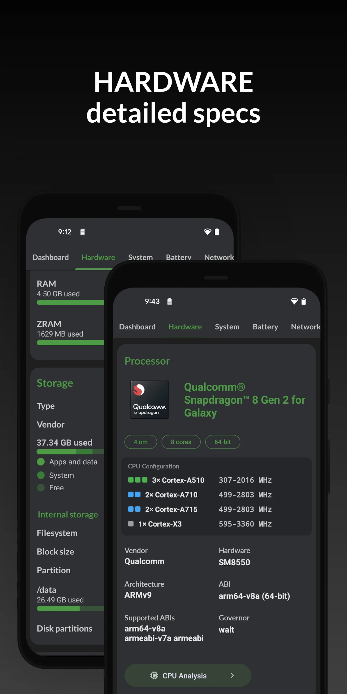{: width="180" .normal }
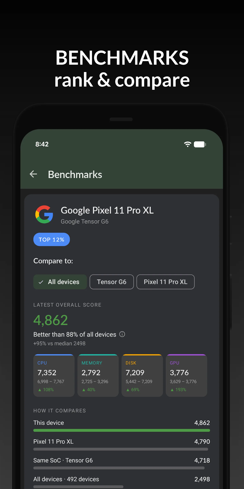{: width="180" .normal }
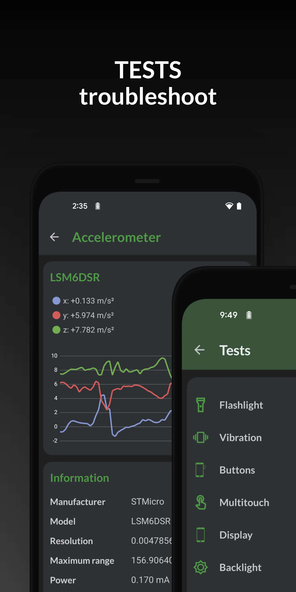{: width="180" .normal }
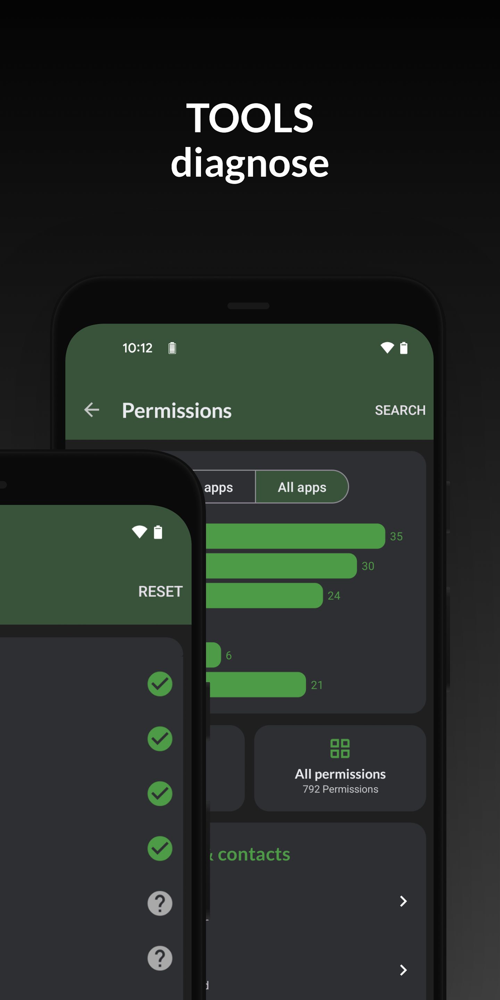{: width="180" .normal }
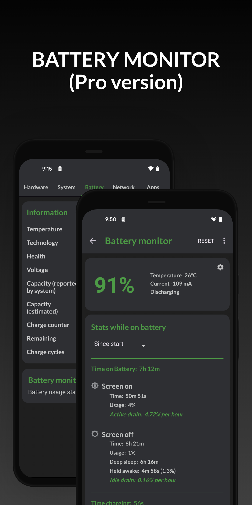{: width="180" .normal }

DevCheck คือ **ตัวรายงานฮาร์ดแวร์และเซ็นเซอร์ครบถ้วน** พร้อมแดชบอร์ดเรียบ: CPU GPU แบตเตอรี่ เครือข่าย เซ็นเซอร์ และอื่นๆ พลัสตัวตรวจสอบระบบและวิดเจ็ต

**จุดแข็ง**
- **การอ่านฮาร์ดแวร์เจาะลึก** — SoC GPU หน่วยความจำ พื้นที่จัดเก็บ กล้อง เซ็นเซอร์
- **แดชบอร์ดเรียลไทม์** สำหรับ CPU แบตเตอรี่ และข้อมูลเทอร์มอล
- **วิดเจ็ตและตัวตรวจสอบระบบ** สำหรับการติดตามต่อเนื่อง
- ส่วนติดต่อผู้ใช้เรียบ โฆษณาน้อย
- ฟรีพร้อมอัปเกรด Pro สำหรับแดชบอร์ดเพิ่มเติม

**จุดอ่อน**
- ไม่มีโอเวอร์เลย์หน้าต่างลอย
- การเตือนความร้อนเกินและ One Tap Boost ไม่ใช่จุดเน้น
- ความลึกที่ดีที่สุดอยู่หลัง DevCheck Pro

**เหมาะสำหรับ:** คนรักที่อยากสินค้าคงคลังฮาร์ดแวร์เต็มและรายการเซ็นเซอร์

**ดาวน์โหลด DevCheck**
- [Google Play](https://play.google.com/store/apps/details?id=flar2.devcheck)
- [App Store](https://apps.apple.com/us/app/devcheck/id1475762785)

---

### 3. AIDA64 — ดีที่สุดรายงานสเปกเจาะลึก

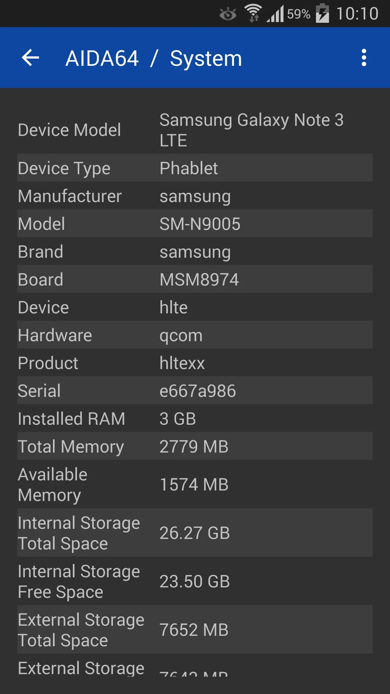{: width="180" .normal }
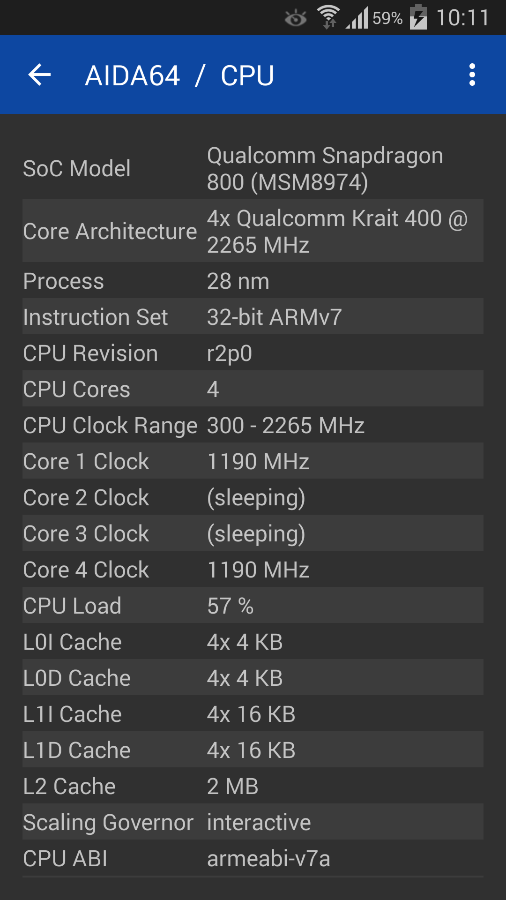{: width="180" .normal }
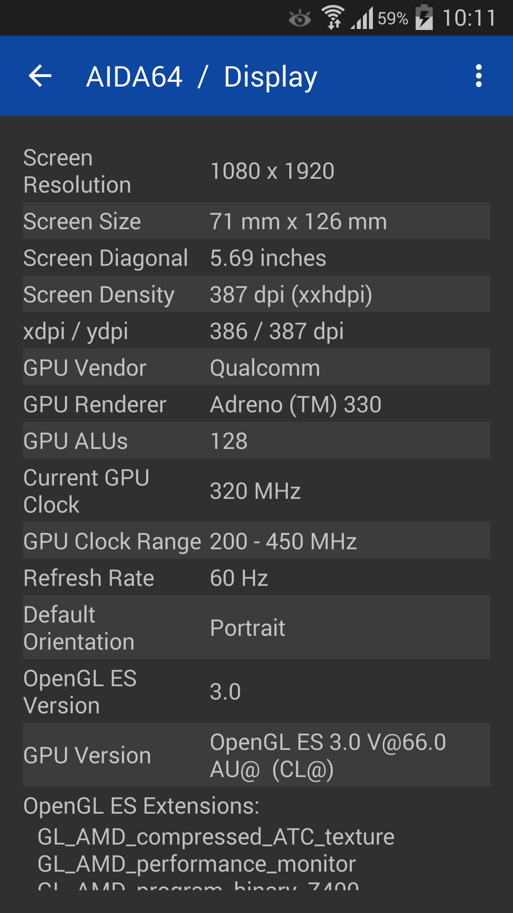{: width="180" .normal }
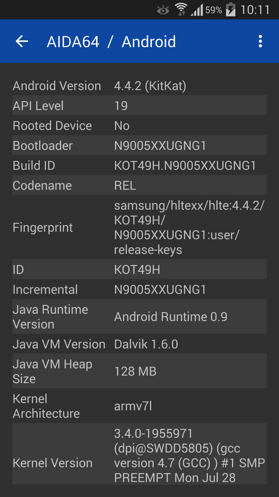{: width="180" .normal }
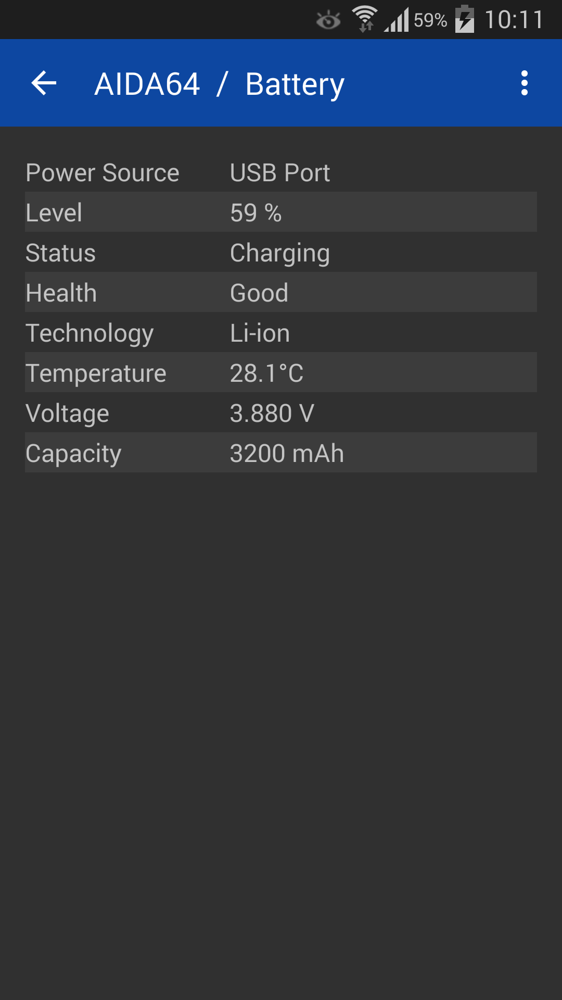{: width="180" .normal }

AIDA64 นำแบรนด์วินิจฉัยพีซีชื่อดังสู่ Android และ iOS พร้อม **รายงานสเปกอุปกรณ์** เจาะลึกและการอ่านเซ็นเซอร์เรียลไทม์

**จุดแข็ง**
- **รายงานสเปกที่เชื่อถือได้และละเอียด** ครอบคลุม CPU จอแสดงผล แบตเตอรี่ เครือข่าย และอื่นๆ
- **หน้าเซ็นเซอร์เรียลไทม์** สำหรับเทอร์มอล แบตเตอรี่ และภาระ
- มีให้บน **Android และ iOS**
- ไม่มีโฆษณาในเวอร์ชันฟรี
- เลย์เอาต์คุ้นเคยสำหรับผู้ใช้ AIDA64 เดสก์ท็อป

**จุดอ่อน**
- ไม่มีหน้าต่างลอยหรือวิดเจ็ต
- ไม่โฟกัสการเตือนความร้อนเกินหรือ boost
- "การตรวจสอบเรียลไทม์" น้อยกว่าตัวตรวจสอบเฉพาะทาง

**เหมาะสำหรับ:** ผู้ใช้ที่อยากแผ่นสเปกเจาะลึกและเชื่อถือได้บนโทรศัพท์หรือแท็บเล็ต

**ดาวน์โหลด AIDA64**
- [Google Play](https://play.google.com/store/apps/details?id=com.finalwire.aida64)
- [App Store](https://apps.apple.com/us/app/aida64/id979579523)

---

### 4. Device Info HW — ดีที่สุดข้อมูลต่อส่วนประกอบ

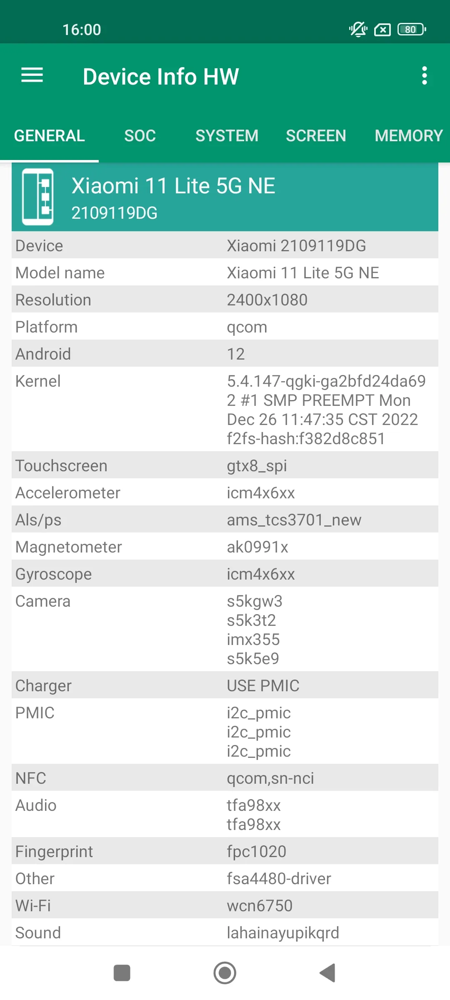{: width="180" .normal style="height:360px;object-fit:cover" }
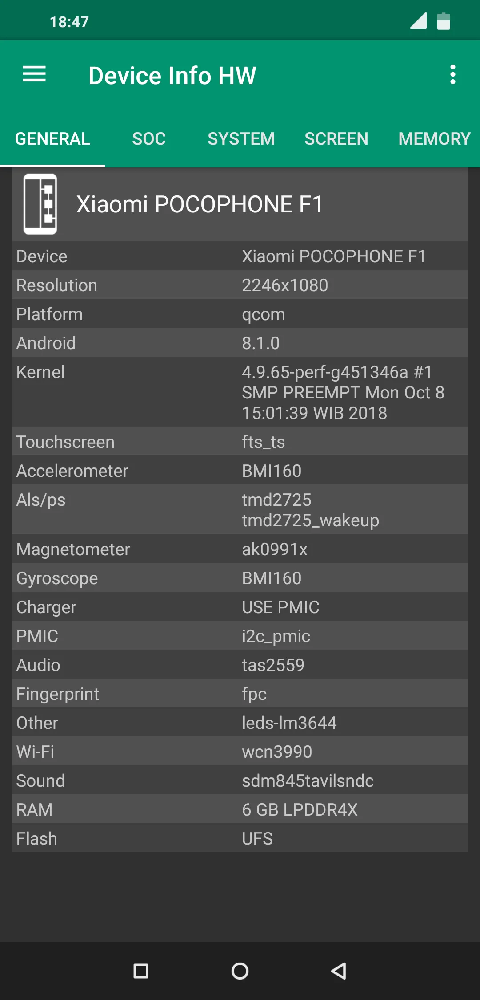{: width="180" .normal style="height:360px;object-fit:cover" }
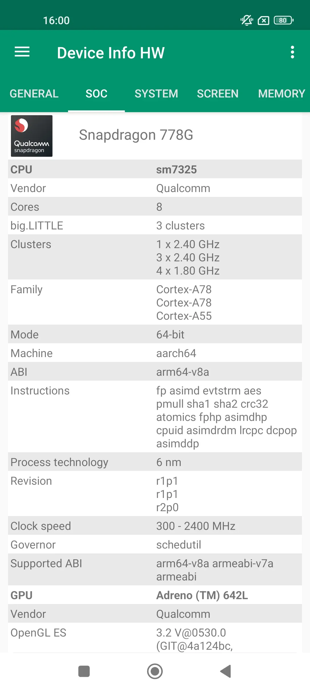{: width="180" .normal style="height:360px;object-fit:cover" }
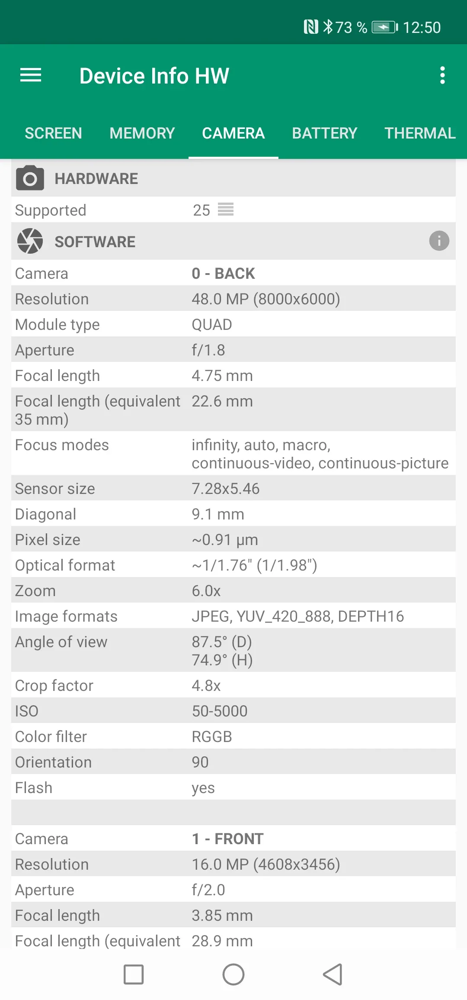{: width="180" .normal style="height:360px;object-fit:cover" }
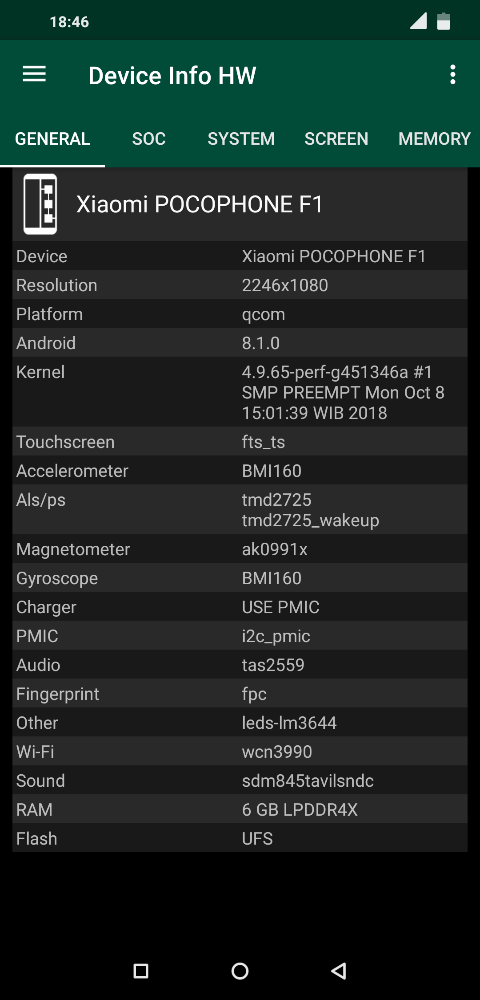{: width="180" .normal style="height:360px;object-fit:cover" }

Device Info HW คือ **แอปข้อมูลฮาร์ดแวร์** ที่แยกแต่ละส่วนประกอบ — CPU GPU แบตเตอรี่ กล้อง เซ็นเซอร์ พื้นที่จัดเก็บ — ด้วยมุมมองชัดเจนระดับส่วนประกอบ

**จุดแข็ง**
- **รายละเอียดระดับส่วนประกอบ** (เช่น เซ็นเซอร์กล้องแม่นยำ โมเดล GPU)
- **ข้อมูลแบตเตอรี่** รวมสุขภาพและรายละเอียดการชาร์จ
- **รายการเซ็นเซอร์** พร้อมค่าเรียลไทม์
- การรายงานเรียบและเลย์เอาต์เป็นมิตรการส่งออก
- ฟรีพร้อมอัปเกรด Pro

**จุดอ่อน**
- แค่ Android
- ไม่มีหน้าต่างลอยเรียลไทม์หรือการเตือนความร้อนเกิน
- ไม่ได้ออกแบบเป็นตัวตรวจสอบประสิทธิภาพ/เทอร์มอล

**เหมาะสำหรับ:** ผู้ใช้ที่อยากรู้แน่ชัดว่าอุปกรณ์มีอะไรภายใน

**ดาวน์โหลด Device Info HW**
- [Google Play](https://play.google.com/store/apps/details?id=ru.andr7e.deviceinfohw)

---

### 5. Droid Hardware Info — ดีที่สุดสเปกด่วน

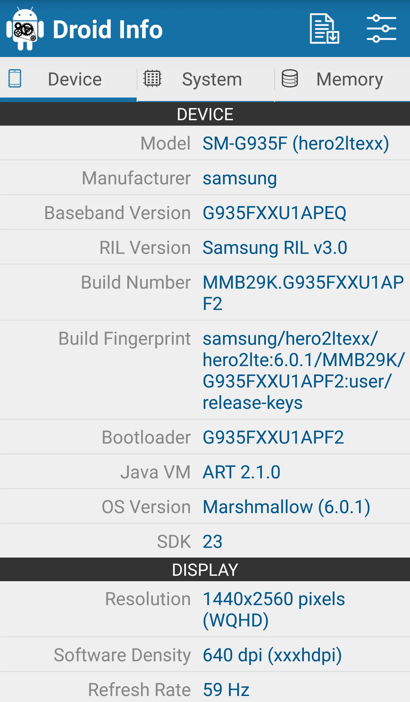{: width="180" .normal }
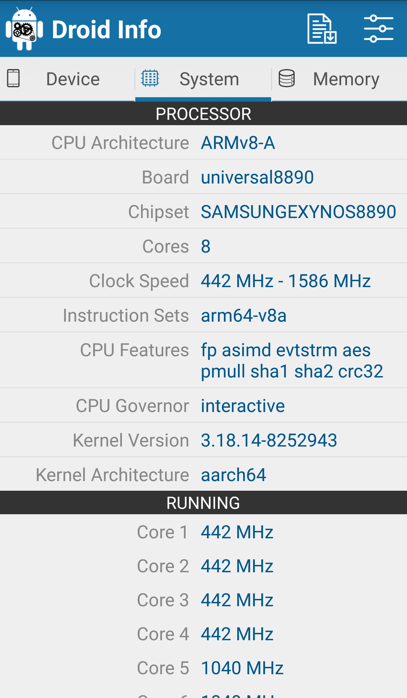{: width="180" .normal }
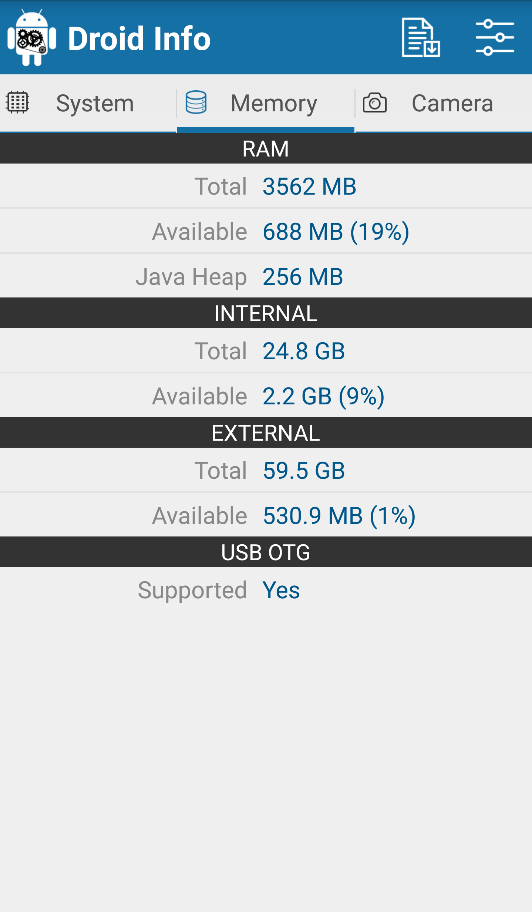{: width="180" .normal }
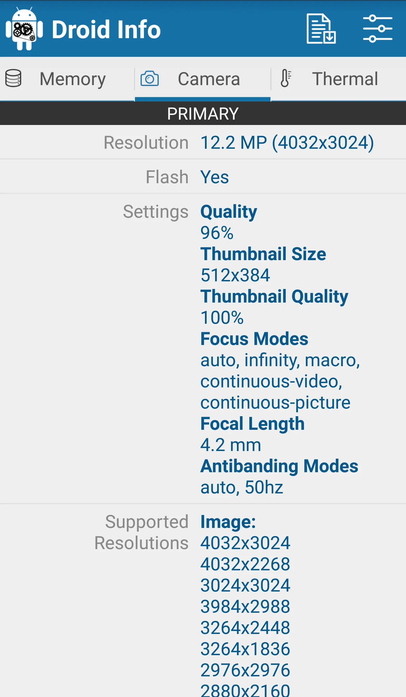{: width="180" .normal }

Droid Hardware Info คือ **ตัวแสดงสเปกเบา** ที่แสดงระบบ CPU GPU หน่วยความจำ กล้อง และรายละเอียดเซ็นเซอร์ในรายการเรียบง่าย

**จุดแข็ง**
- **รายการสเปกด่วนและเรียบง่าย** — ไม่ต้องตั้งค่า
- ครอบคลุม CPU GPU RAM พื้นที่จัดเก็บ กล้อง และเซ็นเซอร์
- เล็กมากและฟรี
- เหมาะสำหรับเช็คด่วนและแชร์สเปก
- ไม่มีบัญชีหรือโฆษณารำคาญ

**จุดอ่อน**
- แค่ Android; ไม่มีเวอร์ชัน iOS
- ไม่มีการตรวจสอบเรียลไทม์ วิดเจ็ต หรือหน้าต่างลอย
- ความลึกต่ำกว่า DevCheck หรือ AIDA64

**เหมาะสำหรับ:** ใครก็ตามที่อยากค่าอ่านสเปกอุปกรณ์เรียบและด่วน

**ดาวน์โหลด Droid Hardware Info**
- [Google Play](https://play.google.com/store/apps/details?id=com.inkwired.droidinfo)

---

### 6. System Monitor — ดีที่สุดเครื่องมือ all-in-one + cleaner

System Monitor คือ **เครื่องมือ Android all-in-one**: ตัวตรวจสอบ CPU cleaner พื้นที่จัดเก็บ RAM booster และหมอแบตเตอรี่ รักษาโทรศัพท์ให้เร็ว เย็น และเหมาะสม

**จุดแข็ง**
- **อุณหภูมิและความถี่ CPU** พร้อมประวัติและการตรวจสอบมัลติคอร์
- **Cleaner พื้นที่จัดเก็บ** สำหรับ junk/แคช และวิเคราะห์ RAM ด้วย One Tap Boost
- **ตัวตรวจสอบแบตเตอรี่** พร้อมสุขภาพ แรงดัน และเส้นโค้งอุณหภูมิ
- **การเตือนและป้องกันความร้อนเกิน** พลัสหน้าต่างลอยและวิดเจ็ต
- มัลติธีมและแกนฟรี

**จุดอ่อน**
- แค่ Android
- การทำความสะอาดเบากว่า cleaner เฉพาะทาง (โฟกัสการตรวจสอบ)
- บางฟีเจอร์อยู่หลังอัปเกรด Pro

**เหมาะสำหรับ:** ผู้ใช้ที่อยากการตรวจสอบพลัสการทำความสะอาดเบาในแอปเดียว

**ดาวน์โหลด System Monitor**
- [Google Play](https://play.google.com/store/apps/details?id=com.glgjing.marvel)

---

## เปรียบเทียบความสามารถแกน

| ความสามารถ | CPU Monitor | DevCheck | AIDA64 | Device Info HW | Droid Hardware Info | System Monitor |
|---|---|---|---|---|---|---|
| **แพลตฟอร์ม** | Android | Android, iOS | Android, iOS | Android | Android | Android |
| **อุณหภูมิ CPU เรียลไทม์** | ใช่ | บางส่วน | เซ็นเซอร์ | ไม่ | ไม่ | ใช่ |
| **ความถี่ / มัลติคอร์ CPU** | ใช่ | ใช่ | ใช่ | ไม่ | ไม่ | ใช่ |
| **การตรวจสอบ RAM** | ใช่ | ใช่ | ใช่ | บางส่วน | บางส่วน | ใช่ (boost) |
| **สุขภาพ / อุณหภูมิแบตเตอรี่** | ใช่ | ใช่ | ใช่ | ใช่ | ไม่ | ใช่ |
| **รายการเซ็นเซอร์** | บางส่วน | ใช่ | ใช่ | ใช่ | ใช่ | บางส่วน |
| **หน้าต่างลอย** | ใช่ | ไม่ | ไม่ | ไม่ | ไม่ | ใช่ |
| **วิดเจ็ต** | ใช่ | ใช่ | ไม่ | ไม่ | ไม่ | ใช่ |
| **การเตือนความร้อนเกิน** | ใช่ | ไม่ | ไม่ | ไม่ | ไม่ | ใช่ |
| **Boost / cleaner หนึ่งแตะ** | ใช่ (boost) | ไม่ | ไม่ | ไม่ | ไม่ | ใช่ (boost + clean) |
| **รายงานสเปกเจาะลึก** | บางส่วน | แข็งแกร่ง | แข็งแกร่ง | แข็งแกร่ง | พื้นฐาน | บางส่วน |
| **ระดับฟรี / โฆษณา** | แกนฟรี | ฟรี + Pro | ฟรี (ไม่มีโฆษณา) | ฟรี + Pro | ฟรี | แกนฟรี |
| **ต้อง root** | ไม่ | ไม่ | ไม่ | ไม่ | ไม่ | ไม่ |

---

## ทางเลือก CPU-Z ตัวไหนเหมาะกับผู้ใช้แต่ละประเภท

ตารางจัดอันดับฟีเจอร์; ที่นี่หกแอปจัดกลุ่มตาม *สิ่งที่คุณอยากได้จริงจากแอปฮาร์ดแวร์*

- **แดชบอร์ดเรียลไทม์ ไม่ใช่แผ่นสเปก** — รายชื่อสั้น **ทางเลือก CPU-Z ที่ดีที่สุด Android** เริ่มจาก CPU Monitor: อุณหภูมิเรียลไทม์ ความถี่ต่อคอร์ หน้าต่างลอย และการเตือนความร้อนเกิน
- **รายงานฮาร์ดแวร์เจาะลึกที่สุด** — **ทางเลือก DevCheck** หรือ **ทางเลือก AIDA64** ยังเหนือกว่าเรื่องรายละเอียด SoC GPU จอแสดงผล และเซ็นเซอร์ Device Info HW ก้าวต่อส่วนประกอบ; Droid Hardware Info คือค่าอ่านฟรีด่วน
- **ชุดเครื่องมือระบบเต็ม** — **ทางเลือก 3C Toolbox** คือตัวเลือกหนักกว่าพร้อมการตรวจสอบ สถิติแบตเตอรี่ และการปรับแต่งในการติดตั้งเดียว
- **กราฟอ่านอย่างเดียวเรียบ** — **ทางเลือก Simple System Monitor** ให้เส้นโค้ง CPU RAM และเครือข่ายโดยไม่มีการอ้างประสิทธิภาพ
- **สุขภาพแบตเตอรี่แทนอุณหภูมิ CPU** — **ทางเลือก AccuBattery** คือคู่ที่ถูกต้องหากอุณหภูมิการชาร์จและรอบการชาร์จเป็นที่สนใจ

การค้นหาอื่นสองอันลงจอดที่นี่แต่ชี้ออกจากหกแอปนี้: **ทางเลือก CPU Float** มักเป็นคำขอสำหรับค่าอ่าน CPU เล็กที่อยู่เหนือเสมอ ไม่ใช่แดชบอร์ดเต็ม และ **ทางเลือก Cooler Master** ว่าด้วยฮาร์ดแวร์พีซีหรืออุปกรณ์เสริมทำความเย็น ไม่ใช่แอปตรวจสอบ Android ไม่มีตัวแทนใดอ่านเซ็นเซอร์ความร้อนเรียลไทม์

ไม่ว่าป้ายจะเรียกว่าอะไร ตรวจสอบสองสิ่งก่อนย้าย: แอปอ่านเซ็นเซอร์ความร้อนแท้จริงโดยไม่ต้อง root หรือไม่ และระดับฟรียังรวมหน้าต่างลอยหรือวิดเจ็ตที่คุณใช้งานจริงหรือไม่

## วิธีเลือก

- อยาก **อุณหภูมิเรียลไทม์ + หน้าต่างลอย + การเตือนความร้อนเกิน** → **CPU Monitor**
- อยาก **รายงานฮาร์ดแวร์และเซ็นเซอร์ละเอียดที่สุด** → **DevCheck** หรือ **AIDA64**
- อยาก **สเปกระดับส่วนประกอบ (กล้อง/GPU)** → **Device Info HW**
- อยาก **ค่าอ่านสเปกฟรีด่วน** → **Droid Hardware Info**
- อยาก **การตรวจสอบ + cleaner + booster ในที่เดียว** → **System Monitor**

## วิธีโยกย้ายจาก CPU-Z

1. **ตัดสินว่าคุณเช็คจริงๆ อะไร** — สเปกครั้งเดียว หรืออุณหภูมิเรียลไทม์ขณะเล่นเกม
2. **ติดตั้งตัวตรวจสอบ** (CPU Monitor หรือ System Monitor) และให้สิทธิ์โอเวอร์เลย์สำหรับหน้าต่างลอย
3. **เพิ่มวิดเจ็ต** ไปยังหน้าจอหลักสำหรับ CPU/RAM/แบตเตอรี่เหลียวเดียว
4. **เปิดการเตือนความร้อนเกิน** หากคุณเล่นเกมหรือชาร์จหนัก เพื่อถูกเตือนก่อน throttling
5. **ใช้ boost หรือ cleaner หนึ่งแตะ** (boost CPU Monitor cleaner System Monitor) เพื่อปลดหน่วยความจำเมื่อโทรศัพท์รู้สึกช้า

## คำถามที่พบบ่อย

**CPU Monitor คือทางเลือก CPU-Z ที่ดีที่สุดไหม?**
{:.faq-q}
สำหรับการตรวจสอบเรียลไทม์ ใช่ CPU Monitor คือคู่ที่ใกล้ที่สุดหากคุณอยากอุณหภูมิ CPU/แบตเตอรี่เรียลไทม์ หน้าต่างลอย วิดเจ็ต และการเตือนความร้อนเกิน — สิ่งที่ CPU-Z ไม่ทำ

**ทางเลือก CPU-Z ตัวไหนแสดงอุณหภูมิเรียลไทม์ตามเวลา?**
{:.faq-q}
CPU Monitor และ System Monitor ทั้งสองแมปอุณหภูมิเป็นเส้นโค้ง; DevCheck และ AIDA64 แสดงค่าเซ็นเซอร์เรียลไทม์ แต่ไม่มีประวัติต่อเนื่อง

**ทางเลือก CPU-Z ตัวไหนมีรายงานสเปกเจาะลึกที่สุด?**
{:.faq-q}
DevCheck และ AIDA64 คือตัวรายงานสเปกแข็งแกร่งที่สุด; Device Info HW เพิ่มรายละเอียดระดับส่วนประกอบเช่น โมเดลกล้อง/GPU แม่นยำ

**CPU Monitor ฟรีไหม?**
{:.faq-q}
ใช่ ตัวตรวจสอบแกน — อุณหภูมิเรียลไทม์ หน้าต่างลอย วิดเจ็ต และการเตือนความร้อนเกิน — ฟรี; ปลดล็อกเลือกได้ปลดล็อกธีมและประวัติที่ลึกกว่า

[หน้าแอป CPU Monitor](/th/apps/cpu-monitor/) — มีให้บน Android

## ศัพท์ที่เกี่ยวข้อง

- [ตัวตรวจสอบอุณหภูมิ CPU คืออะไร?](/th/glossary/what-is-a-cpu-temperature-monitor/)
- [ตัวตรวจสอบระบบคืออะไร?](/th/glossary/what-is-a-system-monitor/)
