Crosshair Hero เพิ่มครอสแฮร์เฉพาะเหนือเกมยิงของคุณ แต่ **ขอบเขตสไตล์ การควบคุมเรียลไทม์ และขีดจำกัดฟรี** ทำให้ผู้เล่นบางคนอยากมากกว่า หากคุณอยากควบคุมละเอียดขึ้น สไตล์เพิ่ม หรือโอเวอร์เลย์เบากว่า หมวดนี้มีตัวเลือกที่สุกงอม

ด้านล่างเราเปรียบเทียบหก **[ทางเลือก Crosshair Hero](/th/glossary/what-is-a-crosshair/)** — ทั้งหมดเป็นโอเวอร์เลย์ปลอดภัย โดยไม่รูทที่วาดครอสแฮร์เหนือเกม FPS ใดก็ได้ — ตั้งแต่ราคา การปรับแต่ง ไปจนฟีเจอร์ที่สำคัญจริง

## ทำไมจึงมองข้าม Crosshair Hero

- **ขอบเขตสไตล์และสีจำกัด** เทียบแอปครอสแฮร์เฉพาะทาง
- **ควบคุมเรียลไทม์น้อย** — ปรับขณะเล่นอาจ awkward
- **โฆษณาหรือ paywall** บนสไตล์ที่คุณต้องการ
- **โอเวอร์เลย์หนักกว่า** อาจรู้สึกกวนขณะแข่งเร็ว
- คุณอาจอยาก **โปรไฟล์ต่อเกม** หรือนำเข้ารูปที่ไม่มีให้

## ทางเลือก Crosshair Hero ที่ดีที่สุดแบบคร่าวๆ

| แอป | ราคา (2026) | สไตล์ | การปรับแต่ง | ตั้งค่าขณะเล่น |
|---|---|---|---|---|
| **Crosshair Aim** | ฟรี + ปลดล็อก | 15+ | ขนาด/สี/สเกล/ตำแหน่ง | ใช่ |
| **Custom Crosshair** | ฟรี + Pro | มากมาย + ภาพเคลื่อนไหว | ขนาด/สี/ดีไซน์ | ใช่ |
| **Custom Aim** | ฟรี + Pro | ตัวสร้างพรีเซ็ต | เต็ม (รูปทรง/สี/ขนาด) | ใช่ |
| **Crosshair Pro** | ฟรี + IAP | พื้นฐาน/Pro/ความแม่นยำ | สี ขนาด ตำแหน่ง | ใช่ (เรียลไทม์) |
| **CrossAim** | ฟรี + IAP | 24 สไตล์ | สี ขนาด | ใช่ |
| **Crosshair PRO** | ฟรี + IAP | ชุด Pro | โอเวอร์เลย์ที่ปรับแต่งได้ | ใช่ |

---

### 1. Crosshair Aim — โอเวอร์เลย์ที่ปรับแต่งได้สุด

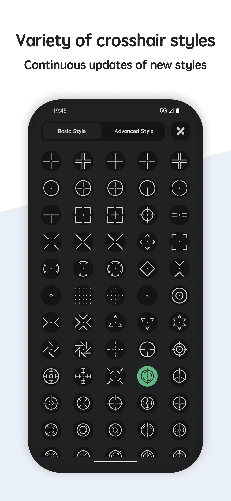{: width="180" .normal }
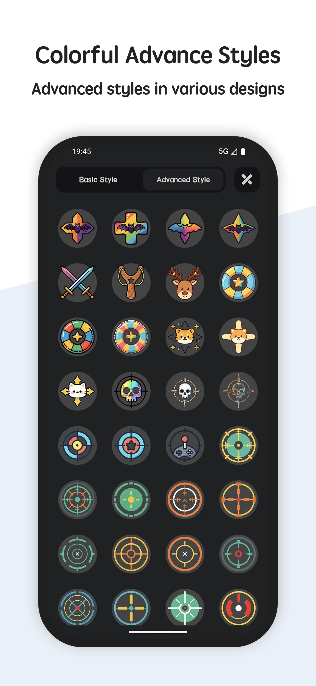{: width="180" .normal }
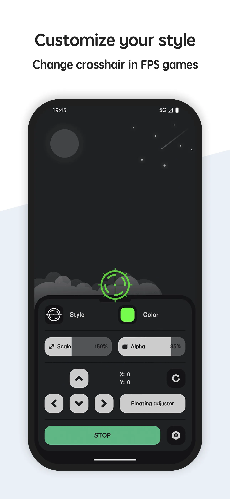{: width="180" .normal }
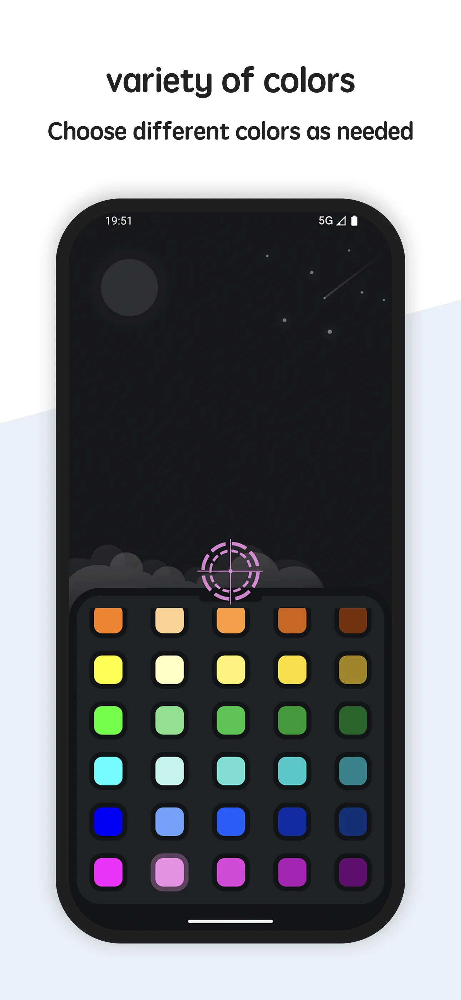{: width="180" .normal }

Crosshair Aim คือ **แอปครอสแฮร์สำหรับเกม FPS** ด้วยสไตล์ 80+ การควบคุมเต็มขนาด/สี/สเกล/ตำแหน่ง โอเวอร์เลย์โปร่งใส (ค่าเริ่มต้น 85%) และตัวตั้งค่าลอยขณะเล่น

**จุดแข็ง**
- **สไตล์ครอสแฮร์ 80+** ครอบคลุมจุด กากบาท วงกลม และอื่นๆ
- **ปรับแต่งเต็ม** — ขนาด สี สเกล และตำแหน่งจอ
- **ตัวตั้งค่าลอยขณะเล่น** ให้ตั้งค่าจุดเล็งโดยไม่ออกแมตช์
- **โอเวอร์เลย์โปร่งใสโดยไม่รูท** ทำงานในเกมยิงแทบทุกเกม
- สามารถสร้างครอสแฮร์แม้สำหรับอาวุธที่ไม่มีให้
- ฟรีใช้กับสไตล์พื้นฐาน; สไตล์ขั้นสูงผ่าน Pro

**จุดอ่อน**
- แค่ Android — ไม่มีเวอร์ชัน iOS
- ค่าดีสุดต้องปลด Pro สำหรับสไตล์พรีเมียม
- ไม่มีนำเข้า PNG สำหรับรูปทรงที่กำหนดเองเต็มที่

**เหมาะสำหรับ:** ผู้เล่นที่อยากสไตล์มากมายและปรับแต่งตรงขณะเล่น

**ดาวน์โหลด Crosshair Aim**
- [Google Play](https://play.google.com/store/apps/details?id=com.glgjing.crosshair.aim.fps.game)

---

### 2. Custom Crosshair — สไตล์ภาพเคลื่อนไหวดีสุด

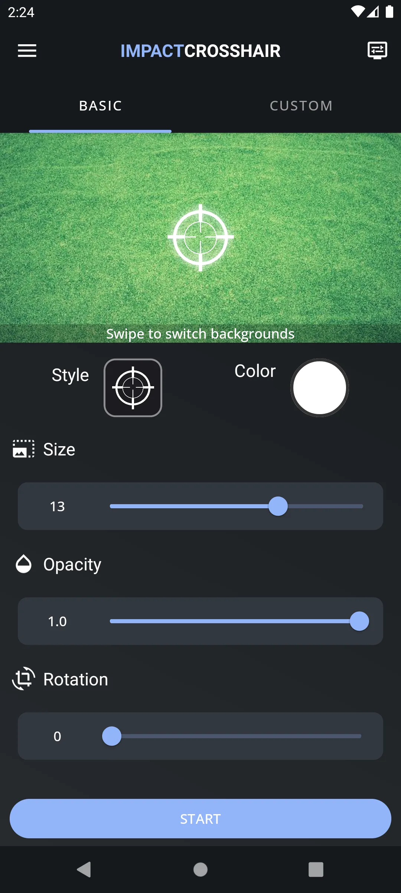{: width="180" .normal }
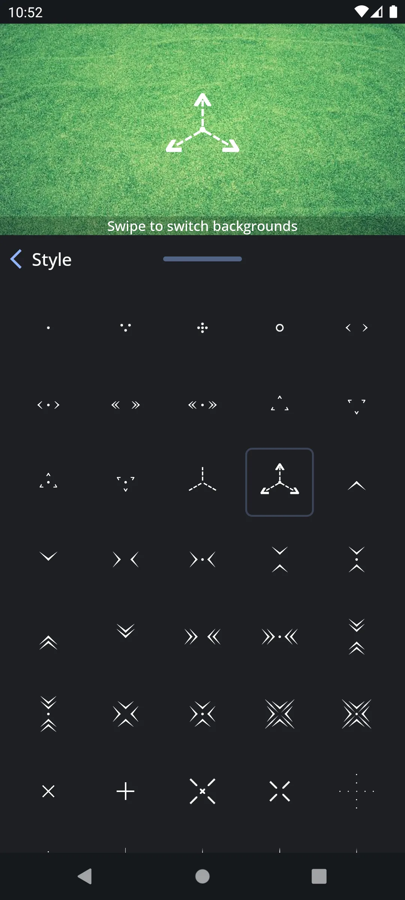{: width="180" .normal }
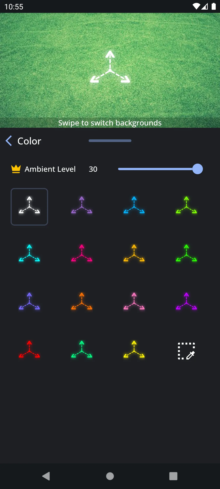{: width="180" .normal }
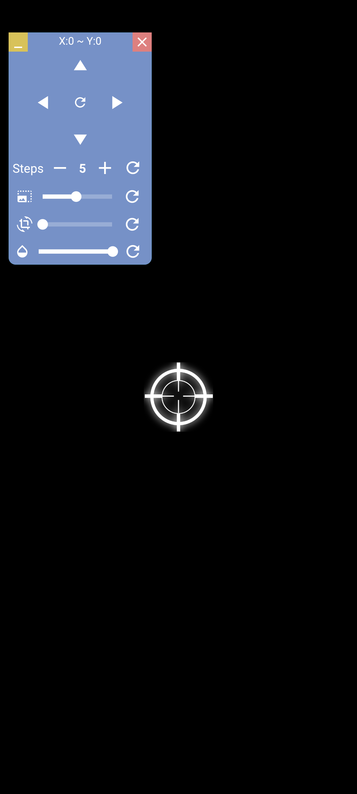{: width="180" .normal }

Custom Crosshair (Impact Crosshair) คือ **เครื่องมือโอเวอร์เลย์** ยอดนิยมด้วยติดตั้ง 500,000+ ตัวสร้างครอสแฮร์ โอเวอร์เลย์เรียลไทม์ และจุดเล็งเคลื่อนไหวสำหรับเกม FPS และ TPS

**จุดแข็ง**
- **ตัวสร้างครอสแฮร์** ด้วยขนาด สี และดีไซน์ที่ปรับได้
- **โอเวอร์เลย์เรียลไทม์** แสดงขณะเล่นเกมยิงที่รองรับ
- **ภาพเคลื่อนไหวครอสแฮร์** สำหรับลุคส์ไดนามิกกว่า
- ฐานผู้ใช้ใหญ่และอัปเดตสม่ำเสมอ
- ฟรีเริ่มต้น พร้อมชั้น Pro สำหรับตัวเลือกขั้นสูง

**จุดอ่อน**
- แค่ Android
- บางภาพเคลื่อนไหวและตัวสร้างขั้นสูงอยู่หลัง Pro
- UI อาจรู้สึกแออัดข้างแอป minimalist

**เหมาะสำหรับ:** ผู้เล่นที่อยากจุดเล็งเคลื่อนไหว  expressive และชุมชนใหญ่

**ดาวน์โหลด Custom Crosshair**
- [Google Play](https://play.google.com/store/apps/details?id=com.devayulabs.crosshair)

---

### 3. Custom Aim — ตัวสร้างครอสแฮร์ดีสุด

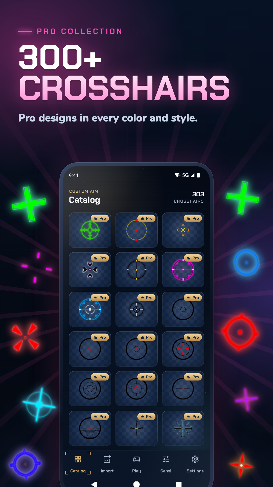{: width="180" .normal }
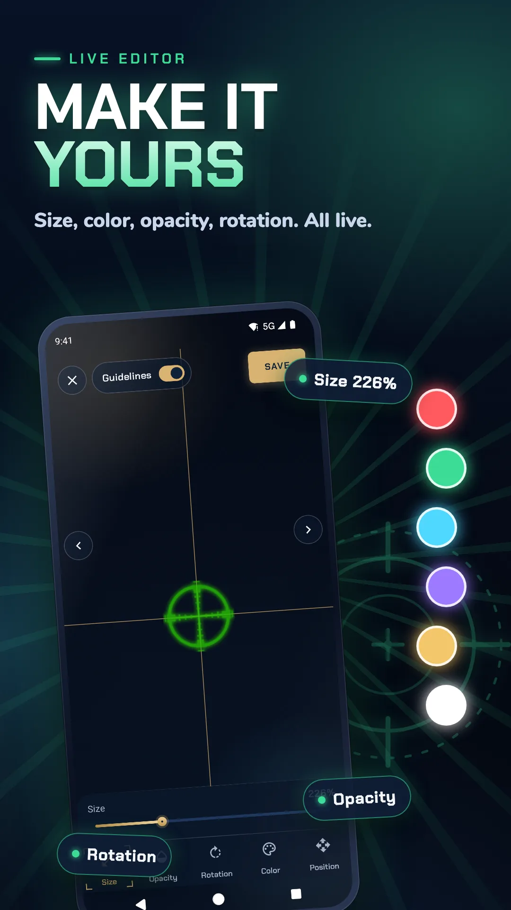{: width="180" .normal }
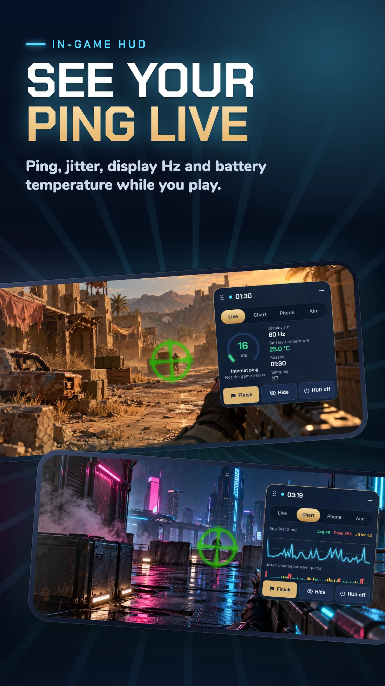{: width="180" .normal }
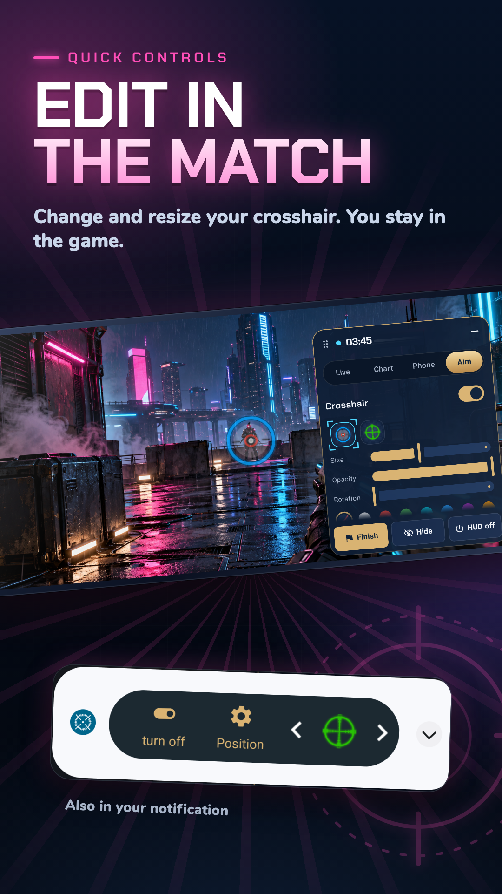{: width="180" .normal }

Custom Aim (Crosshair Generator Pro) ให้คุณ **สร้างโอเวอร์เลย์ครอสแฮร์ที่กำหนดเอง** ในเกม FPS ยิงใดก็ได้ ด้วยพรีเซ็ตและควบคุมรูปทรง/สี/ขนาดลึก

**จุดแข็ง**
- **พรีเซ็ตสไตล์ตัวสร้าง** พลัสควบคุมแมนนวลเต็มรูปทรง สี และขนาด
- **โอเวอร์เลย์ทำงานใน FPS/TPS ใดก็ได้** โดยไม่เปลี่ยนเกม
- เบาและเปิด/ปิดง่าย
- แกนฟรีพร้อมอัปเกรด Pro สำหรับสไตล์เพิ่ม
- ไม่ต้องรูท

**จุดอ่อน**
- แค่ Android
- คู่มือน้อยสำหรับผู้ใช้มือใหม่
- ไม่มีซิงค์โปรไฟล์ต่อเกมข้ามอุปกรณ์ (ไม่มีบัญชี)

**เหมาะสำหรับ:** ผู้คลั่งที่อยากออกแบบจุดเล็งเองจากศูนย์

**ดาวน์โหลด Custom Aim**
- [Google Play](https://play.google.com/store/apps/details?id=com.itdeveapps.customaim)

---

### 4. Crosshair Pro — จัดตำแหน่งเรียลไทม์ดีสุด

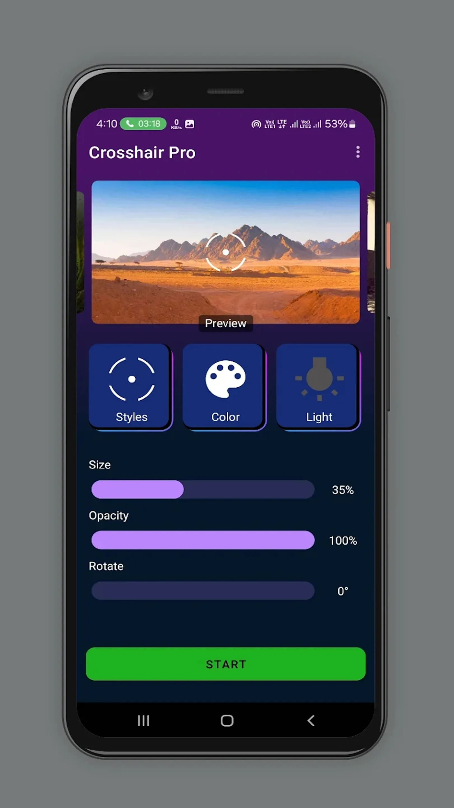{: width="180" .normal }
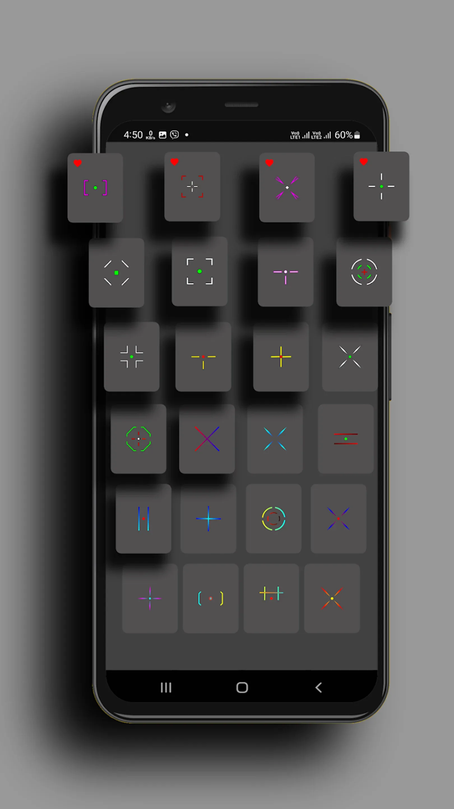{: width="180" .normal }
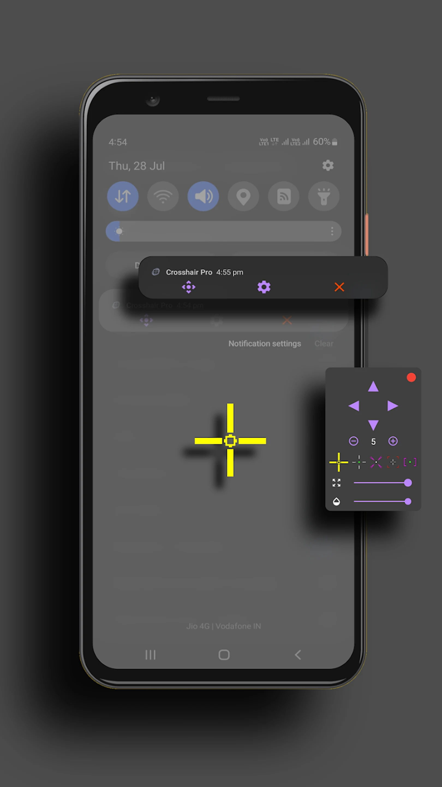{: width="180" .normal }
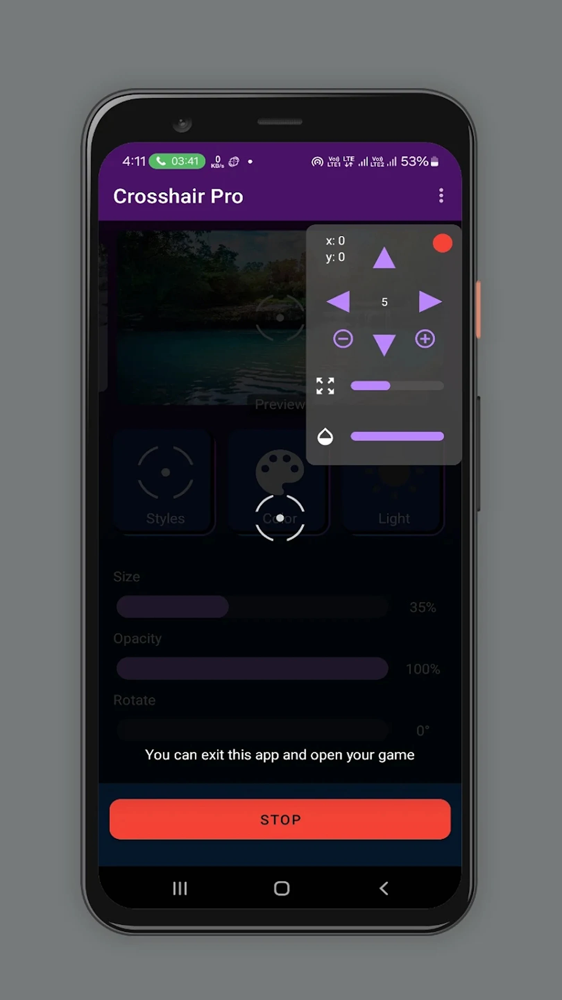{: width="180" .normal }

Crosshair Pro: Custom Scope คือยูทิลิตี้มือถือที่วาง **โอเวอร์เลย์ scope ความแม่นยำ**  anywhere บนจอ ปรับได้เรียลไทม์ขณะเล่น ด้วยความเข้ากันได้ FPS กว้าง

**จุดแข็ง**
- **วางครอสแฮร์ anywhere** และปรับขณะเล่นเรียลไทม์
- **เกม FPS หลักทั้งหมด** รองรับด้วยความเข้ากันได้ดี
- ชุดคลาสสิกและ pro เพื่อเข้ากับสไตล์ยิงของคุณ
- UI เรียบง่ายและโฟกัส
- ฟรีพร้อมซื้อในแอป

**จุดอ่อน**
- แค่ Android
- ความหลากหลายสไตล์แคบกว่าแอปตัวสร้าง
- ชุดกั้น IAP อาจสะสม

**เหมาะสำหรับ:** ผู้เล่นที่ใส่ใจจัดตำแหน่งความแม่นยำเรียลไทม์สุด

**ดาวน์โหลด Crosshair Pro**
- [Google Play](https://play.google.com/store/apps/details?id=com.customscopecommunity.crosshairpro)

---

### 5. CrossAim — ชุดสไตล์เรียบง่ายดีสุด

{: width="180" .normal }
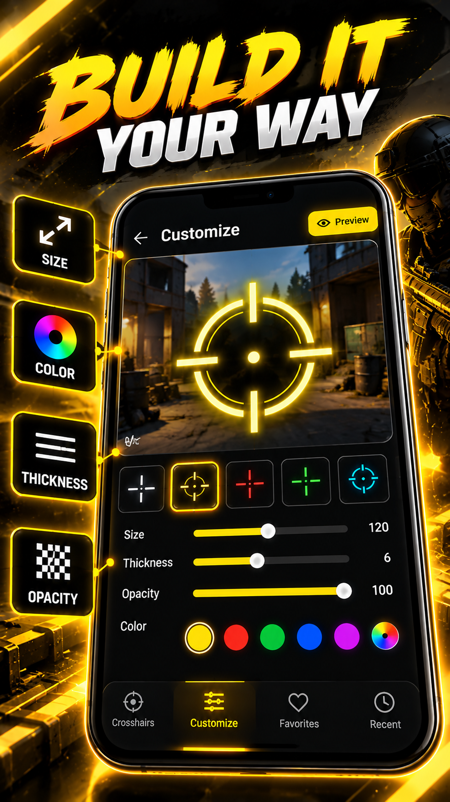{: width="180" .normal }
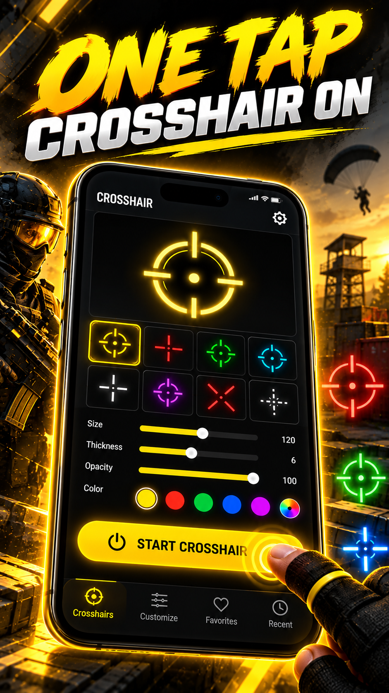{: width="180" .normal }
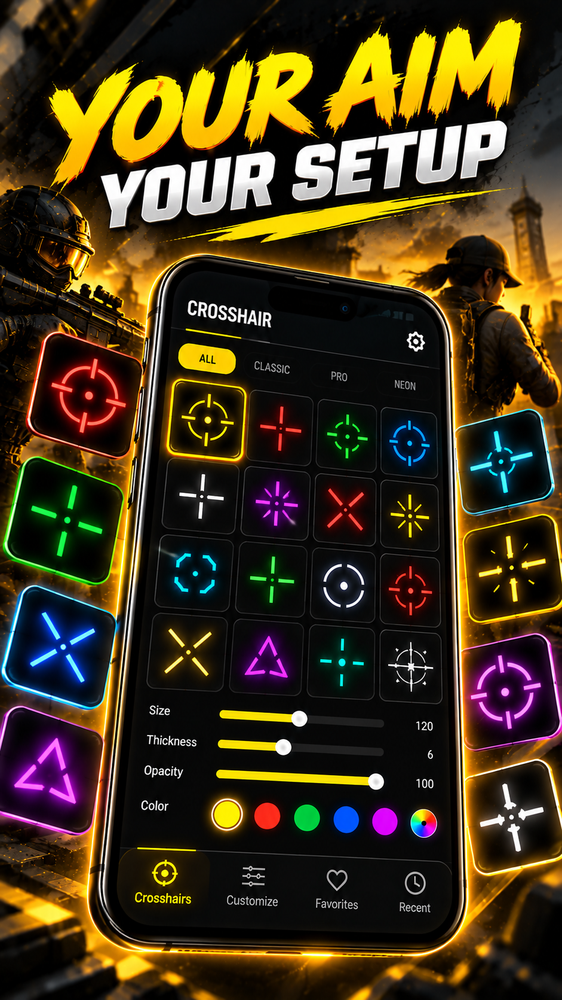{: width="180" .normal }
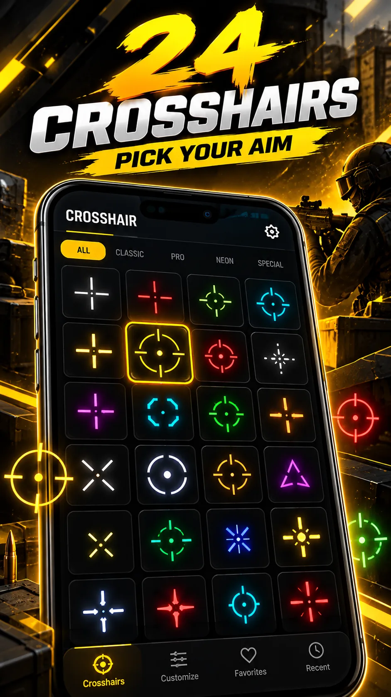{: width="180" .normal }

CrossAim: Custom Crosshair เสนอ **24 สไตล์** พร้อมสีและขนาด เครื่องมือโอเวอร์เลย์สะอาดสำหรับสลับจุดเล็งด่วน

**จุดแข็ง**
- **24 สไตล์พร้อมใช้** ครอบคลุมลุคส์จุดเล็งทั่วไป
- ปรับสีและขนาดง่าย
- โอเวอร์เลย์ minimal และเร็วด้วย overhead ต่ำ
- ฟรีลองกับ IAP สำหรับเพิ่มเติม
- ไม่ต้องรูท

**จุดอ่อน**
- แค่ Android
- ตัวเลือกปรับแต่งลึกน้อยกว่าแอปตัวสร้าง
- ชุดฟีเจอร์โดยรวมเล็กกว่า

**เหมาะสำหรับ:** ผู้เล่นที่อยากจุดเล็งด่วนและสะอาดโดยไม่ยุ่งยาก

**ดาวน์โหลด CrossAim**
- [Google Play](https://play.google.com/store/apps/details?id=com.crosshair.customcrosshair.aimreticle)

---

### 6. Crosshair PRO — ชุดโอเวอร์เลย์ pro ดีสุด

{: width="180" .normal }
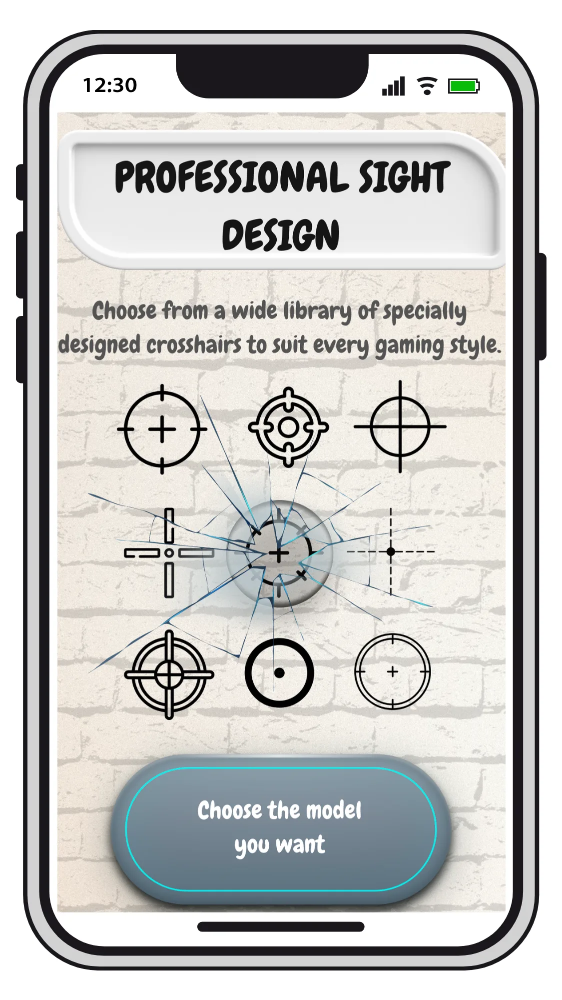{: width="180" .normal }
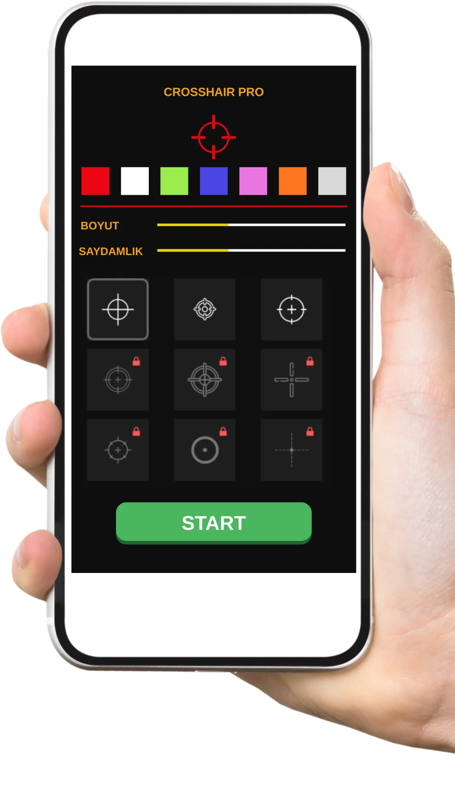{: width="180" .normal }
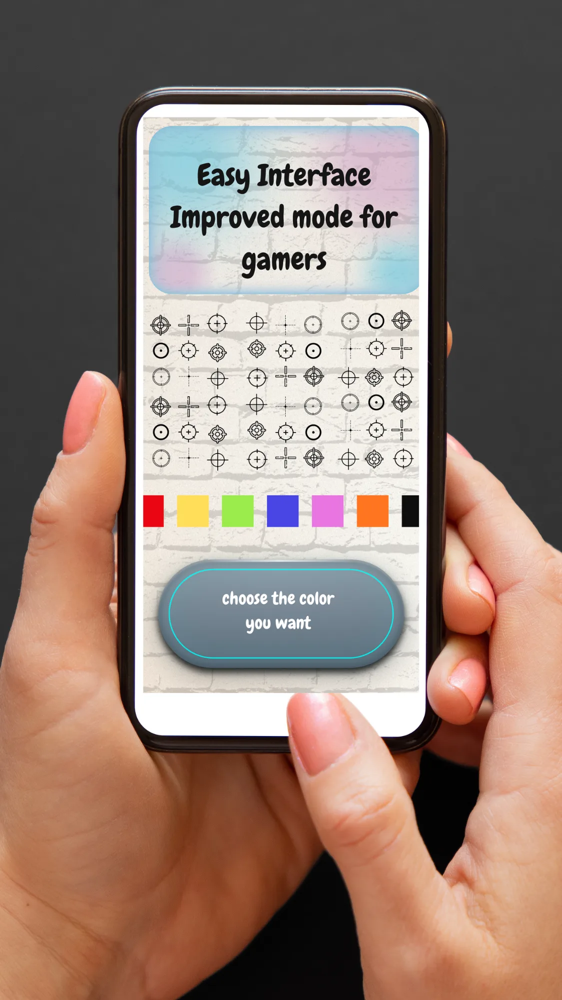{: width="180" .normal }

Crosshair PRO (Custom Scope) คือ **เครื่องมือโอเวอร์เลย์สำหรับแฟน FPS และ TPS** ด้วย scope ที่ปรับแต่งได้และรอยเท้าเบา

**จุดแข็ง**
- **โอเวอร์เลย์ระดับโปร** ออกแบบเพื่อยกระดับ aim
- สไตล์ สี และขนาด scope ที่ปรับแต่งได้
- เบาและเสถียรขณะเล่น
- ฟรีพร้อมซื้อในแอป
- ไม่ต้องรูท

**จุดอ่อน**
- แค่ Android
- ทับซ้อนฟีเจอร์กับ Crosshair Pro อาจสับสนการเลือก
- สไตล์ดีสุดอยู่หลัง IAP

**เหมาะสำหรับ:** ผู้เล่นที่อยากโอเวอร์เลย์ scope สไตล์โปรและโฟกัส

**ดาวน์โหลด Crosshair PRO**
- [Google Play](https://play.google.com/store/apps/details?id=com.redcliff.customcrosshair)

---

## เปรียบเทียบความสามารถหลัก

| ความสามารถ | Crosshair Aim | Custom Crosshair | Custom Aim | Crosshair Pro | CrossAim | Crosshair PRO |
|---|---|---|---|---|---|---|
| **แพลตฟอร์ม** | Android | Android | Android | Android | Android | Android |
| **โอเวอร์เลย์โดยไม่รูท** | ใช่ | ใช่ | ใช่ | ใช่ | ใช่ | ใช่ |
| **จำนวนสไตล์ / พรีเซ็ต** | 15+ | มากมาย + ภาพเคลื่อนไหว | ตัวสร้าง | พื้นฐาน/Pro/ความแม่นยำ | 24 | ชุด Pro |
| **การปรับแต่ง** | ขนาด/สี/สเกล/ตำแหน่ง | ขนาด/สี/ดีไซน์ | เต็ม (รูปทรง/สี/ขนาด) | สี ขนาด ตำแหน่ง | สี ขนาด | ปรับแต่งได้ |
| **ตัวตั้งค่าขณะเล่น** | ใช่ | ใช่ | ใช่ | ใช่ (เรียลไทม์) | ใช่ | ใช่ |
| **นำเข้า PNG / รูปทรงที่กำหนดเอง** | ไม่ | ไม่ | บางส่วน | ไม่ | ไม่ | ไม่ |
| **โปรไฟล์ต่อเกม** | ไม่ | ไม่ | ไม่ | ไม่ | ไม่ | ไม่ |
| **ภาพเคลื่อนไหว** | ไม่ | ใช่ | ไม่ | ไม่ | ไม่ | ไม่ |
| **โฆษณา / IAP** | ปลดล็อก | ฟรี + Pro | ฟรี + Pro | ฟรี + IAP | ฟรี + IAP | ฟรี + IAP |
| **ประสิทธิภาพ (overhead ต่ำ)** | ดี | ดี | ดี | ดี | เบา | เบา |
| **ชั้นฟรี** | ใจกว้าง | ใช่ | ใช่ | ใช่ | ใช่ | ใช่ |
| **ปลอดภัยเกม (ไม่บัญชี/รูท)** | ใช่ | ใช่ | ใช่ | ใช่ | ใช่ | ใช่ |

---

## วิธีเลือก

- อยาก **15+ สไตล์ + ปรับแต่งตรงขณะเล่น** → **Crosshair Aim**
- อยาก **จุดเล็งเคลื่อนไหว expressive** → **Custom Crosshair**
- อยาก **ออกแบบเองจากศูนย์** → **Custom Aim**
- อยาก **จัดตำแหน่งความแม่นยำเรียลไทม์** → **Crosshair Pro**
- อยาก **ชุด 24 สไตล์ด่วนและสะอาด** → **CrossAim**
- อยาก **โอเวอร์เลย์ scope โปรที่โฟกัส** → **Crosshair PRO**

มองแต่ละตัวเป็น **ทางเลือก Crosshair Hero**: **ทางเลือก Custom Crosshair** สำหรับแฟนจุดเล็งเคลื่อนไหว **ทางเลือก Custom Aim** สำหรับผู้สร้างจากศูนย์ **ทางเลือก CrossAim** สำหรับชุด 24 สไตล์ด่วน **ทางเลือก Crosshair Pro** สำหรับจัดตำแหน่งเรียลไทม์ และ **ทางเลือก Crosshair PRO** สำหรับ scope โปร ผู้ใช้ iOS ได้ **ทางเลือก Crosshair X** เป็นตัวเลือกข้ามแพลตฟอร์มเดียว ทั้งหมดเป็นโอเวอร์เลย์ **custom crosshair Android** — โดยไม่รูท ปลอดภัยใช้

หากคุณมาที่นี่หา **ทางเลือก Crosshair Hero android ที่ดีที่สุด** เริ่มจาก Crosshair Aim สำหรับควบคุมตรงขณะเล่น หรือ Custom Crosshair สำหรับจุดเล็งเคลื่อนไหว

## วิธีโยกย้ายจาก Crosshair Hero

1. **จดเกม** ที่ใช้ครอสแฮร์ที่กำหนดเอง (เช่น PUBG Mobile Free Fire CODM)
2. **เลือกผู้แทน** จากตารางตามปริมาณการปรับแต่งที่คุณต้องการ
3. **ให้สิทธิ์แสดง-เหนือแอปอื่น** ให้โอเวอร์เลย์วาดเหนือเกม
4. **สร้างจุดเล็งใหม่** — ตั้งสไตล์ สี ขนาด และตำแหน่งให้เข้ากับที่คุณมี
5. **ทดสอบในแมตช์** และใช้ตัวตั้งค่าขณะเล่นเพื่อปรับตำแหน่งก่อนเล่นแข่ง

## คำถามที่พบบ่อย

**Crosshair Aim คือทางเลือก Crosshair Hero ที่ดีที่สุดไหม?**
{:.faq-q}
หากคุณอยากสไตล์ 80+ พลัสตัวตั้งค่าลอยตรงขณะเล่น (ขนาด สี ตำแหน่ง ความโปร่งใส) และจุดเล็งสำหรับอาวุธที่ไม่มีให้ แน่นอน — Crosshair Aim นำในการควบคุม Custom Crosshair ชนะในจุดเล็งเคลื่อนไหว Custom Aim ในการออกแบบจากศูนย์

**ทางเลือกไหนมีครอสแฮร์เคลื่อนไหว?**
{:.faq-q}
Custom Crosshair (Impact Crosshair) คือตัวเดียวที่มีจุดเล็งเคลื่อนไหว; Crosshair Aim และอื่นๆ นิ่ง

**ทางเลือกไหนคล้าย Crosshair Hero ที่สุด?**
{:.faq-q}
Crosshair Hero (อภิปรายในคู่มือ vs) และ CrossAim คือพรีเซ็ตใกล้สุด; Crosshair Aim คือตัวเลือกลึกและปรับแต่งได้กว่า

**Crosshair Aim ฟรีไหม?**
{:.faq-q}
ใช่ ชุดสไตล์พื้นฐานฟรีและไม่มีโฆษณา; ปลดล็อก Pro เปิดคลังเต็ม

[หน้าแอป Crosshair Aim](/th/apps/cross-hair/) — มีให้บน Android

## ศัพท์ที่เกี่ยวข้อง

- [ครอสแฮร์คืออะไร?](/th/glossary/what-is-a-crosshair/)
