Day One คือไดอารี่ที่เก่งกาจ แต่ **สมาชิก ~$35/ปี** และโมเดลคลาวด์ของมันไม่เหมาะกับทุกคน หากคุณอยากส่วนตัวกว่า โฟกัสอารมณ์กว่า หรือแค่ถูกกว่า ตัวเลือกไดอารี่อื่นก็แข็งแกร่ง

ด้านล่างเราเปรียบเทียบหก **ทางเลือก Day One** — จาก [ไดอารี่อารมณ์](/th/glossary/what-is-a-mood-tracker/) ส่วนตัวน่ารัก ถึงไดอารี่ข้ามแพลตฟอร์มและบันทึกอารมณ์จุลภาค — ด้านราคา แพลตฟอร์ม และความสามารถที่ตัดสินจริง ผู้อ่านส่วนใหญ่มาพร้อมอุปสรรคหนึ่ง — สมาชิก บัญชีคลาวด์ หรือไดอารี่ที่กรอกนานเกินไป — ดังนั้นแต่ละตัวเลือกจึงจัดกรอบตามเหตุผลนั้น

## ทำไมถึงหาทางเลือกนอก Day One

{: width="180" .normal }
{: width="180" .normal }
{: width="180" .normal }
{: width="180" .normal }
{: width="180" .normal }

- **สมาชิกปีเสียเงิน** (~$35/ปีใน 2026) สำหรับฟีเจอร์ที่คนใช้บ่อยที่สุด
- **ซิงโครไนซ์คลาวด์โดยปริยาย** — ผู้ใช้บางคนอยากเก็บในเครื่องที่ตนควบคุม
- **ให้ความสำคัญร้อยแก้วยาว** — ไม่พอดีหากคุณแค่อยากเช็คอินอารมณ์ด่วน
- **เอียงไป iPhone** — แอป Android และเว็บตามหลังเวอร์ชัน iOS
- **ติดกับดัก** — ย้ายแปลว่าต้องส่งออก และรูปแบบไม่เสมอไปว่าพกพาได้

## ภาพรวมทางเลือก Day One ที่ดีที่สุด

| แอป | ราคา (2026) | แพลตฟอร์ม | เหมาะสำหรับ |
|---|---|---|---|
| **Meow Mood Diary** | หลักฟรี + VIP | Android, iOS | ไดอารี่อารมณ์ส่วนตัว น่ารัก |
| **Journey** | ฟรี + สมาชิกคลาวด์ | Android, iOS, เว็บ, Win, Mac | ไดอารี่ข้ามแพลตฟอร์ม |
| **Diaro** | ฟรี + Pro | Android, iOS, Win, Mac | ไดอารี่ข้อความมีระเบียบ |
| **Daylio** | ฟรี + Premium | Android, iOS | บันทึกอารมณ์จุลภาค |
| **Grid Diary** | ฟรี + Premium | Android, iOS | ไดอารี่นำด้วยคำถาม |
| **Momento** | ฟรี + Premium | iOS | ไดอารี่ไทม์ไลน์ส่วนตัว |

---

### 1. Meow Mood Diary — ดีที่สุดสำหรับไดอารี่อารมณ์ส่วนตัวน่ารัก

{: width="180" .normal }
{: width="180" .normal }
{: width="180" .normal }
{: width="180" .normal }
{: width="180" .normal }

Meow Mood Diary คือ **ไดอารี่อารมณ์ที่ปลอดภัยและส่วนตัว** ด้วยอินเทอร์เฟซธีมแมวที่ผ่อนคลาย จุดเด่นที่สุดคือ **ดีไซน์**: ภาพแมวการ์ตูนน่ารักและไอคอนอารมณ์หลากหลายทำให้เช็คอินรายวันรู้สึกเบา ไม่ใช่คลินิก นอกรูปลักษณ์ มันไม่เคยอัปโหลดรายการไปเซิร์ฟเวอร์ และสำรองเฉพาะไป Google Drive ของคุณเอง

**จุดแข็ง**
- **อินเทอร์เฟซแมวการ์ตูนน่ารัก** พร้อมไอคอนอารมณ์หลากหลายและธีมสีปรับแต่ง — จุดแยกชัดเจนที่สุด
- **ความเป็นส่วนตัวโดยสมบูรณ์**: รายการไม่เคยอัปโหลดไปเซิร์ฟเวอร์เรา; สำรองเฉพาะไป Google Drive ของคุณ
- **บันทึกอารมณ์ด่วนแตะเดียว** — บันทึกความรู้สึกโดยไม่เขียนรายการยาว
- **ออฟไลน์เต็มรูปแบบ** — บันทึกอารมณ์ ดูประวัติ และแก้ไขรายการโดยไม่มี Wi-Fi
- **การเตือน ล็อกลายนิ้วมือ/รหัสผ่าน** รวมถึงมุมมองปฏิทิน + กราฟเทรนด์อารมณ์
- รายการไดอารี่ละเอียดและการเตือนรายวันปรับได้

**จุดอ่อน**
- **ไม่มีซิงค์บัญชีคลาวด์** ข้ามอุปกรณ์ — สำรองใช้ Google Drive ของตัวเอง จึงข้ามอุปกรณ์แมนนวลกว่า Day One
- ระบบนิเวศเล็กกว่า และการผสานบุคคลที่สามน้อยกว่าไดอารี่ใหญ่
- น้อยเหมาะกับไดอารี่ร้อยแก้วยาวที่มีโครงstructure

**เหมาะสำหรับ:** คนที่ต้องการไดอารี่อารมณ์ส่วนตัวและเป็นมิตร ที่ปรากฏผ่อนคลายและทำงานออฟไลน์เต็มรูปแบบ

**ดาวน์โหลด Meow Mood Diary**
- [Google Play](https://play.google.com/store/apps/details?id=com.glgjing.meow.mood.diary)
- [App Store](https://apps.apple.com/us/app/meow-mood-diary/id6767560237)

---

### 2. Journey — ดีที่สุดสำหรับไดอารี่ข้ามแพลตฟอร์ม

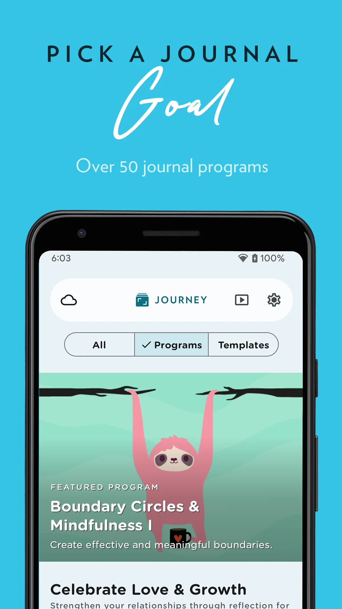{: width="180" .normal }
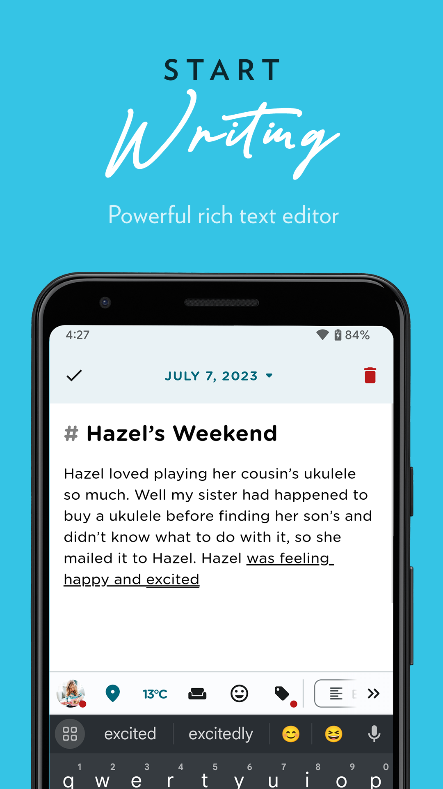{: width="180" .normal }
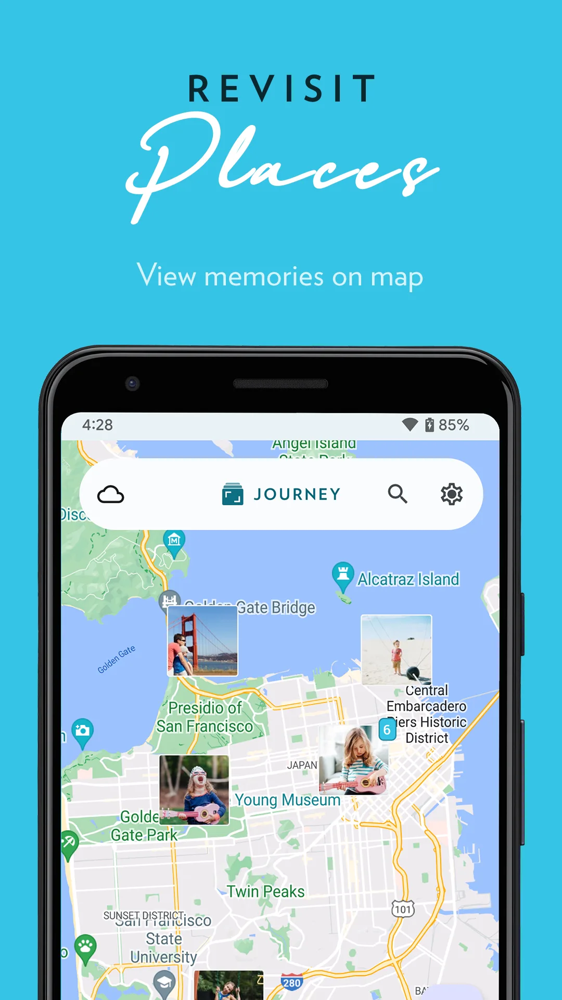{: width="180" .normal }
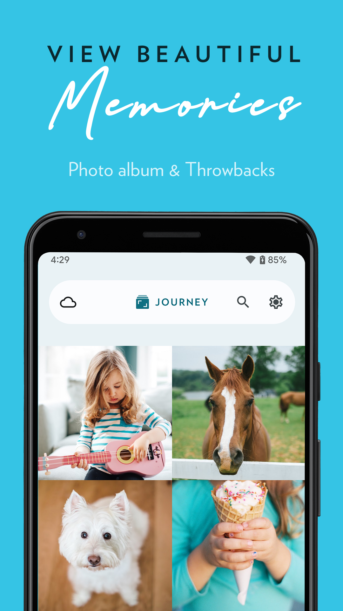{: width="180" .normal }
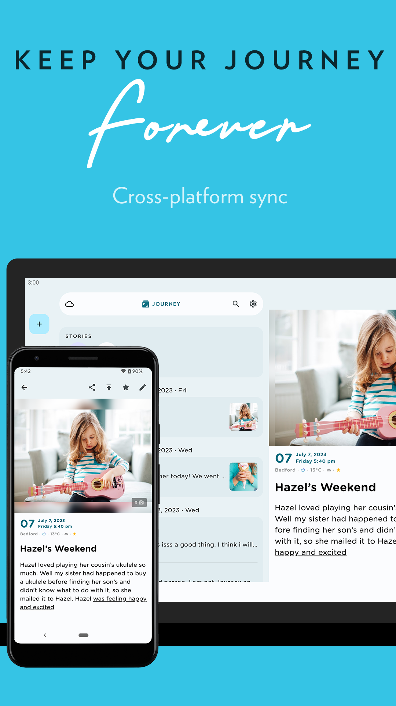{: width="180" .normal }

Journey คือ **ไดอารี่ข้ามแพลตฟอร์ม** สำหรับ Android iOS เว็บ Windows และ Mac พร้อมรายการภาพ การติดตามอารมณ์ และซิงโครไนซ์ Google Drive มันคู่แข่งใกล้ที่สุดของ Day One สำหรับคนเขียนบนหลายอุปกรณ์

**จุดแข็ง**
- **ซิงค์ข้ามแพลตฟอร์มแข็งแกร่ง** ระหว่างโทรศัพท์ แท็บเล็ต เว็บ และเดสก์ท็อปผ่าน Google Drive
- **รายการหลากหลาย**: ภาพ ตำแหน่ง สภาพอากาศ และอารมณ์
- **โครงสร้างนำและสถิติ** เพื่อรักษากิจวัตรบันทึก
- ล็อกรหัสผ่านและการเขียนออฟไลน์
- ชั้นฟรีกว้างขวางสำหรับไดอารี่พื้นฐาน

**จุดอ่อน**
- ฟีเจอร์ซิงค์และขั้นสูงบางส่วนต้อง Journey Cloud (เสียเงิน)
- อินเทอร์เฟซทำงานได้ ไม่สวย — ขาดความรู้สึก "สนุก" เหมือนไดอารี่น่ารัก
- หนักกว่าบันทึกอารมณ์ด่วน

**เหมาะสำหรับ:** นักเขียนที่ไดอารี่บนโทรศัพท์ เว็บ และเดสก์ท็อป และอยากซิงค์ที่เชื่อถือได้

**ดาวน์โหลด Journey**
- [Google Play](https://play.google.com/store/apps/details?id=com.journey.app)
- [App Store](https://apps.apple.com/us/app/journey-diary-journal/id1300202543)

---

### 3. Diaro — ดีที่สุดสำหรับไดอารี่ข้อความมีระเบียบ

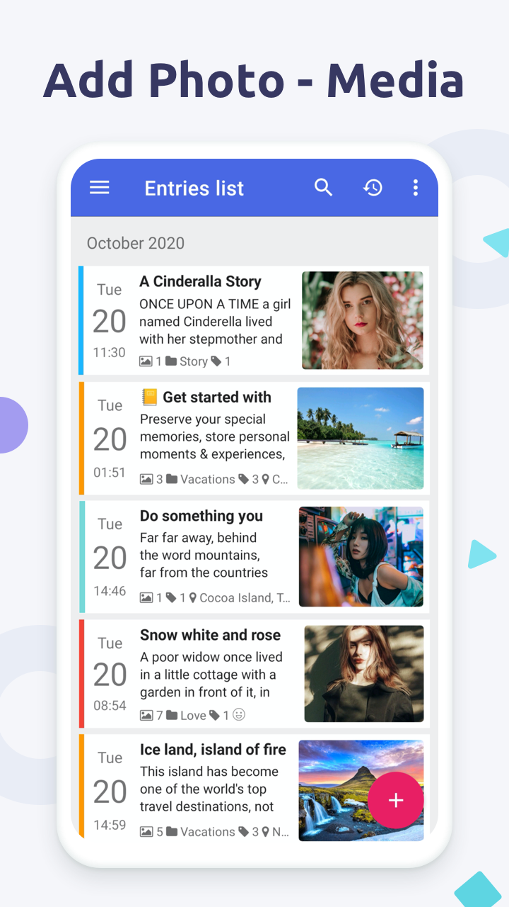{: width="180" .normal }
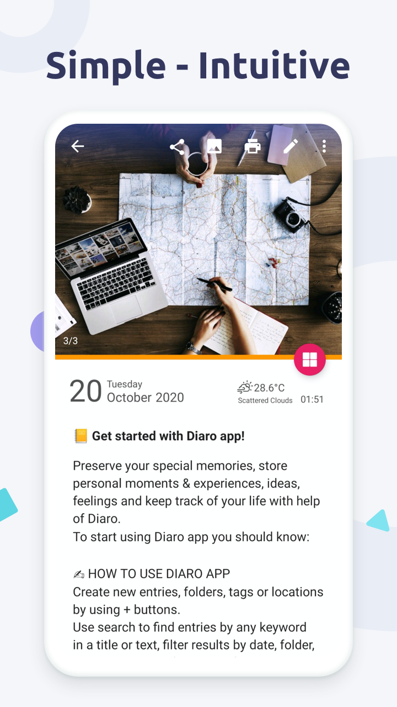{: width="180" .normal }
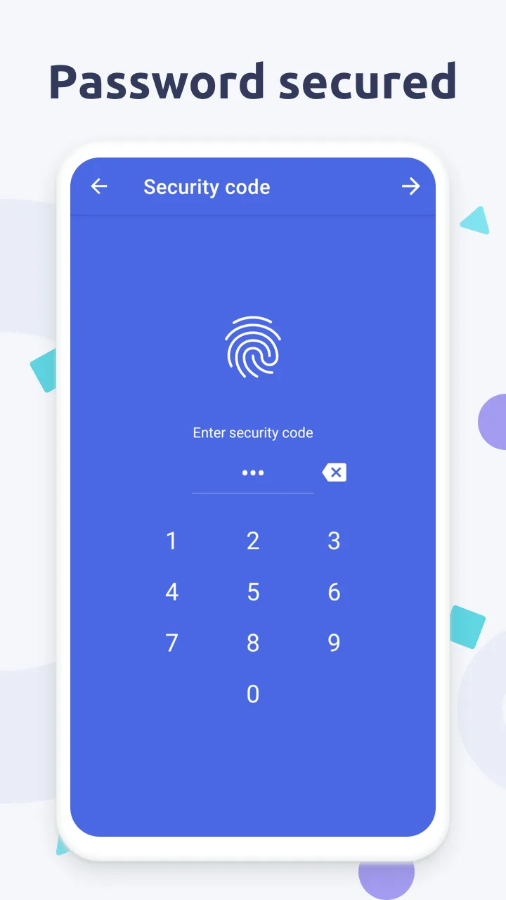{: width="180" .normal }
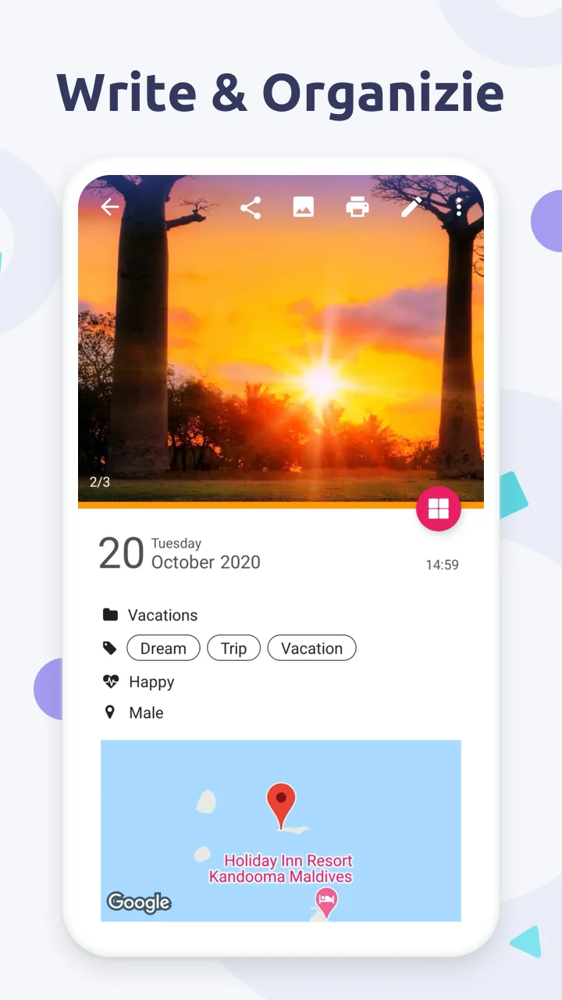{: width="180" .normal }
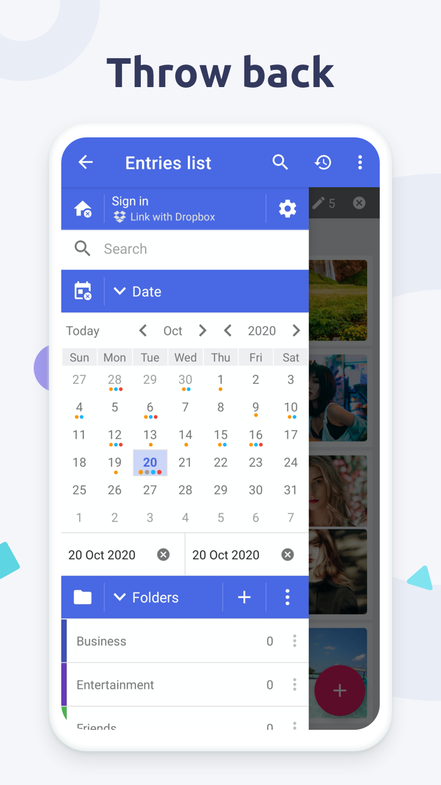{: width="180" .normal }

Diaro คือ **ไดอารี่basedข้อความ** พร้อมโฟลเดอร์ แท็ก การค้นหา และแดชบอร์ดสะอาด ใช้ได้บน Android iOS Windows และ Mac พร้อมสำรองคลาวด์

**จุดแข็ง**
- **โฟลเดอร์ แท็ก และการค้นหาแข็งแกร่ง** ช่วยนำทางไดอารี่ยาว
- **การติดตามอารมณ์และกราฟ** ควบคู่กับรายการข้อความ
- **มัลติแพลตฟอร์ม** พร้อมซิงค์คลาวด์และส่งออกเป็น PDF/XML/TXT
- แนบภาพและการเตือน
- ชั้นฟรีครอบคลุมไดอารี่รายวัน

**จุดอ่อน**
- อินเทอร์เฟซ pragmatik ไม่น่ารัก — ไม่มีธีมน่ารัก
- บางฟีเจอร์ (ซิงค์คลาวด์ ส่งออกเพิ่ม) อยู่หลัง Diaro Pro
- ให้ความสำคัญเช็คอินอารมณ์ด่วนน้อย

**เหมาะสำหรับ:** นักเขียนมีระเบียบที่อยากโฟลเดอร์ แท็ก และการค้นหาข้ามแพลตฟอร์ม

**ดาวน์โหลด Diaro**
- [Google Play](https://play.google.com/store/apps/details?id=com.pixelcrater.Diaro)
- [App Store](https://apps.apple.com/us/app/diary-journal-notes-diaro/id882519460)

---

### 4. Daylio — ดีที่สุดสำหรับบันทึกอารมณ์จุลภาค

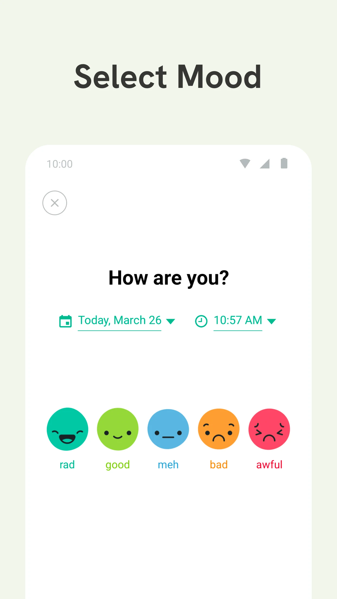{: width="180" .normal }
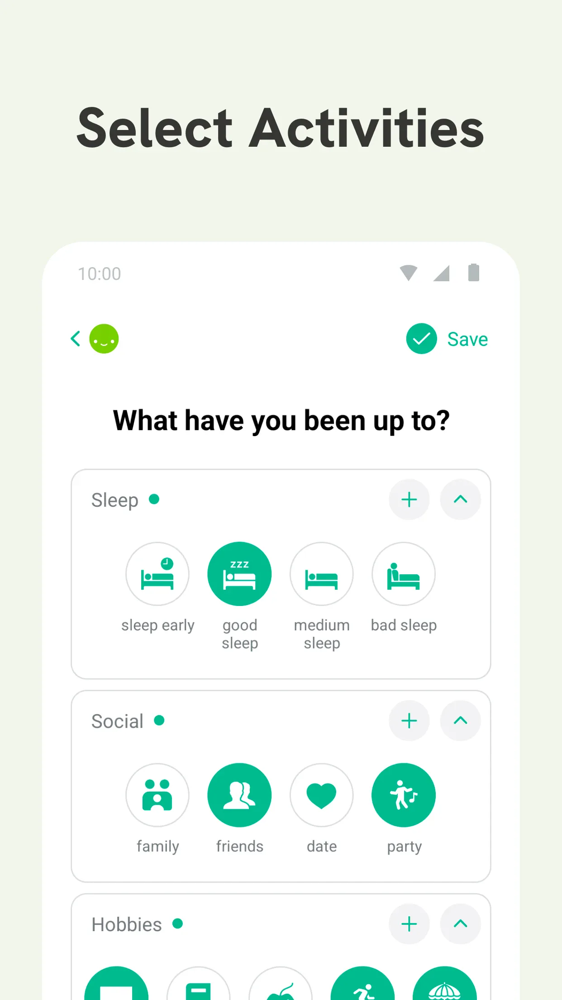{: width="180" .normal }
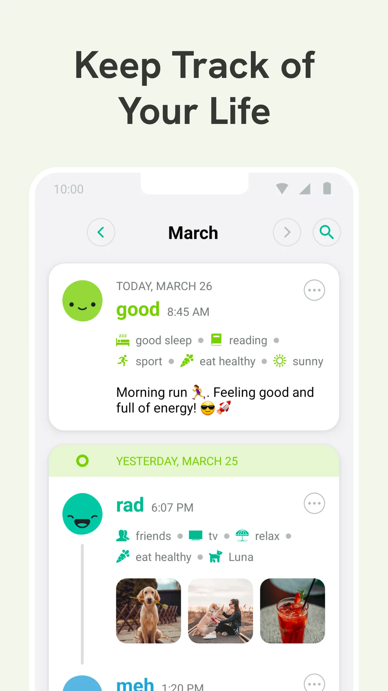{: width="180" .normal }
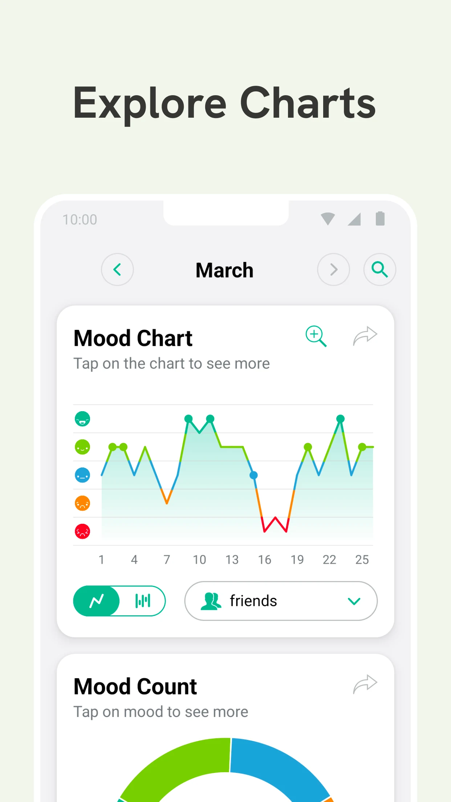{: width="180" .normal }
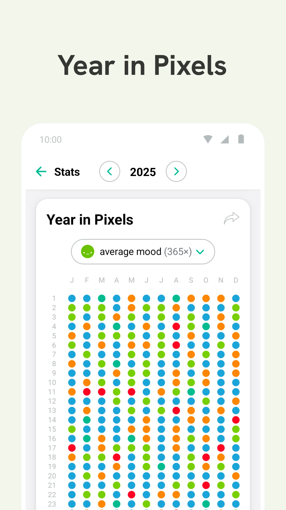{: width="180" .normal }

Daylio คือ **ตัวติดตามอารมณ์จุลภาค** ที่คุณแตะความรู้สึกและเพิ่มกิจกรรมสองสามอย่าง — โดยไม่ต้องเขียน มันสร้างปฏิทินและกราฟสีจากรูปแบบอารมณ์ของคุณ

**จุดแข็ง**
- **อารมณ์ + กิจกรรมแตะเดียว** — ไดอารี่ในไม่กี่วินาที โดยไม่มีร้อยแก้ย
- **ปฏิทินและกราฟสี** ที่แยกรูปแบบอารมณ์ตามกาลเวลา
- **ข้ามแพลตฟอร์ม** (Android + iOS) พร้อมสำรองคลาวด์
- การเตือนและเป้าหมายเพื่อสร้างนิสัย
- ชั้นฟรีกว้างขวาง

**จุดอ่อน**
- ไม่สร้างมาเขียนยาว — มันให้ความสำคัญอารมณ์
- สถิติลึกและประวัติไร้จำกัดอยู่หลัง Premium
- การปรับแต่งกิจกรรมจำกัดในเวอร์ชันฟรี

**เหมาะสำหรับ:** คนที่อยากติดตามอารมณ์ด่วนและเห็นรูปแบบ ไม่ใช่เขียนเรียงความ

**ดาวน์โหลด Daylio**
- [Google Play](https://play.google.com/store/apps/details?id=net.daylio)
- [App Store](https://apps.apple.com/us/app/daylio-journal-mood-tracker/id1194023242)

---

### 5. Grid Diary — ดีที่สุดสำหรับไดอารี่นำด้วยคำถาม

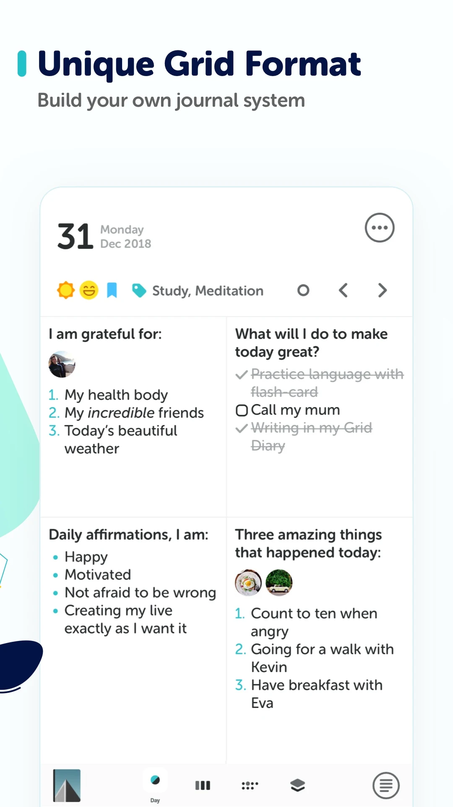{: width="180" .normal }
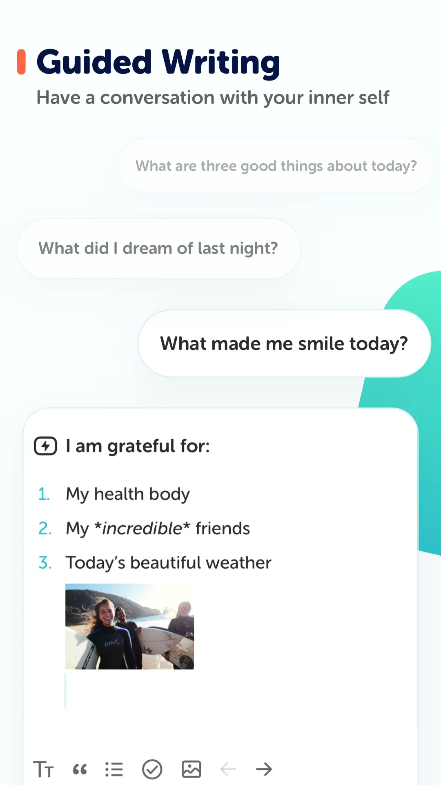{: width="180" .normal }
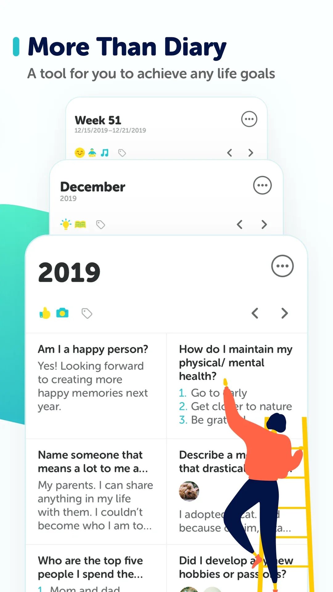{: width="180" .normal }
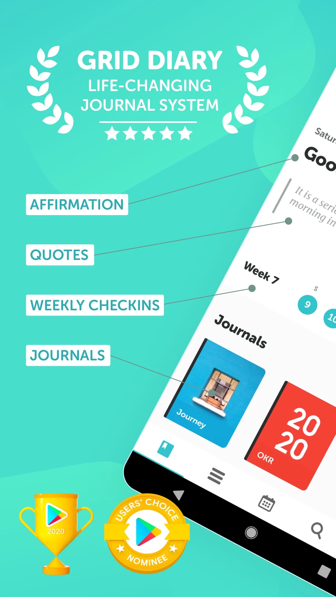{: width="180" .normal }
{: width="180" .normal }

Grid Diary ใช้ **กริดนำด้วยคำถาม** เพื่อจัดรายการ ช่วยให้คุณทบทวนด้วยเทมเพลตนำใช้ซ้ำ นิยมสำหรับไดอารี่กตัญญู คำถามรายวัน และสไตล์นิสัย

**จุดแข็ง**
- **กริดนำด้วยคำถาม** เปลี่ยนหน้าว่างเป็นคำถามมุ่งเป้า
- **เทมเพลตนำใช้ซ้ำ** สำหรับกตัญญู ทบทวนรายวัน เป้าหมาย และอื่นๆ
- **ข้ามแพลตฟอร์ม** (Android + iOS) พร้อมซิงค์คลาวด์
- ประสบการณ์เขียนสะอาดและโฟกัส
- ชั้นฟรีครอบคลุมโครงสร้างนำหลัก

**จุดอ่อน**
- ค่าที่ดีที่สุดต้อง Grid Diary Premium (เทมเพลตมากขึ้น ซิงค์)
- น้อยอิสระ — โครงสร้างกริดไม่เหมาะทุกคน
- ไม่มีสุนทรียภาพน่ารัก/การ์ตูน

**เหมาะสำหรับ:** คนที่เขียนดีขึ้นเมื่อมีการนำและอยากมีโครงสร้าง

**ดาวน์โหลด Grid Diary**
- [Google Play](https://play.google.com/store/apps/details?id=io.sumi.griddiary2)
- [App Store](https://apps.apple.com/us/app/grid-diary-journal-planner/id1392523148)

---

### 6. Momento — ดีที่สุดสำหรับไดอารี่ไทม์ไลน์ส่วนตัว

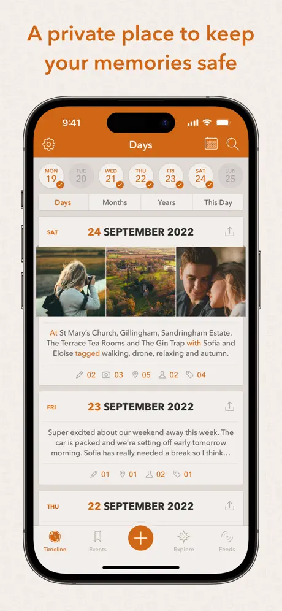{: width="180" .normal }
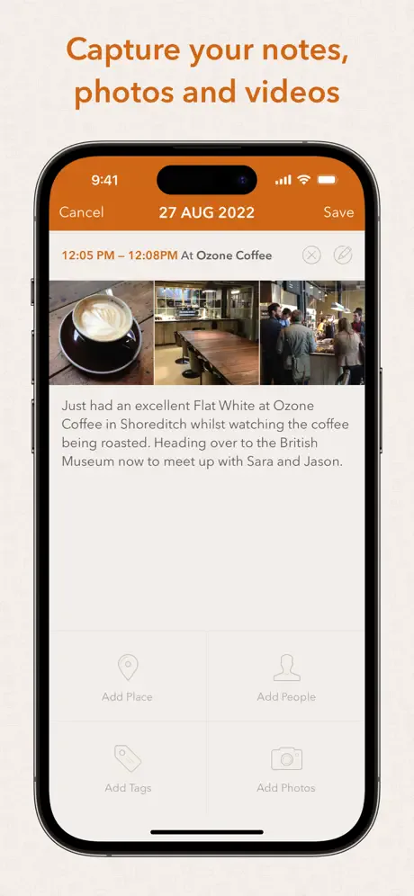{: width="180" .normal }
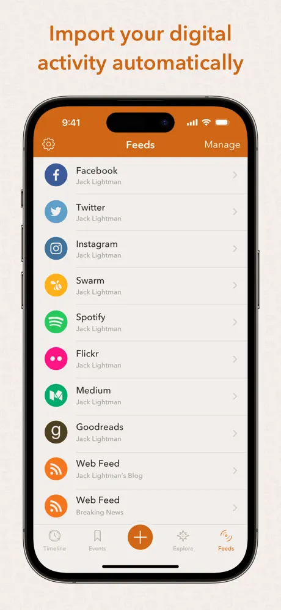{: width="180" .normal }
{: width="180" .normal }
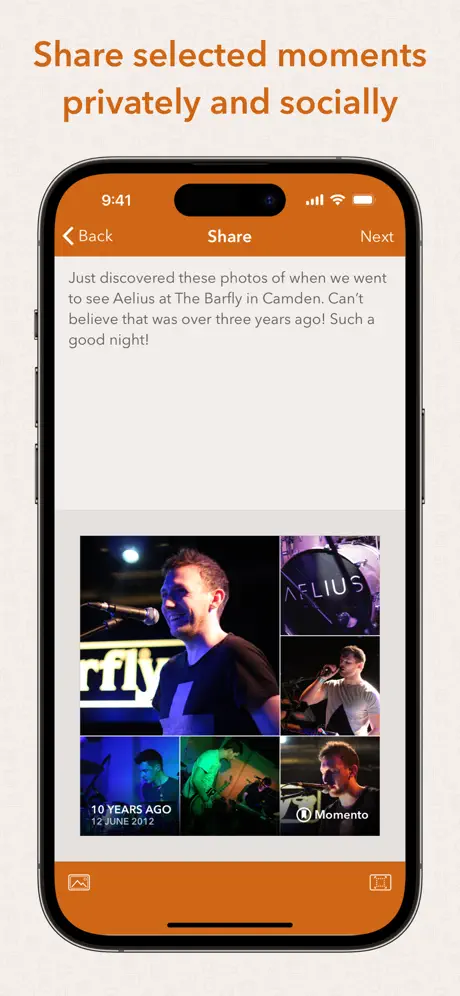{: width="180" .normal }

Momento คือ **ไดอารี่ iOS** ที่สร้างไทม์ไลน์ส่วนตัวจากรายการและบริการที่เชื่อมต่อของคุณ โฟกัสพื้นที่ส่วนตัวสงบเพื่อทบทวน

**จุดแข็ง**
- **ไทม์ไลน์ส่วนตัว** ที่จัดกลุ่มรายการต่อวันสำหรับทบทวนด่วน
- ดีไซน์ iOS มินิมอลสะอาด
- รายการภาพและข้อความพร้อมการเตือน
- ความเป็นส่วนตัวท้องถิ่นเป็นหลัก
- มีชั้นฟรี

**จุดอ่อน**
- **แค่ iOS** — ไม่มีแอป Android หรือเว็บ
- บางฟีเจอร์และรายการไร้จำกัดต้องสมาชิก Premium
- การผสานน้อยกว่า และการเข้าถึงข้ามแพลตฟอร์มแคบกว่า Journey

**เหมาะสำหรับ:** ผู้ใช้ iPhone ที่อยากไดอารี่ไทม์ไลน์ส่วนตัวและสงบ

**ดาวน์โหลด Momento**
- [App Store](https://apps.apple.com/us/app/momento-private-journal-diary/id980592846)

---

## เปรียบเทียบความสามารถหลัก

| ความสามารถ | Meow Mood Diary | Journey | Diaro | Daylio | Grid Diary | Momento |
|---|---|---|---|---|---|---|
| **แพลตฟอร์ม** | Android, iOS | Android, iOS, เว็บ, Win, Mac | Android, iOS, Win, Mac | Android, iOS | Android, iOS | iOS |
| **ชั้นฟรี** | กว้าง | ใช่ | ใช่ | ใช่ | ใช่ | ใช่ |
| **การติดตามอารมณ์** | ใช่ (ไอคอน) | ใช่ | ใช่ | ใช่ (จุลภาค) | บางส่วน | ใช่ |
| **ไดอารี่ข้อความ** | ใช่ | แข็งแกร่ง | แข็งแกร่ง | เบา | นำด้วยโครงสร้าง | ใช่ |
| **โครงสร้าง/โครงสร้าง** | ไม่ | บางส่วน | โฟลเดอร์/แท็ก | กิจกรรม | กริดนำ | ไทม์ไลน์ |
| **ภาพและแนบ** | ใช่ | ใช่ | ใช่ | ไม่ | ใช่ | ใช่ |
| **ความเป็นส่วนตัว / ท้องถิ่นเป็นหลัก** | แข็งแกร่ง (ไม่อัปโหลด) | คลาวด์ (Drive) | คลาวด์ | คลาวด์ | คลาวด์ | ท้องถิ่นเป็นหลัก |
| **ซิงค์คลาวด์ / ข้ามอุปกรณ์** | สำรอง Drive | ใช่ (บัญชี) | ใช่ (บัญชี) | ใช่ (บัญชี) | ใช่ (บัญชี) | จำกัด (iOS) |
| **การเตือน** | ใช่ | ใช่ | ใช่ | ใช่ | ใช่ | ใช่ |
| **ธีม / ปรับแต่ง** | ธีมแมว สี | พื้นฐาน | พื้นฐาน | มีสี | เทมเพลต | มินิมอล |
| **ส่งออก** | ใช่ | ใช่ | PDF/XML/TXT | ใช่ | ใช่ | จำกัด |
| **ออฟไลน์** | ออฟไลน์เต็ม | ใช่ | ใช่ | ใช่ | ใช่ | ใช่ |

---

## ทางเลือก Day One ตัวไหนเหมาะกับผู้ใช้แต่ละประเภท

ตารางด้านบนจัดอันดับฟีเจอร์; ที่นี่หกตัวเลือกจัดกลุ่มตาม *สิ่งที่คุณเปลี่ยนจริงๆ*

- **แทนสมาชิก** — Meow Mood Diary และ Diaro ทั้งสองมีหลักฟรีที่ใช้ได้; **ตัวติดตามอารมณ์ไม่ต้องสมัคร** ควรตรวจสอบ blueprint ของมัน (ล็อกแอป ส่งออก ปฏิทิน) ก่อนย้ายรายการหลายปี
- **แทนพิธีเขียน** — **ทางเลือก Journey** หรือ **ทางเลือก Grid Diary** รักษาโครงสร้างนำ แท็ก และแก้ไขข้ามแพลตฟอร์ม; หากคุณอยากบันทึกแตะเดียว **ทางเลือก Daylio** คือเส้นทางสั้นกว่า และ Meow Mood Diary จัดการนั้นในเครื่อง
- **แทนการติดตามตนมีโครงสร้าง** — **ทางเลือก MoodKit** หรือ **ทางเลือก Bearable** สำหรับบันทึกความคิดและความสัมพันธ์หลายปัจจัย ซึ่งมาตรวัดอารมณ์ 5 ระดับไม่แสดงออกได้
- **แทนคลาวด์** — Meow Mood Diary คือตัวเลือกเมื่อเงื่อนไขคือ **ตัวติดตามอารมณ์ส่วนตัวไม่ต้องบัญชี** พร้อมทางส่งออก; Momento ใกล้ไทม์ไลน์แต่ยัง iOS เป็นหลัก
- **ยังแค่ iPhone** — **ทางเลือก Reflectly** เหมาะสำหรับไดอารี่นำที่นำด้วยดีไซน์ แต่ไม่แก้ปัญหา Android หรือบัญชี

ไม่ว่าจะชื่ออะไร จงถามสองคำถามก่อนย้าย: คุณนำประวัติออกเป็นไฟล์ได้หรือไม่ และแอปยังทำงานโดยไม่มีสัญญาณหรือไม่?

## วิธีเลือก

- อยาก **ไดอารี่อารมณ์ส่วนตัวน่ารักที่ทำงานออฟไลน์** → **Meow Mood Diary**
- อยาก **ซิงค์ข้ามแพลตฟอร์มแท้จริง (โทรศัพท์/เว็บ/เดสก์ท็อป)** → **Journey**
- อยาก **โฟลเดอร์ แท็ก และการค้นหาสำหรับไดอารี่ยาว** → **Diaro**
- อยาก **บันทึกอารมณ์แตะเดียวและรูปแบบ** → **Daylio**
- อยาก **โครงสร้างนำด้วยคำถาม** → **Grid Diary**
- อยาก **ไทม์ไลน์ iOS ส่วนตัวที่สงบ** → **Momento**

## วิธีย้ายจาก Day One

1. **ส่งออกรายการ Day One** ของคุณเป็นรูปแบบมาตรฐาน (PDF หรือส่งออกตั้งต้น) ก่อนยกเลิก
2. **เลือกตัวแทน** จากตารางตามแพลตฟอร์มและว่าคุณอยากติดตามอารมณ์หรือเขียนยาว
3. **นำเข้าหรือสร้างรายการใหม่** — Journey/Diaro/Grid Diary รับนำเข้า; สำหรับ Meow Mood เริ่มใหม่ด้วยบันทึกอารมณ์แตะเดียวและเพิ่มบันทึก
4. **ตั้งการเตือนรายวัน** ในแอปใหม่เพื่อรักษานิสัยขณะย้าย
5. **เปิดสำรอง** (Meow Mood: Google Drive ของตัวเอง; Journey/Diaro: ซิงค์บัญชี) เพื่อไม่ให้คุณติดกับดัก

## คำถามที่พบบ่อย

**Meow Mood Diary เป็นทางเลือก Day One ฟรีที่ดีไหม?**
{:.faq-q}

ใช่ ฟรีในหลัก ทำงานบน Android และ iOS ไม่เคยอัปโหลดรายการไปเซิร์ฟเวอร์ และสำรองเฉพาะไป Google Drive ของคุณ — ตัวเลือกแข็งแกร่งหากคุณอยากความเป็นส่วนตัวและบันทึกอารมณ์ด่วน เหนือมัลติมีเดียหลากหลาย

**Meow Mood Diary ใช้แบบออฟไลน์ได้ไหม?**
{:.faq-q}

ได้ คุณบันทึก ดู และแก้ไขรายการได้โดยไม่มีอินเทอร์เน็ตและไม่ต้องบัญชี; ข้อมูลคงอยู่ในเครื่อง

**ทางเลือก Day One ตัวไหนดีที่สุดสำหรับความเป็นส่วนตัว?**
{:.faq-q}

Meow Mood Diary — ไม่ต้องบัญชี เก็บในเครื่องพร้อมล็อกลายนิ้วมือเลือกได้ และสำรองเฉพาะไป Google Drive ของคุณเมื่อเปิดใช้

**ฉันย้ายรายการจาก Day One ได้ไหม?**
{:.faq-q}

Day One ส่งออก PDF และรูปแบบอื่น; Meow Mood เองส่งออก PDF (CSV ผ่าน VIP) จึงทำให้ข้อมูลของคุณพกพาได้

[หน้าแอป Meow Mood Diary](/th/apps/meow-mood-diary/) — มีให้สำหรับ Android และ iOS

## ศัพท์ที่เกี่ยวข้อง

- [ตัวติดตามอารมณ์คืออะไร?](/th/glossary/what-is-a-mood-tracker/)
