Intuit **ปิดตัว Mint ในเดือนมีนาคม 2024** และรวมฟีเจอร์เข้ากับ Credit Karma หากคุณกำลังมองหา **ทางเลือก Mint** คุณไม่ได้อยู่คนเดียว — อดีตผู้ใช้หลายล้านคนต้องการ **แอปจัดการงบประมาณ** ที่บันทึกรายจ่ายได้ชัดเจน โดยไม่ถูกผลักไปยังผลิตภัณฑ์เครดิต หรือบังคับใช้บัญชีคลาวด์ที่ไม่ไว้ใจ

คู่มือนี้เปรียบเทียบแอป **เจ็ด** ตัวบนมิติเดียวกัน แต่ละตัวถูกเลือกเพราะ **ส่วนแบ่งตลาดใหญ่** หรือ **จุดเด่นเฉพาะ** ที่แยกออกมา แต่ละแอปด้านล่างจะพูดถึงจุดแข็งที่แท้จริง ข้อจำกัดอย่างตรงไปตรงมา และผลงานบนความสามารถหลักที่ผู้ใช้ใส่ใจจริง — หลายบัญชี การซิงโครไนซ์ การเบิกคืน งบประมาณ สถิติ สินทรัพย์/มูลค่าสุทธิ และหลายสกุลเงิน ลิงก์ดาวน์โหลดอยู่ท้ายแต่ละส่วน สำหรับผู้อ่านไทย คำว่า **ทางเลือก DuitKu** **ทางเลือก DompetKu** **ทางเลือก MoneyTrack** **ทางเลือก Caku** **ทางเลือก Catatku** **ทางเลือก Celenganku** **ทางเลือก Monefy** และ **ทางเลือก Spendee** ก็มักถูกค้นหา บวกเจ็ดแอปด้านล่างยังคงเป็นขอบเขตการเปรียบเทียบนี้

## สิ่งที่หายไปเมื่อ Mint ปิดตัว

- **นำเข้ารายการธุรกรรมอัตโนมัติ** จากบัญชีธนาคารและบัตรที่ผูกไว้
- **แดชบอร์ดเดียว** สำหรับมูลค่าสุทธิ บิล และสมัครสมาชิก
- **งบต่อหมวดฟรีและเรียบง่าย**

ผลลัพธ์คือ Mint ทำเงินผ่านการแนะนำนำ และสุดท้ายผลักผู้ใช้ไปยังธุรกิจเครดิต Credit Karma ผู้แทนที่ด้านล่างรักษาส่วนดีไว้ และปล่อยให้คุณตัดสินเองว่าต้องการอัตโนมัติและพื้นที่จัดเก็บคลาวด์มากแค่ไหน

---

## YNAB (You Need A Budget) — ผู้นำด้านระเบียบวิธี

{: width="180" .normal }
{: width="180" .normal }
{: width="180" .normal }
{: width="180" .normal }
{: width="180" .normal }

YNAB คือแอป **งบแบบ zero-based** ที่มีชื่อเสียงที่สุด: ทุกดอลลาร์ "ได้รับมอบหมายหน้าที่" ก่อนใช้จ่าย สร้างบนสี่กฎเรียบง่าย มีชุมชนงบประมาณเฉพาะทางใหญ่ที่สุดและวัสดุการศึกษามากที่สุด (เวิร์กช็อป คู่มือ ฟอรัม)

**จุดแข็ง**
- **ระเบียบวิธีงบประมาณแข็งแกร่งที่สุด** — การจัดสรร zero-based เอาชนะแค่การติดตามหมวดหมู่ในการเปลี่ยนนิสัย
- **ซิงค์ธนาคารผ่าน Plaid** — รายการนำเข้าอัตโนมัติบนเว็บ iOS และ Android
- **รายงานและการติดตามมูลค่าสุทธิที่ยอดเยี่ยม** พร้อมวางแผนเป้าหมาย
- สุกงอม สนับสนุนดี ข้ามแพลตฟอร์ม

**จุดอ่อน**
- **ไม่มีแพ็กฟรี** — มีแค่ทดลอง 34 วัน แล้ว $14.99/เดือน หรือ $109/ปี
- **เส้นโค้งการเรียนรู้ชัน** — คุณต้องวางงบแบบกระตือรือร้น; นี่คือระบบ ไม่ใช่แอปบันทึกแบบรับ
- **ไม่มีกระบวนการเบิกคืนเฉพาะ** และ **หลายสกุลเงินอ่อน** (มุ่งเน้น USD)
- รายงานดี แต่ยืดหยุ่นน้อยกว่าสเปรดชีตสำหรับวิเคราะห์แบบ ad-hoc

**เหมาะสำหรับ:** ผู้ใช้ที่อยากเปลี่ยนพฤติกรรมการใช้จ่ายด้วยระเบียบวิธีที่ผ่านการพิสูจน์ และยอมเสียเวลาตั้งค่า

**ดาวน์โหลด YNAB**
- [Google Play](https://play.google.com/store/apps/details?id=com.youneedabudget.evergreen.app)
- [App Store](https://apps.apple.com/app/ynab/id1010865877)

---

## Meow Money Manager — แอปบันทึกธีมแมวด้วยส่วนติดต่อผู้ใช้ที่น่าพึงพอใจ

{: width="180" .normal }
{: width="180" .normal }
{: width="180" .normal }
{: width="180" .normal }
{: width="180" .normal }

Meow Money Manager คือ [แอปบันทึกการเงิน](/th/glossary/what-is-an-expense-tracker/) และ [แอปจัดการงบประมาณ](/th/glossary/what-is-budget-management/) ธีมแมวสำหรับ **Android และ iOS** จุดเด่นที่สุดคือ **ส่วนติดต่อผู้ใช้**: การออกแบบการ์ตูนน่ารักพร้อม **ไอคอนหมวด 400+** ที่ทำให้การบันทึกรายวันรู้สึกเบาๆ ไม่ใช่งานออฟฟิศ นอกจากรูปลักษณ์ มันยังปิดพื้นฐานบัญชีชีพจร่ายที่เป็นประโยชน์ และมาพร้อมส่วนติดต่อผู้ใช้หลายภาษา — จีน อังกฤษ อินโดนีเซีย ไทย และโปรตุเกส — ที่เป็นมิตรกับผู้ใช้จีนและชาวต่างชาติ

**จุดแข็ง (จากคำอธิบายผลิตภัณฑ์)**
- **UI การ์ตูนสวยงามพร้อมไอคอนที่กำหนดเอง 400+** — จุดเด่น; การบันทึกกลายเป็นเรื่องสนุกในแง่ภาพ
- **สมุดบัญชีหลายเล่ม** — แยกเล่ม (ส่วนตัว เดินทาง ธุรกิจ) และดูเล่มเดียวหรือทั้งหมดพร้อมกัน
- **ตัวติดตามงบประมาณและงบต่อหมวด** — รอบรายวัน / รายเดือน / รายปี พร้อมยอดงบรวมและงบต่อหมวดติดตามพร้อมกัน
- **สถิติแผนภูมิทันที** — รายงานค่าใช้จ่ายรายวัน รายเดือน และรายปี
- **การจัดการเบิกคืน** — ทำเครื่องหมายค่าใช้จ่ายที่เบิกคืนได้ (เช่น ไปธุรกิจ) และติดตามสถานะได้ทุกเมื่อ
- **การจัดการสินทรัพย์** — บันทึกเงินสด กองทุน หุ้น บัตร หนี้ และมูลค่าสุทธิ
- **รายการเกิดซ้ำ** — อัตโนมัติเกิดซ้ำรายวัน / สัปดาห์ / เดือน / ปี
- **50+ สัญลักษณ์สกุลเงิน** **โหมดมืด** และ **ล็อกลายนิ้วมือ**
- **ส่งออก CSV** (บันทึกทั้งหมดหรือช่วงวันที่) สำหรับ Excel พร้อม **สำรอง Google Drive iCloud หรือ WebDav**
- **ไม่ต้องสมัครบัญชี** — **ข้อมูลจัดเก็บในเครื่องของคุณ**

**จุดอ่อน (ตามวัตถุประสงค์)**
- **ไม่มีซิงค์ธนาคารอัตโนมัติ** — กรอกเอง (หรือเกิดซ้ำ) ช่วยเรื่องความเป็นส่วนตัว แต่น้อยความ "ตั้งแล้วลืม" กว่า Mint
- **ซิงค์คลาวด์เป็น Google Drive iCloud หรือ WebDav** ไม่ใช่บัญชีข้ามแพลตฟอร์มเฉพาะ จึงสลับระหว่าง Android และ iPhone น้อยความลื่นไหลกว่าแอปบนบัญชี
- **ฟีเจอร์ขั้นสูง** (สมุดบัญชีหลายเล่ม ส่งออก CSV) ต้องซื้อจ่ายครั้งเดียว; ฟีเจอร์หลักฟรีครอบคลุมการบันทึกรายวัน
- ระบบนิเวศเล็กกว่า และไม่มีการรวมการลงทุนหรือมูลค่าสุทธิในตัว

**สถานการณ์ทั่วไป:** เวลาไปธุรกิจ ใช้ **การจัดการเบิกคืน** ทำเครื่องหมายค่าพาหนะและอาหารเป็นเบิกคืนได้ แล้วส่งออก CSV ตรงกับออฟฟิศในแตะเดียว; ทุกวัน ไอคอน 400+ เร่งการจัดหมวดหมู่ และสมุดบัญชีแยกทำให้ค่าใช้จ่ายส่วนตัวและเดินทางไม่ปนกัน เนื่องจาก **ไม่ต้องบัญชีและเก็บข้อมูลแค่ในเครื่อง** มันจึงเหมาะกับผู้ใช้ที่รักษาความเป็นส่วนตัวและไม่ต้องการให้บิลไปอยู่ในบัญชีคลาวด์เหมือน Mint — ความแตกต่างสำคัญจากแอปบันทึกส่วนใหญ่ที่บังคับล็อกอิน

**เหมาะสำหรับ:** คนที่อยากบันทึกชัดเจนโดยไม่ต้องบัญชีคลาวด์ ให้คุณค่าส่วนติดต่อผู้ใช้ที่เป็นมิตร และไม่รังเกียจการกรอกเองเบาๆ

**ดาวน์โหลด Meow Money Manager ([หน้าแอป](/th/apps/meow-money-manager/))**
- [Google Play](https://play.google.com/store/apps/details?id=com.glgjing.money.manager.bookkeeping.meow)
- [App Store](https://apps.apple.com/app/id1528852284)

---

## Monarch Money — ผู้สืบทอด Mint ที่คล้ายที่สุด

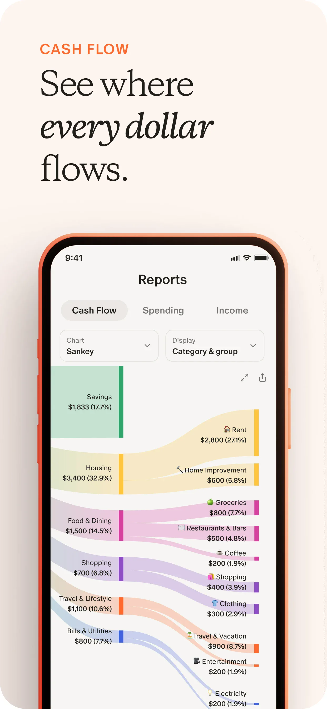{: width="180" .normal }
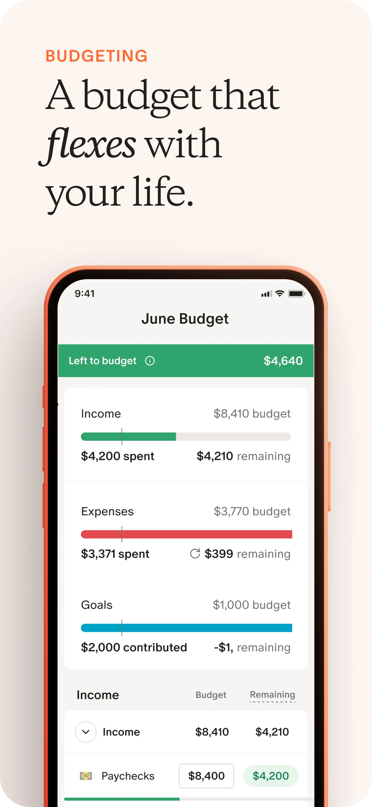{: width="180" .normal }
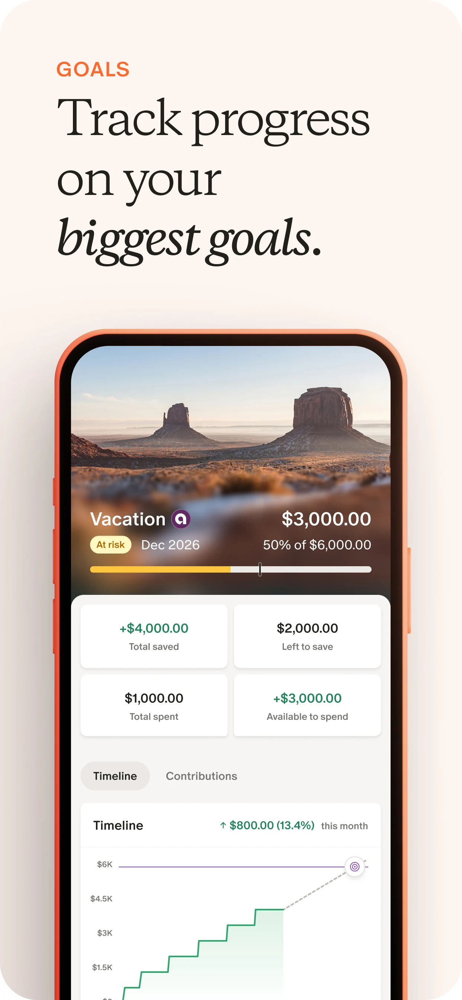{: width="180" .normal }
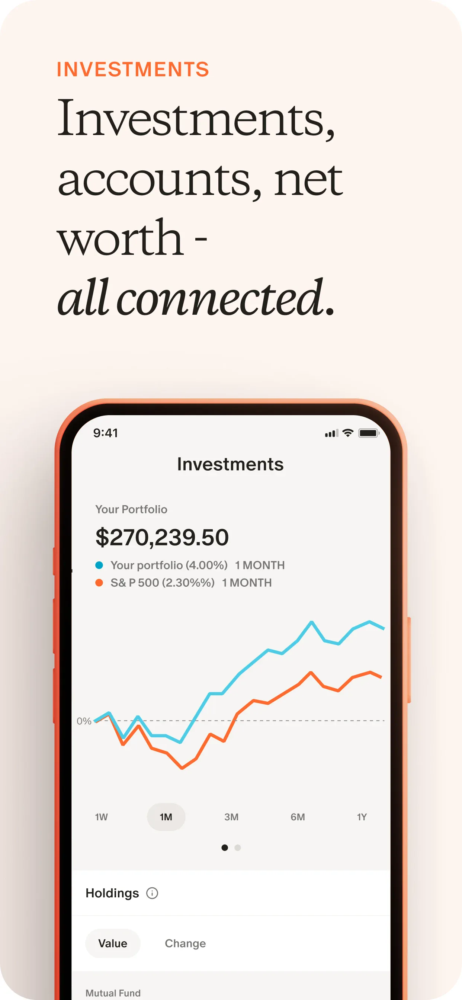{: width="180" .normal }

Monarch คือแอปที่ถูกเรียกบ่อยที่สุดว่า **ทางเลือก Mint โดยตรง** มันรวมธนาคาร บัตร เงินกู้ การลงทุน ไปจนถึงคริปโตและอสังหาเข้าสู่แดชบอร์ดเดียว พร้อมการแชร์แบบร่วมมือให้คู่รักแก้ไขงบเดียวกันได้

**จุดแข็ง**
- **คล้ายแดชบอร์ด Mint ที่สุด** — มูลค่าสุทธิ กระแสเงินสด และสมัครสมาชิกในมุมมองเดียว
- **ซิงโครไนซ์อัตโนมัติกว้างขวาง** รวมการลงทุนและอสังหา (ผ่านการประเมิน)
- **แบบร่วมมือ** — แชร์และแก้ไขร่วมกับคู่รัก; ทั้งคู่เห็นการอัปเดตทันที
- ประสบการณ์เว็บ + มือถือเรียบร้อย และเครื่องมือเป้าหมาย/งบดี

**จุดอ่อน**
- **ไม่มีแพ็กฟรี** (มีแค่ทดลอง) ประมาณ **$99.99/ปี** (หรือ $14.99/เดือน)
- **ค่อนข้างใหม่** (ก่อตั้ง 2021) — ชุมชนเล็กกว่า และคู่มือบุคคลที่สามน้อยกว่า YNAB
- เหมือน Mint มันพึ่งพา **ความน่าเชื่อถือของการรวม**; การเชื่อมต่อขาดหมายถึงต้องเคลียร์เอง
- **หลายสกุลเงินจำกัด** และมุ่งเน้นตลาดสหรัฐ

**เหมาะสำหรับ:** อดีตผู้ใช้ Mint ที่อยากแดชบอร์ด all-in-one คล้ายเดิม และไม่รังเกียจสมัครสมาชิก

**ดาวน์โหลด Monarch Money**
- [Google Play](https://play.google.com/store/apps/details?id=com.monarchmoney.mobile)
- [App Store](https://apps.apple.com/us/app/monarch-budget-track-money/id1459319842)

---

## Rocket Money — ดีที่สุดสำหรับจัดการสมัครสมาชิก

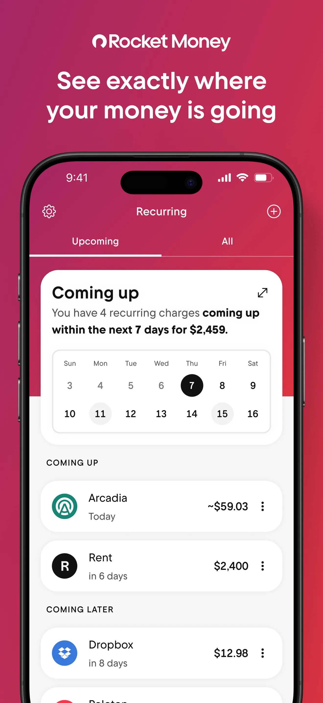{: width="180" .normal }
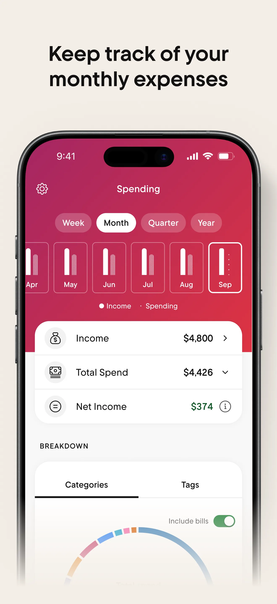{: width="180" .normal }
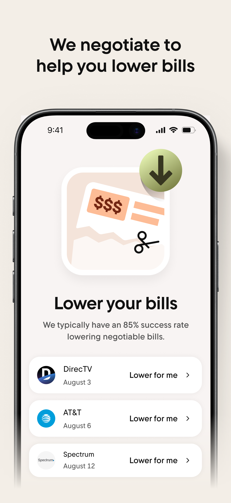{: width="180" .normal }
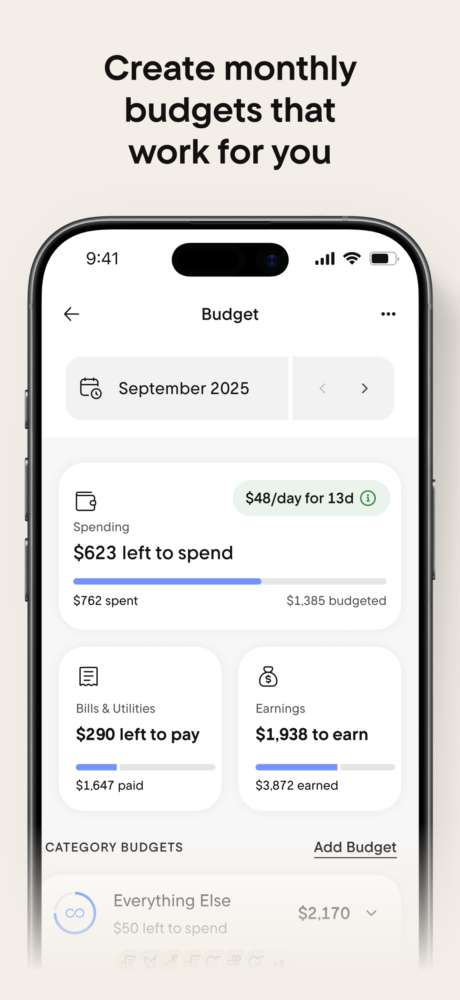{: width="180" .normal }
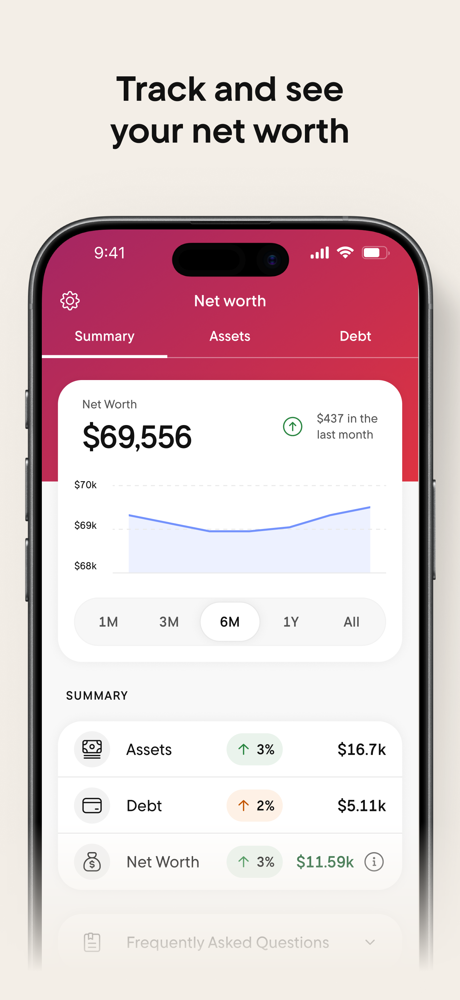{: width="180" .normal }

Rocket Money (เดิม Truebill) สร้างมาเพื่อ **ค้นหาและยกเลิกสมัครสมาชิกที่ไม่ต้องการ** ลดบิลผ่านการเจรจา และให้สรุปรายจ่ายอย่างเรียบง่าย มันคือตัวเลือกแข็งแกร่งที่สุดเมื่อบิลเกิดซ้ำเป็นปัญหาหลัก

**จุดแข็ง**
- **การจัดการสมัครสมาชิกดีที่สุดในคลาส** — ตรวจจับ ติดตาม และช่วยยกเลิกสมัครสมาชิก; สามารถเจรจาบิลให้ต่ำลงได้
- **มีแพ็กฟรี**; การติดตามบัญชีอัตโนมัติและงบอยู่ด้านบน
- ตรวจสอบคะแนนเครดิตและแจ้งเตือนป้องกันยอดติดลบ (premium)
- จำนวนดาวน์โหลดยอดนิยม สนับสนุนและเสถียรภาพแน่น

**จุดอ่อน**
- **งบประมาณพื้นฐาน** — ไม่มีวิธี zero-based หรือซอง; มันบันทึก ไม่ได้วางแผน
- **การจัดหมวดอัตโนมัติดีพอใช้ แต่ปรับแต่งน้อยกว่า** YNAB หรือ Monarch
- ราคา premium **แปรผัน** (มัก ~$6–12/เดือน เรียกเก็บรายปี; อาจแพงสำหรับสิ่งที่ให้นอกการยกเลิกสมัครสมาชิก)
- ไม่มีกระบวนการเบิกคืน ฟีเจอร์มูลค่าสุทธิ/การลงทุนอ่อน

**เหมาะสำหรับ:** คนที่ปัญหาหลักคือสมัครสมาชิกและบิลที่บวมพอง ไม่ใช่งบประมาณโดยตรง

**ดาวน์โหลด Rocket Money**
- [Google Play](https://play.google.com/store/apps/details?id=com.truebill)
- [App Store](https://apps.apple.com/us/app/rocket-money-bills-budgets/id1130616675)

---

## Empower (เดิม Personal Capital) — มุมมองมูลค่าสุทธิและการลงทุนฟรีที่ดีที่สุด

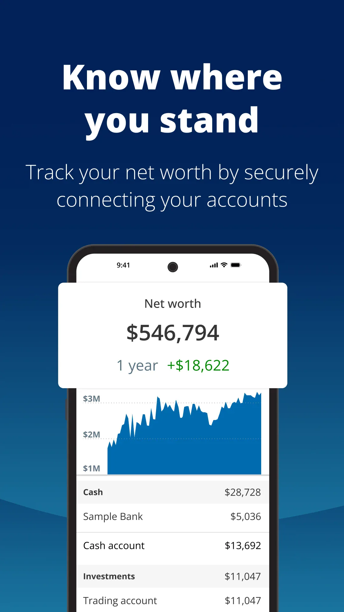{: width="180" .normal }
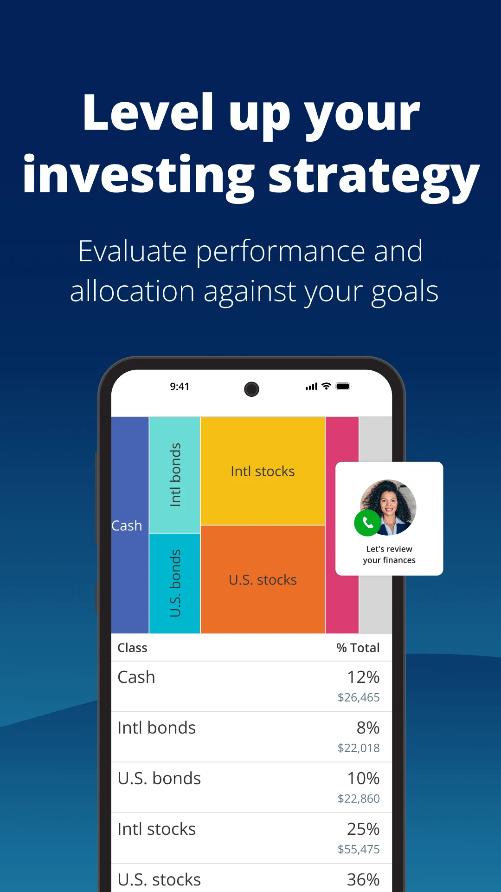{: width="180" .normal }
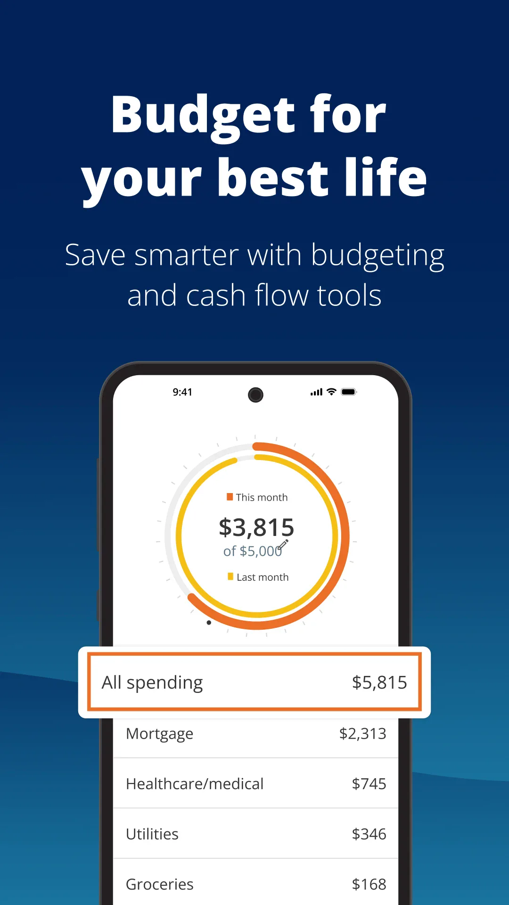{: width="180" .normal }
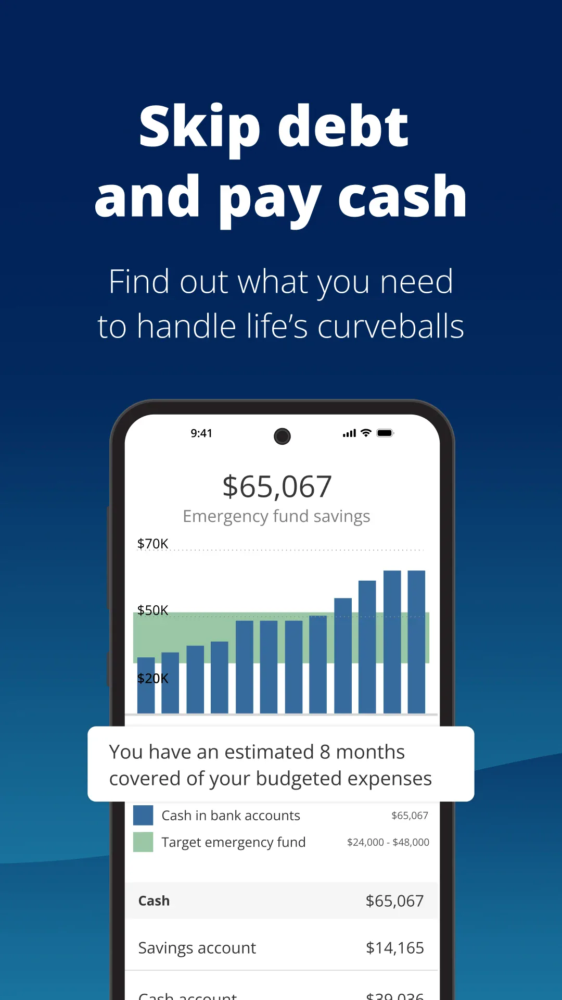{: width="180" .normal }
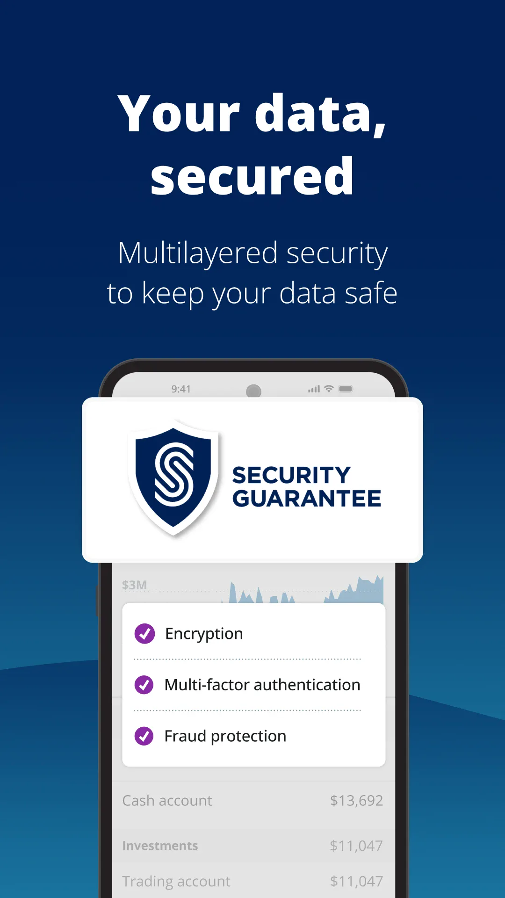{: width="180" .normal }

Empower **ฟรี** และมุ่งเน้น **ติดตามมูลค่าสุทธิและการลงทุน** มันรวมข้อมูลธนาคาร กองทุนเกษียณ หลักทรัพย์ คริปโต ไปจนถึงจำนอง/อสังหา เพื่อให้การวิเคราะห์พอร์ต การวางแผนเกษียณ และการตรวจค่าธรรมเนียม

**จุดแข็ง**
- **ฟรีทั้งหมด** สำหรับแดชบอร์ดหลัก
- **การวิเคราะห์มูลค่าสุทธิและการลงทุนดีที่สุดในคลาส** — การจัดสรรสินทรัพย์ คาดการณ์เกษียณ ตรวจค่าธรรมเนียม
- ขอบเขตบัญชีกว้างมาก รวมการลงทุนและอสังหา
- ประวัติยาวนาน (ทำงานมากกว่าทศวรรษในชื่อ Personal Capital)

**จุดอ่อน**
- **ไม่ใช่แอปงบประมาณแท้** — เครื่องมือกระแสเงินสด/งบพื้นฐานเทียบ YNAB หรือ Monarch
- **มุ่งเน้นสหรัฐ**; การใช้ในต่างประเทศจำกัดและหลายสกุลเงินอ่อน
- **ข้อเสนอที่ปรึกษาการลงทุน** แข็งแกร่งสำหรับยอดคงเหลือสูง
- ไม่มีฟีเจอร์ซองหรือเบิกคืน

**เหมาะสำหรับ:** ผู้ใช้ที่อยากติดตามมูลค่าสุทธิและการลงทุนเป็นหลัก โดยไม่ต้องงบประมาณรายวันละเอียด

**ดาวน์โหลด Empower**
- [Google Play](https://play.google.com/store/apps/details?id=com.participantmobileapp)
- [App Store](https://apps.apple.com/us/app/empower/id1001257338)

---

## PocketGuard — ดีที่สุดสำหรับ "safe to spend"

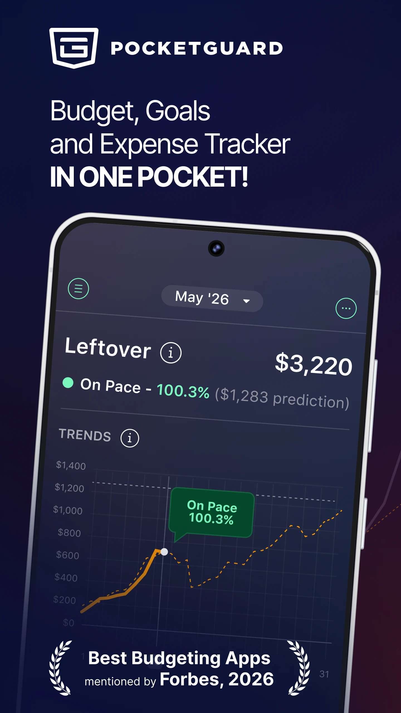{: width="180" .normal }
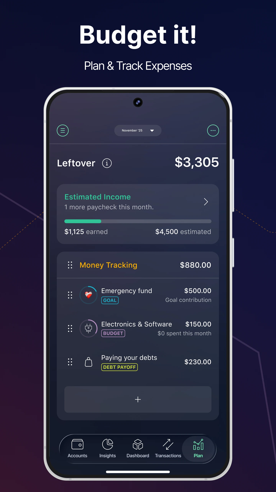{: width="180" .normal }
{: width="180" .normal }
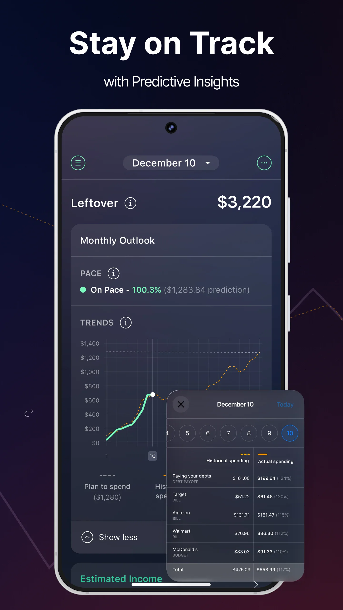{: width="180" .normal }
{: width="180" .normal }

PocketGuard ทำให้เรียบง่าย: มันแสดง **"In My Pocket"** — คุณมีเงินเท่าไรที่ใช้จ่ายได้อย่างปลอดภัยหลังบิล ออม และเป้าหมายสำเร็จ นี่คือวิธีเบาที่สุดในการหลีกเลี่ยงใช้จ่ายเกินโดยไม่ต้องเรียนระเบียบวิธี

**จุดแข็ง**
- **ตัวเลข "In My Pocket" ที่ใช้จ่ายได้อย่างปลอดภัย** intuitive และใช้ได้โดยตรง
- จัดหมวดธุรกรรมอัตโนมัติ ติดตามสมัครสมาชิก และเสนอฟีเจอร์ลดบิล
- **มีแพ็กฟรี** บวก PocketGuard Plus (~$12.99/เดือน หรือ ~$74.99/ปี) สำหรับรายละเอียดมากขึ้น

**จุดอ่อน**
- **ความลึกงบประมาณจำกัด** — ไม่มีวิธี zero-based หรือซอง; ปรับแต่งบาง
- **มุ่งเน้นมือถือ** ประสบการณ์เว็บจำกัด
- ไม่มีเบิกคืน ไม่มีติดตามการลงทุน/มูลค่าสุทธิ หลายสกุลเงินอ่อน
- รายงานที่มีประโยชน์บางตัวอยู่หลัง Plus

**เหมาะสำหรับ:** คนที่อยากคำตอบเร็ว "ฉันซื้อนี้ได้ไหม?" โดยไม่ต้องจัดการงบเต็มรูปแบบ

**ดาวน์โหลด PocketGuard**
- [Google Play](https://play.google.com/store/apps/details?id=com.pocketguard.android.app)
- [App Store](https://apps.apple.com/us/app/pocketguard-budget-app/id949414211)

---

## Goodbudget — งบแบบซองที่ดีที่สุดโดยไม่ต้องสมัครสมาชิก

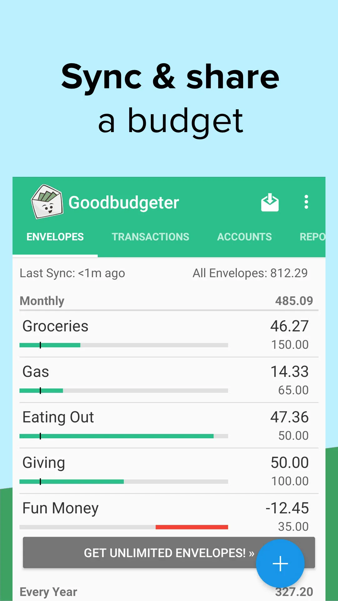{: width="180" .normal }
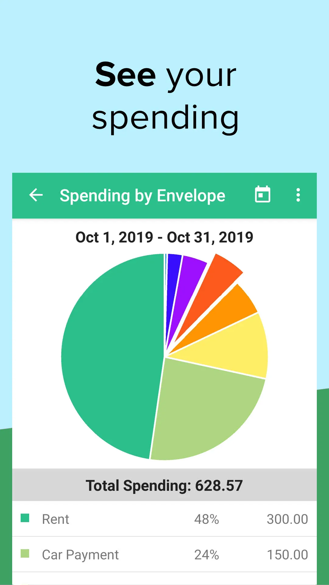{: width="180" .normal }
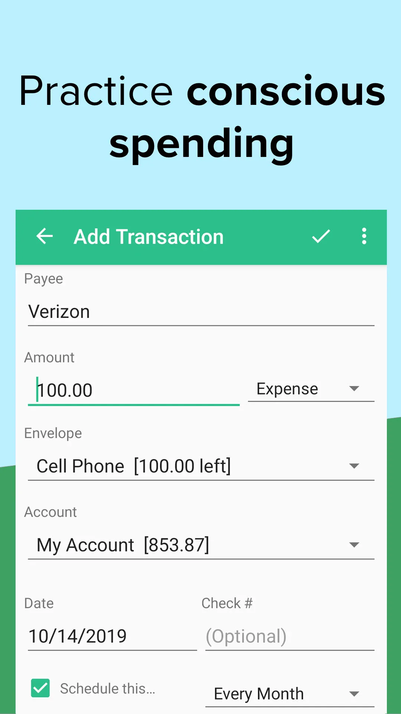{: width="180" .normal }
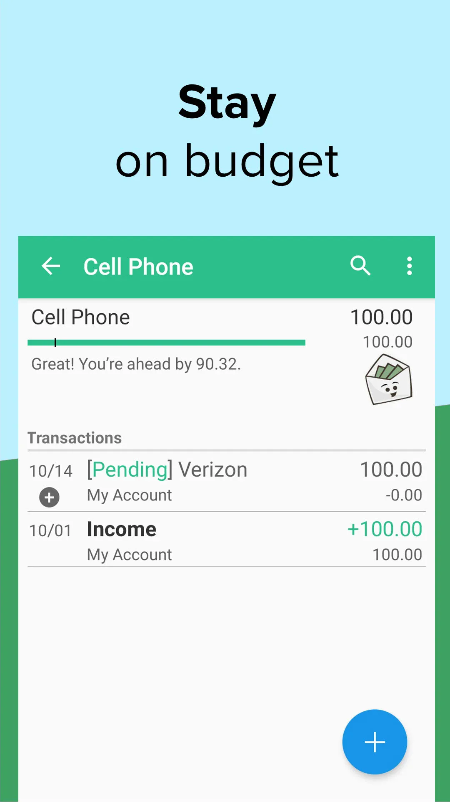{: width="180" .normal }
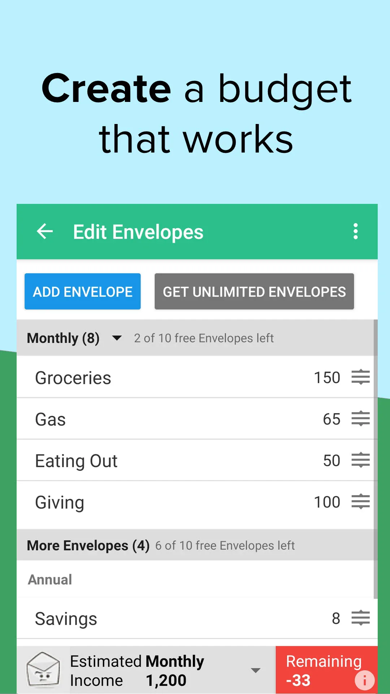{: width="180" .normal }

Goodbudget ทำให้ **ระบบซอง** แบบคลาสสิกเป็นดิจิทัล: คุณจัดสรรเงินเข้าซองเสมือนและใช้จ่ายจากซองนั้น มันตั้งใจให้กรอกเอง และส่องเด่นสำหรับคู่รักและครอบครัวที่แชร์งบ

**จุดแข็ง**
- **วิธีซองทำงานได้ถูกต้อง** พร้อมซิงโครไนซ์คลาวด์ข้ามอุปกรณ์ให้งบครัวหยุดตรงกัน
- **แพ็กฟรี** (20 ซอง 2 อุปกรณ์ ประวัติ 1 ปี); Premium (~$8/เดือน หรือ ~$70/ปี) ปลดซองไม่จำกัด อุปกรณ์มากขึ้น ประวัติ 7 ปี และซิงค์ธนาคาร
- ยืดหยุ่นแพลตฟอร์ม: iOS Android และเว็บ

**จุดอ่อน**
- **ส่วนใหญ่กรอกเอง** — ไม่มีนำเข้าธนาคารอัตโนมัติในแพ็กฟรี และซิงค์ธนาคารที่เสียเงินก็จำกัดกว่า YNAB/Monarch
- **จัดหมวดอัตโนมัติน้อยที่สุด**; คุณเป็นคนแยก
- ไม่มีติดตามการลงทุน/มูลค่าสุทธิ ไม่มีเบิกคืน หลายสกุลเงินอ่อน
- แผนภูมิและรายงานเรียบกว่าแดชบอร์ดอัตโนมัติ

**เหมาะสำหรับ:** แฟนงบแบบซองและงบครอบครัวร่วมที่เลือกการควบคุมเหนืออัตโนมัติ

**ดาวน์โหลด Goodbudget**
- [Google Play](https://play.google.com/store/apps/details?id=com.dayspringtech.envelopes)
- [App Store](https://apps.apple.com/app/goodbudget/id471112395)

---

## เปรียบเทียบความสามารถหลัก

ตารางด้านล่างแสดง ให้เป็นกลางที่สุดเท่าที่ทำได้ ความสามารถที่แต่ละแอปรองรับ "บางส่วน" หมายถึงฟีเจอร์มีแต่มีขีดจำกัด (เช่น สำรองด้วยตนเอง ไม่ใช่ซิงค์ธนาคาร)

| ความสามารถ | YNAB | Meow Money | Monarch | Rocket Money | Empower | PocketGuard | Goodbudget |
|---|---|---|---|---|---|---|---|
| **หลายบัญชี / สมุดบัญชี** | มี | มี (สมุดบัญชีหลายเล่ม) | มี (กว้าง) | มี | มี (กว้าง) | มี | มี (ซอง) |
| **ซิงค์ธนาคารอัตโนมัติ** | มี (Plaid) | บางส่วน (สำรอง Google Drive/iCloud/WebDav ไม่มี feed ธนาคาร) | มี | มี | มี | มี | บางส่วน (กรอกเอง; ซิงค์ธนาคารเสียเงิน) |
| **ติดตามการเบิกคืน** | ไม่ | **มี** | ไม่ | ไม่ | ไม่ | ไม่ | ไม่ |
| **ความลึกงบประมาณ** | **Zero-based (แข็งแกร่ง)** | งบต่อหมวด + รอบ | งบกำหนดเอง | พื้นฐาน | กระแสเงินสดพื้นฐาน | "Safe-to-spend" | **ซอง (แข็งแกร่ง)** |
| **สถิติ / รายงาน** | รายงานแข็งแกร่ง | กราฟรายวัน/รายเดือน/รายปี | กราฟแข็งแกร่ง | พื้นฐาน | แข็งแกร่ง (การลงทุน) | พื้นฐาน | เรียบ |
| **สินทรัพย์ / มูลค่าสุทธิ** | มี | มี (สินทรัพย์/หนี้) | **แข็งแกร่ง** | อ่อน | **แข็งแกร่งที่สุด** | อ่อน | ไม่ |
| **หลายสกุลเงิน** | อ่อน (มุ่งเน้น USD) | **มี (50+ สัญลักษณ์)** | อ่อน | อ่อน | อ่อน (มุ่งเน้นสหรัฐ) | อ่อน | อ่อน |
| **การจัดการสมัครสมาชิก** | ไม่ | ไม่ | บางส่วน | **แข็งแกร่งที่สุด** | ไม่ | มี (ติดตาม) | ไม่ |
| **แพ็กฟรี** | ไม่ (มีแค่ทดลอง) | หลักฟรี ขั้นสูงเสียเงิน | ไม่ (มีแค่ทดลอง) | มี | **มี (เต็ม)** | มี | มี (จำกัด) |
| **แพลตฟอร์ม** | Web + iOS + Android | Android + iOS | Web + iOS + Android | iOS + Android | iOS + Android | iOS + Android | iOS + Android + Web |

---

## วิธีเลือก

- อยาก **ระเบียบวิธี zero-based ที่ผ่านการพิสูจน์** และยอมเรียนมัน → **YNAB**
- อยาก **ฟรี ส่วนตัว ไม่ต้องบัญชี หลายสกุลเงิน พร้อมเบิกคืน** → **[Meow Money Manager](/th/apps/meow-money-manager/)**
- อยาก **แดชบอร์ดคล้าย Mint ที่สุด** พร้อมการลงทุน → **Monarch Money**
- อยาก **หยุดสมัครสมาชิกและลดบิล** → **Rocket Money**
- อยาก **สรุปมูลค่าสุทธิ / การลงทุนฟรี** → **Empower**
- อยากคำตอบเร็ว **"ฉันใช้จ่ายนี้ได้ไหม?"** → **PocketGuard**
- อยาก **ซองและงบครอบครัวร่วม** → **Goodbudget**

## ย้ายจาก Mint

1. **ส่งออกข้อมูลของคุณตอนนี้** หากยังทำได้: ธุรกรรม (CSV) บัญชี และงบที่เก็บไว้
2. **เลือกผู้แทนที่** จากตารางด้านบนตามความเป็นส่วนตัวเทียบอัตโนมัติ
3. **สร้างหมวดหมู่ใหม่** — แอปส่วนใหญ่ให้เปลี่ยนชื่อค่าเริ่มต้นให้ตรงกับ Mint
4. **ตั้งงบและรายการเกิดซ้ำ** (ค่าเช่า เงินเดือน สมัครสมาชิก) ให้การบันทึกต่อไปราบรื่น
5. **ผูกธนาคารหรือคงแบบกรอกเอง** — หากความเป็นส่วนตัวสำคัญ แอปแบบกรอกเองจะเก็บข้อมูลในเครื่องของคุณ

## คำถามที่พบบ่อย

**ฉันยังส่งออกข้อมูลได้ไหมหลัง Mint ปิดตัว?**
{:.faq-q}

ได้ Mint ยังอนุญาตส่งออกธุรกรรม (CSV) บัญชี และงบที่เก็บไว้ก่อนปิดตัว ส่งออกตอนนี้ แล้วนำเข้าไปยังทางเลือกใดก็ได้ด้านบนเพื่อสานต่อการบันทึก

**ทางเลือก Mint ตัวไหนฟรีและเป็นมิตรความเป็นส่วนตัว?**
{:.faq-q}

หากคุณให้ความสำคัญ "ข้อมูลอยู่ในเครื่อง ไม่ต้องลงทะเบียน" **Meow Money Manager** อยู่ในกลุ่มแอปบันทึกไม่กี่ตัวที่หลักฟรีและเป็นในเครื่องอย่างเดียวโดยไม่ต้องบัญชีคลาวด์; สำรองเข้า Google Drive iCloud (iOS) หรือ WebDav ไม่ใช่ล็อกอินคลาวด์บังคับ

**Meow Money Manager รองรับหลายสกุลเงินไหม?**
{:.faq-q}

ใช่ — มันมี **50+ สัญลักษณ์สกุลเงิน** สำหรับช้อปปิ้งข้ามประเทศหรือแลกเปลี่ยน รวมถึงส่วนติดต่อผู้ใช้จีน อังกฤษ อินโดนีเซีย ไทย และโปรตุเกส

**ฉันไม่อยากเรียนระเบียบวิธีงบประมาณ — แค่บันทึกเรียบง่าย ควรเลือกตัวไหน?**
{:.faq-q}

สำหรับคำตอบทันที "เหลือเงินเท่าไร" เลือก **PocketGuard**; สำหรับส่วนติดต่อผู้ใช้น่ารักที่ทำให้การบันทึกรายวันรักษาไว้ได้ เลือก **Meow Money Manager**

**ทางเลือก Mint ที่ดีที่สุด 2026 คืออะไรหากฉันอยากทางเลือก YNAB โดยไม่สมัครสมาชิก?**
{:.faq-q}

สำหรับบันทึกจ่ายครั้งเดียวหรือหลักฟรี Meow Money Manager เก็บสมุดบัญชีในเครื่องโดยไม่เชื่อมธนาคาร; YNAB ยังคงเป็นตัวเลือกหากคุณอยากงบ zero-based พร้อมซิงค์ธนาคารและยอมจ่ายรายปี

**มีทางเลือก PocketGuard ที่ไม่อัปโหลดธุรกรรมของฉันไหม?**
{:.faq-q}

มี แอปอย่าง Meow Money Manager และ Goodbudget เก็บบันทึกในเครื่องหรือไฟล์ที่คุณควบคุม มุมมอง safe-to-spend ของ PocketGuard ต้องบัญชีผูก แต่แอปบันทึกในเครื่องให้ภาพแบบกรอกเองแต่ส่วนตัวบนตัวเลขเดียวกัน

## ศัพท์ที่เกี่ยวข้อง

- [แอปบันทึกการเงินคืออะไร?](/th/glossary/what-is-an-expense-tracker/)
- [การจัดการงบประมาณคืออะไร?](/th/glossary/what-is-budget-management/)
- [การจัดการเบิกคืนคืออะไร?](/th/glossary/what-is-reimbursement-management/)
