Retroflip คือ **[นาฬิกาพลิก](/th/glossary/what-is-a-flip-clock/)** ย้อนยุคฟรีและงามสำหรับ Android — แต่ส่วนใหญ่หยุดที่หน้านาฬิกา ไม่มี **ไวท์นอยส์สำหรับโฟกัสหรือนอน ไม่มีโอเวอร์เลย์นาฬิกาลอย ไม่มีวิดเจ็ต และไม่มีเวอร์ชัน iPhone** หากคุณอยากนาฬิกาพลิกที่ยังเล่นเสียงแวดล้อม อยู่เหนือแอปอื่น หรือรันบน iOS หมวดนี้พัฒนาเร็วมาก

ด้านล่างเราเปรียบเทียบหก **ทางเลือก Retroflip** ที่แข็งแกร่ง — จากนาฬิกาหน้าจอเต็มน่ารักและเต็มฟีเจอร์ถึงนาฬิกาพลิกมิตร Pomodoro — ข้ามราคา แพลตฟอร์ม และความสามารถประจำวันที่สำคัญจริงๆ ส่วนใหญ่ผู้อ่านมักมาพร้อมอุปสรรคหนึ่ง — โฆษณา วิดเจ็ตที่หายไป หรือไม่มีเวอร์ชัน iOS — จึงแต่ละตัวเลือกถูกกรอบตามเหตุผลนั้น

## ทำไมถึงมองหานอก Retroflip

- **ไม่มีเสียงแวดล้อม** — ไม่มีไวท์นอยส์ จึงช่วยโฟกัสหรือหลับไม่ได้
- **ไม่มีนาฬิกาลอย** — เวลาอยู่แค่ในแอป ไม่ใช่เหนือแอปอื่น
- **ไม่มีวิดเจ็ตหน้าจอหลัก** — คุณไม่เห็นเวลาเหลียวเดียวจาก launcher
- **แค่ Android** — ผู้ใช้ iPhone และ iPad ตกหล่น
- **ธีมจำกัด** — การปรับแต่งเบากว่านแอปนาฬิกาพลิกเฉพาะ

## ทางเลือก Retroflip ที่ดีที่สุดแบบคร่าวๆ

| แอป | ราคา (2026) | แพลตฟอร์ม | เหมาะสำหรับ |
|---|---|---|---|
| **Only Clock** | แกนฟรี + ปลดล็อก | Android, iOS | ธีม ไวท์นอยส์ นาฬิกาลอย วิดเจ็ต |
| **FliTik** | ฟรี + IAP | iOS (และเดสก์ท็อป/Android) | Pomodoro นับถอยหลัง นาฬิกาพลิกแอมเบียนต์ |
| **Flip Clock: World Clock** | ฟรี + IAP | Android | นาฬิกาพลิกสภาพอากาศ วิดเจ็ต และ world-clock |
| **Fullscreen Clock** | ฟรี + IAP | iOS | โฟกัสหน้าจอเต็มมินิมอล |
| **Flip Clock: Digital Desk Widget** | ฟรี + IAP | iOS | วิดเจ็ตโต๊ะ + screensaver นาฬิกาพลิก |
| **Flip Clock — Digital Clock** | ฟรี + IAP | iOS | นาฬิกาธีมเบา |

---

### 1. Only Clock — ทางเลือก Retroflip เต็มฟีเจอร์ที่ดีที่สุด

{: width="180" .normal }
{: width="180" .normal }
{: width="180" .normal }
{: width="180" .normal }
{: width="180" .normal }

Only Clock คือ **นาฬิกาพลิกหน้าจอเต็ม** สำหรับ Android และ iOS พร้อมแอนิเมชันพลิกงดงาม ธีมมากมาย ไวท์นอยส์สำหรับโฟกัส นาฬิกาลอย และวิดเจ็ต นี่คือการอัปเกรดครบจบที่ใกล้ Retroflip ที่สุด และแก้แทบทุกช่องว่างด้านบน

**จุดแข็ง**
- **แอนิเมชันพลิกหน้าจอเต็ม** พร้อมธีมงามหลากหลายที่คุณสลับได้อิสระ
- **ไวท์นอยส์ในตัว** — ฝน ป่า เตาผิง และอื่นๆ ช่วยโฟกัสหรือนอน
- **นาฬิกาลอย** โอเวอร์เลย์ให้คุณเห็นเวลาเหนือแอปอื่น
- **วิดเจ็ตนาฬิกา** สำหรับหน้าจอหลัก พลัสการแสดงผล 12/24-ชั่วโมงและวันที่
- **รันบน Android และ iOS** และทำงานได้ดีบนโทรศัพท์เก่าหรือ iPad เป็นนาฬิกาโต๊ะ
- ไม่ต้องบัญชี — แค่เปิด นาฬิกาก็ทำงานทันที

**จุดอ่อน**
- ธีมและเสียงที่หลากหลายที่สุดอยู่หลังปลดล็อกจ่ายครั้งเดียวหรือสมาชิกเล็ก
- การปรับแต่งวิดเจ็ตจำกัดกว่าบน iOS เทียบ Android
- ไม่มีหน้านาฬิกาโลก / มัลติโซนเวลา

**เหมาะสำหรับ:** คนที่ต้องการนาฬิกาพลิกเดียวที่ยังเล่นเสียง ลอยเหนือแอป และทำงานบน Android และ iPhone

**ดาวน์โหลด Only Clock**
- [Google Play](https://play.google.com/store/apps/details?id=com.glgjing.only.flip.clock)
- [App Store](https://apps.apple.com/us/app/only-clock-flip-clock/id1566706513)

---

### 2. FliTik — ดีที่สุดสำหรับ Pomodoro และนับถอยหลัง

{: width="180" .normal }
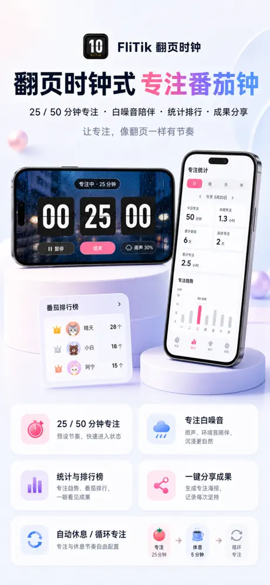{: width="180" .normal }
{: width="180" .normal }
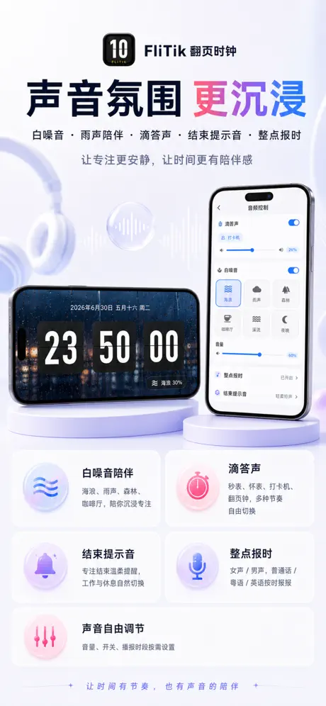{: width="180" .normal }

FliTik คือ **นาฬิกาพลิก** ข้ามแพลตฟอร์มที่หนุนพิธีกรรม: แอนิเมชันพลิกน่าทึ่ง ตัวจับเวลา Pomodoro โหมดนับขึ้น/นับถอยหลัง และเสียงแวดล้อม ทำทุกวินาทีรู้สึกจงใจ นิยมเป็นเพื่อนโฟกัสเรียนและทำงาน

**จุดแข็ง**
- **ตัวจับเวลา Pomodoro** พลัสโหมดนับขึ้นและนับถอยหลังสำหรับสปรินต์เรียนและทำงาน
- **หน้าพลิกงามและบรรยากาศ** ที่ดูดีเป็นนาฬิกาโต๊ะหรือข้างเตียง
- **เสียงแวดล้อม** ผสมกับนาฬิกาสำหรับโฟกัสและผ่อนคลาย
- **ข้ามแพลตฟอร์ม** (iOS เดสก์ท็อป และ Android) ดังนั้นเซ็ตอัพคุณตามมา
- ตัวเลขใหญ่ชัดเจนยังอ่านได้จากปลายห้อง

**จุดอ่อน**
- ธีมและฟีเจอร์ตัวจับเวลาบางตัวอยู่หลังการซื้อในแอป
- เบากว่าการปรับแต่งดิบ (สี/ตำแหน่ง) เทียบแอปวิดเจ็ตนาฬิกาบริสุทธิ์
- ความพร้อม Android ผ่าน sideload/กระจกสโตร์ ไม่ใช่รายการเด่นเดียว

**เหมาะสำหรับ:** นักเรียนและคนทำงานโฟกัสที่อยากนาฬิกาพลิกที่ยังรันเซสชัน Pomodoro และนับถอยหลัง

**ดาวน์โหลด FliTik**
- [App Store](https://apps.apple.com/us/app/flitik-flip-clock-pomodoro/id6448849784)

---

### 3. Flip Clock: World Clock — นาฬิกาพลิก Android ที่ดีที่สุดพร้อมสภาพอากาศ

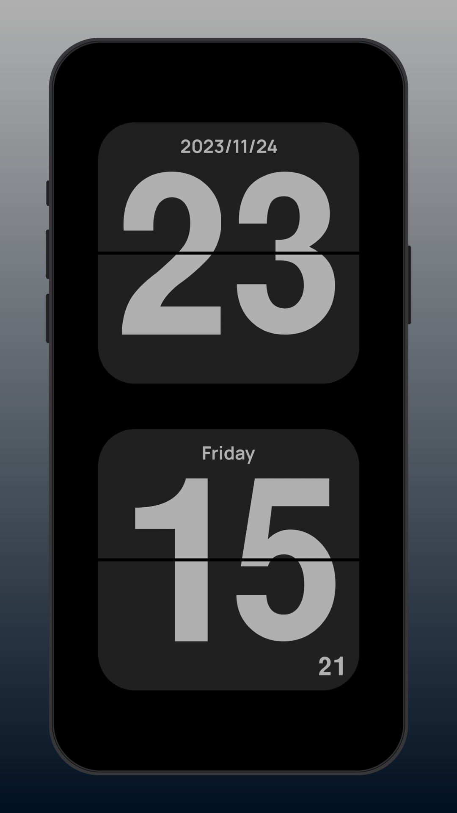{: width="180" .normal }
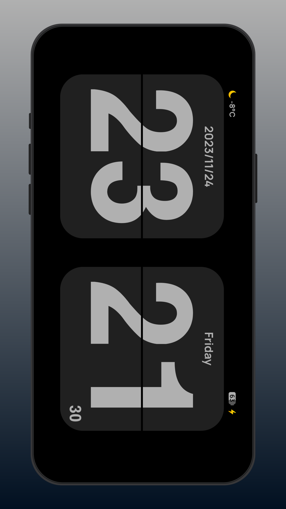{: width="180" .normal }
{: width="180" .normal }
{: width="180" .normal }
{: width="180" .normal }

Flip Clock: World Clock คือ **นาฬิกาพลิก** Android ฟรีที่เพิ่มสภาพอากาศ วิดเจ็ตหน้าจอหลัก ตัวจับเวลา Pomodoro และนาฬิกาลอยเหนือหน้าพลิกคลาสสิก

**จุดแข็ง**
- **นาฬิกาพลิกพร้อมสภาพอากาศ** สำหรับตำแหน่งคุณ สะดวกเป็นนาฬิกาโต๊ะ
- **วิดเจ็ตหน้าจอหลัก** ให้เวลาแสดงบน launcher
- **ตัวจับเวลา Pomodoro และนาฬิกาลอย** สำหรับเซสชันโฟกัส
- ฟรีให้เริ่ม พร้อมอัปเกรดในแอปเลือกได้
- เบาและตั้งค่าง่าย

**จุดอ่อน**
- สนับสนุนโฆษณาที่ระดับฟรี ซึ่งอาจรบกวนหน้าที่สงบ
- สภาพอากาศและวิดเจ็ตบางตัวอยู่หลัง IAP
- ไม่มีเวอร์ชัน iOS

**เหมาะสำหรับ:** ผู้ใช้ Android ที่อยากนาฬิกาพลิกพร้อมสภาพอากาศและวิดเจ็ตโดยไม่จ่ายล่วงหน้า

**ดาวน์โหลด Flip Clock: World Clock**
- [Google Play](https://play.google.com/store/apps/details?id=com.wssc.simpleclock)

---

### 4. Fullscreen Clock — โฟกัสหน้าจอเต็มมินิมอลที่ดีที่สุด

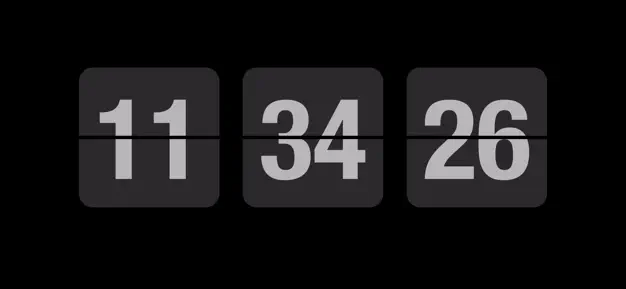{: width="360" .normal }
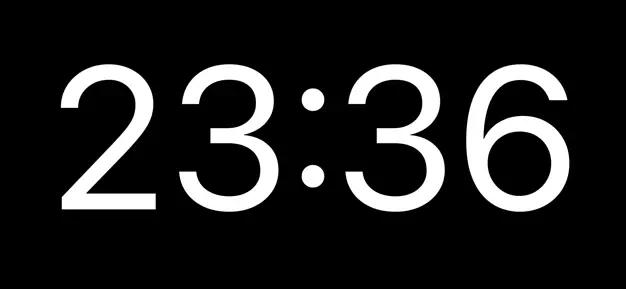{: width="360" .normal }

Fullscreen Clock: Flip & Focus เปลี่ยน iPhone หรือ iPad ของคุณให้เป็น **นาฬิกาพลิก** สะอาด หน้าจอเปิดตลอด พร้อมสิบสามหน้า หรี่แสงกลางคืน สนับสนุนแนวนอน และ Pomodoro ในตัว

**จุดแข็ง**
- **สิบสามหน้านาฬิกา** รวมสไตล์พลิกและโฟกัส
- **หน้าจอคงเปิด** และสนับสนุนหรี่แสงกลางคืนสำหรับใช้งานข้างเตียง
- **Pomodoro ในตัว** สำหรับเซสชันทำงานโฟกัส
- สนับสนุนแนวนอนและแนวตั้ง; UI สะอาดมินิมอลมาก
- ไม่ต้องบัญชี

**จุดอ่อน**
- แค่ iOS — ไม่มีแอป Android
- ส่วนใหญ่แพ็กเกจหน้าและฟีเจอร์อยู่หลัง IAP
- ไม่มีเสียงแวดล้อมในตัว

**เหมาะสำหรับ:** เจ้าของ iPhone/iPad ที่อยากนาฬิกาหน้าจอเต็มมินิมอลงามพร้อม Pomodoro

**ดาวน์โหลด Fullscreen Clock**
- [App Store](https://apps.apple.com/us/app/fullscreen-clock-flip-focus/id1403700342)

---

### 5. Flip Clock: Digital Desk Widget — วิดเจ็ตโต๊ะ + screensaver ที่ดีที่สุด

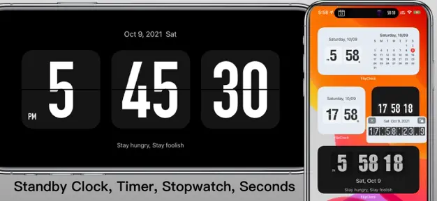{: width="360" .normal }
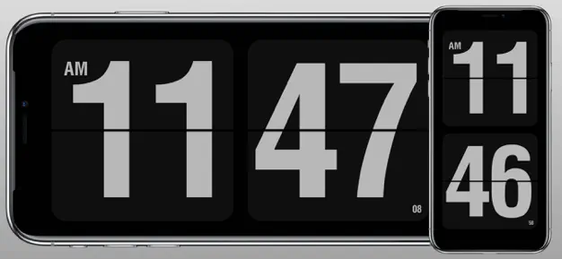{: width="360" .normal }

Flip Clock: Digital Desk Widget คือแอป iOS ที่โฟกัส **นาฬิกาพลิกสไตล์เดสก์ท็อป** วิดเจ็ต StandBy โต้ตอบ และโหมดแบบ screensaver สำหรับโต๊ะและข้างเตียง

**จุดแข็ง**
- **วิดเจ็ต StandBy และโต้ตอบ** ที่แสดงนาฬิกาพลิกทันที
- **โหมด screensaver** สำหรับเซ็ตอัพชาร์จ/โต๊ะ
- แสดงวินาที วันที่ และปฏิทิน พร้อมรูปแบบ 12/24-ชั่วโมง
- สไตล์ขาวดำและมีธีม
- การออกแบบสะอาดเป็นมิตร Apple

**จุดอ่อน**
- แค่ iOS
- ฟีเจอร์ที่ดีที่สุดต้องเวอร์ชันเสียเงิน
- ไม่มีไวท์นอยส์หรือโอเวอร์เลย์ลอย

**เหมาะสำหรับ:** ผู้ใช้ iPhone ที่อยากนาฬิกาพลิกที่ปักหมุดเป็นวิดเจ็ตหรือ screensaver ได้

**ดาวน์โหลด Flip Clock: Digital Desk Widget**
- [App Store](https://apps.apple.com/us/app/flip-clock-digital-desk-widget/id1181028777)

---

### 6. Flip Clock — Digital Clock — นาฬิกาธีมเบาที่ดีที่สุด

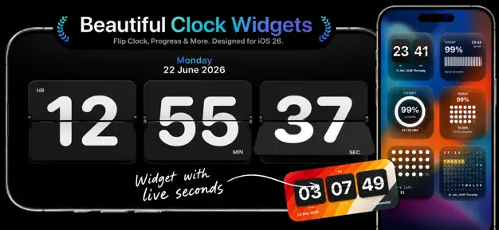{: width="180" .normal }
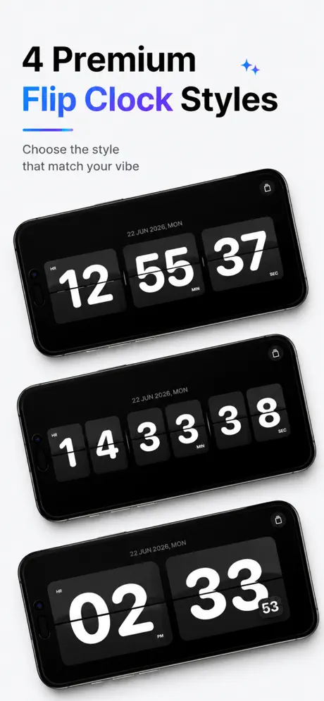{: width="180" .normal }
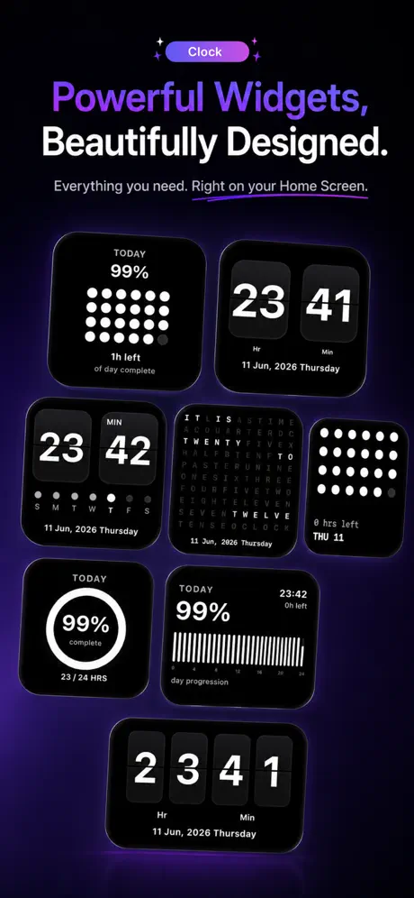{: width="180" .normal }
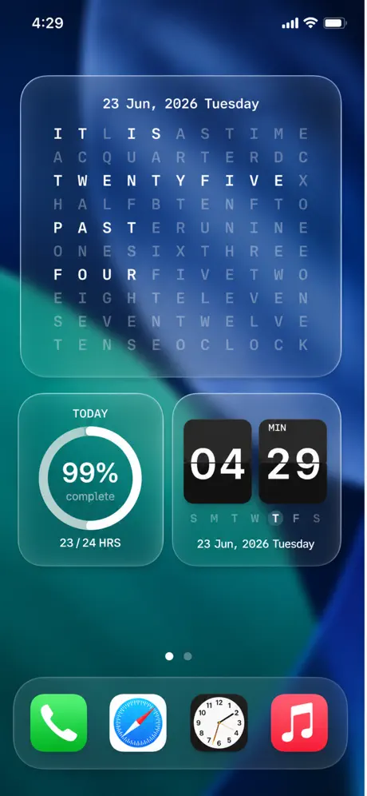{: width="180" .normal }
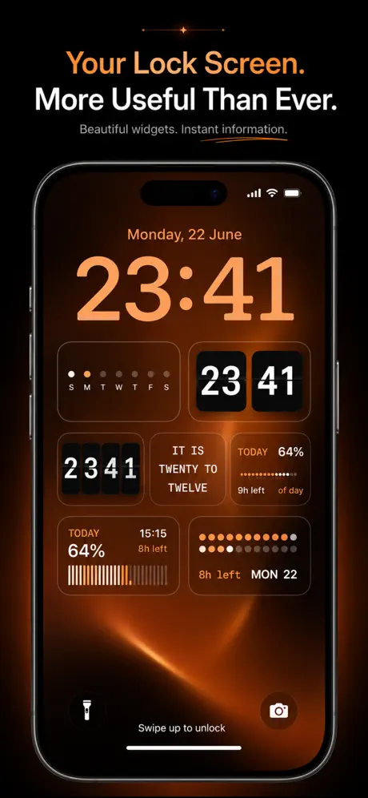{: width="180" .normal }

Flip Clock — Digital Clock คือ **นาฬิกาพลิก** iOS เรียบง่ายและสง่างามพร้อมธีม วิดเจ็ต StandBy การแสดงวินาที/วันที่ และสนับสนุน 12/24-ชั่วโมง — ทางเลือกไม่มีส่วนเสริมไปยัง Retroflip

**จุดแข็ง**
- **แอนิเมชันพลิกสง่างาม** พร้อมธีมหลายตัวเหนือขาวดำ
- **สนับสนุนวิดเจ็ต StandBy และโต้ตอบ**
- แสดงวินาที วันที่ และปฏิทิน
- เบาและเปิดเร็ว
- ฟรีให้ลองพร้อมอัปเกรดเลือกได้

**จุดอ่อน**
- แค่ iOS
- ไม่มีเสียง นาฬิกาลอย หรือ Pomodoro
- ธีมคือตัวเสียเงินหลักเพิ่มเติม

**เหมาะสำหรับ:** ผู้ใช้ iPhone ที่อยากนาฬิกาพลิกธีมสะอาดโดยไม่มีฟีเจอร์เสริม

**ดาวน์โหลด Flip Clock — Digital Clock**
- [App Store](https://apps.apple.com/us/app/flip-clock-digital-clock/id1479450824)

---

## เปรียบเทียบความสามารถแกน

| ความสามารถ | Only Clock | FliTik | Flip Clock: World Clock | Fullscreen Clock | Flip Clock: Digital Desk Widget | Flip Clock — Digital Clock |
|---|---|---|---|---|---|---|
| **แพลตฟอร์ม** | Android, iOS | iOS (+เดสก์ท็อป/Android) | Android | iOS | iOS | iOS |
| **แอนิเมชันพลิกหน้าจอเต็ม** | ใช่ | ใช่ | ใช่ | ใช่ (พลิก & อื่นๆ) | ใช่ | ใช่ |
| **ธีม / ปรับแต่ง** | มาก | บรรยากาศ | พื้นฐาน | 13 หน้า | มีธีม | มีธีม |
| **ไวท์นอยส์ / เสียงโฟกัส** | ใช่ | ใช่ | ไม่ | ไม่ | ไม่ | ไม่ |
| **โอเวอร์เลย์นาฬิกาลอย** | ใช่ | ไม่ | ใช่ | ไม่ | ไม่ | ไม่ |
| **วิดเจ็ต** | ใช่ | ไม่ | ใช่ | ไม่ | StandBy + โต้ตอบ | StandBy + โต้ตอบ |
| **สภาพอากาศ** | ไม่ | ไม่ | ใช่ | ไม่ | ไม่ | ไม่ |
| **Pomodoro / ตัวจับเวลา** | ไม่ | ใช่ | ใช่ | ใช่ | ไม่ | ไม่ |
| **นับถอยหลัง / นับขึ้น** | ไม่ | ใช่ | ไม่ | ไม่ | ไม่ | ไม่ |
| **12/24ชม + วันที่** | ใช่ | ใช่ | ใช่ | ใช่ | ใช่ | ใช่ |
| **ระดับฟรี** | ใจกว้าง | ฟรี + IAP | ฟรี + IAP | ฟรี + IAP | ฟรี + IAP | ฟรี + IAP |
| **โฆษณา** | ไม่ | ไม่ | ใช่ (ฟรี) | ไม่ | ไม่ | ไม่ |

---

## ทางเลือก Retroflip ตัวไหนเหมาะกับผู้ใช้แต่ละประเภท

ตารางจัดอันดับฟีเจอร์; ที่นี่หกแอปจัดกลุ่มตาม *สิ่งที่คุณอยากได้จากนาฬิกานอกเหนือจากแสดงเวลา*

- **นาฬิกามีธีมที่ยังเล่นเสียง** — **ทางเลือก Flip Clock (Soosu)** หรือ **ทางเลือก Nightdream** มักเป็นเรื่องหน้าเปิดตลอดสงบ; Only Clock เพิ่มไวท์นอยส์ ตัวจับเวลาโฟกัส และโหมดลอยเข้าความคิดนั้น
- **นาฬิกาพลิกเดสก์ท็อปหรือเบราว์เซอร์** — **ทางเลือก Fliqlo** เหมาะสำหรับคอมพิวเตอร์; FliTik และ Flip Clock: Digital Desk Widget ครอบคลุมหน้าวิดเจ็ตโต๊ะบนโทรศัพท์
- **วิดเจ็ตและ world clock** — **ทางเลือก ClockLab** หรือ **ทางเลือก Digital Clock Widget** ชี้ไปที่หน้าหน้าจอหลักเล็ก; Flip Clock: World Clock คือเวอร์ชันสภาพอากาศและโซนเวลา
- **แทนแอปเตือนความจำ built-in** — **ทางเลือก Google Clock** คืองานต่าง: เตือนความจำและตัวจับเวลา ไม่ใช่หน้าตกแต่ง
- **คงไม่มีโฆษณาข้ามคืน** — รายชื่อสั้น **ทางเลือก Retroflip** ควรกรองจากโฆษณาและการหรี่แสงก่อน เพราะโทรศัพท์คงเปิดเป็นชั่วโมง

ไม่ว่าป้ายจะเรียกว่าอะไร ให้ถามสองคำถามก่อนย้าย: หน้าสามารถหรี่แสงโดยไม่เผาไหม้จอ OLED ได้หรือไม่ และระดับฟรียังรวมวิดเจ็ตที่คุณใช้งานจริงหรือไม่

## วิธีเลือก

- อยาก **ธีม + ไวท์นอยส์ + นาฬิกาลอย + วิดเจ็ตบนทั้งสองแพลตฟอร์ม** → **Only Clock**
- อยาก **Pomodoro นับถอยหลัง และนาฬิกาพลิกแอมเบียนต์** → **FliTik**
- อยาก **นาฬิกาพลิก Android ฟรีพร้อมสภาพอากาศและวิดเจ็ต** → **Flip Clock: World Clock**
- อยาก **นาฬิกาหน้าจอเต็ม iOS มินิมอลพร้อม Pomodoro** → **Fullscreen Clock**
- อยาก **วิดเจ็ตโต๊ะ / screensaver นาฬิกาพลิกบน iPhone** → **Flip Clock: Digital Desk Widget**
- อยาก **นาฬิกาธีม iOS เบา** → **Flip Clock — Digital Clock**

## วิธีโยกย้ายจาก Retroflip

1. **เลือกตัวแทน** โดยใช้ตารางด้านบนตามแพลตฟอร์มและว่าคุณอยากเสียง วิดเจ็ต หรือนาฬิกาลอย
2. **ติดตั้งและให้สิทธิ์ที่จำเป็น** (แสดงเหนือแอปอื่นสำหรับนาฬิกาลอย เพิกเฉยการเพิ่มประสิทธิภาพแบตเตอรี่สำหรับหน้าจอเปิดตลอด)
3. **ตั้งค่าการแสดงผล 12/24-ชั่วโมงและวันที่** ให้เข้ากับที่คุณใช้ใน Retroflip
4. **เพิ่มวิดเจ็ต** (Only Clock, Flip Clock: World Clock, หรือแอปวิดเจ็ต iOS) ไปยังหน้าจอหลักหรือหน้าจอล็อกสำหรับเหลียวเดียว
5. **หากคุณอยากความช่วยเหลือโฟกัสหรือนอน** เปิดไวท์นอยส์ (Only Clock, FliTik) หรือตัวจับเวลา Pomodoro (FliTik, Fullscreen Clock, Flip Clock: World Clock) ให้นาฬิกาทำมากกว่าแค่แสดงเวลา

## คำถามที่พบบ่อย

**Only Clock คือทางเลือก Retroflip ที่ดีที่สุดไหม?**
{:.faq-q}
สำหรับคนส่วนใหญ่ ใช่ Only Clock คือการอัปเกรดครบจบที่ใกล้ที่สุด — มันเพิ่มไวท์นอยส์ นาฬิกาลอย วิดเจ็ต และสนับสนุน iOS ขณะรักษาหน้านาฬิกาพลิกที่ผู้ใช้ Retroflip ชอบ

**ทางเลือก Retroflip ตัวไหนมีไวท์นอยส์?**
{:.faq-q}
Only Clock และ FliTik ต่างมีเสียงแวดล้อม; สี่ตัวเลือก iOS อื่นเป็นนาฬิกาเงียบ

**ทางเลือก Retroflip ตัวไหนทำงานบน Android และ iOS?**
{:.faq-q}
Only Clock รันบนทั้งสองแพลตฟอร์ม; Flip Clock: World Clock ครอบคลุมแค่ Android และที่เหลือแค่ iOS

**Only Clock ฟรีไหม?**
{:.faq-q}
ใช่ นาฬิกาแกน ธีม และไวท์นอยส์ทำงานฟรี; ปลดล็อกจ่ายครั้งเดียวหรือสมาชิกปลดล็อกธีมและเสียงที่หลากหลายที่สุด

[หน้าแอป Only Clock](/th/apps/only-clock/) — มีให้บน Android และ iOS

## ศัพท์ที่เกี่ยวข้อง

- [นาฬิกาพลิกคืออะไร?](/th/glossary/what-is-a-flip-clock/)
- [นาฬิกาข้างเตียงคืออะไร?](/th/glossary/what-is-a-nightstand-clock/)
