Streaks ทำให้การติดตามนิสัยเป็นพิธีประจำวันสำหรับผู้ใช้ iPhone ล้านคน — แอปเรียบร้อยผู้ชนะ Apple Design Award ที่คอยเตือนคุณให้สเตรกคงอยู่ แต่มีขีดจำกัดจริง: **มีแค่ iPhone และ iPad จ่ายล่วงหน้าโดยไม่มีแพ็กฟรี ซิงโครไนซ์ล็อกอยู่บน iCloud และการปรับแต่งอยู่ในระบบนิเวศ Apple** หากคุณต้องการการรองรับ Android ซิงโครไนซ์ข้ามแพลตฟอร์ม สถิติลึกกว่า ตัวเลือกฟรี หรืออินเทอร์เฟซสนุกกว่า **ทางเลือก Streaks** กำลังเติบโตอย่างรวดเร็ว

ด้านล่างเราเปรียบเทียบหก **ทางเลือก Streaks** ที่แข็งแกร่ง — จาก **แอปติดตามนิสัย** น่ารักที่ให้ความสำคัญความเป็นส่วนตัว ถึงระบบ RPG แบบ gamify และการโค้ชbasedวิทยาศาสตร์ — ในด้านราคา แพลตฟอร์ม ฟีเจอร์หลัก และความสามารถประจำวันที่แท้จริง ผู้อ่านส่วนใหญ่มาพร้อมอุปสรรคที่เป็นรูปธรรม — ไม่มีแอป Android ไม่มีแพ็กฟรี หรือไม่มีวิธีส่งออกประวัติ — ดังนั้นแต่ละตัวเลือกจึงจัดเรียงตามเหตุผลที่คนย้ายจริงๆ

## ทำไมถึงหาทางเลือก Streaks

{: width="180" .normal }
{: width="180" .normal }
{: width="180" .normal }
{: width="180" .normal }
{: width="180" .normal }

- **แค่ iPhone/iPad** — ไม่มีแอป Android และเข้าเดสก์ท็อปจำกัด จึงครอบครัวที่ผสมอุปกรณ์ไม่ครอบคลุม
- **จ่ายล่วงหน้า (~$5.99)** โดยไม่มีแพ็กฟรีให้ลองก่อนซื้อ
- **ซิงโครไนซ์เฉพาะ iCloud** — ไม่มีบัญชีอิสระ จึงย้ายไป Android หรือ Windows ลำบาก
- **วิเคราะห์โฟกัสสเตรก** — สถิติเรียบร้อยแต่เบากว่าแอปสถิติเฉพาะทาง
- **ชั้นสังคมน้อยที่สุด** — ความรับผิดชอบยังแมนนวล (แชร์งาน) ไม่มีชุมชนหรือโค้ช

## ภาพรวมทางเลือก Streaks ที่ดีที่สุด

| แอป | ราคา (2026) | แพลตฟอร์ม | สร้าง + เลิก | เหมาะสำหรับ |
|---|---|---|---|---|
| **Meow Habits** | หลักฟรี + VIP (~$9.99/ปี) | Android, iOS | **ใช่** | UI น่ารัก ไอคอน 500+ ส่วนตัว ไม่ต้องบัญชี |
| **Habitica** | ฟรี + สมาชิก (~$4.99/เดือน) | Android, iOS, เว็บ | ใช่ | ความรับผิดชอบแบบ RPG gamify |
| **Loop Habit Tracker** | ฟรี โอเพนซอร์ส | Android | ใช่ | สถิติเปลือย ความเป็นส่วนตัว ไม่ต้องบัญชี |
| **Fabulous** | ฟรี + สมาชิก (~$12/เดือน) | Android, iOS | กิจวัตร + โค้ช | โค้ชbasedวิทยาศาสตร์ |
| **Productive** | ฟรี + Pro (~$2.50/เดือน) | iOS | ใช่ | วิดเจ็ต iOS เรียบร้อย |
| **Habitify** | ฟรี + สมาชิก | iOS, Android, เว็บ | ใช่ | ข้ามแพลตฟอร์ม ติดตามตามเวลา |

---

### 1. Meow Habits — ดีที่สุดสำหรับแอปติดตามนิสัยน่ารัก ส่วนตัว ไม่ต้องบัญชี

{: width="180" .normal }
{: width="180" .normal }
{: width="180" .normal }
{: width="180" .normal }
{: width="180" .normal }

Meow Habits คือ **[แอปติดตามนิสัย](/th/glossary/what-is-a-habit-tracker/)** ธีมแมวสำหรับ Android และ iOS จุดเด่นที่สุดคือ **อินเทอร์เฟซ**: ดีไซน์การ์ตูนน่ารักพร้อม **ไอคอนหมวดน่ารัก 500+** ทำให้การเช็คอินรายวันรู้สึกเบา ไม่เหมือนภาระ productivity นอกรูปลักษณ์ แอปนี้ครอบคลุมพื้นฐานปฏิบัติของนิสัย — และทำโดยไม่บังคับคุณเข้าบัญชีคลาวด์

**จุดแข็ง**
- **UI การ์ตูนสวยงามพร้อมไอคอน custom 500+** — ตัวแยกชัดเจนที่สุด; การบันทึกนิสัยสนุกในภาพ
- **โหมดสร้างและเลิก** — ติดตามกิจวัตรบวกหรือเลิกนิสัยเสียในแอปเดียว
- **รายการนิสัย สเตรกประจำวัน และมุมมองปฏิทิน / heatmap** (รายวัน / รายสัปดาห์ / รายเดือน) ให้โมเมนตัมเห็นในพริบตา
- **ส่งออก CSV** (ทุกนิสัยหรือช่วงวันที่) สำหรับ Excel พร้อม **สำรอง Google Drive / WebDav** — ข้อมูลออกจากการควบคุมคุณก็ต่อเมื่อคุณอนุญาต
- **ไม่ต้องบัญชี** — นิสัยคงอยู่ในเครื่องพร้อมล็อกลายนิ้วมือเลือกได้ ซึ่งหาได้ยากในแอปนิสัยกระแสหลัก
- การเตือน โหมดมืด/สว่าง และกราฟนิสัย (เปอร์เซ็นต์ความสำเร็จ กราฟการมีส่วนร่วม)

**จุดอ่อน**
- **ไม่มีซิงโครไนซ์คลาวด์ข้ามแพลตฟอร์มอัตโนมัติ** — ซิงโครไนซ์ใช้ Google Drive (Android) หรือ WebDav ไม่ใช่บัญชีเฉพาะ จึงสลับระหว่างโทรศัพท์ Android และ iPhone ลื่นกว่าแอปบนบัญชี
- **ฟีเจอร์ขั้นสูง** (เช่น กราฟรวยกว่า / นิสัยเพิ่ม) อยู่หลัง VIP ถูก (~$0.99/เดือน หรือ $9.99/ปี); หลักฟรีพอสำหรับ **บันทึกนิสัยออฟไลน์** ประจำวัน
- ไม่มี gamify หรือชั้นสังคม/ชุมชน และระบบนิเวศเล็กกว่าผู้เล่นใหญ่

**เหมาะสำหรับ:** คนที่ต้องการ **แอปติดตามนิสัย** ที่ชัดเจนและส่วนตัวโดยไม่ต้องบัญชีคลาวด์ ให้ความสำคัญอินเทอร์เฟซเป็นมิตร และไม่กังวลเรื่องการตั้งค่ามือเบา

**ดาวน์โหลด Meow Habits**
- [Google Play](https://play.google.com/store/apps/details?id=com.glgjing.meow.habit.goal)
- [App Store](https://apps.apple.com/us/app/meow-habits-habit-tracker/id6758230559)

---

### 2. Habitica — ดีที่สุดสำหรับความรับผิดชอบแบบ gamify

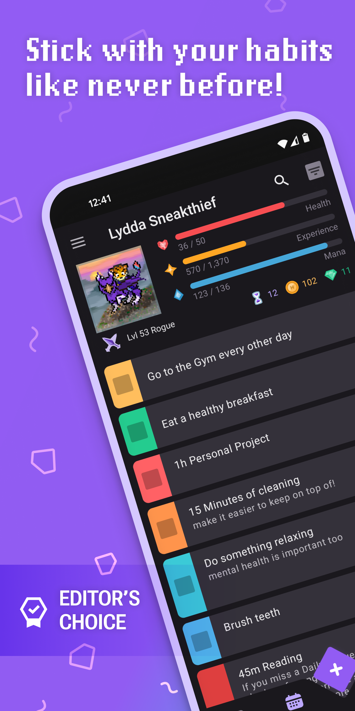{: width="180" .normal }
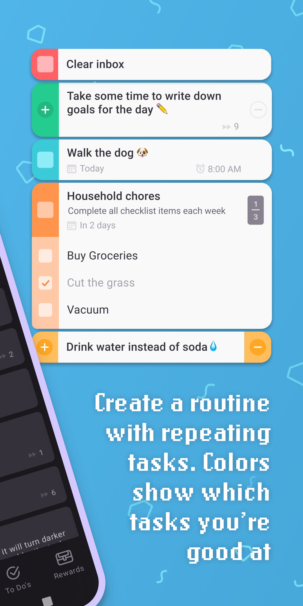{: width="180" .normal }
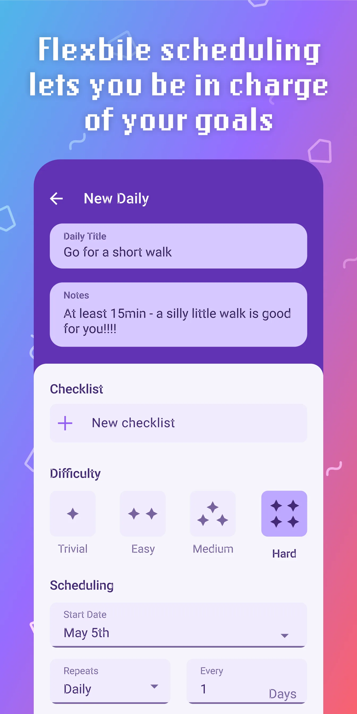{: width="180" .normal }
{: width="180" .normal }
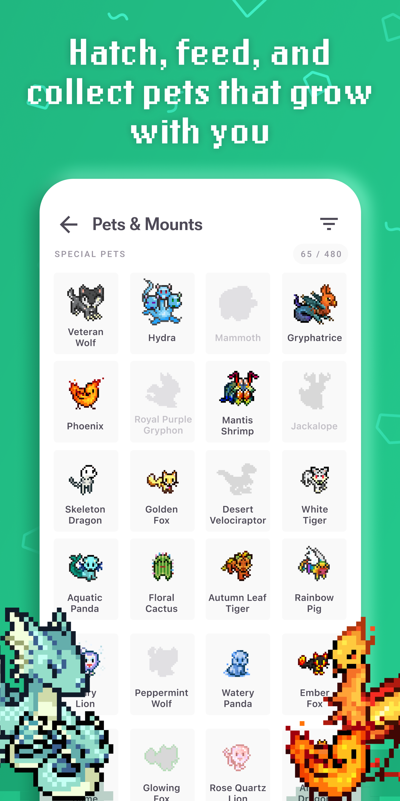{: width="180" .normal }

Habitica เปลี่ยนนิสัย งานประจำวัน และรายการสิ่งที่ต้องทำของคุณเป็น **RPG** คุณสร้างอวตาร ได้ XP และทองเมื่อทำงานเสร็จ และเสีย health เมื่อพลาด แอปนี้ข้ามแพลตฟอร์มพร้อมบัญชี และ parties guilds challenges มอบชั้นสังคมแท้จริงที่ Streaks ไม่มี

**จุดแข็ง**
- **ระบบ RPG แบบ gamify** (อวตาร สัตว์เลี้ยง อุปกรณ์ เควสต์) ทำให้ความสม่ำเสมอรู้สึกเหมือนเกม ไม่ใช่ภาระ
- **ซิงโครไนซ์บัญชีข้ามแพลตฟอร์มแข็งแกร่ง** บน Android iOS และเว็บ
- **Parties guilds challenges** ให้ความรับผิดชอบทางสังคมแท้จริงและการแข่งขันเป็นมิตร
- **แพ็กฟรีใจกว้าง** และโอเพนซอร์สเต็มรูปแบบ
- ผสานกับ **Apple Health / Google Fit**; การเตือนและวิดเจ็ตหน้าจอหลัก

**จุดอ่อน**
- **กลไกเกมอาจรู้สึกยุ่งหรือเด็ก** สำหรับผู้ใช้ที่แค่อยาก productivity เปลือย
- ผลประโยชน์ใหญ่สุดได้ก็ต่อเมื่อคุณ **มีส่วนร่วมกับระบบ RPG**; ผู้ใช้ casual อาจรู้สึก UI หนาแน่น
- **วิเคราะห์นิสัยเบากว่า** เทียบแอปโฟกัสสถิติอย่าง Loop — กราฟเทรนด์และ heatmap ตื้นกว่า
- บางความสวยงามและฟีเจอร์สะดวกอยู่หลังสมาชิก แม้แอปยังใช้ฟรีได้เต็มที่

**เหมาะสำหรับ:** คนที่ถูกจูงใจโดยเกม เลเวล สัตว์เลี้ยง และความรับผิดชอบแบบ party

**ดาวน์โหลด Habitica**
- [Google Play](https://play.google.com/store/apps/details?id=com.habitrpg.android.habitica)
- [App Store](https://apps.apple.com/us/app/habitica-gamified-taskmanager/id994882113)

---

### 3. Loop Habit Tracker — ดีที่สุดสำหรับสถิติฟรี โอเพนซอร์ส และให้ความสำคัญความเป็นส่วนตัว

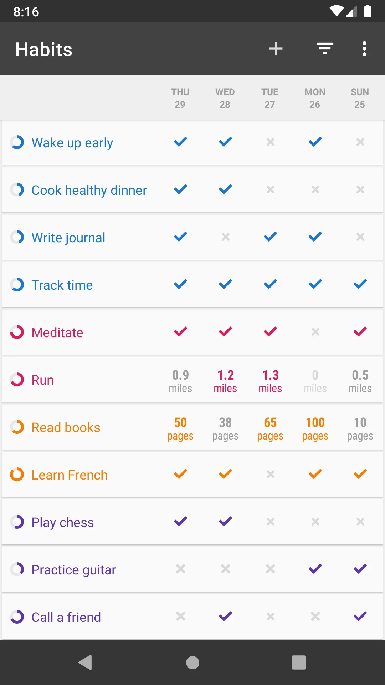{: width="180" .normal }
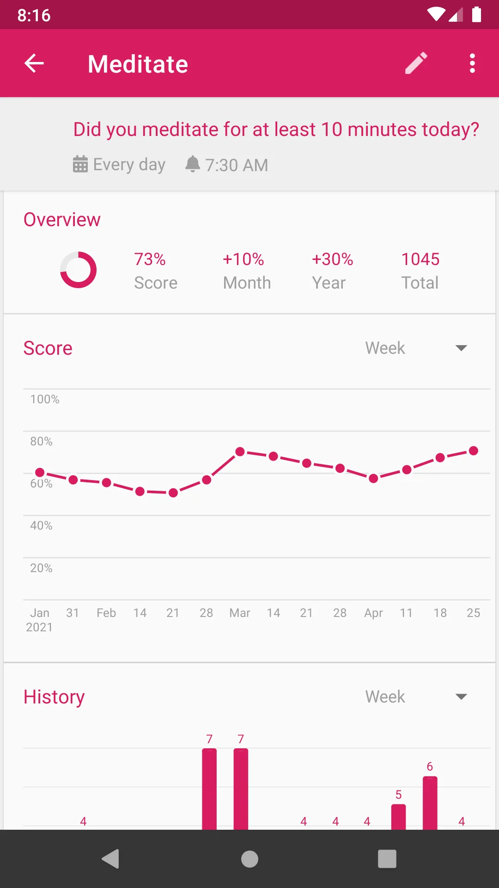{: width="180" .normal }
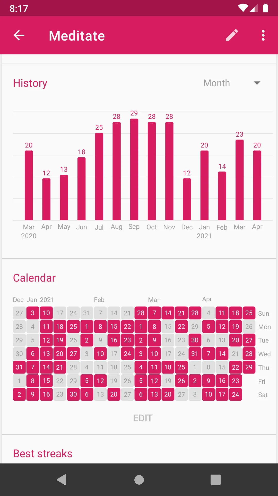{: width="180" .normal }
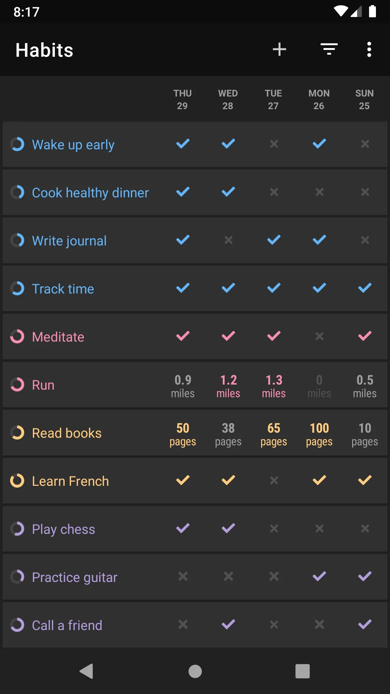{: width="180" .normal }
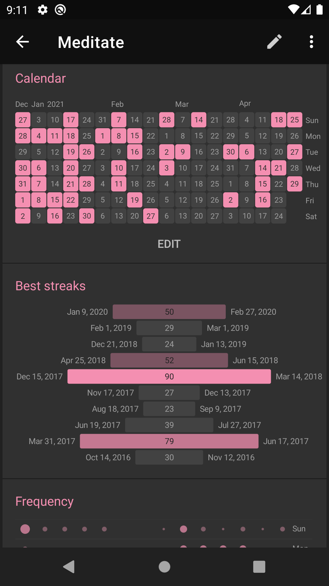{: width="180" .normal }

Loop คือ **แอปติดตามนิสัย** ที่ **ฟรี โอเพนซอร์ส ไม่มีโฆษณา** สำหรับ Android มันตัดทุกอย่างลงจนเหลือสถิติที่แข็งแกร่ง — คะแนนนิสัย สเตรกประจำวัน ความถี่ — และไม่เคยขอให้คุณสมัคร ไม่มีเวอร์ชัน iOS แต่สำหรับผู้บริสุทธิ์ Android ยากที่จะเอาชนะ

**จุดแข็ง**
- **ฟรีเต็มรูปแบบ โอเพนซอร์ส ไม่มีโฆษณา และไม่ต้องบัญชี**
- **สถิติละเอียด**: คะแนนนิสัย สเตรกปัจจุบัน/ดีสุด ความถี่ และ heatmap เรียบร้อย
- **เป้าหมายและการเตือน**; รองรับนิสัยสร้างและเลิก
- **เคารพความเป็นส่วนตัว** และเบามากเร็วมาก
- วิดเจ็ตหน้าจอหลักสำหรับดูพลันเดียว

**จุดอ่อน**
- **แค่ Android** — ไม่มี iOS เว็บ หรือไคลเอนต์เดสก์ท็อป
- **ไม่มีซิงโครไนซ์คลาวด์หรือข้ามอุปกรณ์**; ข้อมูลเก็บท้องถิ่นด้วยส่งออก/นำเข้ามือเท่านั้น
- **ไม่มี gamify ไม่มีสังคม ไม่มีโค้ช** — แค่ตัวติดตามนิสัย
- UI เปลือยกว่าพร้อมคำแนะนำผู้เริ่มต้นน้อยกว่า

**เหมาะสำหรับ:** ผู้ใช้ Android ที่ต้องการ **แอปนิสัยฟรี** ที่ส่วนตัวและโฟกัสสถิติโดยไม่มีเงื่อนไขเพิ่ม

**ดาวน์โหลด Loop Habit Tracker**
- [Google Play](https://play.google.com/store/apps/details?id=org.isoron.uhabits)

---

### 4. Fabulous — ดีที่สุดสำหรับการโค้ชbasedวิทยาศาสตร์

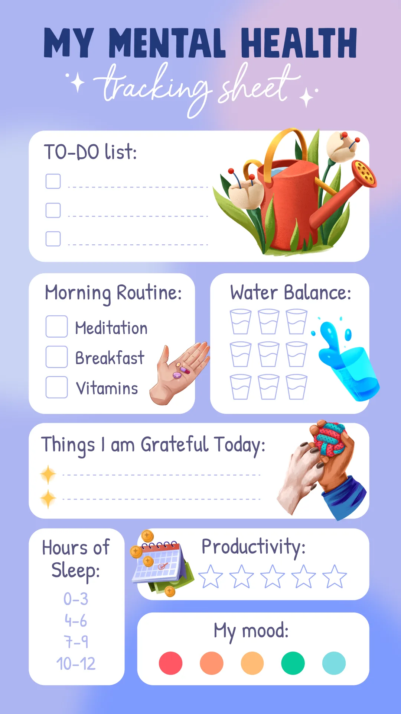{: width="180" .normal }
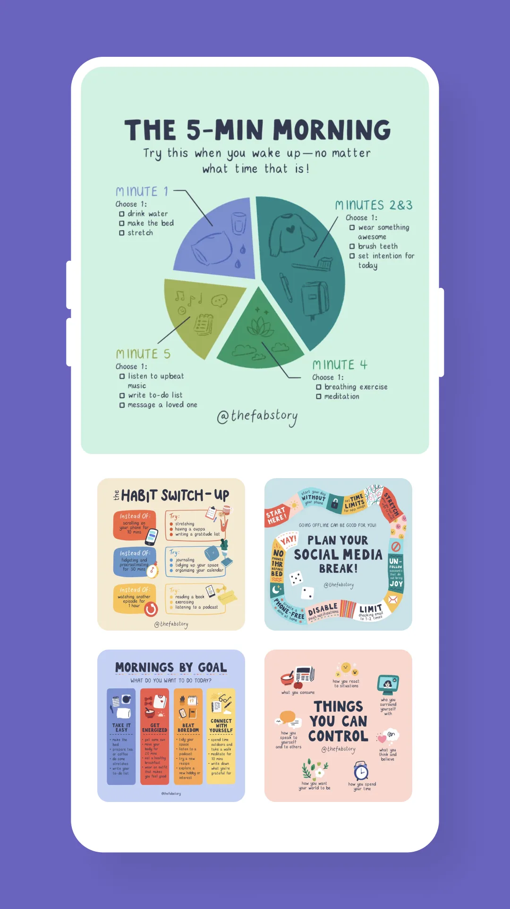{: width="180" .normal }
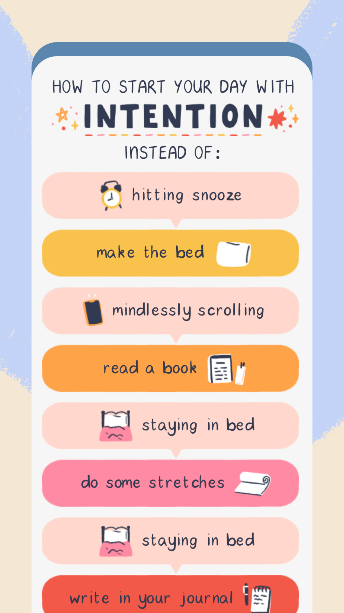{: width="180" .normal }
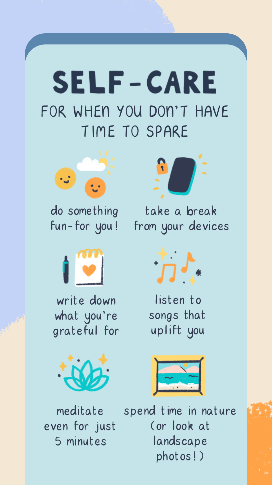{: width="180" .normal }
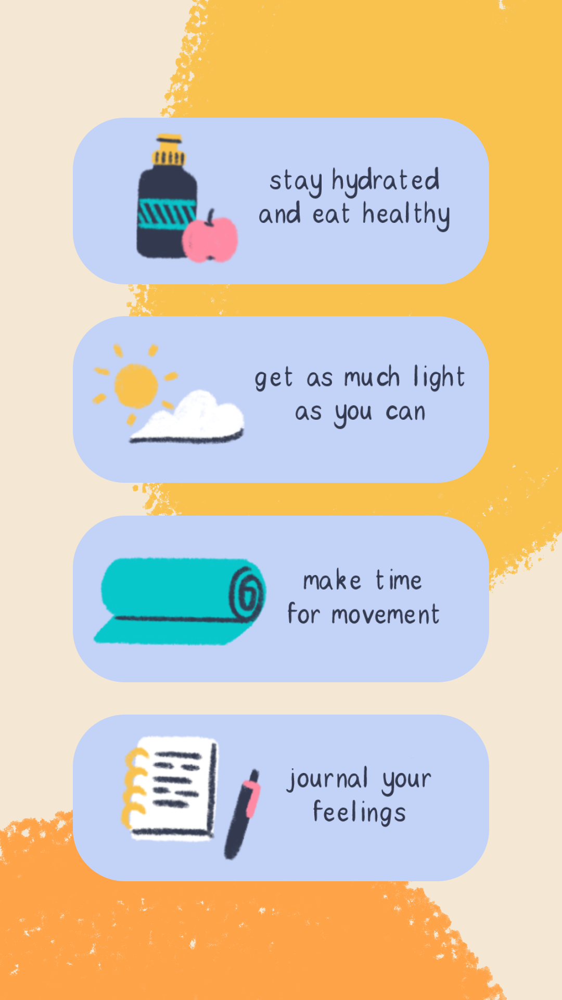{: width="180" .normal }

Fabulous เริ่มจาก **โครงการวิจัยเศรษฐศาสตร์พฤติกรรมมหาวิทยาลัย Duke** และมองการสร้างนิสัยเป็นการเดินทางมีโค้ช — กิจวัตรเช้า สมาธิ นอน ฟิตเนส และโภชนาการมีสติ — ด้วยการโค้ช ไม่ใช่แค่ช่องติ๊ก

**จุดแข็ง**
- **การโค้ชbasedวิทยาศาสตร์และการเดินทางมีโครงสร้าง** ไม่ใช่แค่ติ๊กงาน
- **กิจวัตรมีโค้ช** สำหรับเช้า สมาธิ นอน ฟิตเนส และโภชนาการ
- **ข้ามแพลตฟอร์ม** (Android + iOS) พร้อมซิงโครไนซ์บัญชี
- ดีไซน์เรียบร้อยและผ่อนคลายที่เป็นส่วนตัวขึ้นตามเวลา
- ผสานกับแอป Health สำหรับก้าวและการนอน

**จุดอ่อน**
- **หนักสมาชิก** — การเดินทางส่วนใหญ่อยู่หลัง Fabulous Premium (อาจ ~$12/เดือน)
- วิธีโค้ชอาจรู้สึก **เกินพอดี** สำหรับผู้ใช้ที่อยากตัวติดตามเรียบง่าย
- **ขาดสถิตินิสัยดิบ**; มากกว่าเรื่องโปรแกรมและสเตรกในการเดินทางเดียว
- ค่อนข้างแพงกว่าตัวติดตามเรียบง่าย และผู้ใช้บางคนรู้สึก prompting บังคับ

**เหมาะสำหรับ:** คนที่ต้องการโปรแกรมมีโค้ชเพื่อสร้างกิจวัตรจริง ไม่ใช่แค่เช็กลิสต์

**ดาวน์โหลด Fabulous**
- [Google Play](https://play.google.com/store/apps/details?id=co.thefabulous.app)
- [App Store](https://apps.apple.com/us/app/fabulous-daily-habit-tracker/id1203637303)

---

### 5. Productive — ดีที่สุดสำหรับประสบการณ์ iOS ที่เรียบร้อย

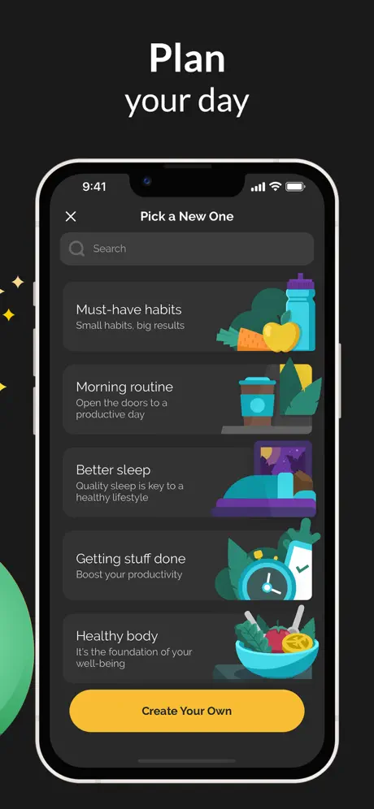{: width="180" .normal }
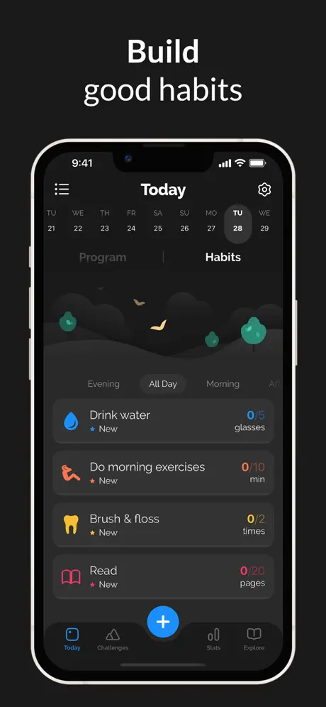{: width="180" .normal }
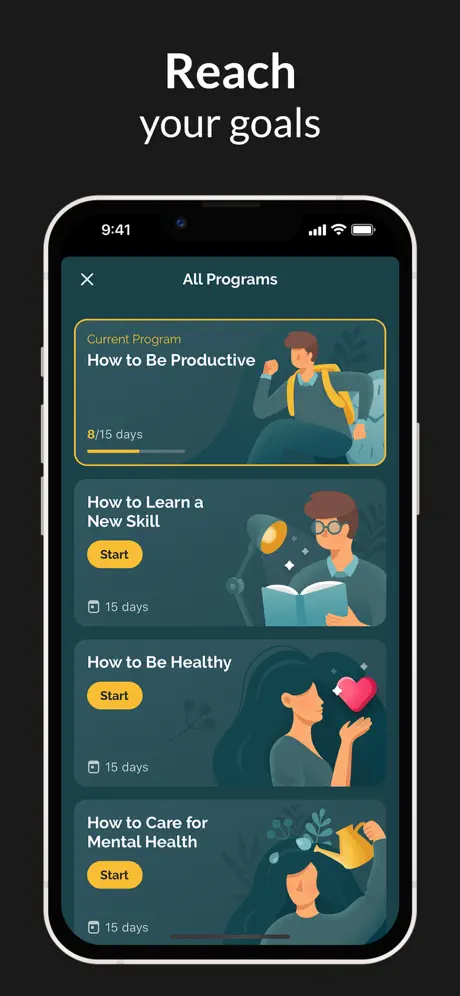{: width="180" .normal }
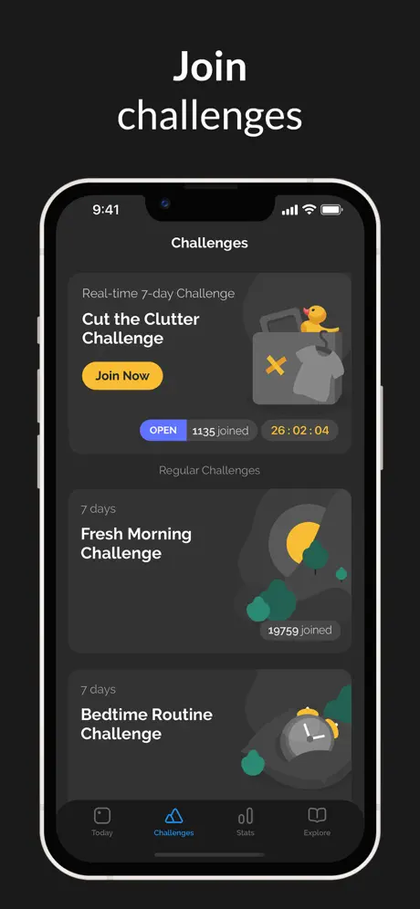{: width="180" .normal }
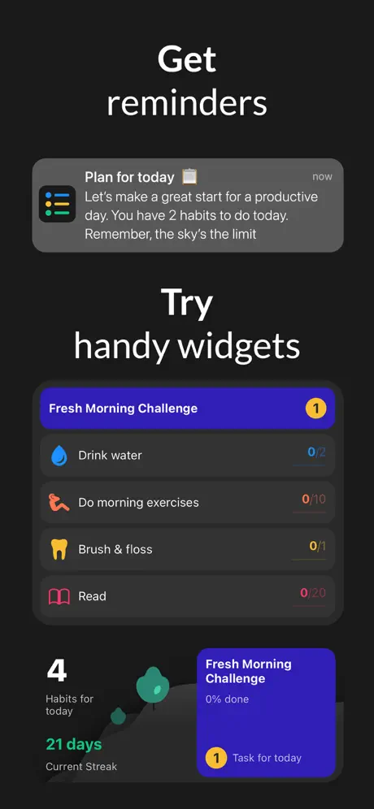{: width="180" .normal }

Productive คือหนึ่งใน **แอปติดตามนิสัย iOS ได้รับความนิยมสุด** รู้จักจากอินเทอร์เฟซสะอาดสวยงามและวิดเจ็ตเยี่ยม แอปนี้ให้ความสำคัญ iPhone/iPad และปฏิบัติตามภาษาดีไซน์ Apple จึงเป็นพี่น้องวิญญาณใกล้ที่สุดของ Streaks สำหรับผู้ใช้ Apple

**จุดแข็ง**
- **UI iOS เรียบร้อยสวยงาม** พร้อมวิดเจ็ตหน้าจอหลักและหน้าจอล็อกเหนือชั้น
- **นิสัยสร้างและเลิก** หมวดหมู่ การเตือน และความท้าทาย
- กระแสวางแผนรายวันดีและสถิติสะอาด
- รองรับ Apple Watch และทางลัด Siri

**จุดอ่อน**
- **โฟกัส iOS** — ไม่มีแอป Android จริง จึงไม่ใช่ตัวเลือกสำหรับผู้ใช้ Android
- ฟีเจอร์มากอยู่หลัง **Productive Pro** (สมาชิก)
- **ไม่แข็งแกร่งสำหรับนิสัยซับซ้อนหรือข้อมูลหนัก** และไม่ข้ามแพลตฟอร์มกับเพื่อน

**เหมาะสำหรับ:** ผู้ใช้ iPhone ที่ต้องการ **แอปติดตามนิสัย** ลื่นไหลและเป็นมิตรวิดเจ็ตที่สุด

**ดาวน์โหลด Productive**
- [App Store](https://apps.apple.com/us/app/productive-habit-tracker/id983826477)

---

### 6. Habitify — ดีที่สุดสำหรับการติดตามข้ามแพลตฟอร์มตามเวลา

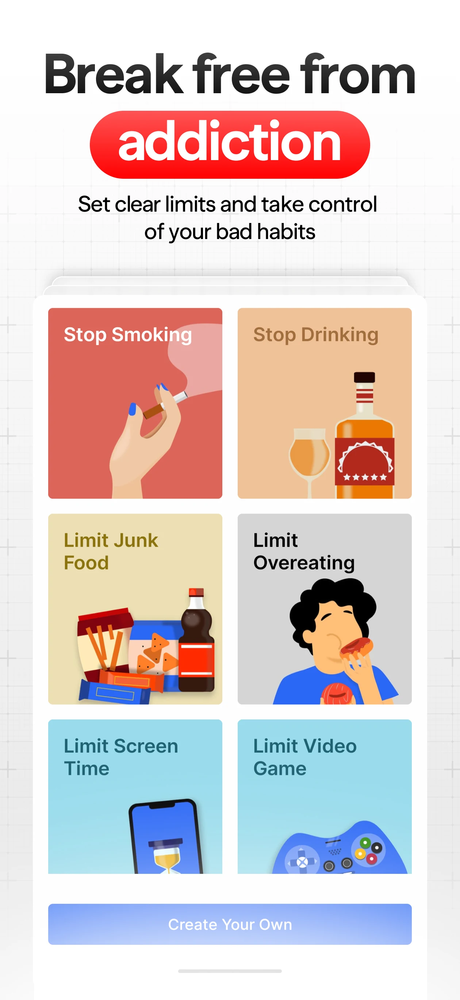{: width="180" .normal }
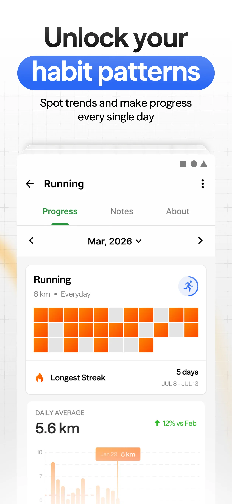{: width="180" .normal }
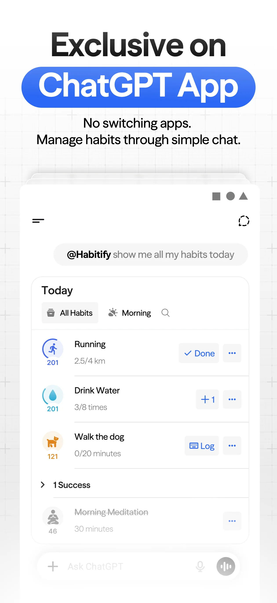{: width="180" .normal }
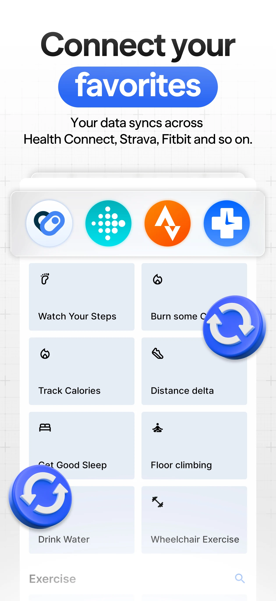{: width="180" .normal }

Habitify คือ **แอปติดตามนิสัยข้ามแพลตฟอร์ม** (iOS Android เว็บ Wear OS) ที่จัดนิสัยตาม **เวลาในวัน — เช้า กลางวัน เย็น** — และซิงโครไนซ์แบบเรียลไทม์ ตัวเลือกแข็งแกร่งหากคุณอยู่บนอุปกรณ์หลายเครื่องและชอบนิสัยที่สอดแทรกเข้ากับตารางอย่างเรียบร้อย

**จุดแข็ง**
- **ข้ามแพลตฟอร์มแท้จริง** พร้อมซิงโครไนซ์เรียลไทม์บน Android iOS เว็บ และนาฬิกา
- **จัดนิสัยตามเวลาในวัน** ซึ่งเข้ากับกิจวัตรรายวันตามธรรมชาติ
- วิเคราะห์สะอาด การเตือน และnuance productivity ที่โฟกัส
- เคยเป็น "App of the Day" ของ Apple; ผู้ใช้ 3M+; มีแพ็กฟรี

**จุดอ่อน**
- บางฟีเจอร์ (นิสัยไม่จำกัด การเตือนฉลาด พื้นที่ custom) อยู่หลัง **Habitify Plus / Pro**
- น้อยความตลกกว่า Meow Habits; เวอร์ชัน Android ล้าหลังจากประสบการณ์ iOS ทางประวัติศาสตร์
- ไม่มีชั้น RPG แบบ gamify เหมือน Habitica

**เหมาะสำหรับ:** คนที่อยู่บนอุปกรณ์มากและอยากนิสัยสอดแทรกเข้าวันของเขา

**ดาวน์โหลด Habitify**
- [Google Play](https://play.google.com/store/apps/details?id=co.unstatic.habitify)
- [App Store](https://apps.apple.com/us/app/habitify-habit-tracker/id1111447047)

---

## เปรียบเทียบความสามารถหลัก

| ความสามารถ | Meow Habits | Habitica | Loop | Fabulous | Productive | Habitify |
|---|---|---|---|---|---|---|
| **แพลตฟอร์ม** | Android, iOS | Android, iOS, เว็บ | แค่ Android | Android, iOS | iOS | iOS, Android, เว็บ |
| **นิสัยสร้าง + เลิก** | ใช่ | ใช่ | ใช่ | กิจวัตร + นิสัย | ใช่ | ใช่ |
| **การเตือน** | ใช่ | ใช่ | ใช่ | ใช่ (ฉลาด) | ใช่ | ใช่ |
| **สเตรกประจำวันและสถิติ** | ใช่ (กราฟ heatmap) | เบา (based XP) | แข็งแกร่ง (คะแนน heatmap) | based โปรแกรม | ใช่ | ใช่ (วิเคราะห์) |
| **วิดเจ็ต** | ใช่ | ใช่ | ใช่ | จำกัด | แข็งแกร่ง | ใช่ |
| **ซิงโครไนซ์คลาวด์ / ข้ามอุปกรณ์** | บางส่วน (Drive / WebDav) | ใช่ (บัญชี) | ไม่ (ท้องถิ่น) | ใช่ (บัญชี) | iCloud | ใช่ (เรียลไทม์) |
| **Gamify / สังคม** | ไม่ | แข็งแกร่ง (RPG + parties) | ไม่ | โค้ช | ท้าทาย | เบา |
| **ออฟไลน์ / ความเป็นส่วนตัว (ไม่ต้องบัญชี)** | แข็งแกร่ง (ในเครื่อง) | based บัญชี | แข็งแกร่ง (ไม่ต้องบัญชี) | based บัญชี | บัญชี (iCloud) | based บัญชี |
| **แพ็กฟรี** | หลักครบ | ครบ | เต็ม (ฟรี) | จำกัด | จำกัด | ครบ |
| **ราคา** | ฟรี + VIP ~$9.99/ปี | ฟรี + ~$4.99/เดือน | ฟรี (โอเพนซอร์ส) | ฟรี + ~$12/เดือน | ฟรี + ~$2.50/เดือน | ฟรี + สมาชิก |
| **ธีม / ไอคอน** | ไอคอนการ์ตูน 500+ | สไตล์ RPG พิกเซล | มินิมอล | ธีมผ่อนคลาย | ธีมเรียบร้อย | ธีมสะอาด |
| **ผสาน Health** | บางส่วน | Apple Health / Google Fit | ไม่ | ใช่ (Health) | Apple Health | บางส่วน |

---

## ทางเลือก Streaks ตัวไหนเหมาะกับผู้ใช้แต่ละประเภท

ตารางด้านบนจัดอันดับฟีเจอร์; ที่นี่หกแอปเดียวกันจัดกลุ่มตาม *สิ่งที่คุณเปลี่ยนจริงๆ*

- **ย้ายเพราะแพลตฟอร์ม** — Meow Habits คือตัวเลือกเดียวที่รวม Android และ iOS ในแอปติดตามนิสัยเดียว และทำงานทันทีเป็น **แอปนิสัยไม่ต้องบัญชี** พร้อมบันทึกนิสัยออฟไลน์หลังติดตั้ง ในรายการ **แอปนิสัยฟรีที่ดีที่สุด Android** มันก็หลีกเลี่ยงกับดัก **แอปติดตามนิสัยฟรีโดยไม่ต้องสมาชิก**: หลักฟรีไม่มีช่วงทดลอง
- **ย้ายเพราะสเตรกไม่จูงใจอีกต่อไป** — การค้นหา **ทางเลือก Habitica** มักหมายถึงรางวัลและความรับผิดชอบ party ต้องแทนที่บทบาทที่สเตรกประจำวันเคยถือ
- **ย้ายเพราะข้อมูลของคุณ** — **ทางเลือก Loop Habit Tracker** เหมาะสำหรับสถิติโอเพนซอร์สในเครื่องโดยไม่สมัคร; Meow Habits รักษาแนวคิดนั้นและเพิ่มส่งออก CSV พร้อมสำรอง WebDav
- **ย้ายเพราะโครงสร้าง** — **ทางเลือก Habitify** เหมาะสำหรับนิสัยที่ผูกเช้า กลางวัน และเย็นข้ามอุปกรณ์ ในขณะที่ **ทางเลือก Fabulous** เหมาะสำหรับโปรแกรมโค้ชมีโครงสร้าง ทั้งสองต้องบัญชี ซึ่งเป็น trade-off เทียบเครื่องมือท้องถิ่นเฉพาะทาง
- **ยังเฉพาะ iPhone** — Productive คล้ายอารมณ์ Streaks ที่สุด แต่สืบทอดข้อจำกัด iOS-only เดียวกัน

หากคำถามแท้จริงคือ **แอปติดตามนิสัย** ไหนที่จะใช้ไปหลายปี ให้เริ่มจากสองสิ่งที่ไม่เปลี่ยนตามเทรนด์: คุณส่งออกประวัติได้หรือไม่ และมันรันโดยไม่ต้องบัญชีได้หรือไม่

## วิธีเลือก

- อยาก **แอปติดตามนิสัยน่ารัก ส่วนตัว ไม่ต้องบัญชีพร้อมไอคอน 500+** → **Meow Habits**
- อยาก **เกม เลเวล และความรับผิดชอบ party** → **Habitica**
- อยาก **สถิติ Android ฟรี โอเพนซอร์ส ไม่ต้องบัญชี** → **Loop**
- อยาก **โปรแกรมมีโค้ช** (นอน สมาธิ ฟิตเนส) → **Fabulous**
- อยาก **วิดเจ็ต iOS ลื่นที่สุด** → **Productive**
- อยาก **ซิงโครไนซ์ข้ามแพลตฟอร์มแท้จริงที่สอดแทรกตามเวลาในวัน** → **Habitify**

## วิธีย้ายจาก Streaks

1. **จดงาน Streaks ปัจจุบัน** พร้อมตาราง (รายวัน วันสลับ รายสัปดาห์)
2. **เลือกผู้แทน** ใช้ตารางด้านบนตามแพลตฟอร์มคุณและว่าคุณอยากโหมดสร้าง เลิก หรือทั้งสอง
3. **สร้างนิสัยใหม่** — เลือกโหมดสร้างหรือเลิกหากรองรับ และคัดลอกความถี่ของแต่ละงาน
4. **ตั้งการเตือน** ในเวลาเดียวกับ Streaks เพื่อให้สเตรกใหม่อยู่รอดหลังย้าย
5. **เปิดสำรอง** (Meow Habits: Google Drive / WebDav; Habitica / Habitify / Fabulous: ซิงโครไนซ์บัญชี) ให้คุณไม่เคยถูกล็อก

## คำถามที่พบบ่อย

**Meow Habits เป็นทางเลือก Streaks ฟรีที่ดีไหม?**
{:.faq-q}

ใช่ มันรันบน Android และ iOS (Streaks เฉพาะ iOS) ฟรีในหลักโดยไม่ต้องบัญชี รองรับโหมดสร้าง *และ* เลิก และเก็บข้อมูลในเครื่องหลังล็อกลายนิ้วมือ

**Meow Habits ใช้บน Android ได้ไหม?**
{:.faq-q}

ได้ — รองรับ Android เต็มรูปแบบ พร้อมสำรอง Google Drive และวิดเจ็ตหน้าจอหลักสำหรับเช็คอินแตะเดียว

**ทางเลือก Streaks ตัวไหนดีที่สุดสำหรับความเป็นส่วนตัว?**
{:.faq-q}

Meow Habits — ไม่ต้องบัญชี เก็บในเครื่องพร้อมล็อกลายนิ้วมือเลือกได้ และสำรองเฉพาะไป Google Drive หรือ WebDav ของคุณเองเมื่อคุณเปิดใช้

**ฉันย้ายนิสัยออกจาก Streaks ได้ไหม?**
{:.faq-q}

Streaks ไม่มีส่งออก CSV ดังนั้นคุณต้องสร้างนิสัยใหม่ด้วยมือ; Meow Habits เองส่งออก CSV ได้ ดังนั้นข้อมูลของคุณย้ายได้ง่ายหลังจากนั้น

[หน้าแอป Meow Habits](/th/apps/meow-habits/) — ดาวน์โหลดสำหรับ Android และ iOS

## ศัพท์ที่เกี่ยวข้อง

- [แอปติดตามนิสัย (Habit Tracker) คืออะไร?](/th/glossary/what-is-a-habit-tracker/)
