หากคุณกำลังหา **ทางเลือก Todoist** มีโอกาสสูงที่คุณต้องการต้นทุนต่ำกว่า ความเป็นส่วนตัวดีกว่า หรืออินเทอร์เฟซเรียบง่ายกว่า นี่คือ **[แอป to-do list ที่ดีที่สุด](/th/glossary/what-is-a-to-do-list/)** ในฐานะทางเลือกที่น่าลองใน 2026 — แอปเจ็ดตัวที่เลือกเพราะส่วนแบ่งตลาดใหญ่หรือจุดเด่นเฉพาะ — พร้อมจุดแข็งจุดอ่อนรายละเอียด ตารางเปรียบเทียบความสามารถหลัก และลิงก์ดาวน์โหลดตรง

## ทำไมผู้ใช้ many ถึงหาทางเลือก Todoist

{: width="180" .normal }
{: width="180" .normal }
{: width="180" .normal }
{: width="180" .normal }
{: width="180" .normal }

- แพ็กฟรี **Beginner** จำกัดคุณถึงราว 5 โครงการ active พร้อมการเตือนจำกัด
- **ผสานปฏิทิน** และอัตโนมัติมากมาย มีแค่ในแพ็ก **Pro** (~$60/ปี)
- ผู้ใช้บางคนแค่อยากอินเทอร์เฟซสงบกว่า และไม่ "gamified" เกินไป หรืออยากเก็บข้อมูลนอกคลาวด์ผู้ขาย

## ภาพรวมทางเลือก Todoist ที่ดีที่สุด

| แอป | ราคา | แพ็กฟรี | เหมาะสำหรับ |
|---|---|---|---|
| **Microsoft To Do** | ฟรี | ครบถ้วน (บัญชี MS) | ผู้ใช้ Microsoft 365 / Outlook |
| **Meow Todo** | หลักฟรี + VIP (~$9.99/ปี) | หลักครบถ้วนพอใช้ | ความเป็นส่วนตัว UI น่ารัก ส่งออก CSV |
| **TickTick** | ฟรี + Premium $35.99/ปี | รายการจำกัด | ครบเครื่อง: ปฏิทิน + pomodoro |
| **Google Tasks** | ฟรี | ครบถ้วน (บัญชี Google) | ผู้ใช้ Gmail / Calendar |
| **Things 3** | มีค่าใช้จ่าย ต่อแพลตฟอร์ม | ไม่มี | แอปเฉพาะ Apple ออกแบบดีสุด |
| **Notion** | ฟรี + แพ็กมีค่าใช้จ่าย | ครบถ้วนพอใช้ | พื้นที่ทำงาน all-in-one ยืดหยุ่น |
| **Any.do** | ฟรี + Premium ~$36/ปี | จำกัด | ปฏิทินและงานรวมกัน |

### 1. Microsoft To Do — ดีที่สุดสำหรับระบบนิเวศ Microsoft

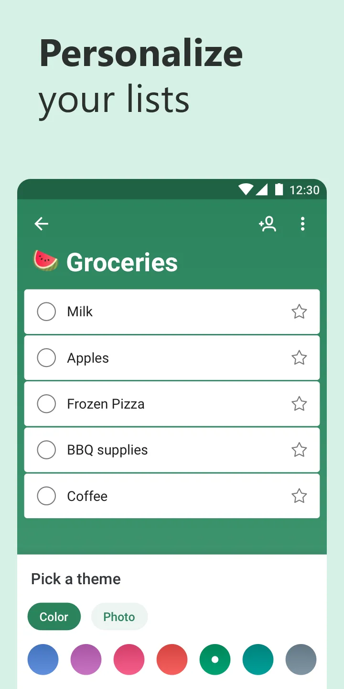{: width="180" .normal }
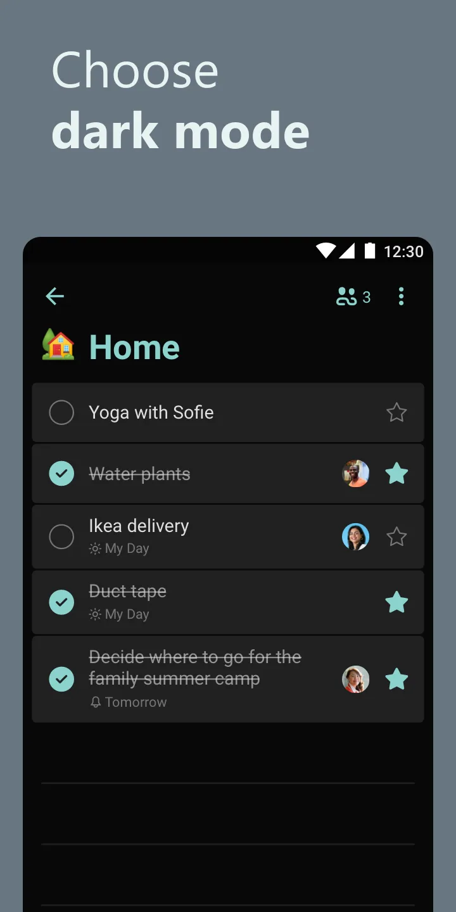{: width="180" .normal }
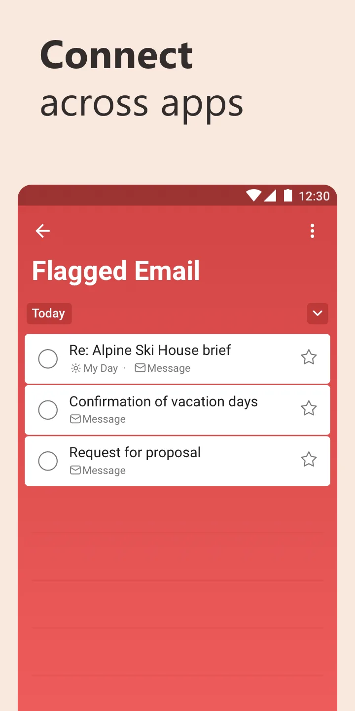{: width="180" .normal }
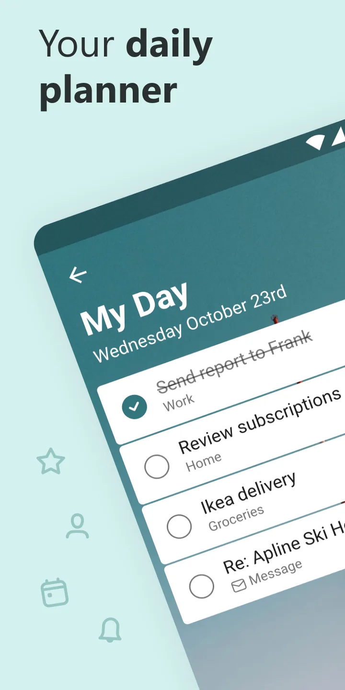{: width="180" .normal }
{: width="180" .normal }

Microsoft To Do (สร้างโดยอดีตทีม Wunderlist ที่ Microsoft ซื้อกิจการใน 2015) **ฟรีเต็มรูปแบบ** และผูกแน่นกับ Outlook และ Windows แอปนี้ส่องเด่นที่สุดสำหรับผู้อยู่ในระบบนิเวศ Microsoft 365

**จุดแข็ง**
- **ฟรีเต็มรูปแบบ** บน iOS Android Windows macOS และเว็บ พร้อมรองรับ 34 ภาษา
- **ผสานลึก Outlook / Microsoft 365** — อีเมลที่ทำเครื่องหมายเปลี่ยนเป็นงาน และใช้เครื่องยนต์เดียวกับงาน Outlook
- วางแผน **My Day** เป็นระเบียบ รายการร่วม งานย่อย แนบไฟล์ และการเตือนกำหนดส่ง
- สนับสนุนโดย Microsoft จึงซิงโครไนซ์และเชื่อถือได้มั่นคง

**จุดอ่อน**
- **ฟีเจอร์ยังพื้นฐาน** — ไม่มีมุมมองปฏิทินในตัว ไม่มี pomodoro หรือตัวติดตามนิสัย และป้อนวันที่ภาษาธรรมชาติจำกัดกว่า TickTick หรือ Things
- ผูกติดบัญชี Microsoft มาก ไม่น่าสนใจหากคุณอยู่นอกระบบนิเวศนั้น
- ไม่มีการร่วมมือนอกรายการร่วม และไม่มีโครงสร้างโครงการหรือ GTD ขั้นสูง

**เหมาะสำหรับ:** ผู้ใช้ Microsoft 365 / Outlook ที่อยากรายการสิ่งที่ต้องทำประจำวันฟรีและเชื่อถือได้ โดยไม่ต้องเรียนระบบใหม่

**ดาวน์โหลด Microsoft To Do**
- [Google Play](https://play.google.com/store/apps/details?id=com.microsoft.todos)
- [App Store](https://apps.apple.com/app/microsoft-to-do/id1212616790)

### 2. Meow Todo — ดีที่สุดสำหรับความเป็นส่วนตัว อินเทอร์เฟซน่ารัก และหลักฟรี

{: width="180" .normal }
{: width="180" .normal }
{: width="180" .normal }
{: width="180" .normal }
{: width="180" .normal }

Meow Todo List คือ **[ตัวจัดการงาน](/th/glossary/what-is-a-to-do-list/)** ธีมแมวสำหรับ Android และ iOS จุดเด่นที่สุดคือ **อินเทอร์เฟซ**: การออกแบบการ์ตูนน่ารักพร้อม **ไอคอนหมวดน่ารัก 400+** ที่ทำให้วางแผนรายวันรู้สึกเบา ไม่เหมือนงานออฟฟิศ นอกรูปลักษณ์ แอปนี้ครอบคลุมพื้นฐานปฏิบัติของรายการสิ่งที่ต้องทำ

**จุดแข็ง**
- **UI การ์ตูนสวยงามพร้อมไอคอนเฉพาะ 400+** — จุดต่างชัดเจนที่สุด; บันทึกงานรู้สึกสนุกในภาพ
- **รายการ งานย่อย และมุมมองปฏิทิน** (รายวัน / รายสัปดาห์ / รายเดือน) ให้งานที่จะมาดูในพริบตา
- **ส่งออก CSV** (งานทั้งหมดหรือช่วงวันที่) สำหรับ Excel พร้อม **สำรอง iCloud / WebDav** — ข้อมูลออกจากการควบคุมคุณก็ต่อเมื่อคุณอนุญาต
- **ไม่ต้องบัญชี** — รายการสิ่งที่ต้องทำไม่ต้องบัญชีเก็บในเครื่องพร้อมล็อกลายนิ้วมือเลือกได้ สิ่งหายากในแอป to-do กระแสหลัก
- งานเกิดซ้ำ การเตือนกำหนดส่ง โหมดมืด/สว่าง และกราฟงาน (pie + กราฟการมีส่วนร่วม)

**จุดอ่อน**
- **ไม่มีซิงโครไนซ์คลาวด์อัตโนมัติข้ามแพลตฟอร์ม** — ซิงโครไนซ์ใช้ iCloud (Apple) หรือ WebDav ไม่ใช่บัญชีเฉพาะ จึงสลับระหว่าง Android และ iPhone ไม่ลื่นเท่าแอปบนบัญชี
- **ฟีเจอร์ขั้นสูง** (เช่น รายการไม่จำกัด / กราฟ richer) อยู่หลัง VIP ราคาถูก (~$0.99/เดือน หรือ $9.99/ปี); หลักฟรีพอสำหรับบันทึกรายวัน
- ไม่มีการร่วมมือหรือรายการร่วม และระบบนิเวศเล็กกว่าผู้เล่นใหญ่

**เหมาะสำหรับ:** คนที่อยากบันทึกงานชัดเจนและส่วนตัว โดยไม่ต้องบัญชีคลาวด์ ให้คุณค่าอินเทอร์เฟซเป็นมิตร และไม่รังเกียจการตั้งค่ามือเบา

**ดาวน์โหลด Meow Todo List**
- [Google Play](https://play.google.com/store/apps/details?id=com.glgjing.money.task.todo.list.meow)
- [App Store](https://apps.apple.com/app/meow-todo-list-task/id6742345495)

### 3. TickTick — ครบเครื่องที่สุด

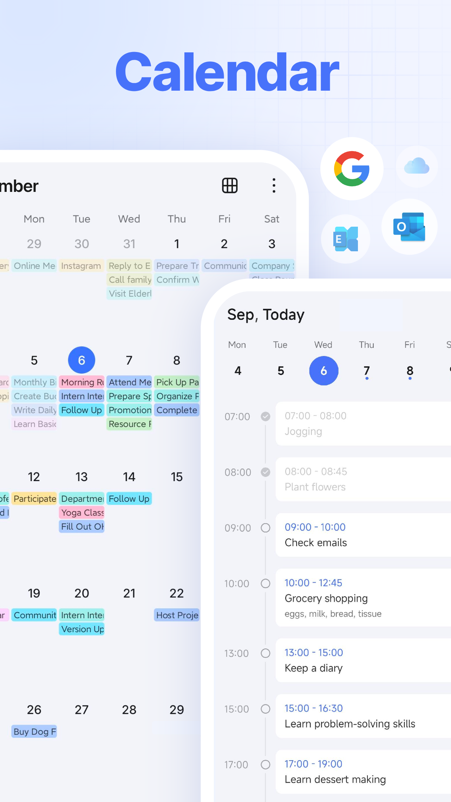{: width="180" .normal }
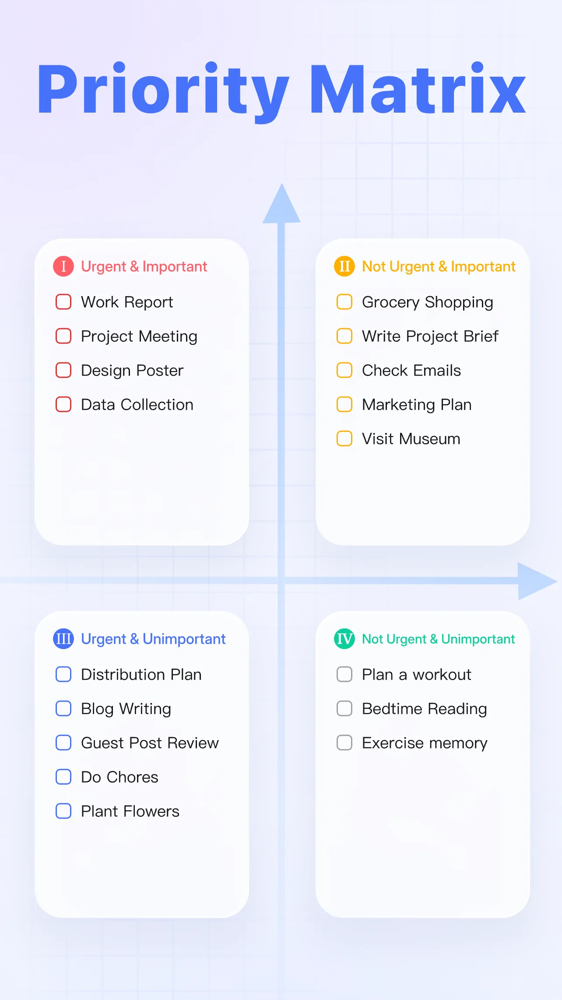{: width="180" .normal }
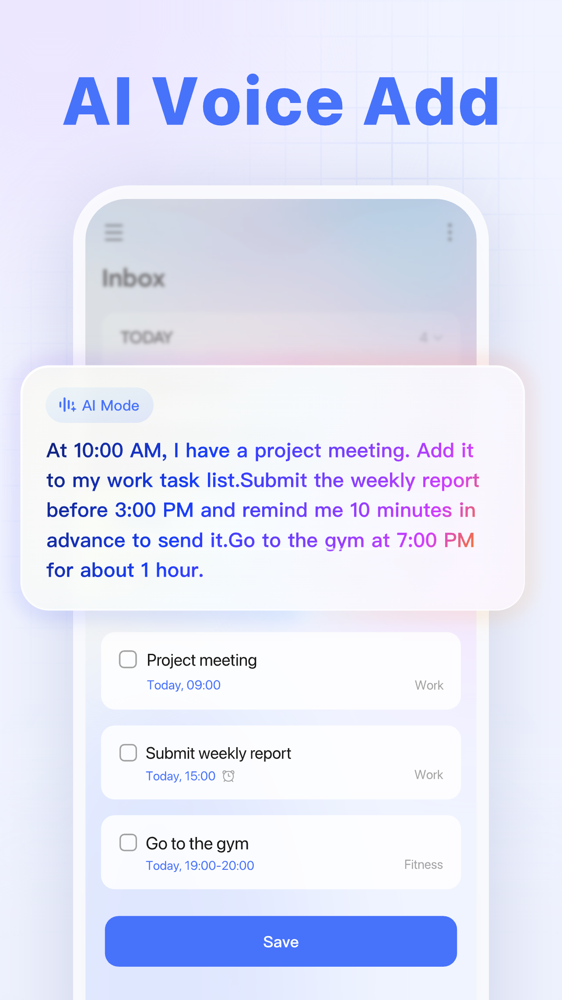{: width="180" .normal }
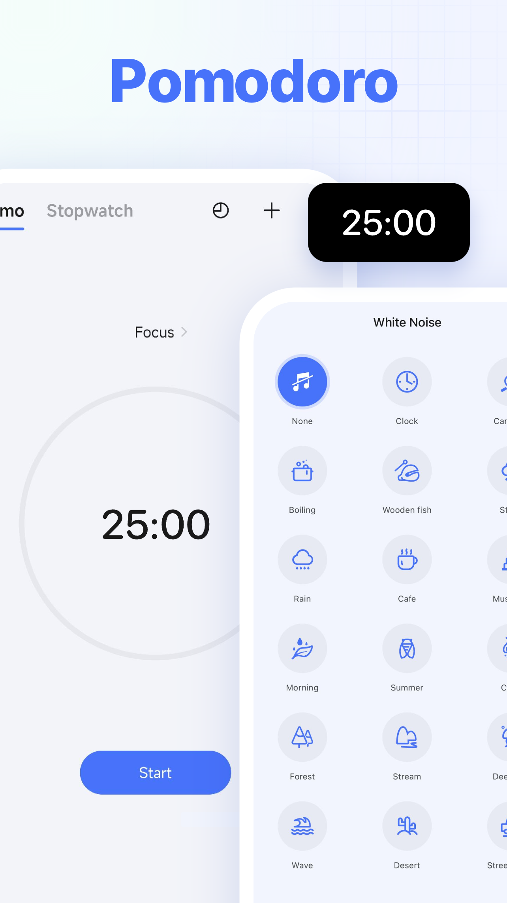{: width="180" .normal }
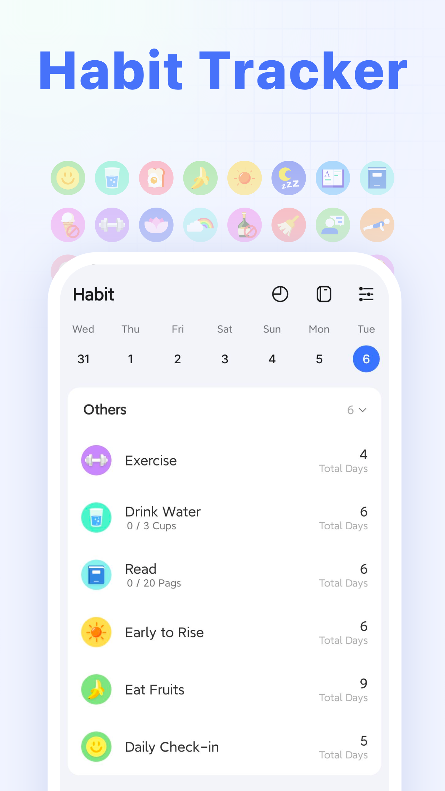{: width="180" .normal }

TickTick คือ **[ตัวจัดการงาน](/th/glossary/what-is-a-to-do-list/)** ทรงพลังพร้อมปฏิทินในตัว ตัวจับเวลา pomodoro และตัวติดตามนิสัย นำฟีเจอร์มากกว่าส่วนใหญ่ และราคาถูกกว่า Todoist Pro

**จุดแข็ง**
- **ปฏิทินในตัว + pomodoro + ตัวติดตามนิสัย** ในแอปเดียว — ไม่ต้องเพิ่มเครื่องมือ
- **จดจำวันที่ฉลาด** (ภาษาธรรมชาติ "ทุกจันทร์ 9 โมงเช้า") และป้อนเสียง ให้บันทึกรวดเร็ว
- มุมมองหลากหลาย: รายการ กริดปฏิทิน ไทม์ไลน์ (premium) แท็ก ความสำคัญ และการเตือนตามตำแหน่ง
- **Premium ถูกกว่า** ($35.99/ปี) กว่า Todoist Pro พร้อมซิงค์บนเว็บ iOS Android Windows และ Mac

**จุดอ่อน**
- **แพ็กฟรีจำกัด** — จำนวนรายการ/งานจำกัด และมุมมองปฏิทินเดียว; ประวัติและบางการเตือนต้อง Premium
- ความกว้างฟีเจอร์อาจทำให้ UI หนาแน่นสำหรับผู้ใช้ที่อยากสิ่ง minimalist
- การร่วมมือเบากว่า Notion; มีรายการร่วม แต่ไม่มีเวิร์กโฟลว์ทีมลึก

**เหมาะสำหรับ:** ผู้ใช้ที่อยากฟีเจอร์แข็งแกร่ง (ปฏิทิน + pomodoro + นิสัย) โดยไม่จ่ายเท่า Todoist

**ดาวน์โหลด TickTick**
- [Google Play](https://play.google.com/store/apps/details?id=com.ticktick.task)
- [App Store](https://apps.apple.com/app/ticktick-to-do-list-calendar/id626144601)

### 4. Google Tasks — ดีที่สุดสำหรับผู้ใช้ Gmail และ Calendar

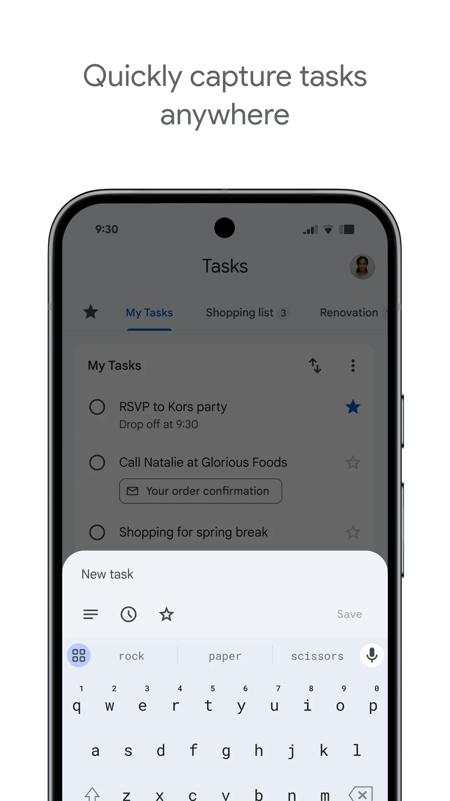{: width="180" .normal }
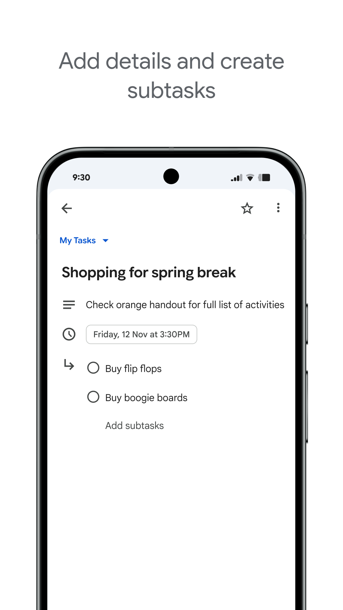{: width="180" .normal }
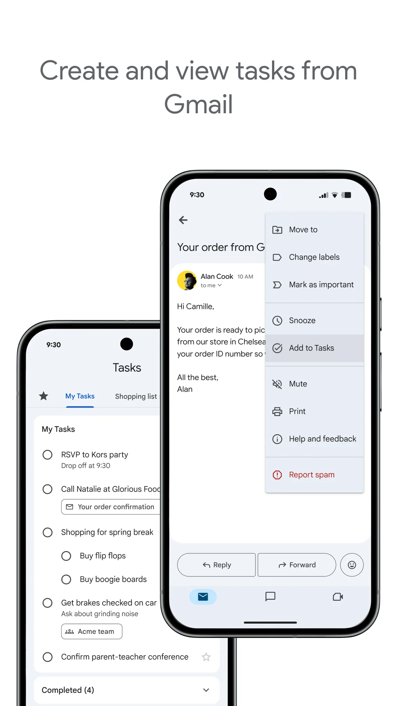{: width="180" .normal }
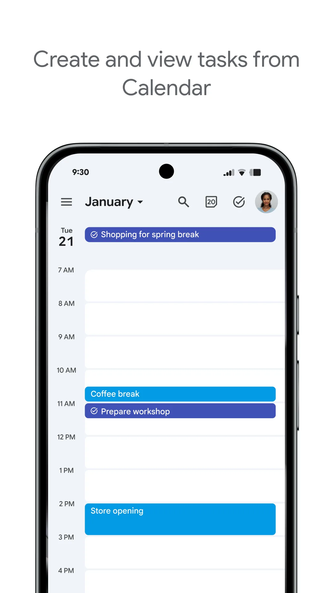{: width="180" .normal }
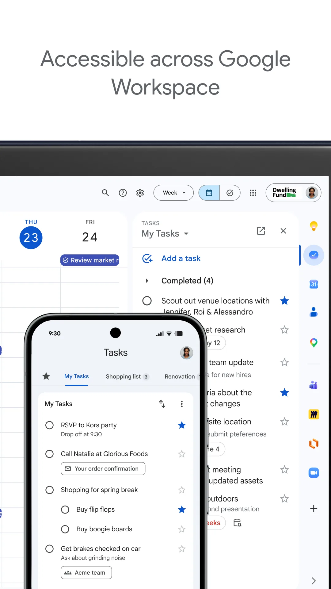{: width="180" .normal }

Google Tasks คือเครื่องมืองานเบาที่ฝังอยู่ใน Gmail และ Google Calendar ตั้งใจให้ minimalist และฟรีสำหรับบัญชี Google ใดก็ได้

**จุดแข็ง**
- **ฟรีและพร้อมใช้ทันที** — มีแล้วใน Gmail Calendar Drive และแอปเฉพาะ (Android iOS เว็บ)
- **ซิงโครไนซ์แน่นกับ Google Calendar** — งานมีกำหนดส่งปรากฏในปฏิทินอัตโนมัติ
- บันทึกเรียบง่ายและรวดเร็ว; หลายรายการ; งานย่อยหนึ่งระดับ; การเตือนพื้นฐาน

**จุดอ่อน**
- **minimalist มาก** — งานย่อยระดับเดียว ไม่มีมุมมอง rich ไม่มีแยกภาษาธรรมชาติ ไม่มี pomodoro หรือนิสัย
- การเตือนยังพื้นฐาน (ตามกำหนดส่ง); ไม่มีการเตือนตามตำแหน่งหรือบันทึกเสียง
- ไม่มีโหมดออฟไลน์-first แท้จริง และร่วมมือจำกัด (แชร์รายการผ่าน Google เท่านั้น); อ่อนสำหรับโครงการซับซ้อน

**เหมาะสำหรับ:** ผู้ใช้ Gmail / Google Calendar ที่อยากรายการสิ่งที่ต้องทำไร้ friction และไม่มากไปกว่านั้น

**ดาวน์โหลด Google Tasks**
- [Google Play](https://play.google.com/store/apps/details?id=com.google.android.apps.tasks)
- [App Store](https://apps.apple.com/app/google-tasks-get-things-done/id1353634006)

### 5. Things 3 — ออกแบบดีสุด เฉพาะ Apple

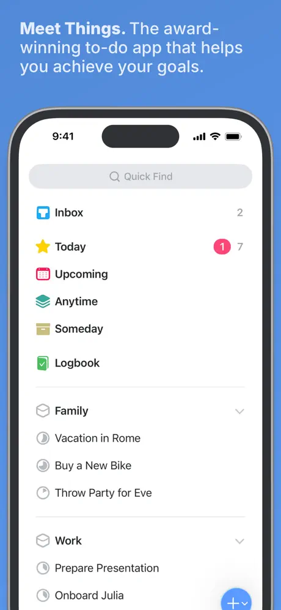{: width="180" .normal }
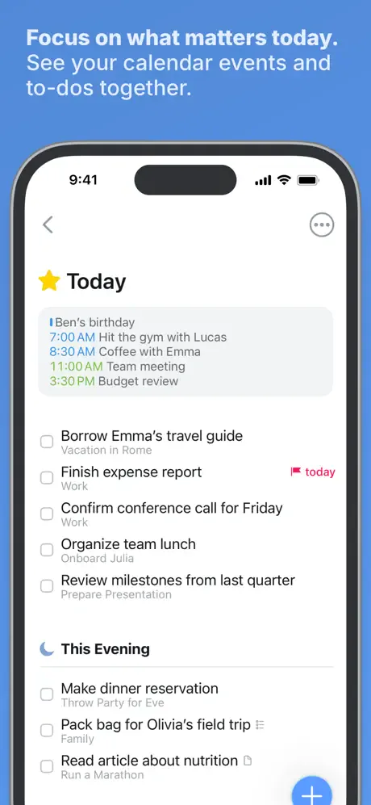{: width="180" .normal }
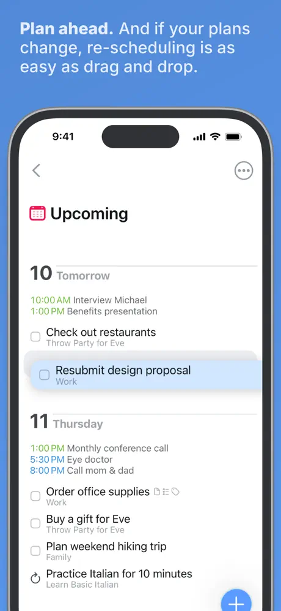{: width="180" .normal }
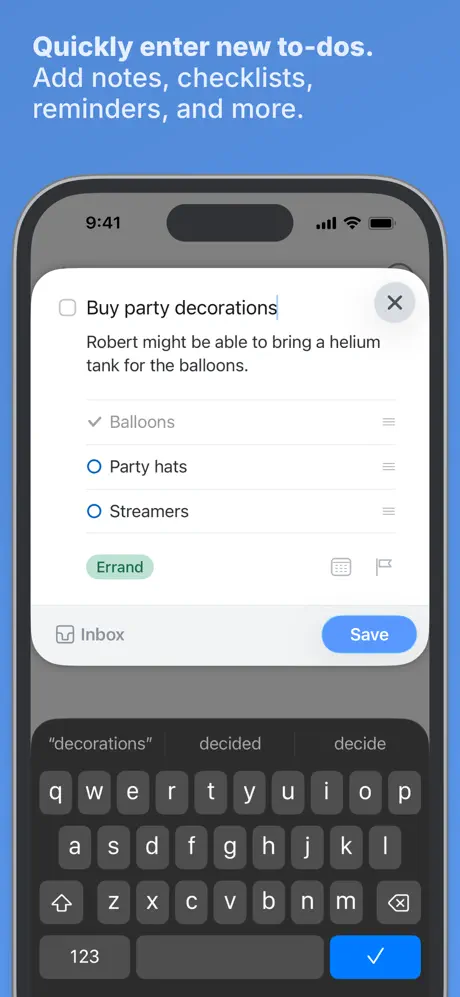{: width="180" .normal }
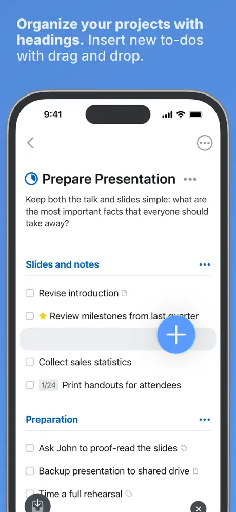{: width="180" .normal }

Things 3 (จาก Cultured Code) ได้รับคำชมกว้างขวางว่าเป็น **แอป to-do ที่มุมมองดีสุด** ด้วยโมเดลเป็นมิตร GTD (Inbox Today Upcoming Anytime Someday Projects Areas tag) แอปนี้รันบนอุปกรณ์ Apple เท่านั้น

**จุดแข็ง**
- **การออกแบบและ UX ชั้นยอด** — เร็ว สงบ และ intuitive; ป้อนเร็วและกำหนดตารางภาษาธรรมชาติ
- **โครงสร้าง GTD แข็งแกร่ง** — โครงการ พื้นที่ งานเกิดซ้ำ (ทำก่อนกำหนดและกำหนดตารางใหม่ได้) กำหนดส่ง และลิงก์ไปโน้ต/URL
- **ซื้อครั้งเดียว ไม่สมาชิก** พร้อมผสาน Apple ลึก (Siri นำเข้า Reminders Handoff)
- ซิงโครไนซ์ผ่าน iCloud บน iPhone iPad และ Mac

**จุดอ่อน**
- **เฉพาะ Apple** — ไม่มี Android ไม่มีเว็บคลายเอ็นต์/Windows จึงไม่เหมาะบ้านที่ผสมอุปกรณ์
- **ไม่มีการร่วมมือหรือรายการร่วม** และไม่มี pomodoro หรือนิสัยในตัว
- จ่ายล่วงหน้าต่อแพลตฟอร์ม (iPhone / iPad / Mac ขายแยก) และไม่มีแพ็กฟรีให้ลองก่อนซื้อ

**เหมาะสำหรับ:** ผู้ใช้เฉพาะ Apple ที่อยากตัวจัดการงานเรียบร้อยและไร้รบกวนที่สุด และเลือกซื้อครั้งเดียว

**ดาวน์โหลด Things 3**
- [App Store](https://apps.apple.com/app/things-3/id904237743)

### 6. Notion — พื้นที่ทำงาน all-in-one ยืดหยุ่นที่สุด

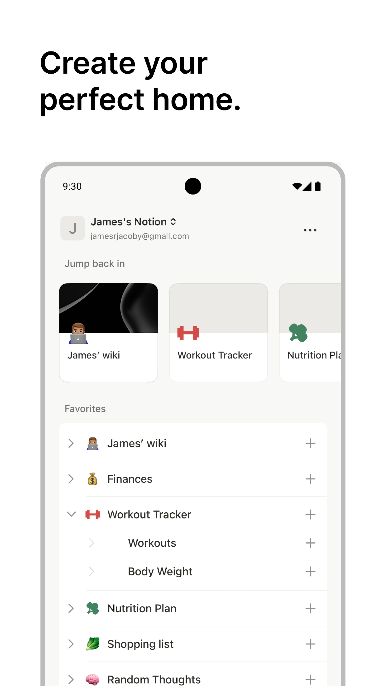{: width="180" .normal }
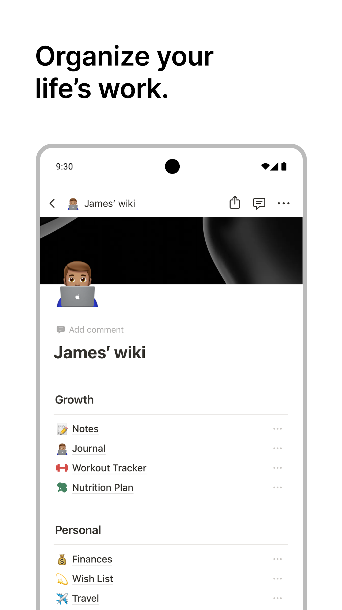{: width="180" .normal }
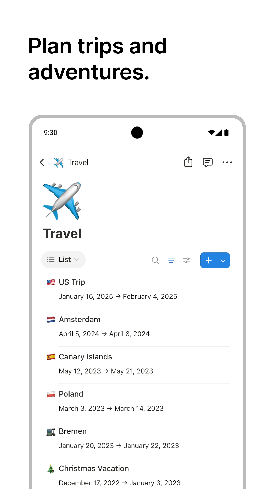{: width="180" .normal }
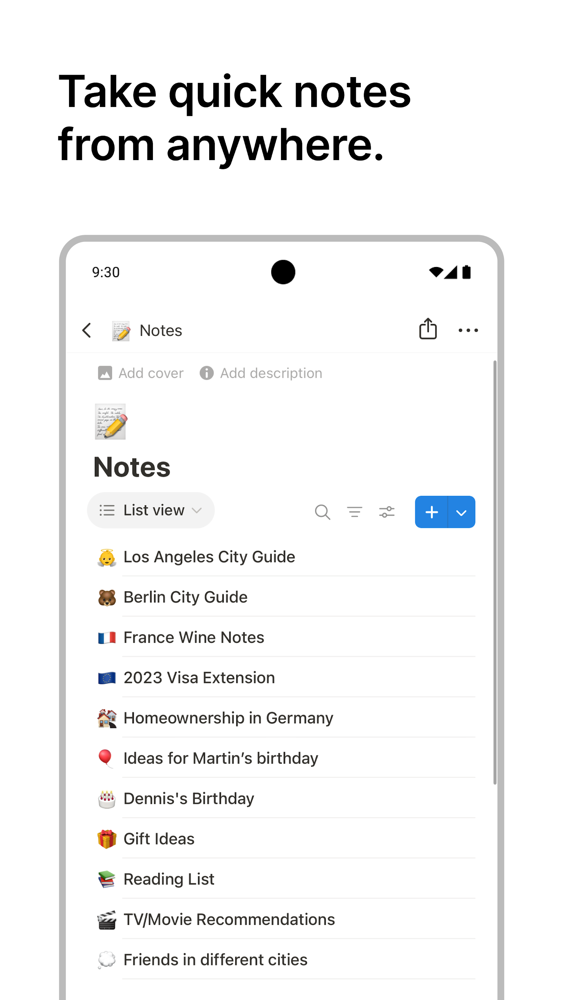{: width="180" .normal }
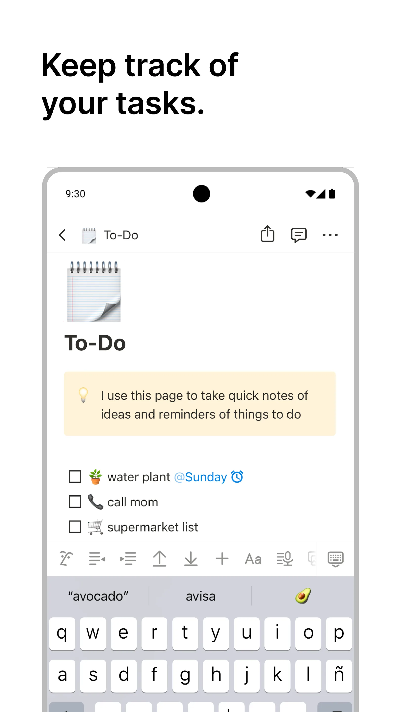{: width="180" .normal }

Notion คือพื้นที่ทำงานโน้ต/docs/ฐานข้อมูล ที่ก็รันงานผ่านฐานข้อมูล มุมมองบอร์ด (Kanban) และปฏิทิน พร้อมการเตือน นี่คือตัวเลือกยืดหยุ่นที่สุดที่นี่ — และหนักที่สุด

**จุดแข็ง**
- **ยืดหยุ่นมาก** — งานเป็นแค่แถวฐานข้อมูล ที่มองเป็นรายการ บอร์ด ปฏิทิน หรือไทม์ไลน์ พร้อมความสัมพันธ์ เทมเพลต และเอกสาร rich
- **ร่วมมือแข็งแกร่ง** — แชร์เรียลไทม์ คอมเมนต์ และเวิร์กโฟลว์ทีมเหนือแอป to-do เฉพาะใดๆ
- ข้ามแพลตฟอร์ม (เว็บ iOS Android Windows Mac) พร้อม **แพ็กฟรีครบถ้วนพอใช้**

**จุดอ่อน**
- **หนักสำหรับงานเรียบง่าย** — บันทึกรวดเร็วช้ากว่าแอปเฉพาะ และมีเส้นโค้งการเรียนที่แท้จริง
- **การเตือนและงานเกิดซ้ำอ่อนกว่า** — ผูกกับวันที่รายการฐานข้อมูล ไม่มีการเตือน push native ที่เชื่อถือได้ ตำแหน่ง หรือบันทึกเสียงของแอปเฉพาะ
- พึ่งพาคลาวด์; ใช้งานออฟไลน์จำกัดแค่แคช จึงไม่ ideal หากคุณอยากข้อมูลอยู่ในเครื่องเต็มรูปแบบ

**เหมาะสำหรับ:** ผู้ใช้ที่อยู่ใน Notion แล้ว (หรืออยาก docs + งาน + จัดการโครงการในที่เดียว) และรับเครื่องมือหนักได้

**ดาวน์โหลด Notion**
- [Google Play](https://play.google.com/store/apps/details?id=notion.id)
- [App Store](https://apps.apple.com/app/notion-notes-tasks-ai/id1232780281)

### 7. Any.do — ดีที่สุดสำหรับปฏิทินและงานรวมกัน

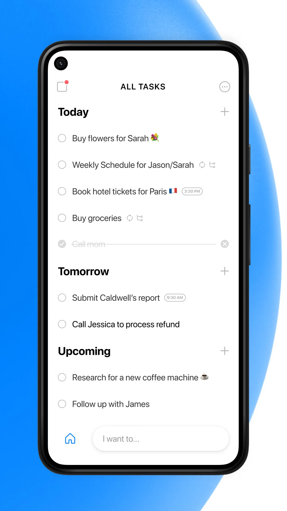{: width="180" .normal }
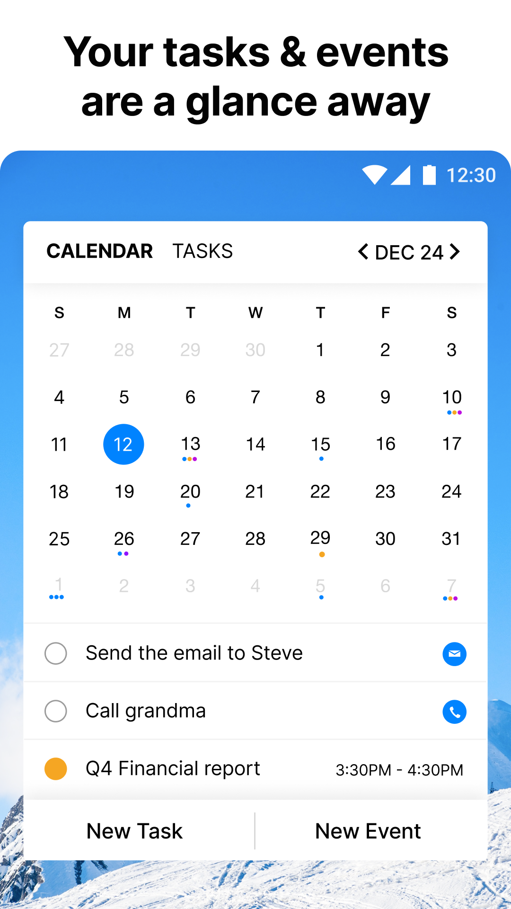{: width="180" .normal }
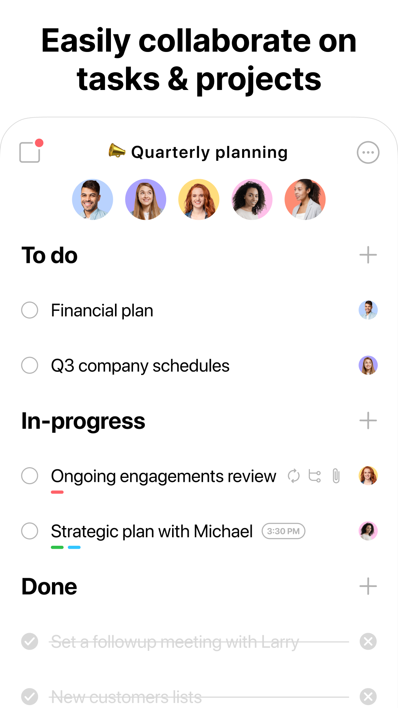{: width="180" .normal }
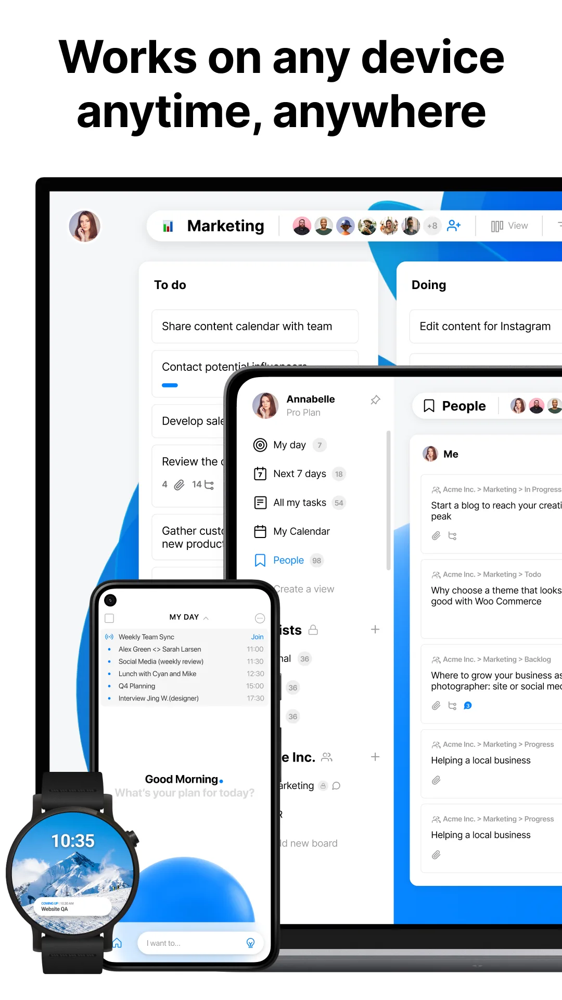{: width="180" .normal }

Any.do รวมรายการสิ่งที่ต้องทำ ปฏิทิน และตัววางแผนเต็มรูปแบบพร้อมการเตือน ใช้โดยหลายสิบล้านคนบนมือถือ เดสก์ท็อป และเว็บ

**จุดแข็ง**
- **งาน + ปฏิทินในมุมมองเดียว** พร้อมการเตือนเสียง WhatsApp และตามตำแหน่ง — บันทึกยืดหยุ่น
- **ข้ามแพลตฟอร์ม** (มือถือ เดสก์ท็อป เว็บ แท็บเล็ต) พร้อมแพ็กฟรีพอใช้
- งานเกิดซ้ำ รายการร่วม และผสานปฏิทินในพื้นผิววางแผนเดียว

**จุดอ่อน**
- **แพ็กฟรีจำกัด** และความสะดวกบางส่วน (เกิดซ้ำขั้นสูง บางการเตือน ธีม premium) ต้อง Premium ~$36/ปี
- มุมมองรวมและข้อเสนออัปเกรด premium อาจรู้สึกรก และความน่าเชื่อถือการเตือนมักเป็นเรื่องร้องเรียน
- ไม่ได้ออกแบบสำหรับจัดการโครงการซับซ้อนหรือร่วมมืองานทีมลึก

**เหมาะสำหรับ:** ผู้ใช้ที่อยากงานและปฏิทินผสานกันพร้อมการเตือนยืดหยุ่น (เสียง/ตำแหน่ง)

**ดาวน์โหลด Any.do**
- [Google Play](https://play.google.com/store/apps/details?id=com.anydo)
- [App Store](https://apps.apple.com/app/any-do-to-do-list-planner/id497328576)

## เปรียบเทียบความสามารถหลัก

ตารางด้านล่างแสดงให้เป็นกลางที่สุดเท่าที่ทำได้ ความสามารถที่แต่ละแอปรองรับ "บางส่วน" หมายถึงฟีเจอร์มี แต่มีขีดจำกัด

| ความสามารถ | Microsoft To Do | Meow Todo | TickTick | Google Tasks | Things 3 | Notion | Any.do |
|---|---|---|---|---|---|---|---|
| **ซิงโครไนซ์คลาวด์ / ข้ามอุปกรณ์** | มี (บัญชี MS) | บางส่วน (iCloud / WebDav) | มี | มี (Google) | มี (iCloud) | มี (บัญชี) | มี |
| **การเตือนงาน** | กำหนดส่ง + เกิดซ้ำ | กำหนดส่ง | หลากหลาย (รวมตำแหน่ง) | กำหนดส่ง | กำหนดส่ง + Siri | บางส่วน (ตามวันที่) | เสียง / ตำแหน่ง / WhatsApp |
| **มุมมองปฏิทิน** | บางส่วน (Outlook) | มี (วัน/สัปดาห์/เดือน) | มี (ในตัว) | บางส่วน (Google Cal) | บางส่วน (Today/Upcoming) | บางส่วน (ปฏิทิน DB) | มี (รวม) |
| **Subtugas** | มี (1 ระดับ) | มี (1 ระดับ) | หลายระดับ | แค่ 1 ระดับ | Checklist | หลายระดับ | มี |
| **งานเกิดซ้ำ** | มี | มี | มี | มี | มี (เกิดซ้ำฉลาด) | บางส่วน | มี |
| **ป้อนภาษาธรรมชาติ** | บางส่วน | บางส่วน | แข็งแกร่ง | ไม่ | มี (ป้อนเร็ว) | บางส่วน | มี (เสียง) |
| **นิสัย / Pomodoro** | ไม่ | ไม่ | มี (ทั้งสอง) | ไม่ | ไม่ | ไม่ | ไม่ |
| **ร่วมมือ / แชร์** | มี (รายการร่วม) | ไม่ | มี (ร่วม) | บางส่วน (Google) | ไม่ | แข็งแกร่ง (เรียลไทม์) | มี (ร่วม) |
| **ออฟไลน์ / ความเป็นส่วนตัว** | บนบัญชี | แข็งแกร่ง (ในเครื่อง ไม่ต้องบัญชี) | บนบัญชี | บนบัญชี | iCloud | พึ่งพาคลาวด์ | บนบัญชี |
| **แพลตฟอร์ม** | ทั้งหมด | Android + iOS | ทั้งหมด | Android + iOS + เว็บ | เฉพาะ Apple | ทั้งหมด | ทั้งหมด |
| **แพ็กฟรี** | ครบถ้วน | หลักครบถ้วนพอใช้ | จำกัด | ครบถ้วน | ไม่มี (มีค่าใช้จ่าย) | ครบถ้วนพอใช้ | จำกัด |
| **ราคา** | ฟรี | ฟรี + VIP ~$9.99/ปี | ฟรี + $35.99/ปี | ฟรี | จ่ายต่อแพลตฟอร์ม | ฟรี + แพ็กมีค่าใช้จ่าย | ฟรี + ~$36/ปี |

## ทางเลือก Todoist ตัวไหนเหมาะกับคุณ?

- ใช้ **Microsoft 365 / Outlook** อยู่แล้ว → **Microsoft To Do**
- อยาก **ฟรี ส่วนตัว ไม่ต้องบัญชี พร้อมส่งออก CSV และ UI น่ารัก** → **Meow Todo**
- อยาก **ฟีเจอร์แข็งแกร่ง** (ปฏิทิน + pomodoro + นิสัย) ในราคาถูก → **TickTick**
- ใช้ชีวิตประจำวันใน **Gmail / Google Calendar** → **Google Tasks**
- ใช้แค่ **อุปกรณ์ Apple** และอยากแอปเรียบร้อยที่สุด → **Things 3**
- อยาก **docs + งาน + โครงการในพื้นที่ทำงานยืดหยุ่นเดียว** → **Notion**
- อยาก **งานและปฏิทินผสานกันพร้อมการเตือนเสียง/ตำแหน่ง** → **Any.do**

## ทางเลือก Todoist สำหรับทุกประเภทผู้ใช้

อ่านแต่ละตัวเลือกเป็น **ทางเลือก Todoist** พร้อมงานเฉพาะ: **ทางเลือก Microsoft To Do** คือรายการฟรีในตัว Outlook, **ทางเลือก Google Tasks** คือแถบข้าง Gmail เบาที่สุด, และ **ทางเลือก TickTick** น่าลองเมื่อคุณอยาก **แอปปฏิทินงาน** และตัวจับเวลา pomodoro ในแอปเดียว Things 3 และ Any.do พึ่งพาการออกแบบเรียบร้อย Notion บนฐานข้อมูล ในขณะที่ Meow Todo คือ **แอป to-do list ฟรีที่ดีที่สุด** ที่นี่สำหรับ **แอป to-do ออฟไลน์** อย่างง่าย **แอปเตือนความจำงาน** รวมถึง **แอป subtask ฟรี** พร้อม **รายการสิ่งที่ต้องทำไม่ต้องบัญชี** ในหลัก หากเหตุผลหลักที่ย้ายคือต้นทุน ให้เริ่มจาก **ตัวจัดการงานฟรี** แทนที่จะสลับสมาชิกหนึ่งเป็นอีกสมาชิก

## วิธีโยกย้ายจาก Todoist

1. **ส่งออก** โครงการของคุณจาก Todoist (Settings → Backups หรือคัดลอกงานออกขณะยังเข้าถึงได้)
2. **เลือกผู้แทน** ใช้ตารางด้านบนตามระบบนิเวศ ความเป็นส่วนตัว และความลึกฟีเจอร์
3. **สร้างโครงสร้างใหม่** — รายการ (To Do Meow) หรือโครงการ (Todoist) ตอบโจทย์กันเรียบร้อย; ใน Notion สร้างฐานข้อมูลงาน
4. **เพิ่มงานเกิดซ้ำและกำหนดส่งกลับ**; ตั้งการเตือนรายวัน และหากรองรับ การเตือนตามตำแหน่งหรือเสียง
5. **เก็บสำรอง CSV** (Meow Todo และส่วนใหญ่ส่งออกได้) เพื่อคุณไม่เคยถูกล็อกอีก

## คำถามที่พบบ่อย

**Meow Todo List เป็นทางเลือก Todoist ฟรีที่ดีไหม?**
{:.faq-q}

ใช่ — หลัก (รายการ งานย่อย มุมมองปฏิทิน การเตือน ส่งออก CSV) ฟรี โดยไม่บังคับบัญชี และความเป็นส่วนตัวในเครื่องผ่านล็อกลายนิ้วมือเลือกได้; แค่ฟีเจอร์ขั้นสูงเพิ่มบางส่วนอยู่หลัง VIP จ่ายครั้งเดียว

**Meow Todo ใช้แบบออฟไลน์ได้ไหม?**
{:.faq-q}

ได้ คุณเพิ่มและติ๊กงานเสร็จโดยไม่มีอินเทอร์เน็ต; ข้อมูลคงอยู่ในเครื่องและเพิ่งซิงโครไนซ์ไป iCloud หรือ WebDav เมื่อคุณเลือก

**ทางเลือก Todoist ตัวไหนดีที่สุดสำหรับความเป็นส่วนตัว?**
{:.faq-q}

Meow Todo — ไม่ต้องบัญชี เก็บงานในเครื่องหลังล็อกลายนิ้วมือ และสำรองไป iCloud หรือ WebDav เมื่อคุณเปิดใช้เท่านั้น ดังนั้นรายการสิ่งที่ต้องทำของคุณไม่เคยอยู่ในคลาวด์ผู้ขายโดยปริยาย

**ฉันย้ายงานออกจาก Todoist ได้ไหม?**
{:.faq-q}

ได้ — ส่งออก CSV จาก Todoist แล้วสร้างรายการใหม่; Meow Todo ก็ส่งออก CSV ได้ ดังนั้นข้อมูลย้ายไป Excel หรือแอปอื่นได้ทุกเมื่อ

[หน้าแอป Meow Todo List](/th/apps/meow-todo-list/) — ดาวน์โหลดสำหรับ Android และ iOS

## ศัพท์ที่เกี่ยวข้อง

- [รายการสิ่งที่ต้องทำ (To-Do List) คืออะไร?](/th/glossary/what-is-a-to-do-list/)
- [งานย่อย (Subtask) คืออะไร?](/th/glossary/what-is-a-subtask/)
