WidgetSmith คือ **แอปวิดเจ็ต iOS** ที่เป็นที่รู้จักที่สุด แต่มีแค่ iPhone และแม้ใน iOS ผู้ใช้บางส่วนอยากสไตล์ต่าง บวกข้อมูลอุปกรณ์สด (แบตเตอรี่ RAM) หรือคลังวิดเจ็ตสำเร็จใหญ่กว่า คู่มือนี้เปรียบเทียบ **หก** **[แอปวิดเจ็ต](/th/glossary/what-is-a-home-screen-widget/)** ข้ามแพลตฟอร์มชั้นนำ แต่ละอันถูกเลือกเพราะจุดแข็งเฉพาะหรือการเข้าถึงตลาดกว้าง แต่ละแอปด้านล่างพูดคุยด้วยจุดแข็งจริง จุดอ่อนจริง และผลงานบนความสามารถหน้าจอหลักแกนที่สำคัญจริงๆ — พรีเซ็ตสำเร็จ ตัวแก้ไขคัสตอม ข้อมูลระบบสด สภาพอากาศ สุขภาพ ภาพ ปฏิสัมพันธ์ และการรองรับหน้าจอล็อก ลิงก์ดาวน์โหลดอยู่ท้ายแต่ละส่วน ผู้อ่านส่วนใหญ่มาพร้อมอุปสรรคหนึ่ง — รองรับแค่ iPhone สมาชิก หรือคลังเล็กเกินไป — จึงแต่ละตัวเลือกถูกกรอบตามเหตุผลนั้น

## ทำไมถึงมองหานอก WidgetSmith

- **ไม่มีเวอร์ชัน Android** — แค่ iPhone จึงผู้ใช้ Android ต้องเลือกเครื่องมือต่างไปเลย
- **โทรมาตรอุปกรณ์สดจำกัด** — WidgetSmith โฟกัสภาพ วันที่ สภาพอากาศ และปฏิทิน; ไม่แสดงสถิติอุปกรณ์ดิบอย่างเปอร์เซ็นต์แบตเตอรี่ RAM หรือ storage เหมือนวิดเจ็ต Android บางตัว
- **สุนทรียะเฉพาะ** — คุณอาจอยากลุค One UI, Material You, หรือ Nothing ที่เลียนแบบภาษาการออกแบบแบรนด์อื่น หรือแพ็กเกจธีมน่ารัก/สุนทรียะ
- **สำเร็จ vs สร้างเอง** — WidgetSmith คือ builder; บางคนแค่อยากคลังใหญ่ให้เลือก
- **ความไว้ราคา** — พรีเมียม WidgetSmith ปลดล็อกบางสไตล์; ทางเลือก ranging จากคลังพรีเซ็ตฟรี Pro key จ่ายครั้งเดียว ถึงสมาชิก

---

## ทางเลือก WidgetSmith ที่ดีที่สุดแบบคร่าวๆ

| แอป | ราคา (2026) | แพลตฟอร์ม | เหมาะสำหรับ |
|---|---|---|---|
| **One Widget** | ชุด One UI ฟรี + ปลดล็อกสไตล์ | Android | วิดเจ็ตสำเร็จมัลติสไตล์ 500+ |
| **KWGT** | ฟรี + Pro key จ่ายครั้งเดียว (~$4.99) | Android | สร้างวิดเจ็ตจากศูนย์ |
| **Widgy** | ฟรี + IAP (~$4.99) | iOS (iPhone/iPad/Watch) | วิดเจ็ต iOS คัสตอมลึก ไม่ต้องโค้ด |
| **Color Widgets** | ฟรี + Pro (~$2.50/เดือน เรียกเก็บรายปี) | iOS (iPhone/iPad/Mac) | พรีเซ็ตและธีมสุนทรียะเร็ว |
| **Widgetable** | ฟรี + สมาชิก | iOS (และ Android) | วิดเจ็ตสังคมและสัตว์เลี้ยงสำหรับคู่รัก/เพื่อน |
| **WidgetClub** | ฟรี + สมาชิก | iOS + Android | วิดเจ็ตธีมน่ารักสุนทรียะ |

---

## 1. One Widget — ดีที่สุดสำหรับวิดเจ็ต Android สำเร็จมัลติสไตล์

{: width="180" .normal }
{: width="180" .normal }
{: width="180" .normal }
{: width="180" .normal }
{: width="180" .normal }

One Widget คือแพ็กเกจวิดเจ็ต Android ที่สร้างรอบ **สี่ภาษาการออกแบบเต็ม** — **Galaxy One UI, Material You, iOS Glass, และ Nothing UI** — จึงแอปเดียวทำให้โทรศัพท์ Samsung Pixel ดูสไตล์ iPhone หรือ Nothing ดูสอดคล้องได้ มันให้ **วิดเจ็ตสำเร็จ 500+** (นาฬิกา วันที่ แบตเตอรี่ RAM storage ทางลัดแอป ทอกเกิลเช่น Wi-Fi/บลูทูธ/ไฟฉาย ปฏิทิน ตัวนับก้าว ดนตรี และสภาพอากาศ) และนักพัฒนา **เพิ่มคอมโพเนนต์ใหม่ active** ซึ่งรักษาคลังให้สด

**จุดแข็ง**
- **สี่ระบบสไตล์ต่างกันในแอปเดียว** — หายาก; แอปวิดเจ็ตส่วนใหญ่ผูกพันกับลุคเดียว
- **คอมโพเนนต์พร้อมวางหลากหลาย** รวมโทรมาตรอุปกรณ์สด (แบตเตอรี่ % RAM storage) ที่วิดเจ็ต iOS มักแสดงในพริบตาไม่ได้
- **ทอกเกิลและทางลัดฟังก์ชัน** (Wi-Fi บลูทูธ ไฟฉาย เปิดแอป) เพิ่มประโยชน์จริง ไม่ใช่แค่ตกแต่ง
- **ไม่ต้องเชี่ยวชาญออกแบบ** — เลือกสไตล์ วางวิดเจ็ต เสร็จ
- **อัปเดตสม่ำเสมอ** ด้วยวิดเจ็ตและประเภทคอมโพเนนต์ใหม่

**จุดอ่อน**
- **แค่ Android** — ไม่มีเวอร์ชัน iOS
- **อิงพรีเซ็ต ไม่ใช่ตัวแก้ไขอิสระ** — คุณปรับแต่งในสิ่งที่เทมเพลตเปิดเผย; ไม่สามารถจัดเลย์เอาต์ arbitrary หรือเขียนสูตรเหมือน KWGT ได้
- **บางสไตล์/คอมโพเนนต์อยู่หลังปลดล็อก** และผู้ใช้ฟรีได้ชุด One UI
- น้อยเหมาะสำหรับผู้ใช้ที่อยากวิดเจ็ต unique จริง แทนพรีเซ็ตเรียบร้อย

**เหมาะสำหรับ:** ผู้ใช้ Android ที่อยากคลังวิดเจ็ตใหญ่สวยครอบคลุมสุนทรียะโทรศัพท์หลายแบบ โดยไม่เรียนเครื่องมือออกแบบ

**ดาวน์โหลด One Widget**
- [Google Play](https://play.google.com/store/apps/details?id=com.glgjing.galaxy.nothing.glass.material.widget)

---

## 2. KWGT Kustom Widget Maker — ดีที่สุดสำหรับสร้างวิดเจ็ตจากศูนย์

{: width="180" .normal }
{: width="180" .normal }
{: width="180" .normal }
{: width="180" .normal }
{: width="180" .normal }

KWGT (by Kustom) คือ **ตัวแก้ไขวิดเจ็ตทรงพลังที่สุดบน Android** แทนที่จะเลือกพรีเซ็ต คุณประกอบวิดเจ็ตจากข้อความ รูปทรง ภาพ แถบความคืบหน้า และภาษาสูตรที่ดึงแบตเตอรี่ เครือข่าย สภาพอากาศ ปฏิทิน และแม้แต่ข้อมูล **Health Connect** (ก้าว นอน แคลอรี่) ชุมชนใหญ่แชร์พรีเซ็ตและแพ็กเกจธีม จึงคุณเริ่มจากดีไซน์คนอื่นและปรับได้

**จุดแข็ง**
- **ควบคุมระดับพิกเซลบนฐานสูตร** — วิดเจ็ตใดก็ได้ที่จินตนาการได้
- **ระบบนิเวศร่วมใหญ่** เต็มพรีเซ็ต แพ็กเกจ และบทเรียน
- รองรับ **สีไดนามิก Material You** และผูกข้อมูลสดลึก
- **Pro key จ่ายครั้งเดียว** (ไม่ต้องสมาชิก) ปลดล็อกทุกฟีเจอร์
- **การรวม Health Connect** สำหรับก้าว/นอน/แคลอรี่

**จุดอ่อน**
- **ภาระการเรียนรู้ชัน** — ภาษาสูตรทรงพลังแต่ไม่เป็นมิตรผู้ใช้ casual
- **แค่ Android** ไม่มีเวอร์ชัน iOS
- สร้างวิดเจ็ตสวย **ต้องเวลา**; UI สาธารณูปโภคมากกว่าสวยสำเร็จ
- ปฏิสัมพันธ์แตะจำกัดเทียบควบคุมดั้งเดิมแอปต้นฉบับ

**เหมาะสำหรับ:** ผู้ใช้ power Android ที่อยากควบคุมเต็มที่และยอมเรียนตัวแก้ไข

**ดาวน์โหลด KWGT Kustom Widget Maker**
- [Google Play](https://play.google.com/store/apps/details?id=org.kustom.widget)

---

## 3. Widgy — ดีที่สุดสำหรับวิดเจ็ต iOS คัสตอมลึก

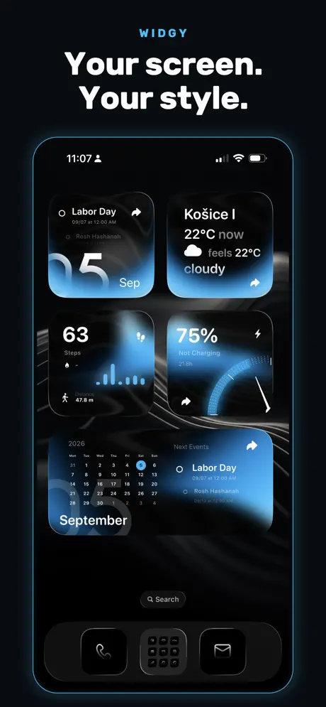{: width="180" .normal }
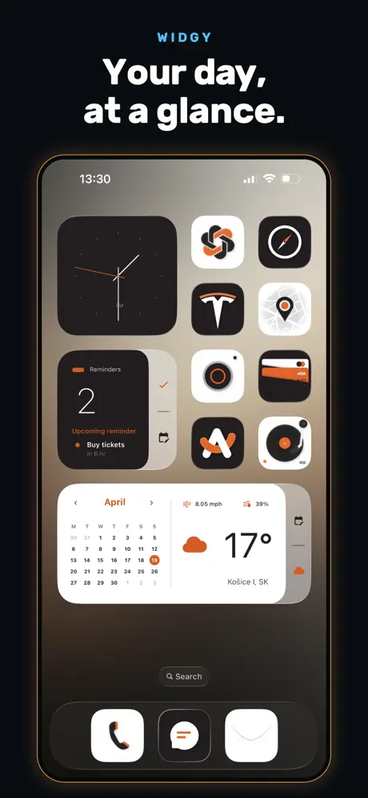{: width="180" .normal }
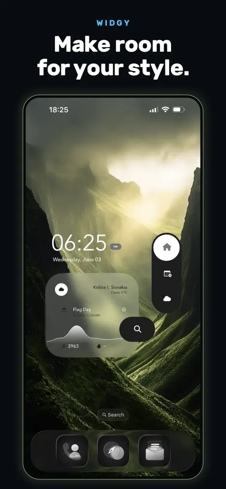{: width="180" .normal }
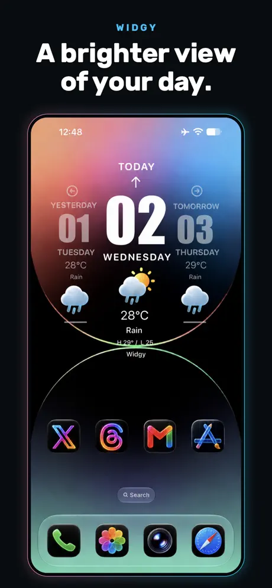{: width="180" .normal }
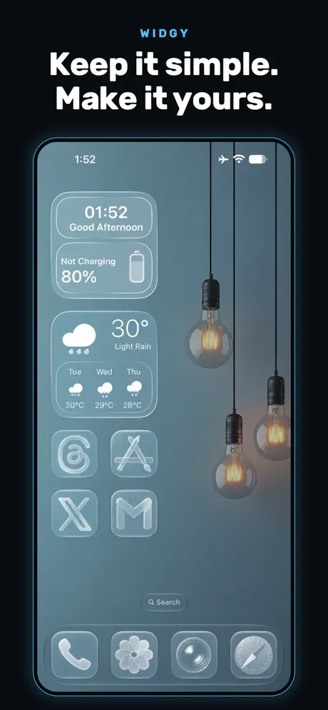{: width="180" .normal }

Widgy คือเทียบเท่า iOS ใกล้สุดกับ KWGT: **builder แบบเลเยอร์บนฐานภาพ** (ไม่ต้องโค้ด) พร้อมเทมเพลทและแหล่งข้อมูลหลากหลาย — สภาพอากาศ Apple Health ปฏิทิน การแจ้งเตือน และอื่นๆ มันเล็ง iPhone iPad Apple Watch หน้าจอล็อก และ StandBy รวมถึงตามภาษาการออกแบบ iOS ใหม่ (เช่น Liquid Glass)

**จุดแข็ง**
- **builder วิดเจ็ตคัสตอมทรงพลังที่สุดใน iOS** พร้อมเลเยอร์ แหล่งข้อมูล และดีไซน์ส่งออกได้
- **ไม่ต้องโค้ด** — การแก้ไขภาพลดกำแพงเทียบสูตร KWGT
- **ข้อมูลลึก** รวม Apple Health และรองรับหน้าจอล็อก StandBy และหน้าปัดนาฬิกา
- **อัปเดต active** สำหรับทุกเวอร์ชัน iOS ใหม่

**จุดอ่อน**
- **แค่ iOS**
- ยังมี **ภาระการเรียนรู้** เพื่อควบคุมเลเยอร์และผูกข้อมูล
- **บางช่อง/ฟีเจอร์วิดเจ็ตอยู่หลัง IAP** (~$4.99)
- อยู่ภายใต้ **ขีดจำกัดรีเฟรชวิดเจ็ต iOS** — ข้อมูลอาจช้าไปไม่กี่นาที

**เหมาะสำหรับ:** ผู้ใช้ iPhone/iPad ที่อยากวิดเจ็ตทำเอง แต่ชอบตัวแก้ไขภาพกว่าโค้ด

**ดาวน์โหลด Widgy**
- [App Store](https://apps.apple.com/us/app/widgy-widgets-home-lock-watch/id1524540481)

---

## 4. Color Widgets — ดีที่สุดสำหรับพรีเซ็ต iOS เร็วและสุนทรียะ

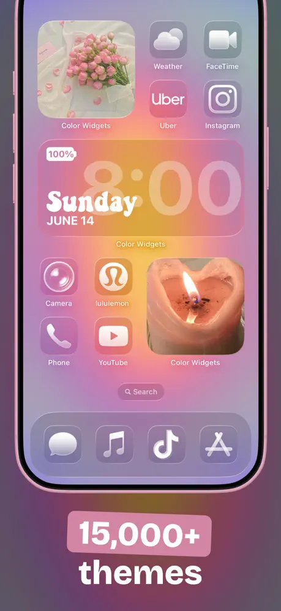{: width="180" .normal }
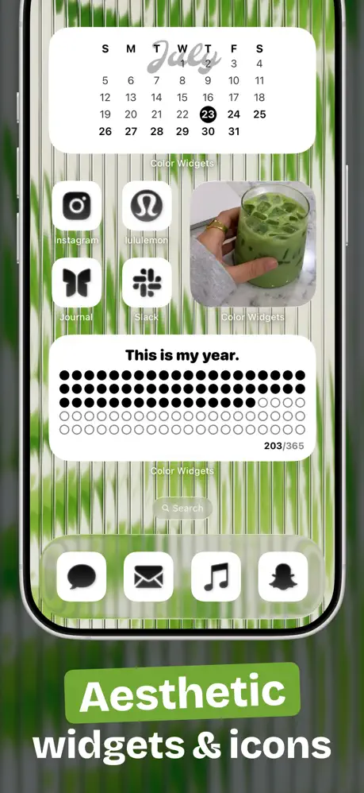{: width="180" .normal }
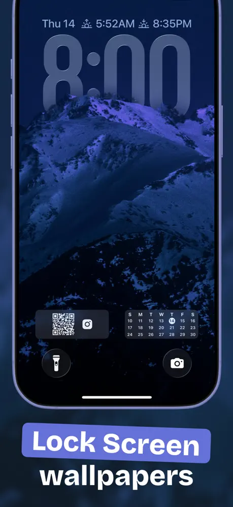{: width="180" .normal }
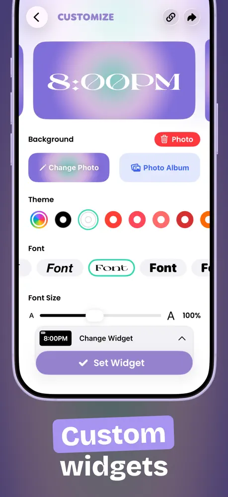{: width="180" .normal }
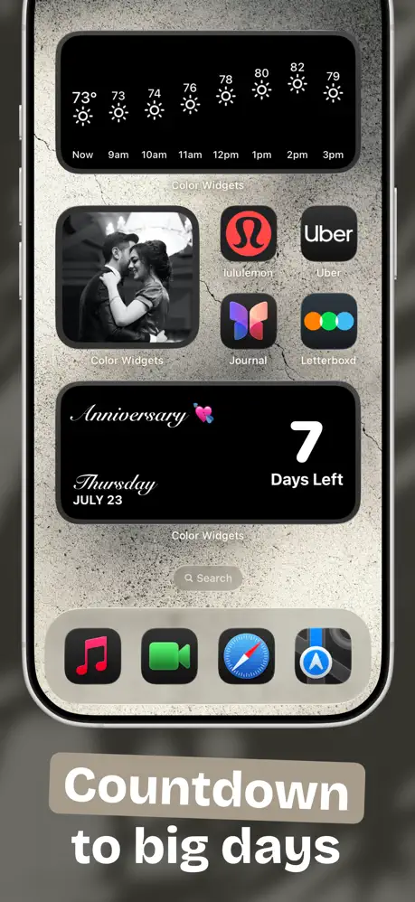{: width="180" .normal }

Color Widgets พึ่งพา **วิดเจ็ตที่ออกแบบแล้วหลายพันตัวพร้อมตัวปรับแต่งง่าย** และแพ็กเกจธีม ไอคอน และวอลเปเปอร์ จึงทั้งหน้าจอหลักและล็อกสกินใหม่ได้ในไม่กี่แตะ มันครอบคลุมภาพ เวลา/วันที่ แบตเตอรี่ นับถอยหลัง สภาพอากาศ ดนตรี (Apple/Spotify) ปฏิทิน คำคม และวิดเจ็ตกิจกรรม พร้อมการรวม Apple Health สำหรับก้าว

**จุดแข็ง**
- **ทางเร็วสุดสู่วิดเจ็ตสวย** — เลือกพรีเซ็ตหรือเปลี่ยนสี/ฟอนต์ โดยไม่มีพื้นฐานออกแบบ
- **ธีม all-in-one** (วิดเจ็ต + ไอคอน + วอลเปเปอร์) สำหรับลุคสอดคล้อง
- **การรวมสุขภาพ** และประเภทวิดเจ็ตกว้าง
- ตำแหน่ง **ความเป็นส่วนตัวก่อน** และรองรับ Mac

**จุดอ่อน**
- มากเรื่อง **สุนทรียะกว่าข้อมูลลึก**; อิสระรูปทรงน้อยกว่า Widgy
- ฟีเจอร์ดีสุดอยู่หลัง **Pro subscription** (~$2.50/เดือน เรียกเก็บรายปี)
- อาจรู้สึก **หนักเทมเพลท**; ความเป็นต้นฉบับพึ่งพาคลังร่วม
- โมเดลสมาชิกมากกว่าปลดล็อกครั้งเดียว

**เหมาะสำหรับ:** ผู้ใช้ iPhone ที่อยากวิดเจ็ตน่าสนใจและธีมเข้ากันเร็ว

**ดาวน์โหลด Color Widgets**
- [App Store](https://apps.apple.com/us/app/color-widgets/id1531594277)

---

## 5. Widgetable — ดีที่สุดสำหรับวิดเจ็ตสังคมและสัตว์เลี้ยง

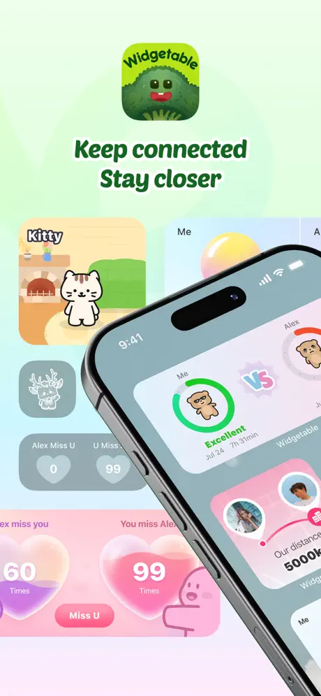{: width="180" .normal }
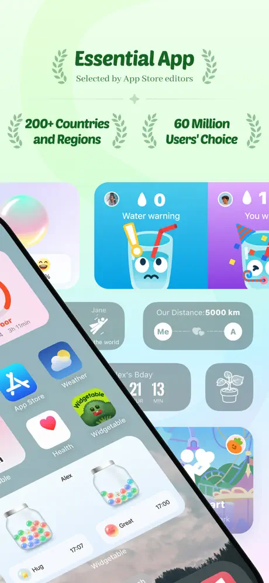{: width="180" .normal }
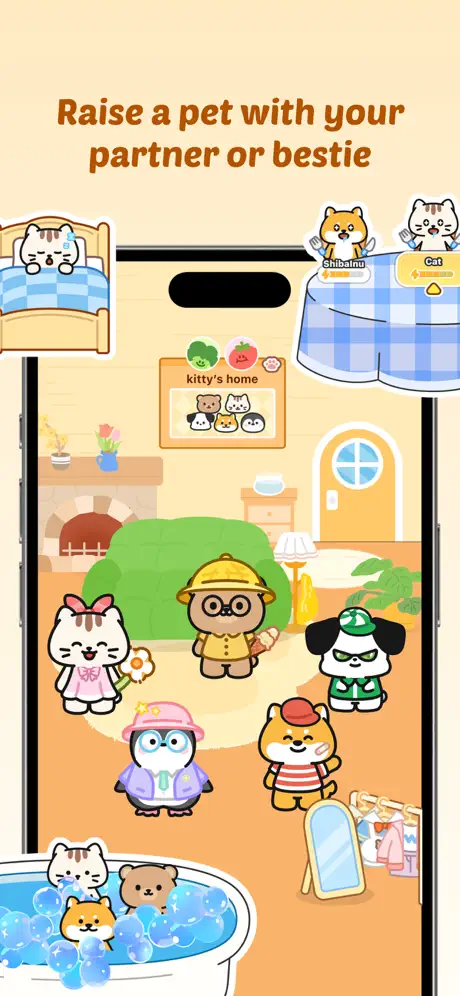{: width="180" .normal }
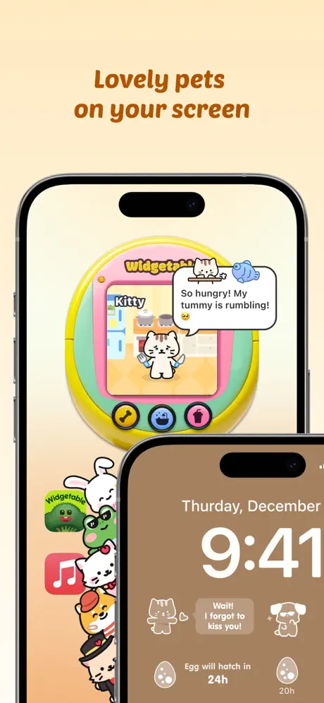{: width="180" .normal }
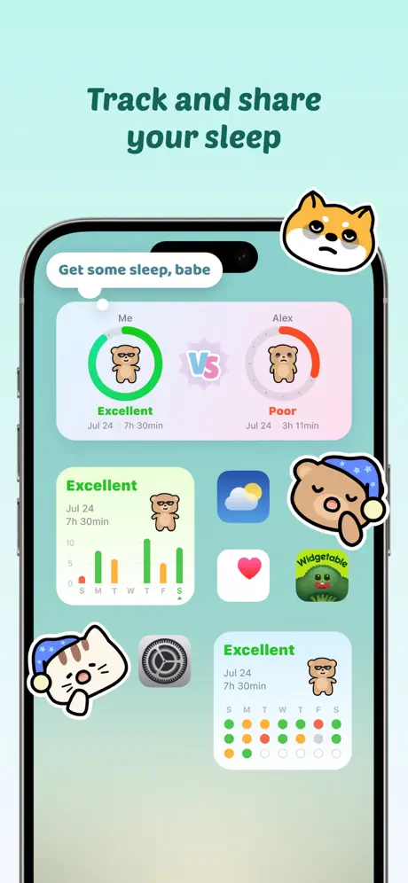{: width="180" .normal }

Widgetable เล็งมุมต่าง: **วิดเจ็ตที่สร้างรอบความสัมพันธ์** คุณรับเลี้ยงสัตว์เลี้ยงเสมือนที่คุณดูแลกับเพื่อน แชร์วิดเจ็ตนอน ส่งอัปเดตอารมณ์ และแสดงระยะห่างเวลาจริงระหว่างคุณกับเพื่อน — ทั้งหมดบนหน้าจอล็อกหรือหลัก นี่เป็นที่นิยมในหมู่คู่รักและเพื่อนสนิทมากกว่าเครื่องมือประสิทธิภาพทั่วไป

**จุดแข็ง**
- **วิดเจ็ตสังคม/ความสัมพันธ์ unique** (สัตว์เลี้ยง นอน อารมณ์ ระยะห่าง สถานะเพื่อน) ที่ไม่มีในแอปวิดเจ็ตทั่วไป
- **เนื้อหาน่ารัก สนุก และอัปเดตบ่อย**; เรตติ้งสูงมาก
- ทำงานข้าม **iOS และ Android** สำหรับวิดเจ็ตร่วมกับเพื่อนบนแพลตฟอร์มใดก็ได้

**จุดอ่อน**
- **เฉพาะกลุ่ม** — ไม่ใช่เครื่องมือวิดเจ็ตทั่วไป; มีประโยชน์น้อยหากคุณไม่ต้องการฟีเจอร์สังคม
- **ฟีเจอร์แกนอยู่หลังสมาชิก**
- แชร์สถานะส่วนตัว (นอน อารมณ์ ระยะห่างตำแหน่ง) เกิด **ข้อควรพิจารณาความเป็นส่วนตัว**
- น้อยประโยชน์สำหรับวิดเจ็ตประสิทธิภาพ/ข้อมูลเช่น แบตเตอรี่ RAM หรือปฏิทิน

**เหมาะสำหรับ:** คู่รัก เพื่อนสนิท และคนรักสัตว์เลี้ยงที่อยากหน้าจอล็อกของพวกเขารู้สึกสังคม

**ดาวน์โหลด Widgetable**
- [App Store](https://apps.apple.com/us/app/widgetable-besties-couples/id1641107226)

---

## 6. WidgetClub — ดีที่สุดสำหรับวิดเจ็ตน่ารักมีธีม

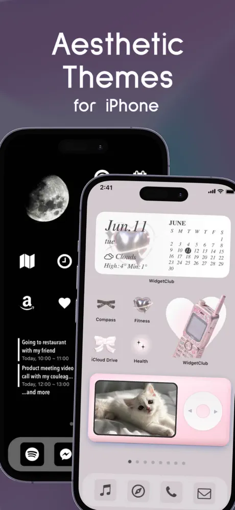{: width="180" .normal }
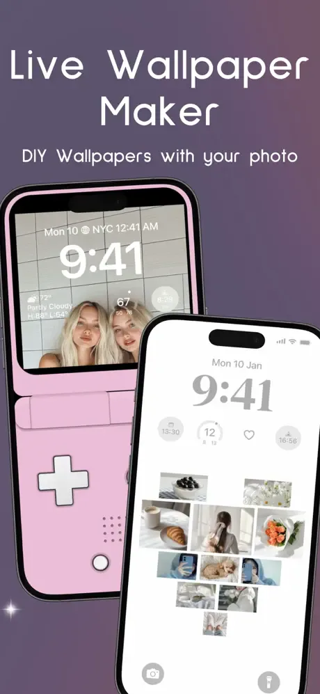{: width="180" .normal }
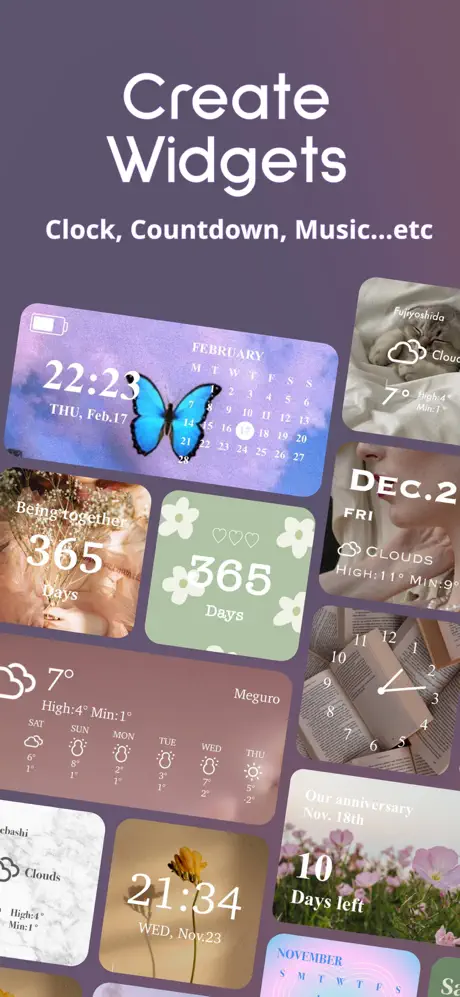{: width="180" .normal }
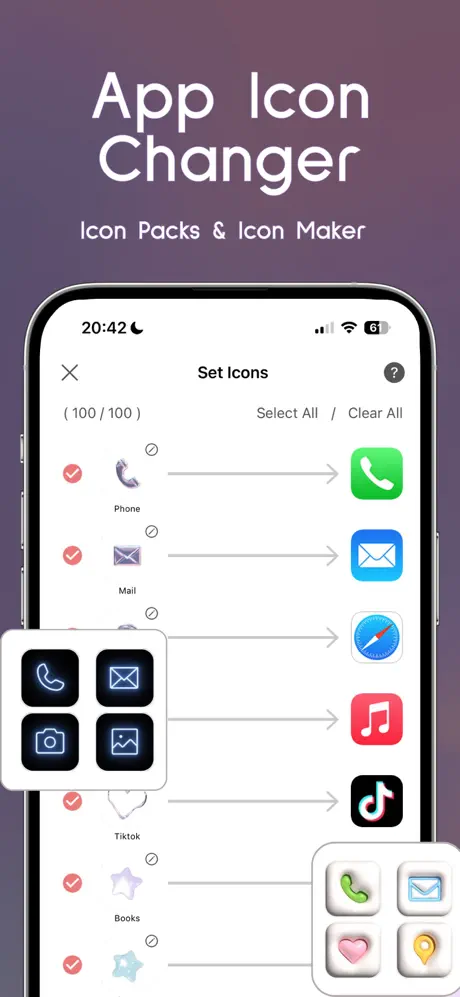{: width="180" .normal }
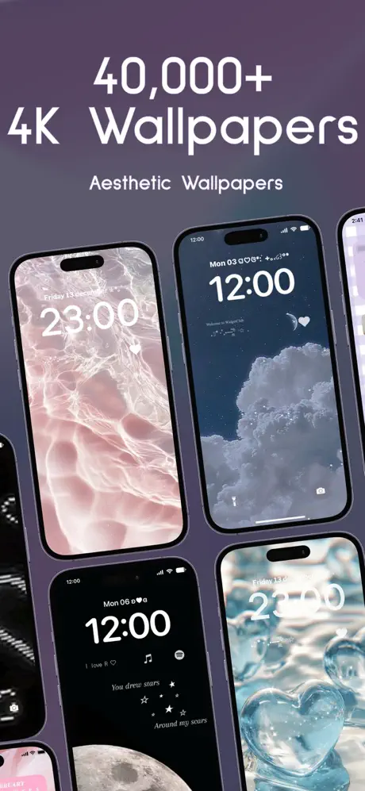{: width="180" .normal }

WidgetClub คือแอปวิดเจ็ต วอลเปเปอร์ และไอคอนสุนทรียะพร้อมแคตตาล็อกใหญ่ (ธีมหลายหมื่น) ครอบคลุมสภาพอากาศ ภาพ ปฏิทิน นาฬิกา นับถอยหลัง แบตเตอรี่ และวิดเจ็ตเตือนความจำ maker ง่ายให้คุณวางภาพและสี; มันรันบน **iOS และ Android**

**จุดแข็ง**
- **ง่ายมาก** สร้างวิดเจ็ตสุนทรียะน่ารักและสอดคล้อง
- **คลังธีมใหญ่** และการเข้าถึงข้ามแพลตฟอร์ม (iOS + Android)
- ดีสำหรับ **วิดเจ็ตภาพและเตือนความจำ** ด้วยความพยายามต่ำสุด

**จุดอ่อน**
- **สุนทรียะเหนือความลึก**; ไม่ใช่ตัวแก้ไขจากศูนย์เหมือน Widgy/KWGT
- คลังเต็มต้อง **สมาชิก**
- **การรองรับ Android อ่อนกว่า** ว่าบน iOS
- วิดเจ็ตแบตเตอรี่/เตือนพื้นฐานเทียบเครื่องมือเฉพาะ

**เหมาะสำหรับ:** ผู้ใช้ที่ให้ความสำคัญหน้าจอหลักสวยมีธีมมากกว่าปรับแต่งลึก

**ดาวน์โหลด WidgetClub**
- [App Store](https://apps.apple.com/us/app/widgetclub-widget-theme-icon/id1580284904)

---

## เปรียบเทียบความสามารถแกน

ตารางด้านล่างแสดง ให้ดีที่สุดเท่าที่เป็นไปได้อย่างเป็นวัตถุวิสัย ว่าความสามารถใดที่แต่ละแอปรองรับ "บางส่วน" หมายความฟีเจอร์มีแต่จำกัด (เช่น แค่พรีเซ็ต หรืออยู่หลัง paywall)

| ความสามารถ | One Widget | KWGT | Widgy | Color Widgets | Widgetable | WidgetClub |
|---|---|---|---|---|---|---|
| **แพลตฟอร์ม** | Android | Android | iOS | iOS | iOS (+Android) | iOS + Android |
| **พรีเซ็ตสำเร็จ** | **แข็งแกร่ง (500+)** | บางส่วน (ชุมชน) | ใช่ (เทมเพลท) | **แข็งแกร่ง** | ใช่ (สังคม) | **แข็งแกร่ง (ธีม)** |
| **ตัวแก้ไขจากศูนย์** | ไม่ (อิงพรีเซ็ต) | **ใช่ (ทรงพลัง)** | **ใช่ (ภาพ)** | บางส่วน (ตัวปรับแต่ง) | ไม่ | บางส่วน (maker ง่าย) |
| **ระบบสไตล์ (One UI / Material You / Glass / Nothing)** | **4 ในตัว** | เต็ม (คุณกำหนด) | เต็ม (คุณกำหนด) | ธีมสุนทรียะ | แค่น่ารัก | น่ารัก / ธีม |
| **ข้อมูลระบบสด (แบตเตอรี่ / RAM / storage)** | **ใช่ (แบต/RAM/storage)** | ใช่ (ผ่านสูตร) | ใช่ (แบต ฯลฯ) | ใช่ (แบต) | จำกัด (สังคม) | ใช่ (แบต) |
| **สภาพอากาศ** | ใช่ | ใช่ | ใช่ | ใช่ | ไม่ | ใช่ |
| **สุขภาพ / กิจกรรม** | บางส่วน | **ใช่ (Health Connect)** | **ใช่ (Apple Health)** | ใช่ (ก้าว) | นอน (สังคม) | บางส่วน |
| **วิดเจ็ตภาพ** | ใช่ | ใช่ | ใช่ | **ใช่ (แข็งแกร่ง)** | จำกัด | ใช่ |
| **ปฏิทิน / วันที่** | ใช่ | ใช่ | ใช่ | ใช่ | จำกัด | ใช่ |
| **โต้ตอบ (ทอกเกิล / ทางลัด)** | **ใช่ (ทอกเกิล ทางลัด)** | จำกัด (แตะทำงาน) | จำกัด (แตะเปิด) | แตะเปิด | แตะเปิด | แตะเปิด |
| **การรองรับหน้าจอล็อก** | Android 12+ | วิดเจ็ตล็อก Android | ล็อก iOS + StandBy | ล็อก iOS | ล็อก iOS | ล็อก iOS |
| **ระดับฟรี** | ชุด One UI ฟรี (+ปลดล็อก) | ฟรี + Pro key | ฟรี + IAP | ฟรี + Pro sub | ฟรี + sub | ฟรี + sub |
| **โมเมนตัมอัปเดต** | **active เพิ่มคอมโพเนนต์** | บำรุง active | active (iOS ใหม่) | active | active | active |

---

## ทางเลือก WidgetSmith ตัวไหนเหมาะกับผู้ใช้แต่ละประเภท

ตารางจัดอันดับฟีเจอร์; ที่นี่หกแอปจัดกลุ่มตาม *สิ่งที่คุณอยากวางบนหน้าจอหลัก*

- **พรีเซ็ตสำเร็จบน Android** — รายชื่อสั้น **ทางเลือก KWGT** หรือ **ทางเลือก KWGT ที่ดีที่สุด Android** เริ่มจาก One Widget: วิดเจ็ตสำเร็จ 500+ ในสไตล์ One UI Nothing Glass และ Material You วางโดยไม่มีตัวแก้ไข
- **วิดเจ็ตที่คุณวาดเอง** — **ทางเลือก Kustom Widget Maker** ยังหมายถึงเลเยอร์ สูตร และเวลาตั้งค่า KWGT ยังคงมาตรฐาน; Widgy คือเทียบเท่า iOS
- **นาฬิกา ปฏิทิน และข่าวก่อน** — **ทางเลือก Chronus** ว่าด้วยทิปอกราฟีและความหนาแน่นข้อมูล ไม่ใช่แพ็กเกจธีม
- **คลังพรีเซ็ตใหญ่โดยไม่สคริปต์** — **ทางเลือก Widgetopia** หรือ **ทางเลือก Zooper Widget** ชี้ไปแอปแนวแคตตาล็อก; Color Widgets และ WidgetClub คือเวอร์ชันรส iOS ของความคิดนั้น
- **วิดเจ็ตน่ารักหรือสังคม** — Widgetable และ WidgetClub ครอบคลุมสัตว์เลี้ยง คู่รัก และธีม ด้วยค่าใช้จ่ายสมาชิกสำหรับส่วนใหญ่ของคลัง

ก่อนสลับ ตรวจสอบสองสิ่งที่ไม่เปลี่ยนตามเทรนด์: ระดับฟรีให้คุณวางและปรับขนาดวิดเจ็ตได้หรือไม่ และวิดเจ็ตยังแสดงข้อมูลสดหลังอัปเดต launcher หรือไม่

## วิธีเลือก

- อยาก **Android + คลังสำเร็จมหึมาในสี่สุนทรียะโทรศัพท์** → **One Widget**
- อยาก **ออกแบบวิดเจ็ตจากศูนย์บน Android** → **KWGT**
- อยาก **วิดเจ็ต iOS คัสตอมลึกโดยไม่โค้ด** → **Widgy**
- อยาก **วิดเจ็ต iOS สวยและธีมเข้ากันเร็ว** → **Color Widgets**
- อยาก **วิดเจ็ตสังคม/สัตว์เลี้ยงกับเพื่อนหรือคู่รัก** → **Widgetable**
- อยาก **วิดเจ็ตน่ารักมีธีมข้าม iOS และ Android** → **WidgetClub**

## คำถามที่พบบ่อย

**One Widget เป็นทางเลือก WidgetSmith ที่ดีบน Android ไหม?**
{:.faq-q}
ใช่ หากคุณอยากคลังวิดเจ็ต Android สำเร็จใหญ่ครอบคลุมลุค One UI Material You Glass และ Nothing — โดยไม่มีเครื่องมือออกแบบ — One Widget คือคำตอบดั้งเดิม Android ที่ใกล้เคียงปรัชญาพรีเซ็ต WidgetSmith ที่สุด

**One Widget ทำงานบน iOS ไหม?**
{:.faq-q}
ไม่ One Widget แค่ Android สำหรับ iOS Widgy หรือ Color Widgets (ในคู่มือนี้) คือตัวเลือกสไตล์ WidgetSmith

**ทางเลือก WidgetSmith ตัวไหนดีที่สุดสำหรับการสร้างคัสตอม?**
{:.faq-q}
KWGT — ตัวแก้ไข Android จากศูนย์ทรงพลังที่สุด One Widget ยังอิงพรีเซ็ต จึงเลือก KWGT หากคุณอยากควบคุมเต็มที่

**One Widget ฟรีไหม?**
{:.faq-q}
ชุดสไตล์ One UI ฟรี; สไตล์อื่นสามปลดล็อกด้วยการซื้อครั้งเดียว (ไม่ต้องสมาชิก)

[หน้าแอป One Widget](/th/apps/one-widget/) — มีให้บน Android

## ศัพท์ที่เกี่ยวข้อง

- [วิดเจ็ตหน้าจอหลักคืออะไร?](/th/glossary/what-is-a-home-screen-widget/)
- [Material You คืออะไร?](/th/glossary/what-is-material-you/)
- [Nothing UI คืออะไร?](/th/glossary/what-is-nothing-ui/)
- [Galaxy One UI คืออะไร?](/th/glossary/what-is-galaxy-one-ui/)
- [iOS Glass คืออะไร?](/th/glossary/what-is-ios-glass/)
