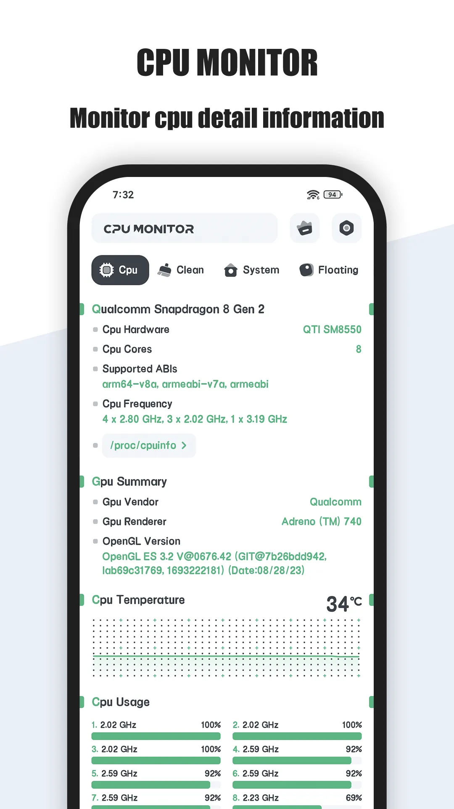
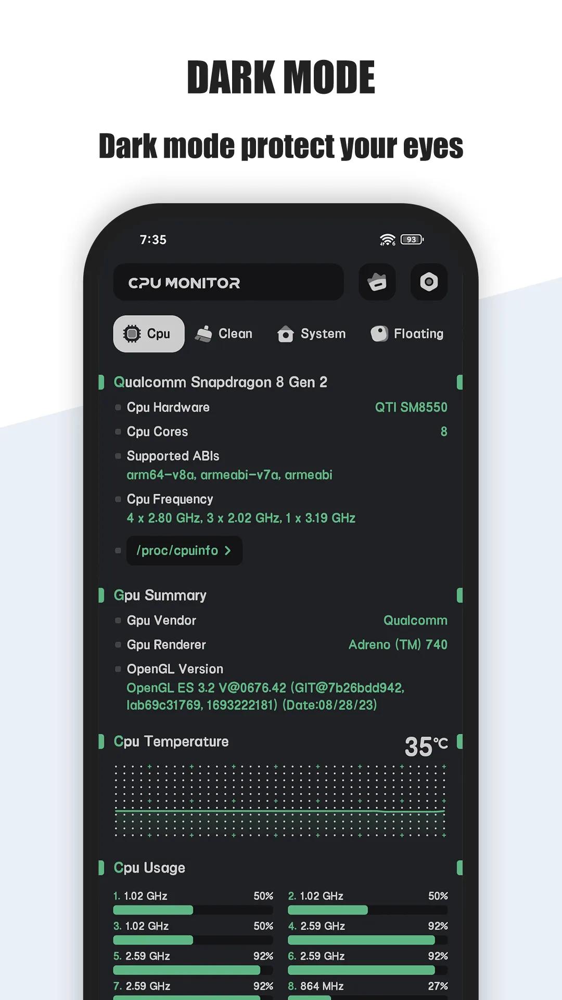
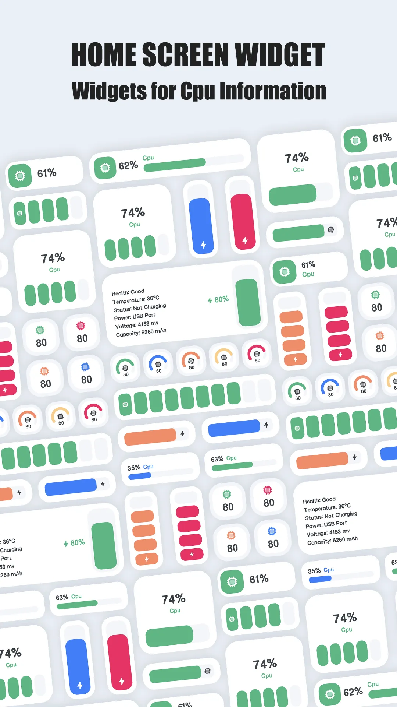
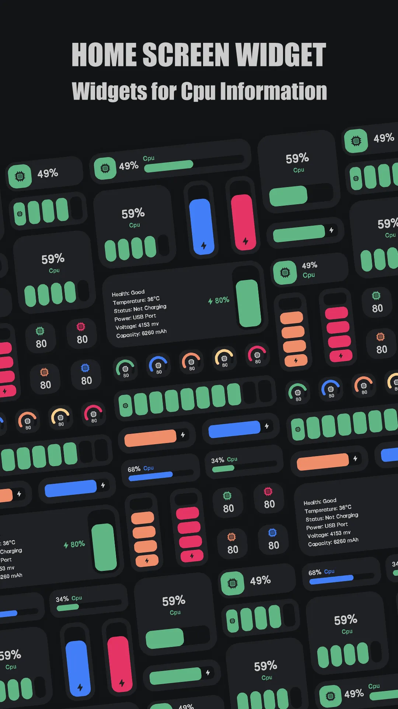
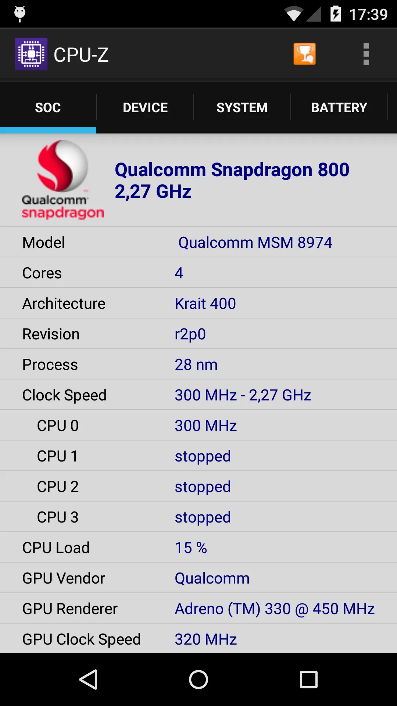
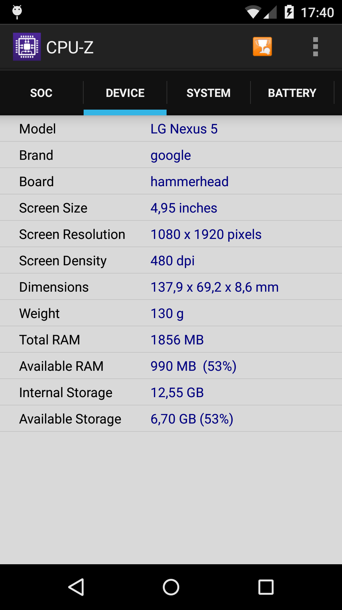
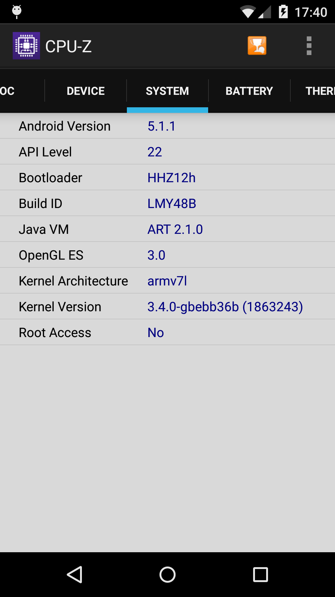
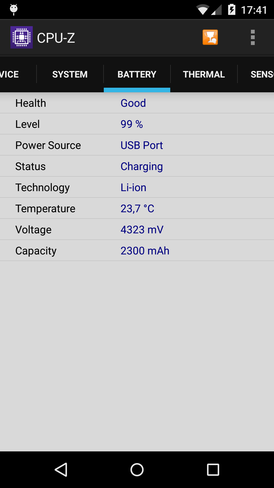
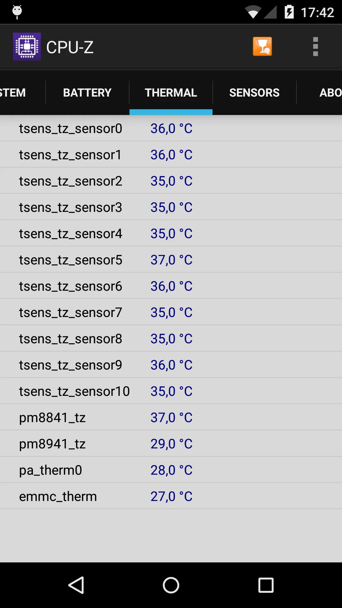

ความร้อนไม่ได้เกี่ยวกับแค่ CPU — แบตเตอรี่ GPU และเซ็นเซอร์แวดล้อมล้วนมีส่วน และแบตเตอรี่ที่ร้อนก็แก่ตัวเร็วขึ้น แอป **[ตรวจสอบอุณหภูมิโทรศัพท์](/th/glossary/what-is-a-cpu-temperature-monitor/)** ต้องอ่านอุปกรณ์ทั้งหมด เตือนคุณ และแนะนำการแก้ไข **CPU Monitor** คือ **ตัวตรวจสอบอุณหภูมิอุปกรณ์สำหรับ Android** พร้อมการเตือนและคำแนะนำ ด้านล่างนี้เราเปรียบเทียบกับ **CPU-Z** เพื่อจัดการความร้อนอุปกรณ์โดยรวม ผู้อ่านที่หา **ตัวตรวจสอบอุณหภูมิแบตเตอรี่** หรือ **แอปทำความเย็นโทรศัพท์พร้อมอุณหภูมิ** จริงๆ แล้วกำลังถามคำถามอุปกรณ์โดยรวมเดียวกัน

## สิ่งที่แอปอุณหภูมิโทรศัพท์ต้องมี

- **แหล่งความร้อนมากมาย** — CPU ควบคู่แบตเตอรี่และค่าอ่านเซ็นเซอร์
- **การเตือนความร้อนเกิน** — แจ้งให้คุณวางโทรศัพท์ลง
- **คำแนะนำชัดเจน** — "ปิดเกม ถอดปลั๊ก ปล่อยให้เย็น"
- **การตรวจสอบเบา** — แอปเองไม่ควรเพิ่มความร้อน

## สิ่งที่การตรวจสอบอุปกรณ์โดยรวมต้องครอบคลุม

อุณหภูมิ CPU เพียงอย่างเดียวพลาดข้อร้องเรียนเรื่องความร้อนที่พบบ่อยที่สุด: แบตเตอรี่ที่อุ่นขณะชาร์จ รายละเอียดสี่ข้อแยกการแสดงผลอุปกรณ์โดยรวมออกจากแอปตัวเลขเดียว:

- **ตัวตรวจสอบอุณหภูมิแบตเตอรี่** — เซ็นเซอร์แบตเตอรี่คือค่าอ่านที่ต่างจาก CPU และนั่นคือตัวเลขสำคัญสำหรับการสึกหร่อระยะยาว
- **เหลียวเดียวบนหน้าจอหลัก** — เลย์เอาต์ **วิดเจ็ต CPU RAM แบตเตอรี่ Android** วางอุณหภูมิ หน่วยความจำ และการชาร์จไว้ด้วยกัน เพื่อคุณไม่ต้องเปิดแอปขณะเล่นเกม
- **ค่าอ่านแบบลอย** — **CPU Monitor พร้อมหน้าต่างลอย** (หรือ **CPU Monitor พร้อมหน้าต่างลอย Android** ตามที่มักค้นหา) คงอยู่เหนือเกมโดยไม่ต้องออก
- **คำแนะนำสุจริต** — **แอปทำความเย็นโทรศัพท์พร้อมอุณหภูมิ** อาจแนะนำปิดเกมหรือถอดชาร์จ; มันไม่สามารถลดอุณหภูมิด้วยการฆ่ากระบวนการ และไม่มีตัวตรวจสอบใดควรอ้างเป็นอย่างอื่น

CPU Monitor ครอบคลุมเซ็นเซอร์ วิดเจ็ต และหน้าต่างลอยเป็นการแสดงผลแบบอ่านอย่างเดียว CPU-Z ให้สินค้าคงคลังฮาร์ดแวร์ลึกกว่า แต่ไม่มีการเตือนความร้อนเกิน

## คู่แข่งแบบคร่าวๆ

| แอป | ราคา (2026) | แหล่งความร้อน | การเตือน | คำแนะนำ | เหมาะสำหรับ |
|---|---|---|---|---|---|
| **CPU Monitor** | แกนฟรี + VIP | CPU + แบตเตอรี่/เซ็นเซอร์ | ✅ | ✅ | ดูแลความร้อนอุปกรณ์ |
| **CPU-Z** | ฟรี | CPU + เซ็นเซอร์ | ❌ | ❌ | สเปกและอุณหภูมิปัจจุบัน |
| **DevCheck** | ฟรี + IAP | CPU + แบตเตอรี่ | ❌ | ❌ | ข้อมูลละเอียด |

## CPU Monitor ลึกๆ

{: width="180" .normal }
{: width="180" .normal }
{: width="180" .normal }
{: width="180" .normal }
{: width="180" .normal }

CPU Monitor คือ **ตัวตรวจสอบอุณหภูมิอุปกรณ์** สำหรับ Android ที่ครอบคลุมความร้อน CPU แบตเตอรี่ และเซ็นเซอร์ พร้อมการเตือนและคำแนะนำ

**จุดแข็งสำหรับความร้อนอุปกรณ์**
- **แหล่งความร้อนมากมาย** — ดูแลอุณหภูมิ CPU และแบตเตอรี่ไปพร้อมกัน
- **การเตือนความร้อนเกิน** — ถูกเตือนก่อนแบตเตอรี่เสียหาย
- **คำแนะนำที่ลงมือได้** — แอปแนะนำขั้นตอนการทำความเย็น ไม่ใช่แค่ตัวเลข
- **เบา** — ภาระเบื้องหลังต่ำ

**จุดอ่อนสำหรับความร้อนอุปกรณ์**
- **VIP สำหรับบันทึกที่ลึกกว่า** — ประวัติความร้อนยาวนานอยู่หลังการอัปเกรด
- **พึ่งพาเซ็นเซอร์** — ความครบถ้วนแตกต่างกันตามอุปกรณ์

**เหมาะสำหรับ:** คนที่อยากปกป้องโทรศัพท์ทั้งเครื่องจากความร้อน ไม่ใช่แค่อ่านตัวเลขเดียว

- [Google Play — CPU Monitor](https://play.google.com/store/apps/details?id=com.glgjing.stark)

## CPU-Z ลึกๆ

{: width="180" .normal }
{: width="180" .normal }
{: width="180" .normal }
{: width="180" .normal }
{: width="180" .normal }

CPU-Z (แพ็กเกจ `com.cpuid.cpu_z`) รายงานรายละเอียดฮาร์ดแวร์รวมถึงอุณหภูมิปัจจุบันจากเซ็นเซอร์ที่มี

**จุดแข็งสำหรับความร้อนอุปกรณ์**
- **ฟรีและละเอียด** — ข้อมูล SoC แบตเตอรี่ และเซ็นเซอร์ในจอเดียว
- **ความแม่นยำที่เชื่อถือได้** — การรายงานสเปก CPUID แน่นอน

**จุดอ่อนสำหรับความร้อนอุปกรณ์**
- **ไม่มีการเตือน** — แสดงอุณหภูมิ แต่ไม่เตือน
- **ไม่มีคำแนะนำ** — ตัวเลขดิบ โดยไม่มี "ควรทำอะไร"
- **เซ็นเซอร์มือถือจำกัด** — บิลด์ Android เบากว่าเครื่องมือพีซี

**เหมาะสำหรับ:** ผู้ใช้ที่อยากภาพรวมสเปกฟรีและอุณหภูมิปัจจุบัน

- [Google Play — CPU-Z](https://play.google.com/store/apps/details?id=com.cpuid.cpu_z)

## อันอื่นเปรียบเทียบอย่างไร

- **DevCheck** เพิ่มแบตเตอรี่และข้อมูลอุปกรณ์เรียลไทม์ฟรี; ดี แต่ยังไม่มีการเตือนเชิงรุก

## คุณควรเลือกอะไร

- อยาก **ความร้อนอุปกรณ์โดยรวม + การเตือน + คำแนะนำ** → **CPU Monitor**
- อยาก **สเปกฟรีและอุณหภูมิปัจจุบัน** → **CPU-Z**

[รับ CPU Monitor](/th/apps/cpu-monitor/) — มีให้บน Android

## สถานการณ์ทั่วไป

- **ปกป้องแบตเตอรี่จากความร้อน** — CPU Monitor ดูอุณหภูมิแบตเตอรี่และเตือนก่อนแก่ตัวจากความร้อนเกินที่ทำซ้ำ
- **คำแนะนำทำความเย็น ณ ที่** — เมื่ออุณหภูมิสูงขึ้น มันแนะนำปิดเกมหรือถอดปลั๊ก ไม่ใช่แค่ตัวเลข
- **การแสดงผลอุปกรณ์โดยรวม** — อุณหภูมิ CPU แบตเตอรี่ และเซ็นเซอร์ในที่เดียว แทนสามแอป
- **ตรวจสอบการชาร์จ** — ปล่อยวิดเจ็ตเห็นขณะชาร์จ เพื่อคุณจับแบตเตอรี่ร้อนตั้งแต่ต้น

## คำถามที่พบบ่อย

**CPU Monitor ฟรีไหม?**
{:.faq-q}
ใช่ การตรวจสอบอุณหภูมิอุปกรณ์แกน การเตือนความร้อนเกิน และคำแนะนำฟรี; VIP ปลดล็อกประวัติและตัวเลือกที่ลึกกว่า

**CPU Monitor หรือ CPU-Z — ควรเลือกอะไร?**
{:.faq-q}
อยากความร้อนอุปกรณ์โดยรวม การเตือน และคำแนะนำทำความเย็น → CPU Monitor; อยากสเปกฟรีและภาพรวมอุณหภูมิปัจจุบัน → CPU-Z

**CPU Monitor ยังตรวจสอบอุณหภูมิแบตเตอรี่ไหม?**
{:.faq-q}
ใช่ มันอ่านอุณหภูมิ CPU และแบตเตอรี่ (พร้อมเซ็นเซอร์เมื่อมี) และเตือนก่อนแบตเตอรี่เสียหายจากความร้อน

[รับ CPU Monitor](/th/apps/cpu-monitor/) — มีให้บน Android

## ศัพท์ที่เกี่ยวข้อง

- [ตัวตรวจสอบอุณหภูมิ CPU คืออะไร?](/th/glossary/what-is-a-cpu-temperature-monitor/)
- [ตัวตรวจสอบระบบคืออะไร?](/th/glossary/what-is-a-system-monitor/)
