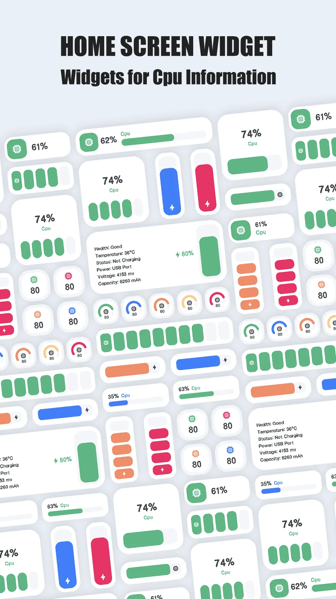

เมื่อโทรศัพท์ร้อน มันช้าลง — thermal throttling เริ่มทำงานและเฟรมตก แอป **[ตัวตรวจสอบอุณหภูมิ CPU](/th/glossary/what-is-a-cpu-temperature-monitor/)** ให้คุณเห็นความร้อนก่อนกินประสิทธิภาพ **CPU Monitor** คือ **แอปอุณหภูมิ CPU สำหรับ Android** พร้อมอุณหภูมิเรียลไทม์ ภาระต่อคอร์ และการเตือนความร้อนเกิน ด้านล่างนี้เราเปรียบเทียบกับ **CPU-Z** เครื่องมือข้อมูลฮาร์ดแวร์คลาสสิก เพื่อตรวจพบความร้อนตั้งแต่ต้น นี่คือรายชื่อสั้นที่หมายถึง **แอปตัวตรวจสอบอุณหภูมิ CPU ที่ดีที่สุด Android** และ **แอปการเตือนความร้อนเกิน CPU**

## สิ่งที่แอปตัวตรวจสอบอุณหภูมิ CPU ต้องมี

แอปตัวตรวจสอบอุณหภูมิ CPU ที่ดีต้องจับความร้อนก่อนที่ thermal throttling จะเฟรมตก ไม่ใช่รอให้เครื่องช้าลงก่อน แอปควรมีห้าอย่าง ได้แก่ อุณหภูมิเรียลไทม์ที่อ่านเหลียวเดียว ความถี่และภาระต่อคอร์ที่บอกว่าคอร์ไหนทำงานหนัก การเตือนความร้อนเกินก่อน throttling ทำงาน ประวัติเส้นโค้งที่แสดงจุดพุ่งสูง และการใช้งานเบื้องหลังเบาที่ตัวแอปเองไม่เพิ่มความร้อน CPU Monitor ครอบคลุมทั้งห้าส่วน แต่ความแม่นยำขึ้นกับเซ็นเซอร์ที่อุปกรณ์เปิดเผย

- **อุณหภูมิเรียลไทม์** — อุณหภูมิ CPU ปัจจุบันเหลียวเดียว
- **ความถี่และภาระต่อคอร์** — ดูคอร์ไหนทำงานหนักสุด
- **การเตือนความร้อนเกิน** — แจ้งเตือนก่อน throttling ทำงาน
- **การใช้งานเบื้องหลังเบา** — การตรวจสอบไม่ควรทำให้โทรศัพท์ร้อน
- **ประวัติ** — เส้นโค้งที่แสดงว่าเมื่อใดมันพุ่งสูง

## วิธีที่เราเลือกแอปตัวตรวจสอบอุณหภูมิ CPU ที่ดีที่สุด

วิธีที่เราเลือกแอปตัวตรวจสอบอุณหภูมิ CPU ที่ดีที่สุดยึดหลักว่าค่าอุณหภูมิมีประโยชน์ก็ต่อเมื่อเชื่อถือได้และเปิดทิ้งไว้ราคาถูก เราใช้สี่การตรวจสอบ ได้แก่ แหล่งที่มาของตัวเลขว่าอ่านเซ็นเซอร์ความร้อนจริงหรือเดาจากภาระ CPU การมีทุกคอร์พร้อมเส้นโค้งประวัติ การแจ้งเตือนที่ตั้งขอบเขตได้และแจ้งก่อนเครื่อง throttling และการคงความเบาแบบอ่านอย่างเดียวที่ไม่ต้องรูท CPU Monitor ผ่านทั้งสี่ข้อด้วยค่าอ่านเรียลไทม์ ประวัติ และการเตือน ขณะที่ CPU-Z ได้เปรียบเมื่อต้องการสินค้าคงคลังฮาร์ดแวร์เป็นหลัก

1. **ตัวเลขมาจากไหน** — แอป **ตัวตรวจสอบอุณหภูมิ CPU Android** ต้องอ่านเซ็นเซอร์ความร้อนของอุปกรณ์ ไม่ใช่คาดเดาความร้อนจากภาระ CPU หากตัวเลขไม่เคยขยับขณะชาร์จ นั่นคือเดา
2. **ทุกคอร์ พร้อมเส้นโค้ง** — **ตัวตรวจสอบอุณหภูมิและความถี่ CPU Android** หมายถึงความถี่ต่อคอร์และ **ตัวตรวจสอบประวัติความถี่ CPU** เพื่อคุณเห็นการพุ่งสูงไหนที่นำหน้า throttling
3. **การแจ้งเตือนที่ลงมือได้** — แอป **การเตือนความร้อนเกิน CPU** ต้องให้คุณตั้งขอบเขตและแจ้งก่อนโทรศัพท์ throttling ไม่ใช่แค่แสดงตัวเลขแดงทีหลัง
4. **คงเบาและอ่านอย่างเดียว** — **ตัวตรวจสอบ CPU มัลติคอร์ Android** ที่โพลลิงรุนแรงกลับทำให้โทรศัพท์ที่วัดร้อนขึ้น CPU Monitor อ่านเซ็นเซอร์โดยไม่ต้อง root และไม่เปลี่ยนการตั้งค่าระบบ

CPU Monitor ชนะในการตรวจสอบ 1–3 ด้วยค่าอ่านเรียลไทม์ ประวัติ และการเตือน; CPU-Z ได้เปรียบกว่าเมื่อคุณอยากสินค้าคงคลังฮาร์ดแวร์เป็นหลัก

## คู่แข่งแบบคร่าวๆ

คู่แข่งแบบคร่าวๆ ของ CPU Monitor มีสี่แอปที่จัดอันดับบนมิติเดียวกัน ได้แก่ ราคาในปี 2026 อุณหภูมิเรียลไทม์ การอ่านต่อคอร์ และการเตือนความร้อนเกิน ผลลัพธ์ชี้ว่า CPU Monitor เป็นแกนฟรีที่รวมค่าอ่านเรียลไทม์ ภาระต่อคอร์ และการเตือนไว้ครบ ขณะที่ CPU-Z DevCheck และ AIDA64 ให้ข้อมูลละเอียดแต่ไม่มีการเตือน ตารางด้านล่างช่วยให้เห็นทันทีว่าตัวไหนเหมาะกับการแจ้งเตือนความร้อนแต่เนิ่นๆ และตัวไหนเหมาะกับการอ่านสเปกฮาร์ดแวร์อย่างเดียว

| แอป | ราคา (2026) | อุณหภูมิเรียลไทม์ | ต่อคอร์ | การเตือน | เหมาะสำหรับ |
|---|---|---|---|---|---|
| **CPU Monitor** | แกนฟรี + VIP | ✅ | ✅ | ✅ | แจ้งเตือนความร้อนแต่เนิ่นๆ |
| **CPU-Z** | ฟรี | ✅ (เซ็นเซอร์) | ✅ | ❌ | สเปกฮาร์ดแวร์ |
| **DevCheck** | ฟรี + IAP | ✅ | ✅ | ❌ | ข้อมูลละเอียด |
| **AIDA64** | ฟรี | ✅ | ✅ | ❌ | สเปกเจาะลึก |

## CPU Monitor ลึกๆ

CPU Monitor คือแอปอุณหภูมิ CPU สำหรับ Android ที่แกนการตรวจสอบ อุณหภูมิเรียลไทม์ ความถี่ต่อคอร์ และภาระ ฟรี โดย VIP เพิ่มประวัติและตัวเลือกที่ลึกกว่า จุดแข็งสำหรับการดูความร้อนคือตัวเลขที่อ่านได้ขณะเล่นเกมหรือชาร์จ การหาคอร์ที่ติดที่ 100 เปอร์เซ็นต์ การเตือนก่อน throttling ลดประสิทธิภาพ เส้นโค้งประวัติที่บอกจุดพุ่งสูง และภาระเบื้องหลังต่ำสุดที่ไม่เพิ่มความร้อน แต่ความแม่นยำขึ้นกับเซ็นเซอร์ของอุปกรณ์

{: width="180" .normal }
{: width="180" .normal }
{: width="180" .normal }
{: width="180" .normal }
{: width="180" .normal }

CPU Monitor คือ **ตัวตรวจสอบอุณหภูมิและภาระ CPU** สำหรับ Android แกน — อุณหภูมิเรียลไทม์ ความถี่ต่อคอร์ และภาระ — ฟรี; VIP เพิ่มประวัติและตัวเลือกที่ลึกกว่า

**จุดแข็งสำหรับดูความร้อน**
- **อุณหภูมิ CPU เรียลไทม์** — ตัวเลขชัดเจนที่ดูได้ขณะเล่นเกมหรือชาร์จ
- **ความถี่และภาระต่อคอร์** — หาคอร์ที่ติดอยู่ที่ 100%
- **การเตือนความร้อนเกิน** — ถูกเตือนก่อน throttling ลดประสิทธิภาพ
- **เบา** — ภาระเบื้องหลังต่ำสุด จึงการตรวจสอบไม่เพิ่มความร้อน
- **เส้นโค้งประวัติ** — ดูเมื่อใดอุณหภูมิพุ่งสูงระหว่างเซสชัน

**จุดอ่อนสำหรับดูความร้อน**
- **VIP สำหรับประวัติที่ลึกกว่า** — บันทึกระยะยาวอยู่หลังการอัปเกรด
- **ความแม่นยำเซ็นเซอร์แปรผัน** — ค่าอ่านขึ้นอยู่กับที่อุปกรณ์เปิดเผย

**เหมาะสำหรับ:** คนที่อยากจับความร้อนเกินตั้งแต่เนิ่นๆ ไม่ใช่แค่อ่านสเปก

- [Google Play — CPU Monitor](https://play.google.com/store/apps/details?id=com.glgjing.stark)

## CPU-Z ลึกๆ

CPU-Z (แพ็กเกจ com.cpuid.cpu_z) คือพอร์ต Android จากเครื่องมือ CPUID ชื่อดังที่มุ่งเน้นการรายงานรายละเอียดฮาร์ดแวร์ จุดแข็งสำหรับการดูความร้อนคือการอ่านชื่อ SoC สถาปัตยกรรม ความถี่ต่อคอร์ ระบบ แบตเตอรี่ และเซ็นเซอร์อย่างละเอียดจากแหล่งที่เชื่อถือได้โดยไม่มีค่าใช้จ่ายหรือสมาชิก แต่สำหรับการจับความร้อน มันเป็นแค่ข้อมูล แสดงอุณหภูมิโดยไม่ให้การเตือนหรือคำแนะนำ ไม่มีเส้นโค้งแนวโน้ม และบิลด์มือถือเปิดเผยเซ็นเซอร์น้อยกว่าบนพีซี

{: width="180" .normal }
{: width="180" .normal }
{: width="180" .normal }
{: width="180" .normal }
{: width="180" .normal }

CPU-Z (แพ็กเกจ `com.cpuid.cpu_z`) คือพอร์ต Android จากเครื่องมือ CPUID ชื่อดัง มุ่งเน้นการรายงานรายละเอียดฮาร์ดแวร์

**จุดแข็งสำหรับดูความร้อน**
- **การอ่านฮาร์ดแวร์เจาะลึก** — ชื่อ SoC สถาปัตยกรรม ความถี่ต่อคอร์ ระบบ แบตเตอรี่ และเซ็นเซอร์
- **ฟรี** — ไม่มีค่าใช้จ่าย ไม่มีสมาชิก
- **แหล่งที่เชื่อถือได้** — ชื่อเสียง CPUID สำหรับสเปกที่แม่นยำ

**จุดอ่อนสำหรับดูความร้อน**
- **แค่ข้อมูล** — แสดงอุณหภูมิ แต่ไม่ให้การเตือนหรือคำแนะนำ
- **ไม่มีเส้นโค้งแนวโน้ม** — ภาพรวม ไม่ใช่ประวัติ
- **เซ็นเซอร์ Android จำกัด** — บิลด์มือถือเปิดเผยน้อยกว่าสำหรับพีซี

**เหมาะสำหรับ:** ผู้ใช้ที่อยากอ่านสเปกฮาร์ดแวร์และอุณหภูมิปัจจุบันที่แม่นยำ

- [Google Play — CPU-Z](https://play.google.com/store/apps/details?id=com.cpuid.cpu_z)

## อันอื่นเปรียบเทียบอย่างไร

อันอื่นเปรียบเทียบอย่างไรกับ CPU Monitor มองได้จาก DevCheck และ AIDA64 ซึ่งเป็นตัวเลือกที่เน้นข้อมูลมากกว่าการเตือน DevCheck แสดงข้อมูลอุปกรณ์ที่หลากหลายด้วยมุมมองเรียลไทม์ ฟรีพร้อม IAP แต่ไม่มีการเตือนความร้อนเกิน ส่วน AIDA64 เป็นตัวอ่านสเปกเจาะลึกที่สุดที่ยอดเยี่ยมสำหรับรายละเอียด ไม่ใช่สำหรับการเตือนความร้อน ผู้ใช้ที่ต้องการจับความร้อนตั้งแต่เนิ่นๆ จึงยังคงต้องเลือก CPU Monitor

- **DevCheck** แสดงข้อมูลอุปกรณ์ rich ด้วยมุมมองเรียลไทม์; ฟรีพร้อม IAP แต่ไม่มีการเตือนความร้อนเกิน
- **AIDA64** คือตัวอ่านสเปกเจาะลึกที่สุด; ยอดเยี่ยมสำหรับรายละเอียด ไม่ใช่สำหรับการเตือนความร้อน

## คุณควรเลือกอะไร

การเลือกว่าจะใช้ CPU Monitor หรือ CPU-Z ขึ้นกับว่าคุณต้องการจับความร้อนตั้งแต่ต้นหรือเพียงอ่านสเปก หากต้องการอุณหภูมิเรียลไทม์ ภาระต่อคอร์ และการเตือนความร้อนเกิน ให้เลือก CPU Monitor ซึ่งผ่านเกณฑ์การอ่านเซ็นเซอร์จริง มีประวัติเส้นโค้ง และแจ้งก่อน throttling หากต้องการสเปกฮาร์ดแวร์ฟรีและละเอียดโดยไม่มีการเตือน CPU-Z ก็ตอบโจทย์ ผู้ใช้ที่เล่นเกมหรือชาร์จหนักควรเลือกตัวแรก ส่วนผู้ใช้ที่อยากทราบข้อมูลฮาร์ดแวร์เป็นหลักควรเลือกตัวหลัง

- อยาก **อุณหภูมิเรียลไทม์ + ภาระต่อคอร์ + การเตือนความร้อนเกิน** → **CPU Monitor**
- อยาก **สเปกฮาร์ดแวร์ฟรีและละเอียด** → **CPU-Z**

## สถานการณ์ทั่วไป

สถานการณ์ทั่วไปที่ CPU Monitor ช่วยได้มุ่งเน้นการจับความร้อนก่อนที่ประสิทธิภาพจะตก ไม่ใช่การอ่านสเปกนิ่งๆ ทั้งการเปิดหน้าต่างลอยดูอุณหภูมิขณะเล่นเกมแล้วหยุดพักก่อนเข้าใกล้จุดเตือน การปล่อยวิดเจ็ตหน้าจอหลักเห็นขณะชาร์จเพื่อถอดปลั๊กทันที การใช้เส้นโค้งประวัติหาแอปหรือช่วงเวลาที่ดันอุณหภูมิขึ้น และการเช็คต่อคอร์ว่าคอร์ใดติดที่ 100 เปอร์เซ็นต์เพื่อตัดสินใจลดภาระ ทุกกรณีใช้การเตือนและค่าอ่านเรียลไทม์เป็นแกน

- **เล่นเกมก่อน throttling** — เปิดหน้าต่างลอยและดูอุณหภูมิ CPU; หยุดพักการแข่งเมื่อเข้าใกล้การเตือน เพื่อเฟรมไม่ตก
- **ชาร์จโดยไม่ต้ม** — ปล่อยวิดเจ็ตหน้าจอหลักเห็น; การเตือนความร้อนเกินบอกให้คุณถอดปลั๊กหรือย้ายโทรศัพท์
- **หาจุดพุ่งสูง** — ใช้เส้นโค้งประวัติเพื่อหาแอปหรือช่วงเวลาที่ดันอุณหภูมิขึ้น แล้วปิด
- **เช็คต่อคอร์** — ดูคอร์ไหนติดอยู่ที่ 100% และตัดสินใจว่าลดภาระหรือไม่

## คำถามที่พบบ่อย

**CPU Monitor ฟรีไหม?**
{:.faq-q}
ใช่ อุณหภูมิเรียลไทม์แกน ภาระต่อคอร์ และการเตือนความร้อนเกินฟรี; VIP ปลดล็อกประวัติและตัวเลือกที่ลึกกว่า

**CPU Monitor หรือ CPU-Z — ควรเลือกอะไร?**
{:.faq-q}
อยากอุณหภูมิเรียลไทม์ ภาระต่อคอร์ และการเตือนความร้อนเกิน → CPU Monitor; อยากสเปกฮาร์ดแวร์ฟรีและละเอียดโดยไม่มีการเตือน → CPU-Z

**CPU Monitor แสดงเส้นโค้งประวัติอุณหภูมิไหม?**
{:.faq-q}
ใช่ มันแมปอุณหภูมิ CPU และแบตเตอรี่ตามเวลา เพื่อคุณเห็นเมื่อใดจุดพุ่งสูงเกิดขึ้นระหว่างเซสชัน

[รับ CPU Monitor](/th/apps/cpu-monitor/) — มีให้บน Android

## ศัพท์ที่เกี่ยวข้อง

- [ตัวตรวจสอบอุณหภูมิ CPU คืออะไร?](/th/glossary/what-is-a-cpu-temperature-monitor/)
- [ตัวตรวจสอบระบบคืออะไร?](/th/glossary/what-is-a-system-monitor/)
