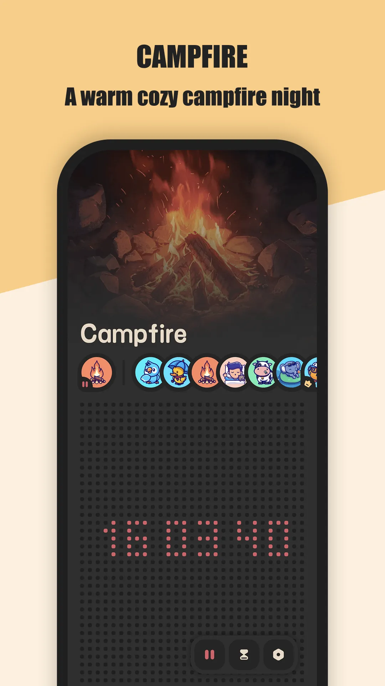

ห้องทำงานแบบเปิดโล่ง ร้านกาแฟที่คนพลุกพล่าน หรือเพื่อนร่วมห้องที่กำลังคุยโทรศัพท์ — ศัตรูของสมาธิมักเป็น **เสียงคนที่เกิดขึ้นฉับพลัน** ไม่ใช่เสียงรบกวนโดยรวม แอป **[ไวต์นอยส์](/th/glossary/what-is-white-noise/) ที่เสถียร** จะกลบการกระชากนั้นให้เป็นความเงียบคงที่ จนสมองคุณหยุดจดจ่อกับห้อง **Meow FM** คือ **เครื่องเล่นไวต์นอยส์ฟรี** สำหรับ Android และ iOS ที่มีพื้นเสียงสำหรับนอนและสมาธิ นี่คือวิธีที่มันเปรียบเทียบสำหรับการทำงานลึก และสิ่งที่ช่วยให้คุณคงสมาธิได้จริง การเปรียบเทียบด้านล่างมุ่งที่ **เสียงโฟกัส** ไม่ใช่เนื้อหาสมาธิ นั่นคือเหตุผลที่เครื่องเล่นนอยส์ที่ต่อเนื่องและฟรีจึงเป็นพื้นฐาน

## ทำไมเสียงรบกวนถึงช่วยโฟกัส

เสียงรบกวนที่เสถียรช่วยโฟกัสเพราะมันกลบเสียงพูดฉับพลันที่แย่งความสนใจ ไม่ใช่เพราะมันทำให้ห้องเงียบลงจริง สามกลไกอธิบายผลนี้ได้ ได้แก่ พื้นเสียงราบเรียบที่ซ่อนคำพูดของคนรอบข้าง ลูปเดียวกันที่เป็นจังหวะส่งสัญญาณโหมดทำงานเหมือนเพลงหนึ่งเพลง และการผสานเสียงก่อสร้าง การแจ้งเตือน และเสียงเท้าให้เป็นเบาะเดียวแทนการกระแทกสติ Meow FM ใช้ลูปธรรมชาติและตัวจับเวลาเพื่อรักษาความต่อเนื่องนี้โดยไม่ต้องสมาชิก

- **กลบเสียงพูด** — พื้นเสียงราบเรียบจะซ่อนคำพูดของคนรอบข้างที่จะแย่งความสนใจ
- **เป็นจังหวะของกิจวัตร** — ลูปเดียวกันส่งสัญญาณ "โหมดทำงาน" เหมือนเพลงหนึ่งเพลง
- **ลดการเปลี่ยนแปลงของสภาพแวดล้อม** — เสียงก่อสร้าง การแจ้งเตือน และเสียงเท้า ผสานเป็นเบาะเดียวแทนที่จะกระแทกสติคุณ

## สิ่งที่แอปเสียงโฟกัสต้องมี

แอปเสียงโฟกัสที่ดีต้องรักษาพื้นเสียงให้ต่อเนื่องจนสมองหยุดจดจ่อกับห้อง ไม่ใช่เพียงมีคลังเสียงมาก หกอย่างที่ขาดไม่ได้ ได้แก่ ไวต์ พิงก์ หรือบราวน์นอยส์ที่ไม่มีรอยต่อให้ได้ยิน การเล่นยาวที่ไม่เริ่มใหม่ทุกสามนาที ตัวจับเวลาที่จับคู่เสียงกับบล็อกโฟกัส การเล่นออฟไลน์บนเครื่องบินหรือคาเฟ่ที่ Wi-Fi ตาย แกนกลางฟรีที่ไม่บังคับสมาชิก และการไม่มีโฆษณาหรือป็อปอัประหว่างเซสชัน Meow FM ครอบคลุมทั้งหกด้วยไฟล์เสียงในเครื่อง

- **เสียงรบกวนที่เสถียร** — ลูปไวต์ พิงก์ หรือบราวน์นอยส์ที่ไม่มีรอยต่อให้ได้ยิน
- **การเล่นยาวต่อเนื่องไร้รอยต่อ** — ลูปไม่ควรเริ่มใหม่ทุกสามนาที
- **ตัวจับเวลา** — จับคู่เสียงกับบล็อกพอโมดอโร
- **เล่นออฟไลน์** — ทำงานบนเครื่องบินหรือคาเฟ่าที่ Wi-Fi ตาย
- **แกนกลางฟรี** — โฟกัสไม่ควรค่าเป็นสมาชิก
- **ไม่มีสิ่งรบกวน** — ไม่มีโฆษณาหรือป็อปอัประหว่างเซสชัน

## สิ่งที่สมาธิต้องการจริงๆ จากเสียง

สิ่งที่สมาธิต้องการจริงๆ จากเสียงคือความต่อเนื่องตลอดบล็อกงาน ไม่ใช่รายการฟีเจอร์ที่ยาว สามรายละเอียดตัดสินว่าไวต์นอยส์สำหรับโฟกัสจะอยู่รอดในบล็อกสองชั่วโมงหรือไม่ ได้แก่ ลูปที่ไม่มีรอยต่อเพราะไฟล์สามนาทีที่เริ่มใหม่ดึงความสนใจกลับทุกครั้ง ตัวจับเวลาที่ตั้งครั้งเดียวแล้วหยุดเองเพื่อไม่ต้องแตกสมาธิไปปิด และการเล่นที่รอดตอนจอล็อก เพราะเพลย์ลิสต์ที่หยุดเมื่อเครื่องหลับแย่กว่าไม่มีเสียงเลย Meow FM จัดการทั้งสามด้วยไฟล์เสียงในเครื่องและตัวจับเวลาหยุดเอง

- **ลูปที่ไม่มีรอยต่อ** — ไฟล์สามนาทีที่เริ่มใหม่ให้ได้ยินดึงความสนใจกลับทุกครั้งที่จบ ไวต์ พิงก์ และบราวน์นอยส์ต้องรันต่อเนื่อง พร้อมตัวเลือกผสมฝนด้านล่างหากเสียงหวีดแหลมราบเรียบรู้สึกคลินิกเกินไป
- **ตัวจับเวลาที่ตั้งครั้งเดียว** — การจับคู่เสียงกับบล็อกพอโมดอโรแปลว่าควรหยุดเอง จึงไม่ต้องแตกสมาธิไปปิดมัน
- **การเล่นที่รอดตอนจอล็อก** — เพลย์ลิสต์ **เสียงโฟกัส** ที่หยุดเมื่อโทรศัพท์หลับแย่กว่าไม่มีเสียงเลย; นอยส์ต้องรันพื้นหลังต่อไปตอนจอดับ

Meow FM จัดการเรื่องนี้ด้วยไฟล์เสียงในเครื่อง จึงทำให้ **ไวต์นอยส์ออฟไลน์** ทำงานบนรถไฟหรือห้องสมุดที่ไม่มีสัญญาณ และรายชื่อสั้น **แอปไวต์นอยส์ฟรีที่ดีที่สุด** ไม่ควรบังคับสมาชิกเพียงเพื่อคงตัวจับเวลาไว้

## คู่แข่งแบบคร่าวๆ

คู่แข่งแบบคร่าวๆ ของ Meow FM มีห้าแอปเสียงโฟกัสที่จัดอันดับบนมิติเดียวกัน ได้แก่ ราคาในปี 2026 การเล่นออฟไลน์ ตัวจับเวลา และสไตล์เสียง ผลลัพธ์ชี้ว่า Meow FM เป็นแกนฟรีที่รวมลูปธรรมชาติ ตัวจับเวลา และการเล่นออฟไลน์ไว้ครบโดยไม่ต้องบัญชี ขณะที่ Calm เน้นสมาธิแบบเมดิเทชันและมีค่าสมาชิกราว 69.99 ดอลลาร์ต่อปี ส่วน Noisli Brain.fm และ myNoise แต่ละตัวเน้นการผสมเองหรือดนตรีเชิงหน้าที่ ตารางด้านล่างช่วยให้เห็นทันทีว่าตัวไหนฟรีจริงและตัวไหนต้องจ่าย

| แอป | ราคา (2026) | ออฟไลน์ | ตัวจับเวลา | สไตล์เสียง | เหมาะสำหรับ |
|---|---|---|---|---|---|
| **Meow FM** | แกนฟรี + VIP เลือกได้ | ✅ | ✅ | ลูปธรรมชาติ (ฝน ทะเล เตาผิง) | ฟรี โฟกัสเรียบง่าย |
| **Calm** | ~$69.99/ปี (ทดลอง 14 วัน) | ⚠️ บางส่วน | ❌ | สมาธิ + เสียงโฟกัส | โฟกัสแบบเมดิเทชัน |
| **Noisli** | ฟรี + สมาชิก | ✅ | ✅ | ไวต์/พิงก์นอยส์ + สภาพแวดล้อม | ผสมเอง |
| **Brain.fm** | สมาชิก | ✅ | ✅ | ดนตรีเชิงหน้าที่ (แต่งด้วย AI) | โฟกัสแบบวิทยาศาสตร์ |
| **myNoise** | ฟรี + IAP | ✅ | ✅ | สร้างได้ ปรับแต่งได้ | นักเล่นเสียง |

## Meow FM ลึกๆ

Meow FM คือเครื่องเล่นไวต์นอยส์และโฟกัสธีมแมวสำหรับ Android และiOS ที่หลักๆ ฟรีด้วยลูปธรรมชาติอย่างฝน ทะเล และเตาผิง พร้อมตัวจับเวลาที่หยุดการเล่นเอง จุดแข็งสำหรับโฟกัสคือพื้นเสียงแกนที่ไม่มี paywall ตอนฟัง ตัวจับเวลาที่ตั้ง 25 นาทีแล้วจบเอง การเล่นออฟไลน์แท้จริงจากเสียงที่ดาวน์โหลด อินเทอร์เฟซเรียบง่ายที่เปิดแล้วแตะทำงานโดยไม่ต้องบัญชี และการผสมชั้นเสียงให้เข้ากับพื้นที่ แต่คลังเสียงเล็กกว่า Noisli หรือ myNoise และไม่มีดนตรีเชิงหน้าที่หรือการวิเคราะห์เซสชัน

{: width="180" .normal }
{: width="180" .normal }
{: width="180" .normal }
{: width="180" .normal }
{: width="180" .normal }

Meow FM คือ **เครื่องเล่นไวต์นอยส์และโฟกัสธีมแมว** สำหรับ Android และ iOS หลักๆ ฟรี: ลูปธรรมชาติอย่างฝน ทะเล และเตาผิง พร้อมตัวจับเวลาที่หยุดการเล่นจึงไม่รันทั้งวัน

**จุดแข็งสำหรับโฟกัส**
- **พื้นเสียงแกนฟรี** — ลูปฝน ทะเล และเตาผิง โดยไม่มี paywall ตอนฟัง
- **ตัวจับเวลาที่หยุดเอง** — รันเสียง 25 นาทีและมันจบเอง
- **เล่นออฟไลน์แท้จริง** — เสียงที่ดาวน์โหลดทำงานโดยไม่มีสัญญาณ
- **อินเทอร์เฟซเรียบง่ายน่ารัก** — เปิด แตะ ทำงาน; ไม่ต้องบัญชีหรือตั้งค่า
- **การผสมชั้นเสียง** — ผสานฉากให้เป็นเบาะที่เข้ากับพื้นที่คุณ

**จุดอ่อนสำหรับโฟกัส**
- **ไม่ใช่ดนตรีเชิงหน้าที่** — มันคือบรรยากาศ ไม่ใช่แทร็กโฟกัสสไตล์ Brain.fm ที่ออกแบบมาสำหรับความสนใจ
- **คลังเสียงเล็กกว่า** — ฉากน้อยกว่า Noisli หรือ myNoise
- **ไม่มีวิเคราะห์** — มันเล่นเสียง; ไม่ได้วัดเซสชัน

**เหมาะสำหรับ:** คนที่ต้องการ **แอปไวต์นอยส์ฟรี** สำหรับโฟกัสพร้อมตัวจับเวลาที่แท้จริงและไม่ต้องสมาชิก

- [Google Play — Meow FM](https://play.google.com/store/apps/details?id=com.glgjing.whitenoise.relax.night.sleep.meow)
- [App Store — Meow FM](https://apps.apple.com/app/id1606715188)

## Calm ลึกๆ

Calm คือแอปสมาธิและการนอนที่มีชื่อเสียงที่สุดใน Google Play ด้วยดาวน์โหลด 50 ล้านครั้งขึ้นไปและคะแนน 4.3 ดาว นอกจากการนอน มันเสนอเสียงโฟกัส การหายใจ และเซสชันรายวัน 10 นาทีสำหรับสมาธิ จุดแข็งสำหรับโฟกัสคือเพลย์ลิสต์ที่คัดสรรสำหรับงานและเรียน Daily Calm ที่รีเซ็ตความสนใจ และความเชื่อใจแบรนด์ แต่สมาชิกเสียเงินราว 69.99 ดอลลาร์ต่อปีหลังทดลอง 14 วัน เนื้อหาฟรีจำกัด และไม่มีลูปนอยส์บริสุทธิ์เรียบง่าย

{: width="180" .normal }
{: width="180" .normal }
{: width="180" .normal }
{: width="180" .normal }

Calm คือ **แอปสมาธิและการนอน** ที่มีชื่อเสียงที่สุดใน Google Play (ดาวน์โหลด 50 ล้าน+, 4.3 ดาว) นอกจากนอน มันเสนอเสียงโฟกัส การหายใจ และเซสชันรายวัน 10 นาทีสำหรับสมาธิ

**จุดแข็งสำหรับโฟกัส**
- **เพลย์ลิสต์โฟกัส** — ดนตรี Calm ที่คัดสรรสำหรับงานและเรียน
- **Daily Calm** — เซสชันสั้นรายวันเพื่อรีเซ็ตความสนใจ
- **ความเชื่อใจแบรนด์** — ชื่อที่รู้จักที่สุดในหมวดนี้

**จุดอ่อนสำหรับโฟกัส**
- **สมาชิกเสียเงิน** — ประมาณ $69.99/ปี หลังทดลอง 14 วัน; เนื้อหาฟรีจำกัด
- **ไม่ใช่นอยส์บริสุทธิ์** — มันเน้นสมาธิก่อน ดังนั้นจึงไม่มี "ลูปบราวน์นอยส์ 50 นาที" เรียบง่าย
- **ความน่าเชื่อถือผสม** — ผู้ใช้บางคนรายงานแอปพังตอนเปิดครั้งแรกทุกวัน

**เหมาะสำหรับ:** คนที่โฟกัสผ่านสมาธิและดนตรีสงบ และยอมรับสมาชิก

- [Google Play — Calm](https://play.google.com/store/apps/details?id=com.calm.android)

## แอปอื่นเปรียบเทียบอย่างไร

แอปอื่นเปรียบเทียบอย่างไรกับ Meow FM แบ่งออกเป็นสามแนวทางที่ตอบโจทย์ต่างกัน Noisli ผสมไวต์และพิงก์นอยส์กับเสียงสิ่งแวดล้อมอย่างร้านกาแฟและลม ฟรีพร้อมสมาชิกสำหรับเพิ่ม เหมาะกับผู้ที่ชอบสร้างผสมเอง Brain.fm ขายดนตรีเชิงหน้าที่แต่งด้วย AI รอบโฟกัสและผ่อนคลาย แต่เป็นสมาชิกเสียเงิน ส่วน myNoise ให้สร้างนอยส์ที่ปรับแต่งกับห้องได้ ฟรีพร้อมส่วนเสริมผ่าน IAP และเป็นเครื่องมือลึกที่สุดสำหรับนักเล่นเสียง ผู้ใช้ที่ต้องการฟรี ออฟไลน์ และไม่ต้องบัญชี ยังคงมอง Meow FM เป็นพื้นฐาน

- **Noisli** ผสมไวต์/พิงก์นอยส์กับเสียงสิ่งแวดล้อม (ร้านกาแฟ ลม) และฟรีพร้อมสมาชิกสำหรับเพิ่ม — ดีหากคุณชอบสร้างผสมของตัวเอง
- **Brain.fm** ขายดนตรีเชิงหน้าที่แต่งด้วย AI รอบโฟกัสและผ่อนคลาย; ได้ผลสำหรับบางคน แต่เป็นสมาชิกเสียเงิน
- **myNoise** สร้างนอยส์ที่คุณปรับแต่งกับห้องได้; ฟรีพร้อมส่วนเสริมผ่าน IAP เครื่องมือลึกที่สุดสำหรับนักเล่นเสียง

## คุณควรเลือกอะไร

การเลือกแอปเสียงโฟกัสขึ้นกับว่าคุณต้องการนอยส์บริสุทธิ์หรือดนตรีและสมาธิแบบเมดิเทชัน หากต้องการฟรี ตัวจับเวลาที่แท้จริง และการเล่นออฟไลน์โดยไม่ต้องบัญชี ให้เลือก Meow FM หากโฟกัสผ่านดนตรีสงบและสมาธิและยอมรับสมาชิกให้เลือก Calm หากต้องการผสมเสียงเองให้เลือก Noisli และหากต้องการแทร็กโฟกัสที่ออกแบบมาด้วย AI ให้เลือก Brain.fm ผู้ใช้ที่ Wi-Fi ไม่เสถียรหรือทำงานบนเครื่องบินควรให้ความสำคัญกับการเล่นออฟไลน์เป็นอันดับแรก

- อยาก **ฟรี + ตัวจับเวลาที่แท้จริง + ออฟไลน์** → **Meow FM**
- อยาก **ดนตรีสงบและสมาธิ** และยอมรับสมาชิก → **Calm**
- อยาก **ผสมเอง** → **Noisli**
- อยาก **แทร็กโฟกัสที่ออกแบบมา** → **Brain.fm**

[รับ Meow FM](/th/apps/meow-fm/) — มีให้สำหรับ Android และ iOS

## สถานการณ์ทั่วไป

สถานการณ์ทั่วไปที่ Meow FM ช่วยได้มุ่งเน้นการเปลี่ยนเสียงรบกวนที่คาดเดาไม่ได้ให้เป็นพื้นเสียงคงที่ ไม่ใช่การเพิ่มเนื้อหาสมาธิ ทั้งการใช้ลูปฝนหรือทะเลพร้อมตัวจับเวลา 25 นาทีในออฟฟิศแบบเปิดโล่ง การกลบเสียงกระแทกและสายเรียกในร้านกาแฟด้วยเตาผิงหรือบราวน์นอยส์ที่เล่นต่อแม้ Wi-Fi กระตุก การใช้ฉากที่ดาวน์โหลดไว้บนเที่ยวบินทำงานลึก และการเปิดแอปแตะฉากแล้วทำงานทันทีโดยไม่มีสมาชิกหรือบัญชีมาคั่น ทุกกรณีใช้ออฟไลน์และตัวจับเวลาเป็นแกน

- **ออฟฟิศแบบเปิดโล่ง** — ลูปฝนหรือทะเลพร้อมตัวจับเวลา 25 นาที เปลี่ยนพื้นที่คุยโจษกันเป็นความเงียบราบเรียบ; เสียงหยุดเองเมื่อบล็อกจบ
- **โฟกัสในร้านกาแฟ** — กลบเสียงกระแทกและสายเรียกใกล้ๆ ด้วยเตาผิงหรือบราวน์นอยส์; การเล่นออฟไลน์รันต่อบน Wi-Fi คาเฟ่าที่กระตุก
- **เที่ยวบินทำงานลึก** — ฉากที่ดาวน์โหลดเล่นโดยไม่มีสัญญาณ จึงทำให้การบินไกลเป็นพื้นที่ทำงานไร้เสียง
- **ไม่สมาชิก ไม่บัญชี** — เปิดแอป แตะฉาก และทำงาน; ไม่มีอะไรคั่นระหว่างคุณกับสมาธิ

## คำถามที่พบบ่อย

**Meow FM ฟรีสำหรับโฟกัสไหม?**
{:.faq-q}
ใช่ พื้นเสียงโฟกัสแกนหลัก — ฝน ทะเล เตาผิง และอื่นๆ — ฟรีโดยไม่มี paywall ตอนเล่น; VIP จ่ายครั้งเดียวปลดล็อกฉากเพิ่ม ไม่ใช่ตัวจับเวลาหรือเล่นออฟไลน์

**Meow FM ทำงานออฟไลน์ได้ไหม?**
{:.faq-q}
ได้ ฉากที่ดาวน์โหลดเล่นโดยไม่มีอินเทอร์เน็ต จึงทำให้คุณโฟกัสได้บนเครื่องบิน รถไฟใต้ดิน หรือคาเฟ่า Wi-Fi ตาย

**Meow FM มีตัวจับเวลาพอโมดอโรไหม?**
{:.faq-q}
มี ตั้ง 15/30/60 นาทีหรือระยะเอง และเสียงหยุดอัตโนมัติ เหมาะสำหรับบล็อกพอโมดอโร 25 นาที

**Meow FM หรือ Brain.fm สำหรับโฟกัส?**
{:.faq-q}
อยากนอยส์แอมเบียนต์ฟรี ออฟไลน์ ไม่ต้องบัญชี พร้อมตัวจับเวลาที่แท้จริง → Meow FM; อยากดนตรีเชิงหน้าที่แต่งด้วย AI สำหรับความสนใจ → Brain.fm (สมาชิก)

## ศัพท์ที่เกี่ยวข้อง

- [ไวต์นอยส์คืออะไร?](/th/glossary/what-is-white-noise/)
