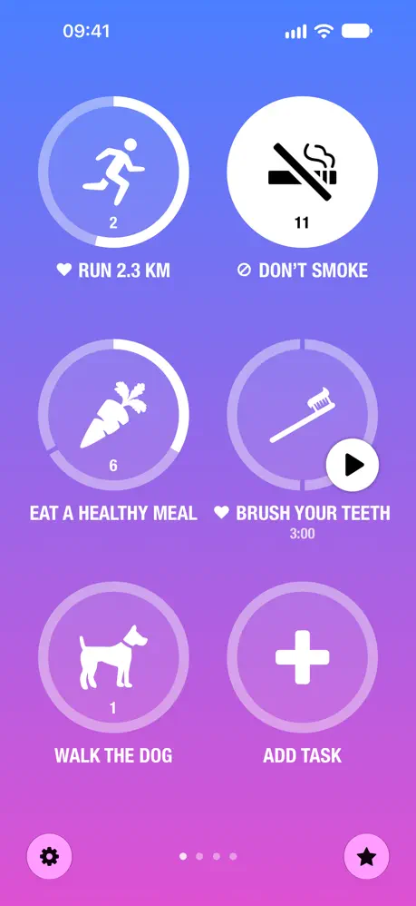

เป้าหมายนิสัยส่วนใหญ่ล้มเหลวเพราะระบบซับซ้อนเกินไป **[แอปติดตามนิสัย](/th/glossary/what-is-a-habit-tracker/) สำหรับผู้เริ่มต้น** ควรเริ่มได้ในไม่กี่วินาทีและฉลองชัยชนะเล็กๆ ได้ **Meow Habits** ทำได้ตรงจุดนั้นผ่านเทมเพลต สเตรกประจำวัน และดีไซน์ธีมแมวที่ผ่อนคลาย นี่คือการเปรียบเทียบกับตัวเลือกอื่นที่เป็นมิตรต่อผู้เริ่มต้น

## สิ่งที่ผู้เริ่มต้นต้องการจริงๆ

สิ่งที่ผู้เริ่มต้นต้องการจริงๆ จากแอปติดตามนิสัยคือการเริ่มได้ในไม่กี่วินาทีและฉลองชัยชนะเล็กๆ ไม่ใช่ระบบที่ซับซ้อน หกอย่างที่ขาดไม่ได้ ได้แก่ การเริ่มด้วยแตะเดียวโดยไม่มีฟอร์มยี่สิบช่อง คลังเทมเพลต เช่น ดื่มน้ำวันละ 3 ครั้ง การเริ่มด้วยหนึ่งหรือสองนิสัยแทนการเพิ่มทีละสิบ การเตือนที่อ่อนโยนไม่ดุด่า หลักฟรีที่ให้พิสูจน์นิสัยก่อนจ่าย และสเตรกที่ให้อภัยเมื่อหลุดหนึ่งวัน Meow Habits ครอบคลุมทั้งหกด้วยเทมเพลตแตะเดียวและสเตรกที่แยกสถิติยาวนานสุด

- **เริ่มด้วยการแตะเดียว** — ไม่มีการตั้งค่ายาวๆ ไม่มีฟอร์มยี่สิบช่อง
- **คลังเทมเพลต** — "ดื่มน้ำวันละ 3 ครั้ง" ด้วยการแตะเดียว
- **หนึ่งหรือสองนิสัย** — เริ่มเล็กๆ การเพิ่มทีละสิบคือวิธีทำสเตรกประจำวันขาด
- **การเตือนนิสัยที่อ่อนโยน** — เตือน ไม่ใช่ดุด่า
- **หลักฟรี** — พิสูจน์นิสัยก่อนที่จะจ่าย
- **สเตรกที่ให้อภัย** — วันที่หลุดหนึ่งวันไม่ควรลบทั้งหมดทิ้ง

## ภาพรวมคู่แข่ง

ภาพรวมคู่แข่งของ Meow Habits มีสี่แอปที่จัดอันดับบนมิติเดียวกัน ได้แก่ ค่าใช้จ่ายเริ่มต้น แพลตฟอร์ม เทมเพลต และความอ่อนโยนต่อผู้เริ่มต้น ผลลัพธ์ชี้ว่า Meow Habits เป็นหลักฟรีที่รองรับทั้ง Android และiOS พร้อมเทมเพลตแตะเดียวและสเตรกที่ให้อภัย ขณะที่ Loop ฟรีโอเพนซอร์สแต่มีเฉพาะ Android Streaks จ่ายครั้งเดียวราว 4.99 ดอลลาร์และมีเฉพาะ iOS และ Habitica ฟรีพร้อมสมาชิกที่ใช้แรงกดดันแบบเกม ตารางด้านล่างช่วยให้เห็นทันทีว่าตัวไหนปลอดภัยที่สุดสำหรับการเริ่ม

| แอป | ค่าใช้จ่ายเริ่มต้น | แพลตฟอร์ม | เทมเพลต | อ่อนโยน? | เหมาะสำหรับผู้เริ่มต้น |
|---|---|---|---|---|---|
| **Meow Habits** | หลักฟรี | Android + iOS | ✅ | ✅ | น่ารัก ข้ามแพลตฟอร์ม |
| **Loop** | ฟรี โอเพนซอร์ส | แค่ Android | มือ | ✅ | Android มินิมอล |
| **Streaks** | ~$4.99 จ่ายครั้งเดียว | แค่ iOS | มือ | ✅ | iOS เรียบร้อย |
| **Habitica** | ฟรี + สมาชิก | Android + iOS + เว็บ | มือ | ⚠️ กดดันแบบเกม | แรงจูงใจแบบ RPG |

## Meow Habits ลึกๆ

Meow Habits คือแอปติดตามนิสัยธีมแมวสำหรับ Android และiOS ที่มีหลักฟรีและเทมเพลตแตะเดียว จุดแข็งสำหรับผู้เริ่มต้นคือการเริ่ม ดื่มน้ำ หรือ อ่าน 10 นาที ทันที การบันทึกหลักไม่มีค่าใช้จ่าย สเตรกปัจจุบันและยาวนานสุดแสดงแยกกันเพื่อไม่ให้วันที่พลาดลบความคืบหน้า การเตือนที่อ่อนโยนไม่สร้างแรงกดดัน และการรองรับข้ามแพลตฟอร์ม ข้อจำกัดคือส่งออก CSV เฉพาะ VIP และการ gamify น้อยกว่า Habitica

{: width="180" .normal }
{: width="180" .normal }
{: width="180" .normal }
{: width="180" .normal }
{: width="180" .normal }

Meow Habits คือ **[แอปติดตามนิสัยธีมแมว](/th/glossary/what-is-a-habit-tracker/)** สำหรับ Android และ iOS ที่มีหลักฟรีและเทมเพลตแตะเดียว

**จุดแข็งสำหรับผู้เริ่มต้น**
- **เทมเพลตแตะเดียว** — เริ่ม "ดื่มน้ำ" หรือ "อ่าน 10 นาที" ทันที
- **ฟรีเพื่อพิสูจน์นิสัย** — การบันทึกหลักไม่มีค่าใช้จ่าย
- **สเตรกที่ให้อภัย** — สเตรกปัจจุบันและยาวนานสุดแสดงแยกกัน วันที่พลาดจึงไม่ลบความคืบหน้า
- **การเตือนนิสัยที่อ่อนโยน** — ตั้งการเตือนโดยไม่มีแรงกดดัน
- **ข้ามแพลตฟอร์ม** — Android และ iOS จึงคุณไม่ถูกล็อกอยู่บนระบบปฏิบัติการเดียว

**จุดอ่อนสำหรับผู้เริ่มต้น**
- **ส่งออก CSV เฉพาะ VIP** — ไม่จำเป็นตอนแรก แต่เป็นข้อจำกัดทีหลัง
- **การ gamify น้อยกว่า** — หากคุณมีแรงจูงใจจากรางวัล RPG Habitica น่าสนใจกว่า

**เหมาะสำหรับ:** ผู้ใช้ครั้งแรกที่ต้องการ **แอปนิสัยฟรี** ที่น่ารักและข้ามแพลตฟอร์ม

- [Google Play — Meow Habits](https://play.google.com/store/apps/details?id=com.glgjing.meow.habit.goal)
- [App Store — Meow Habits](https://apps.apple.com/app/id6758230559)

## Streaks ลึกๆ

Streaks (Crunchy Bagel) คือแอปติดตามนิสัยบน iOS ที่เรียบร้อยที่สุดพร้อมการติดตาม Apple Health อัตโนมัติ จุดแข็งสำหรับผู้เริ่มต้นคือผิวหน้ามินิมอลที่รายการเดียวติ๊กทุกวันก็เสร็จ และการเติมเป้าหมายก้าวหรือน้ำจาก Apple Health โดยอัตโนมัติ แต่มีข้อจำกัดที่เป็นกำแพงแข็งสำหรับหลายคน ได้แก่ การมีเฉพาะ iOS ไม่มี Android การจ่ายล่วงหน้าก่อนรู้ว่านิสัยจะอยู่หรือไม่ และการจำกัด 24 งาน จึงเหมาะกับผู้เริ่มต้น iPhone โดยเฉพาะที่ยอมจ่ายครั้งเดียว

{: width="180" .normal }
{: width="180" .normal }
{: width="180" .normal }
{: width="180" .normal }
{: width="180" .normal }

Streaks (Crunchy Bagel) คือแอป to-do นิสัยบน iOS ที่เรียบร้อยที่สุด พร้อมการติดตาม Apple Health อัตโนมัติ

**จุดแข็งสำหรับผู้เริ่มต้น**
- **ผิวหน้าตามินิมอล** — รายการเดียว ติ๊กทุกวัน เสร็จ
- **เติม Apple Health อัตโนมัติ** — เป้าหมายก้าวและน้ำเติมเอง

**จุดอ่อนสำหรับผู้เริ่มต้น**
- **แค่ iOS** — ไม่มีเวอร์ชัน Android เป็นกำแพงแข็งสำหรับหลายคน
- **จ่ายล่วงหน้า** — คุณซื้อก่อนรู้ว่านิสัยจะอยู่หรือไม่
- **จำกัด 24 งาน** — พอใช้ได้ แต่ไม่ชัดเจนตอนแรก

**เหมาะสำหรับ:** ผู้เริ่มต้น iPhone โดยเฉพาะที่ต้องการความเรียบง่ายและยอมจ่ายครั้งเดียว

- [Apple App Store — Streaks](https://apps.apple.com/app/id963034692)

## แอปอื่นเปรียบเทียบอย่างไร

แอปอื่นเปรียบเทียบอย่างไรกับ Meow Habits แบ่งเป็นสองแนวทางที่ตอบโจทย์ต่างกัน Loop ฟรีและโอเพนซอร์สบน Android โดยไม่ต้องบัญชี เหมาะกับผู้ที่ใช้แค่ Android และอยากมินิมอล Habitica เปลี่ยนนิสัยเป็น RPG ที่สนุกสำหรับบางคน แต่ชั้นเกมอาจเบี่ยงเบนความสนใจจากนิสัยเอง ผู้เริ่มต้นที่ต้องการความน่ารัก ข้ามแพลตฟอร์ม และเทมเพลตพร้อมใช้โดยไม่ลงโทษวันที่หลุด ยังคงมอง Meow Habits เป็นก้าวแรกที่เสี่ยงต่ำกว่า

- **Loop** ฟรีและโอเพนซอร์สบน Android โดยไม่ต้องบัญชี — เหมาะหากคุณใช้แค่ Android และอยากมินิมอล
- **Habitica** เปลี่ยนนิสัยเป็น RPG สนุกสำหรับบางคน แต่ชั้นเกมอาจเบี่ยงเบนจากนิสัยเอง

## สิ่งที่ผู้เริ่มต้นต้องการจริงๆ จากแอปติดตามนิสัย

สัปดาห์แรกคือช่วงที่แอปนิสัยส่วนใหญ่ถูกทิ้ง และนานๆ ครั้งที่เป็นเพราะฟีเจอร์น้อย สามเรื่องสำคัญกว่ารายการฟีเจอร์ยาว ได้แก่ การเริ่มจากนิสัยเดียวไม่ใช่ระบบทั้งชุดด้วยเทมเพลตพร้อมใช้ที่ทำให้ติ๊กครั้งแรกเกิดในไม่ถึงนาที การเป็นแอปนิสัยฟรีโดยไม่ต้องสมาชิกที่ให้พิสูจน์กิจวัตรก่อนตัดสินใจจ่ายรายปี และการเตือนที่ไม่ดุด่าซึ่งเปลี่ยนการบันทึกเป็นแตะเดียวจากหน้าจอหลัก Streaks และ Habitica เป็นแอปเยี่ยมแต่เรียกร้องความมุ่งมั่นล่วงหน้า ส่วน Meow Habits เป็นก้าวแรกที่เสี่ยงต่ำกว่า

- **เริ่มจากนิสัยเดียว ไม่ใช่ระบบหนึ่ง** — **แอปติดตามนิสัย** น่ารักพร้อมเทมเพลตพร้อมใช้ ทำให้การติ๊กครั้งแรกเกิดในไม่ถึงนาที; วัฏจักรและแท็กตามมาทีหลังได้
- **แอปนิสัยฟรีโดยไม่ต้องสมาชิก** — ผู้เริ่มต้นไม่ควรตัดสินว่ากิจวัตรใหม่นี้คุ้มค่ากับค่าใช้จ่ายรายปีก่อนรู้ว่ามันจะอยู่
- **การเตือนที่ไม่ดุด่า** — **การเตือนนิสัย** และ **แอปติดตามนิสัยพร้อมวิดเจ็ต** เปลี่ยนการบันทึกเป็นแตะเดียวจากหน้าจอหลัก

Streaks และ Habitica คือแอปเยี่ยม แต่ทั้งคู่เรียกร้องความมุ่งมั่นล่วงหน้า (ซื้อครั้งเดียว หรือเรียนรู้เกมหนึ่ง) สำหรับ **แอปนิสัยฟรี** ที่ลองได้แล้วทิ้ง quietly Meow Habits คือก้าวแรกที่เสี่ยงต่ำกว่า

## ผู้เริ่มต้นควรเลือกอะไร

การเลือกแอปติดตามนิสัยสำหรับผู้เริ่มต้นขึ้นกับระบบปฏิบัติการ งบประมาณ และว่าต้องการแรงจูงใจแบบเกมหรือไม่ หากต้องการฟรี น่ารัก แตะเดียว และใช้ได้ทั้ง Android และiOS ให้เลือก Meow Habits หากใช้แค่ Android และต้องการโอเพนซอร์สมินิมอลให้เลือก Loop หากเป็นผู้เริ่มต้น iPhone ที่ยอมจ่ายครั้งเดียวให้เลือก Streaks และหากต้องการแรงจูงใจแบบเกมให้เลือก Habitica ผู้ที่ยังไม่แน่ใจว่านิสัยจะอยู่รอดควรเริ่มจากตัวเลือกฟรีที่ไม่ลงโทษวันที่หลุดก่อน

- อยาก **ฟรี + น่ารัก + แตะเดียว + ทั้งสองโทรศัพท์** → **Meow Habits**
- แค่ Android และมินิมอล → **Loop**
- แค่ iPhone ยอมจ่ายครั้งเดียว → **Streaks**
- ต้องการแรงจูงใจแบบเกม → **Habitica**

[รับ Meow Habits](/th/apps/meow-habits/) — มีให้สำหรับ Android และ iOS

## สถานการณ์ทั่วไป

สถานการณ์ทั่วไปที่ Meow Habits ช่วยได้มุ่งเน้นการลดอุปสรรคในสัปดาห์แรก ไม่ใช่การเพิ่มฟีเจอร์ ทั้งการแตะเทมเพลต ดื่มน้ำ เพื่อเริ่มสเตรกแรกก่อนจบประโยคโดยไม่มีฟอร์มยี่สิบช่อง การเริ่มด้วยสองนิสัย เช่น อ่าน 10 นาที และเดิน 5 นาที ที่สเตรกดูเอาชนะได้แม้เคยหลุด การตั้งการเตือน 21.00 น. ที่เตือนใจไม่ดุด่าในสัปดาห์ที่ยุ่ง และการบันทึกหลักฟรีแล้วตัดสินใจภายหลังว่ VIP คุ้มหรือไม่หลังนิสัยติดจริง ทุกกรณีใช้แตะเดียวและสเตรกที่ให้อภัยเป็นแกน

- **นิสัยแรก แตะเดียว** — เปิด Meow Habits แตะเทมเพลต 'ดื่มน้ำ' และสเตรกประจำวันแรกของคุณเริ่มก่อนประโยคนี้จบ โดยไม่มีการตั้งค่ายี่สิบช่อง
- **เริ่มจากสอง** — เริ่มด้วย 'อ่าน 10 นาที' และ 'เดิน 5 นาที' ให้สเตรกดูเอาชนะได้; สเตรกที่ให้อภัยยังแสดงสถิติต่อเนื่องยาวนานสุดแม้เคยหลุด
- **การเตือนอ่อนโยน** — ตั้งการเตือน 21.00 น. ที่เตือนใจ ไม่ดุด่า เพื่อให้นิสัยอยู่รอดในสัปดาห์ที่ยุ่ง
- **ฟรีเพื่อพิสูจน์** — บันทึกหลักฟรี แล้วตัดสินว่า VIP คุ้มหรือไม่หลังนิสัยติดจริง

## คำถามที่พบบ่อย

**Meow Habits เหมาะสำหรับผู้เริ่มต้นไหม?**
{:.faq-q}

ใช่ เทมเพลตแตะเดียว หลักฟรี และสเตรกที่ให้อภัย ทำให้คุณเริ่มในไม่กี่วินาทีโดยไม่ลงโทษวันที่หลุด

**Meow Habits ฟรีไหม?**
{:.faq-q}

หลัก — การบันทึก สเตรกประจำวัน เทมเพลต และการเตือนนิสัย — ฟรี; ส่งออก CSV และเพิ่มเติมบางส่วนอยู่หลัง VIP จ่ายครั้งเดียวเลือกได้

**ฉันต้องมีบัญชีไหม?**
{:.faq-q}

ไม่ คุณเริ่มได้ทันทีโดยไม่ต้องสมัคร; ข้อมูลคงอยู่ในเครื่องในฐานะ **บันทึกนิสัยออฟไลน์** และสำรองไป WebDav หรือ Google Drive เมื่อคุณเลือก

**Meow Habits หรือ Loop สำหรับผู้เริ่มต้น?**
{:.faq-q}

อยากน่ารัก ฟรี ข้ามแพลตฟอร์ม (Android + iOS) พร้อมเทมเพลต → Meow Habits; แค่ Android และอยากโอเพนซอร์สมินิมอล → Loop

## ศัพท์ที่เกี่ยวข้อง

- [แอปติดตามนิสัย (Habit Tracker) คืออะไร?](/th/glossary/what-is-a-habit-tracker/)
