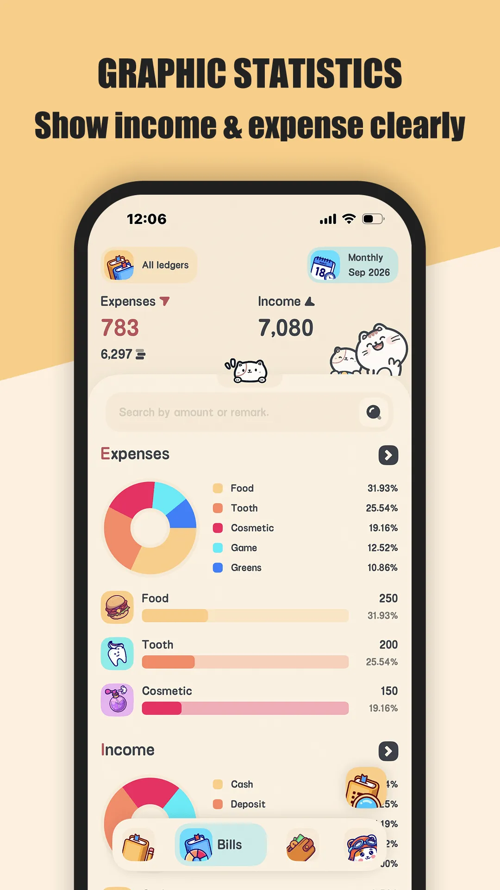
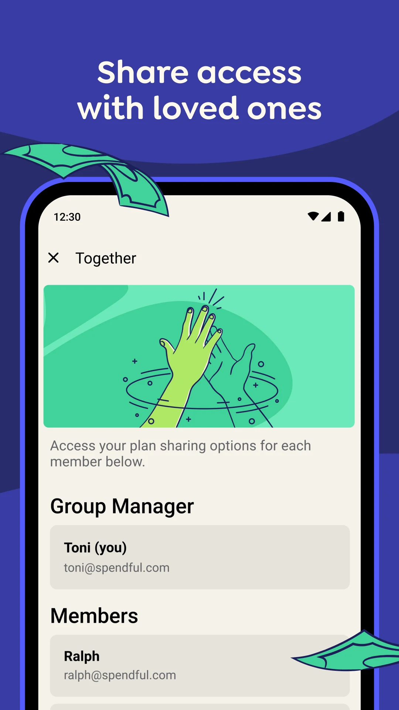

ชีวิตในรั้วมหาวิทยาลัยแพงพออยู่แล้วโดยไม่ต้องมี **[แอปจัดการงบประมาณ](/th/glossary/what-is-an-expense-tracker/)** ที่รู้สึกเหมือนงานที่ได้รับมอบหมาย **แอปบันทึกการเงินสำหรับนักศึกษา** ที่ใช้จริงมักเป็นตัวที่เปิดง่ายที่สุด — ระหว่างเรียน บนรถบัส ก่อนไปซื้อของที่ร้านเร่ กระแสเงินสดของนักศึกษาขึ้นลง: เงินโอนหรือทุนการศึกษาเข้าต้นเทอม แล้วค่าเล่ม ค่าหอ และ **ค่าอาหาร** ก็หมดไปก่อน **สิ้นเดือน** คุณอยากได้แบบฟรี ส่วนตัว และเร็ว

ด้านล่างนี้เราเปรียบเทียบแอปที่นักศึกษาติดตั้งจริง — **Meow Money Manager, YNAB, Goodbudget และ EveryDollar** — จากมุมมองนักศึกษา: บันทึกเบื้องต้นฟรี ไม่บังคับบัญชี ใช้สกุลเงินตอนเรียนต่างประเทศ และค่าใช้จ่ายในการ **จัดการการเงินส่วนตัว** ทุกวัน

## ทำไมนักศึกษาถึงต้องการแอปจัดการงบประมาณที่ต่างออกไป

นักศึกษาต้องการแอปจัดการงบประมาณที่ต่างออกไปเพราะกระแสเงินสดขึ้นลง ไม่ใช่เพราะใช้จ่ายไม่มีระเบียบ ค่าเฉลี่ยรายเดือนซ่อนช่องว่างระหว่างสัปดาห์สิ้นเดือนกับสัปดาห์ที่เงินโอนหรือทุนการศึกษามาถึง ห้าปัจจัยที่ทำให้แอปทั่วไปไม่พอดี ได้แก่ กระแสเงินสดที่ขึ้นลง สมัครสมาชิกที่เล็กน้อยแต่สะสม เช่น Spotify Netflix Adobe iCloud และฟิตเนส บัญชีธนาคารแรกที่เพิ่งเรียนจัดการเงิน หนึ่งเทอมเรียนต่างประเทศที่ต้องบันทึกสกุลเงินที่สอง และการเบิกคืนค่าห้องจัดกิจกรรมหรือแชร์ค่าใช้จ่ายกลุ่ม แอปที่ใช้จริงต้องเปิดง่ายและเร็ว

- **กระแสเงินสดขึ้นลง** — ค่าเฉลี่ยรายเดือนซ่อนช่องว่างระหว่างสัปดาห์ **สิ้นเดือน** กับสัปดาห์ **เงินเดือน** หรือเงินที่ส่งมา
- **สมัครสมาชิกสะสม** — Spotify Netflix Adobe iCloud ฟิตเนส; แต่ละอันเล็กน้อย รวมกันเกิดซ้ำ
- **บัญชีธนาคารแรก** — นักศึกษาหลายคนเพิ่งเรียนจัดการเงินครั้งแรก
- **เรียนต่างประเทศ** — หนึ่งเทอมต่างประเทศแปลว่าสกุลเงินที่สองที่ต้องบันทึก
- **เบิกคืน** — ค่าห้องจัดกิจกรรม งานประชุม และแชร์ค่าใช้จ่ายกลุ่ม ต้องบันทึก

## สิ่งที่นักศึกษาควรหา

สิ่งที่นักศึกษาควรหาในแอปบันทึกการเงินคือความเร็วและการไม่บังคับบัญชี ไม่ใช่รายงานที่ซับซ้อน เจ็ดอย่างที่ตอบโจทย์ชีวิตในมหาวิทยาลัย ได้แก่ เบื้องต้นฟรีที่ไม่คิดค่าฟีเจอร์พื้นฐาน การไม่บังคับบัญชีที่ลดรหัสผ่านหนึ่งอันและข้อมูลยังเป็นของคุณ การกรอกเร็วในสิบวินาทีระหว่างเรียน รายการเกิดซ้ำสำหรับค่าหอและสมัครสมาชิก หลายสกุลเงินสำหรับเรียนหรือเดินทางต่างประเทศการส่งออก CSV สำหรับเบิกคืนหรือย้ายแอป และหน้าตาที่น่ารักซึ่งเปิดบ่อยกว่าสเปรดชีตที่ทิ้งไป

- **เบื้องต้นฟรี** — คุณไม่ต้องจ่ายเพื่อบันทึกรายจ่าย; **แอปบันทึกการเงินฟรี** ไม่คิดค่าฟีเจอร์พื้นฐาน
- **ไม่บังคับบัญชี** — รหัสผ่านหนึ่งอันน้อยลง และข้อมูลยังเป็นของคุณ
- **กรอกเร็ว** — บันทึกในสิบวินาทีระหว่างเรียน
- **รายการเกิดซ้ำ** — ค่าหอ เงินสด และสมัครสมาชิก สร้างอัตโนมัติ
- **หลายสกุลเงิน** — สำคัญหากคุณเรียนหรือเดินทางต่างประเทศ
- **ส่งออก** — CSV สำหรับเบิกคืน ภาษี หรือย้ายแอปในอนาคต
- **หน้าตา** — UI น่ารักเป็นมิตร เปิดบ่อยกว่าสเปรดชีตที่ทิ้งไป

## ภาพรวมคู่แข่ง

ภาพรวมคู่แข่งของแอปบันทึกการเงินสำหรับนักศึกษามีสี่แอปที่จัดอันดับบนมิติเดียวกัน ได้แก่ ราคาในปี 2026 การบังคับบัญชี หลายสกุลเงิน และความเหมาะกับนักศึกษา ผลลัพธ์ชี้ว่า Meow Money Manager เป็นหลักฟรีโดยไม่มีบัญชีและรองรับ 50+ สกุลเงิน ขณะที่ YNAB ให้ปีแรกฟรีสำหรับนักศึกษาแล้วคิด 109 ดอลลาร์ต่อปีพร้อมบังคับคลาวด์ ส่วน Goodbudget ให้ซอง 20 แบบฟรีและ EveryDollar ฟรีแค่กรอกเอง ตารางด้านล่างช่วยให้เห็นทันทีว่าตัวไหนไม่สร้างภาระรายปีกับงบนักศึกษา

| แอป | ราคา (2026) | บัญชี | หลายสกุลเงิน | เหมาะสำหรับนักศึกษา |
|---|---|---|---|---|
| **Meow Money Manager** | ฟรีเบื้องต้น + VIP เลือกได้ | **ไม่มี** (ในเครื่อง + ลายนิ้วมือ) | ✅ 50+ สกุลเงิน | ฟรี ส่วนตัว น่ารัก |
| **YNAB** | ฟรี 1 ปี (นักศึกษา) แล้ว $109/ปี | มี (คลาวด์) | จำกัด (ส่วนใหญ่ USD) | วิธี + ปีแรกฟรี |
| **Goodbudget** | ฟรี (ซอง 20) + Plus ~$70/ปี | มี (สำหรับซิงค์) | ไม่มี | งบแบบซอง |
| **EveryDollar** | ฟรี (กรอกเอง) + Premium ~$79.99/ปี | เลือกได้ | ไม่มี | Zero-based แบบ Ramsey |

## Meow Money Manager ลึกๆ

Meow Money Manager คือแอปบันทึกการเงินและแอปจัดการงบประมาณธีมแมวสำหรับ Android และiOS ที่เก็บทุกอย่างในเครื่องหลังล็อกลายนิ้วมือโดยไม่ต้องสมัครบัญชีหรือล็อกอินธนาคาร จุดแข็งสำหรับนักศึกษาคือการฟรีสำหรับบันทึกเบื้องต้น งบประมาณ และสัญลักษณ์หลายสกุลเงิน การเริ่มโดยไม่มีอะไรอัปโหลด รายการเกิดซ้ำสำหรับค่าเช่าหอและสมัครสมาชิก 50+ สัญลักษณ์สกุลเงินสำหรับเรียนต่างประเทศ การติดตามการเบิกคืนค่าชมรม และส่งออก CSV พร้อมไอคอนน่ารัก 400+ ข้อจำกัดคือไม่มีซิงค์ธนาคารอัตโนมัติและฟีเจอร์ขั้นสูงอยู่หลัง VIP

{: width="180" .normal }
{: width="180" .normal }
{: width="180" .normal }
{: width="180" .normal }
{: width="180" .normal }

Meow Money Manager คือ **[แอปบันทึกการเงินธีมแมว](/th/glossary/what-is-an-expense-tracker/)** และ **[แอปจัดการงบประมาณ](/th/glossary/what-is-budget-management/)** สำหรับ Android และ iOS ที่เก็บทุกอย่าง **ในเครื่องของคุณ** หลังล็อกลายนิ้วมือ — **ไม่ต้องสมัครบัญชี** ไม่มีล็อกอินธนาคาร ส่วนติดต่อผู้ใช้รองรับหลายภาษา: จีน อังกฤษ อินโดนีเซีย ไทย และโปรตุเกส

**จุดแข็งสำหรับนักศึกษา**
- **ฟรีสำหรับบันทึกเบื้องต้น** — บันทึกรายวัน งบประมาณ และสัญลักษณ์หลายสกุลเงิน ไม่เสียเงิน
- **ไม่บังคับบัญชี** — เปิดแอปแล้วเริ่ม; ไม่มีอะไรอัปโหลด
- **รายการเกิดซ้ำ** — ตั้งค่าเช่าหอ สมัครสมาชิก และเงินที่ส่งมา once แล้วเกิดซ้ำอัตโนมัติ
- **สัญลักษณ์หลายสกุลเงิน** — 50+ สัญลักษณ์; บันทึกรายจ่ายในสกุลเงินท้องถิ่นตอนเรียนต่างประเทศ ยังอยู่ในสมุดบัญชีเดียว
- **ติดตามการเบิกคืน** — ทำเครื่องหมายรายจ่ายชมรมหรือเที่ยวประชุมที่เบิกคืนได้ (เต็มหรือบางส่วน)
- **ส่งออก CSV** พร้อมสำรอง Google Drive iCloud หรือ WebDav รวมถึง **ไอคอนน่ารัก 400+** พร้อมโหมดมืด

**จุดอ่อนสำหรับนักศึกษา**
- **ไม่มีซิงค์ธนาคารอัตโนมัติ** — รายการกรอกเอง (ได้เปรียบความเป็นส่วนตัว เสียเรื่องความสะดวก)
- **ขีดจำกัด VIP** — สมุดบัญชีไม่จำกัด ส่งออก CSV และล็อกแอป อยู่หลังการอัปเกรดเลือกได้

**สถานการณ์ทั่วไป:** ต้นเทอม บันทึกการเบิกเงินกู้หรือเงินที่พ่อแม่ส่งมาเป็น "รายการใหญ่" แล้วตั้งค่าเช่าหอ (จ่ายผ่าน GoPay OVO DANA หรือ QRIS) และสมัครสมาชิกเป็นรายการเกิดซ้ำ; ทำเครื่องหมายค่าชมรมหรือเที่ยวประชุมเป็นเบิกคืน (เต็มหรือบางส่วน) และส่งออก CSV ให้เหรัญญิกชมรมหรือภาควิชาตอนจบเทอม; ตอนเรียนต่างประเทศ บันทึกรายจ่ายในสกุลเงินท้องถิ่นและจัดการใช้จ่ายข้ามประเทศในสมุดบัญชีเดียวด้วย 50+ สัญลักษณ์สกุลเงิน ไม่ต้องมีบัญชีและ **ข้อมูลจัดเก็บในเครื่อง** โมเดลนี้เข้ากับความต้องการของนักศึกษาที่อยากแอปฟรี ส่วนตัว และเร็ว

**เหมาะสำหรับ:** นักศึกษาที่อยาก **แอปจัดการงบประมาณฟรี** โดยไม่มีบัญชี รวมถึงใครก็ตามที่เรียนต่างประเทศหรือแชร์ค่าใช้จ่ายกลุ่ม

- [Google Play — Meow Money Manager](https://play.google.com/store/apps/details?id=com.glgjing.money.manager.bookkeeping.meow)
- [App Store — Meow Money Manager](https://apps.apple.com/app/id1528852284)

## YNAB ลึกๆ

YNAB (You Need A Budget) คือแอปงบแบบ zero-based ที่มีชื่อเสียง มอบหน้าที่ให้ทุกดอลลาร์ พร้อมนำเข้ารายการธนาคารผ่าน Plaid จุดแข็งสำหรับนักศึกษาคือข้อเสนอฟรี 12 เดือนสำหรับผู้ยืนยันตัวตนได้ ระเบียบวิธีสี่กฎที่สร้างนิสัยอยู่หลังเรียนจบ การซิงค์ธนาคารที่แทบไม่ต้องออกแรง และรายงานที่แข็งแรง แต่เสียเงิน 14.99 ดอลลาร์ต่อเดือนหรือ 109 ดอลลาร์ต่อปีหลังหมดข้อเสนอ บังคับบัญชีคลาวด์ ต้องใช้เวลาหลายสัปดาห์ถึงลงตัว หลายสกุลเงินอ่อนแอ และไม่มีติดตามการเบิกคืนสำหรับเที่ยวประชุมหรือชมรม

{: width="180" .normal }
{: width="180" .normal }
{: width="180" .normal }
{: width="180" .normal }
{: width="180" .normal }

YNAB (You Need A Budget) คือแอป **งบแบบ zero-based** ที่มีชื่อเสียง มอบหน้าที่ให้ทุกดอลลาร์ พร้อมนำเข้ารายการธนาคารผ่าน Plaid

**จุดแข็งสำหรับนักศึกษา**
- **ฟรีหนึ่งปีสำหรับนักศึกษา** — นักศึกษาที่ยืนยันตัวตนได้ YNAB ฟรี 12 เดือน ประโยชน์แท้จริง
- **ระเบียบวิธี** — ระบบสี่กฎสร้างนิสัยที่อยู่หลังเรียนจบ
- **ซิงค์ธนาคาร** — Plaid ดึงรายการอัตโนมัติ บันทึกแทบไม่ต้องออกแรง
- **รายงานแข็งแกร่ง** — อายุของเงิน รายจ่ายต่อหมวด และเป้าหมาย

**จุดอ่อนสำหรับนักศึกษา**
- **เสียเงินหลังปีแรก** — $14.99/เดือน หรือ $109/ปี หลังหมดข้อเสนอนักศึกษา หนักกระเป๋านักศึกษา
- **บังคับบัญชีคลาวด์** — ข้อมูลการเงินของคุณอยู่ในเซิร์ฟเวอร์ YNAB
- **เส้นโค้งการเรียนรู้** — ต้องใช้เวลาหลายสัปดาห์ระเบียบวิธีถึงลงตัว
- **หลายสกุลเงินอ่อนแอลง** — รอบ USD จัดการหลายสกุลเงินค่อนข้างยุ่ง
- **ไม่มีติดตามการเบิกคืน** — ช่องโหว่สำหรับเที่ยวประชุมหรือชมรม

**เหมาะสำหรับ:** นักศึกษาที่มีวินัยอยากระเบียบวิธีและซิงค์ธนาคาร พร้อมใช้ข้อเสนอปีแรกฟรี

- [Google Play — YNAB](https://play.google.com/store/apps/details?id=com.youneedabudget.evergreen.app)
- [App Store — YNAB](https://apps.apple.com/app/id1010865877)

## แอปอื่นๆ เทียบกันอย่างไร

แอปอื่นเทียบกันอย่างไรกับ Meow Money Manager แบ่งเป็นสองแนวทาง Goodbudget คืองบแบบซองไม่ใช้กระดาษ แพ็กฟรีให้ซอง 20 และซิงค์กรอกเอง Plus ราว 70 ดอลลาร์ต่อปีเปิดซิงค์และซองเพิ่ม เหมาะถ้าวิธีซองเข้ากับคุณแต่อ่อนเรื่องหลายสกุลเงิน ส่วน EveryDollar ตามวิธี zero-based ของ Dave Ramsey ฟรีแค่กรอกเอง Premium ราว 79.99 ดอลลาร์ต่อปีเพิ่มซิงค์ธนาคาร สะอาดแต่สกุลเงินและรายงานน้อย นักศึกษาที่ต้องการฟรี ไม่มีบัญชี และหลายสกุลเงินยังคงมอง Meow Money Manager

- **Goodbudget** คืองบแบบซองไม่ใช้กระดาษ: แพ็กฟรีให้ซอง 20 และซิงค์กรอกเอง; Plus (~$70/ปี) เปิดซิงค์และซองเพิ่ม เหมาะหากวิธีซองเข้ากับคุณ บางต้นเรื่องหลายสกุลเงิน
- **EveryDollar** ตามวิธี zero-based ของ Dave Ramsey ฟรีแค่กรอกกรอกเอง; Premium (~$79.99/ปี) เพิ่มซิงค์ธนาคาร สะอาด แต่สกุลเงินและรายงานน้อย

## นักศึกษาควรเลือกอะไร

การเลือกแอปบันทึกการเงินสำหรับนักศึกษาขึ้นกับงบประมาณ ว่าต้องการระเบียบวิธี หรือต้องการหลายสกุลเงินและความเป็นส่วนตัว หากต้องการฟรี ส่วนตัว หลายสกุลเงิน และไม่ต้องบัญชี ให้เลือก Meow Money Manager หากต้องการระเบียบวิธีและใช้ข้อเสนอปีแรกฟรีให้เลือก YNAB แต่ต้องยอมรับสมาชิกปีต่อไป หากต้องการงบแบบซองให้เลือก Goodbudget และหากต้องการแผน zero-based แบบ Ramsey ให้เลือก EveryDollar นักศึกษาที่เรียนต่างประเทศหรือแชร์ค่าใช้จ่ายกลุ่มควรให้ความสำคัญกับหลายสกุลเงินและการเบิกคืน

- อยาก **ฟรี + ส่วนตัว + หลายสกุลเงิน + ไม่ต้องบัญชี** → **Meow Money Manager**
- อยาก **ระเบียบวิธีและปีแรกฟรี** → **YNAB**
- อยาก **งบแบบซอง** → **Goodbudget**
- อยาก **แผน zero-based แบบ Ramsey** → **EveryDollar**

[รับ Meow Money Manager](/th/apps/meow-money-manager/) — มีทั้ง Android และ iOS

## คำถามที่พบบ่อย

**Meow Money Manager เสียเงินสำหรับนักศึกษาไหม?**
{:.faq-q}

การบันทึกเบื้องต้น งบประมาณ และสัญลักษณ์หลายสกุลเงิน ฟรีทั้งหมด; ส่งออก CSV สมุดบัญชีไม่จำกัด และล็อกแอป อยู่หลัง VIP จ่ายครั้งเดียวเลือกได้ ใช้งานรายวันของนักศึกษาแทบไม่มีค่าใช้จ่าย

**ไม่ต้องสมัครบัญชีกลับยุ่งยากก้า?**
{:.faq-q}

ตรงกันข้าม — เปิดแล้วบันทึก รหัสผ่านหนึ่งอันน้อยลงและกังวลความเป็นส่วนตัวน้อยลง ด้วย **ข้อมูลจัดเก็บในเครื่อง** เท่านั้น

**บันทึกสองสกุลเงินตอนเรียนต่างประเทศได้ไหม?**
{:.faq-q}

ได้ แอปนี้มี **สัญลักษณ์ 50+ สกุลเงิน**; บันทึกรายจ่ายในสกุลเงินท้องถิ่นและจัดการใช้จ่ายข้ามประเทศในสมุดบัญชีเดียว

**จะเลือกอย่างไรระหว่าง Meow Money Manager และ YNAB?**
{:.faq-q}

YNAB ฟรีปีแรกแล้วบังคับสมัครสมาชิกและเก็บข้อมูลในคลาวด์; Meow Money Manager ฟรีในฟีเจอร์หลัก **ไม่ต้องสมัครบัญชี** และหลายสกุลเงิน — เข้ากับนักศึกษาที่ประหยัดและรักษาความเป็นส่วนตัวกว่า

**แอปจัดการงบประมาณน่ารักช่วยอะไรได้จริง หรือแค่ตกแต่ง?**
{:.faq-q}

ธีมแมวใน **แอปบันทึกการเงิน** ไม่ใช่ gimmick หากทำให้คุณเปิดทุกวัน: ไอคอนหมวด 400+ ใน Meow Money Manager เปลี่ยนการบันทึกเป็นนิสัยแตะสองครั้ง ซึ่งสำหรับนักศึกษาหมายความมากกว่ากราฟอีกอัน

**แอปจัดการงบประมาณสำหรับคู่รักจัดการสองสกุลเงินโดยไม่ต้องบัญชีร่วมได้ไหม?**
{:.faq-q}

ได้ — เก็บสมุดบัญชีสองเล่มในแอปเดียว แต่ละเล่มมีสัญลักษณ์สกุลเงินของตัวเอง Meow Money Manager รองรับ 50+ สัญลักษณ์และสถิติแยกตามสมุดบัญชี ทำให้สองคนบันทึกรายจ่ายโดยไม่รวมบัญชีหรือจ่ายสมัครสมาชิกร่วม

## ศัพท์ที่เกี่ยวข้อง

- [แอปบันทึกการเงินคืออะไร?](/th/glossary/what-is-an-expense-tracker/)
- [การจัดการงบประมาณคืออะไร?](/th/glossary/what-is-budget-management/)
- [การจัดการเบิกคืนคืออะไร?](/th/glossary/what-is-reimbursement-management/)
