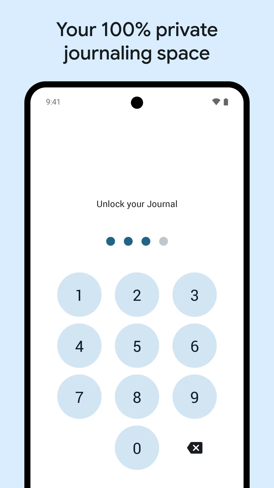

หากความเป็นส่วนตัวสำคัญกว่าฟีเจอร์คลาวด์ คุณต้องการ **แอปไดอารี่ส่วนตัว** ที่ไม่ส่งเนื้อหาความคิดของคุณไปเซิร์ฟเวอร์เลย **Meow Mood** คือ **[ไดอารี่อารมณ์ออฟไลน์](/th/glossary/what-is-a-mood-tracker/)** ที่สร้างบนคำสัญญานั้น: รายการคงอยู่ในเครื่อง และสำรองเดียวที่มีคือ Google Drive ที่คุณเลือกเอง นี่คือการเปรียบเทียบกับตัวเลือกอื่นที่ให้ความสำคัญความเป็นส่วนตัว พร้อมสิ่งที่ควรตรวจสอบก่อนตัดสินใจ ความต้องการนี้ต่างจาก **ตัวติดตามอารมณ์ไม่ต้องสมัคร** — อันหนึ่งว่าไปถึงข้อมูลไปไหน อีกอันว่าคุณจ่ายอย่างไร — และหน้านี้ตรวจสอบทั้งสอง

## สิ่งที่ไดอารี่ส่วนตัวต้องมี

ไดอารี่ส่วนตัวที่แท้จริงต้องให้รายการอยู่ในเครื่องคุณและเปิดได้เฉพาะคุณ ไม่ใช่เพียงโฆษณาว่าเข้ารหัส ห้าอย่างที่ขาดไม่ได้ ได้แก่ การไม่มีอัปโหลดบังคับที่รายการไม่ทิ้งเครื่องเว้นแต่คุณสำรองเอง ล็อกด้วยลายนิ้วมือหรือรหัสผ่านของแอป ไม่ใช่แค่ล็อกหน้าจอโทรศัพท์ ทางส่งออก PDF หรือข้อความที่ชัดเจนเพื่อไม่ติดกับดักผู้ขาย การเขียนได้แม้ไม่มีสัญญาณบนเครื่องบินหรือในรถไฟใต้ดิน และซิงโครไนซ์แบบเลือกได้ที่คุณควบคุมผ่าน Drive ของตัวเอง Meow Mood ครอบคลุมทั้งห้าโดยทำให้ความเป็นส่วนตัวเป็นค่าเริ่มต้น ไม่ใช่ตั้งค่าที่ต้องตามหา

- **ไม่มีอัปโหลดบังคับ** — รายการอยู่ในเครื่องคุณ ไม่ใช่คลาวด์ผู้ขาย
- **ล็อกที่แท้จริง** — ลายนิ้วมือหรือรหัสผ่าน ไม่ใช่แค่ล็อกโทรศัพท์
- **ทางส่งออกชัดเจน** — PDF หรือข้อความเพื่อไม่ให้คุณติดกับดัก
- **ใช้ออฟไลน์ได้** — เขียนบนเครื่องบินหรือตอนไม่มีสัญญาณ
- **ซิงโครไนซ์เลือกได้ที่คุณควบคุม** — Drive ของตัวเอง ไม่ใช่บัญชีบังคับ

## ราคาที่แท้จริงของคำว่า "ส่วนตัว"

ราคาที่แท้จริงของแอปไดอารี่ส่วนตัวไม่ใช่ค่าสมาชิก แต่คือข้อมูลที่คุณยอมมอบให้คลาวด์ของผู้ขาย ตัวติดตามอารมณ์ที่ไม่ต้องบัญชีและตัวติดตามอารมณ์ออฟไลน์แก้ปัญหาเดียวกันจากสองด้าน ด้านแรกป้องกันผู้ขายเก็บตัวตน ด้านหลังรักษารายการให้ใช้ได้บนเครื่องบิน ในห้องใต้ดิน หรือหลังเซิร์ฟเวอร์แอปปิดตัว Meow Mood ทำทั้งสองโดยบันทึกไม่ต้องสมัครและไม่ต้องสัญญาณ ผลตามมาคือซิงโครไนซ์ข้ามอุปกรณ์ต้องจัดเองผ่าน Drive หรือ WebDav สองเรื่องที่ควรตรวจสอบก่อนเลือกจึงคือเวอร์ชันฟรียังคงส่วนตัวหรือซ่อนล็อกหลัง paywall และคุณพกประวัติไปได้หรือไม่ผ่านการส่งออกไฟล์

**ตัวติดตามอารมณ์ส่วนตัวไม่ต้องบัญชี** และ **ตัวติดตามอารมณ์ออฟไลน์** แก้ปัญหาเดียวกันจากสองด้าน: ตัวแรกป้องกันผู้ขายเก็บตัวตนคุณ ตัวหลังรักษารายการให้ใช้ได้บนเครื่องบิน ในห้องใต้ดิน หรือหลังเซิร์ฟเวอร์แอปปิดตัว Meow Mood ทำทั้งสอง — บันทึกไม่ต้องสมัครและไม่ต้องสัญญาณ — โดยมีผลตามมาว่าซิงโครไนซ์ข้ามอุปกรณ์ต้องจัดเองผ่าน Google Drive หรือ WebDav ของคุณ

สองเรื่องที่ควรตรวจสอบก่อนเลือก **แอปไดอารี่อารมณ์** ที่นี่:

- **เวอร์ชันฟรียังคงส่วนตัวไหม?** **ตัวติดตามอารมณ์ไม่ต้องสมัคร** ไม่ควรซ่อนล็อกแอปหรือปฏิทินหลัง paywall; ถ้าไม่ ความเป็นส่วนตัวกลายเป็นฟีเจอร์เสียเงิน
- **คุณพกประวัติไปได้ไหม?** **ตัวติดตามอารมณ์ที่มีส่งออก** ให้ประวัติถูกนำออกเป็นไฟล์ จึงเปลี่ยนราคาไม่ทำให้บันทึกหลายปีจม ไดอารี่ที่พึ่งคลาวด์มักให้แค่ PDF ซึ่งนำเข้าคืนยาก

หากคุณติดตามกิจวัตรด้วย ประกบ **ตัวติดตามอารมณ์และนิสัย** — Meow Mood Diary คู่กับ Meow Habits — รักษาทั้งสองบันทึกไว้ในเครื่อง แทนแบ่งไปสองบัญชี

## ภาพรวมคู่แข่ง

ภาพรวมคู่แข่งของแอปไดอารี่ส่วนตัวมีห้าแอปที่จัดอันดับบนมิติเดียวกัน ได้แก่ รูปแบบความเป็นส่วนตัว การล็อก การส่งออก แพลตฟอร์ม และความเหมาะ Meow Mood เก็บในเครื่องไม่มีอัปโหลดพร้อมล็อกลายนิ้วมือและส่งออก PDF ขณะที่ Day One และ Penzu ใช้คลาวด์เข้ารหัสที่ต้องเชื่อใจผู้ขาย ส่วน Daylio ให้ความสำคัญท้องถิ่นแต่ส่งออกจำกัด และ Apple Journal อยู่ในเครื่องเฉพาะ iPhone ตารางด้านล่างช่วยให้เห็นทันทีว่าตัวไหนไม่เคยให้รายการออกจากโทรศัพท์

| แอป | รูปแบบความเป็นส่วนตัว | ล็อก | ส่งออก | แพลตฟอร์ม | เหมาะสำหรับ |
|---|---|---|---|---|---|
| **Meow Mood** | ท้องถิ่น ไม่มีอัปโหลด | ✅ ลายนิ้วมือ | PDF | Android + iOS | อยู่ในเครื่องทั้งหมด |
| **Day One** | ซิงค์คลาวด์ (เข้ารหัส) | ✅ ล็อกแอป | หลายรูปแบบ | Android+iOS+Mac+Web | ฟีเจอร์ครบ คลาวด์ |
| **Daylio** | ให้ความสำคัญท้องถิ่น | ✅ | จำกัด | Android + iOS | บันทึกอารมณ์ใช้ไอคอน |
| **Apple Journal** | ในเครื่อง (iOS) | อุปกรณ์ | iCloud เลือกได้ | แค่ iOS | ท้องถิ่นเฉพาะ iPhone |
| **Penzu** | คลาวด์เข้ารหัส | ✅ รหัสผ่าน | หลายรูปแบบ | iOS + เว็บ | คลาวด์เข้ารหัส |

## Meow Mood ลึกๆ

Meow Mood คือแอปตัวติดตามอารมณ์และไดอารี่ธีมแมวสำหรับ Android และiOS ที่ทำให้ความเป็นส่วนตัวเป็นค่าเริ่มต้น ไม่ใช่การตั้งค่าที่ต้องตามหา จุดแข็งด้านความเป็นส่วนตัวคือรายการไม่เคยทิ้งเครื่องเว้นแต่คุณสำรองเอง การสำรองไป Drive ของตัวเอง ไม่ใช่บัญชีบังคับ ล็อกลายนิ้วมือหรือรหัสผ่านที่ให้แค่คุณเปิดได้ การเขียนได้ทุกที่แม้ไม่มีสัญญาณ และการส่งออก PDF บันทึกอารมณ์แตะเดียวที่เบาไม่มีอุปสรรค ข้อจำกัดคือส่งออก CSV เฉพาะ VIP และไม่มีซิงค์หลายเครื่องอัตโนมัติหากไม่ใช้ Drive เอง

{: width="180" .normal }
{: width="180" .normal }
{: width="180" .normal }
{: width="180" .normal }
{: width="180" .normal }

Meow Mood คือ **แอปตัวติดตามอารมณ์และไดอารี่ธีมแมว** สำหรับ Android และ iOS ที่ทำให้ความเป็นส่วนตัวเป็นค่าเริ่มต้น ไม่ใช่การตั้งค่าที่ต้องตามหา

**จุดแข็งด้านความเป็นส่วนตัว**
- **ไม่มีอัปโหลดบังคับ** — รายการไม่เคยทิ้งเครื่องเว้นแต่คุณสำรอง
- **Drive ของคุณ ตามที่คุณเลือก** — สำรองไป Google Drive ของตัวเอง ไม่ใช่บัญชีบังคับ
- **ล็อกลายนิ้วมือหรือรหัสผ่าน** — มีแค่คุณที่เปิดได้
- **ออฟไลน์ที่ไหนก็ได้** — เขียนโดยไม่มีสัญญาณ
- **ส่งออก PDF** — นำรายการออกอย่างเป็นระเบียบเมื่อใดก็ได้
- **เบา** — บันทึกอารมณ์แตะเดียวรักษานิสัยโดยไม่มีอุปสรรค

**จุดอ่อนด้านความเป็นส่วนตัว**
- **ส่งออก CSV เฉพาะ VIP** — ผู้ใช้ฟรีส่งออก PDF
- **ไม่มีฟีเจอร์คลาวด์หลากหลาย** — หากอยากซิงค์หลายอุปกรณ์โดยไม่ใช้ Drive เอง นี่ไม่ใช่ตัวเลือก

**เหมาะสำหรับ:** คนที่ต้องการ **แอปไดอารี่ส่วนตัว** ที่ไม่เคยแตะเซิร์ฟเวอร์ที่ตนไม่ควบคุม

- [Google Play — Meow Mood Diary](https://play.google.com/store/apps/details?id=com.glgjing.meow.mood.diary)
- [App Store — Meow Mood Diary](https://apps.apple.com/app/id6767560237)

## Day One ลึกๆ

Day One คือแอปไดอารี่ที่ได้รับรางวัลมากที่สุด พร้อมซิงโครไนซ์เข้ารหัสข้าม Android iOS Mac และเว็บ จุดแข็งด้านความเป็นส่วนตัวคือการเข้ารหัสแน่นทั้งตอนส่งและตอนเก็บ ล็อกแอปด้วยรหัสผ่าน และฟีเจอร์ครบทั้งภาพ เสียง ตำแหน่ง และเทมเพลต แต่ข้อจำกัดชัดเจนคือคลาวด์ตั้งแต่เริ่มที่รายการอยู่ในเซิร์ฟเวอร์ Day One ความเป็นส่วนตัวจึงแปลว่าการเชื่อใจผู้ขาย เวอร์ชันฟรีจำกัดอุปกรณ์และภาพ และสมาชิก Silver หรือ Gold คิดซ้ำสำหรับชั้นพรีเมียม เหมาะกับผู้ที่ต้องการไดอารี่เรียบร้อยและยอมรับคลาวด์เข้ารหัส

{: width="180" .normal }
{: width="180" .normal }
{: width="180" .normal }
{: width="180" .normal }
{: width="180" .normal }

Day One คือแอปไดอารี่ที่ได้รางวัลมากที่สุด พร้อมซิงโครไนซ์เข้ารหัสข้าม Android iOS Mac และเว็บ

**จุดแข็งด้านความเป็นส่วนตัว**
- **ซิงโครไนซ์เข้ารหัส** — เข้ารหัสแน่นทั้งตอนส่งและตอนเก็บ
- **ล็อกแอป** — รหัสผ่านรักษาตัวแอปเอง
- **ฟีเจอร์ครบ** — ภาพ เสียง ตำแหน่ง เทมเพลต

**จุดอ่อนด้านความเป็นส่วนตัว**
- **คลาวด์ตั้งแต่เริ่ม** — รายการอยู่ในเซิร์ฟเวอร์ Day One; ความเป็นส่วนตัวแปลว่าเชื่อใจผู้ขาย
- **เวอร์ชันฟรีจำกัด** — จำกัดอุปกรณ์และภาพ; Silver/Gold เปิดการใช้เต็ม
- **ค่าใช้จ่ายสมาชิก** — จ่ายซ้ำสำหรับชั้นพรีเมียม

**เหมาะสำหรับ:** คนที่ต้องการไดอารี่เรียบร้อยและยอมรับการเก็บคลาวด์เข้ารหัส

- [Google Play — Day One](https://play.google.com/store/apps/details?id=com.dayoneapp.dayone)
- [App Store — Day One](https://apps.apple.com/app/id1044867788)

## แอปอื่นเปรียบเทียบอย่างไร

แอปอื่นเปรียบเทียบอย่างไรกับ Meow Mood แบ่งเป็นสามแนวทางที่ตอบโจทย์ต่างกัน Daylio ให้ความสำคัญการเก็บในเครื่องและบันทึกอารมณ์ผ่านไอคอน เป็นตัวเลือกส่วนตัวที่แข็งแกร่งสำหรับบันทึกสั้น Apple Journal เก็บรายการในเครื่อง iPhone พร้อม iCloud เลือกได้ ดีมากด้านความเป็นส่วนตัวแต่ผู้ใช้ Android ไม่ครอบคลุม ส่วน Penzu เสนอไดอารี่คลาวด์เข้ารหัสพร้อมล็อกรหัสผ่าน จัดเป็นส่วนตัวแต่ยังเก็บในเซิร์ฟเวอร์ ผู้ใช้ที่ต้องการรายการไม่เคยออกจากเครื่องและใช้ทั้งสองระบบยังคงมอง Meow Mood เป็นตัวเลือกแรก

- **Daylio** ให้ความสำคัญการเก็บในเครื่องและบันทึกอารมณ์ผ่านไอคอน; ตัวเลือกส่วนตัวที่แข็งแกร่งหากคุณแค่ต้องการบันทึกอารมณ์สั้น
- **Apple Journal** เก็บรายการในเครื่อง iPhone พร้อม iCloud เลือกได้; ดีมากสำหรับความเป็นส่วนตัว แต่ผู้ใช้ Android ไม่ครอบคลุม
- **Penzu** เสนอไดอารี่คลาวด์เข้ารหัสพร้อมล็อกรหัสผ่าน — ส่วนตัว แต่ยังเก็บในเซิร์ฟเวอร์

## คุณควรเลือกอะไร

การเลือกแอปไดอารี่ส่วนตัวขึ้นกับว่าคุณยอมให้รายการอยู่บนเซิร์ฟเวอร์ของผู้อื่นหรือไม่ หากต้องการรายการที่ไม่เคยทิ้งเครื่องและใช้ได้ทั้ง Android และiOS ให้เลือก Meow Mood หากต้องการซิงโครไนซ์เข้ารหัสที่ไม่ต้องจัดการเองและยอมรับคลาวด์ให้เลือก Day One หากใช้แค่ iPhone และต้องการท้องถิ่นให้เลือก Apple Journal และหากต้องการคลาวด์เข้ารหัสพร้อมรหัสผ่านให้เลือก Penzu ผู้ใช้ที่แชร์โทรศัพท์กับครอบครัวหรือเปิดเครื่องบินบ่อยควรให้ความสำคัญกับการเก็บในเครื่องเป็นอันดับแรก

- อยาก **รายการที่ไม่เคยทิ้งเครื่อง** → **Meow Mood**
- อยาก **ซิงโครไนซ์เข้ารหัสที่ไม่ต้องจัดการเอง** → **Day One**
- อยาก **ท้องถิ่นเฉพาะ iPhone** → **Apple Journal**
- อยาก **คลาวด์เข้ารหัสพร้อมรหัสผ่าน** → **Penzu**

[รับ Meow Mood](/th/apps/meow-mood-diary/) — มีให้สำหรับ Android และ iOS

## สถานการณ์ทั่วไป

สถานการณ์ทั่วไปที่ Meow Mood ช่วยได้มุ่งเน้นการรักษารายการให้เป็นของคุณและเขียนได้ทุกที่ ไม่ใช่การเพิ่มชั้นการเข้ารหัส ทั้งการใช้ล็อกลายนิ้วมือบนโทรศัพท์ที่ครอบครัวใช้ร่วมที่คนอื่นจับได้ การบันทึกความรู้สึกบนเครื่องบินหรือรถไฟใต้ดินที่ดับสัญญาณโดยไม่ต้องคลาวด์ การส่งออก PDF เพื่อดึงรายการทั้งหมดออกอย่างเป็นระเบียบไม่ติดกับดักผู้ขายเจ้าใด และการสำรองไป Drive ของตัวเองตามกฎของคุณ ไม่ใช่บัญชีบังคับ ทุกกรณีใช้การเก็บในเครื่องและการควบคุมการส่งออกเป็นแกน

- **โทรศัพท์ที่ครอบครัวใช้ร่วม** — บนอุปกรณ์ที่คนอื่นจับได้ ล็อกลายนิ้วมือหรือรหัสผ่านรักษารายการเป็นของคุณ; ไม่มีอะไรอัปโหลดเว้นแต่คุณสำรอง
- **ไม่มีสัญญาณ ก็ยังได้** — บันทึกความรู้สึกบนเครื่องบินหรือในรถไฟใต้ดินที่ดับสัญญาณ; ไดอารี่ไม่ต้องคลาวด์เพื่อบันทึกช่วงเวลา
- **ไปเมื่อใดก็ได้** — ส่งออก PDF ดึงรายการทั้งหมดออกอย่างเป็นระเบียบ จึงไม่ติดกับดักผู้ขายใดเจ้าเดียว
- **Drive ของคุณ กฎของคุณ** — สำรองเลือกได้ไปแค่ Google Drive ของตัวเอง ไม่ใช่บัญชีบังคับ

## คำถามที่พบบ่อย

**Meow Mood ส่วนตัวจริงไหม?**
{:.faq-q}

ใช่ รายการไม่เคยอัปโหลดไปเซิร์ฟเวอร์เราโดยปริยาย; สำรองเดียวคือ Google Drive ที่คุณเลือก และล็อกลายนิ้วมือหรือรหัสผ่านรักษาไดอารี่ไว้เป็นของคุณ

**Meow Mood ใช้แบบออฟไลน์ได้ไหม?**
{:.faq-q}

ได้ คุณเขียนและอ่านรายการได้โดยไม่มีอินเทอร์เน็ต; ทุกอย่างเก็บในเครื่อง

**ฉันส่งออกไดอารี่ได้ไหม?**
{:.faq-q}

ได้ — ผู้ใช้ฟรีส่งออก PDF; การส่งออก CSV (VIP) ให้ข้อมูลไปสเปรดชีตได้

**Meow Mood หรือ Day One สำหรับความเป็นส่วนตัว?**
{:.faq-q}

อยากรายการที่ไม่เคยทิ้งเครื่องและไม่ต้องบัญชี → Meow Mood; อยากซิงโครไนซ์เข้ารหัสข้ามทุกอุปกรณ์และยอมรับสมาชิก → Day One

## ศัพท์ที่เกี่ยวข้อง

- [ตัวติดตามอารมณ์คืออะไร?](/th/glossary/what-is-a-mood-tracker/)
