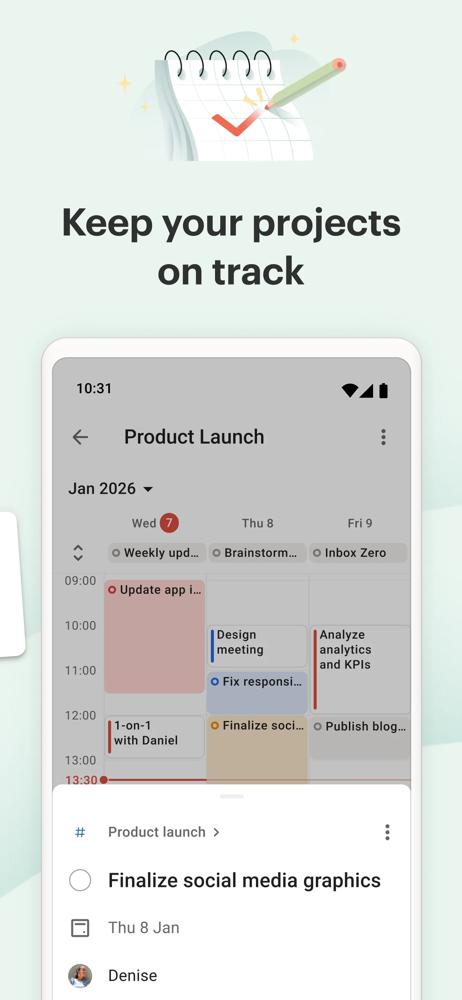
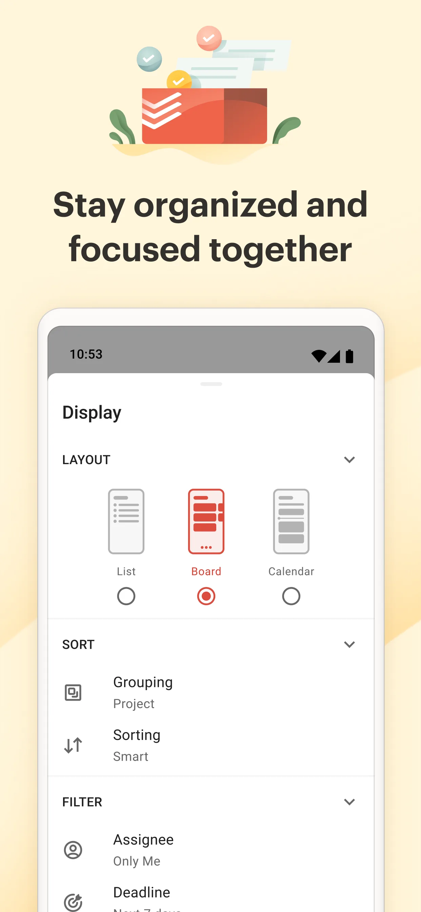

บน Android **[แอป to-do list](/th/glossary/what-is-a-to-do-list/)** ถูกเปิดใช้หลายสิบครั้งต่อวัน ดังนั้นที่เก็บ **รายการสิ่งที่ต้องทำ** ของคุณจึงสำคัญ บางคนอยากซิงค์ผ่านคลาวด์ข้ามอุปกรณ์ บางคนเลือกเก็บงานไว้ในโทรศัพท์หลังล็อกลายนิ้วมือ แทนที่จะเพิ่มบัญชีอีกตัว **Meow Todo** คือ **[แอปจัดการงานประจำวัน](/th/glossary/what-is-a-to-do-list/) ฟรีสำหรับ Android และ iOS** ที่เก็บงานในเครื่องพร้อมล็อก ข้างล่างนี้เราเปรียบเทียบแอปที่ผู้ใช้ Android ติดตั้งจริง — **Meow Todo, Todoist, Microsoft To Do และ Google Tasks** — ในด้านความเป็นส่วนตัว วิดเจ็ต การซิงโครไนซ์ และราคา พร้อมดูว่าเมื่อใด **ทางเลือก Todoist** แบบในเครื่องจึงสมเหตุสมผลกว่า

## สิ่งที่แอป to-do Android ควรทำได้

แอป to-do สำหรับ Android ที่ดีต้องเก็บงานในเครื่องและติ๊กได้จากหน้าจอหลัก ไม่ใช่บังคับบัญชีคลาวด์ก่อนจะเริ่ม หกอย่างที่ควรทำได้ ได้แก่ รูปแบบ local-first ที่งานคงอยู่ในโทรศัพท์พร้อมล็อก วิดเจ็ตหน้าจอหลักที่ติ๊กงานโดยไม่ต้องเปิดแอป การเตือนที่โผล่จริงเมื่อถึงเวลา มุมมองปฏิทินที่เห็นภาพหนึ่งสัปดาห์ในพริบตา งานย่อยที่แบกงานใหญ่เป็นขั้นตอน และราคาที่สมเหตุสมผลโดยการบันทึกพื้นฐานไม่ล็อกหลัง paywall Meow Todo ครอบคลุมทั้งหกด้วยพื้นฐานฟรีและล็อกในเครื่อง

- **รูปแบบ local-first** — เก็บงานในเครื่องพร้อมล็อก ไม่ใช่คลาวด์บังคับ
- **วิดเจ็ตหน้าจอหลัก** — ติ๊กงานโดยไม่ต้องเปิดแอป
- **การเตือนที่เชื่อถือได้** — แจ้งเตือนที่ปรากฏจริง
- **แอปปฏิทินงาน** — ดูภาพหนึ่งสัปดาห์ในพริบตา
- **งานย่อย (subtask)** — แบกงานออกเป็นขั้นตอน
- **ราคาสมเหตุสมผล** — การบันทึกรากฐานไม่ควรถูก lockdown ไว้หลัง paywall

## วิธีที่เราเลือกแอปจัดการงาน Android ที่ดีที่สุด

วิธีที่เราเลือกแอปจัดการงาน Android ที่ดีที่สุดยึดหลักว่าแอป to-do อย่างง่ายหาง่ายแต่อันที่เชื่อถือได้ยากกว่า วัดกันหลังใช้งานสัปดาห์เดียว ไม่ใช่ในรายการฟีเจอร์ สี่เรื่องที่สัมผัสได้จริง ได้แก่ ที่อยู่ของข้อมูลที่แอปออฟไลน์เก็บในโทรศัพท์พร้อมล็อกลายนิ้วมือและเสนอสำรอง Drive ที่คุณควบคุม ความฝืดรายวันที่การเตือนและงานย่อยไม่ต้องสอนใช้และมุมมองปฏิทินเห็นหนึ่งสัปดาห์เต็ม หลักฟรีที่รายการ งาน และการเตือนทำงานโดยไม่ต้องสมัคร และการไม่บังคับบัญชีที่เริ่มบนรถบัสไม่มีสัญญาณได้ Meow Todo ผ่านทั้งสี่ข้อ

- **ที่อยู่ของข้อมูล** — **แอป to-do ออฟไลน์** ที่เชื่อถือได้จะเก็บงานในโทรศัพท์พร้อม **ล็อกลายนิ้วมือ** ในขณะที่ยังเสนอ **สำรอง Google Drive** เป็นตัวสำรองที่คุณควบคุม
- ** friction รายวัน** — **แอปเตือนความจำงาน** และงานย่อยไม่ควรต้องสอนใช้ และมุมมองปฏิทินต้องแสดงหนึ่งสัปดาห์เต็มในพริบตา
- **หลักฟรี** — **แอป to-do list ฟรี** สำหรับคนส่วนใหญ่ คือรายการ งาน และการเตือนที่ทำงานได้โดยไม่ต้องสมัครสมาชิก นั่นคือความหมายของ **แอปจัดการงานฟรี**
- **ไม่บังคับบัญชี** — คุณต้องเริ่มบนรถบัสที่ไม่มีสัญญาณได้โดยไม่ต้องล็อกอิน

## ภาพรวมคู่แข่ง

ภาพรวมคู่แข่งของแอป to-do สำหรับ Android มีสี่แอปที่จัดอันดับบนมิติเดียวกัน ได้แก่ ราคาในปี 2026 การเก็บในเครื่องหรือส่วนตัว วิดเจ็ต และซิงค์ ผลลัพธ์ชี้ว่า Meow Todo เป็นตัวเดียวที่งานอยู่ในเครื่องพร้อมล็อกและซิงค์แบบมือผ่าน Drive หรือ WebDav ที่คุณควบคุม ขณะที่ Todoist Microsoft To Do และ Google Tasks ล้วนเก็บในคลาวด์และซิงค์ทันทีแต่แลกด้วยการพึ่งบัญชี ตารางด้านล่างช่วยให้เห็นทันทีว่าตัวไหนเหมาะกับผู้ใช้ที่รักษางานไว้ในโทรศัพท์

| แอป | ราคา (2026) | ในเครื่อง/ส่วนตัว | วิดเจ็ต | ซิงค์ | เหมาะสำหรับ |
|---|---|---|---|---|---|
| **Meow Todo** | หลักฟรี + VIP เลือกได้ | ✅ ในเครื่อง + ล็อก | ✅ | มือ (Drive/WebDav) | ส่วนตัว ในเครื่อง |
| **Todoist** | ฟรี + Pro ~$48/ปี | ❌ คลาวด์ | ✅ | ✅ ทันที | ข้ามแพลตฟอร์ม |
| **Microsoft To Do** | ฟรี | ❌ คลาวด์ (MS) | ✅ | ✅ | ระบบนิเวศ MS |
| **Google Tasks** | ฟรี | ❌ คลาวด์ (Google) | ✅ | ✅ | Gmail เบาๆ |

## Meow Todo ลึกๆ

Meow Todo คือแอปทำรายการสิ่งที่ต้องทำธีมแมวสำหรับ Android และiOS ที่รายการ งาน การเตือน และมุมมองปฏิทินพื้นฐานฟรี โดย VIP เพิ่มรายการไม่จำกัด แท็ก งานย่อย ส่งออก CSV และล็อกแอป จุดแข็งสำหรับผู้ใช้ Android คือการเก็บงานในเครื่องหลังล็อกลายนิ้วมือโดยไม่บังคับบัญชี วิดเจ็ตติ๊กงานจากหน้าจอหลักในแตะเดียว งานย่อยและการเตือนรายวันที่แบ่งและจัดตารางได้ สำรองไป Drive หรือ WebDav เฉพาะเมื่อเปิดใช้ และส่งออก CSV ได้ทุกเมื่อ ข้อจำกัดคือฟีเจอร์ขั้นสูงอยู่หลัง VIP และไม่มีซิงค์ข้ามเครื่องแบบเรียลไทม์

{: width="180" .normal }
{: width="180" .normal }
{: width="180" .normal }
{: width="180" .normal }
{: width="180" .normal }

Meow Todo คือ **แอปทำรายการสิ่งที่ต้องทำธีมแมว** สำหรับ Android และ iOS ฟีเจอร์หลัก — รายการ งาน การเตือน และมุมมองปฏิทิน — ฟรี; VIP เพิ่มรายการไม่จำกัด แท็ก งานย่อย ส่งออก CSV และล็อกแอป

**จุดแข็งสำหรับผู้ใช้ Android**
- **เก็บในเครื่อง** — งานคงอยู่ในโทรศัพท์หลังล็อกลายนิ้วมือ
- **ไม่บังคับบัญชี** — เปิดแล้วเริ่ม; ไม่มีอะไรอัปโหลดโดยปริยาย
- **วิดเจ็ต** — ติ๊กงานจากหน้าจอหลักในแตะเดียว
- **งานย่อยและการเตือน** — แบ่งและกำหนดตารางงานพร้อมแจ้งเตือนรายวัน
- **สำรองที่คุณควบคุม** — Google Drive หรือ WebDav เฉพาะเมื่อคุณเปิดใช้
- **ส่งออก CSV** — นำข้อมูลออกได้ทุกเมื่อ

**จุดอ่อนสำหรับผู้ใช้ Android**
- **ต้อง VIP สำหรับฟีเจอร์ขั้นสูง** — รายการไม่จำกัด แท็ก และส่งออก CSV อยู่หลังการอัปเกรด
- **ไม่มีซิงค์ข้ามอุปกรณ์ทันที** — นี่คือสำรองมือ ไม่ใช่บัญชีแบบเรียลไทม์

**เหมาะสำหรับ:** ผู้ใช้ Android ที่ต้องการ **แอป to-do ฟรี** ที่ยังคงเก็บในเครื่อง

- [Google Play — Meow Todo List](https://play.google.com/store/apps/details?id=com.glgjing.money.task.todo.list.meow)
- [App Store — Meow Todo List](https://apps.apple.com/app/id6742345495)

## Todoist ลึกๆ

Todoist คือตัวจัดการงานที่ติดตั้งมากที่สุด ด้วยการป้อนภาษาธรรมชาติและซิงโครไนซ์ข้ามแพลตฟอร์มลึกซึ้ง จุดแข็งสำหรับผู้ใช้ Android คือการพิมพ์ เช่น จ่ายค่าเช่าตรงวันที่ 1 แล้วระบบจัดวันที่ให้ทันที งานปรากฏบนทุกอุปกรณ์ในพริบตา โครงการ งานย่อย ป้ายกำกับ ความสำคัญ และการแชร์ครบ และวิดเจ็ตเป็นระเบียบกับการเพิ่มเร็วจากแผงแจ้งเตือน แต่บังคับคลาวด์ที่งานอยู่ในเซิร์ฟเวอร์ Todoist แพ็กฟรีจำกัดและ Pro ราว 48 ดอลลาร์ต่อปีปลดที่เหลือ จึงเหมาะกับผู้ที่ต้องการซิงค์เรียลไทม์มากกว่าความเป็นส่วนตัว

{: width="180" .normal }
{: width="180" .normal }
{: width="180" .normal }
{: width="180" .normal }
{: width="180" .normal }

Todoist คือตัวจัดการงานที่ติดตั้งมากที่สุด ด้วยการป้อนภาษาธรรมชาติและซิงโครไนซ์ข้ามแพลตฟอร์มลึกซึ้ง

**จุดแข็งสำหรับผู้ใช้ Android**
- **ภาษาธรรมชาติ** — "จ่ายค่าเช่าตรงวันที่ 1" จัดวันที่ให้ทันที
- **ซิงค์ทันที** — งานปรากฏบนทุกอุปกรณ์ในพริบตา
- **จัดระเบียบหลากหลาย** — โครงการ งานย่อย ป้ายกำกับ ความสำคัญ และการแชร์
- **แอปสุกงอม** — วิดเจ็ตเป็นระเบียบ และเพิ่มเร็วจากแผงแจ้งเตือน

**จุดอ่อนสำหรับผู้ใช้ Android**
- **บังคับคลาวด์** — งานของคุณเก็บในเซิร์ฟเวอร์ Todoist
- **แพ็กฟรีจำกัด** — Pro (~$48/ปี) สำหรับโครงการ คอมเมนต์ และป้ายกำกับไม่จำกัด
- **ค่าสมาชิก** — จ่ายซ้ำสำหรับการใช้งานเต็มรูปแบบ

**เหมาะสำหรับ:** คนที่อยากซิงโครไนซ์เรียลไทม์ข้ามโทรศัพท์ แท็บเล็ต และเดสก์ท็อป

- [Google Play — Todoist](https://play.google.com/store/apps/details?id=com.todoist)
- [App Store — Todoist](https://apps.apple.com/app/id572688855)

## แอปอื่นเปรียบเทียบอย่างไร

แอปอื่นเปรียบเทียบอย่างไรกับ Meow Todo แบ่งเป็นสองแนวทางที่ตอบโจทย์ต่างกัน Microsoft To Do ฟรีใน Microsoft 365 พร้อมรายการร่วมและการผสาน Outlook เหมาะกับผู้ที่ใช้ชีวิตในระบบนิเวศ Microsoft อยู่แล้ว ส่วน Google Tasks เป็นตัวเลือกเบาที่สุดที่ผูกกับบัญชี Google และ Gmail พอสำหรับรายการธรรมดาแต่อ่อนเรื่องงานย่อยและการส่งออก ทั้งสองเก็บในคลาวด์และต้องการบัญชี ผู้ใช้ที่ต้องการงานอยู่ในเครื่องโดยไม่ล็อกอินและใช้ Android ยังคงมอง Meow Todo เป็นตัวเลือกที่ตรงกว่า

- **Microsoft To Do** ฟรีใน Microsoft 365 พร้อมรายการร่วมและการผสาน Outlook
- **Google Tasks** คือตัวเลือกเบาที่สุด ผูกกับบัญชี Google และ Gmail — พอสำหรับรายการธรรมดา บางเบาเรื่องงานย่อยและการส่งออก

## ผู้ใช้ Android ควรเลือกอะไร

การเลือกแอป to-do สำหรับ Android ขึ้นกับว่าคุณต้องการงานอยู่ในเครื่องหรือซิงค์ข้ามอุปกรณ์ทันที หากต้องการในเครื่อง ส่วนตัว และไม่ต้องบัญชี ให้เลือก Meow Todo เพราะเปิดแล้วเริ่มได้บนรถบัสไม่มีสัญญาณและงานยังเป็นของคุณ หากต้องการซิงค์ข้ามอุปกรณ์ทันทีพร้อมฟีเจอร์แข็งและยอมรับคลาวด์ให้เลือก Todoist หากใช้ชีวิตประจำวันใน Microsoft 365 ให้เลือก Microsoft To Do และหากต้องการรายการเบาที่ผูก Gmail ให้เลือก Google Tasks ผู้ใช้ที่ให้ความสำคัญกับความเป็นส่วนตัวควรเลือกตัวเก็บในเครื่องก่อน

- อยาก **ในเครื่อง ส่วนตัว ไม่ต้องบัญชี** → **Meow Todo**
- อยาก **ซิงค์ข้ามอุปกรณ์ทันที + ฟีเจอร์แข็งแกร่ง** → **Todoist**
- ใช้ชีวิตประจำวันใน **Microsoft 365** → **Microsoft To Do**
- อยาก **รายการเบาที่ผูก Gmail มากที่สุด** → **Google Tasks**

[รับ Meow Todo](/th/apps/meow-todo-list/) — มีให้สำหรับ Android และ iOS

## สถานการณ์ทั่วไป

สถานการณ์ทั่วไปที่ Meow Todo ช่วยได้มุ่งเน้นการเพิ่มและติ๊กงานได้ทันทีโดยไม่พึ่งสัญญาณ ไม่ใช่การเพิ่มระบบจัดการ ทั้งการเพิ่มงานบนรถไฟหรือเครื่องบินที่ทุกอย่างคงอยู่ในเครื่องหลังล็อกลายนิ้วมือ การใช้แท็กและไอคอนหมวด 400+ แยกงาน บ้าน และเดินทางให้เห็นเฉพาะสำคัญตอนนี้ การใส่ตารางเรียนและกำหนดส่งลงรายการเดียวปล่อยให้การเตือนแจ้งก่อนและงานย่อยทำให้โครงการใหญ่ไม่เป็นกำแพง และการจัดเช็กลิสต์ก่อนบินติ๊กออฟไลน์แล้วซิงค์ Drive หรือ WebDav เมื่อกลับออนไลน์ ทุกกรณีใช้การเก็บในเครื่องและวิดเจ็ตเป็นแกน

- **บันทึกงานแบบส่วนตัว** — บนรถไฟหรือเครื่องบินที่ไม่มีสัญญาณ เพิ่มงานทันที; ทุกอย่างคงอยู่ในเครื่องหลังล็อกลายนิ้วมือ จึงไม่มีอะไรอัปโหลดไปบัญชีคลาวด์อื่น
- **แยกงานกับชีวิต** — ใช้แท็กและไอคอนหมวดน่ารัก 400+ เพื่อแยก "งาน" "บ้าน" และ "เดินทาง" ให้เห็นเฉพาะสิ่งสำคัญตอนนี้
- **วางแผนภาคเรียนนักศึกษา** — ใส่ตารางเรียนและกำหนดส่งงานลงรายการเดียว ปล่อยให้การเตือนรายวันแจ้งก่อนกำหนดทุกครั้ง; งานย่อยทำให้โครงการใหญ่ไม่เหมือนกำแพงข้อความ
- **เดินทางแนว offline-first** — จัดเช็กลิสต์ก่อนบิน; ติ๊กรายการโดยไม่มีอินเทอร์เน็ต และซิงค์ไป Google Drive หรือ WebDav เมื่อกลับออนไลน์เท่านั้น

## คำถามที่พบบ่อย

**Meow Todo List ฟรีไหม?**
{:.faq-q}

ใช่สำหรับการใช้งานหลัก — รายการ งาน การเตือน และมุมมองปฏิทิน ฟรี; รายการไม่จำกัด แท็ก งานย่อย ส่งออก CSV และล็อกแอป อยู่หลัง VIP จ่ายครั้งเดียวเลือกได้

**Meow Todo ใช้แบบออฟไลน์ได้ไหม?**
{:.faq-q}

ได้ คุณเพิ่มและติ๊กงานโดยไม่มีอินเทอร์เน็ต; **แอป to-do ออฟไลน์** นี้เก็บข้อมูลในเครื่อง และซิงค์ไป Google Drive หรือ WebDav เมื่อคุณเปิดสำรองเท่านั้น

**ฉันต้องมีบัญชีเพื่อใช้ Meow Todo ไหม?**
{:.faq-q}

ไม่ คุณเริ่มได้ทันทีโดยไม่ต้องสมัคร; **รายการสิ่งที่ต้องทำไม่ต้องบัญชี** นี้ยังคงเก็บในเครื่องหลังล็อกลายนิ้วมือ

**Meow Todo หรือ Todoist — ควรเลือกอะไร?**
{:.faq-q}

อยาก **ทางเลือก Todoist** ที่ฟรี ส่วนตัว เป็นมิตรออฟไลน์ และไม่ต้องบัญชี → Meow Todo; อยากป้อนภาษาธรรมชาติและซิงโครไนซ์เรียลไทม์ข้ามอุปกรณ์ → Todoist (Pro มีค่าใช้จ่าย)

## ศัพท์ที่เกี่ยวข้อง

- [รายการสิ่งที่ต้องทำ (To-Do List) คืออะไร?](/th/glossary/what-is-a-to-do-list/)
- [งานย่อย (Subtask) คืออะไร?](/th/glossary/what-is-a-subtask/)
