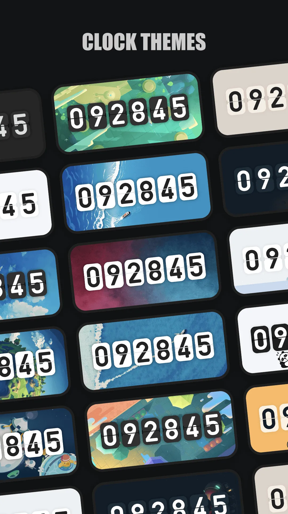

โทรศัพท์หรือแท็บเล็ตสำรองกลายเป็น **[นาฬิกาข้างเตียง](/th/glossary/what-is-a-nightstand-clock/)** ที่สมบูรณ์แบบ **แอปนาฬิกาข้างเตียงที่ดีที่สุด** ต้องหรี่แสง อ่านง่าย และสงบ — และ ideally เล่นเสียงที่กลบเสียงกรนของคู่ **Only Clock** คือ **นาฬิกาพลิกหน้าจอเต็ม** ที่เหมาะข้างเตียง ต่อไปนี้คือวิธีที่มันเปรียบเทียบกับ **Flip Clock** ฟรีสำหรับการใช้งานข้างเตียง พร้อมการตั้งค่าและเคล็ดลับ burn-in คนยังมาได้จากการค้นหา **ใช้งานโทรศัพท์เก่าเป็นนาฬิกา** หรือ **แอปนาฬิกาข้างเตียง** — ทั้งสองคือคำถามการตั้งค่าเดียวกัน

## สิ่งที่นาฬิกาข้างเตียงต้องการ

Only Clock คือแอปนาฬิกาพลิกหน้าจอเต็มสำหรับ Android และ iOS ที่เหมาะกับโทรศัพท์หรือแท็บเล็ตสำรองที่ใช้เป็นนาฬิกาข้างเตียง นาฬิกาข้างเตียงที่ดีต้องมีธีมมืดหรี่แสงได้ ทำงานกับหน้าจอเปิดตลอดขณะเสียบปลั๊ก มีไวท์นอยส์กลบเสียงรบกวน ปกป้องจอ OLED จาก burn-in และเป็นอุปกรณ์ที่เสียบแล้วลืม Only Clock ครอบคลุมทั้งหมดในการติดตั้งเดียว ขณะที่ Flip Clock ฟรีคงหน้าตาเรียบและไม่มีเสียง

- **ธีมหรี่แสง มืด** — สบายตาคล้ายง่วง
- **เป็นมิตรหน้าจอเปิดตลอด** — คงเปิดขณะเสียบปลั๊ก
- **ไวท์นอยส์** — กลบเสียงรบกวนกะทันหัน
- **ปกป้อง burn-in** — จอ OLED ต้องเลื่อนหรือหรี่แสงเพื่อไม่ให้ ghosting
- **เสียบแล้วลืม** — อุปกรณ์สำรองที่ทำหน้าที่เดียว

## สิ่งที่การตั้งค่าข้างเตียงต้องการจริงๆ

Only Clock คือแอปนาฬิกาข้างเตียงที่ผ่านการทดสอบตีสองทึกเช้า โดยมี 4 รายละเอียดปฏิบัติกำหนดว่าอุปกรณ์สำรองจะอยู่บนโต๊ะหรือไม่ ได้แก่ การไม่มีโฆษณาที่ขัดจังหวะยามหลับ ธีมหรี่แสงและมืดที่สบายตา ความปลอดภัยหน้าจอ OLED ที่ต้องเลื่อนหรือหรี่แสง เสียงโดยไม่ต้องแอปที่สอง และการให้ชีวิตที่สองกับอุปกรณ์เก่า Only Clock ครอบคลุมธีมหรี่แสง เสียง และตัวจับเวลาในการติดตั้งเดียว ส่วน Flip Clock คงหน้าตาเรียบและฟรี

- **ไม่มีการขัดจังหวะ** — **นาฬิกาข้างเตียงไม่มีโฆษณา** คือตัวกรองแรก; โฆษณาหน้าจอเต็มยามหลับทำลายแนวคิดทั้งหมด ธีมหรี่แสงและมืดสำคัญพอกับตัวเลขเอง
- **ความปลอดภัยหน้าจอ** — OLED หน้าจอเปิดตลอดต้องการจอหรี่หรือเลื่อน **แอปนาฬิกาข้างเตียง** ที่เสนอแค่หน้าขาวสว่างเดียวคือเพื่อนร่วมเตียงที่แย่
- **เสียงโดยไม่ต้องแอปที่สอง** — **นาฬิกาพลิกพร้อมไวท์นอยส์** กลบเสียงกรนคู่หรือเสียงรบกวนถนน ในขณะที่ **นาฬิกาพลิกพร้อมตัวจับเวลาโฟกัส** มีประโยชน์มากขึ้นบนอุปกรณ์เดียวกันในเวลากลางวัน
- **ชีวิตที่สองสำหรับอุปกรณ์เก่า** — **ใช้งานโทรศัพท์เก่าเป็นนาฬิกา** คือการอัปเกรดโต๊ะหรือ **นาฬิกาพลิกสำหรับโต๊ะ** ที่ถูกที่สุด; ตรวจสอบว่าแอปยังรันบน Android รุ่นเก่าก่อนอุทิศอุปกรณ์

Only Clock ครอบคลุมธีมหรี่แสง เสียง และตัวจับเวลาในการติดตั้งเดียว; Flip Clock คงหน้าตาเรียบและฟรี

## คู่แข่งแบบคร่าวๆ

สามตัวเลือกในรายชื่อแอปนาฬิกาข้างเตียงปี 2026 แตกต่างกันที่การดูแลจอและเสียง Only Clock มีแกนฟรีและ VIP ให้ธีมหรี่แสง ไวท์นอยส์ และตัวเลือกกัน burn-in แบบเลื่อนหรือหรี่แสง Flip Clock ฟรีไม่มีโฆษณาแต่ธีมพื้นฐาน ไม่มีไวท์นอยส์ และไม่ป้องกัน burn-in ส่วนวิดเจ็ตนาฬิกามินิมอลฟรีและจำกัดแค่หน้าจอหลัก ตารางด้านล่างเปรียบเทียบราคา ธีมหรี่แสง เสียง การป้องกัน burn-in และความเหมาะกับข้างเตียง

| แอป | ราคา (2026) | ธีมหรี่แสง | ไวท์นอยส์ | ปกป้อง burn-in | เหมาะสำหรับข้างเตียง |
|---|---|---|---|---|---|
| **Only Clock** | แกนฟรี + VIP | ✅ | ✅ | ✅ (เลื่อน/หรี่) | ครบจบข้างเตียง |
| **Flip Clock** | ฟรี (ไม่มีโฆษณา) | ⚠️ พื้นฐาน | ❌ | ❌ | นาฬิกาเปล่า |
| **วิดเจ็ตนาฬิกามินิมอล** | ฟรี | ❌ | ❌ | ❌ | หน้าจอหลักเหลียวเดียว |

## Only Clock ลึกๆ

Only Clock คือแอปนาฬิกาพลิกหน้าจอเต็มสำหรับ Android และ iOS ที่มีธีมมืดหรี่แสงได้ ไวท์นอยส์ และตัวเลือกกัน burn-in สำหรับจอ OLED ฉากแมวและย้อนยุคยังนุ่มนวลยามค่ำ เสียงฝนและเตาผิงช่วยให้หลับ และตัวเลือกเลื่อนนาฬิกาหรือหรี่แสงปกป้องจอเมื่อทิ้งหน้าจอเปิดตลอดขณะชาร์จ แอปยังมีวิดเจ็ตบนหน้าจอล็อกและหน้าจอหลัก VIP ปลดล็อกเสียงและธีมพรีเมียม จึงเหมาะกับอุปกรณ์สำรองที่ต้องทำมากกว่าแค่แสดงเวลา

{: width="180" .normal }
{: width="180" .normal }
{: width="180" .normal }
{: width="180" .normal }
{: width="180" .normal }

Only Clock คือ **นาฬิกาพลิกหน้าจอเต็ม** สำหรับ Android และ iOS พร้อมธีมมืด ไวท์นอยส์ และตัวเลือกกัน burn-in

**จุดแข็งสำหรับข้างเตียง**
- **ธีมมืด หรี่แสงได้** — ฉากแมวและย้อนยุคที่ยังนุ่มนวลยามค่ำ
- **ไวท์นอยส์** — ฝน เตาผิง และอื่นๆ สำหรับนอน
- **ความปลอดภัย burn-in** — ตัวเลือกเลื่อนนาฬิกา/หรี่แสงปกป้องจอ OLED
- **หน้าจอเปิดตลอดขณะชาร์จ** — โทรศัพท์สำรองเป็นนาฬิกาถาวร
- **วิดเจ็ต** — นาฬิกาบนหน้าจอล็อกหรือหน้าจอหลักด้วย

**จุดอ่อนสำหรับข้างเตียง**
- **VIP สำหรับเสียง/ธีมที่ดีที่สุด** — เสียงพรีเมียมและธีมอยู่หลังการปลดล็อก
- **แอนิเมชันใช้พลังงานมากกว่า** นาฬิกานิ่ง (ไม่เป็นไรขณะเสียบปลั๊ก)

**เหมาะสำหรับ:** อุปกรณ์สำรองที่ต้องทำมากกว่าแค่แสดงเวลา

- [Google Play — Only Clock](https://play.google.com/store/apps/details?id=com.glgjing.only.flip.clock)
- [App Store — Only Clock](https://apps.apple.com/app/id1566706513)

## Flip Clock ลึกๆ

Flip Clock (แพ็กเกจ com.wssc.simpleclock) คือแอปนาฬิกาพลิกฟรีไม่มีโฆษณาที่มาพร้อมควบคุมความสว่างและหน้าจอเปิดตลอด จึงหรี่แสงและคงเปิดได้ง่ายสำหรับใช้ข้างเตียง อย่างไรก็ตามแอปไม่มีไวท์นอยส์ต้องใช้แอปเสียงนอนแยก ไม่มีการเลื่อนกัน burn-in ที่จอ OLED นิ่งเสี่ยง ghosting ข้ามคืน และไม่มีธีมอื่นนอกจากหน้าคลาสสิก จึงเหมาะกับนาฬิกาข้างเตียงเปล่าฟรีบนเซ็ตอัพ non-OLED หรือที่จัดการความสว่างเอง

{: width="180" .normal }
{: width="180" .normal }
{: width="180" .normal }
{: width="180" .normal }
{: width="180" .normal }

Flip Clock (แพ็กเกจ `com.wssc.simpleclock`) คือ **แอปนาฬิกาพลิก** ฟรีไม่มีโฆษณาพร้อมควบคุมความสว่างและหน้าจอเปิดตลอด

**จุดแข็งสำหรับข้างเตียง**
- **ฟรีและสะอาด** — หน้าพลิกย้อนยุคเรียบง่าย ไม่มีค่าใช้จ่าย ไม่มีโฆษณา
- **ความสว่าง + หน้าจอเปิดตลอด** — หรี่ง่ายและคงเปิด

**จุดอ่อนสำหรับข้างเตียง**
- **ไม่มีไวท์นอยส์** — คุณต้องแอปเสียงนอนแยก
- **ไม่มีการเลื่อน burn-in** — หน้า OLED นิ่งเสี่ยง ghosting ข้ามคืน
- **ไม่มีธีม** — แค่หน้าคลาสสิก

**เหมาะสำหรับ:** นาฬิกาข้างเตียงเปล่าฟรีบนเซ็ตอัพ non-OLED หรือที่จัดการความสว่างเอง

- [Google Play — Flip Clock](https://play.google.com/store/apps/details?id=com.wssc.simpleclock)

## เคล็ดลับการตั้งค่าและ burn-in

การตั้งค่าอุปกรณ์สำรองเป็นนาฬิกาข้างเตียงด้วย Only Clock ทำได้ใน 3 ขั้นตอนคือ เก็บโทรศัพท์เสียบปลั๊กและลดความสว่าง เปิดตัวเลือกกัน burn-in หรือเลื่อนนาฬิกาที่แอปให้มา และใช้ไวท์นอยส์กลบเสียงรบกวนแวดล้อม สามขั้นตอนนี้ช่วยให้นาฬิกาทำงานข้ามคืนโดยไม่สว่างห้อง ไม่ทำลายจอ OLED และยังคงความสงบของห้องนอน

- เก็บโทรศัพท์ **เสียบปลั๊ก** และ **ความสว่างต่ำ**
- เปิดตัวเลือก **กัน burn-in / เลื่อนนาฬิกา** ที่แอปเสนอ
- ใช้ **ไวท์นอยส์** กลบเสียงรบกวนแวดล้อม

## คุณควรเลือกอะไร

การเลือกแอปนาฬิกาข้างเตียงขึ้นอยู่กับว่าต้องการเสียงและความปลอดภัยจอหรือความเรียบง่าย Only Clock ให้เพื่อนข้างเตียงที่สงบมีเสียง พร้อมธีมหรี่แสงและตัวเลือกกัน burn-in สำหรับ OLED ด้วยแกนฟรีและ VIP จ่ายครั้งเดียว ขณะที่ Flip Clock ให้นาฬิกาเปล่าฟรีไม่มีโฆษณาและต้องจัดการความสว่างเอง เลือก Only Clock หากใช้จอ OLED หรือต้องการไวท์นอยส์ เลือก Flip Clock หากต้องการแค่ตัวเลข

- อยาก **เพื่อนข้างเตียงที่สงบและมีเสียง** → **Only Clock**
- อยาก **นาฬิกาเปล่าฟรี** และจะจัดการความสว่างเอง → **Flip Clock**

[รับ Only Clock](/th/apps/only-clock/) — มีให้บน Android และ iOS

## สถานการณ์ทั่วไป

Only Clock ครอบคลุม 4 สถานการณ์นาฬิกาข้างเตียงได้แก่ การใช้โทรศัพท์สำรองเสียบปลั๊กข้างเตียงที่หน้าพลิกหรี่แสงแสดงเวลาโดยไม่สว่างห้อง การกลบคู่ที่กรนด้วยไวท์นอยส์ในตัว เช่น ฝนและเตาผิง การเลื่อนหรือหรี่แสงกัน burn-in เพื่อรักษาจอ OLED ตลอดคืน และการเปลี่ยนอุปกรณ์สำรองราคาถูกเป็นนาฬิกาหน้าจอเปิดตลอดที่สงบในห้องเด็กหรือห้องแขก โดยไม่มีบัญชีและไม่วุ่นวาย

- **โทรศัพท์สำรองเป็นนาฬิกาข้างเตียง** — เสียบโทรศัพท์เก่าข้างเตียง เปิด Only Clock และหน้าพลิกหรี่แสงแสดงเวลาโดยไม่สว่างห้อง
- **กลบคู่ที่กรน** — จับคู่่นาฬิกาพลิกกับไวท์นอยส์ในตัว (ฝน เตาผิง) ให้คุณหลับแม้เสียงดัง
- **OLED ไม่ ghosting** — เลื่อน/หรี่แสงกัน burn-in รักษาจอ OLED ปลอดภัยตลอดคืน
- **ห้องเด็กหรือแขก** — อุปกรณ์สำรองราคาถูกกลายเป็นนาฬิกาหน้าจอเปิดตลอดที่สงบโดยไม่มีบัญชีและไม่วุ่นวาย

## คำถามที่พบบ่อย

**Only Clock ฟรีสำหรับข้างเตียงไหม?**
{:.faq-q}
ใช่ นาฬิกาแกน ธีมหรี่แสง และไวท์นอยส์ทำงานฟรี; VIP จ่ายครั้งเดียวปลดล็อกธีมและชุดเสียงที่หลากหลายที่สุด

**Only Clock ปกป้อง OLED จาก burn-in ไหม?**
{:.faq-q}
ใช่ เสนอตัวเลือกเลื่อนนาฬิกากัน burn-in และหรี่แสงให้จอ OLED ไม่ ghosting เมื่อทิ้งหน้าจอเปิดตลอดข้ามคืน

**Only Clock หรือ Flip Clock สำหรับข้างเตียง?**
{:.faq-q}
อยากนาฬิกาข้างเตียงหรี่แสงมีเสียงพร้อมความปลอดภัย burn-in → Only Clock; อยากนาฬิกาเปล่าฟรีและจะจัดการความสว่างเอง → Flip Clock

## ศัพท์ที่เกี่ยวข้อง

- [นาฬิกาพลิกคืออะไร?](/th/glossary/what-is-a-flip-clock/)
- [นาฬิกาข้างเตียงคืออะไร?](/th/glossary/what-is-a-nightstand-clock/)
