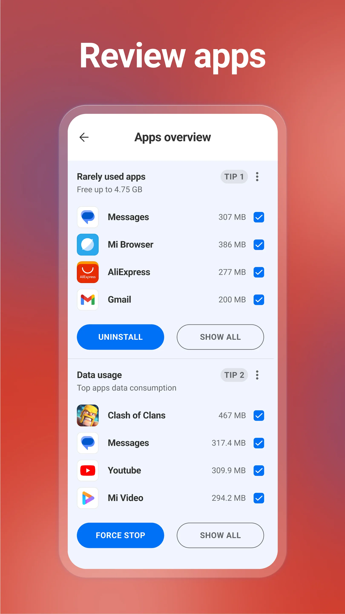

เมื่อเกมกระตุกหรือแอปโหลดใหม่ ผู้ต้องสงสัยหลักคือ **RAM** — แต่ "หน่วยความจำต่ำ" คลุมเครือจนกว่าคุณจะเห็นมัน แอป [เครื่องมือข้อมูล RAM](/th/glossary/what-is-a-ram-booster/) แสดงว่าอะไรกันที่ใช้หน่วยความจำและเหลือเท่าไหร่ เพื่อคุณเข้าใจปัญหาแทนการแตะปุ่ม "boost" ไปมืดบอด **System Monitor** คือ **เครื่องมือข้อมูลฮาร์ดแวร์จ่ายครั้งเดียวสำหรับ Android** ที่ตรวจจับหน่วยความจำ CPU พื้นที่จัดเก็บ และข้อมูลแบตเตอรี่แบบละเอียด ด้านล่างนี้เราเปรียบเทียบกับ **CCleaner** ที่ลบแคชจริงๆ เพื่อเข้าใจหน่วยความจำโทรศัพท์คุณ ผู้อ่านที่เปรียบเทียบ **RAM booster หนึ่งแตะ** กับตัวตรวจสอบอ่านอย่างเดียว จะพบความต่างที่ส่วนท้าย

## สิ่งที่เครื่องมือข้อมูล RAM ต้องมี

System Monitor คือเครื่องมือข้อมูลฮาร์ดแวร์จ่ายครั้งเดียวสำหรับ Android ที่ตรวจจับหน่วยความจำ CPU พื้นที่จัดเก็บ และแบตเตอรี่แบบละเอียดและอ่านอย่างเดียว เครื่องมือข้อมูล RAM ที่ดีต้องบอกหน่วยความจำรวมและที่ใช้ มีรายการกระบวนการให้เห็นว่าใครจอง RAM ติดตามการเปลี่ยนแปลงแบบเรียลไทม์ มีบริบทพื้นที่จัดเก็บ และเบาพอที่ตัวเองไม่กิน RAM System Monitor ทำตามเกณฑ์เหล่านี้โดยรายงานตัวเลข ไม่เคลียร์หรือ boost หน่วยความจำ

- **หน่วยความจำรวมและที่ใช้** — รวม ใช้ไป ว่าง และรายละเอียดต่อแอป
- **รายการกระบวนการ** — ดูว่าอะไรจองหน่วยความจำ
- **การตรวจสอบเรียลไทม์** — เฝ้าดูหน่วยความจำขยับขณะคุณเปิดแอป
- **บริบทพื้นที่จัดเก็บ** — ดูว่าอะไรเติมเต็มอุปกรณ์
- **เบา** — ตัวเองไม่ควรกิน RAM

## สิ่งที่ค่าอ่าน RAM บอกได้และไม่ได้

System Monitor คือเครื่องมือข้อมูลฮาร์ดแวร์จ่ายครั้งเดียวสำหรับ Android ที่ชี้ว่าค่าอ่าน RAM บอกอะไรได้และไม่ได้ มี 4 สิ่งที่ควรรู้ก่อนเชื่อ RAM booster หนึ่งแตะ ได้แก่ RAM ว่างไม่ใช่ RAM ที่สิ้นเปลืองเพราะ Android จงใจเก็บแอปไว้เปิดทันที รายการกระบวนการต้องบอกว่าตัวไหนจองหน่วยความจำจริง พื้นที่จัดเก็บเป็นอุปสรรคอีกแบบที่ตัวเลข RAM ไม่แสดง และเส้นโค้งแบตเตอรี่กับความร้อนช่วยแยก throttling ออกจากปัญหาหน่วยความจำ System Monitor วางค่าอ่านเหล่านี้ไว้ข้างกัน ส่วน CCleaner ลงมือกับไฟล์

- **RAM ว่างไม่ใช่ RAM ที่สิ้นเปลือง** — Android จงใจเก็บแอปที่ใช้แล้วไว้ในหน่วยความจำเพื่อเปิดทันที ตัวเลขที่ใช้ไปสูงเป็นเรื่องปกติ; ตัวเลขที่ควรเฝ้าระวังคือแอปโหลดใหม่กลางเซสชันหรือไม่
- **รายละเอียดต่อแอปและกระบวนการ** — การเปรียบเทียบ **RAM booster android ที่ดีที่สุด** ควรแสดงว่ากระบวนการไหนกันที่จองหน่วยความจำจริงๆ ไม่ใช่แค่แถบเปอร์เซ็นต์
- **พื้นที่จัดเก็บเป็นอุปสรรคต่างกัน** — **ตัวทำความสะอาดพื้นที่จัดเก็บไฟล์ junk android** ว่าด้วยแคชและเศษบนดิสก์; พื้นที่จัดเก็บต่ำอาจชะลอโทรศัพท์ในวิธีที่ตัวเลข RAM ไม่แสดง
- **เส้นโค้งแบตเตอรี่และความร้อน** — **ตัวตรวจสอบแบตเตอรี่พร้อมเส้นโค้งอุณหภูมิ** ช่วยแยก throttling ความร้อนออกจากปัญหาหน่วยความจำ นั่นคือเหตุผลที่ System Monitor วางค่าอ่านนั้นข้างการแสดง RAM

CCleaner ลงมือกับไฟล์; System Monitor รายงานตัวเลข รวมโอเวอร์เลย์ **System Monitor หน้าต่างลอย Android** ที่ปล่อยทิ้งไว้ขณะทดสอบได้ ไม่มีตัวไหนทำโทรศัพท์เร็วขึ้นด้วยการฆ่ากระบวนการ — นั่นคือเส้นแบ่งสุจริตของหมวดนี้

## คู่แข่งแบบคร่าวๆ

สามตัวเลือกในรายชื่อ ram booster android ที่ดีที่สุดปี 2026 แตกต่างกันที่การกระทำ System Monitor เป็นแอปจ่ายครั้งเดียวที่ให้ข้อมูล RAM ละเอียดและรายการกระบวนการแบบอ่านอย่างเดียว CCleaner ฟรีและมีสมาชิก Pro ที่ลบแคชและพื้นที่จัดเก็บจริง ส่วน DevCheck ฟรีและมี IAP ที่ให้มุมมองสเปก ตารางด้านล่างเปรียบเทียบราคา ข้อมูล RAM รายการกระบวนการ และการกระทำปลดหรือทำความสะอาด

| แอป | ราคา (2026) | ข้อมูล RAM | รายการกระบวนการ | การกระทำ (ปลด/ทำความสะอาด) | เหมาะสำหรับ |
|---|---|---|---|---|---|
| **System Monitor** | จ่ายครั้งเดียว | ✅ รายละเอียด | ✅ | ❌ แค่ข้อมูล | เข้าใจหน่วยความจำ |
| **CCleaner** | ฟรี + สมาชิก Pro | ⚠️ พื้นฐาน | ⚠️ จำกัด | ✅ | ทำความสะอาดแคช/พื้นที่จัดเก็บ |
| **DevCheck** | ฟรี + IAP | ✅ รายละเอียด | ✅ | ❌ | มุมมองสเปก |

## System Monitor ลึกๆ

System Monitor คือเครื่องมือข้อมูลฮาร์ดแวร์ Android จ่ายครั้งเดียวที่ตรวจจับหน่วยความจำละเอียดแบบอ่านอย่างเดียว ด้วยราคาดาวน์โหลดครั้งเดียวและไม่มี upsell แอปแสดง RAM รวม ใช้ไป ว่าง และการใช้ต่อแอป พร้อมอัปเดตเรียลไทม์ขณะสลับงานและรายการกระบวนการที่บอกว่าแอปไหนจองหน่วยความจำ จุดแข็งคือเบาและในเครื่องไม่มีบัญชีหรือคลาวด์ จุดอ่อนคือไม่เคลียร์หน่วยความจำ ไม่ฆ่าทาสก์ และไม่มีเทียร์ฟรี จึงเหมาะกับผู้ที่อยากเข้าใจการใช้ RAM อย่างละเอียด ไม่ใช่แค่แตะปุ่ม boost

{: width="180" .normal }
{: width="180" .normal }
{: width="180" .normal }
{: width="180" .normal }
{: width="180" .normal }

System Monitor คือ **เครื่องมือข้อมูลฮาร์ดแวร์ Android จ่ายครั้งเดียว** ด้วยราคาดาวน์โหลดครั้งเดียว มันตรวจจับฮาร์ดแวร์ละเอียด รวมหน่วยความจำ: RAM รวม/ใช้ไป/ว่าง และการใช้ต่อแอป พร้อมอัปเดตเรียลไทม์ขณะคุณสลับงาน มันรายงาน — ไม่เคลียร์หรือ boost หน่วยความจำ

**จุดแข็งสำหรับเข้าใจ RAM**
- **ข้อมูลหน่วยความจำละเอียด** — รวม ใช้ไป ว่าง และ RAM ต่อแอป ไม่ใช่แค่แถบเดียว
- **รายการกระบวนการ** — ดูแอปไหนจองหน่วยความจำและตัดสินใจเองว่าจะปิดตัวไหน
- **การตรวจสอบเรียลไทม์** — เฝ้าดูหน่วยความจำก่อนและหลังเปิดแอป
- **เบาและในเครื่อง** — ไม่มีบัญชี ไม่มีคลาวด์ ภาระต่ำ
- **จ่ายครั้งเดียว โดยไม่มี upsell** — ชุดฟีเจอร์เต็มด้วยราคาครั้งเดียว

**จุดอ่อนสำหรับเข้าใจ RAM**
- **ไม่เคลียร์หน่วยความจำ** — มันแสดงข้อมูล; ไม่ฆ่าทาสก์หรือยึด RAM มาให้คุณ (Android จัดการเรื่องนั้นอยู่แล้ว)
- **อ่านอย่างเดียว** — ได้ข้อมูล ไม่ใช่การกระทำ; คุณปิดแอปด้วยมือ
- **จ่ายล่วงหน้า** — ไม่มีเทียร์ฟรี

**เหมาะสำหรับ:** ผู้ใช้ที่อยากเข้าใจการใช้หน่วยความจำอย่างละเอียด ไม่ใช่แค่แตะปุ่ม boost

- [Google Play — System Monitor](https://play.google.com/store/apps/details?id=com.glgjing.marvel)

## CCleaner ลึกๆ

CCleaner (แพ็กเกจ com.piriform.ccleaner จาก Gen Digital) คือแอปที่โฟกัสการทำความสะอาดแคช ไฟล์ temp และไฟล์ซ้ำบน Android จุดแข็งคือเอาพื้นที่จัดเก็บคืนได้จริง หาไฟล์ซ้ำ และมีเครื่องมือหนึ่งแตะสำหรับการทำความสะอาดด่วน แต่ผลต่อ RAM น้อยเพราะ Android ยึดหน่วยความจำอัตโนมัติ มุมมองกระบวนการจำกัด และต้องสมาชิกสำหรับ Pro จึงเหมาะกับผู้ใช้ที่อยากเอาพื้นที่จัดเก็บคืนเป็นหลัก ไม่ใช่แค่ดูสถิต RAM

{: width="180" .normal }
{: width="180" .normal }
{: width="180" .normal }
{: width="180" .normal }
{: width="180" .normal }

CCleaner (แพ็กเกจ `com.piriform.ccleaner` จาก Gen Digital) โฟกัสการทำความสะอาด — แคช ไฟล์ temp และไฟล์ซ้ำ

**จุดแข็งสำหรับ RAM/พื้นที่จัดเก็บ**
- **ทำความสะอาดพื้นที่จัดเก็บ** — ลบแคชและ junk ที่กินพื้นที่จริง
- **หาไฟล์ซ้ำ** — เอาพื้นที่จัดเก็บคืนจากการทำซ้ำ
- **เครื่องมือหนึ่งแตะ** — การทำความสะอาดด่วน

**จุดอ่อนสำหรับ RAM/พื้นที่จัดเก็บ**
- **ผลต่อ RAM น้อย** — Android ยึดหน่วยความจำอัตโนมัติ ดังนั้น boost จึงอยู่ไม่นาน
- **มุมมองกระบวนการจำกัด** — มันทำความสะอาดมากกว่าอธิบาย
- **สมาชิก** — Pro ต้องแพ็กเกจจ่าย
- **ประวัติความเป็นส่วนตัว** — เคยถูกตรวจสอบเรื่องแนวปฏิบัติข้อมูล

**เหมาะสำหรับ:** ผู้ใช้ที่อยากเอาพื้นที่จัดเก็บคืนเป็นหลัก ไม่ใช่แค่ดูสถิต RAM

- [Google Play — CCleaner](https://play.google.com/store/apps/details?id=com.piriform.ccleaner)

## อันอื่นเปรียบเทียบอย่างไร

DevCheck คือคู่ตรวจสอบที่มีสเปกเจาะลึกและรายการกระบวนการ ฟรีพร้อม IAP เป็นทางเลือกนอกเหนือจาก System Monitor และ CCleaner ในรายชื่อนี้ แตกต่างจาก System Monitor ตรงที่เน้นมุมมองสเปกฮาร์ดแวร์ แต่เหมือนกันที่เป็นตัวตรวจสอบอ่านอย่างเดียวไม่มีการกระทำทำความสะอาด ผู้ที่อยากเจาะสเปกอาจเลือก DevCheck ส่วนผู้ที่อยากเข้าใจ RAM รวม ใช้ไป ว่าง และต่อแอปเลือก System Monitor

- **DevCheck** คือคู่ตรวจสอบที่มีสเปกเจาะลึกและรายการกระบวนการ แต่ไม่มีการกระทำทำความสะอาด

## คุณควรเลือกอะไร

การเลือกแอป RAM ขึ้นอยู่กับว่าอยากเข้าใจตัวเลขหรือเอาพื้นที่คืน System Monitor เป็นแอปจ่ายครั้งเดียวที่ให้ข้อมูล RAM และฮาร์ดแวร์อ่านอย่างเดียวละเอียด รวม RAM รวม ใช้ไป ว่าง และต่อแอปโดยไม่เคลียร์หรือฆ่าทาสก์ ขณะที่ CCleaner เป็นตัวทำความสะอาดแคชและพื้นที่จัดเก็บหนึ่งแตะที่มีสมาชิก เลือก System Monitor หากต้องการรู้ว่าใครกินหน่วยความจำ เลือก CCleaner หากต้องการคืนพื้นที่จัดเก็บจริง

- อยาก **ข้อมูล RAM และฮาร์ดแวร์อ่านอย่างเดียวละเอียด** → **System Monitor**
- อยาก **ทำความสะอาดแคช/พื้นที่จัดเก็บ** → **CCleaner**

[รับ System Monitor](/th/apps/system-monitor/) — มีให้บน Android

## สถานการณ์ทั่วไป

System Monitor ครอบคลุม 5 สถานการณ์เข้าใจหน่วยความจำได้แก่ การจับสาเหตุกระตุกด้วยมุมมอง RAM ก่อนและหลังเปิดเกมแทนการแตะ boost มืดบอด การตามล่าแก็งกินหน่วยความจำผ่านรายการกระบวนการที่บอกว่าแอปไหนจอง RAM มากสุด การเฝ้าดู RAM รวม ใช้ไป ว่างขณะสลับงาน การจับคู่กับพื้นที่จัดเก็บเพื่อดูว่าใครเติมเต็มอุปกรณ์ และการรักษาความเป็นส่วนตัวด้วยค่าอ่านในเครื่องไม่มีบัญชีหรืออัปโหลดคลาวด์

- **จับสาเหตุกระตุก** — เปิดมุมมอง RAM ก่อนและหลังเปิดเกมเพื่อดูแอปไหนกันที่ดูดหน่วยความจำ แทนการแตะ boost มืดบอด
- **ตามล่าแก็งกินหน่วยความจำ** — รายการกระบวนการแสดงแอปไหนจอง RAM มากสุด เพื่อคุณปิดด้วยตนเอง
- **เฝ้าดูเรียลไทม์** — ดู RAM รวม/ใช้ไป/ว่างขยับจริงขณะคุณสลับงาน
- **จับคู่กับพื้นที่จัดเก็บ** — ดูว่าอะไรเติมเต็มอุปกรณ์ ไม่ใช่แค่แถบหน่วยความจำ
- **เป็นส่วนตัวก่อน** — ค่าอ่านทั้งหมดในเครื่อง ไม่มีบัญชี ไม่มีอัปโหลดคลาวด์

## คำถามที่พบบ่อย

**System Monitor ฟรีไหม?**
{:.faq-q}
ไม่ มันดาวน์โหลดจ่ายครั้งเดียว — ไม่มีสมาชิก ไม่มีกำแพงอัปเกรด

**System Monitor หรือ CCleaner สำหรับ RAM?**
{:.faq-q}
อยากข้อมูล RAM และฮาร์ดแวร์อ่านอย่างเดียวละเอียด → System Monitor; อยากตัวทำความสะอาดแคช/พื้นที่จัดเก็บหนึ่งแตะ → CCleaner หมายเหตุ: Android ยึดหน่วยความจำอัตโนมัติอยู่แล้ว ดังนั้น "boost" มักอยู่ไม่นาน

**System Monitor เคลียร์หน่วยความจำหรือฆ่าทาสก์ไหม?**
{:.faq-q}
ไม่ มันรายงานข้อเท็จจริงหน่วยความจำ (รวม/ใช้ไป/ว่าง และการใช้ต่อแอป) และไม่เคยเคลียร์ RAM หรือฆ่าทาสก์ — คุณปิดแอปด้วยมือ

**System Monitor แสดงรายการกระบวนการไหม?**
{:.faq-q}
ใช่ มันแสดงแอปที่ทำงานและการใช้หน่วยความจำของพวกเขา เพื่อคุณเห็นว่าอะไรจอง RAM

## ศัพท์ที่เกี่ยวข้อง

- [ตัวตรวจสอบอุณหภูมิ CPU คืออะไร?](/th/glossary/what-is-a-cpu-temperature-monitor/)
- [ตัวตรวจสอบระบบคืออะไร?](/th/glossary/what-is-a-system-monitor/)
- [ตัวเร่ง RAM คืออะไร?](/th/glossary/what-is-a-ram-booster/)
