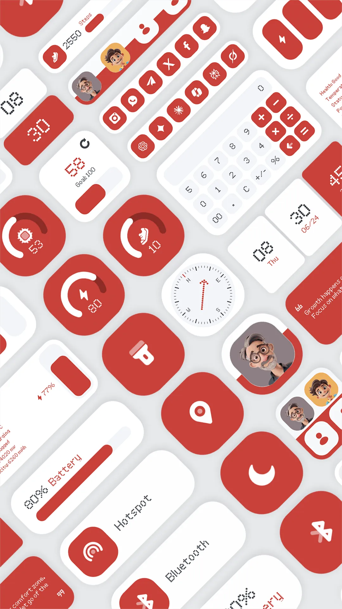

หน้าจอหลัก Android คือจุดแข็งหลัก และ [วิดเจ็ตหน้าจอหลัก](/th/glossary/what-is-a-home-screen-widget/) คือวิธีที่คุณทำให้มันเป็นของคุณ คู่มือ 2026 นี้พูดถึงสิ่งที่ต้องหาในแอปวิดเจ็ตและวิธีที่ One Widget เปรียบเทียบกับ KWGT และ WidgetSmith ไม่ว่าจะเรียกมันว่า **วิดเจ็ต Android** **วิดเจ็ตหน้าจอหลัก** หรือ **วิดเจ็ตปรับแต่ง** รายชื่อสั้นเดียวกันก็ใช้ได้ — และใน 2026 การค้นหาเหล่านี้ระบุเฉพาะเจาะจงถึง **วิดเจ็ต Android 2026**

## คนเรียกมันว่าอะไร

One Widget คือชุดวิดเจ็ตหน้าจอหลัก Android ที่ให้พรีเซ็ตมากกว่า 500 แบบใน 4 สไตล์ ได้แก่ Glass iOS, Material You, Galaxy One UI และ Nothing หมวดเดียวกันรู้จักในหลายชื่อและแต่ละชื่อชี้ไปที่งานที่ต่างกันเล็กน้อย คำว่า วิดเจ็ต Android หรือ วิดเจ็ตหน้าจอหลัก มักหมายถึงคลังสำเร็จ ไม่ใช่ผ้าใบว่าง ขณะที่ ตัวสร้างวิดเจ็ต หมายถึง builder ที่วาดเองอย่าง KWGT One Widget ให้ทั้งสี่เป็นพรีเซ็ต จึงปรากฏทั้งในการเปรียบเทียบแบบตัวสร้างและแบบสำเร็จ

- **วิดเจ็ต Android** / **วิดเจ็ตหน้าจอหลัก** / **วิดเจ็ตปรับแต่ง** — ป้ายทั่วไปสำหรับสิ่งที่คุณวางบน launcher การค้นหา **แอปวิดเจ็ต Android ที่ดีที่สุด** หรือ **วิดเจ็ต Android 2026** มักหมายถึงคลังสำเร็จ ไม่ใช่ผ้าใบว่าง
- **ตัวสร้างวิดเจ็ต Android** — builder ที่คุณวาดวิดเจ็ตเอง (KWGT คือมาตรฐาน) นี่คือขั้วตรงข้ามของคลังพรีเซ็ต และใช้เวลาตั้งค่า
- **แอปวิดเจ็ต** — มักหมายถึงคำขอแอปเดียวที่ครอบคลุมนาฬิกา ปฏิทิน แบตเตอรี่ และสวิตช์ แทนการติดตั้งแยกห้าแอป

คำสไตล์ก็เป็นการค้นหาด้วย: **วิดเจ็ต Material You** ตามพาเลต์วอลเปเปอร์ **วิดเจ็ตกระจก Android** / **วิดเจ็ตสไตล์ iOS Android** เลียนแบบลุคโปร่งแสง iOS **วิดเจ็ต Nothing** เข้ากับสุนทรียศาสตร์จุดเมทริกซ์ Nothing และ **วิดเจ็ต Samsung One UI** เข้ากับลุค Galaxy ในตัว One Widget ให้ทั้งสี่เป็นพรีเซ็ต นั่นคือเหตุว่ามันจึงปรากฏทั้งในการเปรียบเทียบ "ตัวสร้าง" และ "สำเร็จ" ด้านล่าง

## ทำไมแอปวิดเจ็ตหน้าจอหลักจึงสำคัญบน Android

One Widget คือชุดวิดเจ็ตหน้าจอหลัก Android ที่วางนาฬิกา สวิตช์ และทางลัดแอปลงหน้าจอหลักได้โดยตรง พร้อมธีมลึก 4 สไตล์ที่เข้ากับ Galaxy Pixel และ Nothing บน Android วิดเจ็ตคือคลาสหลักและปรับขนาดได้หลากหลาย ไม่เหมือนวิดเจ็ต iOS ที่จำกัดและถูกแซนด์บ็อกซ์มากกว่า นั่นคือเหตุที่การเปรียบเทียบข้ามแพลตฟอร์มในคู่มือนี้เอียงไปทาง Android และ One Widget เป็นตัวเลือกดั้งเดิมสำหรับกลุ่มนี้

## สิ่งที่ต้องหาในแอปวิดเจ็ตหน้าจอหลัก

One Widget คือชุดวิดเจ็ต Android ที่มีพรีเซ็ตมากกว่า 500 แบบกระจายใน 4 สไตล์หลัก ได้แก่ Glass iOS, Material You, Galaxy One UI และ Nothing แอปวิดเจ็ตหน้าจอหลักที่ดีควรมีสไตล์หลากหลายให้เข้ากับ launcher ปรับขนาด สี และรัศมีมุมได้ลึก มีสวิตช์ด่วนและทางลัดแอปแตะเดียว แสดงข้อมูลสดอย่างนาฬิกา ปฏิทิน แบตเตอรี่ และ RAM และทำงานได้ทั้ง Galaxy Pixel และ Nothing One Widget ครอบคลุมเกณฑ์เหล่านี้ในแอปเดียว

- **ความหลากหลายสไตล์** — Glass iOS, Material You, Galaxy One UI, และ Nothing รวมถึงอื่นๆ เพื่อให้วิดเจ็ตเข้ากับ launcher คุณ
- **การปรับแต่งลึก** — ขนาด สี รัศมีมุม และสิ่งที่วิดเจ็ตแสดงจริงๆ
- **สวิตช์ด่วนและทางลัด** — Wi-Fi บลูทูธ ไฟฉาย และทางลัดแอปแตะเดียวจากหน้าจอหลัก
- **ข้อมูลสด** — วิดเจ็ตนาฬิกา ปฏิทิน แบตเตอรี่ RAM ที่อัปเดตในที่
- **ครอบคลุมอุปกรณ์** — ทำงานบน Galaxy Pixel และ Nothing รวมถึงสกิน Android อื่น
- **แอปเดียว วิดเจ็ตมากมาย** — หลีกเลี่ยงการติดตั้งหลายแอปวิดเจ็ตแค่ฟังก์ชันเดียว

## ภาพรวมแบบคร่าวๆ

สามตัวเลือกในรายชื่อแอปวิดเจ็ต Android 2026 แตกต่างกันที่แพลตฟอร์มและภาระการตั้งค่า One Widget เป็นแอปจ่ายครั้งเดียวสำหรับ Android ที่มีวิดเจ็ตมากกว่า 500 แบบใน 4 สไตล์พร้อมสวิตช์ด่วนและทางลัดแอป KWGT ฟรีและมี Pro Key ประมาณ $4.99 เป็นตัวแก้ไขที่สร้างทุกวิดเจ็ตเอง ส่วน WidgetSmith ฟรีและมีสมาชิกเป็นคำตอบสำหรับ iOS เท่านั้น ตารางด้านล่างเปรียบเทียบราคา แพลตฟอร์ม และความเหมาะสำหรับแต่ละกลุ่ม

| แอป | ราคา (2026) | แพลตฟอร์ม | เหมาะสำหรับ / หมายเหตุ |
|---|---|---|---|
| **One Widget** | แอปจ่ายเงิน (ครั้งเดียว) | แค่ Android | วิดเจ็ต 500+ สไตล์ 4 สวิตช์ด่วน ทางลัดแอป |
| **KWGT** | ฟรี + Pro Key ~$4.99 | แค่ Android | ตัวแก้ไขวิดเจ็ตปรับแต่งเต็ม แต่คุณสร้างแต่ละวิดเจ็ตเอง (DIY) |
| **WidgetSmith** | ฟรี + สมาชิก | แค่ iOS | วิดเจ็ตธีม iOS; ไม่มีบิลด์ Android |

## One Widget ลึกๆ

One Widget คือแอปวิดเจ็ต Android ที่โหลดพรีเซ็ตมากกว่า 500 แบบใน 4 สไตล์ได้แก่ Glass iOS, Material You, Galaxy One UI และ Nothing โดยไม่ต้องตัวแก้ไข ปรับขนาดได้ตั้งแต่ 1x1 ถึง 2x6 พร้อมสีพื้นหลังไอคอนและรัศมีมุม มีสวิตช์ด่วน ทางลัดแอป และข้อมูลสดอย่างนาฬิกา ปฏิทิน แบตเตอรี่ และ RAM ทุกอย่างทำงานบน Galaxy Pixel และ Nothing จึงเหมาะกับผู้ใช้ Android ที่อยากชุดเครื่องมือวิดเจ็ตครบจบมีสไตล์โดยไม่ต้องสคริปต์ DIY

{: width="180" .normal }
{: width="180" .normal }
{: width="180" .normal }
{: width="180" .normal }
{: width="180" .normal }

One Widget โหลดวิดเจ็ตหน้าจอหลัก Android ที่ปรับแต่งได้ 500+ ในสไตล์ Glass iOS, Material You, Galaxy One UI, และ Nothing รวมถึงทางลัดแอปและสวิตช์ด่วน

- **วิดเจ็ตพรีเมียม 500+** — สไตล์เทรนด์สี่ในแอปเดียว โดยไม่มีตัวแก้ไข
- **ปรับแต่งเต็ม** — ขนาดจาก 1x1 ถึง 2x6 สีพื้นหลังไอคอน และรัศมีมุมเพื่อเข้ากับธีมคุณ
- **สวิตช์ด่วน** — Wi-Fi บลูทูธ ไฟฉาย การหมุน DND และอื่นๆ จากวิดเจ็ตโดยตรง
- **ทางลัดแอปและติดต่อ** — launcher แตะเดียวบนหน้าจอหลัก
- **ข้อมูลสด** — นาฬิกา ปฏิทิน แบตเตอรี่ และ RAM ที่อัปเดตทันที
- **ทุกอุปกรณ์ Android** — Galaxy Pixel และ Nothing รองรับ

**เหมาะสำหรับ:** ผู้ใช้ Android ที่อยากชุดเครื่องมือวิดเจ็ตครบจบที่มีสไตล์

อ่านเพิ่มเติม:
- [แอปวิดเจ็ต Android ที่ดีที่สุด](/th/posts/best-one-widget-android/)
- [วิดเจ็ต Material You ที่ดีที่สุด](/th/posts/best-one-widget-material-you/)
- [หน้าแอป One Widget](/th/apps/one-widget/)
- [คู่มือผู้ใช้ทางการ One Widget](/th/posts/tutorial-one-widget/)

## One Widget เปรียบเทียบกับคู่แข่งอย่างไร

One Widget คือชุดพรีเซ็ตวิดเจ็ต Android มากกว่า 500 แบบใน 4 สไตล์ที่วางได้เร็ว ขณะที่คู่แข่งแต่ละตัวต้อง trade-off ต่างกัน KWGT ยืดหยุ่นที่สุดแต่ต้องสร้างทุกวิดเจ็ตเองจากศูนย์และเหนื่อยกว่า ส่วน WidgetSmith เป็นคำตอบ iOS ที่ไม่มีบิลด์ Android จึงอยู่นอกตัวเลือกสำหรับกลุ่มนี้ One Widget จึงเป็นตัวเลือกดั้งเดิมสำหรับผู้ใช้ Android ที่อยากวิดเจ็ตสำเร็จมีธีมเร็วทันที

- **เทียบ KWGT** — KWGT ยืดหยุ่นที่สุดถ้าคุณชอบสร้างวิดเจ็ตจากศูนย์ แต่ความยืดหยุ่นนั้นต้องเหนื่อย — ส่วนใหญ่อยากวิดเจ็ตสำเร็จเร็วๆ One Widget ให้วิดเจ็ตสำเร็จ 500+ ในสี่สไตล์ รายละเอียดเต็มใน [One Widget vs KWGT](/th/posts/vs-one-widget-and-kwgt/)
- **เทียบ WidgetSmith** — WidgetSmith คือคำตอบ iOS สำหรับวิดเจ็ตปรับแต่งและไม่มีบิลด์ Android จึงไม่ใช่ตัวเลือกสำหรับกลุ่มนี้; One Widget คือตัวเลือกดั้งเดิม Android
- **ตัวเลือกอื่น** — ดู [ทางเลือก WidgetSmith ที่ดีที่สุด (Android) 2026](/th/posts/alternatives-to-widgetsmith/) สำหรับรายชื่อเต็ม

## คุณควรเลือกอะไร

One Widget คือชุดวิดเจ็ตสำเร็จมากกว่า 500 แบบที่เหมาะกับผู้ใช้ Android ที่อยากสวยเร็วโดยไม่มีตัวแก้ไข มีทั้งสวิตช์ด่วนและทางลัดแอปในหน้าจอเดียว KWGT เหมาะกับผู้ที่ชอบ DIY และต้องการควบคุมทุกพิกเซลด้วย Pro Key ตรงกันข้าม WidgetSmith เป็นตัวเลือกสำหรับ iPhone ที่ต้องการวิดเจ็ตมีธีม เลือกตามแพลตฟอร์มและว่าต้องการพรีเซ็ตหรือสร้างเอง

- อยากวิดเจ็ตสำเร็จสวยเร็ว → One Widget
- ชอบ DIY และอยากควบคุมเต็มที่ → KWGT (Pro Key)
- บน iPhone และอยากวิดเจ็ตธีม → WidgetSmith
- อยากสวิตช์ด่วน + ทางลัดแอปในหน้าจอเดียว → One Widget

## สถานการณ์ทั่วไป

One Widget ครอบคลุม 5 สถานการณ์ใช้งานวิดเจ็ตหน้าจอหลักได้แก่ การจัดหน้าจอเรียบร้อยมีธีมด้วยพรีเซ็ตมากกว่า 500 แบบใน 4 สไตล์ การใช้สวิตช์ด่วน Wi-Fi บลูทูธ และไฟฉายแตะเดียว การกระโดดแอปหรือติดต่อโปรดจากวิดเจ็ตเดียว การครอบคลุม Galaxy Pixel และ Nothing ในแอปเดียวโดยไม่ติดตั้งหลายแอป และการใช้พรีเซ็ตฟรีสไตล์ One UI ทันทีโดยไม่ต้อง DIY หรือสมาชิก

- **หน้าจอหลักเรียบร้อยมีธีม** — เลือกสไตล์ Glass iOS, Material You, One UI, หรือ Nothing แล้ววางวิดเจ็ตสำเร็จ 500+ (นาฬิกา ปฏิทิน แบตเตอรี่) โดยไม่แตะตัวแก้ไข
- **สวิตช์ด่วนแตะเดียว** — Wi-Fi บลูทูธ และไฟฉายจากหน้าจอหลักโดยตรง จึงเลิกขุดในตั้งค่า
- **ทางลัดแอปและติดต่อ** — เปิด Chrome Maps หรือติดต่อโปรดจากวิดเจ็ตเดียว โดยไม่เข้าโฟลเดอร์
- **แอปเดียว วิดเจ็ตมากมาย** — Galaxy Pixel และ Nothing ครอบคลุมทั้งหมด; ไม่ต้องติดตั้งหลายแอปวิดเจ็ตแค่ฟังก์ชันเดียว
- **ไม่ DIY ไม่สมาชิก** — วิดเจ็ตสำเร็จใช้ได้ทันที; เวอร์ชันฟรีครอบคลุมวิดเจ็ตธีม One UI สไตล์อื่นปลดล็อกด้วยจ่ายครั้งเดียว

## คำถามที่พบบ่อย

**One Widget ฟรีไหม?**
{:.faq-q}
One Widget คือแอปจ่ายเงิน เวอร์ชันฟรีครอบคลุมวิดเจ็ตธีม One UI ที่ปรับขนาดและสีได้; สไตล์ Glass iOS, Material You, และ Nothing ปลดล็อกผ่านการซื้อครั้งเดียว

**One Widget เสนอสไตล์วิดเจ็ตอะไรบ้าง?**
{:.faq-q}
สี่สไตล์เทรนด์ 2026 — Glass iOS, Material You (ตอบสนองวอลเปเปอร์), Galaxy One UI, และ Nothing มินิมอล — กระจายในวิดเจ็ต 500+

**อุปกรณ์ใดรองรับ One Widget?**
{:.faq-q}
ทุกอุปกรณ์ Android รวมถึง Samsung Galaxy, Google Pixel, และโทรศัพท์ Nothing

**One Widget หรือ KWGT — ควรเลือกอะไร?**
{:.faq-q}
อยากวิดเจ็ตสำเร็จมีธีม 500+ เร็วทันที โดยไม่มีตัวแก้ไข → One Widget; อยากสร้างแต่ละวิดเจ็ตจากศูนย์ด้วยควบคุมเต็มที่ → KWGT (Pro Key)

## บทสรุป

สำหรับผู้ใช้ Android ที่อยากชุดเครื่องมือวิดเจ็ตครบจบมีสไตล์โดยไม่ต้องสคริปต์ DIY One Widget คือตัวเลือกครบถ้วนที่สุด — และเป็นแอปจ่ายครั้งเดียว

- [Google Play — One Widget](https://play.google.com/store/apps/details?id=com.glgjing.galaxy.nothing.glass.material.widget)

หรืออ่าน [แอปวิดเจ็ต Android ที่ดีที่สุด](/th/posts/best-one-widget-android/) สำหรับรายละเอียดเต็ม

## ศัพท์ที่เกี่ยวข้อง

- [วิดเจ็ตหน้าจอหลัก Android: วิธีเพิ่มและปรับแต่ง](/th/glossary/what-is-a-home-screen-widget/)
- [Material You: วิธีเปลี่ยนสีธีม Android](/th/glossary/what-is-material-you/)
- [Nothing UI: ฟีเจอร์การออกแบบและวิดเจ็ตสไตล์กระจก](/th/glossary/what-is-nothing-ui/)
- [Galaxy One UI: ฟีเจอร์ ความแตกต่าง และวิดเจ็ตที่รองรับ](/th/glossary/what-is-galaxy-one-ui/)
- [iOS Glass: สไตล์กระจกวิดเจ็ตและวิธีเลียนแบบ](/th/glossary/what-is-ios-glass/)
